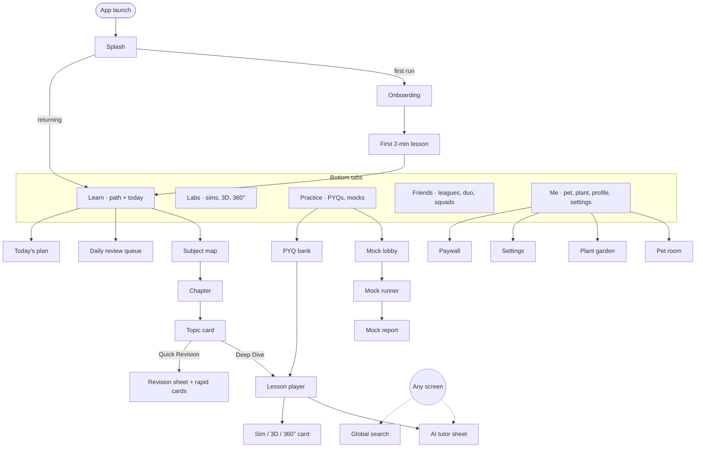
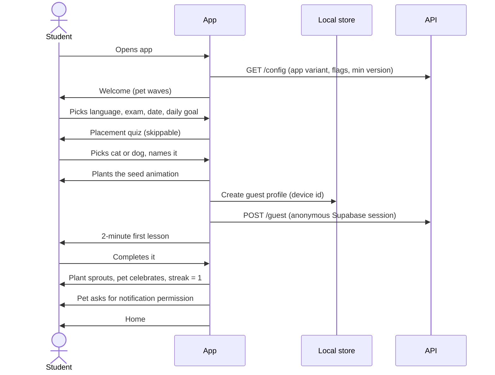
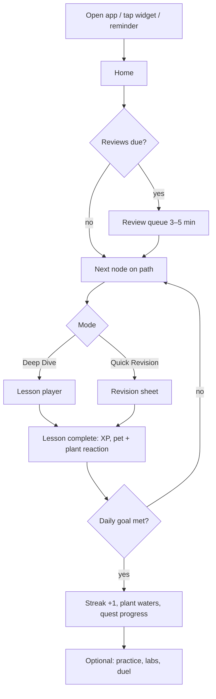
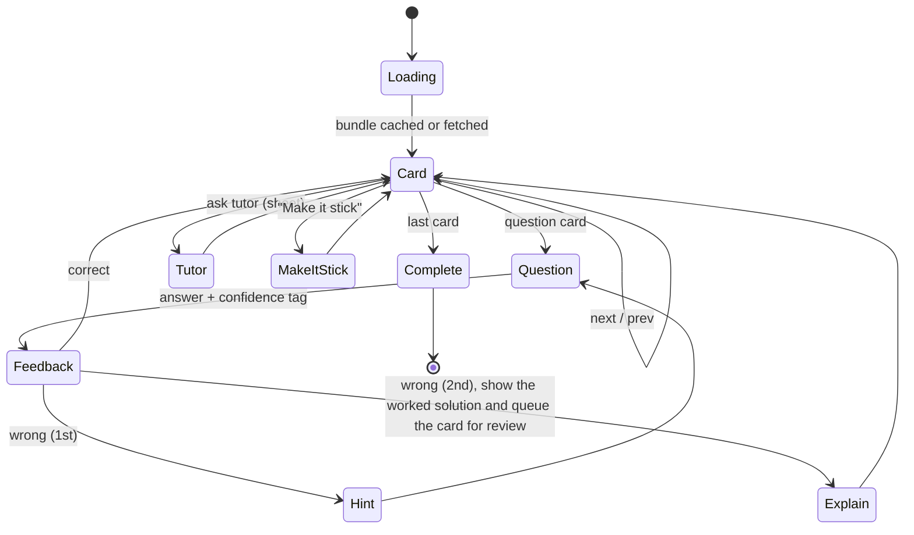
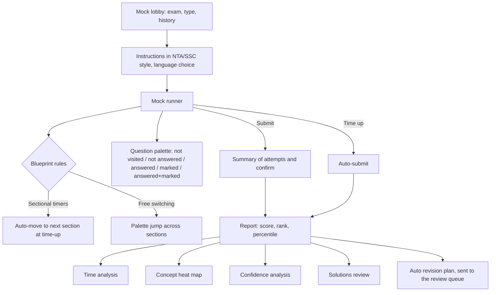
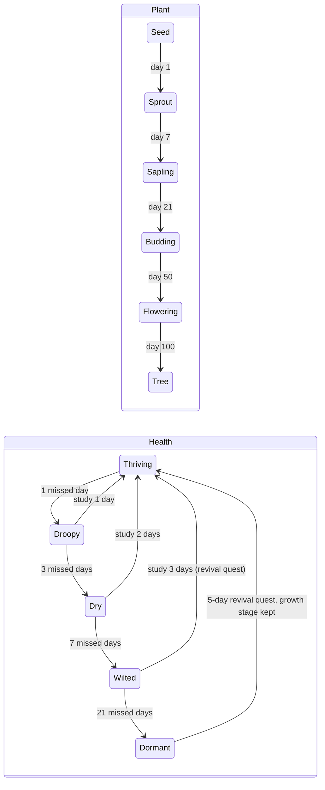
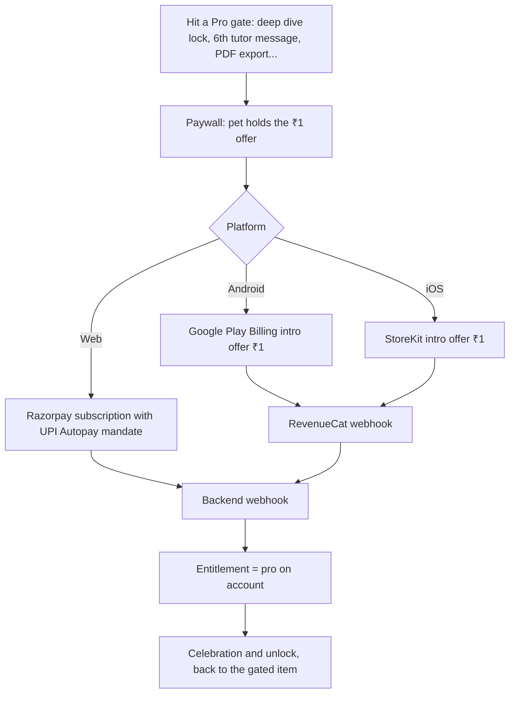
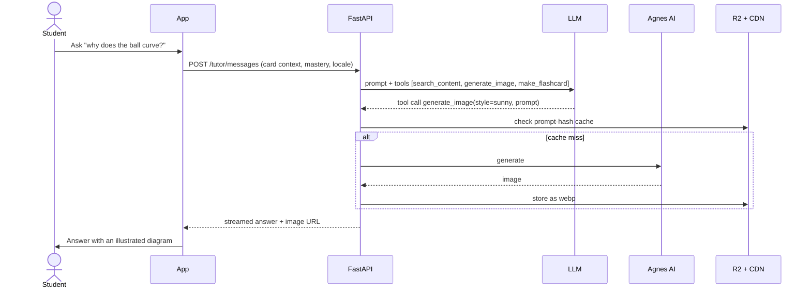
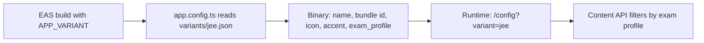

# Smriti — App Flow

Status: Draft v0.1, 28 Oct 2026. This document covers the screens, the navigation, and how the main journeys move through the product. Visual and interaction detail for each screen is in `UX_FLOW.md`.

---

## 1. Navigation map



There are five tabs. Learn is always the default tab. The AI tutor and search open from a floating tutor button and the top bar on every main screen.

## 2. Screen inventory

| Area | Screens |
|---|---|
| Entry | Splash, Update prompt (soft/forced), Maintenance |
| Onboarding | Welcome, Language, Goal (exam/class), Exam date, Placement quiz, Daily goal, Pick pet, Name pet, Plant seed, First lesson, Notification ask |
| Auth | Login sheet (phone OTP, Google, Apple, email), OTP entry, Merge progress, Parent consent (for under-13s) |
| Learn | Home, Today's plan, Subject map, Chapter, Topic card, Lesson player, Lesson complete, Review queue, Revision sheet, Cheat sheet, Formula/shortcut vault, Storybook reader, Video lesson |
| Labs | Lab hub, Sim player, 3D viewer, 360° viewer, Periodic table, Fun experiments |
| Memory | Flashcard deck, Memory palace builder, Palace walk, "Make it stick" (AI cue), Confidence stats |
| Practice | Practice hub, Concept drill, PYQ bank, Daily challenge, Mock lobby, Mock instructions, Mock runner, Submit confirm, Mock report, Solutions review, Analytics dashboard |
| AI | Tutor chat, Voice tutor, Photo doubt (camera), Generated story |
| Social | Friends list, Friend profile, Add friends, League, Leaderboards, Duo, Squad, Challenge duel, Shared decks |
| Me | Profile, Pet room, Plant garden, Card album, Badges, Shop (gems), Downloads, PDF export, Settings, Notifications settings, Language, Subscription, Parent mode, Help, Report content |
| Monetisation | Paywall, Trial checkout, Payment status, Manage plan |

## 3. Core journeys

### 3.1 First launch (guest)



In per-exam apps, the exam is preset, so the exam-choice step is skipped.

### 3.2 When login is asked for

```mermaid
flowchart LR
  G[Guest session] --> T{Trigger}
  T -->|3rd lesson done| Soft[Soft sheet: "Save your plant?"]
  T -->|Streak day 2 night| Soft
  T -->|Add friend / join league| Hard[Login required]
  T -->|Start ₹1 trial| Hard
  T -->|Second device| Hard
  Soft -->|Later| G
  Soft -->|Sign in| Auth
  Hard --> Auth[Login sheet]
  Auth --> Merge[Merge guest progress into account]
  Merge --> Back[Return to where they were]
```

Signing in always returns the student to the exact screen they left, so the flow is never broken.

### 3.3 Daily learning loop



### 3.4 Lesson player



- The student can exit at any point, and progress is saved per card.
- On resume, the lesson reopens at the last card.

### 3.5 Mock test



The mock runner keeps working offline once the paper has downloaded. Answers and per-question timings are written locally every 5 seconds and synced on submit. A crash or call interruption resumes the mock with the timer intact. For live mocks, the timer follows server time.

### 3.6 Streak, plant and pet lifecycle



- **Plant.** The growth stage comes from the total of study days, so it is never lost. The health state comes from recency. A streak freeze stops health from dropping for a day.
- **Pet.** It uses the same recency model, shown as mood (happy, content, sleepy, sad, unwell, resting) and energy. Care actions speed up recovery: a lesson, a review, or a "feed" bought with XP. The pet never dies. Under-10 mode stops at "sleepy".
- All of these states are calculated on the server from activity days in the student's timezone. The app shows a predicted state while offline.

### 3.7 Upgrade to Pro



If the student isn't logged in, the login sheet appears before checkout.

### 3.8 AI tutor and image generation



### 3.9 App variants



The all-exams app shows an exam switcher. A per-exam app hides the switcher, shows "Also try Smriti NEET" cross-promotion in settings, and shares the same account and Pro entitlement.

### 3.10 Offline and sync
- Content bundles and media are cached with a version and evicted least-recently-used first. Downloads that the student picks are pinned.
- Progress events (lesson progress, answers, reviews, timings) go to an outbox and are sent to `/sync` in batches with idempotency keys.
- Conflict rules: events are append-only, so a merge is a union. Mastery and spaced-repetition state are recalculated on the server from events.

## 4. Deep links

| Link | Opens |
|---|---|
| `smriti.app/t/{topicSlug}` | Topic card (and the web topic page if the app isn't installed) |
| `smriti.app/mock/{mockId}` | Mock lobby |
| `smriti.app/duel/{code}` | Join a challenge duel |
| `smriti.app/invite/{code}` | Referral (both get a free week) |
| `smriti.app/review` | Review queue (used by notifications and widgets) |

Each per-exam app registers its own domain path prefix, for example `/jee/`.
