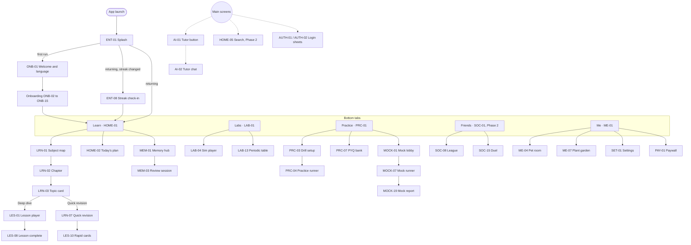
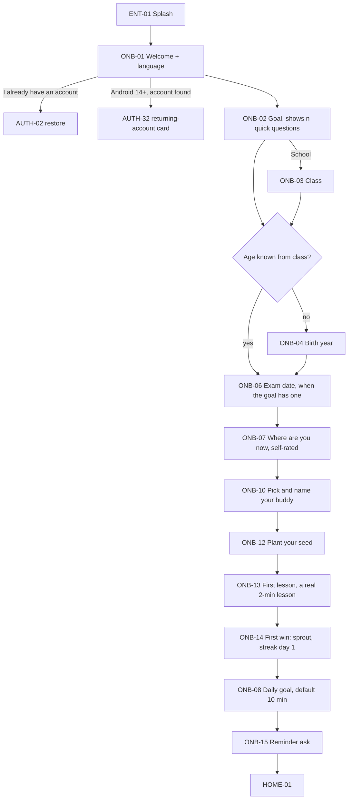
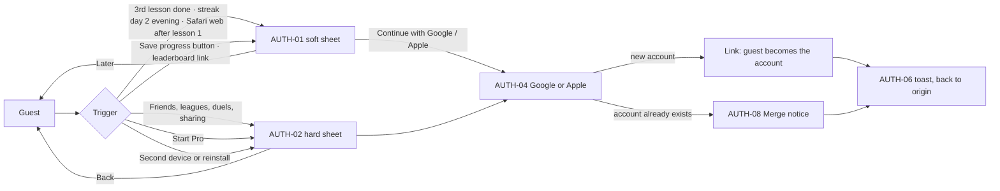
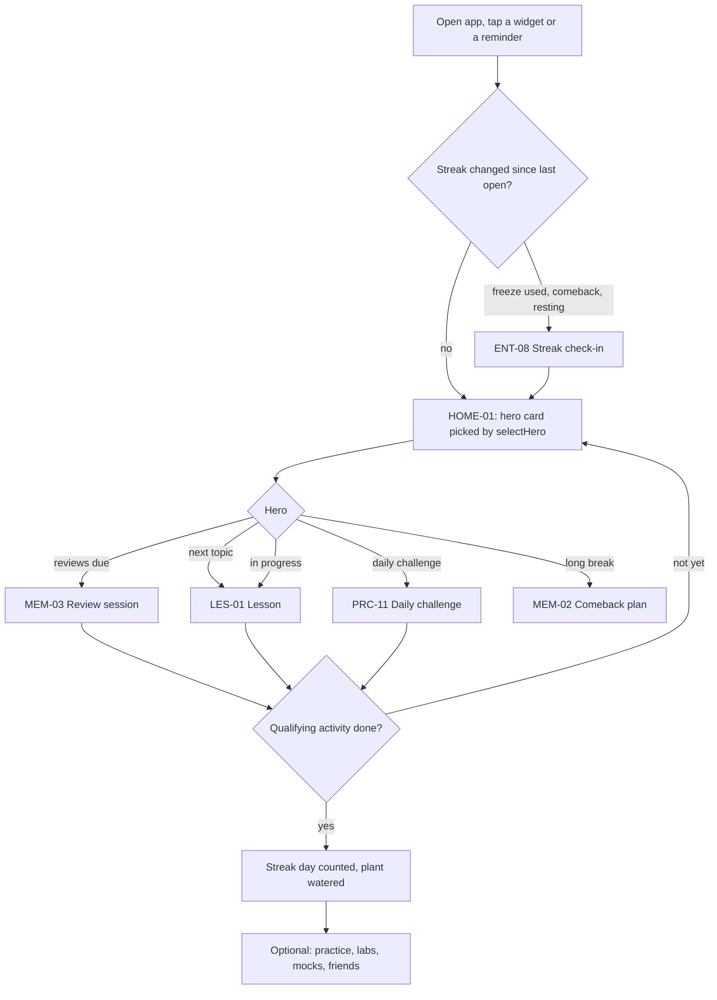
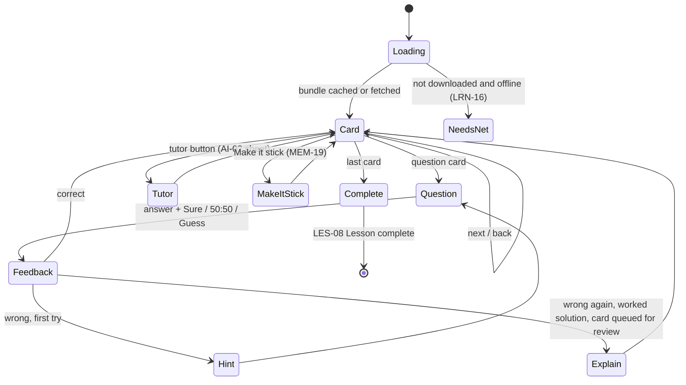
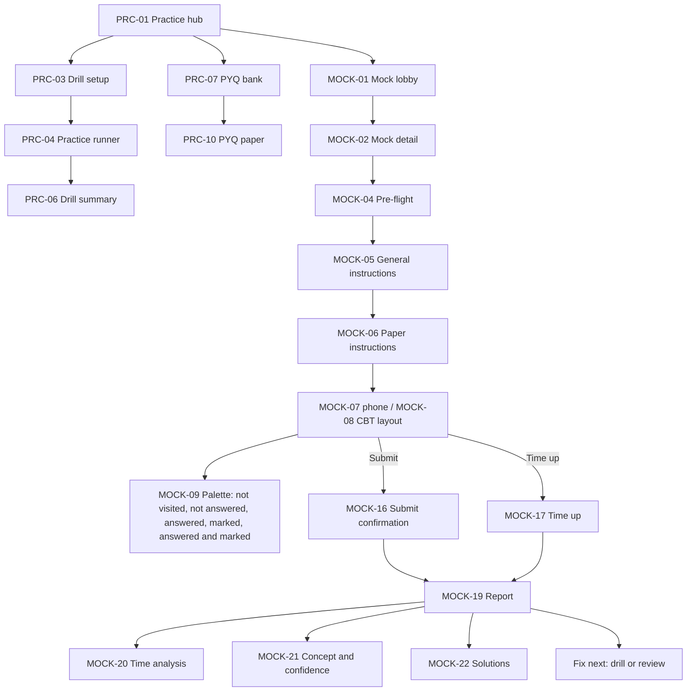
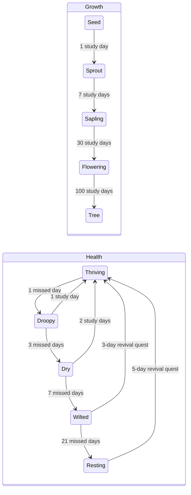
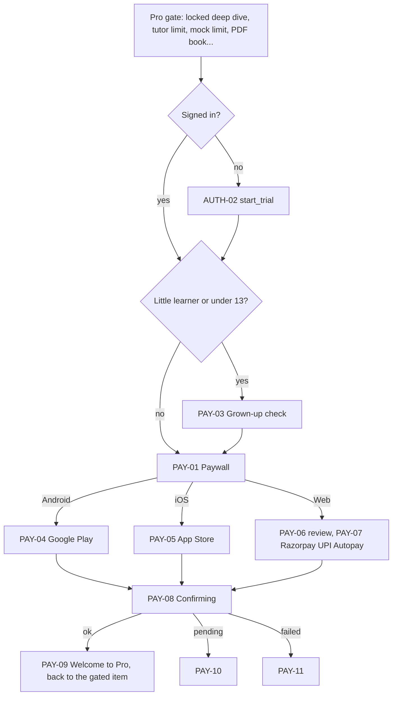
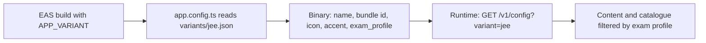

# Smriti — App Flow

Status: Draft v0.2, 29 Oct 2026. Replaces v0.1 (28 Oct).

This is the index for how the product moves: the navigation map, the tabs, the main journeys and the deep links. The detail lives in one flow doc and one screen-spec doc per area:

| Area | Flow (logic, branches, data, analytics) | Screen specs (layout, copy EN + HI, states, motion, accessibility) |
|---|---|---|
| Entry and onboarding | [`flows/onboarding.md`](flows/onboarding.md) | [`ux/onboarding.md`](ux/onboarding.md) |
| Sign-in and accounts | [`flows/auth.md`](flows/auth.md) | [`ux/auth.md`](ux/auth.md) |
| Home, learning and lessons | [`flows/learn.md`](flows/learn.md) | [`ux/learn.md`](ux/learn.md) |
| Memory tools and labs | [`flows/memory-labs.md`](flows/memory-labs.md) | [`ux/memory-labs.md`](ux/memory-labs.md) |
| Practice and mock tests | [`flows/practice.md`](flows/practice.md) | [`ux/practice.md`](ux/practice.md) |
| AI tutor and friends | [`flows/tutor-social.md`](flows/tutor-social.md) | [`ux/tutor-social.md`](ux/tutor-social.md) |
| Me, settings, Pro and notifications | [`flows/me-money.md`](flows/me-money.md) | [`ux/me-money.md`](ux/me-money.md) |

- **Every screen has one ID** (for example `HOME-01`). The full list, with phase and mock priority, is [`SCREENS.md`](SCREENS.md), generated by `node tools/docs/screen_index.mjs`.
- **Research** behind the flows (Duolingo, Brilliant, Matiks and Indian exam apps): [`research/COMPETITOR_FLOWS.md`](research/COMPETITOR_FLOWS.md).
- **Visual mocks** of the P0 screens: [Smriti Screens](https://claude.ai/artifact/Qo8oFPHZahA11hRgPEPxr7), source in `design/mocks/` (gallery built by `tools/mocks/build.mjs`). How screens look is summarised in [`UX_FLOW.md`](UX_FLOW.md).
- **Phases** follow PRD §17. A screen is Phase 1 unless `SCREENS.md` says otherwise.

---

## 1. Rules every flow follows

1. **Free works without login.** A guest gets an anonymous Supabase session at first launch and can learn, review, practise and use labs. Sign-in is Google only on every surface, with Sign in with Apple added under Google on iOS. No phone numbers, OTPs, email links or passwords.
2. **Sign-in returns to where the student was.** Every login sheet stores the origin and the pending action, and resumes it after success.
3. **Never mid-lesson.** No login, Pro or rating prompt interrupts a lesson card, a review session, a mock, onboarding or a tutor chat.
4. **"Locked" only means Pro.** A locked item always opens a preview or a useful sheet, never a dead end. Prerequisites are a suggestion with [Start anyway]. All labs and Quick revision are free.
5. **One prompt per lesson complete.** On LES-08 a soft login beats the Pro card. No Pro upsell on Home.
6. **Children's data rules (DPDP).** Under-18s need guardian consent before any social or public surface. Minors appear publicly with their pet avatar and an auto-generated nickname, never a name they typed. No behaviour-predicted notifications for minors. Little learners (class 1–5) never see prices.
7. **Offline first.** Lessons, reviews and downloaded mocks work offline. Progress goes to an outbox and syncs with idempotency keys.

## 2. Navigation map

### 2.1 Tabs

| Who | Tabs | Notes |
|---|---|---|
| Students 13+ and adults, target | Learn, Labs, Practice, Friends, Me | Learn is the default tab. Memory is not a tab: it opens from Home, "My memory" on Me, lessons, notifications, widgets and search |
| Phase 1 build | Learn, Labs, Practice, Me | The Friends tab and every SOC screen arrive in Phase 2 with leagues and friends. The mocks show the five-tab target |
| Little learners, class 1–5 (Phase 3) | Learn, Labs, Me | No Friends, no Practice tab, no tutor button by default, no prices. Home is HOME-06 with a zig-zag path |
| Web, 600 px and wider | Same tabs as a left sidebar | Streak, plant and pet sit in a compact card at the top of the sidebar |

- **Tutor button** (AI-01) floats on main screens and inside lessons. It is hidden in the mock runner and for little learners by default.
- **Home has no full Duolingo-style path.** HOME-01 shows one plan-driven hero card, an "Up next in {chapter}" strip and the subject grid.

## 3. Core journeys

### 3.1 First launch (guest)

The order is fixed by ruling R27 and takes about 30 to 45 seconds before the first lesson. Full logic: [`flows/onboarding.md`](flows/onboarding.md) §5.

- **No login anywhere in onboarding.** The anonymous session starts in the background at ONB-01 (auth flow §6.1).
- **Per-exam apps** skip ONB-02 only when the variant has a single exam profile.
- **No quiz in onboarding.** A self-rated level decides where the first lesson starts. "Find my level" (HOME-08) is an optional card on Home that never locks anything.
- **Little learners** (Phase 3) are set up by a grown-up first (ONB-05, then ONB-08 and ONB-15 in parent wording) and then hand the phone over (ONB-09).

### 3.2 When sign-in is asked for

Every trigger opens a login sheet with a `reason`. Full table: [`flows/auth.md`](flows/auth.md) §4.

- **Soft-wall budget:** each pop-up trigger shows at most once in 7 days. After two "Later" taps, no pop-up sheets for 14 days. The persistent "Save progress" entry points (ME-01, SET-02, the AUTH-33 save-state chip) always work.
- **Trust line on every sign-in surface:** "We never call you or share your email." / "हम आपको कभी कॉल नहीं करेंगे और आपका ईमेल किसी से शेयर नहीं करेंगे।"
- **Under-18s** who sign in still need guardian consent (AUTH-18 to AUTH-23) before any social or public feature. Under-13s use a managed account under a parent's Google account (AUTH-24 to AUTH-28).
- **Web:** Google One Tap first, then AUTH-01 as the fallback. The marketing site sends people to AUTH-29.

### 3.3 Daily learning loop

- **A streak day is one qualifying activity:** one lesson, or 10 reviews, or one mock section, or the daily challenge. The daily goal in minutes is a separate ring and does not decide the streak.
- **Day boundary:** the student's local midnight for the streak. The daily challenge rolls at 00:00 IST.
- **Comeback, not a review wall:** after time away, the backlog is spread over 3, 5 or 7 days (MEM-02) and Home shows only today's capped count.

### 3.4 Lesson player

- Progress is saved per card. Exit (LES-05) says so, and the lesson resumes at the last card (LES-06).
- A Pro-locked Deep Dive shows its first 4 cards free, then LES-09 "Preview finished".
- LES-08 shows XP, accuracy and time, the plant update and at most one prompt: the soft login (3rd lesson, guest), else the inline Pro card every 5th lesson (13+ only).

### 3.5 Practice and mock test

- **The mock runner is plain on purpose:** light by default, no mascots, confetti, tutor or pushes inside it, and a "not affiliated with {conducting_body}" footer. Three time policies: practice (pausable), strict exam-day, and live (server clock).
- **Free limits:** 30 questions a day, 1 sectional mock a week, 1 sample full mock, PYQs within the daily cap plus one free paper per exam. The free report has the score, section bars, solutions and the top "Fix next" item. Deeper analysis is Pro.
- **Percentile and rank** appear only above a sample-size threshold, and only for first attempts. No predicted rank in Phase 1.
- The runner works offline once the paper is downloaded. Answers and timings are saved locally every 5 seconds and synced on submit. A crash or call resumes with the timer intact.

### 3.6 Streak, plant and pet

- **Growth** comes from total study days (thresholds are a flag), so it is never lost. **Health** comes from recency. The plant never dies, and "dormant" is shown to students as "Resting".
- **Freezes:** free users get 1 a month, Pro 2. Up to 2 can be equipped. One free rest day a week. Our own outages never break a streak. Gems are never sold for real money, and there is no paid streak repair.
- **The pet** follows the same recency model as mood and energy, never shown in distress. Full model: [`flows/me-money.md`](flows/me-money.md).
- The streak pill uses the Phosphor `Plant` icon in streak gold, not a flame: the streak is the plant.
- State is computed on the server from activity days in the student's timezone. The app shows a predicted state while offline.

### 3.7 Upgrade to Pro

- **Prices are tax-inclusive.** ₹1 for the first month shows only when the server says the person is eligible; otherwise "Get Pro" at ₹99.
- **Honest trial:** a timeline with real dates (today ₹1, our reminder 3 days before renewal, the renewal date at ₹99), and cancel within 2 taps from PAY-12 Manage plan. No countdowns, anchors or "% off".
- One account and one Pro entitlement work across every exam app and the web.

### 3.8 AI tutor

- **AI-01 → AI-02:** the tutor opens as a sheet with the current card as context. Free: 5 text messages a day (AI-06 at the limit). It can show existing indexed images to free users, and read answers aloud within a daily cap. New images ("Draw it"), voice (AI-13 to AI-15, Phase 2), Feynman mode (AI-10, AI-11, Phase 2) and photo doubts (AI-16 to AI-19) are Pro.
- Every answer can be rated and reported (AI-05 → SET-24). Safety refusals and crisis support follow AI-08.
- Calls go through the API's AI gateway. Image requests check the image index first and generate with Agnes AI only when nothing fits (TRD).

### 3.9 Friends (Phase 2)

- The Friends tab needs a signed-in account, and under-18s also need guardian consent with the `social` scope. Without it, SOC-02 explains the lock and offers the next step.
- Weekly leagues in groups of 30 within one exam, 10 plant-named tiers. Duos (friend streaks with up to 5 friends), squads, challenge duels and shared decks. No free-text chat between users for anyone: cheers are presets (SOC-22). Random duels offer "Practise solo" after 10 seconds instead of a hidden bot.
- For minors, friend-triggered pushes wait for the minor's own reminder window.

### 3.10 App variants

The all-exams app shows the exam switcher (HOME-04). A per-exam app hides it unless the variant has more than one exam profile. Which exams appear on Goal comes from the live catalogue in `/v1/config`, so there are no "Coming soon" tiles.

### 3.11 Offline and sync

- Content bundles and media are cached by version and evicted least-recently-used first. Downloads the student picks (LRN-15, ME-21) are pinned.
- Progress events go to an outbox and are sent to `/v1/sync` in batches with idempotency keys. Events are append-only, so a merge is a union. Mastery and spaced-repetition state are recalculated on the server.
- The AUTH-33 save-state chip tells a student whether their progress is only on this phone, saving, saved, or saved but offline.

## 4. Deep links

Every link works on `smriti.app` and opens the app if installed, otherwise the web app (via ENT-06 for content that needs the app). A per-exam app uses its own prefix, for example `/jee/mock/{mockId}`. A link before onboarding is done follows [`flows/onboarding.md`](flows/onboarding.md) §6.10.

| Link | Opens | Phase | Owner |
|---|---|---|---|
| `/t/{topicSlug}` | LRN-03 Topic card (onboarding fast lane before onboarding) | 1 | learn |
| `/plan` | HOME-02 Today's plan | 1 | learn |
| `/review` (`?set=quick\|rescue\|bedtime`, `?topic={id}`) | MEM-03 Review session (`bedtime` is adults only) | 1 | memory-labs |
| `/lab/{id}` | LAB-03 Lab detail | 1 | memory-labs |
| `/mock/{mockId}` | MOCK-02 Mock detail, with MOCK-01 behind it | 1 | practice |
| `/mock/{mockId}/report` | MOCK-19 Mock report | 1 | practice |
| `/pyq/{paperId}` | PRC-10 PYQ paper | 1 | practice |
| `/challenge` | PRC-11 Daily challenge | 1 | practice |
| `/practice` | PRC-01 Practice hub | 1 | practice |
| `/me`, `/pet`, `/garden`, `/streak`, `/quests`, `/shop`, `/downloads` | ME-01, ME-04, ME-07, ME-10, ME-20, ME-17, ME-21 | 1 | me-money |
| `/books/{exportId}` | ME-23 My PDF books | 2 | me-money |
| `/pro`, `/pro/manage`, `/pro/fix` | PAY-01, PAY-12, PAY-15 | 1 | me-money |
| `/pay/child/{token}` | PAY-17 Pay for a child (web) | 3 | me-money |
| `/settings/notifications` | SET-03 Notifications | 1 | me-money |
| `/privacy/export/{id}` | SET-12 Data export | 1 | me-money |
| `/parent` | SET-13 gate, then SET-14 Parent dashboard | 3 | me-money |
| `/login?next=` | AUTH-29 Web sign-in page | 1 | auth |
| `/guardian/{code}` | AUTH-22 Guardian landing (web if the app isn't installed) | 1 | auth |
| `/delete-account` | AUTH-13 Delete account (web help page when signed out) | 1 | auth |
| `smriti-{variant}://auth/callback` | OAuth callback (not a user-facing link) | 1 | auth |
| `/invite/{code}` | SOC-04 "Add {name}?" after onboarding; also the referral | 2 | tutor-social |
| `/duel/{code}` | SOC-20 Incoming duel | 2 | tutor-social |
| `/squad/{code}` | SOC-13 Join a squad | 2 | tutor-social |
| `/deck/{code}` | SOC-21 Shared deck preview, then MEM-08 after [Add a copy] | 2 | tutor-social, memory-labs |

A link the student can't use (wrong app, removed content, a social link for a little learner) opens ENT-07 "Link not available", never a blank screen.

## 5. Open questions for the owner

These are collected from the area docs (each doc's "Open questions" section has the detail):

1. **Guardian consent timing for 13 to 17** (`auth.guardian_consent_gate`, `minor.defer_sync_until_consent`): needs legal review before launch.
2. **Managed accounts for under-13s in Phase 1** (TRD §18 D9) or later.
3. **Licence for the Google sign-in module** on mobile (the paid Universal Sign In module).
4. **Two pets after a merge** (keep the guest pet as a visitor, behind `merge.keep_guest_pet`).
5. **DigiLocker** as a stronger consent check if legal review asks for one.
6. **Mascot names and reference sheets** for the cat and dog, and the 10 league tier names.
7. **Phase of UPSC Prelims and classes 9–10:** PRD §4.1 puts them in Phase 1, while PRD §17 and the implementation plan put them in Phase 2.
8. **Nickname word list** (English and Hindi) for minors: who writes it and who runs its safety review.
