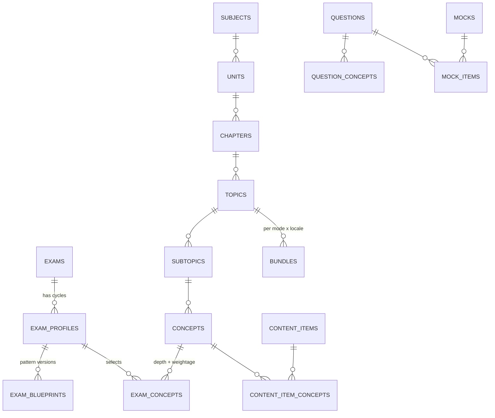
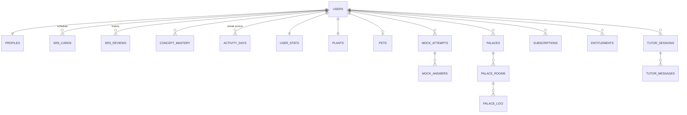

# Smriti — Database Schema

Status: Draft v0.1, 28 Oct 2026. Read with `TRD.md` (§5, §6, §7, §10, §11) and `PRD.md`.

This document covers three stores:

| Store | Holds | Source of truth for |
|---|---|---|
| **Supabase Postgres** | Accounts, the content catalogue (a projection of `content/`), learning state, review history, gamification, social, billing, AI usage, notifications | Everything a user owns, and money |
| **ClickHouse** | Every raw event (learning and product), forever | Analytics, dashboards, ML signals |
| **On-device storage** (SQLite on mobile, IndexedDB on web) | Cards, decks, the spaced-repetition schedule, memory palaces, notes, the profile snapshot, session state, the action queue, the asset cache index | Nothing; it is a cache plus an outbox, and the server wins on conflict |

---

## 1. Conventions

- **Migrations:** plain SQL in `supabase/migrations/`, applied with the Supabase CLI. This is the only place the schema changes. SQLAlchemy models in `apps/api` mirror it, and CI fails on drift.
- **Schemas** group tables by domain: `app`, `content`, `learn`, `game`, `social`, `billing`, `ai`, `notify`, `ops`. Nothing lives in `public`, and none of these schemas is exposed through the Supabase Data API. Clients only reach data through FastAPI (TRD §1).
- **IDs:**
  - Users are `auth.users.id` (uuid). Guests are real users with `is_anonymous = true`, so every table uses the same `user_id` before and after sign-up.
  - Content IDs are stable, readable slugs from the `content/` JSON (for example `phy.kinematics.relative-velocity-1d`), so git diffs and the database agree.
  - Rows created offline use a **client-generated UUIDv7** (time-ordered), which also makes sync idempotent.
  - Other rows use `gen_random_uuid()`.
- **Time:** always `timestamptz`. "Days" for streaks are `date` in the user's own IANA timezone (`app.profiles.timezone`).
- **Localised text:** the `i18n_text` domain, a JSON object keyed by locale (`{"en": "...", "hi": "..."}`). A new language adds keys, not columns.
- **Enumerations** are `text` with a `check` constraint, which is easier to extend than Postgres enums.
- **Every user-owned table** has `user_id uuid not null references auth.users(id) on delete cascade`, so deleting an account (DPDP right to erasure) removes everything.
- **`updated_at`** is maintained by one shared trigger, `app.touch_updated_at()`.
- **Money** is stored in paise (`integer`), never as floats.

```sql
create extension if not exists citext;
create extension if not exists pg_trgm;
create extension if not exists vector;      -- pgvector
create extension if not exists pg_cron;     -- partition upkeep, cleanup

create domain i18n_text as jsonb
  check (jsonb_typeof(value) = 'object' and value <> '{}'::jsonb);
```

---

## 2. Overview





---

## 3. Accounts and profiles (`app`)

```sql
create table app.profiles (
  user_id                 uuid primary key references auth.users(id) on delete cascade,
  handle                  citext unique,                 -- for friend search; null for guests
  display_name            text,
  avatar_asset_id         uuid,                          -- content.media_assets (private or preset)
  locale                  text not null default 'en' check (locale in ('en','hi')),
  timezone                text not null default 'Asia/Kolkata',
  age_band                text check (age_band in ('u10','10_12','13_17','18p')),
  is_minor                boolean generated always as (age_band in ('u10','10_12','13_17')) stored,
  primary_exam_profile_id text,                          -- content.exam_profiles
  daily_goal_xp           smallint not null default 30,
  daily_goal_minutes      smallint not null default 15,
  settings                jsonb not null default '{}',   -- sound, haptics, reduced motion, theme
  first_variant           text,                          -- app variant at first launch
  referral_code           text unique,
  referred_by             uuid references auth.users(id),
  onboarding_completed_at timestamptz,
  created_at              timestamptz not null default now(),
  updated_at              timestamptz not null default now()
);

create table app.user_exams (
  user_id          uuid not null references auth.users(id) on delete cascade,
  exam_profile_id  text not null,
  target_date      date,
  is_primary       boolean not null default false,
  created_at       timestamptz not null default now(),
  primary key (user_id, exam_profile_id)
);
create unique index on app.user_exams (user_id) where is_primary;

create table app.guardian_consents (
  id                  uuid primary key default gen_random_uuid(),
  user_id             uuid not null references auth.users(id) on delete cascade,
  guardian_phone_hash text not null,            -- salted hash, never the raw number
  method              text not null check (method in ('phone_otp','digilocker','other')),
  scope               jsonb not null,           -- which processing was consented to
  consented_at        timestamptz not null,
  revoked_at          timestamptz,
  evidence            jsonb not null default '{}'
);

create table app.devices (
  id            uuid primary key default gen_random_uuid(),
  user_id       uuid not null references auth.users(id) on delete cascade,
  platform      text not null check (platform in ('ios','android','web')),
  app_variant   text not null,
  app_version   text not null,
  push_token    text unique,
  timezone      text,
  locale        text,
  last_seen_at  timestamptz not null default now(),
  invalid_at    timestamptz                      -- set when Expo reports the token dead
);
create index on app.devices (user_id);

create table app.account_merges (                -- guest identity already belonged to another account
  id              uuid primary key default gen_random_uuid(),
  source_user_id  uuid not null,                 -- the guest; deleted after merge
  target_user_id  uuid not null references auth.users(id) on delete cascade,
  status          text not null check (status in ('queued','running','done','failed')),
  stats           jsonb not null default '{}',
  created_at      timestamptz not null default now(),
  finished_at     timestamptz
);

create table app.exports (                       -- PDF books and DPDP data exports
  id            uuid primary key default gen_random_uuid(),
  user_id       uuid not null references auth.users(id) on delete cascade,
  kind          text not null check (kind in ('pdf_book','data_export')),
  spec          jsonb not null,                  -- topics, modes, locale, options
  status        text not null check (status in ('queued','rendering','ready','failed','expired')),
  r2_key        text,
  pages         integer,
  bytes         bigint,
  requested_at  timestamptz not null default now(),
  completed_at  timestamptz,
  expires_at    timestamptz
);
create index on app.exports (user_id, requested_at desc);

create table app.data_requests (                 -- DPDP: access, correction, erasure
  id            uuid primary key default gen_random_uuid(),
  user_id       uuid not null,
  kind          text not null check (kind in ('access','correction','erasure','withdraw_consent')),
  status        text not null check (status in ('open','in_progress','done','rejected')),
  created_at    timestamptz not null default now(),
  closed_at     timestamptz
);
```

**On sign-up**, a trigger on `auth.users` (`app.handle_new_user()`) creates `app.profiles`, `game.user_stats`, `game.plants` (stage `seed`) and `notify.prefs`. The pet row is created when the student picks a cat or a dog in onboarding.

---

## 4. Content catalogue (`content`)

These tables are a **projection** of the `content/` folder in git. Only the `content-publish` job (service role) writes them. Lesson cards themselves live in R2 bundles. Postgres holds the graph, the metadata, the search index and anything the server needs for scoring.

### 4.1 Exams, profiles and blueprints

```sql
create table content.exams (
  id               text primary key,           -- 'jee-main', 'neet-ug', 'upsc-cse', 'ssc-cgl', 'cbse-11'
  name             i18n_text not null,
  category         text not null check (category in
                     ('engineering','medical','civil_services','ssc','banking','railways','defence','state','school')),
  conducting_body  text,
  official_url     text,
  is_active        boolean not null default true
);

create table content.exam_profiles (           -- one exam in one cycle: 'jee-main-2027'
  id            text primary key,
  exam_id       text not null references content.exams(id),
  cycle         text not null,                 -- '2027', '2026-27'
  name          i18n_text not null,
  locales       text[] not null default '{en,hi}',
  is_active     boolean not null default true,
  published_at  timestamptz
);

create table content.exam_blueprints (         -- drives the generic mock engine (TRD §7.4)
  id               uuid primary key default gen_random_uuid(),
  exam_profile_id  text not null references content.exam_profiles(id),
  paper_code       text not null,              -- 'main', 'paper-1', 'gs-1', 'csat', 'tier-1'
  version          integer not null,
  spec             jsonb not null,             -- sections, timers, lock/switch rules, question types,
                                               -- marking incl. partial, languages, calculator, instructions
  source_url       text not null,              -- official notification it was encoded from
  verified_at      date not null,
  effective_from   date not null,
  status           text not null check (status in ('draft','active','retired')),
  unique (exam_profile_id, paper_code, version)
);
```

School classes are exam profiles too (`cbse-11-2027`, `up-board-10-2027`), so the same graph, depth and weightage model covers class 1–12.

### 4.2 The concept graph

```sql
create table content.subjects (
  id            text primary key,              -- 'phy', 'chem', 'math', 'bio', 'polity', 'history'
  name          i18n_text not null,
  color_token   text not null,                 -- maps to DESIGN.md subject tint
  icon_asset_id uuid,
  sort          smallint not null
);

create table content.units (
  id text primary key, subject_id text not null references content.subjects(id),
  name i18n_text not null, sort smallint not null
);

create table content.chapters (
  id          text primary key,
  unit_id     text not null references content.units(id),
  subject_id  text not null references content.subjects(id),   -- denormalised for filters
  name        i18n_text not null,
  ncert_ref   text,                                            -- e.g. 'NCERT 11 Physics Ch 4'
  sort        smallint not null
);

create table content.topics (
  id          text primary key,
  chapter_id  text not null references content.chapters(id),
  name        i18n_text not null,
  summary     i18n_text,
  sort        smallint not null
);

create table content.subtopics (
  id text primary key, topic_id text not null references content.topics(id),
  name i18n_text not null, sort smallint not null
);

create table content.concepts (
  id            text primary key,
  subtopic_id   text not null references content.subtopics(id),
  name          i18n_text not null,
  summary       i18n_text not null,            -- also the tutor's grounding text
  key_points    jsonb not null default '[]',   -- used by Feynman grading
  kind          text not null check (kind in
                  ('fact','definition','formula','derivation','process','skill','date','list','diagram')),
  intrinsic_depth smallint not null check (intrinsic_depth between 1 and 5),
  sort          smallint not null
);

create table content.concept_edges (
  from_id  text not null references content.concepts(id),
  to_id    text not null references content.concepts(id),
  kind     text not null check (kind in ('prerequisite','related','contrast','applies_in')),
  primary key (from_id, to_id, kind)
);

create table content.exam_concepts (           -- the heart of "one graph, many exams"
  exam_profile_id text not null references content.exam_profiles(id),
  concept_id      text not null references content.concepts(id),
  depth           smallint not null check (depth between 1 and 5),   -- L1 basic … L5 JEE Advanced
  weightage       numeric(5,2),                -- expected share of marks, from PYQ analysis
  priority        text not null default 'core' check (priority in ('core','high_yield','optional')),
  primary key (exam_profile_id, concept_id)
);
create index on content.exam_concepts (concept_id);
```

### 4.3 Content items, versions, bundles and manifests

```sql
create table content.content_items (
  id              text primary key,
  kind            text not null check (kind in
                    ('lesson','flashcard_set','mnemonic','cheat_sheet','revision_sheet','storybook',
                     'sim','model3d','pano360','video','experiment','mind_map_template')),
  topic_id        text references content.topics(id),
  mode            text check (mode in ('deep_dive','quick_revision')),
  status          text not null check (status in ('draft','review','published','retired')),
  current_version integer not null default 1,
  is_free         boolean not null default false,  -- free-tier gate; limits are flags (TRD §17)
  source_path     text not null,                   -- path in content/
  updated_at      timestamptz not null default now()
);

create table content.content_item_concepts (
  item_id    text not null references content.content_items(id),
  concept_id text not null references content.concepts(id),
  role       text not null check (role in ('teaches','revises','tests','mentions')),
  primary key (item_id, concept_id, role)
);

create table content.content_versions (
  item_id         text not null references content.content_items(id),
  version         integer not null,
  locale          text not null,
  content_hash    text not null,
  schema_version  smallint not null,
  changelog       text,
  published_at    timestamptz not null default now(),
  primary key (item_id, version, locale)
);

create table content.bundles (                 -- one JSON file per topic × mode × locale in R2
  id               text primary key,           -- '{topic_id}:{mode}:{locale}'
  topic_id         text not null references content.topics(id),
  mode             text not null,
  locale           text not null,
  hash             text not null,              -- sha256; also the R2 object name
  size_bytes       integer not null,
  card_count       smallint not null,
  min_app_version  text not null,
  published_at     timestamptz not null default now()
);

create table content.bundle_history (          -- keeps old hashes so patches can be built
  bundle_id     text not null references content.bundles(id),
  hash          text not null,
  published_at  timestamptz not null,
  primary key (bundle_id, hash)
);

create table content.bundle_patches (          -- delta patches (TRD §3.2)
  bundle_id   text not null references content.bundles(id),
  from_hash   text not null,
  to_hash     text not null,
  size_bytes  integer not null,
  primary key (bundle_id, from_hash, to_hash)
);

create table content.manifests (
  exam_profile_id text not null references content.exam_profiles(id),
  locale          text not null,
  version         integer not null,
  hash            text not null,
  is_current      boolean not null default false,
  published_at    timestamptz not null default now(),
  primary key (exam_profile_id, locale, version)
);
create unique index on content.manifests (exam_profile_id, locale) where is_current;

create table content.seed_packs (              -- shipped inside each app build
  variant_id   text not null,
  locale       text not null,
  bundle_ids   text[] not null,
  hash         text not null,
  built_at     timestamptz not null default now(),
  primary key (variant_id, locale)
);
```

### 4.4 Questions, PYQs and mocks

Practice questions ship inside bundles with their answers, so practice works offline. **Mock and live-mock answer keys never ship to the device**: they live in `content.question_keys`, which only the API's scoring code reads.

```sql
create table content.questions (
  id               text primary key,
  type             text not null check (type in
                     ('mcq_single','mcq_multi','numerical','integer','matrix_match','match_list',
                      'assertion_reason','statement_based','paragraph','fill_blank')),
  locales          text[] not null,
  difficulty       numeric(4,2),               -- IRT b, calibrated from ClickHouse
  discrimination   numeric(4,2),               -- IRT a
  ideal_time_s     smallint,
  source           text not null check (source in ('original','pyq','ncert_exemplar','adapted')),
  status           text not null check (status in ('draft','review','published','retired')),
  version          integer not null default 1,
  bundle_ref       text,                       -- where the rendered stem and solution live
  search           tsvector
);
create index on content.questions using gin (search);

create table content.question_keys (
  question_id  text primary key references content.questions(id),
  answer       jsonb not null,                 -- option ids, numeric value with tolerance, matrix
  partial_rule jsonb                           -- JEE Advanced-style partial marking, when used
);

create table content.question_concepts (
  question_id text not null references content.questions(id),
  concept_id  text not null references content.concepts(id),
  weight      numeric(3,2) not null default 1,
  primary key (question_id, concept_id)
);
create index on content.question_concepts (concept_id);

create table content.pyq_papers (
  id            text primary key,              -- 'jee-main-2025-jan-22-s1'
  exam_id       text not null references content.exams(id),
  year          smallint not null,
  session_label text,                          -- shift, paper, set
  held_on       date,
  source_url    text,
  notes         text
);

create table content.pyq_questions (
  paper_id     text not null references content.pyq_papers(id),
  number       smallint not null,
  question_id  text not null references content.questions(id),
  primary key (paper_id, number)
);

create table content.mocks (
  id               text primary key,
  exam_profile_id  text not null references content.exam_profiles(id),
  blueprint_id     uuid not null references content.exam_blueprints(id),
  kind             text not null check (kind in ('full','sectional','chapter','pyq_paper','live')),
  title            i18n_text not null,
  is_free          boolean not null default false,
  window_start     timestamptz,                -- live mocks only
  window_end       timestamptz,
  status           text not null check (status in ('draft','scheduled','open','closed','retired'))
);

create table content.mock_items (
  mock_id       text not null references content.mocks(id),
  section_code  text not null,                 -- matches a section in the blueprint spec
  position      smallint not null,
  question_id   text not null references content.questions(id),
  marking       jsonb,                         -- override of the blueprint default, rarely used
  primary key (mock_id, section_code, position)
);
```

Mocks generated from a student's weak areas are not stored here. They are `learn.mock_attempts` rows with `mock_id = null` and a `generated_spec`.

### 4.5 Media, the image index, sims and videos

```sql
create table content.media_assets (
  id             uuid primary key default gen_random_uuid(),
  sha256         text not null unique,         -- also the R2 object name
  kind           text not null check (kind in
                   ('image','audio','model3d','pano360','lottie','rive','video_clip','svg')),
  mime           text not null,
  bytes          integer not null,
  width          smallint, height smallint, duration_ms integer,
  variants       jsonb not null default '{}',  -- sizes and formats (webp/avif, low LOD)
  source         text not null check (source in ('agnes','deepgram_tts','open_licence','original','user_upload')),
  licence        text,                         -- 'CC BY 4.0', 'MIT', 'owned'
  attribution    text,
  prompt         text,                         -- Agnes prompt or TTS text
  prompt_hash    text,                         -- sha256(normalised prompt + preset + size + model) or TTS key
  style_preset   text,                         -- DESIGN.md illustration preset
  model_version  text,
  alt            i18n_text,                    -- required for images before approval
  tags           text[] not null default '{}',
  embedding      vector(768),                  -- image embedding (CLIP-style); dimension follows D2
  visibility     text not null default 'public' check (visibility in ('public','private')),
  owner_user_id  uuid references auth.users(id) on delete cascade,   -- set for private items
  status         text not null check (status in ('staging','approved','rejected')),
  created_at     timestamptz not null default now()
);
create unique index on content.media_assets (prompt_hash) where prompt_hash is not null and visibility = 'public';
create index on content.media_assets using hnsw (embedding vector_cosine_ops) where status = 'approved';
create index on content.media_assets using gin (tags);

create table content.sims (
  id              text primary key,
  version         text not null,
  r2_prefix       text not null,
  origin          text not null check (origin in ('own','phet','other_open')),
  licence         text not null,
  attribution     text,
  params_schema   jsonb not null default '{}',
  size_bytes      integer not null,
  status          text not null check (status in ('draft','published','retired'))
);

create table content.videos (                  -- YouTube lessons (@examatlas.official)
  youtube_id      text primary key,
  playlist_id     text,
  title           i18n_text not null,
  duration_s      integer,
  topic_id        text references content.topics(id),
  transcript_key  text,                        -- R2 key of the Deepgram or caption transcript
  published_at    timestamptz
);
```

### 4.6 Search and community mnemonics

```sql
create table content.search_docs (             -- one row per searchable card, concept, question or sheet
  id               text primary key,
  ref_kind         text not null,
  ref_id           text not null,
  locale           text not null,
  exam_profile_ids text[] not null,
  title            text not null,
  body             text not null,
  tsv              tsvector not null,          -- 'english' config for en, 'simple' for hi
  embedding        vector(768)
);
create index on content.search_docs using gin (tsv);
create index on content.search_docs using gin (title gin_trgm_ops);
create index on content.search_docs using gin (exam_profile_ids);
create index on content.search_docs using hnsw (embedding vector_cosine_ops);

create table content.mnemonics (               -- published (system or approved community) mnemonics
  id           uuid primary key default gen_random_uuid(),
  concept_id   text not null references content.concepts(id),
  technique    text not null check (technique in
                 ('acronym','acrostic','story','rhyme','song','keyword','pao','major_system',
                  'peg','palace','chunking','visual')),
  locale       text not null,
  body         text not null,
  audio_asset_id uuid references content.media_assets(id),
  image_asset_id uuid references content.media_assets(id),
  exam_style   text,                           -- 'jee', 'upsc', … (course-aware forge)
  origin       text not null check (origin in ('traditional','system','community')),
  votes        integer not null default 0,
  status       text not null check (status in ('review','published','retired'))
);
create index on content.mnemonics (concept_id, locale) where status = 'published';
```

**RLS for `content`:** `select` is allowed to `anon` and `authenticated` on published or approved rows. There are no `insert`, `update` or `delete` policies, so only the service role writes. `content.question_keys` has RLS on with **no** policies, so only the service role can read it.

---

## 5. Learning state (`learn`)

### 5.1 Lessons, mastery and the daily plan

```sql
create table learn.lesson_progress (
  user_id          uuid not null references auth.users(id) on delete cascade,
  topic_id         text not null,
  mode             text not null check (mode in ('deep_dive','quick_revision')),
  bundle_hash      text not null,              -- which version they saw
  last_card_index  smallint not null default 0,
  cards_seen       smallint not null default 0,
  best_score       smallint,
  completed_at     timestamptz,
  updated_at       timestamptz not null default now(),
  primary key (user_id, topic_id, mode)
);

create table learn.concept_mastery (
  user_id            uuid not null references auth.users(id) on delete cascade,
  concept_id         text not null,
  mastery            real not null default 0,  -- 0..1, from answers and reviews
  attempts           integer not null default 0,
  correct            integer not null default 0,
  avg_time_ms        integer,
  sure_total smallint not null default 0, sure_correct smallint not null default 0,
  fifty_total smallint not null default 0, fifty_correct smallint not null default 0,
  guess_total smallint not null default 0, guess_correct smallint not null default 0,
  calibration        real,                     -- predicted vs actual, for the metacognitive dashboard
  self_confidence    smallint,                 -- the student's own 1..5 rating per topic
  last_practiced_at  timestamptz,
  updated_at         timestamptz not null default now(),
  primary key (user_id, concept_id)
);

create table learn.daily_plans (
  user_id       uuid not null references auth.users(id) on delete cascade,
  day           date not null,
  items         jsonb not null,                -- ordered: reviews, new topic, drill, mock
  done_items    jsonb not null default '[]',
  generated_at  timestamptz not null default now(),
  primary key (user_id, day)
);

create table learn.activity_days (             -- source of truth for streaks and the plant
  user_id            uuid not null references auth.users(id) on delete cascade,
  day                date not null,            -- in the user's timezone
  xp                 integer not null default 0,
  minutes            smallint not null default 0,
  focus_sessions     smallint not null default 0,   -- Pomodoro
  cards_reviewed     smallint not null default 0,
  lessons_completed  smallint not null default 0,
  goal_met           boolean not null default false,
  freeze_used        boolean not null default false,
  first_event_at     timestamptz,
  last_event_at      timestamptz,              -- feeds bedtime estimation (TRD §9.6)
  primary key (user_id, day)
);
```

### 5.2 Spaced repetition (FSRS)

System cards live in bundles and are referenced by id. Student-made cards live in `learn.cards`. `card_ref` covers both: `c:{content_card_id}` or `u:{uuid}`.

```sql
create table learn.decks (
  id             uuid primary key default gen_random_uuid(),
  owner_user_id  uuid references auth.users(id) on delete cascade,   -- null = system deck
  source         text not null check (source in ('system','user','note','transcript','tutor','shared_copy')),
  title          text not null,
  topic_id       text,
  share_code     text unique,                  -- shared decks (social)
  is_public      boolean not null default false,
  created_at     timestamptz not null default now(),
  deleted_at     timestamptz
);

create table learn.cards (                     -- student-made cards only
  id              uuid primary key,            -- client UUIDv7
  deck_id         uuid not null references learn.decks(id) on delete cascade,
  owner_user_id   uuid not null references auth.users(id) on delete cascade,
  front           jsonb not null,
  back            jsonb not null,
  image_asset_id  uuid,
  concept_id      text,
  source_ref      text,                        -- note id, tutor message id, transcript offset
  created_at      timestamptz not null default now(),
  deleted_at      timestamptz
);

create table learn.srs_cards (                 -- current schedule, one row per card the user has studied
  user_id         uuid not null references auth.users(id) on delete cascade,
  card_ref        text not null,
  deck_id         uuid,
  state           smallint not null,           -- 0 new, 1 learning, 2 review, 3 relearning
  due_at          timestamptz not null,
  stability       real not null,
  difficulty      real not null,
  reps            smallint not null default 0,
  lapses          smallint not null default 0,
  last_review_at  timestamptz,
  suspended       boolean not null default false,
  updated_at      timestamptz not null default now(),
  primary key (user_id, card_ref)
) partition by hash (user_id);                 -- 16 partitions to start
create index on learn.srs_cards (user_id, due_at) where not suspended;

create table learn.srs_reviews (               -- full review history (owner's architecture)
  id              uuid not null,               -- client UUIDv7, makes sync idempotent
  user_id         uuid not null references auth.users(id) on delete cascade,
  card_ref        text not null,
  rating          smallint not null check (rating between 1 and 4),   -- Fail, Hard, Good, Easy
  confidence      text check (confidence in ('sure','fifty','guess')),
  state_before    smallint not null,
  elapsed_days    real not null,
  scheduled_days  real not null,
  stability_after real not null,
  difficulty_after real not null,
  duration_ms     integer,
  context         text check (context in ('review','lesson','sleep_review','palace_walk','duel')),
  reviewed_at     timestamptz not null,
  primary key (id, reviewed_at)
) partition by range (reviewed_at);            -- monthly partitions
create index on learn.srs_reviews (user_id, reviewed_at desc);

create table learn.fsrs_params (               -- per-user optimised weights, refit monthly
  user_id            uuid primary key references auth.users(id) on delete cascade,
  weights            real[] not null,
  desired_retention  real not null default 0.9,
  review_count       integer not null,
  optimised_at       timestamptz not null
);
```

### 5.3 Practice and mocks

```sql
create table learn.question_attempts (         -- practice, drills, daily challenge, lesson checks
  id            uuid not null,                 -- client UUIDv7
  user_id       uuid not null references auth.users(id) on delete cascade,
  question_id   text not null,
  context       text not null check (context in ('practice','drill','daily','lesson','duel','pyq')),
  answer        jsonb not null,
  is_correct    boolean not null,
  time_ms       integer not null,
  confidence    text check (confidence in ('sure','fifty','guess')),
  mistake_type  text check (mistake_type in ('conceptual','calculation','misread','silly','time')),
  hints_used    smallint not null default 0,
  answered_at   timestamptz not null,
  primary key (id, answered_at)
) partition by range (answered_at);
create index on learn.question_attempts (user_id, answered_at desc);

create table learn.mock_attempts (
  id                 uuid primary key,         -- client UUIDv7; created when the mock starts
  user_id            uuid not null references auth.users(id) on delete cascade,
  mock_id            text,                     -- null for a generated weak-area mock
  generated_spec     jsonb,                    -- concepts, counts and blueprint for generated mocks
  blueprint_id       uuid not null,
  language           text not null,
  status             text not null check (status in ('in_progress','submitted','auto_submitted','abandoned')),
  section_state      jsonb not null default '{}',  -- current section, per-section start and lock times
  started_at         timestamptz not null,
  submitted_at       timestamptz,
  server_deadline_at timestamptz not null,     -- the server enforces time, not the device
  score              numeric(6,2),
  max_score          numeric(6,2),
  rank               integer,
  percentile         numeric(5,2),
  created_at         timestamptz not null default now()
);
create index on learn.mock_attempts (user_id, started_at desc);
create index on learn.mock_attempts (mock_id, score desc) where status in ('submitted','auto_submitted');

create table learn.mock_answers (              -- one row per question, upserted by autosave
  attempt_id          uuid not null references learn.mock_attempts(id) on delete cascade,
  question_id         text not null,
  section_code        text not null,
  palette_status      text not null check (palette_status in
                        ('not_visited','not_answered','answered','marked','answered_marked')),
  answer              jsonb,
  time_spent_ms       integer not null default 0,
  visits              smallint not null default 0,
  first_seen_seq      smallint,                -- order of first visit
  answered_seq        smallint,                -- order of first answer (attempt order)
  answer_changes      smallint not null default 0,
  confidence          text check (confidence in ('sure','fifty','guess')),
  is_correct          boolean,                 -- filled at scoring
  marks_awarded       numeric(5,2),
  mistake_type        text,
  client_updated_at   timestamptz not null,    -- last write wins by this value
  primary key (attempt_id, question_id)
);

create table learn.mock_reports (              -- computed once at submit; read many times
  attempt_id    uuid primary key references learn.mock_attempts(id) on delete cascade,
  report        jsonb not null,                -- by subject, section, concept; time buckets;
                                               -- right-but-slow, fast-and-wrong, lucky guesses; next steps
  report_version smallint not null,
  generated_at  timestamptz not null default now()
);
```

The per-click palette log (every visit, answer and change with timestamps) goes to ClickHouse only. `mock_answers` keeps the totals the report needs.

### 5.4 Memory tools: palaces, notes, mind maps, mnemonics and tags

```sql
create table learn.palaces (
  id           uuid primary key,               -- client UUIDv7, built offline
  user_id      uuid not null references auth.users(id) on delete cascade,
  name         text not null,
  template     text not null check (template in ('home','school','monument','pano360','custom')),
  pano_asset_id uuid,
  created_at   timestamptz not null default now(),
  updated_at   timestamptz not null default now(),
  deleted_at   timestamptz
);

create table learn.palace_rooms (
  id                  uuid primary key,
  palace_id           uuid not null references learn.palaces(id) on delete cascade,
  name                text not null,
  sort                smallint not null,
  background_asset_id uuid
);

create table learn.palace_loci (
  id             uuid primary key,
  room_id        uuid not null references learn.palace_rooms(id) on delete cascade,
  sort           smallint not null,             -- walk order
  pos            jsonb not null,                -- {x,y} for a picture room, {yaw,pitch} for 360°
  item_ref       text not null,                 -- card_ref, concept id or mnemonic id
  note           text,
  image_asset_id uuid
);

create table learn.notes (                      -- smart Cornell notepad
  id            uuid primary key,               -- client UUIDv7
  user_id       uuid not null references auth.users(id) on delete cascade,
  topic_id      text,
  concept_ids   text[] not null default '{}',
  title         text not null,
  cues          jsonb not null default '[]',    -- left column; AI can fill
  body          jsonb not null,                 -- rich text
  summary       text,                           -- bottom; AI can fill
  ai_filled_at  timestamptz,
  deck_id       uuid references learn.decks(id),-- after "turn into flashcards"
  created_at    timestamptz not null default now(),
  updated_at    timestamptz not null default now(),
  deleted_at    timestamptz
);
create index on learn.notes (user_id, updated_at desc);

create table learn.mind_maps (
  id             uuid primary key,
  user_id        uuid not null references auth.users(id) on delete cascade,
  root_topic_id  text,
  graph          jsonb not null,                -- nodes, edges, annotations, cross-subject links
  origin         text not null check (origin in ('ai','user')),
  updated_at     timestamptz not null default now()
);

create table learn.user_mnemonics (             -- forge output and the student's own hooks
  id             uuid primary key,
  user_id        uuid not null references auth.users(id) on delete cascade,
  concept_id     text,
  card_ref       text,
  technique      text not null,                 -- same list as content.mnemonics
  body           text not null,
  image_asset_id uuid,
  audio_asset_id uuid,
  origin         text not null check (origin in ('ai','user')),
  shared_for_review boolean not null default false,   -- offered to the community pool
  created_at     timestamptz not null default now()
);

create table learn.emotion_tags (
  user_id     uuid not null references auth.users(id) on delete cascade,
  item_ref    text not null,                    -- card_ref or concept id
  emoji       text,
  feeling     text,
  note        text,
  created_at  timestamptz not null default now(),
  primary key (user_id, item_ref)
);

create table learn.bookmarks (
  id         uuid primary key,
  user_id    uuid not null references auth.users(id) on delete cascade,
  item_ref   text not null,
  kind       text not null check (kind in ('bookmark','highlight','formula_vault','shortcut_vault')),
  range      jsonb,
  note       text,
  created_at timestamptz not null default now()
);
create index on learn.bookmarks (user_id, kind, created_at desc);

create table learn.content_reports (            -- "report an error" on any card
  id          uuid primary key default gen_random_uuid(),
  user_id     uuid references auth.users(id) on delete set null,
  item_ref    text not null,
  bundle_hash text,
  locale      text,
  reason      text not null check (reason in ('wrong','unclear','typo','translation','offensive','other')),
  note        text,
  status      text not null default 'open' check (status in ('open','accepted','fixed','rejected')),
  created_at  timestamptz not null default now()
);
```

---

## 6. Gamification (`game`)

```sql
create table game.user_stats (
  user_id             uuid primary key references auth.users(id) on delete cascade,
  xp_total            bigint not null default 0,
  xp_week             integer not null default 0,
  week_start          date,
  level               smallint not null default 1,
  gems                integer not null default 0 check (gems >= 0),
  current_streak      integer not null default 0,
  longest_streak      integer not null default 0,
  streak_last_day     date,
  freezes_available   smallint not null default 1,
  updated_at          timestamptz not null default now()
);

create table game.plants (
  user_id           uuid primary key references auth.users(id) on delete cascade,
  species           text not null default 'tulsi',
  skin              text,
  growth_points     integer not null default 0,     -- only goes up
  stage             text not null default 'seed' check (stage in ('seed','sprout','sapling','flowering','tree')),
  health            text not null default 'thriving' check (health in ('thriving','droopy','dry','wilted','dormant')),
  last_watered_day  date,
  revival_progress  smallint not null default 0,    -- days into a revival streak
  updated_at        timestamptz not null default now()
);

create table game.pets (
  user_id        uuid primary key references auth.users(id) on delete cascade,
  species        text not null check (species in ('cat','dog')),
  name           text not null,
  mood           smallint not null default 80 check (mood between 0 and 100),
  energy         smallint not null default 80 check (energy between 0 and 100),
  state          text not null default 'happy',     -- derived label, cached for widgets
  outfit_ids     text[] not null default '{}',
  last_cared_at  timestamptz,
  last_decay_day date,
  updated_at     timestamptz not null default now()
);

create table game.xp_ledger (
  event_id     uuid not null,                       -- the event that earned it; idempotent
  user_id      uuid not null references auth.users(id) on delete cascade,
  amount       integer not null,
  source       text not null check (source in ('lesson','review','practice','mock','quest','duel','challenge','bonus','admin')),
  ref          text,
  occurred_at  timestamptz not null,
  primary key (event_id, occurred_at)
) partition by range (occurred_at);
create index on game.xp_ledger (user_id, occurred_at desc);

create table game.gem_ledger (                      -- currency: kept forever, never partitioned away
  id          uuid primary key default gen_random_uuid(),
  user_id     uuid not null references auth.users(id) on delete cascade,
  delta       integer not null,
  reason      text not null,
  ref         text,
  created_at  timestamptz not null default now()
);
create index on game.gem_ledger (user_id, created_at desc);

create table game.streak_freezes (
  id          uuid primary key default gen_random_uuid(),
  user_id     uuid not null references auth.users(id) on delete cascade,
  source      text not null check (source in ('monthly','pro_monthly','shop','reward')),
  granted_at  timestamptz not null default now(),
  used_on     date
);

create table game.quests (
  id           text primary key,
  period       text not null check (period in ('daily','weekly','event')),
  spec         jsonb not null,                      -- counter, target, filters
  reward       jsonb not null,                      -- xp, gems, item
  active_from  date not null,
  active_to    date
);

create table game.user_quests (
  user_id       uuid not null references auth.users(id) on delete cascade,
  quest_id      text not null references game.quests(id),
  period_start  date not null,
  progress      integer not null default 0,
  target        integer not null,
  completed_at  timestamptz,
  claimed_at    timestamptz,
  primary key (user_id, quest_id, period_start)
);

create table game.badges (
  id text primary key, name i18n_text not null, description i18n_text not null,
  asset_id uuid, rule jsonb not null, tier smallint not null default 1
);
create table game.user_badges (
  user_id uuid not null references auth.users(id) on delete cascade,
  badge_id text not null references game.badges(id),
  earned_at timestamptz not null default now(),
  primary key (user_id, badge_id)
);

create table game.collections (                     -- illustrated card albums
  id text primary key, name i18n_text not null, item_ids text[] not null
);
create table game.user_collection_items (
  user_id uuid not null references auth.users(id) on delete cascade,
  collection_id text not null references game.collections(id),
  item_id text not null,
  earned_at timestamptz not null default now(),
  primary key (user_id, collection_id, item_id)
);

create table game.shop_items (
  id text primary key,
  kind text not null check (kind in ('freeze','pet_outfit','plant_skin','theme','palace_room')),
  price_gems integer not null, pro_only boolean not null default false,
  asset_id uuid, active boolean not null default true
);
create table game.inventory (
  user_id uuid not null references auth.users(id) on delete cascade,
  item_id text not null references game.shop_items(id),
  qty smallint not null default 1,
  acquired_at timestamptz not null default now(),
  primary key (user_id, item_id)
);

-- Leagues: live ranks in Redis sorted sets; persisted at Sunday rollover
create table game.league_cohorts (
  id           uuid primary key default gen_random_uuid(),
  week_start   date not null,
  tier         smallint not null,                   -- 1 Bronze … 10 Diamond
  exam_group   text not null,                       -- leagues are grouped by exam
  status       text not null check (status in ('open','closed'))
);
create index on game.league_cohorts (week_start, tier, exam_group);

create table game.league_members (
  cohort_id  uuid not null references game.league_cohorts(id) on delete cascade,
  user_id    uuid not null references auth.users(id) on delete cascade,
  xp         integer not null default 0,
  final_rank smallint,
  result     text check (result in ('promoted','stayed','demoted')),
  primary key (cohort_id, user_id)
);
create index on game.league_members (user_id);

create table game.daily_challenges (
  id               uuid primary key default gen_random_uuid(),
  exam_profile_id  text not null,
  day              date not null,
  question_id      text not null,
  unique (exam_profile_id, day)
);
create table game.daily_challenge_results (
  challenge_id uuid not null references game.daily_challenges(id),
  user_id      uuid not null references auth.users(id) on delete cascade,
  correct      boolean not null,
  time_ms      integer not null,
  submitted_at timestamptz not null default now(),
  primary key (challenge_id, user_id)
);
```

**Who writes what:** the sync handler updates `activity_days`, `user_stats`, `xp_ledger`, `plants` and `pets` in the same transaction as the learning rows, so a retried batch changes nothing twice. The nightly roll-up job (per timezone bucket) applies decay to pets and plants and closes streaks for users who did not sync that day.

---

## 7. Social (`social`)

```sql
create table social.friendships (               -- one row per pair, user_a < user_b
  user_a        uuid not null references auth.users(id) on delete cascade,
  user_b        uuid not null references auth.users(id) on delete cascade,
  status        text not null check (status in ('pending','accepted','blocked')),
  requested_by  uuid not null,
  created_at    timestamptz not null default now(),
  accepted_at   timestamptz,
  primary key (user_a, user_b),
  check (user_a < user_b)
);
create index on social.friendships (user_b);

create table social.duos (                      -- two friends keep a shared streak
  id                  uuid primary key default gen_random_uuid(),
  user_a              uuid not null references auth.users(id) on delete cascade,
  user_b              uuid not null references auth.users(id) on delete cascade,
  status              text not null check (status in ('invited','active','ended')),
  shared_streak       integer not null default 0,
  last_both_active    date,
  started_at          timestamptz,
  ended_at            timestamptz
);
create unique index on social.duos (least(user_a,user_b), greatest(user_a,user_b)) where status <> 'ended';

create table social.squads (
  id               uuid primary key default gen_random_uuid(),
  name             text not null,
  owner_id         uuid not null references auth.users(id) on delete cascade,
  exam_profile_id  text,
  invite_code      text not null unique,
  max_members      smallint not null default 20,
  created_at       timestamptz not null default now()
);
create table social.squad_members (
  squad_id  uuid not null references social.squads(id) on delete cascade,
  user_id   uuid not null references auth.users(id) on delete cascade,
  role      text not null default 'member' check (role in ('owner','admin','member')),
  joined_at timestamptz not null default now(),
  primary key (squad_id, user_id)
);
create index on social.squad_members (user_id);

create table social.duels (                     -- realtime over Supabase Realtime channel 'duel:{id}'
  id               uuid primary key default gen_random_uuid(),
  challenger_id    uuid not null references auth.users(id) on delete cascade,
  opponent_id      uuid references auth.users(id) on delete cascade,   -- null = random match
  exam_profile_id  text not null,
  question_ids     text[] not null,
  status           text not null check (status in ('pending','live','finished','expired','declined')),
  scores           jsonb not null default '{}',
  winner_id        uuid,
  created_at       timestamptz not null default now(),
  started_at       timestamptz,
  finished_at      timestamptz
);
create index on social.duels (challenger_id, created_at desc);
create index on social.duels (opponent_id, created_at desc);

create table social.nudges (                    -- "cheer" and "nudge" a friend, rate-limited
  id          uuid primary key default gen_random_uuid(),
  from_user   uuid not null references auth.users(id) on delete cascade,
  to_user     uuid not null references auth.users(id) on delete cascade,
  kind        text not null check (kind in ('nudge','cheer','challenge')),
  created_at  timestamptz not null default now()
);

create table social.user_reports (
  id          uuid primary key default gen_random_uuid(),
  reporter_id uuid not null references auth.users(id) on delete cascade,
  target_id   uuid not null references auth.users(id) on delete cascade,
  reason      text not null,
  note        text,
  status      text not null default 'open',
  created_at  timestamptz not null default now()
);
```

Minors' profiles show only first name and initial on leaderboards by default (PRD §16.4). Social tables are only written after guardian consent for users under 18.

---

## 8. Billing (`billing`)

```sql
create table billing.products (
  id                text primary key,             -- 'pro_monthly_web', 'pro_monthly_android_jee'
  platform          text not null check (platform in ('web','android','ios')),
  variant_id        text,                         -- per-exam apps sell their own product
  store_product_id  text not null,
  price_paise       integer not null,             -- 9900
  intro_price_paise integer,                      -- 100
  period            text not null check (period in ('month','year')),
  entitlement       text not null default 'pro',
  active            boolean not null default true
);

create table billing.subscriptions (
  id                    uuid primary key default gen_random_uuid(),
  user_id               uuid not null,             -- no FK: kept after erasure (see below)
  source                text not null check (source in ('razorpay','play','app_store')),
  external_id           text not null,             -- Razorpay sub id or RevenueCat original transaction
  product_id            text not null references billing.products(id),
  status                text not null check (status in
                          ('created','trialing','active','grace','on_hold','paused','cancelled','halted','expired')),
  is_intro              boolean not null default false,
  current_period_start  timestamptz,
  current_period_end    timestamptz,
  cancel_at_period_end  boolean not null default false,
  started_at            timestamptz,
  ended_at              timestamptz,
  updated_at            timestamptz not null default now(),
  unique (source, external_id)
);
create index on billing.subscriptions (user_id);

create table billing.entitlements (               -- what the app reads; recomputed on every webhook
  user_id          uuid not null references auth.users(id) on delete cascade,
  entitlement      text not null,                 -- 'pro'
  active           boolean not null,
  subscription_id  uuid references billing.subscriptions(id),
  expires_at       timestamptz,
  grace_until      timestamptz,
  updated_at       timestamptz not null default now(),
  primary key (user_id, entitlement)
);

create table billing.payments (                   -- each charge, for reconciliation
  id                   uuid primary key default gen_random_uuid(),
  subscription_id      uuid not null references billing.subscriptions(id),
  external_payment_id  text not null unique,
  amount_paise         integer not null,
  status               text not null check (status in ('captured','failed','refunded')),
  method               text,                       -- 'upi_autopay', 'card', 'store'
  paid_at              timestamptz not null
);

create table billing.payment_events (             -- every webhook, raw, kept for audit
  id                 uuid primary key default gen_random_uuid(),
  source             text not null,
  external_event_id  text not null,
  event_type         text not null,
  user_id            uuid,
  payload            jsonb not null,
  signature_ok       boolean not null,
  received_at        timestamptz not null default now(),
  processed_at       timestamptz,
  error              text,
  unique (source, external_event_id)              -- replay protection
);

create table billing.intro_claims (               -- one ₹1 month per person
  phone_hash  text primary key,                   -- survives erasure, so the offer can't be reclaimed
  user_id     uuid,
  source      text not null,
  claimed_at  timestamptz not null default now()
);
```

Billing rows (`subscriptions`, `payments`, `payment_events`) are kept for 8 years for tax records, even after account deletion, so they have no cascading foreign key to `auth.users`. On erasure, the deletion job replaces `user_id` with a tombstone ID and clears `intro_claims.user_id`. `entitlements` is derived, so it cascades. The retention period needs legal sign-off.

---

## 9. AI (`ai`)

```sql
create table ai.tutor_sessions (
  id               uuid primary key default gen_random_uuid(),
  user_id          uuid not null references auth.users(id) on delete cascade,
  mode             text not null check (mode in ('chat','feynman','doubt_photo','voice')),
  context_ref      text,                          -- card, concept or question
  exam_profile_id  text,
  locale           text not null,
  started_at       timestamptz not null default now(),
  ended_at         timestamptz,
  message_count    smallint not null default 0
);
create index on ai.tutor_sessions (user_id, started_at desc);

create table ai.tutor_messages (
  id          uuid not null default gen_random_uuid(),
  session_id  uuid not null,
  user_id     uuid not null references auth.users(id) on delete cascade,
  role        text not null check (role in ('user','assistant','tool')),
  content     text not null,
  attachments jsonb not null default '[]',        -- image asset ids, photo upload keys
  tool_calls  jsonb,
  tokens_in   integer, tokens_out integer,
  flagged     boolean not null default false,
  created_at  timestamptz not null default now(),
  primary key (id, created_at)
) partition by range (created_at);                -- dropped after 180 days
create index on ai.tutor_messages (session_id, created_at);

create table ai.feynman_scores (
  id           uuid primary key default gen_random_uuid(),
  session_id   uuid not null references ai.tutor_sessions(id) on delete cascade,
  user_id      uuid not null references auth.users(id) on delete cascade,
  concept_id   text not null,
  clarity      smallint not null check (clarity between 0 and 100),
  completeness smallint not null check (completeness between 0 and 100),
  accuracy     smallint not null check (accuracy between 0 and 100),
  gaps         jsonb not null default '[]',       -- key points missed, misconceptions
  created_at   timestamptz not null default now()
);

create table ai.voice_sessions (
  id              uuid primary key default gen_random_uuid(),
  user_id         uuid not null references auth.users(id) on delete cascade,
  tutor_session_id uuid references ai.tutor_sessions(id),
  provider        text not null default 'gemini_live',
  token_expires_at timestamptz not null,
  started_at      timestamptz not null default now(),
  ended_at        timestamptz,
  seconds         integer,
  transcript_key  text                              -- R2, private
);

create table ai.generations (                     -- every non-chat AI job, for cost and debugging
  id           uuid primary key default gen_random_uuid(),
  user_id      uuid references auth.users(id) on delete set null,   -- null for content jobs
  kind         text not null check (kind in
                 ('image','tts','stt','story','mnemonic','cornell_fill','mind_map','cards_from_transcript',
                  'doubt_photo','embedding')),
  provider     text not null,                       -- 'agnes', 'deepgram', 'gemini'
  model        text not null,
  input_hash   text not null,
  asset_id     uuid,                                -- content.media_assets when the output is media
  cache_hit    boolean not null default false,
  cost_micros  bigint,                              -- micro-rupees
  latency_ms   integer,
  status       text not null check (status in ('ok','error','blocked')),
  trace_id     text,
  created_at   timestamptz not null default now()
);
create index on ai.generations (user_id, created_at desc);

create table ai.usage_daily (                     -- quotas and fair-use limits
  user_id       uuid not null references auth.users(id) on delete cascade,
  day           date not null,
  tier          text not null,                      -- 'tutor', 'cheap', 'voice', 'image', 'tts'
  requests      integer not null default 0,
  tokens_in     bigint not null default 0,
  tokens_out    bigint not null default 0,
  units         integer not null default 0,         -- images, voice seconds, TTS characters
  cost_micros   bigint not null default 0,
  primary key (user_id, day, tier)
);

create table ai.moderation_flags (
  id           uuid primary key default gen_random_uuid(),
  user_id      uuid references auth.users(id) on delete set null,
  source_kind  text not null,                       -- 'tutor_message', 'user_mnemonic', 'upload'
  source_id    text not null,
  category     text not null,
  score        real,
  action       text not null check (action in ('allowed','blocked','queued')),
  reviewed_by  uuid,
  created_at   timestamptz not null default now()
);
```

The image cache and TTS cache are `content.media_assets` rows looked up by `prompt_hash`. There's no separate cache table.

---

## 10. Notifications (`notify`)

```sql
create table notify.prefs (
  user_id              uuid primary key references auth.users(id) on delete cascade,
  daily_reminder_at    time,                       -- local time
  streak_risk          boolean not null default true,
  weak_area_alerts     boolean not null default true,
  sleep_review         boolean not null default false,   -- opt-in
  social               boolean not null default true,
  product_news         boolean not null default false,
  quiet_start          time not null default '22:00',
  quiet_end            time not null default '07:00',
  estimated_bedtime    time,                       -- from the bedtime job (TRD §9.6)
  bedtime_confidence   real,
  updated_at           timestamptz not null default now()
);

create table notify.templates (
  id         text not null,
  locale     text not null,
  pet        text not null default 'any' check (pet in ('cat','dog','any')),
  kind       text not null,                        -- 'streak_risk', 'weak_area', 'friend_cheer', …
  title      text not null,
  body       text not null,                        -- ICU message with variables
  active     boolean not null default true,
  primary key (id, locale, pet)
);

create table notify.log (
  id           uuid not null default gen_random_uuid(),
  user_id      uuid not null references auth.users(id) on delete cascade,
  device_id    uuid,
  template_id  text not null,
  channel      text not null check (channel in ('push','email','sms','in_app')),
  status       text not null check (status in ('queued','sent','failed','suppressed')),
  suppressed_reason text,                          -- cap, quiet hours, pref off
  sent_at      timestamptz not null default now(),
  opened_at    timestamptz,
  primary key (id, sent_at)
) partition by range (sent_at);
create index on notify.log (user_id, sent_at desc);
```

Local reminders scheduled on the device are not logged here. The app reports their opens as events.

---

## 11. Operations and config (`ops`)

```sql
create table ops.app_variants (                  -- mirrors packages/config/variants for the API
  id               text primary key,             -- 'all', 'jee', 'neet', 'upsc', 'ssc'
  exam_profile_ids text[] not null,
  min_version      text not null,
  latest_version   text not null,
  config           jsonb not null,
  active           boolean not null default true
);

create table ops.flags (                         -- served by GET /v1/config
  key          text primary key,                 -- 'free.tutor_messages_per_day', 'pricing.web'
  value        jsonb not null,
  rules        jsonb not null default '[]',      -- by variant, platform, app version, cohort %
  description  text,
  updated_by   uuid,
  updated_at   timestamptz not null default now()
);

create table ops.staff (
  user_id  uuid primary key references auth.users(id) on delete cascade,
  role     text not null check (role in ('admin','content','support','finance'))
);

create table ops.audit_log (
  id          bigint generated always as identity primary key,
  actor_id    uuid,
  action      text not null,
  target      text not null,
  before      jsonb,
  after       jsonb,
  created_at  timestamptz not null default now()
);
```

---

## 12. Row-level security

Clients never query Postgres directly, but RLS is still on for every table, as defence in depth:

- **The API runs queries as the user.** Each request's transaction starts with `set local role authenticated` and `select set_config('request.jwt.claims', <verified claims>, true)`. Both are transaction-scoped, so they are safe with the Supavisor transaction pooler. `auth.uid()` then works inside policies.
- **The worker uses the service role**, which bypasses RLS, for publish, roll-ups, merges, scoring and webhooks.

Policy patterns (each uses `(select auth.uid())` so Postgres evaluates it once per query):

| Pattern | Tables | Policy |
|---|---|---|
| Owner only | `app.*` user tables, `learn.*`, `game.user_stats`, `plants`, `pets`, `ai.*`, `notify.prefs` | `using (user_id = (select auth.uid()))`, and the same `with check` for writes |
| Owner via parent | `learn.palace_rooms`, `palace_loci`, `learn.mock_answers` | `exists` on the parent row owned by the user |
| Public read | `content.*` (published rows), `game.badges`, `quests`, `shop_items`, `collections` | `select` to `anon, authenticated` with a status filter |
| Service only | `content.question_keys`, `billing.payment_events`, `ops.*`, `ai.moderation_flags` | RLS on, no policies |
| Owner read, server write | `billing.subscriptions`, `billing.entitlements`, `game.xp_ledger`, `gem_ledger`, `learn.mock_reports` | `select` for the owner. Writes only from the service role. Scores on `learn.mock_attempts` are set only by the scoring job. |
| Social | `social.friendships`, `duos`, `duels` | Visible to either participant. Friend profiles are read through a `security definer` view that exposes only handle, display name, avatar, streak, league and pet. |
| Squads | `social.squads`, `squad_members` | Visible to members. Writes by owner or admin. |
| Realtime | `realtime.messages` | Private channels. A user may join `duel:{id}` only if they are a participant, and `mock:{id}` only if they have an attempt. |

---

## 13. Partitions, retention and scale

**Assumptions for year one:** 1M monthly active users, around 100k daily active, 30 reviews and 40 events per active day.

| Table | Rows per day (approx.) | Partitioning | Kept in Postgres |
|---|---|---|---|
| `learn.srs_reviews` | 3M | Monthly by `reviewed_at` | 12 months hot. Older partitions are exported to Parquet in R2, then detached. ClickHouse keeps them all. |
| `learn.question_attempts` | 2M | Monthly | 12 months, same archive path |
| `game.xp_ledger` | 2M | Monthly | 13 months (totals live in `user_stats`) |
| `ai.tutor_messages` | 0.3M | Monthly | 180 days (privacy policy) |
| `notify.log` | 0.3M | Monthly | 13 months |
| `learn.srs_cards` | grows to roughly 500M rows | Hash by `user_id`, 16 partitions | Always. If it outgrows this, move to per-user packed state behind the same API. |

- A `pg_cron` job creates next month's partitions a week ahead and runs the archive step.
- Guests inactive for 90 days are deleted (TRD §6), which removes their rows through `cascade`.
- Supabase compute is sized for this in Phase 2. Phase 1 traffic fits a small instance.

---

## 14. ClickHouse (analytics event store)

The worker batch-inserts every event received by `/v1/sync/events` (learning) and the product event stream. Nothing here is read by the app.

```sql
CREATE TABLE events
(
    event_id      UUID,
    user_id       UUID,
    is_guest      Bool,
    type          LowCardinality(String),    -- 'review_rated', 'mock_palette_visit', 'screen_view', …
    occurred_at   DateTime64(3, 'UTC'),
    received_at   DateTime64(3, 'UTC'),
    session_id    UUID,
    device_id     UUID,
    platform      LowCardinality(String),
    app_variant   LowCardinality(String),
    app_version   LowCardinality(String),
    locale        LowCardinality(String),
    exam_profile  LowCardinality(String),
    props         String                     -- JSON; typed columns are added as needs settle
)
ENGINE = ReplacingMergeTree(received_at)     -- de-duplicates client retries by event_id
PARTITION BY toYYYYMM(occurred_at)
ORDER BY (user_id, occurred_at, event_id);
```

Materialised views built on `events`:

| View | Used for |
|---|---|
| `daily_active_mv` | DAU, WAU, MAU and retention by variant and exam |
| `lesson_funnel_mv` | Card-by-card drop-off for each bundle version |
| `question_stats_mv` | Attempts, accuracy and time per question, feeding IRT calibration back into `content.questions` |
| `mock_time_mv` | Time per question and palette behaviour across all students, for "ideal time" in reports |
| `srs_reviews_mv` | FSRS parameter optimisation and retention curves |
| `ai_cost_daily_mv` | Cost and latency per tier, provider and feature |

Grafana reads ClickHouse directly through its ClickHouse data source. Guests and minors carry no ad IDs, and `props` never contains free text typed by the student.

---

## 15. On-device storage (SQLite on mobile, IndexedDB on web)

One database per signed-in user (`smriti-{user_id}.db`), in WAL mode. Migrations ship with the app and run at launch.

The web app keeps the same tables as IndexedDB object stores (through Dexie), behind the same storage interface in `packages/app-core`, so the outbox, sync rules and conflict handling are identical on both.

| Table | Purpose |
|---|---|
| `outbox` | The action queue: `seq` (autoincrement), `event_id` (UUIDv7, unique), `type`, `payload`, `occurred_at`, `attempts`, `last_error`, `sent_at`. Flushed in batches of 200 when online. Rows are deleted after the server acknowledges them. |
| `bundles` | Downloaded bundles: `bundle_id`, `hash`, `path`, `bytes`, `pinned`, `last_opened_at`. Includes the seed pack. |
| `cards_index` | Card ids, bundle id and concept ids for fast queue building without opening every bundle |
| `srs_cards` | The local FSRS schedule (same columns as the server) |
| `decks`, `cards` | The student's own decks and cards |
| `palaces`, `palace_rooms`, `palace_loci` | Memory palaces, editable offline |
| `notes`, `mind_maps` | Cornell notes and mind maps, editable offline |
| `lesson_progress` | Where the student is in each topic |
| `mock_local` | Autosave of an in-progress mock (answers, palette, timers) in case the app is killed |
| `profile_snapshot` | Profile, stats, pet, plant, entitlement and the last `/me/summary`, so Home renders instantly |
| `session_state` | The current study session and temporary AI outputs |
| `asset_cache` | `key`, `path`, `bytes`, `last_access_at`, `pinned`. LRU eviction at the size limit (TRD §3.2). |

**Sync rules:**
- The device writes to its own tables and appends an event to `outbox` in the same SQLite transaction.
- The server applies events idempotently (client UUIDs as keys) and returns the authoritative state for anything it changed (streak, XP, pet, plant, schedule). The device overwrites its copy with that.
- `GET /v1/sync/state?since=` restores everything on a new device or after reinstall.

---

## 16. Migration order

1. `0001_extensions_domains.sql`: extensions, `i18n_text`, schemas, `touch_updated_at()`
2. `0002_content.sql`: exams, graph, items, bundles, questions, mocks, media, search
3. `0003_app.sql`: profiles, devices, consents, exports, the new-user trigger
4. `0004_learn.sql`: progress, mastery, SRS, practice, mocks, memory tools
5. `0005_game.sql`: stats, plant, pet, ledgers, quests, badges, leagues
6. `0006_social.sql`
7. `0007_billing.sql`
8. `0008_ai_notify_ops.sql`
9. `0009_rls.sql`: every policy, in one reviewable file
10. `0010_partitions_cron.sql`: initial partitions and `pg_cron` jobs

`supabase/seed.sql` loads two exams, one subject, a few concepts, a sample mock and test users, for local and preview environments.
