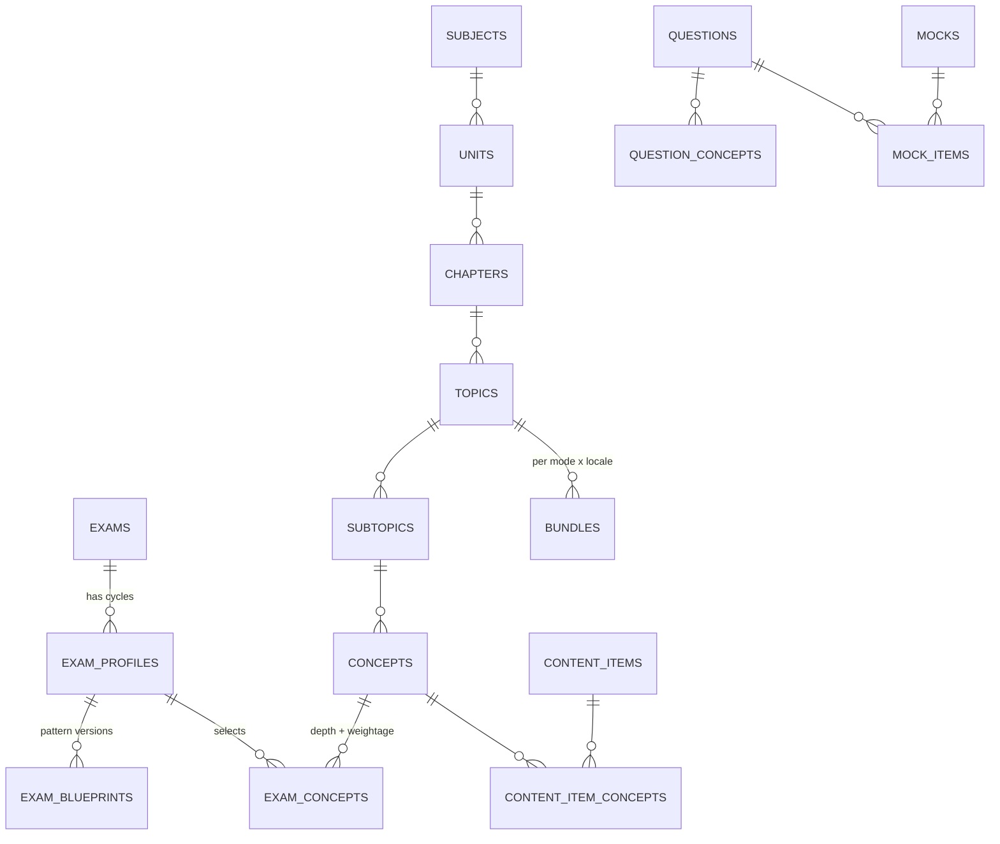
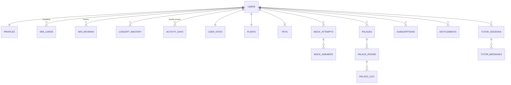

# Smriti — Database Schema

Status: Draft v0.2, 29 Oct 2026 (consistency pass: gaps from `docs/flows/*` added). Read with `TRD.md` (§5, §6, §7, §10, §11) and `PRD.md`.

This document covers three stores:

| Store | Holds | Source of truth for |
|---|---|---|
| **Supabase Postgres** | Accounts, the content catalogue (a projection of `content/`), learning state, review history, gamification, social, billing, AI usage, notifications | Everything a user owns, and money |
| **ClickHouse** | Every raw event (learning and product), forever | Analytics, dashboards, ML signals |
| **On-device storage** (SQLite on mobile, IndexedDB on web) | Cards, decks, the spaced-repetition schedule, memory palaces, notes, the profile snapshot, session state, the action queue, the asset cache index | Nothing; it is a cache plus an outbox, and the server wins on conflict |

---

## 1. Conventions

- **Migrations:** plain SQL in `supabase/migrations/`, applied with the Supabase CLI. This is the only place the schema changes. SQLAlchemy models in `apps/api` mirror it, and CI fails on drift.
- **Schemas** group tables by domain: `app`, `content`, `learn`, `game`, `social`, `billing`, `ai`, `notify`, `ops`. Nothing lives in `public`, and none of these schemas is exposed through the Supabase Data API. Clients only reach data through FastAPI (TRD §1).
- **IDs:**
  - Users are `auth.users.id` (uuid). Guests are real users with `is_anonymous = true`, so every table uses the same `user_id` before and after sign-up. Managed children (under 13) are real users too, with an internal identity no person uses, so every table works for them unchanged (`docs/flows/auth.md` §6.11).
  - Content IDs are stable, readable slugs from the `content/` JSON (for example `phy.kinematics.relative-velocity-1d`), so git diffs and the database agree.
  - Rows created offline use a **client-generated UUIDv7** (time-ordered), which also makes sync idempotent.
  - Other rows use `gen_random_uuid()`.
- **Time:** always `timestamptz`. "Days" for streaks are `date` in the user's own IANA timezone (`app.profiles.timezone`).
- **Localised text:** the `i18n_text` domain, a JSON object keyed by locale (`{"en": "...", "hi": "..."}`). A new language adds keys, not columns.
- **Enumerations** are `text` with a `check` constraint, which is easier to extend than Postgres enums.
- **Every user-owned table** has `user_id uuid not null references auth.users(id) on delete cascade`, so deleting an account (DPDP right to erasure) removes everything.
- **`updated_at`** is maintained by one shared trigger, `app.touch_updated_at()`.
- **Money** is stored in paise (`integer`), never as floats.

```sql
create extension if not exists citext;
create extension if not exists pg_trgm;
create extension if not exists vector;      -- pgvector
create extension if not exists pg_cron;     -- partition upkeep, cleanup

create domain i18n_text as jsonb
  check (jsonb_typeof(value) = 'object' and value <> '{}'::jsonb);
```

---

## 2. Overview





---

## 3. Accounts and profiles (`app`)

```sql
create table app.institutions (                  -- directory for the optional school or coaching field (tutor-social G-S4)
  id          text primary key,
  kind        text not null check (kind in ('school','coaching')),
  name        i18n_text not null,
  city        text not null,
  state       text not null,
  source      text not null,                     -- the public list it was loaded from; the owner picks the source
  active      boolean not null default true
);

create table app.profiles (
  user_id                 uuid primary key references auth.users(id) on delete cascade,
  handle                  citext unique,                 -- for friend search; null for guests; adults only on public surfaces
  nickname_word_ids       text[],                        -- minors: auto-generated public nickname from the fixed word list (config), rendered EN or HI
  nickname_number         smallint,                      -- minors: the number part, e.g. "Sunny Sprout 27"; re-rollable, never typed
  display_name            text,
  avatar_asset_id         uuid,                          -- content.media_assets (private or preset)
  locale                  text not null default 'en' check (locale in ('en','hi')),
  timezone                text not null default 'Asia/Kolkata',
  age_band                text check (age_band in ('u10','10_12','13_17','18p')),
  is_minor                boolean generated always as (age_band in ('u10','10_12','13_17')) stored,
  birth_ym                date,                          -- first of the birth month; only when the student gave a birth year (ONB-04, AUTH-03)
  age_source              text check (age_source in ('class','birth_year','declined','guardian','self_declared')),  -- 'self_declared': the one-time SET-02 Age row
  account_kind            text not null default 'learner'
                            check (account_kind in ('learner','managed','guardian')),
  guardian_consent_state  text not null default 'not_required'
                            check (guardian_consent_state in ('not_required','required','pending','granted','declined','revoked')),
  signed_up_at            timestamptz,                   -- first Google or Apple identity linked; null for guests
  deletion_scheduled_for  timestamptz,                   -- set by an erasure request; erased by the worker after it
  primary_exam_profile_id text,                          -- content.exam_profiles
  daily_goal_xp           smallint not null default 30,
  daily_goal_minutes      smallint not null default 10 check (daily_goal_minutes in (5,10,20,30)),
  settings                jsonb not null default '{}',   -- documented keys below the table
  discoverable            boolean not null default false, -- "Let others find me by username" (SOC-03): set on for adults at sign-in, off for minors
  league_opt_out          boolean not null default false, -- a break from leagues (SET-11); adults join automatically after sign-in (R30)
  institution_id          text references app.institutions(id),  -- optional school or coaching centre (ME-02); never shown to others or sent to analytics
  city                    text,                          -- optional (ME-02), from the same directory's city list; never public
  first_variant           text,                          -- app variant at first launch
  referral_code           text unique,
  referred_by             uuid references auth.users(id),
  onboarding_completed_at timestamptz,
  created_at              timestamptz not null default now(),
  updated_at              timestamptz not null default now()
);

create table app.user_exams (
  user_id          uuid not null references auth.users(id) on delete cascade,
  exam_profile_id  text not null,
  target_date      date,
  is_primary       boolean not null default false,
  self_level       text check (self_level in ('starting','basics','revising')),   -- ONB-07; the plan reads it
  question_language text check (question_language in ('en','hi')),             -- per-exam question language (research A28); null = app language
  created_at       timestamptz not null default now(),
  primary key (user_id, exam_profile_id)
);
create unique index on app.user_exams (user_id) where is_primary;

create table app.guardian_consent_requests (     -- a teen (or a parent) asks; the guardian decides
  id                uuid primary key default gen_random_uuid(),
  learner_user_id   uuid references auth.users(id) on delete cascade,  -- null until claimed when minor.defer_sync_until_consent is on
  claim_secret_hash text unique,                   -- device-held secret for the consent-first variant (auth flow §6.10)
  claimed_at        timestamptz,
  initiated_by      text not null default 'learner' check (initiated_by in ('learner','guardian','device')),
  channel           text not null check (channel in ('handoff','link')),
  code_hash         text not null unique,          -- hash of the 8-character code in the link or QR
  scopes            text[] not null,               -- asked: 'account','social','community','voice','uploads'
  status            text not null default 'pending'
                      check (status in ('pending','granted','declined','expired','cancelled')),
  guardian_user_id  uuid references auth.users(id) on delete set null,
  created_at        timestamptz not null default now(),
  expires_at        timestamptz not null,          -- from auth.consent_handoff_ttl_min or auth.consent_link_ttl_h
  resolved_at       timestamptz,
  check (learner_user_id is not null or claim_secret_hash is not null)
);
create index on app.guardian_consent_requests (learner_user_id, created_at desc);

create table app.guardian_link_requests (        -- AUTH-27: a guardian asks to link an existing teen (auth flow §6.11)
  id                  uuid primary key default gen_random_uuid(),
  guardian_user_id    uuid not null references auth.users(id) on delete cascade,
  learner_user_id     uuid references auth.users(id) on delete cascade,   -- set when the email or invite code matched, or when the teen claims the code
  code_hash           text not null unique,     -- the code the teen claims; reused by the consent request opened on accept
  target_email_hash   text,                     -- HMAC of the teen's email the guardian typed; never the address
  scopes              text[] not null default '{account}',
  status              text not null default 'pending'
                        check (status in ('pending','accepted','declined','expired','cancelled')),
  consent_request_id  uuid references app.guardian_consent_requests(id) on delete set null,  -- opened on accept (initiated_by = 'guardian')
  evidence            jsonb not null default '{}',  -- the teen's accept: time, notice version, app version, platform, scopes shown
  created_at          timestamptz not null default now(),
  expires_at          timestamptz not null,     -- from auth.link_request_ttl_h
  resolved_at         timestamptz
);
create unique index on app.guardian_link_requests (guardian_user_id, learner_user_id)
  where status = 'pending' and learner_user_id is not null;

create table app.guardian_consents (             -- the consent record (DPDP Rule 10)
  id                  uuid primary key default gen_random_uuid(),
  user_id             uuid not null references auth.users(id) on delete cascade,   -- the learner
  guardian_user_id    uuid references auth.users(id) on delete set null,
  guardian_sub_hash   text not null,             -- HMAC of the guardian's Google or Apple sub; proves who consented if the guardian account is deleted
  request_id          uuid references app.guardian_consent_requests(id) on delete set null,
  method              text not null check (method in ('google_same_device','google_own_device','parent_created')),
  age_assurance       text not null check (age_assurance in ('self_declared','digilocker_token','known_adult')),
  scope               jsonb not null,            -- {"account":true,"social":true,"community":false,"voice":false,"uploads":true}
  notice_version      text not null,             -- version of the consent notice shown, per locale
  consented_at        timestamptz not null,
  revoked_at          timestamptz,               -- whole record withdrawn (per-scope changes write a new row)
  superseded_by       uuid references app.guardian_consents(id),
  evidence            jsonb not null default '{}' -- request id, app version, platform, declaration version; no IP, no email
);
create unique index on app.guardian_consents (user_id) where revoked_at is null and superseded_by is null;
create index on app.guardian_consents (guardian_user_id);

create table app.guardian_links (                -- who a guardian is responsible for
  guardian_user_id  uuid not null references auth.users(id) on delete cascade,
  learner_user_id   uuid not null references auth.users(id) on delete cascade,
  kind              text not null check (kind in ('managed','consent')),   -- owns a managed child, or consented for a teen
  relation          text not null default 'parent' check (relation in ('parent','guardian')),
  created_at        timestamptz not null default now(),
  revoked_at        timestamptz,
  primary key (guardian_user_id, learner_user_id)
);
create unique index on app.guardian_links (learner_user_id) where kind = 'managed' and revoked_at is null;  -- one owner per managed child
create index on app.guardian_links (learner_user_id);

create table app.devices (
  id            uuid primary key default gen_random_uuid(),
  user_id       uuid not null references auth.users(id) on delete cascade,
  platform      text not null check (platform in ('ios','android','web')),
  app_variant   text not null,
  app_version   text not null,
  push_token    text unique,                     -- Expo push token (mobile)
  web_push_subscription jsonb,                   -- Web Push endpoint and keys (web app)
  push_enabled  boolean not null default true,   -- the student's switch for this device
  notif_permission text not null default 'not_asked'
                  check (notif_permission in ('not_asked','granted','denied','provisional','not_required')),
  notif_asked_count smallint not null default 0, -- OS prompts shown (ONB-15, NTF-03 re-ask policy)
  timezone      text,
  locale        text,
  last_seen_at  timestamptz not null default now(),
  invalid_at    timestamptz                      -- set when Expo reports the token dead
);
create index on app.devices (user_id);

create table app.account_merges (                -- guest identity already belonged to another account
  id              uuid primary key default gen_random_uuid(),
  source_user_id  uuid not null,                 -- the guest; deleted after merge
  target_user_id  uuid not null references auth.users(id) on delete cascade,
  status          text not null check (status in ('queued','running','done','failed')),
  include_progress boolean not null default true, -- false when the student said "not mine" on AUTH-07
  attempts        smallint not null default 0,
  failure_code    text,
  stats           jsonb not null default '{}',   -- numbers only: lessons_added, xp_added, days_added, streak_before, streak_after, pet_kept
  created_at      timestamptz not null default now(),
  finished_at     timestamptz
);

create table app.exports (                       -- PDF books and DPDP data exports
  id            uuid primary key default gen_random_uuid(),
  user_id       uuid not null references auth.users(id) on delete cascade,
  kind          text not null check (kind in ('pdf_book','data_export')),
  spec          jsonb not null,                  -- topics, modes, locale, options
  status        text not null check (status in ('queued','rendering','ready','failed','expired')),
  r2_key        text,
  pages         integer,
  bytes         bigint,
  requested_at  timestamptz not null default now(),
  completed_at  timestamptz,
  expires_at    timestamptz
);
create index on app.exports (user_id, requested_at desc);

create table app.parental_controls (             -- Parent mode limits per child (SET-16, Phase 3)
  learner_user_id     uuid primary key references auth.users(id) on delete cascade,
  set_by              uuid references auth.users(id) on delete set null,   -- the guardian
  daily_limit_min     smallint check (daily_limit_min in (15,30,45,60,90,120)),   -- null = off
  allowed_from        time,                      -- allowed hours, local time; both null = any time
  allowed_to          time,
  break_reminders     boolean not null default false,
  ask_before_switching boolean not null default false,   -- AUTH-25 opens SET-13 before switching profiles
  tutor_button        boolean not null default false,    -- little learners: preset-questions tutor (R14)
  picture_rhymes      boolean not null default false,    -- little learners: mnemonic forge (memory-labs Q8)
  updated_at          timestamptz not null default now()
);

create table app.time_requests (                 -- "Ask for 15 more minutes" from SET-19
  id                uuid primary key default gen_random_uuid(),
  learner_user_id   uuid not null references auth.users(id) on delete cascade,
  guardian_user_id  uuid references auth.users(id) on delete set null,
  minutes           smallint not null,
  status            text not null default 'pending' check (status in ('pending','allowed','declined','expired')),
  created_at        timestamptz not null default now(),
  decided_at        timestamptz
);
create index on app.time_requests (learner_user_id, created_at desc);

create table app.data_requests (                 -- DPDP: access, correction, erasure
  id            uuid primary key default gen_random_uuid(),
  user_id       uuid not null,
  kind          text not null check (kind in ('access','correction','erasure','withdraw_consent')),
  status        text not null check (status in ('open','in_progress','done','rejected')),
  created_at    timestamptz not null default now(),
  closed_at     timestamptz
);
```

**On sign-up**, a trigger on `auth.users` (`app.handle_new_user()`) creates `app.profiles`, `game.user_stats`, `game.plants` (stage `seed`) and `notify.prefs`. The pet row is created when the student picks a cat or a dog in onboarding.

**Documented `settings` keys** (`app.profiles.settings`): `sound`, `haptics`, `reduced_motion`, `theme`, `mock_dark_mode` (SET-07), `content_locale` (lesson language, SET-06), `tutor_locale`, `analytics_opt_out` (adults only; minors never send product events, me-money flow §4.6), `start_mode` (Quick revision or Deep dive for learned topics, SET-10), `name_display` (adults: full name or first name and initial). Anything another table needs to filter on gets a column instead.

**Public name.** Adults show their display name or handle. Minors show only the auto-generated nickname (`nickname_word_ids` and `nickname_number`, rendered in the viewer's language) with the pet avatar, and only after guardian consent (R31 amended, PRD §16.4). The word list ships in config; its owner and safety review are an open question (`docs/flows/tutor-social.md` Q-B11).

Trigger and auth notes (`docs/flows/auth.md`):
- The trigger fires for **every** new `auth.users` row: anonymous guests at first launch, a Google or Apple sign-in that creates a new account (restore on a fresh install creates the guest first, so this is rare), a guardian's first sign-in, and a managed child created by the API. It must stay cheap and idempotent (`on conflict do nothing`).
- **Linking** Google or Apple to a guest is an update, not an insert, so the trigger doesn't fire again. `POST /v1/auth/linked` sets `signed_up_at`, the display name and the handle (adults) or the nickname (minors, PRD §16.4).
- A guardian's profile gets `account_kind = 'guardian'` from the API after their first consent or Parent-mode sign-in. The game rows the trigger made for them are harmless and stay empty.
- A **"before user created" auth hook** rejects email sign-ups, except internal identities on `AUTH_MANAGED_IDENTITY_DOMAIN` created by the service role for managed children.
- `guardian_consent_state` on the profile is a cache of the active `guardian_consents` row and pending request, kept by the API, so gates read one column.
- **Notification defaults by age:** `app.handle_new_user()` and every `age_band` change set the `notify.prefs` defaults from the band (me-money flow §4.3): minors get only the reminder at their picked time, focus alarms and exam alerts; adults get the full set. A minor can never turn on `smart_timing`, `streak_saver`, `pet_plant_nudges` or `sleep_review` (a check in the API, R34).
- A daily job moves `age_band` forward from `birth_ym`. When a teen turns 18, `guardian_consent_state` becomes `not_required` and the `consent` guardian link gets `revoked_at`.
- **Erasure:** `app.guardian_consents` cascades with the learner. Whether consent records must be kept longer as proof needs legal review; if so, they move to the tombstone pattern used by billing (§8).

---

## 4. Content catalogue (`content`)

These tables are a **projection** of the `content/` folder in git. Only the `content-publish` job (service role) writes them. Lesson cards themselves live in R2 bundles. Postgres holds the graph, the metadata, the search index and anything the server needs for scoring.

### 4.1 Exams, profiles and blueprints

```sql
create table content.exams (
  id               text primary key,           -- 'jee-main', 'neet-ug', 'upsc-cse', 'ssc-cgl', 'cbse-11'
  name             i18n_text not null,
  category         text not null check (category in
                     ('engineering','medical','civil_services','ssc','banking','railways','defence','state','school')),
  conducting_body  text,
  official_url     text,
  is_active        boolean not null default true
);

create table content.exam_profiles (           -- one exam in one cycle: 'jee-main-2027'
  id            text primary key,
  exam_id       text not null references content.exams(id),
  cycle         text not null,                 -- '2027', '2026-27'
  name          i18n_text not null,
  locales       text[] not null default '{en,hi}',
  schedule      jsonb,                         -- official dates for the cycle (application, exam window, result), each with its notification URL; null until announced
  is_active     boolean not null default true,
  published_at  timestamptz
);

create table content.exam_blueprints (         -- drives the generic mock engine (TRD §7.4)
  id               uuid primary key default gen_random_uuid(),
  exam_profile_id  text not null references content.exam_profiles(id),
  paper_code       text not null,              -- 'main', 'paper-1', 'gs-1', 'csat', 'tier-1'
  version          integer not null,
  spec             jsonb not null,             -- sections, timers, lock/switch rules, question types,
                                               -- marking incl. partial, languages, calculator, instructions,
                                               -- interface_profile (buttons, palette_states[]), language_switch,
                                               -- attempt_rule, early_section_submit, exam_day, accommodations,
                                               -- numeric_input (practice flow §12.3); all from the notification
  source_url       text not null,              -- official notification it was encoded from
  verified_at      date not null,
  effective_from   date not null,
  status           text not null check (status in ('draft','active','retired')),
  unique (exam_profile_id, paper_code, version)
);
```

School classes are exam profiles too (`cbse-11-2027`, `up-board-10-2027`), so the same graph, depth and weightage model covers class 1–12.

### 4.2 The concept graph

```sql
create table content.subjects (
  id            text primary key,              -- 'phy', 'chem', 'math', 'bio', 'polity', 'history'
  name          i18n_text not null,
  color_token   text not null,                 -- maps to DESIGN.md subject tint
  icon_asset_id uuid,
  sort          smallint not null
);

create table content.units (
  id text primary key, subject_id text not null references content.subjects(id),
  name i18n_text not null, sort smallint not null
);

create table content.chapters (
  id          text primary key,
  unit_id     text not null references content.units(id),
  subject_id  text not null references content.subjects(id),   -- denormalised for filters
  name        i18n_text not null,
  ncert_ref   text,                                            -- e.g. 'NCERT 11 Physics Ch 4'
  sort        smallint not null
);

create table content.topics (
  id          text primary key,
  chapter_id  text not null references content.chapters(id),
  name        i18n_text not null,
  summary     i18n_text,
  sort        smallint not null
);

create table content.subtopics (
  id text primary key, topic_id text not null references content.topics(id),
  name i18n_text not null, sort smallint not null
);

create table content.concepts (
  id            text primary key,
  subtopic_id   text not null references content.subtopics(id),
  name          i18n_text not null,
  summary       i18n_text not null,            -- also the tutor's grounding text
  key_points    jsonb not null default '[]',   -- used by Feynman grading
  kind          text not null check (kind in
                  ('fact','definition','formula','derivation','process','skill','date','list','diagram')),
  intrinsic_depth smallint not null check (intrinsic_depth between 1 and 5),
  sort          smallint not null
);

create table content.concept_edges (
  from_id  text not null references content.concepts(id),
  to_id    text not null references content.concepts(id),
  kind     text not null check (kind in ('prerequisite','related','contrast','applies_in')),
  primary key (from_id, to_id, kind)
);

create table content.exam_concepts (           -- the heart of "one graph, many exams"
  exam_profile_id text not null references content.exam_profiles(id),
  concept_id      text not null references content.concepts(id),
  depth           smallint not null check (depth between 1 and 5),   -- L1 basic … L5 JEE Advanced
  weightage       numeric(5,2),                -- expected share of marks, from PYQ analysis
  priority        text not null default 'core' check (priority in ('core','high_yield','optional')),
  primary key (exam_profile_id, concept_id)
);
create index on content.exam_concepts (concept_id);
```

### 4.3 Content items, versions, bundles and manifests

```sql
create table content.content_items (
  id              text primary key,
  kind            text not null check (kind in
                    ('lesson','flashcard_set','mnemonic','cheat_sheet','revision_sheet','storybook',
                     'sim','model3d','pano360','video','experiment','mind_map_template')),
  topic_id        text references content.topics(id),
  mode            text check (mode in ('deep_dive','quick_revision')),
  status          text not null check (status in ('draft','review','published','retired')),
  current_version integer not null default 1,
  is_free         boolean not null default false,  -- free-tier gate; limits are flags (TRD §17). Rotating free chapters come from
                                                   -- the flag `free.rotating_chapters`, served in the manifest (learn G6)
  source_path     text not null,                   -- path in content/
  updated_at      timestamptz not null default now()
);

create table content.content_item_concepts (
  item_id    text not null references content.content_items(id),
  concept_id text not null references content.concepts(id),
  role       text not null check (role in ('teaches','revises','tests','mentions')),
  primary key (item_id, concept_id, role)
);

create table content.content_versions (
  item_id         text not null references content.content_items(id),
  version         integer not null,
  locale          text not null,
  content_hash    text not null,
  schema_version  smallint not null,
  changelog       text,
  published_at    timestamptz not null default now(),
  primary key (item_id, version, locale)
);

create table content.bundles (                 -- one JSON file per topic × mode × locale in R2
  id               text primary key,           -- '{topic_id}:{mode}:{locale}'
  topic_id         text not null references content.topics(id),
  mode             text not null,
  locale           text not null,
  hash             text not null,              -- sha256; also the R2 object name
  size_bytes       integer not null,
  card_count       smallint not null,
  min_app_version  text not null,
  published_at     timestamptz not null default now()
);

create table content.bundle_history (          -- keeps old hashes so patches can be built
  bundle_id     text not null references content.bundles(id),
  hash          text not null,
  published_at  timestamptz not null,
  primary key (bundle_id, hash)
);

create table content.bundle_patches (          -- delta patches (TRD §3.2)
  bundle_id   text not null references content.bundles(id),
  from_hash   text not null,
  to_hash     text not null,
  size_bytes  integer not null,
  primary key (bundle_id, from_hash, to_hash)
);

create table content.manifests (
  exam_profile_id text not null references content.exam_profiles(id),
  locale          text not null,
  version         integer not null,
  hash            text not null,
  is_current      boolean not null default false,
  published_at    timestamptz not null default now(),
  primary key (exam_profile_id, locale, version)
);
create unique index on content.manifests (exam_profile_id, locale) where is_current;

create table content.seed_packs (              -- shipped inside each app build
  variant_id   text not null,
  locale       text not null,
  bundle_ids   text[] not null,
  hash         text not null,
  built_at     timestamptz not null default now(),
  primary key (variant_id, locale)
);
```

### 4.4 Questions, PYQs and mocks

Practice questions ship inside bundles with their answers, so practice works offline. **Mock and live-mock answer keys never ship to the device**: they live in `content.question_keys`, which only the API's scoring code reads.

```sql
create table content.questions (
  id               text primary key,
  type             text not null check (type in
                     ('mcq_single','mcq_multi','numerical','integer','matrix_match','match_list',
                      'assertion_reason','statement_based','paragraph','fill_blank','order_steps')),
  locales          text[] not null,
  difficulty       numeric(4,2),               -- IRT b, calibrated from ClickHouse
  discrimination   numeric(4,2),               -- IRT a
  difficulty_label text check (difficulty_label in ('easy','medium','hard')),   -- author's estimate, for filters before calibration
  ideal_time_s     smallint,
  source           text not null check (source in ('original','pyq','ncert_exemplar','adapted')),
  status           text not null check (status in ('draft','review','published','retired')),
  version          integer not null default 1,
  bundle_ref       text,                       -- where the rendered stem and solution live
  search           tsvector
);
create index on content.questions using gin (search);

create table content.question_keys (
  question_id  text primary key references content.questions(id),
  answer       jsonb not null,                 -- option ids, numeric value with tolerance, matrix
  partial_rule jsonb                           -- JEE Advanced-style partial marking, when used
);

create table content.question_concepts (
  question_id text not null references content.questions(id),
  concept_id  text not null references content.concepts(id),
  weight      numeric(3,2) not null default 1,
  primary key (question_id, concept_id)
);
create index on content.question_concepts (concept_id);

create table content.pyq_papers (
  id            text primary key,              -- 'jee-main-2025-jan-22-s1'
  exam_id       text not null references content.exams(id),
  year          smallint not null,
  session_label text,                          -- shift, paper, set
  held_on       date,
  paper_code    text,                          -- matches content.exam_blueprints.paper_code
  blueprint_id  uuid references content.exam_blueprints(id),   -- the pattern in force on held_on
  source_url    text,
  notes         text
);

create table content.pyq_questions (
  paper_id     text not null references content.pyq_papers(id),
  number       smallint not null,
  question_id  text not null references content.questions(id),
  primary key (paper_id, number)
);

create table content.mocks (
  id               text primary key,
  exam_profile_id  text not null references content.exam_profiles(id),
  blueprint_id     uuid not null references content.exam_blueprints(id),
  kind             text not null check (kind in ('full','sectional','chapter','pyq_paper','live')),
  title            i18n_text not null,
  is_free          boolean not null default false,
  window_start     timestamptz,                -- live mocks only
  window_end       timestamptz,
  results_at       timestamptz,                -- live mocks: when rank and percentile are published
  group_id         text,                       -- paired papers taken together (for example paper 1 and paper 2)
  group_order      smallint,
  status           text not null check (status in ('draft','scheduled','open','closed','retired'))
);

create table content.mock_items (
  mock_id       text not null references content.mocks(id),
  section_code  text not null,                 -- matches a section in the blueprint spec
  position      smallint not null,
  question_id   text not null references content.questions(id),
  marking       jsonb,                         -- override of the blueprint default, rarely used
  primary key (mock_id, section_code, position)
);
```

Daily-challenge questions carry the `daily` use tag, and their keys stay in `content.question_keys` like mock keys, so the answer never ships in a practice bundle (practice flow §12.1). PYQ keys are public official keys and ship in practice bundles; a PYQ-paper mock is still scored on the server.

Mocks generated from a student's weak areas are not stored here. They are `learn.mock_attempts` rows with `mock_id = null` and a `generated_spec`.

### 4.5 Media, the image index, sims and videos

```sql
create table content.media_assets (
  id             uuid primary key default gen_random_uuid(),
  sha256         text not null unique,         -- also the R2 object name
  kind           text not null check (kind in
                   ('image','audio','model3d','pano360','lottie','rive','video_clip','svg')),
  mime           text not null,
  bytes          integer not null,
  width          smallint, height smallint, duration_ms integer,
  variants       jsonb not null default '{}',  -- sizes and formats (webp/avif, low LOD)
  source         text not null check (source in ('agnes','deepgram_tts','open_licence','original','user_upload')),
  licence        text,                         -- 'CC BY 4.0', 'MIT', 'owned'
  attribution    text,
  prompt         text,                         -- Agnes prompt or TTS text
  prompt_hash    text,                         -- sha256(normalised prompt + preset + size + model) or TTS key
  style_preset   text,                         -- DESIGN.md illustration preset
  model_version  text,
  alt            i18n_text,                    -- required for images before approval
  tags           text[] not null default '{}',
  embedding      vector(768),                  -- image embedding (CLIP-style); dimension follows D2
  visibility     text not null default 'public' check (visibility in ('public','private')),
  owner_user_id  uuid references auth.users(id) on delete cascade,   -- set for private items
  status         text not null check (status in ('staging','approved','rejected')),
  created_at     timestamptz not null default now()
);
create unique index on content.media_assets (prompt_hash) where prompt_hash is not null and visibility = 'public';
create index on content.media_assets using hnsw (embedding vector_cosine_ops) where status = 'approved';
create index on content.media_assets using gin (tags);

create table content.sims (
  id              text primary key,
  version         text not null,
  r2_prefix       text not null,
  origin          text not null check (origin in ('own','phet','other_open')),
  licence         text not null,
  attribution     text,
  params_schema   jsonb not null default '{}',
  size_bytes      integer not null,
  status          text not null check (status in ('draft','published','retired'))
);

create table content.videos (                  -- YouTube lessons (@examatlas.official)
  youtube_id      text primary key,
  playlist_id     text,
  title           i18n_text not null,
  duration_s      integer,
  topic_id        text references content.topics(id),
  transcript_key  text,                        -- R2 key of the Deepgram or caption transcript
  published_at    timestamptz
);
```

### 4.6 Search and community mnemonics

```sql
create table content.search_docs (             -- one row per searchable card, concept, question or sheet
  id               text primary key,
  ref_kind         text not null,
  ref_id           text not null,
  locale           text not null,
  exam_profile_ids text[] not null,
  title            text not null,
  body             text not null,
  tsv              tsvector not null,          -- 'english' config for en, 'simple' for hi
  embedding        vector(768)
);
create index on content.search_docs using gin (tsv);
create index on content.search_docs using gin (title gin_trgm_ops);
create index on content.search_docs using gin (exam_profile_ids);
create index on content.search_docs using hnsw (embedding vector_cosine_ops);

create table content.mnemonics (               -- published (system or approved community) mnemonics
  id           uuid primary key default gen_random_uuid(),
  concept_id   text not null references content.concepts(id),
  technique    text not null check (technique in
                 ('acronym','acrostic','story','rhyme','song','keyword','pao','major_system',
                  'peg','palace','chunking','visual')),
  locale       text not null,
  body         text not null,
  audio_asset_id uuid references content.media_assets(id),
  image_asset_id uuid references content.media_assets(id),
  exam_style   text,                           -- 'jee', 'upsc', … (course-aware forge)
  origin       text not null check (origin in ('traditional','system','community')),
  submitted_by uuid references auth.users(id) on delete set null,   -- community only; never exposed to other students (R20)
  source_user_mnemonic_id uuid,                -- the submitter's own copy in learn.user_mnemonics
  votes        integer not null default 0,     -- cached count of mnemonic_votes
  status       text not null check (status in ('review','published','retired'))
);
create index on content.mnemonics (concept_id, locale) where status = 'published';

create table content.mnemonic_votes (          -- one "Helpful" vote per signed-in student; no downvotes
  mnemonic_id  uuid not null references content.mnemonics(id) on delete cascade,
  user_id      uuid not null references auth.users(id) on delete cascade,
  created_at   timestamptz not null default now(),
  primary key (mnemonic_id, user_id)
);
```

**RLS for `content`:** `select` is allowed to `anon` and `authenticated` on published or approved rows. There are no `insert`, `update` or `delete` policies, so only the service role writes. `content.question_keys` has RLS on with **no** policies, so only the service role can read it. Two exceptions: `content.mnemonic_votes` is owner only (a student reads and writes their own votes), and `content.mnemonics.submitted_by` is never selected by a client view.

---

## 5. Learning state (`learn`)

### 5.1 Lessons, mastery and the daily plan

```sql
create table learn.lesson_progress (
  user_id          uuid not null references auth.users(id) on delete cascade,
  topic_id         text not null,
  mode             text not null check (mode in ('deep_dive','quick_revision')),
  bundle_hash      text not null,              -- which version they saw
  last_card_index  smallint not null default 0,
  cards_seen       smallint not null default 0,
  bites_completed  text[] not null default '{}', -- bite ids from lesson@1 bites[] (learn G2)
  best_score       smallint,
  completed_at     timestamptz,
  updated_at       timestamptz not null default now(),
  primary key (user_id, topic_id, mode)
);

create table learn.concept_mastery (
  user_id            uuid not null references auth.users(id) on delete cascade,
  concept_id         text not null,
  mastery            real not null default 0,  -- 0..1, from answers and reviews
  attempts           integer not null default 0,
  correct            integer not null default 0,
  avg_time_ms        integer,
  sure_total smallint not null default 0, sure_correct smallint not null default 0,
  fifty_total smallint not null default 0, fifty_correct smallint not null default 0,
  guess_total smallint not null default 0, guess_correct smallint not null default 0,
  calibration        real,                     -- predicted vs actual, for the metacognitive dashboard
  self_confidence    smallint,                 -- the student's own 1..5 rating from LES-07, copied to each concept of the topic
  last_practiced_at  timestamptz,
  updated_at         timestamptz not null default now(),
  primary key (user_id, concept_id)
);

create table learn.daily_plans (
  user_id       uuid not null references auth.users(id) on delete cascade,
  day           date not null,
  items         jsonb not null,                -- ordered: reviews, new topic, drill, mock
  done_items    jsonb not null default '[]',
  generated_at  timestamptz not null default now(),
  primary key (user_id, day)
);

create table learn.topic_status (              -- how a topic became learned, so placement marks can be undone (learn G10)
  user_id      uuid not null references auth.users(id) on delete cascade,
  topic_id     text not null,
  status       text not null check (status in ('not_started','in_progress','learned')),
  learned_via  text check (learned_via in ('lesson','test_out','placement','chapter_test')),
  updated_at   timestamptz not null default now(),
  primary key (user_id, topic_id)
);

create table learn.activity_days (             -- source of truth for streaks and the plant
  user_id            uuid not null references auth.users(id) on delete cascade,
  day                date not null,            -- in the user's timezone
  xp                 integer not null default 0,
  minutes            smallint not null default 0,
  focus_sessions     smallint not null default 0,   -- Pomodoro
  cards_reviewed     smallint not null default 0,
  lessons_completed  smallint not null default 0,
  mock_sections      smallint not null default 0,
  daily_challenge    boolean not null default false,
  qualified          boolean not null default false,  -- one lesson, or 10 reviews, or one mock section, or the daily challenge (R1, R23); drives the streak
  goal_met           boolean not null default false,  -- the daily minutes goal ring only; never decides the streak
  rescue_done        boolean not null default false,  -- a 2-minute rescue finished (MEM-32): a health day for the plant, never a streak day
  rest_day           boolean not null default false,  -- the student's weekly rest day; protects the streak (R28, R36)
  freeze_used        boolean not null default false,
  first_event_at     timestamptz,
  last_event_at      timestamptz,              -- feeds bedtime estimation (TRD §9.6)
  primary key (user_id, day)
);
```

**Plant health days.** A day is a *health day* when `qualified` or `rescue_done` is true. Plant health counts days since the last health day, so a rescue keeps a thirsty plant thriving and stops a droopy plant getting worse. Revival quests (R12) count only `qualified` days, and the streak reads only `qualified`, freezes and rest days. The sync handler and the nightly roll-up both apply this (TRD §10).

### 5.2 Spaced repetition (FSRS)

System cards live in bundles and are referenced by id. Student-made cards live in `learn.cards`. Practice and mock questions can be queued as cards too. `card_ref` covers all three: `c:{content_card_id}`, `u:{uuid}` or `q:{question_id}`. A `q:` card from a mock is created only after that attempt's solutions are released, and a retired question suspends its card like a retired system card (memory-labs §5.14).

```sql
create table learn.decks (
  id             uuid primary key default gen_random_uuid(),
  owner_user_id  uuid references auth.users(id) on delete cascade,   -- null = system deck
  source         text not null check (source in ('system','user','note','transcript','tutor','shared_copy')),
  title          text not null,
  topic_id       text,
  share_code     text unique,                  -- shared decks (social)
  is_public      boolean not null default false,
  share_status   text check (share_status in ('checking','shared','blocked','stopped')),   -- moderation pre-pass in MEM-11
  listed_for_exam text,                        -- exam profile it is listed under in SOC-21 (adults only, flag social.deck_listing)
  helpful_count  integer not null default 0,   -- cached count of deck_helpful_votes
  created_at     timestamptz not null default now(),
  deleted_at     timestamptz
);

create table learn.cards (                     -- student-made cards only
  id              uuid primary key,            -- client UUIDv7
  deck_id         uuid not null references learn.decks(id) on delete cascade,
  owner_user_id   uuid not null references auth.users(id) on delete cascade,
  kind            text not null default 'basic' check (kind in ('basic','basic_reverse','cloze')),
  front           jsonb not null,
  back            jsonb not null,
  image_asset_id  uuid,
  concept_id      text,
  source_ref      text,                        -- note id, tutor message id, transcript offset
  created_at      timestamptz not null default now(),
  deleted_at      timestamptz
);

create table learn.deck_helpful_votes (        -- one "Helpful" per student per shared deck; never shows who voted
  deck_id     uuid not null references learn.decks(id) on delete cascade,
  user_id     uuid not null references auth.users(id) on delete cascade,
  created_at  timestamptz not null default now(),
  primary key (deck_id, user_id)
);

create table learn.srs_cards (                 -- current schedule, one row per card the user has studied
  user_id         uuid not null references auth.users(id) on delete cascade,
  card_ref        text not null,
  deck_id         uuid,
  state           smallint not null,           -- 0 new, 1 learning, 2 review, 3 relearning
  due_at          timestamptz not null,
  stability       real not null,
  difficulty      real not null,
  reps            smallint not null default 0,
  lapses          smallint not null default 0,
  last_review_at  timestamptz,
  suspended       boolean not null default false,
  flags           smallint not null default 0, -- bit 1: leech_seen
  buried_until    date,                        -- sibling cards buried for the day
  updated_at      timestamptz not null default now(),
  primary key (user_id, card_ref)
) partition by hash (user_id);                 -- 16 partitions to start
create index on learn.srs_cards (user_id, due_at) where not suspended;

create table learn.srs_reviews (               -- full review history (owner's architecture)
  id              uuid not null,               -- client UUIDv7, makes sync idempotent
  user_id         uuid not null references auth.users(id) on delete cascade,
  card_ref        text not null,
  rating          smallint not null check (rating between 1 and 4),   -- Again, Hard, Good, Easy (R18)
  confidence      text check (confidence in ('sure','fifty','guess')),
  state_before    smallint not null,
  elapsed_days    real not null,
  scheduled_days  real not null,
  stability_after real not null,
  difficulty_after real not null,
  duration_ms     integer,
  context         text check (context in ('review','lesson','sleep_review','palace_walk','duel')),
  reviewed_at     timestamptz not null,
  primary key (id, reviewed_at)
) partition by range (reviewed_at);            -- monthly partitions
create index on learn.srs_reviews (user_id, reviewed_at desc);

create table learn.fsrs_params (               -- per-user optimised weights, refit monthly
  user_id            uuid primary key references auth.users(id) on delete cascade,
  weights            real[] not null,
  desired_retention  real not null default 0.9,
  review_count       integer not null,
  optimised_at       timestamptz not null
);
```

### 5.3 Practice and mocks

```sql
create table learn.question_attempts (         -- practice, drills, daily challenge, lesson checks
  id            uuid not null,                 -- client UUIDv7
  user_id       uuid not null references auth.users(id) on delete cascade,
  question_id   text not null,
  context       text not null check (context in ('practice','drill','daily','lesson','duel','pyq','chapter_test')),
  session_id    uuid,                          -- learn.practice_sessions, when the answer was part of one
  attempt_no    smallint not null default 1,   -- tries on this question inside the same card or session
  difficulty_shown text,                       -- the difficulty label the student saw
  answer        jsonb not null,
  is_correct    boolean not null,
  time_ms       integer not null,
  confidence    text check (confidence in ('sure','fifty','guess')),
  mistake_type  text check (mistake_type in ('conceptual','calculation','misread','silly','time')),
  hints_used    smallint not null default 0,
  answered_at   timestamptz not null,
  primary key (id, answered_at)
) partition by range (answered_at);
create index on learn.question_attempts (user_id, answered_at desc);

create table learn.mock_attempts (
  id                 uuid primary key,         -- client UUIDv7; created when the mock starts
  user_id            uuid not null references auth.users(id) on delete cascade,
  mock_id            text,                     -- null for a generated weak-area mock
  generated_spec     jsonb,                    -- concepts, counts and blueprint for generated mocks
  blueprint_id       uuid not null,
  language           text not null,
  time_policy        text not null default 'practice' check (time_policy in ('practice','strict','live')),   -- R24
  paused_ms          integer not null default 0,
  pause_count        smallint not null default 0,
  active_device_id   uuid,                     -- one active device per attempt (takeover)
  accommodation      jsonb,                    -- only what the official notification defines
  status             text not null check (status in ('in_progress','submitted','auto_submitted','abandoned')),
  section_state      jsonb not null default '{}',  -- current section, per-section start and lock times
  started_at         timestamptz not null,
  submitted_at       timestamptz,
  server_deadline_at timestamptz not null,     -- the server enforces time, not the device
  score              numeric(6,2),
  max_score          numeric(6,2),
  rank               integer,
  percentile         numeric(5,2),
  created_at         timestamptz not null default now()
);
create index on learn.mock_attempts (user_id, started_at desc);
create index on learn.mock_attempts (mock_id, score desc) where status in ('submitted','auto_submitted');

create table learn.mock_answers (              -- one row per question, upserted by autosave
  attempt_id          uuid not null references learn.mock_attempts(id) on delete cascade,
  question_id         text not null,
  section_code        text not null,
  palette_status      text not null check (palette_status in
                        ('not_visited','not_answered','answered','marked','answered_marked')),
  answer              jsonb,
  time_spent_ms       integer not null default 0,
  visits              smallint not null default 0,
  first_seen_seq      smallint,                -- order of first visit
  answered_seq        smallint,                -- order of first answer (attempt order)
  answer_changes      smallint not null default 0,
  confidence          text check (confidence in ('sure','fifty','guess')),
  is_correct          boolean,                 -- filled at scoring
  marks_awarded       numeric(5,2),
  mistake_type        text check (mistake_type in ('conceptual','calculation','misread','silly','time')),
  client_updated_at   timestamptz not null,    -- last write wins by this value
  primary key (attempt_id, question_id)
);

create table learn.mock_reports (              -- computed once at submit; read many times
  attempt_id    uuid primary key references learn.mock_attempts(id) on delete cascade,
  report        jsonb not null,                -- by subject, section, concept; time buckets;
                                               -- right-but-slow, fast-and-wrong, lucky guesses; next steps
  report_version smallint not null,
  generated_at  timestamptz not null default now()
);

create table learn.mock_registrations (       -- live mocks (Phase 3)
  mock_id        text not null,
  user_id        uuid not null references auth.users(id) on delete cascade,
  registered_at  timestamptz not null default now(),
  reminded_at    timestamptz,
  primary key (mock_id, user_id)
);

create table learn.practice_sessions (         -- drills and practice runs, for history (PRC-16)
  id          uuid primary key,                -- client UUIDv7
  user_id     uuid not null references auth.users(id) on delete cascade,
  kind        text not null check (kind in ('drill','weak_spots','pyq','chapter_test','custom')),
  spec        jsonb not null,                  -- concepts, filters, counts
  started_at  timestamptz not null,
  ended_at    timestamptz,
  answered    smallint not null default 0,
  correct     smallint not null default 0
);
create index on learn.practice_sessions (user_id, started_at desc);
```

The per-click palette log (every visit, answer and change with timestamps) goes to ClickHouse only. `mock_answers` keeps the totals the report needs.

### 5.4 Memory tools: palaces, notes, mind maps, mnemonics and tags

```sql
create table learn.palaces (
  id           uuid primary key,               -- client UUIDv7, built offline
  user_id      uuid not null references auth.users(id) on delete cascade,
  name         text not null,
  template     text not null check (template in ('home','school','monument','pano360','custom')),
  pano_asset_id uuid,
  created_at   timestamptz not null default now(),
  updated_at   timestamptz not null default now(),
  deleted_at   timestamptz
);

create table learn.palace_rooms (
  id                  uuid primary key,
  palace_id           uuid not null references learn.palaces(id) on delete cascade,
  name                text not null,
  sort                smallint not null,
  background_asset_id uuid
);

create table learn.palace_loci (
  id             uuid primary key,
  room_id        uuid not null references learn.palace_rooms(id) on delete cascade,
  sort           smallint not null,             -- walk order
  pos            jsonb not null,                -- {x,y} for a picture room, {yaw,pitch} for 360°
  item_ref       text not null,                 -- card_ref, concept id or mnemonic id
  note           text,
  image_asset_id uuid
);

create table learn.notes (                      -- smart Cornell notepad
  id            uuid primary key,               -- client UUIDv7
  user_id       uuid not null references auth.users(id) on delete cascade,
  topic_id      text,
  concept_ids   text[] not null default '{}',
  title         text not null,
  cues          jsonb not null default '[]',    -- left column; AI can fill
  body          jsonb not null,                 -- rich text
  summary       text,                           -- bottom; AI can fill
  ai_filled_at  timestamptz,
  deck_id       uuid references learn.decks(id),-- after "turn into flashcards"
  created_at    timestamptz not null default now(),
  updated_at    timestamptz not null default now(),
  deleted_at    timestamptz
);
create index on learn.notes (user_id, updated_at desc);

create table learn.mind_maps (
  id             uuid primary key,
  user_id        uuid not null references auth.users(id) on delete cascade,
  root_topic_id  text,
  graph          jsonb not null,                -- nodes, edges, annotations, cross-subject links
  origin         text not null check (origin in ('ai','user')),
  updated_at     timestamptz not null default now()
);

create table learn.user_mnemonics (             -- forge output and the student's own hooks
  id             uuid primary key,
  user_id        uuid not null references auth.users(id) on delete cascade,
  concept_id     text,
  card_ref       text,
  technique      text not null,                 -- same list as content.mnemonics
  body           text not null,
  image_asset_id uuid,
  audio_asset_id uuid,
  origin         text not null check (origin in ('ai','user')),
  shared_for_review boolean not null default false,   -- offered to the community pool
  created_at     timestamptz not null default now()
);

create table learn.emotion_tags (
  user_id     uuid not null references auth.users(id) on delete cascade,
  item_ref    text not null,                    -- card_ref or concept id
  emoji       text,
  feeling     text,
  note        text,
  created_at  timestamptz not null default now(),
  primary key (user_id, item_ref)
);

create table learn.bookmarks (
  id         uuid primary key,
  user_id    uuid not null references auth.users(id) on delete cascade,
  item_ref   text not null,
  kind       text not null check (kind in ('bookmark','highlight','formula_vault','shortcut_vault')),
  range      jsonb,
  note       text,
  created_at timestamptz not null default now()
);
create index on learn.bookmarks (user_id, kind, created_at desc);

create table learn.content_reports (            -- SET-24, the one report sheet for all content (R39)
  id          uuid primary key default gen_random_uuid(),
  user_id     uuid references auth.users(id) on delete set null,
  kind        text not null check (kind in
                ('lesson_card','question','review_card','solution','tutor_message','generated_image',
                 'story_page','roleplay_turn','community_mnemonic','lab','album_card')),
  item_ref    text not null,                      -- card, question, message, asset or 'mn:{id}' for a community mnemonic
  bundle_hash text,
  locale      text,
  reason      text not null check (reason in ('wrong','unclear','typo','translation','offensive','spam','other')),
                                                  -- 'spam' only when kind = 'community_mnemonic' (checked in the service)
  note        text,                               -- optional, 280 characters; never sent to analytics; not offered under 13
  status      text not null default 'open' check (status in ('open','accepted','fixed','rejected')),
  created_at  timestamptz not null default now()
);
create index on learn.content_reports (kind, status, created_at);

create table learn.lab_progress (               -- recent labs, readings and task results across devices (memory-labs G6)
  user_id         uuid not null references auth.users(id) on delete cascade,
  item_id         text not null,                -- content item of kind sim, model3d, pano360 or experiment
  last_opened_at  timestamptz not null,
  tasks           jsonb not null default '{}',  -- task id → result
  readings        jsonb not null default '{}',  -- typed readings for host-checked tasks
  completed_at    timestamptz,
  primary key (user_id, item_id)
);
```

Shared decks (Phase 2) use `learn.decks.share_code`, `share_status` and `learn.deck_helpful_votes`. The owner's name is never stored on a copy or shown in SOC-21 (R20). Shared decks and people are reported in SOC-23 (`social.user_reports`); everything else goes to `learn.content_reports` (R39).

---

## 6. Gamification (`game`)

```sql
create table game.user_stats (
  user_id             uuid primary key references auth.users(id) on delete cascade,
  xp_total            bigint not null default 0,
  xp_week             integer not null default 0,
  week_start          date,
  level               smallint not null default 1,
  gems                integer not null default 0 check (gems >= 0),
  current_streak      integer not null default 0,
  longest_streak      integer not null default 0,
  streak_last_day     date,
  freezes_available   smallint not null default 1,
  updated_at          timestamptz not null default now()
);

create table game.plants (
  user_id           uuid primary key references auth.users(id) on delete cascade,
  species           text not null default 'tulsi',
  skin              text,
  growth_points     integer not null default 0,     -- only goes up
  stage             text not null default 'seed' check (stage in ('seed','sprout','sapling','flowering','tree')),
  health            text not null default 'thriving' check (health in ('thriving','droopy','dry','wilted','dormant')),
  last_watered_day  date,
  revival_progress  smallint not null default 0,    -- study days into a revival quest (R12)
  updated_at        timestamptz not null default now()
);

create table game.plant_history (                   -- past plants in the garden (ME-09) after "Plant a new seed"
  id            uuid primary key default gen_random_uuid(),
  user_id       uuid not null references auth.users(id) on delete cascade,
  species       text not null,
  skin          text,
  stage         text not null,                      -- the stage it reached
  growth_points integer not null,
  planted_on    date not null,
  retired_on    date not null
);
create index on game.plant_history (user_id, retired_on desc);

create table game.pets (
  user_id        uuid primary key references auth.users(id) on delete cascade,
  species        text not null check (species in ('cat','dog')),
  name           text not null,
  mood           smallint not null default 80 check (mood between 0 and 100),
  energy         smallint not null default 80 check (energy between 0 and 100),
  state          text not null default 'happy',     -- derived label, cached for widgets
  outfit_ids     text[] not null default '{}',
  room_theme     text,                              -- pet room backdrop from the shop
  last_cared_at  timestamptz,
  last_decay_day date,
  updated_at     timestamptz not null default now()
);

create table game.xp_ledger (
  event_id     uuid not null,                       -- the event that earned it; idempotent
  user_id      uuid not null references auth.users(id) on delete cascade,
  amount       integer not null,
  source       text not null check (source in ('lesson','review','practice','mock','quest','duel','challenge','lab','experiment','bonus','admin')),   -- no XP for the focus timer
  ref          text,
  occurred_at  timestamptz not null,
  primary key (event_id, occurred_at)
) partition by range (occurred_at);
create index on game.xp_ledger (user_id, occurred_at desc);

create table game.gem_ledger (                      -- currency: kept forever, never partitioned away
  id          uuid primary key default gen_random_uuid(),
  user_id     uuid not null references auth.users(id) on delete cascade,
  delta       integer not null,
  reason      text not null,
  ref         text,
  created_at  timestamptz not null default now()
);
create index on game.gem_ledger (user_id, created_at desc);

create table game.streak_freezes (
  id          uuid primary key default gen_random_uuid(),
  user_id     uuid not null references auth.users(id) on delete cascade,
  source      text not null check (source in ('monthly','pro_monthly','shop','reward')),
  granted_at  timestamptz not null default now(),
  used_on     date
);

create table game.quests (
  id           text primary key,
  period       text not null check (period in ('daily','weekly','event')),
  spec         jsonb not null,                      -- counter, target, filters
  reward       jsonb not null,                      -- xp, gems, item
  active_from  date not null,
  active_to    date
);

create table game.user_quests (
  user_id       uuid not null references auth.users(id) on delete cascade,
  quest_id      text not null references game.quests(id),
  period_start  date not null,
  progress      integer not null default 0,
  target        integer not null,
  completed_at  timestamptz,
  claimed_at    timestamptz,
  primary key (user_id, quest_id, period_start)
);

create table game.badges (
  id text primary key, name i18n_text not null, description i18n_text not null,
  asset_id uuid, rule jsonb not null, tier smallint not null default 1
);
create table game.user_badges (
  user_id uuid not null references auth.users(id) on delete cascade,
  badge_id text not null references game.badges(id),
  earned_at timestamptz not null default now(),
  primary key (user_id, badge_id)
);

create table game.collections (                     -- illustrated card albums; item metadata (art, text) ships in content bundles
  id text primary key, name i18n_text not null, item_ids text[] not null
);
create table game.user_collection_items (
  user_id uuid not null references auth.users(id) on delete cascade,
  collection_id text not null references game.collections(id),
  item_id text not null,
  earned_at timestamptz not null default now(),
  primary key (user_id, collection_id, item_id)
);

create table game.shop_items (
  id text primary key,
  kind text not null check (kind in ('freeze','pet_outfit','plant_skin','theme','palace_room','treat','room_theme')),
  price_gems integer not null, pro_only boolean not null default false,   -- gems are never sold for money (R36)
  asset_id uuid, active boolean not null default true
);
create table game.inventory (
  user_id uuid not null references auth.users(id) on delete cascade,
  item_id text not null references game.shop_items(id),
  qty smallint not null default 1,
  acquired_at timestamptz not null default now(),
  primary key (user_id, item_id)
);

-- Leagues: live ranks in Redis sorted sets; persisted at Sunday rollover
create table game.league_cohorts (                  -- groups of 30 within one exam (R30)
  id           uuid primary key default gen_random_uuid(),
  week_start   date not null,
  tier         smallint not null check (tier between 1 and 10),   -- 1 Seed … 10 Banyan; names live in config (R30)
  exam_group   text not null,                       -- leagues are grouped by exam
  status       text not null check (status in ('open','closed'))
);
create index on game.league_cohorts (week_start, tier, exam_group);

create table game.league_members (
  cohort_id  uuid not null references game.league_cohorts(id) on delete cascade,
  user_id    uuid not null references auth.users(id) on delete cascade,
  xp         integer not null default 0,
  final_rank smallint,
  result     text check (result in ('promoted','stayed','demoted')),
  primary key (cohort_id, user_id)
);
create index on game.league_members (user_id);

create table game.daily_challenges (
  id               uuid primary key default gen_random_uuid(),
  exam_profile_id  text not null,
  day              date not null,                   -- an IST day: the challenge rolls at 00:00 IST (R23)
  question_id      text not null,
  unique (exam_profile_id, day)
);
create table game.daily_challenge_results (
  challenge_id uuid not null references game.daily_challenges(id),
  user_id      uuid not null references auth.users(id) on delete cascade,
  correct      boolean not null,
  time_ms      integer not null,
  submitted_at timestamptz not null default now(),
  primary key (challenge_id, user_id)
);

create table game.squad_quests (                    -- weekly cooperative squad targets (tutor-social G-S6)
  id           text primary key,
  spec         jsonb not null,                      -- counter and target, from gamification config
  reward       jsonb not null,
  active_from  date not null,
  active_to    date
);
create table game.squad_quest_progress (
  squad_id      uuid not null references social.squads(id) on delete cascade,
  quest_id      text not null references game.squad_quests(id),
  week_start    date not null,
  progress      integer not null default 0,
  target        integer not null,
  completed_at  timestamptz,
  contributors  uuid[] not null default '{}',       -- members who get the reward
  primary key (squad_id, quest_id, week_start)
);
```

Squad names come from a curated two-part list in config (EN and HI), never free text. `game.squad_quest_progress` is created in the social migration because it references `social.squads`.

**Who writes what:** the sync handler updates `activity_days`, `user_stats`, `xp_ledger`, `plants` and `pets` in the same transaction as the learning rows, so a retried batch changes nothing twice. The nightly roll-up job (per timezone bucket) applies decay to pets and plants and closes streaks for users who did not sync that day.

---

## 7. Social (`social`)

```sql
create table social.friendships (               -- one row per pair, user_a < user_b
  user_a        uuid not null references auth.users(id) on delete cascade,
  user_b        uuid not null references auth.users(id) on delete cascade,
  status        text not null check (status in ('pending','accepted','blocked')),
  requested_by  uuid not null,
  created_at    timestamptz not null default now(),
  accepted_at   timestamptz,
  primary key (user_a, user_b),
  check (user_a < user_b)
);
create index on social.friendships (user_b);

create table social.duos (                      -- two friends keep a shared streak
  id                  uuid primary key default gen_random_uuid(),
  user_a              uuid not null references auth.users(id) on delete cascade,
  user_b              uuid not null references auth.users(id) on delete cascade,
  status              text not null check (status in ('invited','active','ended')),
  shared_streak       integer not null default 0,
  best_streak         integer not null default 0,   -- best shared streak for this pair (SOC-25)
  last_both_active    date,                         -- both had a qualifying day (R1), each by their own local midnight
  started_at          timestamptz,
  ended_at            timestamptz
);
create unique index on social.duos (least(user_a,user_b), greatest(user_a,user_b)) where status <> 'ended';
-- Per-student cap (R32): a trigger rejects an insert or an 'active' update when either student already has
-- `social.duo_max_partners` (flag, default 5) Duos that aren't ended. The API checks first; the trigger is the backstop.

create table social.squads (
  id               uuid primary key default gen_random_uuid(),
  name             text not null,
  owner_id         uuid not null references auth.users(id) on delete cascade,
  exam_profile_id  text,
  invite_code      text not null unique,
  max_members      smallint not null default 20,
  created_at       timestamptz not null default now()
);
create table social.squad_members (
  squad_id  uuid not null references social.squads(id) on delete cascade,
  user_id   uuid not null references auth.users(id) on delete cascade,
  role      text not null default 'member' check (role in ('owner','admin','member')),
  joined_at timestamptz not null default now(),
  primary key (squad_id, user_id)
);
create index on social.squad_members (user_id);

create table social.duels (                     -- realtime over Supabase Realtime channel 'duel:{id}'
  id               uuid primary key default gen_random_uuid(),
  challenger_id    uuid not null references auth.users(id) on delete cascade,
  opponent_id      uuid references auth.users(id) on delete cascade,   -- null = random match
  exam_profile_id  text not null,
  question_ids     text[] not null,
  mode             text not null default 'live' check (mode in ('live','async','solo')),   -- 'solo': "Practise solo", unranked (R31)
  status           text not null check (status in ('pending','live','finished','expired','declined','abandoned')),
  scores           jsonb not null default '{}',
  winner_id        uuid,
  abandoned_by     uuid references auth.users(id) on delete set null,   -- a quit gives the other player the win
  flagged_fast     boolean not null default false,  -- answers under `duel_min_answer_ms`; kept out of leagues and boards
  created_at       timestamptz not null default now(),
  started_at       timestamptz,
  finished_at      timestamptz
);
create index on social.duels (challenger_id, created_at desc);
create index on social.duels (opponent_id, created_at desc);

create table social.duel_answers (              -- per-question answers, written with idempotency keys (they touch XP)
  duel_id      uuid not null references social.duels(id) on delete cascade,
  user_id      uuid not null references auth.users(id) on delete cascade,
  question_id  text not null,
  answer       jsonb not null,
  is_correct   boolean not null,
  time_ms      integer not null,
  answered_at  timestamptz not null,
  primary key (duel_id, user_id, question_id)
);
-- Quit cooldown: the API counts abandoned_by rows in the last `duel_quit_window_hours` (no extra table).

create table social.nudges (                    -- "cheer" and "nudge" a friend, rate-limited
  id          uuid primary key default gen_random_uuid(),
  from_user   uuid not null references auth.users(id) on delete cascade,
  to_user     uuid not null references auth.users(id) on delete cascade,
  kind        text not null check (kind in ('nudge','cheer','challenge')),
  preset_id   text not null,                    -- the fixed message from config; no free text (B2)
  created_at  timestamptz not null default now()
);

create table social.activity_items (            -- friend activity cards in SOC-01, from events the server already has
  id          uuid primary key default gen_random_uuid(),
  user_id     uuid not null references auth.users(id) on delete cascade,   -- whose activity
  kind        text not null check (kind in ('streak_milestone','league_promoted','badge_earned','duo_milestone')),
  ref         text,
  created_at  timestamptz not null default now()
);
create index on social.activity_items (user_id, created_at desc);

create table social.reactions (                 -- one preset reaction per item per person
  item_id     uuid not null references social.activity_items(id) on delete cascade,
  user_id     uuid not null references auth.users(id) on delete cascade,
  reaction    text not null check (reaction in ('clap','star','strong','smile')),
  created_at  timestamptz not null default now(),
  primary key (item_id, user_id)
);

create table social.user_reports (              -- SOC-23: people and shared decks (R39)
  id          uuid primary key default gen_random_uuid(),
  reporter_id uuid not null references auth.users(id) on delete cascade,
  target_kind text not null default 'person' check (target_kind in ('person','deck')),
  target_id   uuid references auth.users(id) on delete cascade,   -- person reports
  deck_id     uuid references learn.decks(id) on delete cascade,   -- deck reports; the author is never shown to the reporter
  reason      text not null check (reason in
                ('inappropriate_username','cheating','bullying','impersonation',      -- person
                 'wrong_facts','copied','inappropriate_words','spam',                  -- deck
                 'other')),
  note        text,
  status      text not null default 'open' check (status in ('open','actioned','dismissed')),
  created_at  timestamptz not null default now(),
  check ((target_kind = 'person' and target_id is not null) or (target_kind = 'deck' and deck_id is not null))
);
```

**Minors on social surfaces (R31 amended, PRD §16.4):** a minor appears to other students only after guardian consent, and then only as the pet avatar and the auto-generated nickname from `app.profiles.nickname_word_ids` and `nickname_number`. Friends added by invite link or QR see the pet name. A minor's real name, first name, initial and handle are never shown to another student. Social tables are only written after guardian consent for users under 18.

---

## 8. Billing (`billing`)

```sql
create table billing.products (
  id                text primary key,             -- 'pro_monthly_web', 'pro_monthly_android_jee'
  platform          text not null check (platform in ('web','android','ios')),
  variant_id        text,                         -- per-exam apps sell their own product
  store_product_id  text not null,
  price_paise       integer not null,             -- 9900
  intro_price_paise integer,                      -- 100
  period            text not null check (period in ('month','year')),
  entitlement       text not null default 'pro',
  active            boolean not null default true
);

create table billing.subscriptions (
  id                    uuid primary key default gen_random_uuid(),
  user_id               uuid not null,             -- no FK: kept after erasure (see below)
  source                text not null check (source in ('razorpay','play','app_store','promo')),   -- 'promo': a billing.promo_grants row
  external_id           text not null,             -- Razorpay sub id, RevenueCat original transaction, or the promo grant id
  payer                 text not null default 'self' check (payer in ('self','guardian_declared','guardian')),   -- a parent paying (PAY-03, PAY-17)
  product_id            text not null references billing.products(id),
  status                text not null check (status in
                          ('created','authenticated','pending','trialing','active','grace','on_hold','paused','cancelled','halted','expired')),
                                                   -- 'authenticated': Razorpay mandate approved before the first charge; 'pending': a retry in progress
  is_intro              boolean not null default false,
  current_period_start  timestamptz,
  current_period_end    timestamptz,
  cancel_at_period_end  boolean not null default false,
  started_at            timestamptz,
  ended_at              timestamptz,
  updated_at            timestamptz not null default now(),
  unique (source, external_id)
);
create index on billing.subscriptions (user_id);

create table billing.entitlements (               -- what the app reads; recomputed on every webhook
  user_id          uuid not null references auth.users(id) on delete cascade,
  entitlement      text not null,                 -- 'pro'
  active           boolean not null,
  subscription_id  uuid references billing.subscriptions(id),
  expires_at       timestamptz,
  grace_until      timestamptz,
  updated_at       timestamptz not null default now(),
  primary key (user_id, entitlement)
);

create table billing.payments (                   -- each charge, for reconciliation
  id                   uuid primary key default gen_random_uuid(),
  subscription_id      uuid not null references billing.subscriptions(id),
  external_payment_id  text not null unique,
  amount_paise         integer not null,
  status               text not null check (status in ('captured','failed','refunded')),
  method               text,                       -- 'upi_autopay', 'card', 'store'
  paid_at              timestamptz not null
);

create table billing.payment_events (             -- every webhook, raw, kept for audit
  id                 uuid primary key default gen_random_uuid(),
  source             text not null,
  external_event_id  text not null,
  event_type         text not null,
  user_id            uuid,
  payload            jsonb not null,
  signature_ok       boolean not null,
  received_at        timestamptz not null default now(),
  processed_at       timestamptz,
  error              text,
  unique (source, external_event_id)              -- replay protection
);

create table billing.promo_grants (               -- free Pro time not bought in a store (PRD §8 referral week)
  id           uuid primary key default gen_random_uuid(),
  user_id      uuid not null references auth.users(id) on delete cascade,
  reason       text not null check (reason in ('referral_week')),
  ref          text,                              -- the referral that earned it
  starts_at    timestamptz not null,
  ends_at      timestamptz not null,
  created_at   timestamptz not null default now()
);
create index on billing.promo_grants (user_id, ends_at desc);

create table billing.payment_links (              -- "Send to my parent": one-time web link (me-money flow §5.12)
  id               uuid primary key default gen_random_uuid(),
  learner_user_id  uuid not null references auth.users(id) on delete cascade,
  token_hash       text not null unique,          -- the link token, hashed
  product_id       text not null references billing.products(id),
  status           text not null default 'open' check (status in ('open','paid','expired','cancelled')),
  expires_at       timestamptz not null,          -- 48 h after creation (me-money flow §5.12)
  paid_at          timestamptz,
  created_at       timestamptz not null default now()
);

create table billing.intro_claims (               -- one ₹1 month per person (TRD §11)
  claim_key    text primary key,                  -- HMAC-SHA256(pepper, 'google:'||sub) or (pepper, 'apple:'||sub); survives erasure
  key_kind     text not null check (key_kind in ('google_sub','apple_sub')),
  key_version  smallint not null default 1,       -- pepper version; a new pepper never rewrites old keys
  user_id      uuid,                              -- cleared on erasure
  source       text not null,                     -- 'play', 'app_store', 'razorpay'
  variant_id   text,
  claimed_at   timestamptz not null default now()
);
create index on billing.intro_claims (user_id);
```

Billing rows (`subscriptions`, `payments`, `payment_events`) are kept for 8 years for tax records, even after account deletion, so they have no cascading foreign key to `auth.users`. On erasure, the deletion job replaces `user_id` with a tombstone ID and clears `intro_claims.user_id`, keeping the hashed claim keys so a re-created account can't claim the ₹1 month again. Device signals for the same purpose live with Apple (DeviceCheck) and Google (Play Integrity device recall), not in our database. `entitlements` is derived, so it cascades. The entitlement recompute reads active `subscriptions` and current `promo_grants` together, so a referral week and a paid plan never conflict. The retention period needs legal sign-off.

---

## 9. AI (`ai`)

```sql
create table ai.tutor_sessions (
  id               uuid primary key default gen_random_uuid(),
  user_id          uuid not null references auth.users(id) on delete cascade,
  mode             text not null check (mode in ('chat','feynman','doubt_photo','voice','roleplay')),
  context_ref      text,                          -- card, concept or question
  exam_profile_id  text,
  locale           text not null,
  started_at       timestamptz not null default now(),
  ended_at         timestamptz,
  message_count    smallint not null default 0
);
create index on ai.tutor_sessions (user_id, started_at desc);

create table ai.tutor_messages (
  id          uuid not null default gen_random_uuid(),
  session_id  uuid not null,
  user_id     uuid not null references auth.users(id) on delete cascade,
  role        text not null check (role in ('user','assistant','tool')),
  content     text not null,
  attachments jsonb not null default '[]',        -- image asset ids, photo upload keys
  tool_calls  jsonb,
  tokens_in   integer, tokens_out integer,
  flagged     boolean not null default false,
  created_at  timestamptz not null default now(),
  primary key (id, created_at)
) partition by range (created_at);                -- dropped after 180 days
create index on ai.tutor_messages (session_id, created_at);

create table ai.message_feedback (               -- AI-05 thumbs and reason codes; no free text
  message_id  uuid not null,
  user_id     uuid not null references auth.users(id) on delete cascade,
  rating      text not null check (rating in ('up','down')),
  reasons     text[] not null default '{}',         -- 'wrong','confusing','too_long','not_answered','wrong_language','not_suitable'
  created_at  timestamptz not null default now(),
  primary key (message_id, user_id)
);

create table ai.generated_stories (               -- AI-20 stories; deleted after 180 days unless saved
  id          uuid primary key default gen_random_uuid(),
  user_id     uuid not null references auth.users(id) on delete cascade,
  concept_id  text,
  locale      text not null,
  pages       jsonb not null,                       -- text and image asset ids per page
  saved       boolean not null default false,
  created_at  timestamptz not null default now()
);
create index on ai.generated_stories (user_id, created_at desc);

create table ai.feynman_scores (
  id           uuid primary key default gen_random_uuid(),
  session_id   uuid not null references ai.tutor_sessions(id) on delete cascade,
  user_id      uuid not null references auth.users(id) on delete cascade,
  concept_id   text not null,
  clarity      smallint not null check (clarity between 0 and 100),
  completeness smallint not null check (completeness between 0 and 100),
  accuracy     smallint not null check (accuracy between 0 and 100),
  gaps         jsonb not null default '[]',       -- key points missed, misconceptions
  created_at   timestamptz not null default now()
);

create table ai.voice_sessions (
  id              uuid primary key default gen_random_uuid(),
  user_id         uuid not null references auth.users(id) on delete cascade,
  tutor_session_id uuid references ai.tutor_sessions(id),
  provider        text not null default 'gemini_live',
  token_expires_at timestamptz not null,
  started_at      timestamptz not null default now(),
  ended_at        timestamptz,
  seconds         integer,
  transcript_key  text                              -- R2, private
);

create table ai.doubt_photos (                    -- photo doubt, AI-16 to AI-19 (migration 20261030200004)
  id               uuid primary key default gen_random_uuid(),
  user_id          uuid not null references auth.users(id) on delete cascade,
  storage_key      text,                            -- R2 uploads, private; null once deleted; no user id in it
  mime             text not null,                   -- image/jpeg, image/png, image/webp
  bytes            integer not null,
  status           text not null,                   -- read, unreadable, rejected, solved
  reason           text,                            -- why a read failed: blurry, no_question, multiple, unreadable, not_study, personal, unsafe, ai_unavailable
  question_text    text,                            -- the recognised question, editable by the student
  subject          text,
  exam_profile_id  text,
  session_id       uuid references ai.tutor_sessions(id) on delete set null,   -- the AI-19 chat
  revealed_at      timestamptz,                     -- "Show full solution"
  created_at       timestamptz not null default now(),
  deleted_at       timestamptz
);                                                -- owner read; API writes; ai.tutor_retention_days

create table ai.generations (                     -- every non-chat AI job, for cost and debugging
  id           uuid primary key default gen_random_uuid(),
  user_id      uuid references auth.users(id) on delete set null,   -- null for content jobs
  kind         text not null check (kind in
                 ('image','tts','stt','story','mnemonic','cornell_fill','mind_map','cards_from_transcript',
                  'doubt_photo','embedding')),
  provider     text not null,                       -- 'agnes', 'deepgram', 'gemini'
  model        text not null,
  input_hash   text not null,
  asset_id     uuid,                                -- content.media_assets when the output is media
  cache_hit    boolean not null default false,
  cost_micros  bigint,                              -- micro-rupees
  latency_ms   integer,
  status       text not null check (status in ('ok','error','blocked')),
  trace_id     text,
  created_at   timestamptz not null default now()
);
create index on ai.generations (user_id, created_at desc);

create table ai.usage_daily (                     -- quotas and fair-use limits
  user_id       uuid not null references auth.users(id) on delete cascade,
  day           date not null,
  tier          text not null,                      -- 'tutor', 'cheap', 'voice', 'image', 'tts'
  requests      integer not null default 0,
  tokens_in     bigint not null default 0,
  tokens_out    bigint not null default 0,
  units         integer not null default 0,         -- images, voice seconds, TTS characters
  cost_micros   bigint not null default 0,
  primary key (user_id, day, tier)
);

create table ai.moderation_flags (
  id           uuid primary key default gen_random_uuid(),
  user_id      uuid references auth.users(id) on delete set null,
  source_kind  text not null,                       -- 'tutor_message', 'user_mnemonic', 'upload'
  source_id    text not null,
  category     text not null,
  score        real,
  action       text not null check (action in ('allowed','blocked','queued')),
  reviewed_by  uuid,
  created_at   timestamptz not null default now()
);
```

The image cache and TTS cache are `content.media_assets` rows looked up by `prompt_hash`. There's no separate cache table.

---

## 10. Notifications (`notify`)

```sql
create table notify.prefs (                       -- groups and defaults by age: docs/flows/me-money.md §4.3
  user_id              uuid primary key references auth.users(id) on delete cascade,
  reminder_enabled     boolean not null default true,
  daily_reminder_at    time,                       -- local time; for minors the only habit send (R34)
  smart_timing         boolean not null default false,   -- adults only (R34); set on for 18p by the age defaults
  streak_saver         boolean not null default false,   -- the `streak_risk` push; adults only
  pet_plant_nudges     boolean not null default false,   -- adults only
  review_due           boolean not null default true,    -- own push for adults; folded into the reminder for minors
  weak_area_alerts     boolean not null default true,    -- same
  daily_challenge      boolean not null default true,    -- same (`challenge_ready`)
  sleep_review         boolean not null default false,   -- Pro, opt-in, adults only (inferred bedtime)
  bedtime_review_time  time,                       -- minors: a bedtime review at a time they chose, never inferred
  focus_timer          boolean not null default true,    -- local round and break alarms
  friends              boolean not null default true,    -- social pushes; sent only after consent; minors: inside their reminder window (R45)
  exam_alerts          boolean not null default true,    -- `mock_reminder`, `report_ready`
  news                 boolean not null default false,   -- product news; adults only
  email_reminders      boolean not null default false,   -- web only, when Web Push isn't available; adults only
  quiet_start          time not null default '22:00',    -- 13–17: 21:00; under 13: 20:00 (set by the age defaults)
  quiet_end            time not null default '07:00',    -- under 13: 08:00
  school_hours         boolean not null default false,   -- weekdays 08:00–14:00; on for minors
  focus_until          timestamptz,                -- set by `focus_started`; non-urgent pushes wait until then
  ignored_count        smallint not null default 0,      -- habit sends in a row without an app open
  paused_at            timestamptz,                -- auto-pause after `notify.autopause_after_ignored` (7); cleared on the next open
  estimated_bedtime    time,                       -- adults only, from the bedtime job (TRD §9.6)
  usual_study_hour     time,                       -- adults only, for smart timing (same job)
  bedtime_confidence   real,
  updated_at           timestamptz not null default now()
);

create table notify.templates (
  id         text not null,
  locale     text not null,
  pet        text not null default 'any' check (pet in ('cat','dog','any')),
  kind       text not null,                        -- the NTF-01 catalogue (me-money flow §6.3), for example 'streak_risk',
                                                   -- 'report_ready', 'consent_decided', 'friend_cheer'
  title      text not null,
  body       text not null,                        -- ICU message with variables
  active     boolean not null default true,
  primary key (id, locale, pet)
);

create table notify.log (
  id           uuid not null default gen_random_uuid(),
  user_id      uuid not null references auth.users(id) on delete cascade,
  device_id    uuid,
  template_id  text not null,
  channel      text not null check (channel in ('push','email','in_app')),   -- no 'sms': we hold no phone numbers
  status       text not null check (status in ('queued','sent','failed','suppressed')),
  suppressed_reason text,                          -- cap, quiet hours, pref off
  sent_at      timestamptz not null default now(),
  opened_at    timestamptz,
  primary key (id, sent_at)
) partition by range (sent_at);
create index on notify.log (user_id, sent_at desc);
```

Local reminders scheduled on the device are not logged here. The app reports their opens as events, which also reset `ignored_count`.

---

## 11. Operations and config (`ops`)

```sql
create table ops.app_variants (                  -- mirrors packages/config/variants for the API
  id               text primary key,             -- 'all', 'jee', 'neet', 'upsc', 'ssc'
  exam_profile_ids text[] not null,
  min_version      text not null,
  latest_version   text not null,
  config           jsonb not null,
  active           boolean not null default true
);

create table ops.flags (                         -- served by GET /v1/config
  key          text primary key,                 -- 'free.tutor_messages_per_day', 'pricing.web'
  value        jsonb not null,
  rules        jsonb not null default '[]',      -- by variant, platform, app version, cohort %
  description  text,
  updated_by   uuid,
  updated_at   timestamptz not null default now()
);

create table ops.staff (
  user_id  uuid primary key references auth.users(id) on delete cascade,
  role     text not null check (role in ('admin','content','support','finance'))
);

create table ops.support_tickets (               -- SET-23 Contact support
  id            uuid primary key default gen_random_uuid(),
  user_id       uuid references auth.users(id) on delete set null,
  category      text not null,
  message       text,                            -- optional, 1000 characters; never in analytics or logs
  app_info      jsonb,                           -- version, variant, platform, content version, last trace id (opt-out toggle)
  reply_email   text,                            -- copied from the auth identity into the ticket only; null for Apple relay (reply in app)
  status        text not null default 'open' check (status in ('open','waiting','closed')),
  created_at    timestamptz not null default now(),
  closed_at     timestamptz
);

create table ops.audit_log (
  id          bigint generated always as identity primary key,
  actor_id    uuid,
  action      text not null,
  target      text not null,
  before      jsonb,
  after       jsonb,
  created_at  timestamptz not null default now()
);
```

---

## 12. Row-level security

Clients never query Postgres directly, but RLS is still on for every table, as defence in depth:

- **The API runs queries as the user.** Each request's transaction starts with `set local role authenticated` and `select set_config('request.jwt.claims', <verified claims>, true)`. Both are transaction-scoped, so they are safe with the Supavisor transaction pooler. `auth.uid()` then works inside policies.
- **The worker uses the service role**, which bypasses RLS, for publish, roll-ups, merges, scoring and webhooks.

Policy patterns (each uses `(select auth.uid())` so Postgres evaluates it once per query):

| Pattern | Tables | Policy |
|---|---|---|
| Owner only | `app.*` user tables (except the guardian tables below), `learn.*` (including `topic_status`, `lab_progress`, `practice_sessions`, `mock_registrations`, `deck_helpful_votes`), `game.user_stats`, `plants`, `plant_history`, `pets`, `ai.*` (including `message_feedback`, `generated_stories`), `notify.prefs`, `content.mnemonic_votes` | `using (user_id = (select auth.uid()))`, and the same `with check` for writes |
| Owner insert, server read | `learn.content_reports`, `social.user_reports`, `ops.support_tickets` | `insert` with `with check (user_id = (select auth.uid()))` (or `reporter_id`); the owner reads their own rows; staff read through the service role. A report never exposes the reporter to the person or author reported |
| Owner via parent | `learn.palace_rooms`, `palace_loci`, `learn.mock_answers` | `exists` on the parent row owned by the user |
| Learner or guardian read, server write | `app.guardian_consents`, `app.guardian_links`, `app.parental_controls`, `app.time_requests` | `select` when `user_id` (or `learner_user_id`) `= (select auth.uid())` or `guardian_user_id = (select auth.uid())`. Writes only through the API's service-role functions after its checks (flow §6.10). |
| Guardian or teen read, server write | `app.guardian_link_requests` | `select` when `guardian_user_id` or `learner_user_id` `= (select auth.uid())`. No write policies: the API creates, claims, accepts and declines after its checks (AUTH-27). |
| Learner read, server write | `app.guardian_consent_requests` | `select` for the learner. A guardian reads a request only through the `security definer` function `app.consent_request_by_code(code)`, which checks the code hash, status and expiry and returns the learner's first name, pet name and pet species, the app variant and the scopes only. |
| Guardian reads a managed child | Child's `learn.*`, `game.*` summaries (Parent mode, Phase 3) | Through `security definer` views filtered by an active `app.guardian_links` row. Notes, tutor chats and uploads are never in these views. |
| Public read | `content.*` (published rows), `app.institutions` (active rows), `game.badges`, `quests`, `squad_quests`, `shop_items`, `collections` | `select` to `anon, authenticated` with a status filter |
| Service only | `content.question_keys`, `billing.payment_events`, `billing.intro_claims`, `billing.payment_links`, `app.account_merges` (the owner reads its merge through the API), `ops.*` (except the reporter's own `support_tickets`), `ai.moderation_flags` | RLS on, no policies |
| Owner read, server write | `billing.subscriptions`, `billing.entitlements`, `billing.promo_grants`, `game.xp_ledger`, `gem_ledger`, `learn.mock_reports` | `select` for the owner. Writes only from the service role. Scores on `learn.mock_attempts` are set only by the scoring job. |
| Social | `social.friendships`, `duos`, `duels`, `duel_answers` | Visible to either participant. `social.activity_items` and `social.reactions` are visible to the owner's accepted, unblocked friends; `social.nudges` to sender and recipient. Friend profiles are read through a `security definer` view that exposes only handle, display name, avatar, streak, league and pet. For a minor the view returns the nickname and pet avatar on public surfaces and the pet name only to friends added by link or QR, never the display name or handle. |
| Squads | `social.squads`, `squad_members`, `game.squad_quest_progress` | Visible to members. Writes by owner or admin; quest progress by the service role only. |
| Realtime | `realtime.messages` | Private channels. A user may join `duel:{id}` only if they are a participant, and `mock:{id}` only if they have an attempt. |
| Later migrations (§17) | `social.members`, `social.duel_queue`, `game.league_players`, `game.daily_challenge_starts` (owner read); `social.duel_players`, `social.duel_events` (the two players); `social.handle_reservations`, `content.question_bodies` (service only); `billing.family_groups`, `family_members`, `family_invites` (payer, or member for their own rows) | Server write in every case. See §17 for each policy. |

**RLS tests for the new tables:** a student can't read another student's `lab_progress`, `topic_status` or `content_reports`; a guardian reads `parental_controls` and `time_requests` only for linked learners; `mnemonic_votes` and `deck_helpful_votes` never reveal who voted; a blocked friend sees no `activity_items` or `reactions`.

**RLS tests for the auth tables:** a teen can't read another teen's consent; a guardian sees only learners linked to them; a revoked link hides the learner at once; a guest JWT (`is_anonymous`) can't create consent requests; a managed child can't read its guardian's rows.

---

## 13. Partitions, retention and scale

**Assumptions for year one:** 1M monthly active users, around 100k daily active, 30 reviews and 40 events per active day.

| Table | Rows per day (approx.) | Partitioning | Kept in Postgres |
|---|---|---|---|
| `learn.srs_reviews` | 3M | Monthly by `reviewed_at` | 12 months hot. Older partitions are exported to Parquet in R2, then detached. ClickHouse keeps them all. |
| `learn.question_attempts` | 2M | Monthly | 12 months, same archive path |
| `game.xp_ledger` | 2M | Monthly | 13 months (totals live in `user_stats`) |
| `ai.tutor_messages` | 0.3M | Monthly | 180 days (privacy policy) |
| `notify.log` | 0.3M | Monthly | 13 months |
| `learn.srs_cards` | grows to roughly 500M rows | Hash by `user_id`, 16 partitions | Always. If it outgrows this, move to per-user packed state behind the same API. |

- A `pg_cron` job creates next month's partitions a week ahead and runs the archive step.
- Guests inactive for 90 days are deleted (TRD §6), which removes their rows through `cascade`.
- Supabase compute is sized for this in Phase 2. Phase 1 traffic fits a small instance.

---

## 14. ClickHouse (analytics event store)

The worker batch-inserts every event received by `/v1/sync/events` (learning) and the product event stream. Nothing here is read by the app.

```sql
CREATE TABLE events
(
    event_id      UUID,
    user_id       UUID,
    is_guest      Bool,
    type          LowCardinality(String),    -- 'review_rated', 'mock_palette_visit', 'screen_view', …
    occurred_at   DateTime64(3, 'UTC'),
    received_at   DateTime64(3, 'UTC'),
    session_id    UUID,
    device_id     UUID,
    platform      LowCardinality(String),
    app_variant   LowCardinality(String),
    app_version   LowCardinality(String),
    locale        LowCardinality(String),
    exam_profile  LowCardinality(String),
    props         String                     -- JSON; typed columns are added as needs settle
)
ENGINE = ReplacingMergeTree(received_at)     -- de-duplicates client retries by event_id
PARTITION BY toYYYYMM(occurred_at)
ORDER BY (user_id, occurred_at, event_id);
```

Materialised views built on `events`:

| View | Used for |
|---|---|
| `daily_active_mv` | DAU, WAU, MAU and retention by variant and exam |
| `lesson_funnel_mv` | Card-by-card drop-off for each bundle version |
| `question_stats_mv` | Attempts, accuracy and time per question, feeding IRT calibration back into `content.questions` |
| `mock_time_mv` | Time per question and palette behaviour across all students, for "ideal time" in reports |
| `srs_reviews_mv` | FSRS parameter optimisation and retention curves |
| `ai_cost_daily_mv` | Cost and latency per tier, provider and feature |

Grafana reads ClickHouse directly through its ClickHouse data source. Guests and minors carry no ad IDs, and `props` never contains free text typed by the student.

```sql
CREATE TABLE user_aliases                     -- a merged guest's id points to the account it joined
(
    alias_user_id      UUID,
    canonical_user_id  UUID,
    merged_at          DateTime64(3, 'UTC')
)
ENGINE = ReplacingMergeTree(merged_at)
ORDER BY alias_user_id;
```

Funnels join `events` to `user_aliases` so a guest's history counts towards the account after a merge (`docs/flows/auth.md` §6.4). On erasure, the user's events and aliases are removed in a weekly lightweight-delete batch (legal review on keeping pseudonymous events instead).

---

## 15. On-device storage (SQLite on mobile, IndexedDB on web)

One database per profile on the device (`smriti-{user_id}.db`: the guest, the signed-in student, or each managed child), in WAL mode. Migrations ship with the app and run at launch. At first launch there is no user id yet, and there may be no network, so the first database is `smriti-local.db`, keyed by an install id. It is renamed to `smriti-{user_id}.db` once the first session exists (onboarding flow §6.1).

- **Sessions:** one Supabase session per profile, in encrypted MMKV under its own key. A small **profile registry** in MMKV lists `{user_id, kind, display name, pet species}` for each profile with a session here, for the "Who's learning?" picker (AUTH-25). Nothing else about a profile lives outside its database.
- **Sign out** deletes that profile's database, its MMKV namespace, its private files in the asset cache and its widget snapshot. Downloaded bundles and public media are shared by all profiles and stay.
- **Merge:** after a guest is merged into an existing account, the device restores the account into a new database from `GET /v1/sync/state` and deletes the guest's database.
- **Device flag:** `prior_signout_on_device` (boolean in MMKV) turns on the shared-phone check before a merge (AUTH-07). It never stores the old user id.

The web app keeps the same tables as IndexedDB object stores (through Dexie), behind the same storage interface in `packages/app-core`, so the outbox, sync rules and conflict handling are identical on both.

| Table | Purpose |
|---|---|
| `outbox` | The action queue: `seq` (autoincrement), `event_id` (UUIDv7, unique), `type`, `payload`, `occurred_at`, `attempts`, `last_error`, `sent_at`. Flushed in batches of 200 when online. Rows are deleted after the server acknowledges them. |
| `bundles` | Downloaded bundles: `bundle_id`, `hash`, `path`, `bytes`, `pinned`, `last_opened_at`. Includes the seed pack. |
| `cards_index` | Card ids, bundle id and concept ids for fast queue building without opening every bundle |
| `srs_cards` | The local FSRS schedule (same columns as the server) |
| `decks`, `cards` | The student's own decks and cards |
| `palaces`, `palace_rooms`, `palace_loci` | Memory palaces, editable offline |
| `notes`, `mind_maps` | Cornell notes and mind maps, editable offline |
| `bookmarks` | Bookmarks, highlights and vault items (mirror of `learn.bookmarks`) |
| `user_mnemonics`, `emotion_tags` | The student's own hooks and feelings on cards, editable offline |
| `lab_progress` | Recent labs, readings and task results (mirror of `learn.lab_progress`) |
| `lesson_progress` | Where the student is in each topic, with `bites_completed` |
| `topic_status` | How each topic became learned (mirror of `learn.topic_status`) |
| `analytics_cache` | The last PRC-14 analytics summary, so it opens offline |
| `tutor_history` | The tutor chat list (session id, title, mode, last message time) for AI-09 offline; message bodies are fetched on open |
| `social_cache` | The last SOC-01 overview: friends' today, Duos, squads, league card and inbox count, for offline display (tutor-social G-6) |
| `mock_local` | Autosave of an in-progress mock (answers, palette, timers, rough work) in case the app is killed |
| `profile_snapshot` | Profile, stats, pet, plant, entitlement and the last `/me/summary`, so Home renders instantly |
| `session_state` | The current study session and temporary AI outputs |
| `asset_cache` | `key`, `path`, `bytes`, `last_access_at`, `pinned`. LRU eviction at the size limit (TRD §3.2). |

**Sync rules:**
- The device writes to its own tables and appends an event to `outbox` in the same SQLite transaction.
- The server applies events idempotently (client UUIDs as keys) and returns the authoritative state for anything it changed (streak, XP, pet, plant, schedule). The device overwrites its copy with that.
- `GET /v1/sync/state?since=` restores everything on a new device or after reinstall.

---

## 16. Migration order

1. `0001_extensions_domains.sql`: extensions, `i18n_text`, schemas, `touch_updated_at()`
2. `0002_content.sql`: exams, graph, items, bundles, questions, mocks, media, search
3. `0003_app.sql`: institutions, profiles, devices, guardian consent requests, consents and links, parental controls, time requests, merges, exports, data requests, the new-user trigger, `app.consent_request_by_code()`
4. `0004_learn.sql`: progress, topic status, mastery, SRS, shared-deck votes, practice sessions, mocks, registrations, memory tools, lab progress, content reports
5. `0005_game.sql`: stats, plant, pet, ledgers, quests, badges, leagues
6. `0006_social.sql`: friendships, Duos (with the cap trigger), squads, duels and answers, nudges, activity, reactions, reports, and `game.squad_quest_progress`
7. `0007_billing.sql`
8. `0008_ai_notify_ops.sql`: AI tables (with feedback and stories), notification prefs, templates and log, support tickets
9. `0009_rls.sql`: every policy, in one reviewable file
10. `0010_partitions_cron.sql`: initial partitions and `pg_cron` jobs

Later, dated migrations (each additive; §17 lists their tables and columns):

- `20261030200001_practice_mocks_tutor.sql`, `20261030200002_mock_ranking.sql`, `20261030300001_mock_answer_context.sql`: question bodies, practice sessions, mock attempts and ranking, the daily challenge start, tutor message fields, `mock` question attempts
- `20261030300002_social.sql`: social members, handle reservations, duel players, queue and events, league players
- `20261030500001_parent_mode.sql`: parent controls for social and tutor, the weekly report switch, time requests per day
- `20261030500002_family_plan.sql`: product plans, family groups, members and invites, the `family` entitlement source

`supabase/seed.sql` loads two exams, one subject, a few concepts, a sample mock and test users, for local and preview environments.

---

## 17. Later migrations: practice, mocks, tutor, social, parent mode and plans

Each migration below is additive: new tables, new nullable or defaulted columns, indexes and policies. Sections 3 to 12 describe the first schema; this section lists what was added after it, in migration order.

### 17.1 `20261030200001_practice_mocks_tutor.sql` (practice §7.2, §12.3; tutor-social §A14; TRD §9.2)

```sql
-- Question bodies for the server (mock papers, the daily challenge, tutor context). Written by
-- tools/content-publish like question_keys. Service only: `mock` and `daily` questions never
-- ship to devices (content-format §8).
create table content.question_bodies (
  question_id  text primary key references content.questions(id) on delete cascade,
  uses         text[] not null,
  body         jsonb not null
);
create index on content.question_bodies using gin (uses);

-- Full-text fallback for tutor retrieval while pgvector is not installed (TRD §9.5). The
-- `simple` config keeps Hindi tokens intact.
create index concepts_fts on content.concepts using gin (to_tsvector('simple', <name, summary, key_points in en and hi>));
create index topics_fts   on content.topics   using gin (to_tsvector('simple', <name, summary in en and hi>));
create index on content.mock_items (question_id);

alter table learn.practice_sessions            -- practice §5.3, §12.3
  add column exam_profile_id text,
  add column source          text,
  add column question_ids    text[] not null default '{}',
  add column size            smallint;
create index on learn.question_attempts (user_id, session_id) where session_id is not null;

alter table learn.mock_attempts                -- practice §6.2 to §6.10
  add column kind            text check (kind in ('full','sectional','chapter','pyq_paper','live','custom')),
  add column exam_profile_id text,
  add column attempt_no      smallint not null default 1,
  add column paper           jsonb,            -- sections, items and marking pinned at the start (§6.6)
  add column paused_at       timestamptz,
  add column last_saved_at   timestamptz,
  add column scored_at       timestamptz;
create unique index mock_attempts_one_in_progress on learn.mock_attempts (user_id) where status = 'in_progress';
create index on learn.mock_attempts (mock_id, attempt_no) where status in ('submitted','auto_submitted');
create index on learn.mock_attempts (server_deadline_at) where status = 'in_progress';

create table game.daily_challenge_starts (     -- the server start time; one attempt per challenge
  challenge_id uuid not null references game.daily_challenges(id) on delete cascade,
  user_id      uuid not null references auth.users(id) on delete cascade,
  started_at   timestamptz not null default now(),
  primary key (challenge_id, user_id)
);
create index on game.daily_challenge_starts (user_id);

alter table game.daily_challenge_results
  add column answer          jsonb,
  add column confidence      text check (confidence in ('sure','fifty','guess')),
  add column client_time_ms  integer,
  add column local_day       date;
create index on game.daily_challenge_results (challenge_id, correct desc, time_ms, submitted_at);

alter table ai.tutor_sessions add column last_message_at timestamptz;
alter table ai.tutor_messages                  -- tutor-social §A5, §A6
  add column counted   boolean not null default false,   -- used the daily quota
  add column status    text not null default 'ok' check (status in ('ok','stopped','refused','crisis','error')),
  add column citations jsonb not null default '[]';      -- published content the answer cites
create index on ai.tutor_messages (user_id, created_at) where counted;
```

RLS: `content.question_bodies` is service only; `game.daily_challenge_starts` is owner read, server write.

### 17.2 `20261030200002_mock_ranking.sql` (practice §6.10, R26)

```sql
-- Percentile and rank compare first attempts on the same paper. Published mocks and PYQ papers
-- carry a paper key; papers built for one student have none and never rank.
create index mock_attempts_paper_key_idx on learn.mock_attempts ((paper ->> 'key'), score desc)
  where attempt_no = 1 and status in ('submitted','auto_submitted');
```

### 17.3 `20261030300001_mock_answer_context.sql` (sync contract v1.3)

```sql
-- When an attempt is submitted, the server records each scored answer as a question attempt with
-- context 'mock' and session_id = the attempt id, so mock answers update mastery.
alter table learn.question_attempts add constraint question_attempts_context_check
  check (context in ('practice','drill','daily','lesson','duel','pyq','chapter_test','mock'));
create index question_attempts_mock_idx on learn.question_attempts (user_id, session_id, question_id)
  where context = 'mock';
```

### 17.4 `20261030300002_social.sql` (Phase 2 social, tutor-social Part B)

```sql
alter table social.friendships
  add column method text check (method in ('invite','qr','search','league_row','duel','squad'));  -- R31

create table social.members (                    -- one row per student who opened social
  user_id            uuid primary key references auth.users(id) on delete cascade,
  first_visit_at     timestamptz,                -- SOC-03 shows once
  inbox_seen_at      timestamptz,                -- SOC-06 unread count
  league_joined_at   timestamptz,                -- teens tap Join (R30)
  handle_changed_at  timestamptz,                -- `social.handle_change_days`
  presence_visible   boolean not null default false,  -- "Studying now": adults only, opt-in
  board_school       boolean not null default false,  -- B7 opt-ins
  board_city         boolean not null default false,
  created_at         timestamptz not null default now()
);

create table social.handle_reservations (        -- old handles are held for a while (B14)
  handle       citext primary key,
  user_id      uuid references auth.users(id) on delete cascade,
  released_at  timestamptz not null
);
create unique index activity_items_once on social.activity_items (user_id, kind, ref);

alter table social.duos
  add column invited_by        uuid references auth.users(id) on delete set null,
  add column invited_at        timestamptz not null default now(),
  add column ended_by          uuid references auth.users(id) on delete set null,
  add column evaluated_through date;            -- the last day the shared streak was settled for

alter table social.squads
  add column crest_id      text,
  add column name_word_ids text[],              -- from the name picker
  add column name_number   smallint;
alter table social.squad_members
  add column via text not null default 'code' check (via in ('create','link','qr','code'));

alter table social.duels
  add column code                 text unique,  -- smriti.app/duel/{code}
  add column subject_id           text,
  add column relation             text not null default 'friend' check (relation in ('friend','random','solo')),
  add column settings             jsonb not null default '{}',  -- question seconds, count, speed bonus, XP at creation
  add column start_at             timestamptz,  -- the synced 3-2-1 ends here
  add column current_index        smallint not null default 0,
  add column question_opened_at   timestamptz,
  add column expires_at           timestamptz,
  add column rematch_of           uuid references social.duels(id) on delete set null,
  add column rematch_requested_by uuid references auth.users(id) on delete set null,
  add column rematch_requested_at timestamptz;

create table social.duel_players (               -- per-player clock, presence and score
  duel_id            uuid not null references social.duels(id) on delete cascade,
  user_id            uuid not null references auth.users(id) on delete cascade,
  role               text not null check (role in ('challenger','opponent')),
  joined_at          timestamptz,
  last_seen_at       timestamptz,
  current_index      smallint not null default 0,  -- async and solo: each player's own question
  question_opened_at timestamptz,
  finished_at        timestamptz,
  score              integer not null default 0,
  correct            smallint not null default 0,
  flagged_fast       boolean not null default false,  -- an answer under `duel.min_answer_ms` (A36)
  primary key (duel_id, user_id)
);
create index on social.duel_players (user_id);

create table social.duel_queue (                 -- random matching (B10 §2): same exam and age group
  user_id          uuid primary key references auth.users(id) on delete cascade,
  exam_profile_id  text not null,
  subject_id       text,
  age_group        text not null check (age_group in ('adult','teen')),
  tier             smallint not null default 1,
  enqueued_at      timestamptz not null default now(),
  matched_duel_id  uuid references social.duels(id) on delete set null
);
create index on social.duel_queue (exam_profile_id, age_group, enqueued_at) where matched_duel_id is null;

create table social.duel_events (                -- what the realtime channel carries
  id          bigint generated always as identity primary key,
  duel_id     uuid not null references social.duels(id) on delete cascade,
  kind        text not null,
  payload     jsonb not null default '{}',
  created_at  timestamptz not null default now()
);
create index on social.duel_events (duel_id, id);

create table game.league_players (               -- tier and history between weeks (R30)
  user_id          uuid primary key references auth.users(id) on delete cascade,
  tier             smallint not null default 1 check (tier between 1 and 10),
  best_week_xp     integer,
  best_week_tier   smallint,
  best_week_start  date,
  last_week_start  date,
  last_tier        smallint,
  last_rank        smallint,
  last_xp          integer,
  last_result      text check (last_result in ('promoted','stayed','demoted')),
  result_seen_at   timestamptz,
  updated_at       timestamptz not null default now()
);
alter table game.league_members add column joined_at timestamptz not null default now();
create index on game.league_cohorts (week_start, exam_group, tier) where status = 'open';
```

RLS: `social.members`, `social.duel_queue` and `game.league_players` are owner read, server write; `social.handle_reservations` is service only; `social.duel_players` and `social.duel_events` are readable by the two players only, through the `security definer` function `social.is_duel_player(duel, user)` (the realtime channel `duel:{id}` uses the same rule).

### 17.5 `20261030500001_parent_mode.sql` (Phase 3 parent mode, me-money §4.7)

```sql
alter table app.parental_controls
  add column social_enabled boolean not null default true,   -- SET-14: friends, duels and the rest
  add column tutor_enabled  boolean not null default true,   -- SET-14: the AI tutor (older children)
  add constraint parental_controls_hours_pair check ((allowed_from is null) = (allowed_to is null));

alter table app.guardian_links
  add column weekly_report boolean not null default true;    -- SET-14 "Weekly email report", per guardian

alter table app.time_requests
  add column for_date date not null,              -- the child's local day the extra minutes are for
  add constraint time_requests_minutes check (minutes between 1 and 120);
-- guardian_user_id stays null while the ask is open and records who allowed or declined it.
create unique index time_requests_one_pending on app.time_requests (learner_user_id) where status = 'pending';
```

How the server uses them: the social gate answers `parent_off` (403 `parent_turned_off`) and hides the child everywhere social when `social_enabled` is false; the tutor refuses with 403 `parent_turned_off` when `tutor_enabled` is false or, for a little learner, `tutor_button` is not on; the tutor also refuses a new chat with `time_limit_reached` or `outside_allowed_hours` from `daily_limit_min` (plus today's allowed `time_requests`) and the synced `learn.activity_days.minutes`. RLS is unchanged (learner or guardian read, server write, §12).

### 17.6 `20261030500002_family_plan.sql` (PRD §11.2: ₹799/year and the family plan, Phase 3)

```sql
alter table billing.products
  add column plan text not null default 'individual' check (plan in ('individual','family')),
  alter column price_paise drop not null,         -- a family product's price is an owner flag
  add constraint products_price_set check (price_paise is not null or plan = 'family');

alter table billing.entitlements                  -- Pro from someone else's family plan
  add constraint entitlements_source_check check (source in ('razorpay','play','app_store','promo','family'));

create table billing.family_groups (               -- one per paid family subscription
  id               uuid primary key default gen_random_uuid(),
  owner_user_id    uuid not null references auth.users(id) on delete cascade,   -- the payer
  subscription_id  uuid not null unique references billing.subscriptions(id) on delete cascade,
  created_at       timestamptz not null default now()
);
create index on billing.family_groups (owner_user_id);

create table billing.family_members (              -- seats are people besides the payer
  group_id    uuid not null references billing.family_groups(id) on delete cascade,
  user_id     uuid not null references auth.users(id) on delete cascade,
  added_by    uuid references auth.users(id) on delete set null,
  via         text not null check (via in ('guardian_link','invite')),   -- children only via a guardian link
  joined_at   timestamptz not null default now(),
  removed_at  timestamptz,
  primary key (group_id, user_id)
);
create unique index family_members_one_active on billing.family_members (user_id) where removed_at is null;

create table billing.family_invites (              -- codes for adults; only the sha256 is stored
  id           uuid primary key default gen_random_uuid(),
  group_id     uuid not null references billing.family_groups(id) on delete cascade,
  created_by   uuid not null references auth.users(id) on delete cascade,
  code_hash    text not null unique,
  created_at   timestamptz not null default now(),
  accepted_by  uuid references auth.users(id) on delete set null,
  accepted_at  timestamptz,
  revoked_at   timestamptz
);
create index on billing.family_invites (group_id);
```

The product rows (`pro_yearly_*` at 79900 paise, `family_monthly_*` and `family_yearly_*` with no price) are in `supabase/seed.sql`. `/v1/config` and checkout leave a family product out until the owner sets `billing.family_seats` and that period's `billing.family_{monthly,yearly}_price_paise`.

RLS: the payer reads the group, its members and its invites; a member reads the group and their own membership row (the members policy asks the `security definer` function `billing.owns_family_group(group)` so the two policies don't read each other); no client writes.
