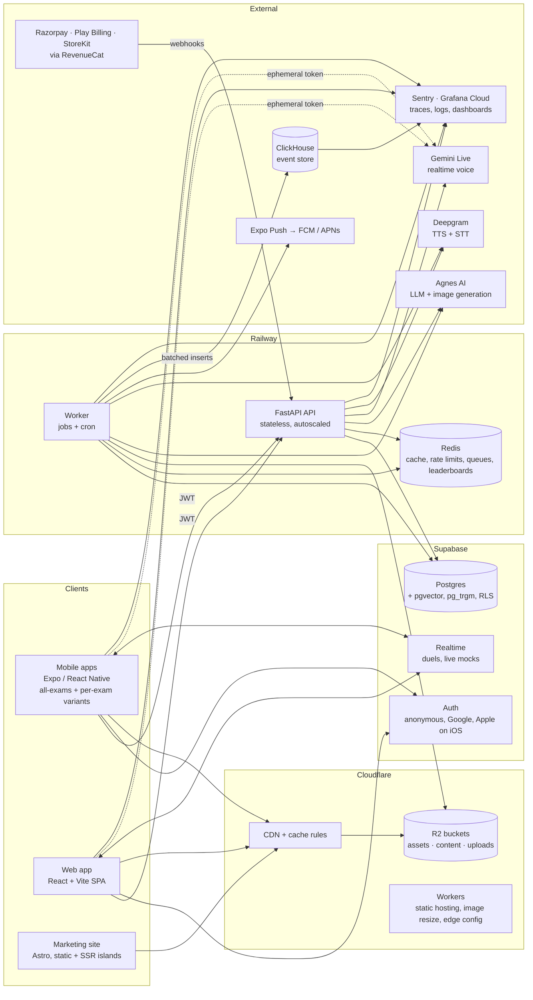
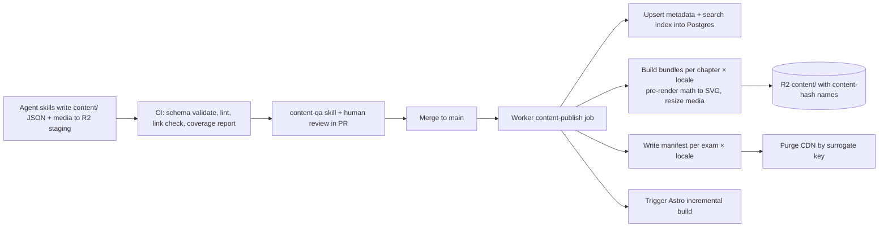

# Smriti — Technical Requirements Document

Status: Draft v0.1, 28 Oct 2026. Read with `PRD.md`, `APP_FLOW.md`, `DB_SCHEMA.md` and `IMPLEMENTATION_PLAN.md`.

The owner fixed these choices:
- FastAPI backend on Railway
- Supabase for auth and database
- Astro for the marketing site
- React for the web app
- React Native for mobile
- Cloudflare for web hosting
- Cloudflare R2 behind Cloudflare's CDN for assets
- Agnes AI for LLM and image generation
- Gemini Live for realtime voice, and Deepgram for text-to-speech and speech-to-text
- ClickHouse as the analytics event store, with Grafana dashboards
- An on-device SQLite database with an on-device FSRS engine and a write-ahead action queue
- Versioned content packages with delta patches, and a seed pack shipped inside the app

Everything else below is a recommendation. Each decision lists its alternatives so it can be revisited.

---

## 1. System overview



**Principles:**
- One API serves every client. Clients never write to Postgres directly, except through Supabase Auth.
- **Content is static and cacheable.** Lessons, questions and media are published as versioned bundles to R2 and served by the CDN. The API serves only personal and dynamic data.
- **Offline first on mobile.** Learning works without a network. Progress is queued as events and synced later.
- **Config, not forks.** Exam variants, free limits, pricing and feature flags are all data.
- **Observable by default.** Every request, job and AI call carries a trace ID end to end.

## 2. Repository and code organisation

**Decision: one monorepo, pnpm workspaces and Turborepo for JS/TS, uv for Python.**

```
smriti/
├─ apps/
│  ├─ api/            FastAPI service (Python 3.12, uv)
│  ├─ worker/         Background jobs + cron (shares the api package)
│  ├─ mobile/         Expo app (iOS/Android), build variants per exam
│  ├─ web/            React (Vite) web app, its own screens (decision 2.1)
│  └─ site/           Astro marketing + SEO site
├─ packages/
│  ├─ config/         App variants (exam apps), feature flags schema, env schema
│  ├─ tokens/         Design tokens (from DESIGN.md) → TS, CSS vars, RN theme
│  ├─ ui-native/      React Native components (mobile)
│  ├─ ui-web/         React DOM components (web), same names, props and states as ui-native
│  ├─ app-core/       Platform-free logic: stores, sync client, FSRS, gamification rules, storage interface
│  ├─ api-client/     Generated TS client from FastAPI OpenAPI + TanStack Query hooks
│  ├─ content-schema/ JSON Schemas + TS types + Pydantic models for content bundles
│  ├─ lesson-core/    Lesson engine: card sequencing, answer checking, scoring, events (no UI)
│  ├─ lesson-player-native/  Card renderers for mobile
│  ├─ lesson-player-web/     Card renderers for web
│  ├─ sim-bridge/     postMessage protocol for sims/labs
│  ├─ i18n/           i18next setup + UI string catalogs (en, hi)
│  └─ analytics/      Typed event catalogue, client batching, OTel helpers
├─ content/           Source content written by agents (JSON/MD), validated in CI
├─ sims/              Self-contained simulation bundles (HTML/JS), one folder each
├─ supabase/          Migrations (SQL), seed, RLS policies, edge config
├─ skills/            Agent skills for content, visuals, sims, 3D (see AGENTS.md)
├─ infra/             Railway, Cloudflare (wrangler), EAS, GitHub Actions
└─ docs/
```

### 2.1 Decision: how to build the web app

| Option | How | Pros | Cons |
|---|---|---|---|
| A. Expo universal app | The same Expo Router codebase builds iOS, Android and web (react-native-web). Web is deployed as static assets on Cloudflare. | One set of screens, one lesson player, one design system. Roughly 40% less UI work. Same behaviour everywhere. | The web UI feels a bit more "app-like". Some web libraries need wrappers. SEO doesn't matter because SEO lives in Astro. |
| **B. Separate React (Vite) SPA (chosen)** | Its own React DOM screens, sharing `api-client`, `content-schema`, `tokens` and logic hooks | The most web-native feel, with the full web ecosystem | Every screen is built twice, and the two drift apart |

**Decision (owner, 29 Oct 2026): B.** The web app is a separate React app in `apps/web`.

To keep the cost of building screens twice down, and to stop the two apps drifting apart:
- **Everything that isn't UI is shared** and written once in TypeScript with no platform imports: `app-core` (stores, the sync client and its outbox, FSRS, streak, pet and plant rules, entitlement checks, the free-limit logic), `lesson-core` (the lesson engine), `api-client`, `content-schema`, `i18n`, `analytics`, `config` and `tokens`.
- **Storage is an interface** in `app-core`. Mobile implements it with SQLite and MMKV. Web implements it with IndexedDB (through Dexie) and `localStorage`.
- **Only renderers are built twice:** `ui-native` and `ui-web` implement the same component list from `DESIGN.md` §5 with the same names, props and states. `lesson-player-native` and `lesson-player-web` render the same card types from `lesson-core`.
- **One spec per screen.** `UX_FLOW.md` stays the single description of every screen, with web layout notes where they differ (UX_FLOW §4.17).
- **A parity matrix** (`docs/PARITY.md`, created in Phase 0) lists every screen and feature with its status on iOS, Android and web. A pull request that adds a feature to one platform updates the matrix.
- **Shared tests:** `lesson-core` and `app-core` carry most of the logic tests. End-to-end flows are written once as scenarios and run as Maestro (mobile) and Playwright (web).

## 3. Mobile app (Expo / React Native)

| Concern | Choice |
|---|---|
| Framework | Expo SDK (latest stable), Expo Router, TypeScript strict, New Architecture on |
| State and data | TanStack Query (server state) persisted to MMKV, Zustand (UI state) |
| Local storage | MMKV for small key-value data (session, settings, query cache). SQLite (`expo-sqlite`, WAL mode) for cards, decks, the spaced-repetition schedule, memory-palace data, the profile snapshot, session state, downloaded-content indexes and the **action queue** (a write-ahead log of every user action, flushed on reconnect). The file system holds bundles and media, with an LRU asset cache for images, audio mnemonics and TTS output. |
| Images | `expo-image` with disk cache. WebP/AVIF from R2 with size variants. |
| Animation | Reanimated 3 and Gesture Handler. Rive (`rive-react-native`) for pet and plant state machines. Lottie for confetti and UI flourishes. |
| 3D and 360° | `@react-three/fiber/native` + `expo-gl` + drei. glTF/GLB with meshopt/Draco and KTX2 textures. 360° scenes are equirectangular textures on an inverted sphere. |
| Sensors | `expo-sensors` (DeviceMotion) for gyroscope "look around" and parallax. Drag fallback always available. |
| Sims and labs | WebView (`react-native-webview`) hosting sim bundles via the `sim-bridge` protocol (§7.3) |
| Maths | Formulas pre-rendered to SVG at content build (KaTeX → SVG). Live input uses a math keypad and renders at runtime with a lightweight KaTeX renderer. |
| Audio | `expo-audio` for narration, SFX and mnemonic songs |
| Video | YouTube via `react-native-youtube-iframe`, or deep link to the YouTube app |
| Notifications | `expo-notifications`. Daily reminders are scheduled **locally**, so they work offline. Social, event and re-engagement messages come by server push through Expo Push. |
| Widgets | iOS WidgetKit via `expo-apple-targets`. Android via `react-native-android-widget`. The app writes a widget snapshot (streak, plant stage, pet mood, plan) to App Group or SharedPreferences storage. |
| Updates | EAS Update for over-the-air JS updates (channels per variant and environment). `/config` returns `min_version` and `latest_version`. Android in-app updates API and an iOS soft prompt. |
| Payments | `react-native-purchases` (RevenueCat) |
| Auth | `@supabase/supabase-js` with an encrypted MMKV storage adapter (key in Keychain or Keystore via `expo-secure-store`, excluded from backups). Anonymous session at first launch. **Google** through `@react-native-google-signin/google-signin`, licensed Universal Sign In module (Credential Manager on Android, `GoogleSignIn-iOS` on iOS, nonce on both; decision D5). **Sign in with Apple** on iOS only, through `expo-apple-authentication`. Both hand an ID token and a raw nonce to `linkIdentity` (guest) or `signInWithIdToken` (restore). Without Google Play services, Supabase's OAuth redirect with PKCE runs in a Custom Tab or `ASWebAuthenticationSession` (`expo-web-browser`). One session and one SQLite database per profile on the device. Flows: `docs/flows/auth.md`. |
| i18n | i18next + `react-i18next`, ICU plural rules, locale from onboarding |
| Crash and perf | Sentry React Native (errors, tracing, profiling), with trace propagation to the API |
| Build and release | EAS Build and Submit. One build profile per variant × environment. |

### 3.1 Exam app variants
- `packages/config/variants/*.json` holds the variant config:
  - `id`, `appName`, `bundleId`, `androidPackage`, `scheme`
  - `icon`, `splash`, `accentColor`
  - `examProfileIds[]`, `showExamSwitcher`
  - `storeListing` keys, `deepLinkPrefix`, `revenuecatOfferingId`
  - `googleIosClientId` and `googleIosUrlScheme` (one iOS OAuth client per bundle id), `authCallbackScheme` (`smriti-{variant}`). Android uses the shared web client id from env. These ids are public, not secrets.
- `app.config.ts` reads `APP_VARIANT` and produces the matching native config.
- At runtime the app sends `X-App-Variant`. The API filters content and catalogue by the variant's exam profiles.
- One Supabase project and one user table serve every variant. One Google Cloud project and one Apple primary App ID (every variant grouped under it for Sign in with Apple) give the same Google and Apple user id in every app. Each app keeps its own session on the phone, so a second Smriti app is one more tap. Pro entitlement is per account, so it is shared across apps. App Store and Play require each app to sell its own subscription product, so every variant's product maps to the same `pro` entitlement in RevenueCat.

### 3.2 Offline and sync
- **Seed pack:** each variant's build includes a small seed pack (under 8 MB): onboarding lessons, the first chapter of its exam, the pet and plant art, and the starter decks. The app teaches on first launch with no network.
- **Content:** the manifest lists the bundles. Bundles are downloaded on demand, content-addressed (hash in the filename) and immutable.
  - **Delta patches:** when a bundle changes, the publisher also writes a patch from each of the last few versions (added, changed and removed cards). A client that holds an older version downloads the patch, and otherwise the full bundle. A typo fix costs a few KB, not a re-download.
  - Least-recently-used items are evicted at a 500 MB default limit, which the student can configure.
  - Bundles the student downloads explicitly are pinned.
- **Progress:** the app records every learning action as an **event** in a SQLite outbox: `lesson_card_viewed`, `answer_submitted`, `review_rated`, `mock_answer`, and so on. Each event carries a client UUID and timestamps.
  - Events are flushed to `POST /v1/sync/events` in batches of up to 200, with an idempotency key per event.
  - The server recomputes mastery, spaced-repetition schedules, XP and streaks from events. The client shows an optimistic local copy.
- **Spaced-repetition scheduling:** FSRS runs on the device (`ts-fsrs`) for instant offline scheduling. The server runs the same FSRS parameters, and its result wins on conflict.

## 4. Web surfaces

### 4.1 Marketing and SEO site (Astro)
- Static output for exam, subject, chapter and topic landing pages, plus free cheat sheets and PYQ explanations.
- Pages are generated at build time from the published content index. Incremental rebuilds run on content publish.
- English and Hindi with `hreflang`. Schema.org markup: `Course`, `FAQPage`, `Quiz`, `VideoObject`.
- Deployed to Cloudflare (Workers static assets). Images go through Cloudflare image resizing from R2.
- Interactive islands use React: an embeddable mini quiz, a periodic table, and a "try a lesson" widget. Fancy web motion uses React Bits components (web only).
- **No sign-in on the site.** Its "Sign in" link goes to `app.<domain>/login?next=` in the web app. The site holds no session and loads no Google script.

### 4.2 Web app (`apps/web`)

| Concern | Choice |
|---|---|
| Framework | React 19 + TypeScript strict, built with Vite as a static single-page app |
| Routing | TanStack Router (type-safe routes, search params for filters) |
| Data and state | TanStack Query (persisted to IndexedDB) and Zustand, through `app-core` and `api-client` |
| Styling | Tailwind CSS with a theme generated from `packages/tokens`, plus CSS variables for light and dark mode. No raw hex values in components. |
| Accessible primitives | Radix UI primitives for dialogs, sheets, menus, tabs and tooltips, styled by `ui-web` |
| Motion | Motion (Framer Motion) for UI. React Bits components for showpiece motion, used sparingly. Rive (`@rive-app/react-canvas`) for the pet and plant, dotLottie for confetti. |
| 3D and 360° | `@react-three/fiber` + drei. Scene code is shared with mobile where possible. Device orientation for "look around" on phones and tablets, drag everywhere. |
| Sims | Same sim bundles as mobile, in a sandboxed `iframe` through `sim-bridge` |
| Maths | KaTeX (the SVGs from bundles, plus KaTeX at runtime for live input) |
| Offline and install | Installable PWA. A service worker (Workbox) caches the app shell, downloaded bundles and media. Offline on web covers downloaded lessons and the review queue. |
| Local data | IndexedDB (Dexie) implementing the `app-core` storage interface: the same outbox, cards, schedule, palaces and notes as the mobile SQLite tables (DB_SCHEMA §15) |
| Auth | `@supabase/supabase-js` with anonymous sign-in (Cloudflare Turnstile token) and **Google only**: Google Identity Services One Tap (FedCM) and the Google-rendered button, with a nonce, passing the ID token to `linkIdentity` or `signInWithIdToken`. On iOS browsers, and whenever the GIS script can't run, Supabase's Google OAuth redirect with PKCE to `/auth/callback`. In-app browsers (social app webviews) are detected and asked to open the page in Chrome or Safari, because Google blocks sign-in in webviews. No Apple, email or phone sign-in on web. |
| Payments | Razorpay Checkout for the subscription with UPI Autopay (§11) |
| Notifications | Web Push (VAPID) through the service worker where the browser supports it, with email reminders as an opt-in fallback |
| Mock runner | Desktop-first layout that mirrors the official computer-based test screen (NTA and TCS style), with full keyboard support. This is where students practise for real CBT exams. |
| Errors and traces | Sentry for React with tracing, sending `traceparent` to the API |
| Hosting | Cloudflare Workers static assets at `app.<domain>`, preview deployments per pull request |
| Tests | Vitest + React Testing Library for components, Playwright for flows and visual regression |

## 5. Backend (FastAPI)

| Concern | Choice |
|---|---|
| Runtime | Python 3.12, FastAPI, Uvicorn (uvloop, httptools), Gunicorn workers on Railway |
| Packaging | `uv`, `pyproject.toml`. Ruff for linting and formatting, mypy strict. |
| Data access | SQLAlchemy 2.0 async + asyncpg to Supabase Postgres through the Supavisor pooler in transaction mode. Prepared-statement cache is turned off, as Supavisor's transaction mode requires. |
| Migrations | Supabase CLI SQL migrations in `supabase/migrations`. This one place holds tables, RLS, functions and triggers. SQLAlchemy models are hand-written to match, and CI checks for drift. |
| Validation | Pydantic v2 models, which are also the OpenAPI source. `packages/api-client` is generated from them. |
| Auth | Verify the Supabase JWT with asymmetric signing keys via JWKS (cached), in a FastAPI dependency. The `sub` claim is the user ID, and `is_anonymous` marks guests. Hard-login endpoints (social, sharing, starting the trial) reject guest tokens with an RFC 7807 `login_required` problem carrying a `reason`, which the client turns into the login sheet. Sensitive actions (account deletion, minting a managed child's session) need an `amr` entry newer than 5 or 10 minutes. Service role is used only inside the worker. |
| Caching | Redis: user summary (60 s), leaderboards (sorted sets), config (5 min), rate limits. CDN caching for public GET endpoints (`/config`, `/catalog`) with `Cache-Control` and surrogate keys. |
| Jobs | `arq` on Redis. Queues: `default`, `ai`, `media`, `notifications`, `content-publish`, `pdf`. Cron covers the daily streak and pet roll-up per timezone bucket, league rollover, reminder fan-out and cleanup. |
| Realtime | Supabase Realtime broadcast channels for duels and live mocks. The server is authoritative for scoring, and clients only render. |
| Files | Signed R2 upload URLs (S3 API) for user uploads (doubt photos, avatars). The worker scans, resizes and stores them. |
| PDF export | A worker renders HTML templates to PDF with headless Chromium (Playwright). Chromium shapes Devanagari text correctly. The PDF is stored in R2 and served by signed URL. |
| Search | Postgres FTS (an `english` config plus a `simple` config for Hindi) with `pg_trgm` for fuzzy matching. Move to Typesense or Meilisearch if it needs to grow. |
| API style | REST + JSON under `/v1`, SSE for streaming tutor responses, cursor pagination, RFC 7807 errors, idempotency keys on POSTs that change money or progress |

### 5.1 API surface (first cut)

| Area | Endpoints |
|---|---|
| Config | `GET /v1/config` (variant, flags, min version, free limits, pricing) |
| Catalogue | `GET /v1/catalog/exams`, `/subjects`, `/chapters/{id}`, `/topics/{id}` (metadata + bundle refs) · `GET /v1/content/manifest?exam=&locale=` |
| Me | `GET /v1/me`, `PATCH /v1/me`, `GET /v1/me/summary` (streak, plant, pet, XP, today) |
| Sync | `POST /v1/sync/events` (batch), `GET /v1/sync/state?since=` |
| Learning | `GET /v1/plan/today`, `GET /v1/reviews/due`, `POST /v1/reviews/{card}/rate` (online path) |
| Practice | `GET /v1/practice/drill?concept=`, `GET /v1/pyq?exam=&year=&topic=` |
| Mocks | `GET /v1/mocks`, `POST /v1/mocks/{id}/attempts`, `PUT /v1/attempts/{id}/answers` (autosave), `POST /v1/attempts/{id}/submit`, `GET /v1/attempts/{id}/report` |
| AI | `POST /v1/tutor/sessions`, `POST /v1/tutor/sessions/{id}/messages` (SSE), `POST /v1/ai/memory-cue`, `POST /v1/ai/story`, `POST /v1/ai/doubt-photo`, `POST /v1/voice/session` (mints an ephemeral provider token) |
| Social | friends, requests, duo, squads, leagues, leaderboards, duels |
| Gamification | `GET /v1/pet`, `POST /v1/pet/care`, `GET /v1/plant`, `POST /v1/streak/freeze`, quests, badges, shop |
| Accounts | `POST /v1/auth/linked`, `POST /v1/account/merge-intents`, `POST /v1/account/merges`, `GET /v1/account/merges/{id}`, `POST` and `DELETE /v1/account/deletion`, `DELETE /v1/account` (guest erase), `POST /v1/sync/restore-snapshot`, webhook `/v1/webhooks/apple-signin` (`docs/flows/auth.md` §10) |
| Guardians | `POST /v1/guardian/consent-requests`, `GET /v1/guardian/consent-requests/{id or code}`, `POST .../{code}/confirm` and `/decline`, `DELETE /v1/guardian/consents/{id}/scopes/{scope}`, `GET /v1/guardian/learners`, `POST` and `DELETE /v1/guardian/children/{id}`, `POST /v1/guardian/children/{id}/session`, `POST /v1/guardian/link-requests` |
| Billing | `GET /v1/billing/entitlement`, `GET /v1/billing/intro-eligibility`, `POST /v1/billing/razorpay/subscription`, webhooks: `/v1/webhooks/razorpay`, `/v1/webhooks/revenuecat` |
| Notifications | `POST /v1/devices` (push token), `PATCH /v1/notification-prefs` |
| Exports | `POST /v1/exports/pdf`, `GET /v1/exports/{id}` |
| Admin (internal) | content publish, blueprint management, moderation queue, user support |

**Still to merge into this table** (endpoints the area flow docs need): `docs/flows/practice.md` §12.2, `docs/flows/tutor-social.md` A14 and B15, `docs/flows/memory-labs.md` G16 and G25 (including `POST /v1/reviews/queue`), `docs/flows/me-money.md` §9, `docs/flows/learn.md` G4 and G5, and `docs/flows/onboarding.md` §8. Mutations that touch progress or money take an idempotency key.

## 6. Auth, accounts and guest mode

The full lifecycle, with diagrams and every branch, is in `docs/flows/auth.md`. The screens are in `docs/ux/auth.md`. This section is the technical summary.

- **Sign-in methods:** Google on every surface. Sign in with Apple on iOS only, because App Store guideline 4.8 requires an equivalent privacy-focused login next to Google ([guideline 4.8](https://developer.apple.com/app-store/review/guidelines/#login-services)). No phone OTP, no email sign-in and no passwords, so there is no SMS provider and no DLT registration.
- **Guests:** Supabase anonymous sign-in at first launch gives a real `auth.users` row flagged `is_anonymous` ([anonymous sign-ins](https://supabase.com/docs/guides/auth/auth-anonymous)). All progress is stored under this user ID from the start. If the anonymous sign-in fails (offline, rate limit), the app keeps a local-only guest and retries.
- **Upgrade (link):** with manual linking turned on in the project, the client gets a Google (or Apple) ID token with a nonce and calls `linkIdentity` on the anonymous session ([identity linking](https://supabase.com/docs/guides/auth/auth-identity-linking)). The same user is converted, so **no data migration is needed**. Then `POST /v1/auth/linked` finalises the profile once.
  - **Nonce:** the client hashes a random nonce (SHA-256 hex) for Google or Apple and passes the raw value to Supabase. "Skip nonce check" stays off ([Google login](https://supabase.com/docs/guides/auth/social-login/auth-google), [Apple login](https://supabase.com/docs/guides/auth/social-login/auth-apple)).
  - **Google clients:** one Google Cloud project. A web client (its id is the server client id on Android and the audience of Android tokens), one Android client per variant package and signing SHA-1, and one iOS client per variant bundle id. The Supabase Google provider lists the web client id first, then every iOS client id.
  - **Apple:** every variant App ID is grouped under the all-exams app's primary App ID, so the Apple user id is the same in every app. Apple sends the full name only on the first authorisation, so the client saves it straight away.
- **Merge:** if the identity already belongs to another account, Supabase returns `identity_already_exists` ([error codes](https://supabase.com/docs/guides/auth/debugging/error-codes)). The guest proves control with a short-lived merge intent (`POST /v1/account/merge-intents`), signs in to the existing account with `signInWithIdToken`, and asks for the merge (`POST /v1/account/merges`). The `merge_guest` worker job unions the guest's events into the account (client event ids keep it idempotent), recomputes the streak from the union of activity days (never lower than the higher of the two), keeps the account's pet and profile, moves the guest's decks, notes and devices, and deletes the guest. Two real (non-guest) accounts are never merged by the user.
- **Sign out** revokes the session (`scope: 'local'`, or `'global'` for "all devices"), clears Google's credential state, unregisters the push token, logs out of RevenueCat, **deletes this account's local database and private cache**, and starts a fresh guest. Public bundles stay.
- **Delete account** (DPDP erasure, Apple guideline 5.1.1(v), Google Play's in-app and web deletion rule): re-sign-in with a fresh `amr`, then `POST /v1/account/deletion` signs out everywhere, hides the account from others, cancels Razorpay, revokes Apple tokens through Apple's REST API ([TN3194](https://developer.apple.com/documentation/technotes/tn3194-handling-account-deletions-and-revoking-tokens-for-sign-in-with-apple)), and schedules erasure after 7 days. Store subscriptions must be cancelled by the user in the store. The web link is `app.<domain>/delete-account`.
- **Abuse control:**
  - Anonymous sign-ins are rate-limited per IP by Supabase (default 30 an hour, editable). Carrier-grade NAT puts many Indian users behind one IP, so the limit is raised and the app tolerates failures. Cloudflare Turnstile protects the web.
  - Anonymous users with no server activity for 90 days are cleaned up by a `pg_cron` job (Supabase has no automatic cleanup). A guest that comes back after cleanup re-homes its local data with `POST /v1/sync/restore-snapshot`.
  - Email sign-up is blocked by a Supabase "before user created" auth hook, except for the internal identities of managed children.
- **Teens (13 to 17), guardian consent:** before social features, sharing, the voice tutor and photo uploads (flag `auth.guardian_consent_gate = features`; `signin` moves it to right after sign-in if legal review requires). The guardian signs in with **their own** Google account (Apple on iOS): on the teen's phone through a second, in-memory Supabase client that never touches the teen's session, or on their own phone through `/guardian/{code}`. The guardian declares they are the parent or legal guardian and an adult, and the server stores `app.guardian_consents` with the scopes, the method, the age assurance and a hashed provider `sub`. DPDP Rule 10 asks us to check the guardian is an identifiable adult; Google gives no verified age, so a DigiLocker age-token step is built behind `auth.guardian_digilocker`. Legal review decides which is required (D8).
- **Under-13s, managed accounts:** the child never signs in with Google. A parent signs in with Google in Parent mode and owns the child through `app.guardian_links`. Each child has its own `auth.users` row with an internal email identity on a domain we own that never receives mail. To put a child on a device, the API checks the link and a fresh parent `amr`, asks Supabase admin for a one-time token hash for the child's identity, and the device exchanges it for a child session. The guest a child used in onboarding is converted in place, so the child keeps its user id. This needs a Phase 0 spike, with a server-held per-child secret as the fallback.
- **Separate sessions per app:** each app variant and the web app keep their own session. A profile registry on the device lists the profiles that have a session there (siblings, a parent), each with its own database.

## 7. Content system

### 7.1 Model
- **Graph:** `subject → unit → chapter → topic → subtopic → concept`.
- **Exam profiles** choose concepts, depth (L1 to L5) and weightage.
- **Content items** attach to concepts: lesson bundles, questions, flashcards, mnemonics, media, sims, 3D models and videos. Each item is versioned, localised and in one of these states: draft → review → published → retired.
- Source content lives in `content/` as JSON that validates against `packages/content-schema`. Agents write it there through skills. Large media goes straight to R2 staging.

### 7.2 Publish pipeline



- A **bundle** is one JSON file per topic and locale, holding ordered cards with references to media URLs. Media sits beside it in R2: `assets/{sha256}.{webp|avif|glb|mp3}`.
- A **manifest** maps `exam × locale` to bundle hashes and sizes, the available patches (`from_hash → patch_hash`), and `min_app_version` for content that needs newer card renderers.
- Patches live at `content/patches/{from_hash}-{to_hash}.json` and are also immutable.
- All bundle and media URLs are immutable. Manifests use a short TTL (5 min) plus a purge on publish.

### 7.3 Sims and labs (`sims/` + `sim-bridge`)
- Each sim is a self-contained static web bundle (HTML, JS, assets) under `sims/{id}/`. It is built to `R2:sims/{id}/{version}/`.
- The host (WebView on mobile, iframe on web) and the sim talk through a versioned `postMessage` protocol:
  - **Host → sim:** `init {locale, theme, params, task}`, `reset`.
  - **Sim → host:** `ready`, `state {…}`, `measurement {name, value, unit}`, `task_result {taskId, correct, data}`, `complete`, `error`.
- This lets us use our own sims (built by the `sim-builder` skill on a shared kit), PhET HTML5 sims (CC BY 4.0, with attribution shown) and other open-licence sims without platform-specific code.
- Performance: sims should stay under 2 MB, start in under 1.5 s on a mid-range Android phone, and support a "low power" flag.

### 7.4 Exam blueprints
- Stored as JSON (`exam_blueprints` table and `content/blueprints/*.json`) with sections, durations, sectional timing rules, question types, marking (including partial marking), languages, calculator and instructions.
- The mock runner is a generic engine driven entirely by the blueprint. A pattern change means a new blueprint version and no code release.

## 8. Assets, storage and CDN

| Bucket | Access | Contents |
|---|---|---|
| `smriti-assets` | Public via `cdn.<domain>` | Illustrations, icons, audio, 3D models, 360° images, sim builds |
| `smriti-content` | Public via `cdn.<domain>/c/` | Bundles and manifests |
| `smriti-uploads` | Private (signed URLs) | Doubt photos, avatars before review, PDF exports |
| `smriti-staging` | Private | Agent-generated media awaiting QA |

- **Naming:** content-addressed (`sha256`) and immutable. Cache headers: `Cache-Control: public, max-age=31536000, immutable`.
- **Images:** the worker produces WebP and AVIF at 3 widths (480/960/1440) on ingest. Cloudflare Image Resizing is used only for odd sizes.
- **3D:** GLB with meshopt and KTX2 textures. Each model has a low-poly LOD for low-end devices.
- **Google Drive (optional):** a cold archive of raw source files (Agnes originals, PSDs, voice takes) synced by `rclone` from `smriti-staging`. Drive is not a serving origin, because of rate limits and its terms.
- **Cost guardrail:** R2 has no egress fees. Monitor Class A/B operation counts, and keep bundles chunky (one per topic, not one per card).

## 9. AI architecture

### 9.1 Gateway
- `apps/api/ai/` is a gateway with one interface per capability, so a provider can be swapped without touching features:

| Interface | Provider | Used for |
|---|---|---|
| `LLMProvider.complete/stream(messages, tools, model_tier)` | Agnes AI | Tutor, Feynman grading, mnemonic forge, stories, Cornell fill, mind maps, content skills |
| `ImageProvider.generate(prompt, style, size, seed)` | Agnes AI | All illustrations, diagrams and story art |
| `RealtimeVoiceProvider.create_session(context)` | Gemini Live | Realtime voice tutor |
| `SpeechProvider.tts(text, voice, locale)` / `.stt(audio, locale)` | Deepgram | Audio mnemonics, narration, read-aloud, voice answers, Feynman voice explanations, lecture transcripts |
| `EmbeddingProvider.embed_text(texts)` / `.embed_image(images)` | Chosen in Phase 0 (D2) | Content retrieval and the image index |

- **Model tiers come from config, not code.** Each tier maps to an Agnes model through env vars (`AI_TIER_TUTOR_MODEL`, `AI_TIER_CHEAP_MODEL`, `AI_TIER_AUTHOR_MODEL`), so a model can be swapped without a deploy:
  - `tutor`: fast and capable, for live chat.
  - `cheap`: the smallest model that passes evals, for classification, hint generation and the moderation pre-pass.
  - `author`: the most capable model, for offline content generation through skills.
- Every tier change runs the tutor eval set (§16) before it goes to production.
- Every call records model, tokens, latency, cost, cache hits, the user or job, and the trace ID. Budgets are set per user and per day, and per tier.
- Prompt caching is used for long system prompts and lesson context.

### 9.2 Tutor
- **Context:** the current card, concept summaries (from the published bundle), the student's mastery for those concepts, the exam profile, the locale and the age band.
- **Tools the model can call:**
  - `search_content` (pgvector + FTS over published content)
  - `get_mastery`
  - `generate_image`
  - `make_flashcard`
  - `start_practice`
  - `explain_with_story`
  - `forge_mnemonic` (story, acronym, palace room, keyword image, PAO scene, major-system word or rhyme, styled for the exam)
  - `speak` (Deepgram TTS for an audio hook)
- **Modes:** normal chat, Feynman mode (the student explains; the model scores clarity, completeness and accuracy against the concept's key points and asks follow-ups), and doubt-from-photo.
- **Pedagogy policy:** the tutor gives hints before answers, checks understanding, cites the platform's own content wherever possible, and stays on study topics for under-13s.
- **Safety:** moderation runs on input and output. Personal data is filtered out of prompts. Image prompts are checked for policy compliance before they are sent to Agnes.
- Streamed to the client by SSE. Messages are stored for continuity and for quality review, with retention limits.

### 9.3 Image generation (Agnes AI) and the image index
- **Agnes API** (from the Agnes developer docs, checked 29 Oct 2026; re-check before Phase 0 work):
  - Base URL `https://apihub.agnes-ai.com/v1`, header `Authorization: Bearer $AGNES_AI_API_KEY`. Key name: `AGNES_AI_API_KEY`.
  - **Chat:** `POST /chat/completions`, OpenAI-compatible. Text and vision models include `agnes-2.5-flash` and `agnes-2.0-flash`. The tiers in §9.1 map to these by config. Streaming and tool calling still need to be confirmed in Phase 0, because the tutor depends on both.
  - **Images:** `POST /images/generations` with model `agnes-image-2.1-flash`, `prompt`, `size` (`1K`, `2K`, `3K`, `4K`), `ratio` (`1:1`, `3:4`, `4:3`, `16:9`, `9:16`, `2:3`, `3:2`, `21:9`), and reference images for image-to-image and composition (`image`, a list of URLs or data URIs). `extra_body.response_format` is `url` or `b64_json`. The response is `{created, data: [{url, b64_json, revised_prompt}]}`. Timeouts of 60–360 s are recommended, so generation runs in the worker's `media` queue, not inside a request.
  - **Video:** `POST /videos` (model `agnes-video-v2.0`), polled at `GET https://apihub.agnes-ai.com/agnesapi?video_id=…`. Useful later for short explainer clips and YouTube Shorts.
  - **Not offered:** embeddings and text-to-speech. Those stay with the embedding provider (D2) and Deepgram.
- `AgnesLLMProvider` and `AgnesImageProvider` implement the gateway interfaces. Agnes returns opaque images, so presets that need transparency are generated on a flat plain background and cut out in the delivery step (`skills/visual-director`).
- Reference images keep characters consistent: the approved pet and plant reference sheets are passed in `image` on every pet or plant generation.
- **Search before generating:** every image (generated or open-licence) is stored in R2 and indexed in the `image_assets` table with an image embedding (a CLIP-style multilingual model) in pgvector. Before calling Agnes, the agent searches the index by meaning. A close match is reused, and generation is the fallback.
- **Style guide prompts:** every generated image starts from a named style preset (see `DESIGN.md` and `skills/visual-director`), such as "Sunny 3D object" or "Pet character sheet". The pets use a reference sheet, so the cat and dog stay consistent across images.
- **Cache:** `key = sha256(normalized_prompt + style_preset + size + model_version)`. A cache hit returns the existing R2 URL, so shared prompts (for example "photosynthesis diagram, class 7") are generated once for everyone.
- **Agent decides:** the tutor and lesson runtime call `generate_image` only when the model judges a visual will help. Hourly and daily caps apply even with "unlimited" image generation, to protect latency.
- Generated images for published content go through the QA queue before they're reused publicly.

### 9.4 Voice (Gemini Live and Deepgram)
- **Realtime tutor:** the client asks `POST /v1/voice/session`. The API checks entitlement and quota, assembles the tutor context (system instructions, card, mastery, locale), and mints a **short-lived Gemini Live ephemeral token** locked to that config. The client then streams audio to Gemini Live directly, for low latency, and the API key never reaches the device.
  - Tools the voice tutor calls (for example `get_mastery`, `make_flashcard`) are relayed to the API, which executes them.
  - Transcripts come back to the API for storage, mastery signals and safety checks.
- **Deepgram TTS:** audio mnemonics, rhymes and narration are generated in the worker, cached in R2 by `sha256(text + voice + locale)`, and shipped in bundles like any other media. On-demand TTS (for example, reading a tutor answer aloud) goes through the API with the same cache.
- **Deepgram STT:** voice answers, spoken Feynman explanations and YouTube lecture transcripts (for transcript-to-flashcards).
- **Hindi check (Phase 0):** confirm Deepgram's Hindi TTS voice and STT accuracy on a test set of Hindi and Hinglish. If a gap shows up, add a second `SpeechProvider` for Hindi only. That is a config change, not a rewrite.

### 9.5 Retrieval
- `pgvector` in Supabase holds embeddings of published concept summaries, cards, questions and solutions, chunked per card, plus the image index (§9.3).
- The embedding provider must be multilingual (English and Hindi). Agnes doesn't offer embeddings, so one is picked in Phase 0 by a small evaluation (text and image).
- pgvector is enough for the first million vectors with HNSW indexes. Moving to a dedicated vector database (for example Qdrant) is a later option, behind the same interface.

### 9.6 Learning-science jobs
- **Predictive weak-area alerts:** a nightly worker job computes each card's predicted recall (FSRS retrievability) for the next 3 days, groups cards that will drop below the target by topic, and queues one alert per user. The notification rules (§12) still cap frequency.
- **Sleep review (adults only, R34):** the worker estimates a usual bedtime from the last 14 days of session end times (median of the last session per day). If confidence is high enough, the app schedules a local notification 20 minutes before it with the 5 hardest due cards. The same job estimates the usual study hour that adult smart timing uses (`notify.prefs.usual_study_hour`). Neither estimate is computed for minors; a teen can pick a fixed bedtime review time instead (`notify.prefs.bedtime_review_time`).
- **Cornell fill and mind maps:** LLM jobs that write into the student's own note or map, never into published content.
- **Transcript to flashcards:** Deepgram transcribes a YouTube lesson's audio (or the published caption track is used when available), then the LLM writes candidate cards linked to Concepts. Cards for published lessons go through `content-qa`.

## 10. Gamification engine
- **Activity day:** a date, in the user's IANA timezone (the day ends at local midnight), on which they did at least one qualifying activity: one lesson, or 10 reviews, or one mock section, or the daily challenge (which rolls over at 00:00 IST). Meeting the daily goal (minutes, default 10) is a separate ring and does not decide the streak.
- **Streak:**
  - Consecutive activity days. An equipped freeze (up to `streak.freeze_slots`, 2), the weekly rest day and an incident freeze (`streak.incident_freeze`, for our outages) each protect a day without activity (R28, R36). There is no paid streak repair.
  - Computed incrementally on sync and checked again by the nightly roll-up.
- **Plant:**
  - `growth_points` add up from activity days and never decrease, which gives the growth stage.
  - Five growth stages: seed, sprout, sapling, flowering, tree, at 1, 7, 30 and 100 study days (flag, R2, R37). The stage is never lost.
  - `health` comes from days since the last *health day*: thriving, droopy, dry, wilted, dormant (shown as "Resting"; never dead). A health day is an activity day or a day with a finished 2-minute rescue (`learn.activity_days.rescue_done`). A rescue keeps the plant healthy that night but never counts as a streak day or a revival day (memory-labs flow §5.13).
  - It recovers through a revival quest of study days: droopy 1, dry 2, wilted 3, dormant 5 (R12, `APP_FLOW.md` §3.6).
- **Pet:** `mood` and `energy` are 0–100. They decay per missed day, rise with care events and are clamped. The state label is derived from them. Under-10 mode applies a floor at "sleepy".
- **XP and leagues:**
  - XP is credited from events.
  - Weekly leagues use Redis sorted sets keyed `league:{week}:{tier}:{cohort}` and are persisted at rollover.
  - Promotion and demotion run on a cron job each Sunday at 23:59 IST.
- **Anti-cheat:** server-side validation of event plausibility (time per card, answer timing), duplicate detection, and caps on XP per hour.

## 11. Payments and entitlements
- **The source of truth** is the `subscriptions` and `entitlements` tables in Postgres.
- **Android and iOS:** RevenueCat handles the store purchases. Its webhooks reach `/v1/webhooks/revenuecat`, and the server confirms by calling RevenueCat's REST API. Each store intro offer is set to ₹1 for the first month.
- **Web:** a Razorpay Subscription (UPI Autopay mandate or card) with a plan at ₹99/month and an add-on or offer so the first charge is ₹1.
  - Webhooks (`subscription.activated`, `charged`, `halted`, `cancelled`) reach `/v1/webhooks/razorpay`, with HMAC verification and idempotency.
- **Entitlement** is computed as `pro` if any active subscription from any source exists. Clients read it from `/v1/me/summary`, and the app caches it with a grace period.
- **Trial abuse:** one ₹1 intro month per person (`docs/flows/auth.md` §8).
  - **Identity keys:** `HMAC-SHA256(AUTH_IDENTITY_HASH_PEPPER, provider:sub)` for every Google and Apple identity on the account, stored in `billing.intro_claims`. They survive account deletion (the user id is cleared), so deleting and re-creating an account doesn't give another ₹1 month. The pepper is never rotated in place; a new pepper gets a new `key_version`.
  - **Device keys:** Apple DeviceCheck bits on iOS ([DeviceCheck](https://developer.apple.com/documentation/devicecheck)) and Play Integrity device recall on Android, whose bits are shared across every app in our Play developer account ([device recall](https://developer.android.com/google/play/integrity/device-recall), beta with early access). Web has identity keys only.
  - `GET /v1/billing/intro-eligibility` decides. Each variant sells a product (or offer) with the ₹1 intro and one without, and the paywall sells the intro one only when eligible: Play uses developer-determined offer eligibility, and on iOS this stops one Apple ID taking ₹1 in every variant's subscription group. The stores also enforce their own intro eligibility.
  - Claims are written by the worker on the first intro purchase webhook. A key conflict is logged for review.
- **Accounting:** every webhook is stored raw (`payment_events`) for audit and reconciliation.

## 12. Notifications
- **Local:** the daily reminder at the student's chosen time, and the streak saver (`streak_risk`, adults only) at least 1 hour before quiet hours start when today isn't a streak day yet (R1, R23). The device keeps a 7-day plan of local sends and rebuilds it on each app open and after each sync (`docs/flows/me-money.md` §6.1).
- **Minors (R34, R45):** only the reminder at the time they picked. No smart timing, no inferred bedtime and no copy chosen from predicted plant health. Friend-triggered pushes wait for that reminder window; in-app banners still show. Smart timing for adults uses the usual study hour from the §9.6 job.
- **Web:** Web Push where the browser supports it (`app.devices.web_push_subscription`), otherwise an optional email reminder for adults.
- **Server push:** the worker sends through Expo Push in batches of 100, retries with backoff, and prunes invalid tokens.
- **Rules engine:**
  - At most 1 re-engagement push a day, and at most 3 pushes a day in total. Exam alerts and transactional messages don't count against the caps.
  - Quiet hours run 22:00–07:00 by default, and are stricter for minors.
  - Reminders auto-pause after `notify.autopause_after_ignored` (7) ignored sends in a row, and a comeback flow takes over after 30 or more days away (R34).
  - Nothing is shown while a mock runner is open (R24).
  - Messages are localised and come from templates in the pet's voice.
- Every server send is logged in `notify.log` to measure open rates and cap frequency (DB_SCHEMA §10).

## 13. Observability, logging and tracing
- **Tracing:** OpenTelemetry SDKs in the API and worker, with auto-instrumentation for FastAPI, SQLAlchemy, Redis and httpx.
  - Mobile and web run Sentry with tracing and send `traceparent` and `baggage` on API calls, so one trace spans app → API → DB → LLM.
  - Traces are exported over OTLP to a managed backend: Grafana Cloud (recommended) or Honeycomb.
- **Logs:**
  - Structured JSON through `structlog`, with fields `trace_id`, `span_id`, `user_id` (hashed), `variant`, `app_version` and `route`.
  - No personal data or answer text in logs.
  - Railway log drain to the same backend.
- **Errors:** Sentry for mobile, web, API and worker, with release health per variant.
- **Metrics:**
  - RED metrics per route.
  - Job queue depth and latency.
  - AI tokens, cost and latency per tier.
  - Cache hit rates.
  - Content download sizes and failures.
  - Crash-free sessions.
- **Analytics pipeline (ClickHouse):**
  - Learning events already reach the API through `/v1/sync/events`. Product events (screens, taps, funnels) use the same typed catalogue in `packages/analytics` and the same batching.
  - The worker writes both streams to ClickHouse in batches (ClickHouse Cloud, `MergeTree` tables partitioned by month and ordered by `(user_id, ts)`). Postgres keeps only the state it needs. ClickHouse keeps the full history.
  - Grafana dashboards read ClickHouse directly: retention, funnels, lesson drop-off, question difficulty, mock analytics and AI cost.
  - The same tables feed ML signals: question calibration (difficulty and discrimination), predicted rank, and FSRS parameter tuning.
  - Events are limited to what's needed for learning analytics. No session replay and no ad IDs for minors.
  - Feature flags and experiments run through `/config` flags, with experiment results analysed in ClickHouse.
- **SLOs:**
  - API p95 under 300 ms for non-AI routes.
  - Tutor time to first token under 1.5 s.
  - 99.9% monthly availability.
  - Alerts go to Slack or email.

## 14. Security and privacy
- RLS on every user table (`user_id = auth.uid()`). The API also checks ownership, as defence in depth.
- Secrets live in Railway, Cloudflare and EAS secrets, never in the repo. `.env.example` documents the names.
- Rate limits per user and per IP (Redis token bucket): stricter for AI, auth and sync, looser for reads.
- Input validation everywhere through Pydantic. Uploads are capped and content-type checked. Images are re-encoded.
- Webhooks are HMAC-verified and replay-protected.
- Mobile follows OWASP MASVS L1: secure storage for tokens (encrypted MMKV, key in Keychain or Keystore, auth storage excluded from Android Auto Backup and iCloud backup), no secrets in the bundle, and Play Integrity and App Attest signals on sensitive endpoints in Phase 2.
- Auth hardening: a nonce on every ID token, PKCE on every redirect, an allowlist of redirect URLs in Supabase, a Supabase custom auth domain so Google's consent screen shows our domain, no Google access tokens stored, and Redis rate limits on consent requests, child sessions and merges.
- Privacy follows the DPDP Act and Rules: consent records, guardian consent for minors, data export and delete endpoints, a retention policy (tutor transcripts 180 days) and a breach-notification runbook.

## 15. Performance budgets

| Target | Budget |
|---|---|
| Mobile app download | Under 45 MB (Android AAB split), including a seed pack under 8 MB |
| Cold start to interactive Home | Under 2.5 s on a Redmi-class phone (3 GB RAM), under 1.5 s on mid-range |
| Lesson card transition | Under 100 ms, 60 fps |
| Topic bundle (one locale) | Under 300 KB JSON compressed, plus lazy media |
| Illustrations | Under 80 KB WebP at 960 px |
| 3D models | Under 3 MB GLB (high LOD), under 800 KB low LOD |
| Web app first load (JS) | Under 350 KB gzip for the first route |
| Astro pages | LCP under 2.0 s on 4G, CLS under 0.05 |

## 16. Testing and CI/CD
- **Unit:** pytest (API and worker), Vitest (packages and web components with React Testing Library), Jest with React Native Testing Library (mobile components).
- **Contract:** OpenAPI snapshot check. The generated client must compile.
- **Content:** schema validation, coverage report (every syllabus concept has at least one explainer, question and card), broken media links, and a profanity and safety lint.
- **E2E:** Maestro flows for mobile (onboarding, lesson, mock, paywall in sandbox), Playwright for web and site.
- **Load:** k6 against sync, the mock submit endpoint and live mock fan-out before the first live all-India mock.
- **CI:** GitHub Actions with Turborepo remote cache.
  - Every PR runs lint, typecheck, test and the content checks.
  - **API and worker:** Railway deploys preview environments per PR and production on `main`.
  - **Web and site:** Cloudflare preview deployments per PR.
  - **Mobile:** EAS Build on tags, and EAS Update for JS-only changes.
- **Database:** Supabase branching for PR previews. Migrations run in CI against a shadow database.

## 17. Environments and configuration

| Env | Purpose | Data |
|---|---|---|
| `local` | Docker Compose: Supabase local stack, Redis, API, worker | Seed data |
| `preview` | Per-PR Railway, Cloudflare and Supabase branches | Seed data |
| `staging` | Release candidate, store internal testing tracks | Copy of the content, synthetic users |
| `production` | Live | Real |

Key environment variables (names only):

| Area | Variables |
|---|---|
| Supabase | `SUPABASE_URL`, `SUPABASE_ANON_KEY`, `SUPABASE_SERVICE_ROLE_KEY`, `SUPABASE_JWKS_URL`, `DATABASE_URL` |
| Redis | `REDIS_URL` |
| R2 | `R2_ACCOUNT_ID`, `R2_ACCESS_KEY_ID`, `R2_SECRET_ACCESS_KEY`, `R2_BUCKET_ASSETS`, `_CONTENT`, `_UPLOADS`, `_STAGING` |
| CDN | `CDN_BASE_URL` |
| AI | `AGNES_AI_API_KEY`, `AGNES_BASE_URL`, `AI_TIER_TUTOR_MODEL`, `AI_TIER_CHEAP_MODEL`, `AI_TIER_AUTHOR_MODEL`, `AI_TIER_VISION_MODEL`, `GEMINI_API_KEY`, `DEEPGRAM_API_KEY`, `EMBEDDING_PROVIDER`, `EMBEDDING_MODEL` |
| Analytics | `CLICKHOUSE_URL`, `CLICKHOUSE_USER`, `CLICKHOUSE_PASSWORD`, `CLICKHOUSE_DATABASE` |
| Payments | `RAZORPAY_KEY_ID`, `RAZORPAY_KEY_SECRET`, `RAZORPAY_WEBHOOK_SECRET`, `REVENUECAT_API_KEY`, `REVENUECAT_WEBHOOK_SECRET` |
| Push | `EXPO_ACCESS_TOKEN` |
| Observability | `SENTRY_DSN_*`, `OTEL_EXPORTER_OTLP_ENDPOINT`, `OTEL_EXPORTER_OTLP_HEADERS` |
| Auth: Google | `GOOGLE_OAUTH_WEB_CLIENT_ID` (public; also `EXPO_PUBLIC_GOOGLE_WEB_CLIENT_ID` and `VITE_GOOGLE_WEB_CLIENT_ID` for the clients), `SUPABASE_AUTH_EXTERNAL_GOOGLE_CLIENT_ID`, `SUPABASE_AUTH_EXTERNAL_GOOGLE_SECRET` (Supabase provider config: the web client id plus every iOS client id, and the web client secret). iOS client ids per variant live in `packages/config/variants/*.json` (public). |
| Auth: Apple | `APPLE_TEAM_ID`, `APPLE_SIGNIN_KEY_ID`, `APPLE_SIGNIN_PRIVATE_KEY` (token revocation on deletion), `APPLE_SIGNIN_CLIENT_IDS` (every variant bundle id), `SUPABASE_AUTH_EXTERNAL_APPLE_CLIENT_ID`, `SUPABASE_AUTH_EXTERNAL_APPLE_SECRET`. `APPLE_SERVICES_ID` only if web Apple sign-in is approved (D10). |
| Auth: other | `AUTH_IDENTITY_HASH_PEPPER`, `AUTH_MANAGED_IDENTITY_DOMAIN`, `WEB_APP_URL`, `TURNSTILE_SECRET_KEY`, `VITE_TURNSTILE_SITE_KEY`, `APPLE_DEVICECHECK_KEY_ID`, `APPLE_DEVICECHECK_PRIVATE_KEY`, `PLAY_INTEGRITY_SERVICE_ACCOUNT_JSON`, `DIGILOCKER_CLIENT_ID`, `DIGILOCKER_CLIENT_SECRET` (only if D8 needs DigiLocker) |

## 18. Decisions still open

| # | Decision | Recommendation | Needed by |
|---|---|---|---|
| D1 | Web app approach (§2.1) | **Decided:** separate React (Vite) web app | Closed 29 Oct 2026 |
| D2 | Embedding provider (text and image) | A multilingual model chosen by an evaluation (Agnes has no embeddings API) | Phase 0 |
| D3 | Hindi speech quality | Test Deepgram Hindi TTS and STT. Add a Hindi-only fallback only if needed. | Phase 0 |
| D4 | Tracing backend | Grafana Cloud | Phase 0 |
| D5 | Google sign-in library for Expo (SMS is no longer needed: Google is the only sign-in) | Buy the Universal Sign In licence of `@react-native-google-signin/google-signin` (Team, $249 a year, or free through the EAS offer): Credential Manager on Android, nonce on every platform, Expo config plugin. Fallback: a small in-house Expo module over `androidx.credentials` and `GoogleSignIn-iOS`. | Phase 0 |
| D6 | Agnes AI API details | Endpoints and models documented in §9.3. Image generation confirmed working from the cloud environment on 29 Oct (about 12 s per 2K image; it returns 429 when called too fast, so the gateway retries with backoff). Still to confirm: streaming, tool calling and the exact rate limits. | Phase 0 |
| D7 | Final brand name and domain | Owner. Also blocks Google OAuth brand verification, since the consent screen shows the name. | Before store submission |
| D8 | Guardian age assurance for DPDP Rule 10: Google sign-in plus a self-declaration, or a DigiLocker age token too | Ship self-declaration with legal sign-off. Start DigiLocker onboarding now so it can be switched on before Rule 10 applies (about May 2027). | Before Phase 1 launch |
| D9 | Managed accounts for every under-13 (not only class 1–5), and in Phase 1 rather than Phase 3 | Yes to both, account part only (parent sign-in, children, restore). Google's own minimum age in India is 13. | Phase 1, M-7 |
| D10 | Web sign-in for people who signed up with Apple on an iPhone | Phase 1: a help sheet to add Google from the iPhone. Add Supabase's Apple OAuth on web only if support volume shows a need. | After Phase 1 beta |
