# Flow · Accounts, sign-in and consent (AUTH)

Status: Draft v0.3 (revision 1), 29 Oct 2026. Owner area: accounts, sign-in, linking, merge, sign out, delete, guardian consent, parent sign-in and managed child accounts (AUTH).

This doc covers the logic of the account system. How each screen looks is in [`docs/ux/auth.md`](../ux/auth.md). It builds on PRD §3, §10, §11.2 and §16.4, TRD §3, §4, §5, §6, §11 and §14, DB_SCHEMA §3, §8, §12 and §15, APP_FLOW §3.1 and §3.2, and the entry and onboarding flow ([`flows/onboarding.md`](onboarding.md)).

## Screens in this area

| ID | Screen | Kind |
|---|---|---|
| AUTH-01 | Login sheet, soft | Bottom sheet (60%), dismissible, with a reason line |
| AUTH-02 | Login sheet, hard | Bottom sheet (full height), the action needs an account |
| AUTH-03 | Age check | Step inside the sheet, only when the age is unknown |
| AUTH-04 | Google handoff and loading | System Google UI, then our "Signing you in" state |
| AUTH-05 | Sign in with Apple | iOS only. System Apple UI, then our loading state |
| AUTH-06 | Saved / Welcome back | Toast after a link, short card after a restore. No form |
| AUTH-07 | Is this progress yours? | Sheet, shared-phone check before a merge |
| AUTH-08 | Merge notice | Sheet after a guest was merged into an existing account |
| AUTH-09 | Account in use, switch account | Sheet for account conflicts and for switching |
| AUTH-10 | Used Apple on your iPhone? | Help sheet on Android and web |
| AUTH-11 | Add another sign-in | Sheet from Settings (add Google on iOS, add Apple on iOS) |
| AUTH-12 | Sign out confirm | Sheet (40%), with an unsynced-progress variant |
| AUTH-13 | Delete account: what goes | Full screen, step 1 of 2 |
| AUTH-14 | Delete account: your subscription | Panel inside AUTH-13, shown only with an active Pro (research X16: two screens) |
| AUTH-15 | Delete account: confirm it's you | Full screen, step 2 of 2, re-sign-in with Google or Apple |
| AUTH-16 | Delete account: scheduled | Full screen, final |
| AUTH-17 | Keep your account? | Full screen when someone signs in during the deletion grace period |
| AUTH-18 | Guardian consent: ask | Full screen, student side |
| AUTH-19 | Guardian consent: hand the phone | Full screen, same-device handoff |
| AUTH-20 | Guardian consent: review and agree | Full screen, guardian side (same device or the guardian's own phone) |
| AUTH-21 | Guardian consent: send a link or QR | Full screen, student side, waiting state |
| AUTH-22 | Guardian consent: guardian landing | Full screen on the guardian's phone or browser (`/guardian/{code}`) |
| AUTH-23 | Guardian consent: result | Full screen, student side (agreed, declined, expired) |
| AUTH-24 | Parent sign-in | Full screen, Parent mode and little-learner entry |
| AUTH-25 | Who's learning? | Full screen profile picker (siblings and parents on one phone) |
| AUTH-26 | Add a child | Full screen, creates a managed child account |
| AUTH-27 | Link to your guardian | Full screen, teen side, when a parent starts the link |
| AUTH-28 | Restore a child on this device | Full screen, parent picks which child to bring back |
| AUTH-29 | Web sign-in page | Web page at `app.<domain>/login` |
| AUTH-30 | Sign-in problems | Error states, as a sheet over AUTH-01/02/29 |
| AUTH-31 | Session ended | Sheet when a signed-in session can no longer refresh |
| AUTH-32 | Returning-account card | Non-blocking card on ONB-01, Android only, when a silent check finds an account that used Smriti before |
| AUTH-33 | Save-state chip | Reusable component (not a screen), embedded in ME-01, SET-02 and LES-08 |

**Phases (R8).** Everything above is Phase 1 except:
- **AUTH-18 to AUTH-23** (guardian consent): built in Phase 1. With the default flags (`auth.guardian_consent_gate = features`, `minor.defer_sync_until_consent = off`) a teen first meets them at the first gated feature that is live: photo doubts or community mnemonics if they ship in Phase 1, and social, leagues, shared decks and the voice tutor in Phase 2. With either flag switched to its strict value they are on the Phase 1 sign-in path (§6.10).
- **AUTH-24 to AUTH-28** (parent sign-in, Who's learning?, add, link, restore a child): **Phase 1, account part only** (TRD §18 D9, owner Q2). Classes 1 to 5 content and the Parent mode dashboard (SET-14 reports, time limits) are Phase 3. In Phase 1 they serve any under-13 who uses a Phase 1 app (age known from ONB-04 or AUTH-03), and parents restoring a child.
- **AUTH-27** (link an existing teen to a parent) is opened from SET-18, so it ships when SET-18 ships.

The parent gate (SET-13), the Account settings screen (SET-02) and the Me tab (ME-01) belong to the me and money area. They open the AUTH screens above and embed AUTH-33. SET-20 "Who's learning?" in the me and money doc is a pointer to AUTH-25 (§13).

---

## 1. Purpose

1. Let anyone learn with **no account**, and turn that guest into a saved account with **one tap on Google** (or Apple on iPhone) at a moment when saving matters.
2. Keep **one user id for life**: the guest's id becomes the account's id, so nothing is copied or lost when a guest signs in.
3. Make one Smriti account work in **every Smriti app and on the web**, with the same progress and the same Pro.
4. Meet India's **DPDP Act 2023** and **DPDP Rules 2025** for children: a guardian's verifiable consent for 13 to 17 year olds before the features that need it, and accounts for under-13s that a parent owns.
5. Make signing out, switching and deleting safe on a **shared family phone**: the next person never sees the last person's data.

## 2. Key decisions

| # | Decision | Why |
|---|---|---|
| A1 | **Google is the only sign-in method** on Android, the web app, the marketing site and every app variant. **iOS adds Sign in with Apple** under the Google button. There is no phone OTP, no email sign-in and no password. | Owner decision (29 Oct 2026). Nearly every Android phone in India already has a Google account, so it is one tap. App Store guideline 4.8 requires an equivalent privacy-focused login next to Google on iOS ([guideline 4.8](https://developer.apple.com/app-store/review/guidelines/#login-services)). No SMS means no DLT registration and no SMS cost. |
| A2 | **Guest first.** A Supabase anonymous user is created at first launch. Onboarding never asks for sign-in. | PRD §10.1. The anonymous user is a real `auth.users` row, so all progress has a `user_id` from the first tap ([Supabase anonymous sign-ins](https://supabase.com/docs/guides/auth/auth-anonymous)). |
| A3 | **Sign-in links Google to the guest.** We call `linkIdentity` with the Google ID token on the anonymous session. The user id stays the same and `is_anonymous` turns false. | No data migration, no merge job in the common case ([Supabase identity linking](https://supabase.com/docs/guides/auth/auth-identity-linking)). Manual linking must be switched on in the Supabase project. |
| A4 | **If that Google account already has a Smriti account, we merge the guest into it** on the server: union of events, higher streak kept, the account's pet and profile kept. The student is told plainly what happened (AUTH-08). | Fixed decision 3. Supabase returns `identity_already_exists` for this case ([error codes](https://supabase.com/docs/guides/auth/debugging/error-codes)). |
| A5 | **Native ID-token sign-in on mobile, Google Identity Services on web.** Android uses Credential Manager ("Sign in with Google" bottom sheet and button). iOS uses the Google Sign-In SDK. Web uses One Tap (FedCM) and the Google-rendered button. All of them hand an ID token with a nonce to Supabase. | The old Google Sign-In for Android is deprecated in favour of Credential Manager ([migration guide](https://developer.android.com/identity/sign-in/legacy-gsi-migration)). Supabase documents exactly this pattern ([Supabase Google login](https://supabase.com/docs/guides/auth/social-login/auth-google)). |
| A6 | **Expo library: `@react-native-google-signin/google-signin`, the licensed "Universal Sign In" module.** | The free "Original" module still uses the deprecated Android SDK and has no nonce on Android. Universal Sign In uses Credential Manager on Android and the Google Sign-In SDK on iOS, supports a nonce on every platform, and ships an Expo config plugin ([library docs](https://react-native-google-signin.github.io/docs/), [pricing](https://universal-sign-in.com/#pricing): Team licence $249 a year for up to 15 developers, free for some EAS customers). Fallback if the licence is refused: a small in-house Expo module over `androidx.credentials` and `GoogleSignIn-iOS`. TRD §18 D5. |
| A7 | **Browser fallback.** When native Google sign-in can't run (no Google Play services, an old Play services version, an iOS browser where the Google popup is blocked), we use Supabase's Google OAuth redirect with PKCE in a system browser tab (Chrome Custom Tab, `ASWebAuthenticationSession`, or a full-page redirect on web). Never an embedded WebView. | Google blocks sign-in inside webviews ([supported browsers](https://developers.google.com/identity/gsi/web/guides/supported-browsers)). Some Indian Android phones ship without Play services or with an outdated version. |
| A8 | **Under-13s get a managed account owned by a parent.** The parent signs in with their own Google account in Parent mode. The child never signs in with Google. Every child still has its own `auth.users` row and `user_id`. | Google's minimum age to manage your own Google account in India is 13 ([Google age requirements](https://support.google.com/accounts/answer/1350409)). Fixed decision 5 says class 1–5 never sign in with their own Google account; we extend that to everyone under 13 (age bands `u10` and `10_12`) so the rule is the same as Google's. Owner question Q1. |
| A9 | **13 to 17 year olds sign in with their own Google account, then a guardian consents** by signing in with the guardian's own Google account, on the same phone or through a link or QR on the guardian's phone. A consent record is stored. | Fixed decision 5 and DPDP Rule 10. Legal review is required (§10). |
| A10 | **Separate apps keep separate sessions.** Signing in to Smriti JEE doesn't sign you in to Smriti NEET on the same phone. The second app is one tap, because Credential Manager and the Google SDK already know the account. | Each app has its own sandbox. Sharing a session across apps needs a shared keychain group on iOS and has no clean Android equivalent. One tap is good enough. |
| A11 | **Sign out wipes this account's data from the device** and starts a fresh guest. Public content (bundles, media) stays. | Shared phones are common. The next person must never see the last person's progress, notes or tutor history. |
| A12 | **Deleting an account has a grace period** (`auth.deletion_grace_days`, proposed 7, owner Q5). The account is signed out everywhere at once and hidden from others, then erased after 7 days unless the owner signs in and keeps it. | Protects against a mistaken or malicious delete on a shared phone, while still erasing quickly (DPDP §12). Apple allows a short grace if the app says so. Legal review for the period. |
| A13 | **The ₹1 intro offer is deduplicated by hashed sign-in identities and by device signals**, not by phone number. | There are no phone numbers. See §8. |
| A14 | **Soft walls are rationed** (R29): one per trigger per 7 days, never mid-lesson, and after two "Later" taps no soft wall for 14 days. "Later" is a full-size secondary button, not a small link. Hard walls only for social, money and restore. | Research A10, A11 and X1. Asking less often, at a moment that names what is at stake, converts better and keeps trust. |
| A15 | **Nothing to fill in after sign-in.** A link ends in a toast, "Saved. You're signed in as {email}.", and the student is back where they were. No name, school or city form. The name can be changed later in SET-02. | Research A13. Google already gave us a first name for adults; for minors we don't need one (R31). |
| A16 | **One save-state chip everywhere** (AUTH-33): "Only on this phone", "Saving…", "Saved to {email}", and an offline state. ME-01, SET-02 and LES-08 embed the same component. | Research §11.7. A guest always knows whether their progress is safe, without a banner. |
| A17 | **Every login sheet carries the trust line** "We never call you or share your email." and uses only Google's approved labels, "Continue with Google" or "Sign in with Google". | R29, research X7, Google branding guidelines. |

---

## 3. Account kinds

| Kind | Who | How they sign in | `auth.users` | `app.profiles.account_kind` | Notes |
|---|---|---|---|---|---|
| **Guest** | Anyone before sign-in | Nothing. Anonymous session at first launch | Row with `is_anonymous = true` | `learner` | Free tier works fully. Cleaned up after 90 days with no server activity (TRD §6). |
| **Learner, adult** | 18 and over | Google (all platforms), Apple (iOS) | Same row, `is_anonymous = false` | `learner` | No consent step. |
| **Learner, teen** | 13 to 17 | Google (all platforms), Apple (iOS) | Same row | `learner`, `guardian_consent_state` tracks consent | Social, community sharing, voice tutor and photo uploads wait for guardian consent (§6.10). |
| **Managed learner** | Under 13 (little learners and 10–12) | Never signs in. A parent's session hands the device a child session | Own row with an internal identity that no person uses (§6.11) | `managed` | Owned by one guardian through `app.guardian_links`. |
| **Guardian** | A parent or guardian | Google (all platforms), Apple (iOS) | Own row | `guardian`, or `learner` if they also study | Created when a guardian consents or signs in to Parent mode. A guardian who starts learning becomes `learner` and keeps their links. |

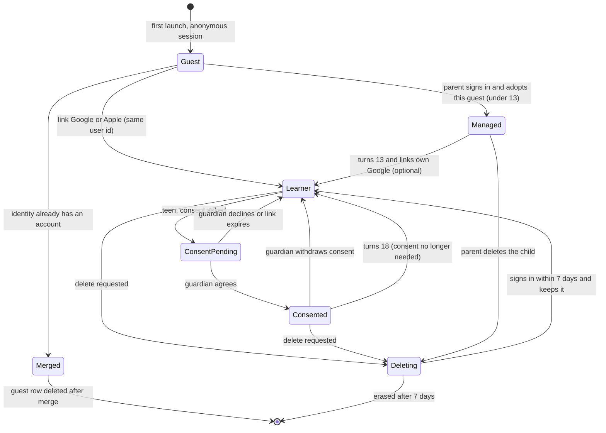

---

## 4. Entry points and return to origin

Every trigger opens the login sheet with a `reason`. The sheet stores the **origin** (route, params, scroll anchor, and the pending action if there is one) before it opens. After sign-in the app returns to the origin and, for a hard trigger, **resumes the pending action** (for example, sends the friend request or opens checkout).

| Trigger (PRD §10.1) | `reason` | Sheet | Shown where | After success |
|---|---|---|---|---|
| End of the 3rd lesson (guest) | `lesson_3` | AUTH-01 soft | LES-08, 1.2 s after the counts finish (learn doc §7.5). It beats the PAY-19 Pro card (R15) | Toast, back to LES-08, then [Continue] as before |
| Evening of streak day 2 (guest), before day 3 | `streak_day_2` | AUTH-01 soft | HOME-01 streak card link "Save your plant", from the hour in `auth.streak_prompt_hour` (learn doc §5.4) | Toast, back to HOME-01, the streak card shows AUTH-33 "Saved to {email}" |
| Web guest on Safari or any iOS browser, after the 1st lesson | `web_storage_risk` | AUTH-01 soft (web only) | LES-08 on web, in place of `lesson_3` for these browsers (onboarding doc Q8) | Toast, back to LES-08 |
| Appear on a leaderboard, from an inline link the student taps | `leaderboard` | AUTH-01 soft | PRC-12 and MOCK-24 "Sign in to appear on the leaderboard" (practice doc §4.2). A link, never a pop-up | Toast, back to the board with the student's row. A teen then needs the `social` scope (AUTH-18) before others see them |
| Save progress, from a persistent button | `save_progress` | AUTH-01 soft | ME-01 header (AUTH-33 chip and the "Not saved yet" row), SET-02 guest row, any "Sign in to..." inline link | Toast, back to origin |
| Friends, leagues, duels, duo, squads, shared decks, community submit | `social`, `share_deck`, `community` | AUTH-02 hard | SOC-02 and other SOC entry points, SOC deep links, MEM-11 share | Resume the action, then the minor gate (§6.10) |
| Start Pro (the ₹1 trial when eligible) | `start_trial` | AUTH-02 hard | PAY-01 [Start for ₹1], or [Get Pro] at ₹99 when the server says the person isn't eligible (R38) | Back to PAY-01, checkout continues (me and money doc) |
| Second device or restore | `restore` | AUTH-02 hard | ONB-01 "I already have an account", ENT-06 deep links that need an account | ENT-09 Restoring progress, then AUTH-06, then HOME-01 |
| Returning account found on first launch (Android 14 and later) | `restore` | AUTH-32 card on ONB-01, straight to AUTH-04 (no AUTH-02) | ONB-01 (§6.12) | ENT-09, then AUTH-06, then HOME-01 |
| Switch account | `switch_account` | AUTH-02 hard | SET-02 [Switch account] after AUTH-12 | HOME-01 of the new account |
| Session ended | `session_expired` | AUTH-31, then AUTH-02 | Any screen, when a refresh fails (§6.9) | Back to origin, outbox flushes |
| Parent mode, little learner "Ask a grown-up" | `parent` | AUTH-24 | SET-13 gate, HOME-06 grown-ups corner, LES-08 little-learner row | SET-14 Parent dashboard (Phase 3), or back to HOME-06 |
| Web sign-in page | `site_sign_in` | AUTH-29 | `app.<domain>/login?next=`, linked from the marketing site | `next` route, or ONB-02 for a brand-new account (onboarding doc §6.12) |

**Soft-wall budget (R29).** The client keeps a small per-profile record in MMKV (web: `localStorage`): `last_shown_at` per soft `reason`, `later_count`, and `paused_until`. No content, no user text.
- **Pop-up triggers** (`lesson_3`, `streak_day_2`, `web_storage_risk`) use the budget. **Tap triggers** (`save_progress`, `leaderboard`) open because the student asked, so they ignore the cooldown and the pause, but a "Later" on them still counts toward `later_count`.
- A pop-up trigger shows AUTH-01 only if that `reason` was not shown in the last `auth.soft_prompt_cooldown_days` (7, R29) and `paused_until` has passed.
- [Later], swiping the sheet down and the back gesture all count as one "Later". Each one adds 1 to `later_count`. When `later_count` reaches `auth.soft_prompt_later_limit` (2, R29), `paused_until = now + auth.soft_prompt_pause_days` (14, R29) and `later_count` goes back to 0. During the pause only the persistent buttons remain (the ME-01 row, the AUTH-33 chip, the SET-02 row), and tapping one of them opens AUTH-01 as usual, because the student asked.
- A soft trigger that is skipped by the budget is not queued for later. The next real trigger gets the next chance.
- On web, a closed One Tap prompt counts as a "Later" too (§5.3).
- Signing in clears the record.

Rules:
- **Never mid-lesson.** Soft sheets never appear during a lesson card, a review session, a mock or a mock section, onboarding, a paywall, a tutor chat, or for a managed learner. They appear only on LES-08 (after the counts finish), on HOME-01 and on the screens that host a persistent button. For a managed learner every trigger maps to "Ask a grown-up" (AUTH-24).
- **One prompt per lesson complete** (R15). On LES-08 the soft login wins over PAY-19, in the order the learn doc sets (learn doc §7.5). If the budget skips the soft login, the slot goes to the next item in the learn doc's order.
- **Bottom sheet first, button always** (research A11). On Android the Google sheet opens from our sheet's button. If the student dismisses Google's sheet, our sheet and its [Continue with Google] button stay.
- **A hard sheet can always be closed** with [Back]. Closing returns to the origin with the action not done, and the gated control keeps its lock icon. Hard sheets don't use the soft budget.
- **A signed-in user is never shown a login sheet** except AUTH-31 (session ended) and the re-sign-in inside AUTH-15.
- **Trust line and labels** (R29, R40 canonical text): every AUTH sheet, AUTH-29 and AUTH-32 show "We never call you or share your email." / "हम आपको कभी कॉल नहीं करेंगे और आपका ईमेल किसी से शेयर नहीं करेंगे।" under the buttons. The Google button text is only "Continue with Google" or "Sign in with Google" (Google-rendered on web, localised by Google).
- The API enforces hard triggers too: a guest JWT on a hard-login endpoint gets an RFC 7807 problem `type = login_required` with `reason`, and the client opens AUTH-02 with that reason.
- **Streak push** (research §11.2): an optional single push for `streak_day_2` is NTF's to design (me and money doc), behind `auth.streak_prompt_push` (off by default), adults and unknown age only, and it spends the same 7-day budget.

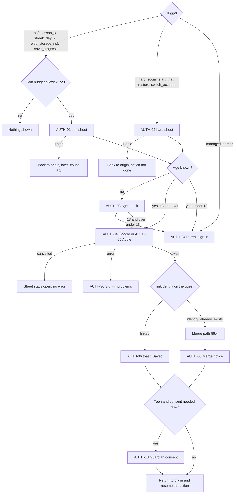

---

## 5. Google and Apple on each platform

### 5.1 Android (every variant)

1. The client makes a random 32-byte **raw nonce** and its SHA-256 hex **hashed nonce**. The hashed nonce goes to Google, the raw nonce goes to Supabase ([Supabase Google login](https://supabase.com/docs/guides/auth/social-login/auth-google)).
2. **On a tap of "Continue with Google"**, the client asks Credential Manager in this order ([Credential Manager implementation](https://developer.android.com/identity/sign-in/credential-manager-siwg-implementation), and the research in `docs/research/COMPETITOR_FLOWS.md` §11.3):
   - `GetGoogleIdOption` with `filterByAuthorizedAccounts = true` (accounts that used Smriti before). Server client id = our **web** client id, nonce = the hashed nonce.
   - On `NoCredentialException`, `GetGoogleIdOption` with `filterByAuthorizedAccounts = false`: Google's bottom sheet lists every account on the phone.
   - On `NoCredentialException` again (no Google account on the phone, or accounts that need re-authentication), the **button flow**, `GetSignInWithGoogleOption`, which shows Google's chooser and lets the student add an account.
   - If the student **dismisses** a sheet, that is a cancel: we stop and leave our sheet open. We don't chain to the next request after a dismissal.
   - Universal Sign In's `authenticate()` already runs this sequence (saved credential, then create-account, then explicit sign-in) and checks Play services first, so app code calls one method.
3. **Automatic sign-in** (`autoSelectEnabled = true`) is used only for `reason = restore` and on AUTH-24 for a returning parent. It works only when one authorised account is on the phone and the person didn't sign out last time. We never auto-select after an explicit sign-out (we call `clearCredentialState()` on sign-out, and Google skips auto-select itself).
4. The ID token goes to Supabase (§6.3).
5. **No Play services, or Play services too old:** the library reports `PLAY_SERVICES_NOT_AVAILABLE`. We switch to the browser fallback (A7): `supabase.auth.linkIdentity({ provider: 'google' })` (guest) or `signInWithOAuth` (restore) opened in a Custom Tab with `expo-web-browser`, PKCE, and the redirect `smriti-{variant}://auth/callback`.
6. **Returning-account check at first launch** (AUTH-32, §6.12): a silent query on Android 14 and later that shows nothing to new users.
7. Each variant package name needs its own Android OAuth client in Google Cloud with the SHA-1 of every signing certificate (Play App Signing key, EAS upload key, development key). A wrong SHA-1 shows up as a `DEVELOPER_ERROR`, which we log with the trace id and show as AUTH-30 "Something went wrong on our side".

### 5.2 iOS (every variant)

1. **Two buttons, the same size, stacked:** "Continue with Google" on top, "Continue with Apple" (Apple's own `AppleAuthenticationButton`, type `CONTINUE`, the same height and width as the Google button) under it. Google and Apple each ask to be at least as prominent as other providers, and equal size meets both.
2. **Google:** the Universal Sign In module drives `GoogleSignIn-iOS`, which opens Google's page in `ASWebAuthenticationSession`. We pass the hashed nonce and send the ID token and access token to Supabase. Each variant bundle id has its own iOS OAuth client id, and its reversed client id is registered as a URL scheme by the config plugin.
3. **Before Google opens**, iOS shows its own system alert asking to allow the app to use google.com to sign in. We can't remove it, so AUTH-01, AUTH-02 and AUTH-04 say first: "Google will open for a moment." / "थोड़ी देर के लिए Google खुलेगा।" (research §11.4).
4. **At app launch** we never start an interactive Google sign-in. A signed-in student's Supabase session is restored from storage. The Google SDK's `restorePreviousSignIn` is called only where we need a fresh Google ID token without UI (AUTH-15 re-sign-in tries it first, then falls back to the interactive flow).
5. **Apple:** `expo-apple-authentication` with scopes full name and email, and the hashed nonce. Apple returns an identity token and, **only on the first authorisation**, the full name ([Supabase Apple login](https://supabase.com/docs/guides/auth/social-login/auth-apple)). We save the given name to `app.profiles.display_name` straight away through `PATCH /v1/me`, because it never comes again.
6. **Hide My Email:** Apple may give a private relay address. We never need the email to work. We don't show it in the app (SET-02 shows "Signed in with Apple" and the name only), and we don't email it unless we later register our sending domain with Apple's private email relay.
7. All variant App IDs are **grouped under the all-exams app's App ID** for Sign in with Apple, so the student sees one consent and gets the same Apple user id in every Smriti app.
8. If the Google SDK fails for a reason other than cancel, we fall back to the Supabase OAuth redirect in `ASWebAuthenticationSession`, like Android.

### 5.3 Web app (`apps/web`)

1. The page loads the Google Identity Services (GIS) script only on screens that can sign in (AUTH-01, AUTH-02, AUTH-29, AUTH-22, AUTH-15) and on LES-08 and HOME-01 for guests, where a value moment can happen. Other pages stay light.
2. **Button:** the Google-rendered button, `google.accounts.id.renderButton` with `type: 'standard'`, `theme: 'outline'` in light mode and `'filled_black'` in dark mode, `size: 'large'`, `text: 'continue_with'`, `shape: 'pill'`, `width` up to 400 px (the sheet's content width), and `locale` from the app language (`en` or `hi`, so Google localises the label). `use_fedcm_for_button: true` where the browser supports it. For a Google session that has approved our site before, the button is **personalised** with the account's name and email. Google hides the personalised form under 200 px wide, which our sheets never are. Using Google's own button keeps us inside the branding rules ([branding guidelines](https://developers.google.com/identity/branding-guidelines)).
3. **One Tap is a budget, not a default** (research §11.5). Each manual close starts Google's cooldown (2 hours, then 1 day, 1 week, 4 weeks; a successful sign-in resets it), and FedCM browsers may add their own. So we spend it only where it is worth it:

| Where | One Tap | `context` | Auto sign-in |
|---|---|---|---|
| First visit to the web app, ONB screens, lessons, mocks, reviews, any page that isn't a value moment | **Never** | | |
| A soft value moment for a guest (`lesson_3`, `streak_day_2`, `web_storage_risk`) that passes the R29 budget | Yes, instead of opening AUTH-01 | `use` | No |
| AUTH-29 web sign-in page | Yes, with the rendered button | `signin` | Yes for one returning account, off after any sign-out (`disableAutoSelect`) |
| AUTH-22 guardian landing | Yes, with the rendered button | `signin` | No |
| AUTH-02 hard sheet, AUTH-15 re-sign-in | No (the rendered button is already in front of the student) | | |
| Marketing site, SEO topic pages | **Never** (§5.4) | | |

   - **At a soft value moment** the app calls `google.accounts.id.prompt()` with a moment listener. If One Tap is **displayed**, a one-line banner above the page content shows the AUTH-01 headline and the trust line, so the reason is still named (no second sheet). If One Tap is **not displayed or skipped** (cooldown, no Google session, third-party sign-in turned off, ITP), AUTH-01 opens as the normal sheet with the rendered button. If the student **closes** One Tap, that counts as one "Later" for the R29 budget and nothing else opens.
   - `cancel_on_tap_outside` stays at its default, so a stray tap never traps the student. `use_fedcm_for_prompt: true`. The hashed nonce goes with every prompt.
   - Safari, Firefox and every iOS browser get Google's ITP flow (a welcome page, then a pop-up) and **no auto sign-in**. We pass `itp_support: true` and accept that.
4. The GIS callback gives an ID token, which goes to Supabase (§6.3) with the raw nonce.
5. **iOS browsers and other ITP cases:** where the GIS pop-up is blocked or the script fails to load, we show our own Google-branded button (Google's official asset, the `thirdParty.google` tokens, Google's padding) that starts Supabase's OAuth redirect with PKCE to `app.<domain>/auth/callback`. The same fallback runs if the GIS script fails to load.
6. **In-app browsers** (Instagram, Facebook and similar webviews) can't sign in with Google. We detect them by user agent and show AUTH-30 "Open in your browser" with [Copy link] and, on Android, an intent link that opens Chrome.
7. **No Apple button on web** (owner decision). An iPhone user who signed up with Apple sees the "Used Apple on your iPhone?" link (AUTH-10). Owner question Q4.
8. **Turnstile:** the anonymous sign-in on web carries a Cloudflare Turnstile token (TRD §6).
9. **Safari storage:** Safari can clear site storage after 7 days without a visit, which would lose a web guest's progress. That is why `web_storage_risk` asks after the first lesson on these browsers (onboarding doc, web storage note and Q8).

### 5.4 Marketing site (Astro)

- The site never holds a session. Its "Sign in" link goes to `app.<domain>/login?next={path}` (AUTH-29). "Start learning free" goes to onboarding (onboarding doc §6.12).
- No One Tap and no GIS script on the site, including SEO topic pages. The site's "Sign in" goes to AUTH-29, which is the only place One Tap runs with `context: 'signin'`. This keeps the site free of third-party scripts and cookies, which matters for page speed (TRD §15) and for minors, and it doesn't spend One Tap's cooldown on a page view.

---

## 6. Flows

### 6.1 Anonymous session at first launch

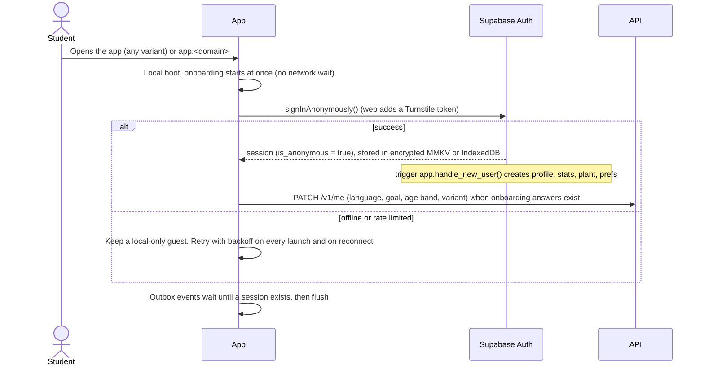

- **Mobile:** the session lives in an encrypted MMKV instance whose key is in the Keychain or Keystore (`expo-secure-store`). The auth storage is excluded from Android Auto Backup and from iCloud backup, so a stale session is never restored onto another phone.
- **Web:** the session lives in `localStorage` under the app origin only. The marketing site's origin never sees it.
- **Rate limits:** Supabase limits anonymous sign-ins per IP (30 an hour by default, editable). Many Indian mobile users share an IP through carrier-grade NAT, so this limit must be raised a lot, and the app must keep working as a local-only guest until the session arrives. Turnstile on web carries the abuse protection there.
- **Per-exam apps:** identical. `first_variant` on the profile records which app created the guest.
- **A second Smriti app on the same phone** creates its own guest. If the student later signs in to both with the same Google account, both guests end up in the one account (the second one through the merge path).

### 6.2 What the login sheet does before Google

1. **Age check.** If the profile has no age (`age_source = 'declined'` or no answer), AUTH-03 asks for the birth year (and month in the boundary year), the same neutral control as ONB-04. Under 13 goes to AUTH-24 ("Ask a grown-up"). 13 and over continues.
2. **Online check.** Sign-in needs the network. Offline, the buttons are disabled and the sheet says so (AUTH-30 offline state). The sheet closes itself when the network returns only if the student hasn't left it.
3. **Outbox flush.** The client flushes the guest's outbox before it calls Google, so every guest event is already on the server under the guest id. If the flush fails, sign-in still continues: the merge path re-checks (§6.4 step 3).

### 6.3 Link (the common case)

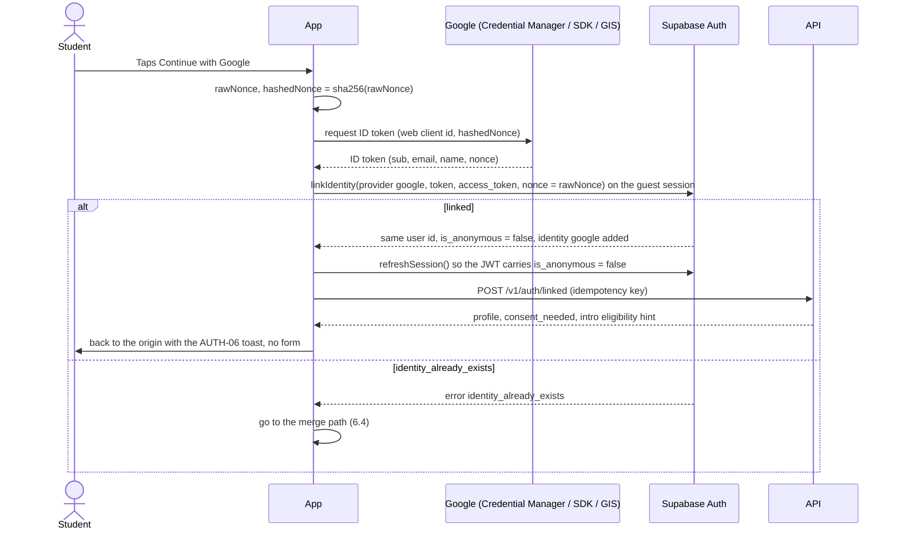

`POST /v1/auth/linked` (new endpoint) does the server side once per account:
- Sets `app.profiles.signed_up_at` if it is empty.
- **Adults:** fills `display_name` from the Google `given_name` (or Apple's name) if the student hasn't set one. The Google photo is offered as an avatar choice in SET-02, never applied silently.
- **Minors** (`10_12`, `13_17`): keeps the first name only and never copies the Google photo (data minimisation, DPDP Act s.6(1)). The first name is **private**: the student, their guardian (AUTH-20, SET-14) and the AUTH-25 picker on their own phone see it. Other students only ever see the pet avatar with an auto-generated nickname, or the pet name for friends added by link or QR (R31, amended).
- Gives the profile a **public name**. Adults: a `handle` from a safe generator, editable later, and their display name. **Minors** (R31, amended): an auto-generated nickname from a fixed, moderated word list in both languages (for example "Sunny Sprout 27" / "धूप अंकुर 27"), stored as word ids plus a number so it renders in either language. A minor can re-roll it but can never type it. It is used on every public surface (leaderboards, leagues, duels, community) only after guardian consent with the `social` or `community` scope; friends added by invite link or QR see the pet name instead. A minor's typed pet name and first name never appear on public surfaces.
- Attributes a stored referral code (onboarding doc invite path).
- Returns `consent_needed` for teens (§6.10) and whether the device should show AUTH-07 next time (never for a plain link).
- Emits the server event `account_linked` with `provider` and `path = 'link'`.

**What the student sees after a link (AUTH-06 toast, research §11.6 and A13):** the sheet closes and the origin screen shows a toast (DESIGN.md §5, 4 s): "Saved! {pet_name}, your plant and {n} days of progress are now in your Google account." / "सेव हो गया! {pet_name}, आपका पौधा और {n} दिन की प्रोग्रेस अब आपके Google अकाउंट में है।" with the second line "You're signed in as {email}." `{n}` is the number of activity days (one qualifying activity each, R1). With Apple the account name replaces "Google" and the second line is "You're signed in with Apple." (a relay address is never shown). The AUTH-33 chip changes to "Saved to {email}". On LES-08 the chip also shows once as a line under the counts. There is no form, no name step and no pet sheet. A pending action (hard sheets) resumes right after the toast appears.

Apple on iOS is the same flow with `provider = 'apple'` and the Apple identity token. If an Apple account and a Google account share the same verified email, Supabase links them to the same user automatically ([identity linking](https://supabase.com/docs/guides/auth/auth-identity-linking)). A relay address never matches, so those stay separate until the student adds Google in SET-02 (AUTH-11).

### 6.4 Merge (the Google account already has a Smriti account)

The guest is user **A** (anonymous). The existing account is user **B**. The goal: the student ends up signed in as B with A's progress added, and A is deleted.

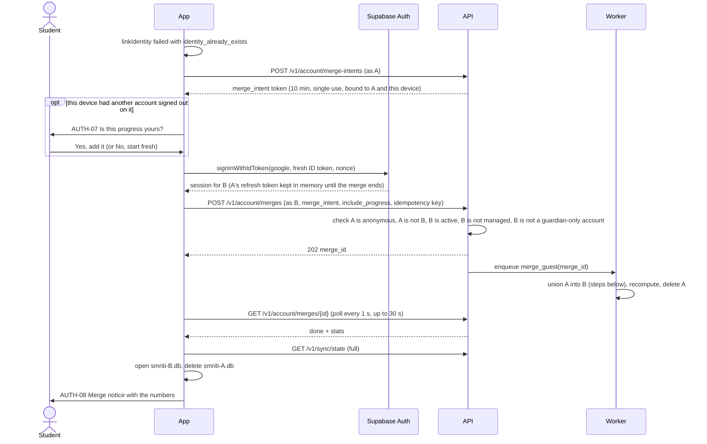

**Server steps** (worker `merge_guest`, service role, idempotent by `merge_id`, an advisory lock on B, each domain in its own transaction so a retry resumes where it stopped):

1. **Validate again.** A exists and `is_anonymous`; B exists, isn't deleted, banned or scheduled for deletion; A is not B. Otherwise `failed` with a reason code.
2. **Make sure A's events are all on the server.** The client flushed before sign-in. If the intent says the device still had unsent events, the merge waits up to 60 s for a final flush from the device (the device sends them with A's refresh token, which it kept in memory).
3. **Learning events** (lesson progress, answers, reviews, mock attempts): re-key A's rows to B with `on conflict do nothing` on the client event UUID. Events are append-only, so this is a union (APP_FLOW §3.10).
4. **Spaced repetition:** a card that only A had moves to B. A card both had is recomputed by replaying the union of both review histories through FSRS in time order.
5. **Activity days:** union of dates. The streak, plant stage and pet mood are recomputed from the union. A streak computed from the union is never lower than the higher of the two, which keeps fixed decision 3 ("keeps the higher streak").
6. **XP and gems:** union of ledger rows, de-duplicated by source event, totals recomputed. Today's AI usage counters are added together, so signing in can't reset a daily quota.
7. **Pet:** B keeps its pet (species and name) as the main buddy. If B has no pet, A's pet moves to B. If both had a pet, A's pet is kept as a second, "visiting" pet in B's pet room with its outfits, behind `merge.keep_guest_pet` (on by default, owner question Q9, research §14 Q9); with the flag off A's pet is dropped and only its outfits move. A's pet name is never sent anywhere else.
8. **Things the student made** (decks, cards, notes, mind maps, palaces, bookmarks, highlights, tutor sessions): moved to B. Their ids are UUIDv7, so there are no clashes.
9. **Profile:** B's fields win. A fills only B's empty fields (timezone, daily goal, language). `user_exams` is a union, B's primary exam stays primary.
10. **Badges and quests:** union, earliest earned date kept.
11. **Devices:** A's device rows move to B, so push tokens keep working.
12. **Stats:** `app.account_merges.stats` gets numbers only: `lessons_added`, `reviews_added`, `xp_added`, `days_added`, `streak_before`, `streak_after`, `pet_kept` (`account`, `guest` or `both`), `items_moved`. Gems, freezes (up to the cap), inventory, plant growth and quests follow the me and money doc's merge rules (me and money doc, edge case 9), which the worker implements in steps 5 and 6.
13. **Delete A** through the Supabase admin API. Its remaining rows cascade.
14. **Analytics:** insert `(alias_user_id = A, canonical_user_id = B)` into ClickHouse `user_aliases` so funnels stitch the guest's history to the account. A's raw events stay under A's id.

**What the student sees:**
- While the worker runs, AUTH-04's loading state says "Adding this phone's progress to your account". Most merges finish in 1 to 3 s.
- When it finishes, AUTH-08 says: "Welcome back! We joined this phone's progress with your account. You kept the longer streak ({streak} days) and all your lessons." / "फिर से स्वागत है! इस फ़ोन की प्रोग्रेस आपके अकाउंट से जोड़ दी गई। लंबी स्ट्रीक ({streak} दिन) और सारे लेसन आपके पास हैं।" With two pets it adds: "You had two buddies. {pet_a} is your main buddy; {pet_b} is visiting your pet room." / "आपके दो दोस्त थे। {pet_a} आपका मुख्य दोस्त है, {pet_b} आपके पेट रूम में है।" (research §11.6).
- If the merge takes longer than `auth.merge_wait_s` (30 s), the app continues as B and AUTH-08 shows "We're still adding your progress. It will appear soon." The worker retries `auth.merge_retries` (3) times with backoff. A's data stays safe on the server under A until the merge is done.
- If the guest had **no meaningful progress** (`lessons_completed = 0`, no decks or notes), the merge still runs (it is cheap), but the student sees AUTH-06 "Welcome back" instead of AUTH-08. This is the normal restore case.
- **"No, start fresh" on AUTH-07** sends `include_progress = false`. The worker then skips steps 3 to 11 and only deletes A.

**When AUTH-07 appears:** only if this device has had a different account signed out on it since the guest session began (a local flag `prior_signout_on_device`, stored as a boolean, never the old user id). On a phone only one person has used, the merge is automatic and AUTH-07 never shows.

**B is a guardian-only account** (`account_kind = 'guardian'` with linked learners): the API returns `409 account_is_guardian`. The client shows AUTH-09: "This Google account belongs to a parent account." [Use a different Google account] or [It's me, I want to learn too]. The second option converts B to `learner` and runs the merge.

**B is a managed child** can't happen, because managed children have no Google identity.

### 6.5 Sign in on a second device, restore after reinstall

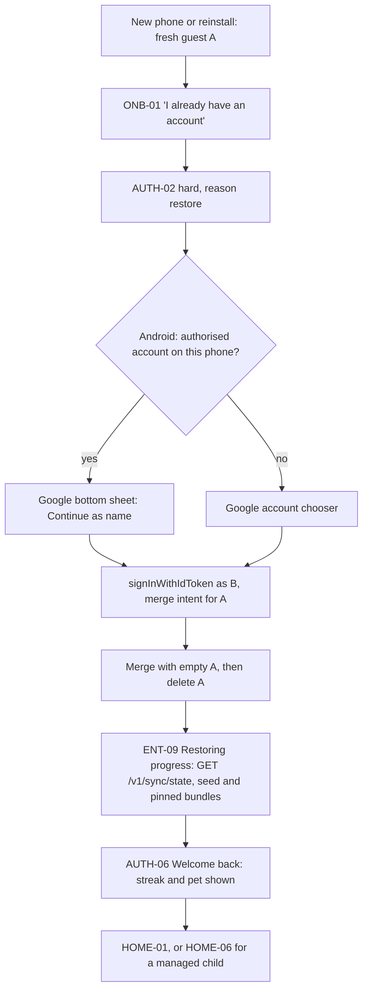

- `GET /v1/sync/state` restores everything (DB_SCHEMA §15). Downloads that were pinned on the old phone are offered again, not forced, on ENT-09.
- **A per-exam app** restoring an account that has other exams: the account's exams stay, and the app shows its own exam. If the account doesn't have this app's exam yet, it is added to `user_exams` (not primary).
- **Restore skips the rest of onboarding** when the account already has a pet and a goal (onboarding doc §6.9). If the student had done onboarding as a guest before tapping restore, that guest's answers are merged like any other guest data.
- **A restoring parent** sees "Restoring your child's account? Sign in with your own Google account" on AUTH-02 (onboarding hand-off requirement). That link opens AUTH-24 and then AUTH-28.
- **Apple on a new iPhone:** the same, with Apple. Apple sign-in on Android or web isn't offered, so AUTH-02 on those platforms has the AUTH-10 link.

### 6.6 Switching Google accounts

Switching is a sign-out followed by a sign-in. It is never a merge between two real accounts.

1. SET-02 [Switch account] opens AUTH-12 in its switch variant ("Sign out of {name} and sign in with another account?").
2. The sign-out steps in §6.7 run, including the wipe.
3. A new guest is created. AUTH-02 opens with `reason = switch_account`.
4. Android shows the full account chooser (auto-select is off after `clearCredentialState()`). iOS and web show Google's chooser.
5. The new account restores through §6.5.

Two real accounts can never be merged. If someone has two Smriti accounts by mistake, support can merge them by hand after checking both (an internal admin tool using the same worker job). This is rare and isn't self-serve.

### 6.7 Sign out

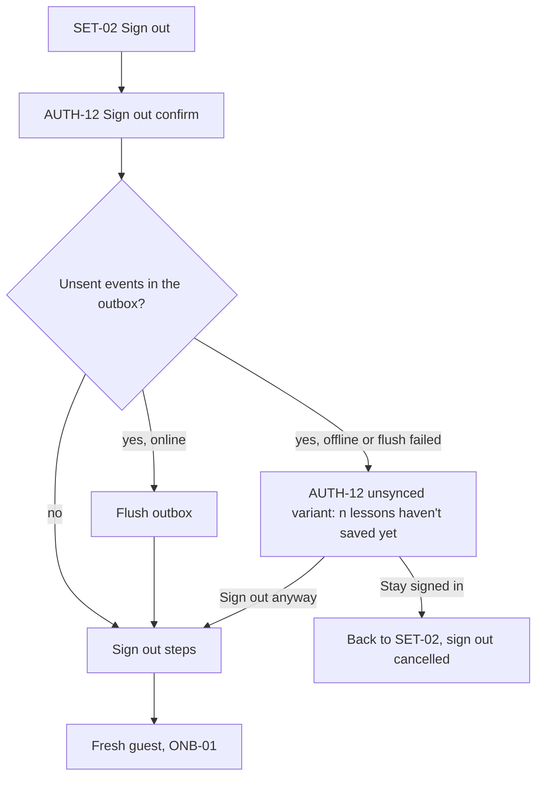

**Sign out steps** (in this order, each one allowed to fail without stopping the next):
1. `DELETE /v1/devices/{device_id}` so this phone stops getting this account's pushes.
2. RevenueCat `logOut()` so purchases on this phone aren't tied to the old account.
3. `supabase.auth.signOut({ scope: 'local' })`, which revokes this session's refresh token. SET-02 also has [Sign out of all devices], which uses `scope: 'global'`.
4. Google: `clearCredentialState()` on Android, `signOut()` in the Google SDK on iOS, `google.accounts.id.disableAutoSelect()` on web so One Tap doesn't sign the same person straight back in.
5. Apple: nothing on the device (Apple keeps no session for us).
6. **Wipe this account's local data:** delete `smriti-{user_id}.db`, the account's MMKV namespace, the TanStack Query cache, private images in the asset cache (avatars, doubt photos, generated images), scheduled local notifications, the widget snapshot (widgets fall back to a neutral "Open Smriti" state) and, on web, the account's IndexedDB stores and the service worker's cached API responses.
7. **Keep public content:** downloaded bundles, media and the seed pack are not personal and stay, so the next person doesn't download them again.
8. Create a **fresh guest** and open ONB-01. Set the local flag `prior_signout_on_device = true` (used by AUTH-07).

Notes:
- **Guests can't sign out**, because there's nothing to sign out of. SET-02 offers guests [Erase this phone's progress] instead, which deletes the anonymous user on the server (`DELETE /v1/account`, no grace for guests) and runs steps 6 to 8.
- **Managed child profiles** have no sign-out of their own. The parent removes a child from a device in Parent mode (SET-14), which runs steps 1 and 6 for that profile only.
- **Unsynced variant** (research §11.9): "{n} lessons haven't saved yet. Stay signed in until they do?" with [Stay signed in] as the main button. "Sign out anyway" loses the unsent events, and the copy says how many lessons and reviews that is (counted from the outbox by event type, no content). When the phone comes back online, the AUTH-33 chip shows "Saving…" and then "Saved to {email}", so the student can see when it is safe.

### 6.8 Delete account

DPDP gives the right to erasure (Act §12), Apple requires in-app deletion for apps that create accounts ([guideline 5.1.1(v)](https://developer.apple.com/app-store/review/guidelines/#data-collection-and-storage)), and Google Play requires an in-app path and a web link for deletion requests. Our web link is `app.<domain>/delete-account`, which runs the same steps in the web app.

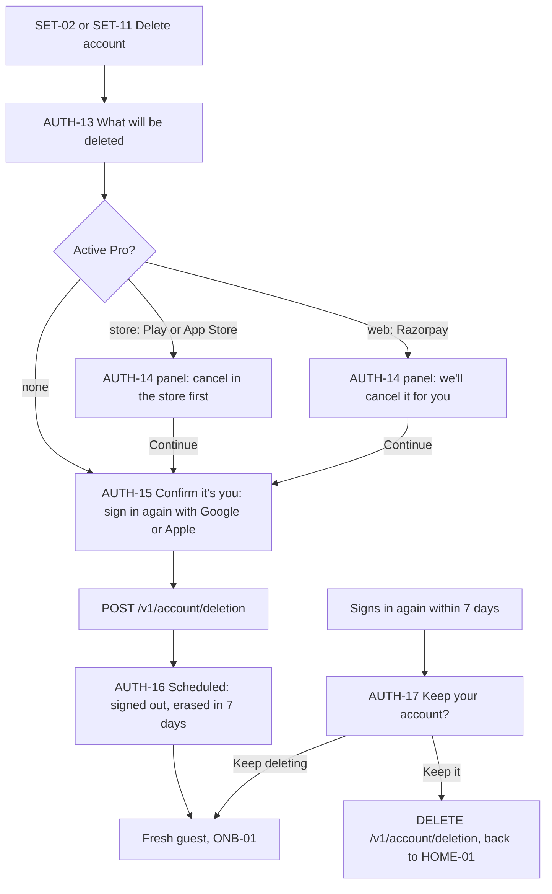

**Confirm it's you (AUTH-15):** the student signs in again with the same provider. For Google, the client does a fresh `signInWithIdToken` for the same user, and the API requires an `amr` entry newer than 5 minutes in the JWT ([JWT fields](https://supabase.com/docs/guides/auth/jwt-fields)). If the student picks a different Google account, AUTH-15 says "That's a different account" and stays. For Apple, the client also sends the fresh **authorization code**, which the server exchanges for a token and then revokes through Apple's REST API, as Apple requires on account deletion ([TN3194](https://developer.apple.com/documentation/technotes/tn3194-handling-account-deletions-and-revoking-tokens-for-sign-in-with-apple)).

**`POST /v1/account/deletion`** (new endpoint, idempotent):
1. Creates `app.data_requests (kind = 'erasure', status = 'open')` and sets `app.profiles.deletion_scheduled_for = now() + 7 days`.
2. Signs the user out everywhere (Supabase admin sign-out, global).
3. Hides the account from others at once: friend lists, leagues, duels, squads, shared decks and community items show "Deleted account" or disappear (tutor and social doc).
4. Cancels a Razorpay subscription at once (no refund of the current month unless support decides). A store subscription can't be cancelled by us. AUTH-14 told the student so.
5. Revokes the Apple tokens (Apple accounts).
6. Removes push devices.
7. If the account is a **guardian of managed children**, AUTH-13 listed them and they are scheduled for deletion with the parent (a managed child can't exist without a guardian). A guardian who only consented for a teen is unlinked: the teen's consent becomes `revoked` and the teen is told (AUTH-23 revoked variant).

**After 7 days** the worker erases:
- `auth.users` row (every user table cascades, DB_SCHEMA §1).
- R2 private objects (avatars, doubt photos, exports).
- Billing rows are kept for tax with a tombstone id, and `intro_claims.user_id` is cleared while the hashed claim keys stay (DB_SCHEMA §8). Legal review for the retention.
- ClickHouse events for the user id and its aliases are deleted with a lightweight delete in a weekly batch. Legal review on whether pseudonymous analytics may stay instead.
- `data_requests` is closed as `done`. Its row keeps only the request dates (no FK).

**Signing in during the grace period** (AUTH-17): Supabase still accepts the identity, the API sees `deletion_scheduled_for` and every endpoint except `GET /v1/me` and `DELETE /v1/account/deletion` returns `409 account_deletion_scheduled`. [Keep my account] cancels the deletion and the account is restored as it was (social presence comes back). [Continue deleting] signs out again.

**Teens and children:** a teen can delete their own account (it's their data). A managed child can't delete itself: the parent does it in SET-14, which runs AUTH-13 to AUTH-16 in the parent's session with the child's name in the copy.

### 6.9 Token refresh and offline

- Access tokens last 1 hour (Supabase default). `supabase-js` refreshes them in the background, and the API client retries once on a 401 after a refresh.
- **Offline:** nothing about learning needs a valid token. Events go to the outbox under the current `user_id` and flush on reconnect after a refresh.
- **Refresh fails with a network error:** keep trying with backoff. Never sign out for a network error.
- **Refresh fails with an auth error** (`refresh_token_not_found`, `refresh_token_already_used` beyond the reuse window, `session_expired`, `user_banned`, user deleted): the session has ended.
  - **Signed-in account:** AUTH-31 "Please sign in again". The local database and the outbox are **kept**. When the same account signs in again (same `sub`), the outbox flushes and nothing is lost. If a different account signs in, AUTH-31 warns that this phone's unsent progress for the old account will be removed, and the sign-out wipe runs for the old account first.
  - **`user_banned`:** AUTH-30 "This account is paused" with [Contact support] (SET-23).
  - **Deleted or scheduled for deletion:** AUTH-17 if within the grace period, otherwise the wipe runs and a fresh guest starts.
  - **Guest** (for example, a guest that was cleaned up after 90 idle days while the phone was offline): the app creates a new guest and uploads a snapshot of the local state with `POST /v1/sync/restore-snapshot` (new endpoint, guest only, rate limited), so the student loses nothing visible. Owner question Q6.
- **Clock skew:** the API accepts tokens with 60 s leeway. A phone with a badly wrong clock gets AUTH-30 "Your phone's date and time look wrong".

### 6.10 Guardian consent for 13 to 17

**When it is needed.** A teen (`age_band = '13_17'`) needs a guardian's consent record before any feature in the consent scope:

| Scope key | Covers | Required? |
|---|---|---|
| `account` | Keeping a saved account and syncing progress across devices | Required for the rest |
| `social` | Friends, leagues, duo, squads, duels (preset messages only, PRD §8) | Optional |
| `community` | Sharing decks and submitting community mnemonics | Optional |
| `voice` | Voice tutor (audio processed by Gemini Live) | Optional |
| `uploads` | Photo doubts and avatar uploads | Optional |

**Two flags decide when consent is asked.** Both come from `/v1/config`, so they can change without an app release, and the owner decides both with legal review (Q8). DPDP Act s.9(1) asks for verifiable consent before processing **any** personal data of a child (under 18), not only for some features, which is why the strict values exist (research finding 15).

**`auth.guardian_consent_gate`** (what a signed-in teen can do before consent):

| | `features` (default, fixed decision 5) | `signin` |
|---|---|---|
| Teen's Google sign-in | Links freely, like an adult. `guardian_consent_state = 'required'` | Links, then AUTH-18 opens at once (`pending`) |
| What the account does before consent | Saves and syncs progress, cross-device restore, Pro purchase | The identity is held, but sync to other devices, Pro and every scoped feature wait. Progress keeps syncing under the same user id only if `minor.defer_sync_until_consent` is off |
| Name and email | Email stays in `auth.identities` (Supabase). No name copied (§6.3) | The same |
| When AUTH-18 opens | The first time the teen reaches a scoped feature (`social`, `community`, `voice`, `uploads`). `account` is asked with it | Straight after sign-in, with `account` plus the scopes the teen picks |
| No answer | The feature stays locked. The account is unaffected | After `auth.consent_pending_days` the server unlinks the Google identity and deletes the identity data. The account goes back to a guest on that device with its progress |
| Phase | Phase 1 rules, but the first scoped features are mostly Phase 2 | AUTH-18 to AUTH-23 are on the Phase 1 sign-in path |

**`minor.defer_sync_until_consent`** (onboarding doc §6.2.1 owns the guest side; this is the auth side):

| | `off` (default) | `on` |
|---|---|---|
| Anonymous session for a minor | At first launch, like everyone | None. A minor is a local provisional profile until consent (onboarding doc §6.2.1) |
| Soft walls (AUTH-01) | As in §4 | The same moments and the same R29 budget, but the sheet asks "Ask a parent to save your progress". Its main button starts AUTH-18, not Google |
| Order of steps for a teen | Google sign-in, then consent (when the gate asks) | **Consent first, then the teen's Google sign-in.** AUTH-18 creates the request from the device without an account (`POST /v1/guardian/consent-requests` with a device-held claim secret and a Turnstile, App Attest or Play Integrity token). The guardian agrees on AUTH-20. AUTH-23 "agreed" then shows [Continue with Google] for the teen. The teen's sign-in creates the account and claims the consent in the same call (`POST /v1/auth/linked` with the claim secret). Only then does the outbox flush for the first time |
| Under 13 | Managed account through AUTH-24 at the first "Ask a grown-up" | The same. The parent's sign-in on AUTH-24 is the consent, so the child's data reaches the server only after it |
| Restore on a new phone | §6.5 | The same (the account already has consent) |
| AUTH-33 chip | Guest: "Only on this phone" | The same, and it stays until consent arrives |
| Analytics | Reduced allowlist (§11) | Nothing for the minor until consent (onboarding doc §9) |

With `on`, `auth.guardian_consent_gate` has no effect before consent (nothing is processed), and after consent it is irrelevant for `account`, because `account` was granted first. The scoped features still need their own scopes, which AUTH-20 offers at the same time.

**Two ways to consent:**

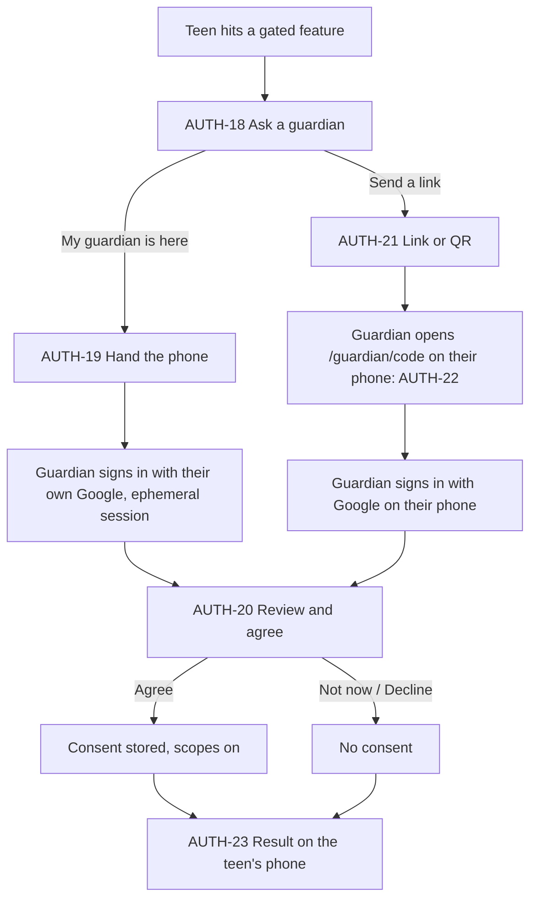

**Request** (`POST /v1/guardian/consent-requests`, as the teen, or as a device without an account when `minor.defer_sync_until_consent` is on): creates `app.guardian_consent_requests` with the asked scopes, `channel` (`handoff` or `link`), a random 8-character code (stored hashed) and `expires_at` (`auth.consent_handoff_ttl_min` for a handoff, `auth.consent_link_ttl_h` for a link; proposed 15 minutes and 72 hours, §10.1). The response gives the code and the link `https://smriti.app/guardian/{code}` (per-exam apps use their own prefix, APP_FLOW §4). In the device variant the request has no `learner_user_id` yet. It holds the hash of a claim secret that only this device knows; the guardian's [I agree] marks the request `granted`, and the `app.guardian_consents` row is written when the teen's new account claims it (within the request's expiry plus `auth.consent_claim_days`, after which it lapses).

**Same phone (handoff):**
1. AUTH-19 asks the teen to hand the phone over. The screen switches to the guardian's view: the copy speaks to the guardian.
2. The guardian taps "Continue with Google". **The teen's session is not touched.** The app runs a second, in-memory Supabase client (no persistence) and signs the guardian in with `signInWithIdToken`. On Android the account chooser lists accounts on this phone, which on a family phone often includes the parent's. [Use another account] opens Google sign-in in a browser tab, with an ephemeral session where the platform supports it (iOS `prefersEphemeralWebBrowserSession`), so the guardian's account isn't left on the teen's phone. iOS also offers Sign in with Apple.
3. With the guardian's session, the app calls `GET /v1/guardian/consent-requests/{code}` and shows AUTH-20.
4. The guardian ticks the declaration and the scopes and taps [I agree]. `POST /v1/guardian/consent-requests/{code}/confirm` (as the guardian).
5. The app signs the in-memory guardian client out (`scope: 'local'`) and throws it away. The phone goes back to the teen with AUTH-23.

**Guardian's own phone (link or QR):**
1. AUTH-21 shows a QR code and [Share link] (system share sheet, WhatsApp first in the list on Android because the system orders it, not us). The link text is prewritten in the teen's language.
2. The guardian opens the link. It opens the Smriti app if installed, otherwise the web app (AUTH-22). The guardian signs in with Google there, as their own account on their own device (One Tap on web works well here).
3. AUTH-20 on the guardian's phone. [I agree] or [No thanks].
4. The teen's phone polls `GET /v1/guardian/consent-requests/{id}` every 5 s while AUTH-21 is open, and gets a push (NTF-01, kind `consent_decided`, transactional, in the me-money NTF-01 catalogue) if the app is in the background. AUTH-23 shows the result.

**Server checks on confirm:**
- The request is `pending`, not expired, and the code matches.
- The guardian is not the teen: a different `user_id` **and** a different Google `sub` (and Apple `sub`) from any identity on the teen's account.
- The guardian's own profile isn't a declared minor. If the guardian account is new, its `age_band` is set to `18p` from the guardian's declaration on AUTH-20.
- One guardian can consent for several teens. A teen has at most one active consent at a time; a new one supersedes the old.

**What is stored** (`app.guardian_consents`, DB_SCHEMA §3): the teen's user id, the guardian's user id, an HMAC of the guardian's Google or Apple `sub` (so the record still proves who consented if the guardian later deletes their account), `method` (`google_same_device`, `google_own_device`, `parent_created`), `age_assurance` (`self_declared`, `digilocker_token`, `known_adult`), the scopes, the notice version shown, timestamps, and evidence (request id, app version, platform, the declaration version). No raw email, no IP address. `app.guardian_links` gets `(guardian, teen, kind = 'consent')`.

**Changes later:**
- The guardian can **withdraw** any scope in Parent mode (SET-17) or from the guardian's own account. Withdrawal sets `revoked_at` and turns those features off at once (social doc B4, "consent withdrawn").
- The teen **turns 18:** a daily job compares `app.profiles.birth_ym` with today. When the teen is 18, `age_band` becomes `18p`, the consent is no longer needed, and the guardian link ends with a note to both. Without a birth month (age from class only), the band moves up one year after the class year ends, and the teen is asked to confirm their birth year once.
- **Declined:** the gated feature stays locked. The teen can ask again after `auth.consent_retry_h`. After `auth.consent_decline_limit` declines in a rolling window the ask button rests for `auth.consent_decline_pause_days` ("Your guardian said no for now"). Proposed values are in §10.1.

**Is this "verifiable"?** DPDP Rule 10 asks the data fiduciary to check that the person consenting is an **identifiable adult**, using reliable identity and age details it already holds, or details the person provides, or a **virtual token** from an authorised entity such as a DigiLocker service provider ([MeitY data protection framework](https://www.meity.gov.in/data-protection-framework), Rules notified as G.S.R. 846(E) on 13 Nov 2025; Rule 10 applies 18 months after notification, around May 2027). A Google sign-in proves the guardian controls a real Google account, but **Google does not give us a verified age**. So:
- **Phase 1 design:** Google sign-in plus the guardian's declaration that they are the teen's parent or legal guardian and are 18 or older (`age_assurance = 'self_declared'`).
- **Ready to add:** a DigiLocker age token step on AUTH-20 (`age_assurance = 'digilocker_token'`), behind the flag `auth.guardian_digilocker`. A guardian who already has a Smriti account with a verified adult age skips it (`known_adult`).
- **Legal review decides** whether self-declaration is enough before May 2027, and whether DigiLocker must be mandatory after. This is a launch blocker for the consent flow (IMPLEMENTATION_PLAN §2). Commentators also note DigiLocker can't prove the *relationship* between guardian and child, only the guardian's age.

### 6.11 Managed accounts for under-13s

**Goals:** a child under 13 never signs in with Google; the parent owns the account; the child still has its own `user_id` so every table works unchanged; the parent can bring the child back on a new phone; siblings can share one phone.

**The internal identity.** Each managed child has an email identity on a domain we own that never receives mail (`{child_user_id}@managed.<auth-domain>`, with a null MX record). Nobody types or sees it. It exists only so the server can create a session for the child on a device the parent has signed in on.

**How a device gets a child session** (`POST /v1/guardian/children/{id}/session`, as the parent):
1. The API checks `app.guardian_links (guardian = caller, learner = child, kind = 'managed', revoked_at is null)` and that the parent's JWT has an `amr` entry newer than 10 minutes.
2. The API asks Supabase admin to generate a one-time email token for the child's internal identity and returns only its **token hash** (no email is sent).
3. The device exchanges the hash for a child session (supabase-js `verifyOtp` with `token_hash` and `type: 'email'`; the name is historical, no code goes to any person). The hash works once and expires in 5 minutes.
4. The child session is stored under its own storage key (`sb-{project}-auth-{child_user_id}`) and opens `smriti-{child_user_id}.db`.

This needs a Phase 0 spike (IMPLEMENTATION_PLAN F-7): confirm the token-hash exchange on the current supabase-js, and block public email sign-ups with Supabase's "before user created" auth hook so the email provider can stay enabled only for these internal identities. **Fallback** if the spike fails: the server holds a random per-child secret and creates the session server-side with Supabase's password grant, then hands the tokens to the device over TLS. Either way, no person ever has a credential for the child.

**Creating a managed child:**

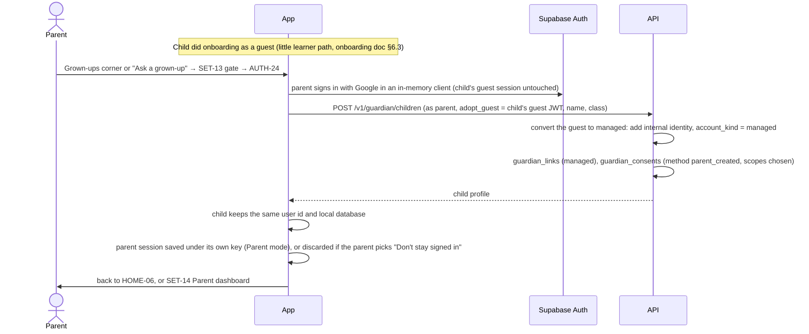

- **The child keeps its user id.** The guest that did onboarding becomes the managed account (the server adds the internal identity to the anonymous user, so `is_anonymous` turns false). Nothing is merged or copied.
- **Adding a second child** (AUTH-26) creates a new user server-side (`POST /v1/guardian/children` without `adopt_guest`), and the device gets its session through the token-hash step. Then the child does the little-learner part of onboarding (ONB-09 onwards).
- **The parent's consent** is captured at creation (`method = 'parent_created'`, the parent's Google sign-in plus the declaration), with the same scopes as AUTH-20. For under-13s `social` is limited to friend duels with consent (social doc), and `voice` is off for little learners.

**Restore a child on a new device (AUTH-28):** ONB-01 "I already have an account" → AUTH-02 "Restoring your child's account?" → AUTH-24 parent sign-in → AUTH-28 lists the parent's managed children (pet face and name) → the parent picks one or more → token-hash sessions → ENT-09 restores each → AUTH-25 if more than one profile is on the phone, otherwise HOME-06.

**Siblings and parents on one phone (AUTH-25):**
- The device keeps a **profile registry** in MMKV: a list of `{user_id, kind, display name, pet species}` for each profile with a session on this phone. No other data.
- With more than one profile, the app opens to AUTH-25 "Who's learning?". Switching between children needs no gate **unless** the parent turned on "Ask before switching profiles" in SET-14 (a device setting `parent.ask_before_switching` in the profile registry, off by default). With it on, tapping any tile on AUTH-25 opens SET-13 first, and the switch happens only after the gate passes; failing or closing the gate leaves the current profile open. Opening an adult profile or Parent mode always goes through SET-13.
- Each profile has its own session and its own database, so one child never sees another's progress, and the outbox of each flushes under its own user id.
- A guardian's own session on a child's phone is kept only if the parent chose "Stay signed in on this phone" on AUTH-24. Otherwise every Parent mode visit signs in again through the gate (one tap with Credential Manager).
- **Removing a child from this phone** (SET-14): wipes that profile's data from the device and revokes that device's child session. The child's account is untouched.

**Turning 13:** the parent can let the child "move to their own Google account" in SET-14. The child links their Google identity to the same user (`linkIdentity`), `account_kind` becomes `learner`, the internal identity is unlinked, and the parent's consent continues as the teen's guardian consent until 18.

**Linking an existing teen to a parent** (me and money doc SET-18, path 2): the parent starts it in SET-18, which creates a link request and shows a QR. The teen scans it on their own phone, sees AUTH-27 "Link {parent first name} as your guardian?", and confirms. The parent then sees AUTH-20 on their own phone. This is the same request record as §6.10 with `initiated_by = 'guardian'`.

### 6.12 Returning-account check on Android (AUTH-32)

The onboarding doc owns ONB-01 and the experiment (onboarding doc §6.9.1, flag `onb.returning_account_check`). This is the auth side, which onboarding references as AUTH-32.

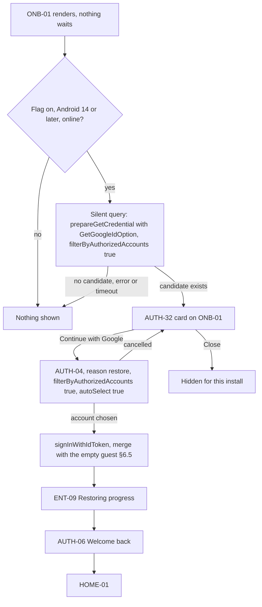

1. **Silent query.** When ONB-01 is on screen, the app calls Credential Manager's `prepareGetCredential` (Android 14, API 34, and later) with a `GetGoogleIdOption` that has `filterByAuthorizedAccounts = true`, our web client id and a hashed nonce, then reads `hasCredentialResults` for the Google ID token type. This shows **no UI**. It needs the manifest permission `CREDENTIAL_MANAGER_QUERY_CANDIDATE_CREDENTIALS` ([PrepareGetCredentialResponse](https://developer.android.com/reference/androidx/credentials/PrepareGetCredentialResponse)). Universal Sign In doesn't expose this call, so it is a small in-house Expo module next to it (IMPLEMENTATION_PLAN F-7 spike).
2. **Only accounts that used Smriti before** count, because of `filterByAuthorizedAccounts = true`. A Google account that has never signed in to any Smriti app gives no candidate.
3. **New users see nothing.** No candidate, an error, offline, a timeout of `auth.returning_check_timeout_ms`, or Android 13 and below: ONB-01 is unchanged. On Android 13 and below there is no silent query, and a plain `getCredential` would show Google's sheet over ONB-01, so we don't call it.
4. **A candidate exists:** ONB-01 shows AUTH-32, a card above the language buttons. It doesn't block them. The card can't say the account's name, because the silent query doesn't reveal which account it found; Google's own sheet shows "Continue as {name}" the moment the student taps. So our card reads "Welcome back! Continue with Google to bring back your streak." with the Google button and the trust line.
5. **Tap:** straight to AUTH-04 with `reason = restore` (the card already gave the reason, so no AUTH-02). We use the prepared handle (`getCredential` with the pending handle) so Google's sheet opens at once. With one authorised account and no sign-out, Google may sign in automatically.
6. **After sign-in:** the guest created at first launch is empty, so the merge path runs with nothing to add (§6.5), then ENT-09, AUTH-06 "Welcome back", and HOME-01 (or AUTH-25 if the account manages children). Onboarding is skipped when the account already has a pet and a goal (onboarding doc §6.9).
7. **Cancel** returns to ONB-01 with the card still there. **Close** hides the card for this install.
8. **Guardian-only accounts:** a parent's account also counts as authorised. If it signs in here, the API's `account_is_guardian` answer opens AUTH-09, which offers the parent restore path (AUTH-28) as well as "It's me, I want to learn too".
9. **iOS and web:** nothing. iOS has no silent query across installs, and the web app spends no One Tap on a first visit (§5.3). Both keep ONB-01's "I already have an account".
10. **Privacy:** the query reveals nothing to us except "there is a candidate", and we log only that (`returning_card_shown`, onboarding doc). No account details leave Credential Manager until the student taps.

### 6.13 Save-state chip (AUTH-33)

One component in `packages/app-core` (state) and `ui-native` and `ui-web` (view), so ME-01, SET-02 and LES-08 always agree (research §11.7, A16).

| State | Condition (from app-core) | Icon (Phosphor) | EN | HI | Tap |
|---|---|---|---|---|---|
| `guest` | Anonymous session, or no session yet (local provisional profile) | `CloudSlash` | Only on this phone | सिर्फ़ इसी फ़ोन पर | Opens AUTH-01, `reason = save_progress` (ignores the soft budget: the student asked) |
| `saving` | Signed in, online, outbox has events | `CloudArrowUp` | Saving… | सेव हो रहा है… | Nothing (it is a status) |
| `saved` | Signed in, outbox empty | `CloudCheck` | Saved to {email} | {email} में सेव है | Opens SET-02 |
| `saved_offline` | Signed in, offline, outbox has events | `CloudCheck` | Saved. New progress syncs when online | सेव है। नई प्रोग्रेस ऑनलाइन होने पर सिंक होगी | Opens SET-02 |

- `{email}` is the Google email. With Apple it shows "Saved to your Apple account" / "आपके Apple अकाउंट में सेव है", never a relay address. For managed children it shows "Saved by your grown-up" / "आपके बड़ों ने सेव किया है" (little learners: "तुम्हारे बड़ों ने सेव किया है", R3), with no email.
- **Where:** ME-01 header (always), SET-02 account row (always), and LES-08 as a one-line row under the counts on the first lesson complete after the first sign-in only. The onboarding doc also shows the `guest` state on ONB-14 (onboarding doc §6.2.1).
- **Truthful:** `saving` shows only while the outbox really has events and the device is online. A failed flush that will retry stays `saving` for at most `auth.chip_saving_max_s`, then shows `saved_offline` until the retry succeeds.
- Never colour alone: icon plus text, Chip status style (DESIGN.md §5). The email is not sent to analytics.

---

## 7. Error cases

| Case | Detected by | What the student sees | What happens |
|---|---|---|---|
| Cancelled the Google or Apple sheet | Library cancel code, GIS `dismissed` | The sheet stays open with a quiet line: "No problem. You can save anytime from Me." / "कोई बात नहीं। आप कभी भी 'मैं' टैब से सेव कर सकते हैं।" (soft sheets only) | `auth_provider_result (result = cancelled)`. No error toast. A cancel is not a "Later". |
| No Google account on the phone (Android) | `NoCredentialException` from the bottom sheet | Google's own "Add account" screen in the button flow | We always use the button flow on tap, so the student can add an account. AUTH-30 explains if adding fails. |
| No Google Play services, or too old | `PLAY_SERVICES_NOT_AVAILABLE` | A short "Opening Google in your browser" state | Browser fallback (A7). If Play services can be updated, AUTH-30 also offers [Update Google Play services]. |
| Network failure before or during sign-in | Fetch error, timeout (`auth.signin_timeout_s`) | AUTH-30 offline variant: "No internet. Your progress stays on this phone, and we'll save it when you're back online." / "इंटरनेट नहीं है। प्रोग्रेस इसी फ़ोन पर है, ऑनलाइन होते ही सेव कर देंगे।" with [Try again] | Guest continues as before. Nothing partial is stored. |
| Network failure after the link succeeded | `POST /v1/auth/linked` fails | Normal success screen | The call retries from the outbox. It is idempotent. |
| Google account belongs to another Smriti account | `identity_already_exists` | AUTH-07 (only on shared phones), then AUTH-08 | Merge path §6.4. |
| Google account belongs to a parent account | `409 account_is_guardian` | AUTH-09 | §6.4. |
| Account disabled by us | `user_banned` | AUTH-30 "This account is paused" | [Contact support]. No retries. |
| Account scheduled for deletion | `409 account_deletion_scheduled` | AUTH-17 | §6.8. |
| Supervised Google account (Family Link) that a parent hasn't approved for Smriti | Google's own screen asks the child to get approval | Google's "Ask a parent" screen, then cancel | We return to the sheet. Our age check should already have sent under-13s to AUTH-24. |
| Apple Hide My Email | Relay address in the token | Nothing special | We don't depend on email (§5.2). |
| Apple name missing (not the first authorisation) | No `fullName` | Nothing. No form (A15) | The name can be set later in SET-02. |
| In-app browser on web | User-agent check | AUTH-30 "Open in your browser" | [Copy link], Android intent link to Chrome. |
| Third-party sign-in prompts turned off in the browser or Google account | One Tap not displayed | Nothing. The button is always there. | `auth_onetap_not_displayed` with the GIS reason code. |
| Wrong app configuration (SHA-1, client id) | `DEVELOPER_ERROR`, `invalid_audience` | AUTH-30 "Something went wrong on our side" | Logged to Sentry with the trace id. Alert on any occurrence in production. |
| Nonce mismatch | Supabase rejects the token | AUTH-30 generic error: "Couldn't reach Google. Try again in a moment." / "Google से कनेक्ट नहीं हो पाया। थोड़ी देर में फिर कोशिश करें।" with [Try again] | A fresh nonce on retry. Alert above `auth.nonce_error_alert_rate`. |
| Too many sign-in attempts | `over_request_rate_limit` | AUTH-30 "Too many tries. Wait a minute." | Exponential backoff in the client. |
| Phone clock badly wrong | Token `iat` in the future or expired at once | AUTH-30 "Your phone's date and time look wrong" | Link to the system date settings. |
| Merge failed | `account_merges.status = 'failed'` | AUTH-08 "We're still adding your progress" | Worker retries. After 3 failures, an ops alert and a support ticket. The student keeps using the account. |

---

## 8. The ₹1 intro offer and abuse without phone numbers

PRD §11.2: the ₹1 first month is "once per account and device". With Google-only sign-in, the person is approximated by **every sign-in identity on the account** plus **device signals** where the platform gives them.

**Identity keys.** For each identity on the account, the server computes `HMAC-SHA256(AUTH_IDENTITY_HASH_PEPPER, provider || ':' || sub)`. The Google `sub` is stable for a Google account within our Google Cloud project, across every variant. The Apple `sub` is stable across our App IDs because they are grouped under one primary App ID (§5.2). Emails are never used: they change, and Apple relays hide them.

**Device keys.**
- **iOS:** Apple DeviceCheck gives two bits per device for our developer team, which survive reinstalls ([DeviceCheck](https://developer.apple.com/documentation/devicecheck)). Bit 0 = "a ₹1 month was claimed on this device".
- **Android:** Play Integrity **device recall** gives developer-set bits per device shared across all apps in our Play developer account, which fits our many variants ([device recall](https://developer.android.com/google/play/integrity/device-recall)). It is in beta and writing needs early access, so until we have it, Android relies on identity keys and Play's own intro eligibility.
- **Web:** no device key. Identity keys only.

**Eligibility** (`GET /v1/billing/intro-eligibility`, as a signed-in user, used by PAY-01):
1. The account is not anonymous (starting the trial is a hard login).
2. No row in `billing.intro_claims` for any identity key on this account.
3. The account never had a subscription.
4. On iOS and Android (when available), the device bit is not set.

**What PAY-01 shows (R38).** "₹1" appears only when the server says the person is eligible; otherwise PAY-01 shows "Get Pro" at the full price. A **guest** can't be fully checked, because the identity keys come with sign-in. So for a guest the endpoint also accepts the anonymous JWT and answers from the device bit alone (`eligible_hint`); PAY-01 may show ₹1 on that hint, and the full check runs after AUTH-02 and before checkout. If the full check says no, PAY-01 changes to "Get Pro" before any payment sheet opens, with the line "The ₹1 month was already used on this account." / "इस अकाउंट पर ₹1 वाला महीना पहले ही इस्तेमाल हो चुका है।" (PAY owns the screen; this is the rule it follows.)

**Selling the right product.** Each variant sells two products or offers: one with the ₹1 intro (`pro_monthly_intro_{variant}`) and one without (`pro_monthly_{variant}`). The paywall sells the intro one only when the server says eligible. On Play, the ₹1 offer uses developer-determined eligibility, so the app only requests it when allowed. On iOS, StoreKit decides intro eligibility per Apple ID and per app's subscription group, so without this rule one Apple ID could take ₹1 once in every variant app. Razorpay on web uses a plan with or without the ₹1 offer, chosen by the server. (Me and money doc owns PAY; this is the rule PAY follows.)

**Claiming.** On the first intro purchase webhook (RevenueCat `INITIAL_PURCHASE` with an intro period, or Razorpay `subscription.activated` with the offer), the worker inserts one `intro_claims` row per identity key on the account and sets the device bit. A unique-key conflict means a race or an abuse attempt; it is logged for review (the store has already charged ₹1, so nothing is refunded or blocked).

**Erasure.** Claims keep their hashed keys after an account is deleted (the `user_id` is cleared), so deleting and re-creating an account with the same Google account doesn't give another ₹1 month. Legal review must confirm this is a legitimate use for fraud prevention.

**Other abuse controls:**
- Anonymous sign-ins: Turnstile on web, a raised but present per-IP limit on Supabase, and on mobile App Attest and Play Integrity signals on sensitive endpoints from Phase 2 (TRD §14).
- Referral rewards (free week for both) also use identity keys: one reward per invitee identity, and none if the invitee's identity has claimed before.
- Several Google accounts on one person can't be stopped fully. The device bits limit the damage on phones.

---

## 9. Branches at a glance

| Branch | What changes |
|---|---|
| Guest vs signed in | Guests see soft and hard sheets at the PRD moments; signed-in users never do (except AUTH-31). Guests have [Erase this phone's progress] instead of sign out and delete. |
| Free vs Pro | Sign-in is the same. Delete account (AUTH-14) adds the subscription step for Pro. |
| Online vs offline | Sign-in, merge, consent and delete need the network. Offline, sheets disable their buttons and say why. Learning never needs a valid token. |
| Adult vs teen vs under 13 | Adult: no consent. Teen: own Google plus guardian consent (§6.10). Under 13: managed by a parent (§6.11); every login trigger becomes "Ask a grown-up". |
| Per-exam app vs all-exams app | Same account and same Pro. Separate sessions per app on one phone (A10). A restoring per-exam app adds its exam to the account if missing. |
| Android vs iOS vs web | Android: Credential Manager, Google only. iOS: Google SDK plus Apple. Web: GIS One Tap and button, OAuth redirect on iOS browsers, no Apple. |
| Shared phone | AUTH-07 before a merge if another account signed out here. Sign-out wipes. AUTH-25 picker for several profiles. |

---

## 10. Data: what is stored where

| Data | On the device | On the server | Notes |
|---|---|---|---|
| Session (access and refresh token) | Encrypted MMKV (mobile), `localStorage` (web), one key per profile | Supabase `auth.sessions` | Excluded from backups |
| Identities (Google, Apple, internal) | none | Supabase `auth.identities` | Holds email and name from the provider. We don't copy the email into `app` tables. |
| Account kind, consent state, signed-up time, deletion schedule, birth month | `profile_snapshot` | `app.profiles` (`account_kind`, `guardian_consent_state`, `signed_up_at`, `deletion_scheduled_for`, `birth_ym`, `age_source`) | New columns, DB_SCHEMA §3 |
| Consent requests | Request id while waiting | `app.guardian_consent_requests` | New table |
| Consent records | Scopes in `profile_snapshot` | `app.guardian_consents` (rewritten) | No phone hash. Guardian user id plus a hashed `sub`. |
| Guardian links | Profile registry (ids and names only) | `app.guardian_links` | New table |
| Merges | Merge id while waiting | `app.account_merges` | Existing |
| Deletion requests | none | `app.data_requests`, `app.profiles.deletion_scheduled_for` | Existing table, new column |
| Intro claims | none | `billing.intro_claims` keyed by `claim_key` | Rewritten, DB_SCHEMA §8 |
| Device flags | `prior_signout_on_device` (MMKV, boolean) | none | Never the old user id |
| Origin and pending action for return-to-origin | Zustand, in memory | none | Lost on app kill: the student lands on Home, which is fine |
| Soft prompt history | MMKV (learn doc) | none | |

### 10.1 Config keys

All tunables come from `/v1/config` (`packages/config` defaults), so none is hard-coded. Values marked R come from DECISIONS.md. The others are **proposed** defaults for the owner to confirm; they are not research findings.

| Key | Default | Used in |
|---|---|---|
| `auth.soft_prompt_cooldown_days` | 7 (R29) | §4 soft budget |
| `auth.soft_prompt_later_limit` | 2 (R29) | §4 |
| `auth.soft_prompt_pause_days` | 14 (R29) | §4 |
| `auth.streak_prompt_hour` | learn doc owns | §4, HOME-01 |
| `auth.streak_prompt_push` | off | §4 |
| `auth.guardian_consent_gate` | `features` (fixed decision 5) | §6.10 |
| `minor.defer_sync_until_consent` | off (onboarding doc) | §6.10 |
| `auth.guardian_digilocker` | off | §6.10 |
| `auth.consent_pending_days` | proposed 7 | §6.10, `signin` gate |
| `auth.consent_claim_days` | proposed 7 | §6.10, device variant |
| `auth.consent_handoff_ttl_min` / `auth.consent_link_ttl_h` | proposed 15 / 72 | §6.10 |
| `auth.consent_retry_h`, `auth.consent_decline_limit`, `auth.consent_decline_pause_days` | proposed 24, 3, 30 | §6.10 |
| `auth.deletion_grace_days` | proposed 7 (Q5) | §6.8 |
| `auth.merge_wait_s`, `auth.merge_retries` | proposed 30, 3 | §6.4 |
| `auth.returning_check_timeout_ms` | proposed 1500 | §6.12 |
| `auth.chip_saving_max_s` | proposed 10 | §6.13 |
| `auth.signin_timeout_s` | proposed 15 | §7 |
| `auth.nonce_error_alert_rate` | proposed 0.5% | §7, alerting |
| `auth.max_children_per_guardian` | owner to set | AUTH-26 |
| `merge.keep_guest_pet` | on (owner Q9) | §6.4 step 7 |
| `onb.returning_account_check` | onboarding doc (A/B test) | §6.12 |
| `parent.ask_before_switching` | off, set by the parent in SET-14 | §6.11, AUTH-25 |

**New or changed endpoints** (TRD §5.1 "Accounts" row):

| Endpoint | Caller | Purpose |
|---|---|---|
| `POST /v1/auth/linked` | Just-linked user | Finalise a link (§6.3) |
| `POST /v1/account/merge-intents` | Guest | Prove control of the guest before a merge |
| `POST /v1/account/merges`, `GET /v1/account/merges/{id}` | Existing account | Start and follow a merge |
| `POST /v1/account/deletion`, `DELETE /v1/account/deletion` | Signed-in user | Request and cancel deletion |
| `DELETE /v1/account` | Guest | Erase guest progress now |
| `POST /v1/sync/restore-snapshot` | New guest | Re-home local data after a lost guest session (§6.9) |
| `POST /v1/guardian/consent-requests`, `GET /v1/guardian/consent-requests/{id or code}` | Teen, guardian | Start and read a consent request |
| `POST /v1/guardian/consent-requests/{code}/confirm`, `/decline` | Guardian | Decide |
| `DELETE /v1/guardian/consents/{id}/scopes/{scope}` | Guardian | Withdraw a scope |
| `GET /v1/guardian/learners` | Guardian | List linked teens and managed children |
| `POST /v1/guardian/children`, `DELETE /v1/guardian/children/{id}` | Guardian | Create or delete a managed child |
| `POST /v1/guardian/children/{id}/session` | Guardian | Token hash for a child session on this device |
| `POST /v1/guardian/link-requests` | Guardian | Start linking an existing teen (AUTH-27) |
| `GET /v1/billing/intro-eligibility` | Signed-in user | ₹1 eligibility (§8) |
| `POST /v1/webhooks/apple-signin` | Apple | Server-to-server notifications: consent revoked, account deleted, email relay changes |

---

## 11. Analytics events

All events go to the typed catalogue in `packages/analytics` first. No names, emails, `sub`s or free text. For minors only the essential allowlist is sent (me and money doc §4.6); the events marked ✓ are on it.

| Event | Props | Minor allowlist |
|---|---|---|
| `auth_prompt_shown` | `reason`, `variant` (`soft`, `hard`), `surface` | |
| `auth_prompt_dismissed` | `reason`, `variant`, `via` (`later`, `swipe`, `back`, `onetap_close`), `later_count` | |
| `auth_prompt_skipped` | `reason`, `cause` (`cooldown`, `paused`, `mid_activity`, `managed`) | |
| `auth_onetap_shown` | `context` (`use`, `signin`), `reason` | |
| `auth_age_check_shown` / `auth_age_check_result` | `band` | ✓ |
| `auth_provider_tapped` | `provider` (`google`, `apple`), `flow` (`button`, `bottom_sheet`, `onetap`, `redirect`) | |
| `auth_provider_result` | `provider`, `flow`, `result` (`success`, `cancelled`, `error`), `error_code` (from a fixed list) | ✓ |
| `auth_fallback_used` | `cause` (`no_play_services`, `ios_browser`, `gis_load_failed`) | ✓ |
| `auth_onetap_not_displayed` | `gis_reason` | |
| `auth_linked` | `provider`, `path` (`link`, `merge`, `restore`), `reason` | ✓ |
| `auth_shared_phone_check` | `choice` (`add`, `fresh`) | ✓ |
| `auth_merge_completed` | `duration_bucket`, `lessons_added_bucket`, `pet_kept` | ✓ |
| `auth_merge_failed` | `failure_code` | ✓ |
| `auth_return_to_origin` | `reason`, `action_resumed` (bool) | |
| `auth_returning_check` | `result` (`candidate`, `none`, `unsupported`, `timeout`, `error`) | ✓ (no account data, sent as age `unknown`) |
| `auth_save_chip_tapped` | `state` (`guest`, `saving`, `saved`, `saved_offline`), `surface` (`me`, `settings`, `lesson_complete`) | ✓ |
| `auth_signed_out` | `scope` (`local`, `global`), `unsynced_lost` (bool) | ✓ |
| `auth_session_ended` | `cause` (`refresh_revoked`, `banned`, `deleted`, `guest_lost`) | ✓ |
| `account_switch_started` | none | |
| `account_delete_step_viewed` | `step` (1, 2), `has_store_sub` (bool) | ✓ |
| `account_delete_requested` / `account_delete_cancelled` | `provider` | ✓ |
| `guest_erase_confirmed` | none | ✓ |
| `guardian_consent_requested` | `channel` (`handoff`, `link`), `gate` (`features`, `signin`), `scopes` (list of keys) | ✓ |
| `guardian_consent_link_shared` | `via` (`qr`, `share_sheet`, `copy`) | ✓ |
| `guardian_consent_decided` | `channel`, `decision` (`agreed`, `declined`), `scopes_granted`, `age_assurance` | ✓ |
| `guardian_consent_expired` | `channel` | ✓ |
| `guardian_consent_withdrawn` | `scope` | ✓ |
| `parent_signed_in` | `entry` (`set_gate`, `ask_grown_up`, `restore`), `stay_signed_in` (bool) | |
| `child_profile_created` | `adopted_guest` (bool), `class_band` | ✓ |
| `child_profile_switched` | `profiles_on_device` (count) | ✓ |
| `child_restored` | `count` | ✓ |

Server-side events (written by the API, same catalogue): `account_linked`, `account_merged`, `account_deleted`, `guardian_consent_recorded`, `intro_claimed`, `intro_claim_conflict`.

---

## 12. Security notes

- **Nonce on every ID token** (Google and Apple), raw to Supabase, hashed to the provider. "Skip nonce check" stays off in Supabase.
- **PKCE** on every redirect flow. Redirect URLs are an allowlist in Supabase (app schemes per variant, `app.<domain>/auth/callback`, the staging origin).
- **Supabase custom domain** (`auth.<domain>`) so Google's consent screen and the redirect show our domain, not the Supabase project URL.
- **Manual linking on, automatic linking by verified email on** (Supabase default). Email sign-up is blocked by the "before user created" hook except for internal managed identities.
- **Re-authentication** for deletion and for child sessions uses the `amr` timestamp in the JWT (5 and 10 minutes).
- **Guardian sign-in on a teen's phone** uses an in-memory client that is signed out and discarded, and the browser fallback uses an ephemeral session where available.
- **No provider tokens leave the device** except the ID token to Supabase and the Apple authorization code to our API at deletion. We don't store Google access tokens (App Store guideline 5.1.1(v) on social credentials).
- **Rate limits** (Redis): consent requests 5 a day per teen, consent confirm 10 an hour per guardian, child sessions 20 a day per guardian, merges 5 a day per account.

---

## 13. Gaps and conflicts found

| Where | Conflict | Resolution |
|---|---|---|
| PRD §10.3, TRD §1, §4.2, §6, §17, §18 D5, DB_SCHEMA §3 and §8, IMPLEMENTATION_PLAN §2, M-7 and §9, `.env.example` | Phone OTP, email sign-in, DLT, MSG91, `guardian_phone_hash`, `intro_claims.phone_hash` | Updated in this round (auth agent) |
| APP_FLOW §2 Auth row, UX_FLOW §4.14 | Still list phone OTP, email, OTP entry, "Parent consent (for under-13s)" | Owner of those files to replace with the AUTH screen list in this doc |
| APP_FLOW §3.1 | Shows `POST /guest` | The guest is created by `supabase.auth.signInAnonymously()`, not by our API. The new-user trigger makes the rows. |
| APP_FLOW §3.2 | "Streak day 2 night" soft trigger and no `restore` or `switch_account` | Matches §4 here. Add the restore and switch triggers. |
| APP_FLOW §4 | No auth deep links | Add `smriti.app/guardian/{code}` (AUTH-22, opens web if the app isn't installed), `smriti.app/delete-account`, `smriti.app/login`, and the OAuth callback `smriti-{variant}://auth/callback` |
| PRD §10.3 "Parent accounts for under-13 users: consent" | Under-13 vs under-18 | Teens: guardian consent. Under-13: managed accounts (A8). |
| PRD §17 | Parent mode is Phase 3, but under-13 learners can't save progress without managed accounts | Q2 |
| me and money doc SET-20 "Who's learning?" | Same screen as AUTH-25 | **Decided by the coordinator: AUTH-25 wins.** SET-20 must be a pointer to AUTH-25 (the me and money screen index already says "AUTH-25 (replaces SET-20)"). Its "Ask before switching profiles" request is in AUTH-25. |
| DB_SCHEMA §10 `notify.log.channel` | Allowed `sms`, but we hold no phone numbers | `sms` removed |
| Tokens | Google and Apple buttons need their brand colours, which weren't in `tokens.json` | Done in revision 1: `thirdParty.google` and `thirdParty.apple` in `packages/tokens/tokens.json`, and the brand exception in DESIGN.md §5 (R29) |
| onboarding doc Q6 | Says AUTH-25 and AUTH-26 are Phase 3 | They are Phase 1, account part only (TRD §18 D9, Q2). Only the Parent mode dashboard is Phase 3. Onboarding to update Q6. Resolved in consistency pass: onboarding Q6 says so. |
| onboarding doc §6.2.1, step 3 | With `minor.defer_sync_until_consent` on, the teen signs in with Google first, then the guardian consents | Signing in creates an account with the teen's email, which is processing before consent. With the flag on, consent comes first and the teen's sign-in claims it (§6.10). Onboarding to swap the order in step 3. Resolved in consistency pass: onboarding §6.2.1 step 3 is consent first. |
| me and money doc, edge case 9 | Two pets on a merge: "{guest pet} is now a friend in your garden" | Research §11.6 copy uses the pet room: "{pet_b} is visiting your pet room". AUTH-08 uses the research copy behind `merge.keep_guest_pet` (Q9). Me and money to align the pet room wording, or the owner picks one. Resolved in consistency pass: me-money edge case 9 uses the pet room line. |
| tutor-social doc (leagues, boards, SOC-21) | Show minors as "first name and initial", citing PRD §16.4 | R31 (amended): minors appear only after guardian consent, with the pet avatar and an auto-generated nickname from a fixed word list; friends added by link or QR see the pet name. PRD §8 and §16.4 now say so (revision 1); a minor's first name stays private (§6.3). Those docs to update. Resolved in consistency pass: tutor-social, practice, onboarding and DB_SCHEMA §7 use the nickname rule. |
| tutor-social doc SOC-03 | Shows a generated username the student can change | Adults: fine. Minors: the public name is the auto-generated nickname (§6.3), which can be re-rolled but never typed (R31, amended). SOC-03 to offer [Shuffle] instead of a text field for minors. Resolved in consistency pass: SOC-03 has a minor variant with [Shuffle]. |
| research §11.3 (test) | Suggests a direct `GetGoogleIdOption` call at ONB-01, which shows Google's sheet | We use the silent `prepareGetCredential` (Android 14 and later) so new users see nothing, as the coordinator asked (§6.12). The card can't name the account; Google's sheet does. |
| PAY-01 (R38) | ₹1 shown only when the server says eligible, but a guest has no identity keys yet | `eligible_hint` from the device bit for guests, full check after sign-in (§8). Me and money to confirm PAY-01 handles the late switch to "Get Pro". Resolved in consistency pass: me-money §5.4 and PAY-01 states switch before any payment sheet. |

---

## 14. Open questions for the owner

| # | Question | Recommendation |
|---|---|---|
| Q1 | Should **all under-13s** (10–12 too, not only class 1–5) use managed accounts? | **Yes.** Google itself doesn't allow an unsupervised Google account under 13 in India, and supervised (Family Link) accounts need the parent's approval anyway. One rule is simpler for parents and for us. At 13 the child can move to their own Google account and keep everything. |
| Q2 | Ship managed accounts (parent sign-in, one or more children, restore) in **Phase 1**, ahead of the Phase 3 Parent mode dashboard? | **Yes, the account part only** (AUTH-24 to AUTH-28, no dashboard). Without it a 10–12 year old in the all-exams app can't save progress or start Pro. The weekly report and time limits stay Phase 3. |
| Q3 | Is a guardian's **Google sign-in plus a self-declaration** enough as verifiable consent, or must we add a **DigiLocker** age token? | Ship self-declaration behind the flag with legal sign-off for launch, and start DigiLocker partner onboarding now so it can be switched on before DPDP Rule 10 applies (about May 2027). |
| Q4 | On **Android and web**, how does someone who signed up with **Apple on an iPhone** get in? | Phase 1: AUTH-10 help sheet ("Add Google to your account on your iPhone"), and AUTH-06 on iOS suggests adding Google once. If support tickets show it matters, add a small "Signed up with Apple?" link on web that runs Supabase's Apple OAuth (needs a Services ID and a key rotated every 6 months). |
| Q5 | Is a **7-day deletion grace period** acceptable? | Yes, if legal agrees and the privacy policy says so. It protects shared-phone users from a mistaken delete. |
| Q6 | A guest whose server data was cleaned up while the phone was offline: re-home the local data? | Yes, with `POST /v1/sync/restore-snapshot`. Also lengthen guest cleanup from 90 to 180 days of no server activity, since many Indian students go offline for weeks. |
| Q7 | Buy the **Universal Sign In** licence ($249 a year, Team)? | Yes, or apply for the free EAS-customer licence. The in-house module is the fallback. |
| Q8 | Which values for `auth.guardian_consent_gate` and `minor.defer_sync_until_consent`? (DPDP Act s.9(1) covers any processing of a child's data.) | Put both to legal review before the Phase 1 beta; §6.10 says what each value changes. Recommendation: `features` plus `off` for launch only if legal accepts that sign-in and sync are covered by another basis; otherwise `defer_sync_until_consent = on`, which makes the gate setting moot before consent. Both are built, so it is a flag change. |
| Q9 | On a merge with two different pets, keep the guest's pet as a visiting buddy? (research §14 Q9) | Yes (`merge.keep_guest_pet` on). Losing a named pet feels like a loss, and it costs one row. |
| Q10 | Build a small Expo module for `prepareGetCredential` so the Android returning-account check is silent? | Yes, as part of the F-7 spike. Without it, AUTH-32 is off and ONB-01's link covers returning students. |

---

## 15. Sources

- Supabase: [Anonymous sign-ins](https://supabase.com/docs/guides/auth/auth-anonymous), [Identity linking](https://supabase.com/docs/guides/auth/auth-identity-linking), [Login with Google](https://supabase.com/docs/guides/auth/social-login/auth-google), [Login with Apple](https://supabase.com/docs/guides/auth/social-login/auth-apple), [signInWithIdToken](https://supabase.com/docs/reference/javascript/auth-signinwithidtoken), [Error codes](https://supabase.com/docs/guides/auth/debugging/error-codes), [JWT fields](https://supabase.com/docs/guides/auth/jwt-fields)
- Google: [Credential Manager, Sign in with Google](https://developer.android.com/identity/sign-in/credential-manager-siwg), [implementation](https://developer.android.com/identity/sign-in/credential-manager-siwg-implementation), [legacy Google Sign-In migration](https://developer.android.com/identity/sign-in/legacy-gsi-migration), [Google Identity Services for web](https://developers.google.com/identity/gsi/web/guides/overview), [FedCM migration](https://developers.google.com/identity/gsi/web/guides/fedcm-migration), [supported browsers](https://developers.google.com/identity/gsi/web/guides/supported-browsers), [branding guidelines](https://developers.google.com/identity/branding-guidelines), [age requirements](https://support.google.com/accounts/answer/1350409), [Family Link supervision](https://support.google.com/families/answer/9055704), [Play Integrity device recall](https://developer.android.com/google/play/integrity/device-recall)
- Expo library: [`@react-native-google-signin/google-signin`](https://react-native-google-signin.github.io/docs/), [Universal Sign In pricing](https://universal-sign-in.com/#pricing)
- Apple: [App Review Guidelines 4.8 and 5.1.1(v)](https://developer.apple.com/app-store/review/guidelines/), [TN3194 account deletion and token revocation](https://developer.apple.com/documentation/technotes/tn3194-handling-account-deletions-and-revoking-tokens-for-sign-in-with-apple), [DeviceCheck](https://developer.apple.com/documentation/devicecheck)
- India: [MeitY data protection framework (DPDP Act 2023, DPDP Rules 2025)](https://www.meity.gov.in/data-protection-framework). Rule 10 (verifiable consent for children) and the phased commencement were read from the notified rules as summarised by legal commentators; **legal review must confirm the final text before launch**.

---

## Changelog (revision 1)

- **R29, research A10 to A13, §11:** soft-wall budget (once per trigger per 7 days, never mid-lesson, 14-day pause after two "Later" taps) in §4, with config keys in §10.1. "Later" is a full-size secondary button. Trust line on every sign-in surface in the R40 text. Approved Google labels only. Research §11.2 headlines and §11.6 copy for link, merge, two pets, offline, cancel and error (AUTH-01, AUTH-02, AUTH-06, AUTH-08, AUTH-30).
- **AUTH-06** is now a toast after a link ("Saved! ... You're signed in as {email}.") and a short card after a restore. No name form (A15). The Apple-name-missing case asks nothing.
- **New AUTH-32** (Android returning-account card on ONB-01, silent `prepareGetCredential`, §6.12) and **AUTH-33** (save-state chip component for ME-01, SET-02, LES-08 and ONB-14, §6.13).
- **Web One Tap budget** (§5.3): never on a first visit, ONB, lessons or SEO pages; `context: 'use'` only at soft value moments, `context: 'signin'` on AUTH-29 and AUTH-22; closing it counts as a "Later". Button parameters from research §11.5.
- **iOS:** the "Google will open for a moment." prep line, `restorePreviousSignIn` never interactive at launch, the Apple button titled "Continue with Apple" (§5.2).
- **Triggers:** `streak_day_3` renamed `streak_day_2` to match the learn doc, with `auth.streak_prompt_hour`. New `web_storage_risk` (Safari and iOS browsers, after the 1st lesson; onboarding Q8) and `leaderboard` (practice PRC-12 and MOCK-24). Tap triggers ignore the budget.
- **Flags** (§6.10): what each value of `auth.guardian_consent_gate` and `minor.defer_sync_until_consent` changes. With deferred sync on, consent comes before the teen's Google sign-in and the new account claims it (device-held claim secret; DB_SCHEMA `guardian_consent_requests` updated).
- **AUTH-25:** "Ask before switching profiles" (SET-14) sends every tile through SET-13 first. SET-20 is a pointer to AUTH-25 (coordinator decision).
- **Delete account** is two screens (research X16): AUTH-14 is now a panel inside AUTH-13; AUTH-15 is step 2 of 2.
- **R31 (amended):** minors' public name is an auto-generated nickname from a fixed word list (re-rollable, never typed), shown only after guardian consent; a minor's first name stays private (§6.3; DB_SCHEMA `profiles.nickname_*`).
- **R38:** ₹1 only when the server says eligible; a guest hint from the device bit, full check after sign-in (§8).
- **Merge:** two pets kept behind `merge.keep_guest_pet` (Q9); stats `pet_kept = both`; gems, freezes and plant follow the me and money rules.
- **Sign out:** the unsynced variant asks "{n} lessons haven't saved yet. Stay signed in until they do?" (research §11.9).
- **Phases** noted for AUTH-18 to AUTH-28 (R8).
- **Numbers** that were not from a ruling or a source are now named config keys with proposed defaults (§10.1).
- **Cross-doc:** tokens `thirdParty.google` and `thirdParty.apple`, DESIGN.md §5 brand exception, TRD §10 activity day (R1, R23), DB_SCHEMA `daily_goal_minutes` default 10 and `activity_days.qualified`, PRD §7 leagues (R30), streak (R23) and gems (R36), PRD §8 and §16.4 minors' visibility (R31).
- New conflicts are in §13; new questions Q9 and Q10 in §14.
