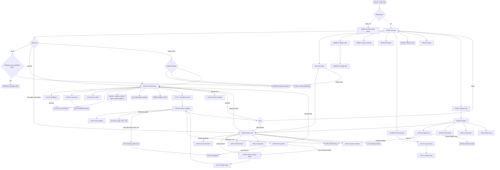
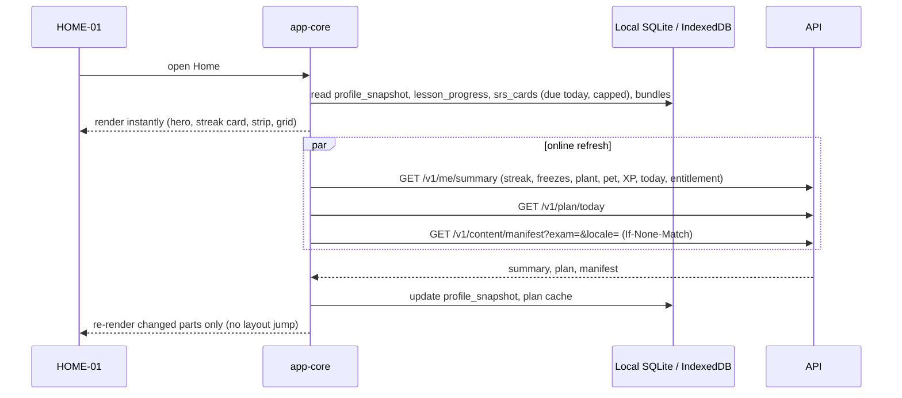
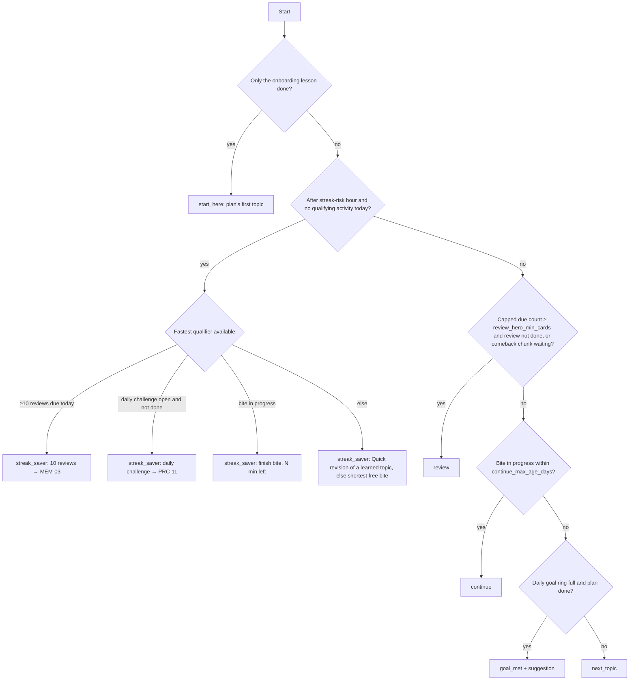
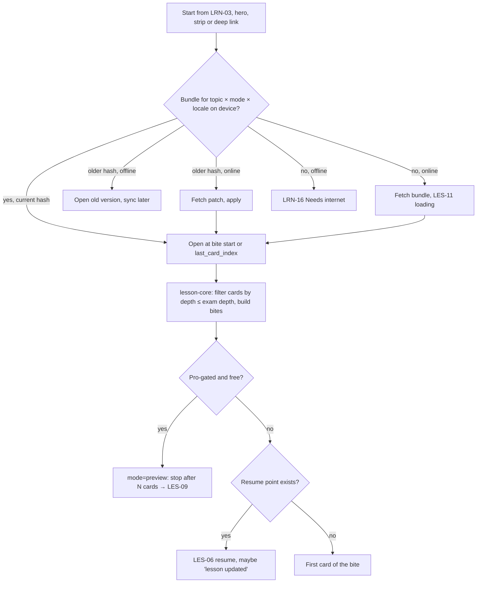
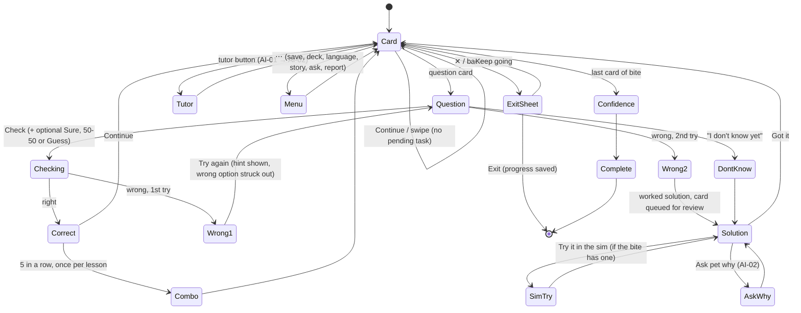
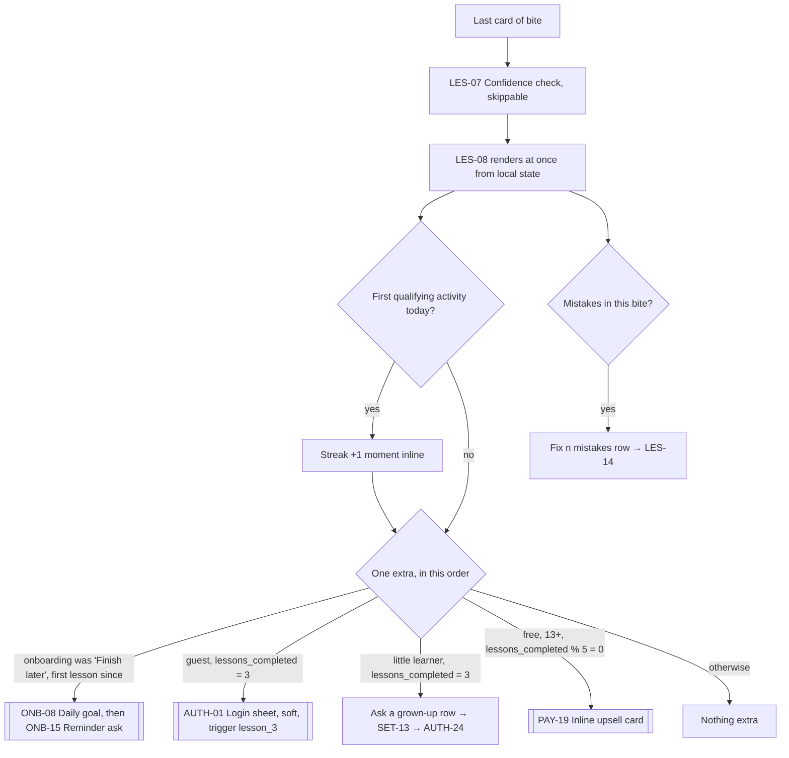
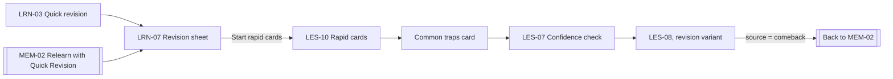

# Learn flow: Home, subjects, topics and the lesson player

Status: Draft v0.3 (revision 1), 29 Oct 2026. Owner of this file: the learn area (screen prefixes HOME, LRN, LES).

This doc covers the logic: what each screen decides, every branch, and where the data lives. How each screen looks is in [`docs/ux/learn.md`](../ux/learn.md). Both build on `APP_FLOW.md` §1–3.4 and §3.10, `UX_FLOW.md` §4.3–4.8, §4.17 and §5, `DESIGN.md`, PRD §5, §7 and §11.1, TRD §3.2 and §7, DB_SCHEMA §4.2–4.5 and §5.1, `skills/_shared/content-format.md` §7–8, the competitor research (`docs/research/COMPETITOR_FLOWS.md`, items A14–A23, A19, X1, X13, X19) and the orchestrator's rulings R1–R34. Where an older doc disagrees with a ruling, the ruling wins.

Screens owned here (phase per IMPLEMENTATION_PLAN; R8):

| ID | Screen | Phase |
|---|---|---|
| HOME-01 | Home (Learn tab) | 1 |
| HOME-02 | Today's plan | 1 |
| HOME-03 | Change today's plan (sheet) | 1 |
| HOME-04 | Exam switcher (sheet; also reused on PRC-01 and MOCK-01) | 1 |
| HOME-05 | Global search | 1 |
| HOME-06 | Little learner Home (class 1–5) | 3 |
| HOME-07 | *Retired in revision 1.* The little learner break screen is SET-19 "Time's up" (me+money). ID not reused. | |
| HOME-08 | Find my level (intro sheet for the 5-question check) | 1 |
| LRN-01 | Subject map | 1 |
| LRN-02 | Chapter | 1 |
| LRN-03 | Topic card | 1 |
| LRN-04 | "Learn this first?" prerequisite sheet | 1 |
| LRN-05 | Pro preview sheet (and the "Ask a grown-up" variant) | 1 |
| LRN-06 | Chapter test sheet (test out, practise the chapter, timed chapter mock) | 1 |
| LRN-07 | Quick revision sheet (also the "relearn" target from MEM-02) | 1 |
| LRN-08 | Cheat sheet viewer | 1 |
| LRN-09 | Library: formula vault, shortcut vault, saved, notes, mind maps | 1 (Notes and Mind maps tabs: 2) |
| LRN-10 | Formula or shortcut detail sheet | 1 |
| LRN-11 | Storybook reader (layout reused by AI-20) | 1 (little learner use: 3) |
| LRN-12 | Video lesson | 1 (transcript flashcards: 2) |
| LRN-13 | Cornell notepad | 2 |
| LRN-14 | Mind map viewer | 2 |
| LRN-15 | Download for offline (sheet) | 1 |
| LRN-16 | Needs internet (full-screen state) | 1 |
| LRN-17 | Song player (little learner; proposed, R59) | 3 |
| LRN-18 | Play activity (little learner; proposed, R59) | 3 |
| LES-01 | Lesson player, with a sub-block per card type (LES-01.1 to LES-01.20) | 1 |
| LES-02 | Answer feedback sheet (correct, wrong first try, wrong second try, "I don't know yet") | 1 |
| LES-03 | Key term and symbol sheet | 1 |
| LES-04 | Card menu (report opens SET-24) | 1 |
| LES-05 | Exit confirm sheet (with the onboarding variant) | 1 |
| LES-06 | Resume and "lesson updated" notice | 1 |
| LES-07 | Confidence check (end of a lesson) | 1 |
| LES-08 | Lesson complete | 1 |
| LES-09 | Preview finished (free Deep Dive preview) | 1 |
| LES-10 | Rapid cards (Quick revision mode) | 1 |
| LES-11 | Lesson loading and load error | 1 |
| LES-12 | Quick check mode (used by Find my level and Test out) | 1 |
| LES-13 | Check result (Find my level and Test out) | 1 |
| LES-14 | Fix mistakes round | 1 |

---

## 1. Purpose

The Learn tab is where a student spends most of their time. It has three jobs:

1. **Tell the student the one next thing to do**, in under a second, offline or online. This is the hero card on Home.
2. **Let them go anywhere in the syllabus** in at most three taps: Home → Subject map → Chapter → Topic card. Search gets there in two.
3. **Teach and check** in the lesson player, then save what was learned into the memory system (spaced-repetition cards, mastery, confidence).

## 2. Key decisions

### 2.1 Home: subject grid, plan-driven hero card, and a path strip for the current chapter (R10)

Duolingo shows one long linear path because a language course has one designer-set order. Smriti does not:

- An exam syllabus has hundreds of topics across three or four subjects, studied **in parallel**.
- The order is set by the student's school or coaching timetable. A single forced path would either block that student or be a fake path that everyone skips.
- A path of 400 nodes is a scroll, not a map.

Inside a chapter, order does matter (the chapter's `sort` plus `prerequisite` edges), and "2 more topics to finish Kinematics" is real motivation. So:

- **Home** keeps the subject grid for random access. Each subject tile also shows that subject's own next topic ("Next: {topic_title}"), so every subject has one "next up" (A14).
- The **hero card** ("Up next") is the single main action (§2.2).
- Under it, a **path strip**: "Up next in {chapter_title}", the chapter's topics as nodes, with **review nodes placed by FSRS** where that chapter's cards are due (A14).
- The **Chapter screen (LRN-02)** shows the full chapter as a vertical rail list with the same review nodes woven in. Its header opens the chapter cheat sheet (A16), and it offers a free **Test out** (A15).
- **Little learners (class 1–5)** get a true zig-zag path on HOME-06.

### 2.2 The hero card follows the daily plan

The hero shows the **first unfinished item of today's plan**; other candidates become at most one quiet secondary row. The hero kinds are:

| Hero kind | When | Button |
|---|---|---|
| `start_here` | No lesson completed beyond the onboarding lesson | [Start] |
| `streak_saver` | After the streak-risk hour (`home.streak_risk_hour`, matching the local "streak at risk" notification) and no qualifying activity today (R1, R23) | The fastest qualifying action (§5.2) |
| `review` | Today's capped review count ≥ `home.review_hero_min_cards` and today's review not done, or a comeback plan chunk is waiting (R22) | [Review] |
| `continue` | A bite in progress, opened in the last `home.continue_max_age_days` days | [Resume] |
| `next_topic` | No bite in progress; the plan's new topic, else the next topic in the current chapter | [Start deep dive] or [Start quick revision] |
| `goal_met` | Daily goal ring full and plan done | [One more] (secondary styling) |

`selectHero()` lives in `packages/app-core`, so web and mobile agree, and it runs from the local snapshot, so Home never waits for the network.

### 2.3 "Locked" means Pro, never prerequisite order (R9)

- **No topic is ever blocked by order.** Prerequisites are a soft suggestion (LRN-04 with [Start anyway]).
- **The only lock is Pro**, following PRD §11.1 and the rulings (§6.2). A locked item always opens to a preview or a useful sheet. Quick revision is always free.
- "Locked" and the lock icon appear only with the text label "Pro", never as a grey, untappable row.
- **Nothing is gated on mistakes** (X1). There are no hearts or energy. Lesson check questions never count against the free practice quota. Free limits are shown up front and never trigger mid-lesson.

### 2.4 A "lesson" is a bite

PRD §5.1 splits a Deep Dive into 2–4 minute bites. The player ends at the end of each bite with LES-08, so a 14-minute Deep Dive is about four lessons. A whole Quick Revision is one lesson. These counts drive "soft login after the 3rd lesson" and "Pro card every 5th lesson". **Gap:** `lesson@1` has no bite field (§11, G2).

### 2.5 Streak and daily goal are separate (R1, R23)

One qualifying activity a day keeps the streak: one lesson, or 10 reviews, or one mock section, or the daily challenge. The daily goal (minutes, default 10 per R6) is a separate ring. Day boundary: the student's local midnight.

### 2.6 Strong students can skip ahead: Test out and Find my level (A15, R27, X13)

- **Test out of this chapter** (LRN-06 → LES-12 → LES-13) is free for everyone, does not use the 30-a-day practice quota, and marks topics as learned when passed. It never marks anything as failed.
- **Find my level** (HOME-08 → LES-12 → LES-13) is the 5-question placement check that left onboarding (R27). It appears on Home as an optional card for students who rated themselves "Know the basics" or "Revising" in ONB-07, can be redone any time, and never locks anything.
- Both are **reversible**: LRN-02's overflow has "Reset chapter progress", and a redo replaces earlier placement marks that no lesson has confirmed since.

### 2.7 The help ladder (A21) and finishing kindly (A22, A23)

- Wrong answers climb a ladder: first wrong → a hint; second wrong → the worked solution, plus [Try it in the sim] when the bite has a sim for the question's concepts; then [Ask {pet_name} why] (AI-02 with the question as context). Every rung up to the sim is free and never uses any quota.
- At lesson complete, **"Fix {n} mistakes"** is an optional, free step after the celebration (LES-14). It never costs gems or the practice quota.
- **Lesson complete renders instantly from local state.** There is never a spinner between the last card and the celebration. Sync happens later through the outbox.

---

## 3. Entry points

| Entry | Lands on | Notes |
|---|---|---|
| App launch (returning) | HOME-01, or HOME-06 for little learners | From ENT-01. ENT-08 (streak check-in) may show first. Home renders from `profile_snapshot` before any network call. |
| End of onboarding | HOME-01 `start_here` | From ONB-14 / ONB-15. [Finish later] in ONB-13 also lands here. |
| Learn tab tap | HOME-01, scrolled to top | |
| Deep link `smriti.app/t/{topicSlug}` | LRN-03 | Via ENT-06. Outside the variant's exam: a note on LRN-03 (§6.1). Before onboarding: the onboarding fast lane plays the topic's first bite in `mode=onboarding` (no gate), then LRN-03 shows the gate later. |
| Deep link `smriti.app/plan` (needed by the large widget, me+money request) | HOME-02 | New deep link, owned here |
| Deep link `smriti.app/review` | MEM-03 | Owned by memory-labs |
| Widgets, notifications | HOME-01 (hero pre-selected) or HOME-02 | NTF catalogue, me+money |
| Search (top bar on every main screen) | HOME-05 | |
| PRC-05 / MOCK-22 "Learn this topic" | LRN-03 | Practice |
| MOCK-19 "Fix next" | PRC-03 (practice owns), or LRN-03 | |
| AI-02 "Open lesson" | LRN-03 or LES-01 at a card | Tutor |
| LAB-03 / LAB-07 "Learn the theory" | LRN-03 | Labs |
| MEM-02 "Relearn with Quick Revision" | LRN-07 (`source=comeback`) | Memory |
| ME-21 Downloads | LRN-15 | |

---

## 4. Navigation map

---

## 5. Home logic (HOME-01)

### 5.1 What Home loads

- First paint never waits for the network (TRD §15: cold start to interactive Home under 2.5 s).
- If `/me/summary` fails, Home keeps the snapshot and retries silently with backoff.

### 5.2 Hero selection (`selectHero()` in app-core)

- "Current chapter" is the chapter of the most recent lesson, else the plan's suggested chapter.
- **Review routing** follows memory-labs §5.2 (`reviewEntryTarget()` in app-core, owned by memory-labs): MEM-02 when the backlog rule fires or a comeback plan is active, else MEM-03. Home only ever shows **today's capped count** (R22), never the raw backlog.
- **Secondary row candidates**, in priority order, at most one shown: the second-best hero candidate ("Or continue {topic_title}", or reviews below the hero threshold); then a predicted-forgetting alert ("{topic_title} is fading · {n} cards", opens MEM-03 `?topic=`, Phase 2 with the weak-area job); then a weak-spot drill ("Practise {concept_name}", opens PRC-02).
- Flags: `home.review_hero_min_cards`, `home.streak_risk_hour`, `home.continue_max_age_days`, `home.strip_max_nodes` (topic nodes before a "+{n}" node), `home.strip_max_review_nodes`.

### 5.3 Path strip and review nodes (A14)

- The strip lists the current chapter's topics in `sort` order with the states in ux §0.3.
- **Review nodes:** for each learned topic in the chapter that has cards due today (FSRS `due_at` ≤ end of today, within the daily cap), a review node "Review {n}" sits right after that topic. At most `home.strip_max_review_nodes` review nodes; the rest fold into one "Review {n}" node. Tapping one opens MEM-03 in topic review (`?topic=`, memory-labs §5.4). A review node disappears when its cards are done.
- The strip header row has [Cheat sheet], which opens LRN-08 for the chapter (A16), and "See chapter" (LRN-02).

### 5.4 Home states and branches

| Branch | What changes |
|---|---|
| **New user** | Hero `start_here`. Streak card at day 1. Strip shows the suggested chapter. Subject progress bars hidden until first progress. |
| **Self-rated "Know the basics" or "Revising"** (ONB-07) | The **Find my level** card shows under the plan row until the check is done or dismissed. [Start] → HOME-08. Dismissed: it moves to the LRN-01 overflow ("Find my level") and HOME-02's footer. |
| **Guest** | Same Home as signed in. No login banner. On streak day 2 in the evening (`auth.streak_prompt_hour`), the streak card adds "Save your plant", which opens AUTH-01 (trigger `streak_day_2`). Frequency rules are AUTH's (R29: once per trigger per 7 days; after two "Later" taps, no soft walls for 14 days). |
| **Streak card: freezes** (R28, A17) | Two freeze slots (`streak.freeze_slots_max`, default from config) as small icons with text: "2 freezes ready", "1 freeze ready", "No freezes ready · Get one". Tapping the slots opens ME-10. |
| **Rest day** (me+money §3.5) | Streak card: "Rest day. Your plant is resting too." No streak-risk state, no streak saver. |
| **Incident freeze** (R28, X15) | When the server's incident flag is on, the streak card says "We had a problem on our side. Your streak is safe." and decay is paused. |
| **Streak at risk** | Streak card `warningTint`, pet "thinking", hero `streak_saver`. Never guilt copy (X9). |
| **Plant droopy, dry or wilted** | Plant art changes (DESIGN §6.4), encouraging copy. Revival needs 1, 2 or 3 study days (R12). |
| **Plant dormant ("Resting")** | Revival card replaces the streak card: "Welcome back! Let's wake your plant up: {days} short days." `{days}` comes from the server (5 today, R12). Links to ME-08. Hero = the shortest free bite. |
| **Pet resting** | Header avatar shows the resting pose; tap opens ME-04. |
| **Review due** | Hero `review` above the threshold, otherwise a secondary row "{count} today · {minutes} min". |
| **Comeback plan active** (R22) | Review hero or row reads "Comeback plan · day {d} of {n} · {count} today" and opens MEM-02. |
| **No reviews due** | Plan row second line: "All caught up! Next review in {duration}." |
| **Offline** | Slim banner. Hero picks on-device content only. Tiles and nodes without local bundles show "Needs internet"; tapping opens LRN-16. |
| **Free** | "Free today" chip on the rotating free chapter. **No Pro upsell on Home** (R15). |
| **Pro** | No chips. ME owns any Pro mark on the avatar. |
| **All-exams app** | Exam switcher chip at the **top left of the header** (A18), opens HOME-04. Streak, plant, pet and XP are account-wide across exams and apps. |
| **Per-exam app** | No switcher, unless the variant has more than one exam profile. |
| **"Just curious" only** (ONB-02) | The grid shows the `curious` catalogue profile (a general set of subjects from `/v1/config`, R7). The header chip reads "Exploring" and HOME-04 offers [Pick an exam]. No countdown. |
| **Exam date passed** | One-time card: "How did {exam_name} go? Set your next goal." → ONB-06 in `edit` mode. |
| **Minor (13–17)** | No change on Home. No league chip on Home for anyone. |
| **Little learner** | HOME-06 instead (§5.6). |
| **Dark mode** | Night Colour tokens. |

Home also has two quiet tiles at the bottom: **Memory** (MEM-01: decks, palaces, focus timer; R17) and **Library** (LRN-09).

### 5.5 Exam switching (HOME-04)

- Lists `app.user_exams` (primary first) with target dates, [Add an exam] and "Manage exams" (ME-03).
- Picking one sets `is_primary`, calls `PATCH /v1/me` (queued offline), swaps the manifest and re-renders. Mastery is per concept, so shared concepts keep their progress (DB_SCHEMA §5.1).
- [Add an exam] opens ONB-02 then ONB-06 in `add` mode, then returns.
- Leagues are grouped by exam; switching does not move the student mid-week (SOC-08 owns the rule).
- PRC-01 and MOCK-01 reuse this sheet (practice request).

### 5.6 Little learner Home (HOME-06, Phase 3)

For class 1–5 (`age_band = 'u10'`, managed accounts, AUTH-25 picks the child):

- A zig-zag path of the current unit's stories and activities, at most 7 nodes in view, the pet on the current node, one giant [Play].
- **Three tabs only: Learn, Labs, Me** (R14). No search, gems, leagues, prices or exam switcher.
- **No tutor button by default** (R14). A parent can turn on the chips-only little learner tutor (AI-02 little learner variant) in SET-14.
- Every label has a speaker; copy uses तुम (R3).
- **Grown-ups corner** → SET-13 (parent mode gate) → SET-14.
- **Time limits:** SET-16 sets them; at the limit, the player finishes the current card and shows SET-19 "Time's up".
- Pet moods: happy, excited, curious, sleepy only. The plant stops at "droopy" in this mode.
- Login: none. At the 3rd lesson, LES-08 shows "Ask a grown-up to save your stars", which opens SET-13 and then AUTH-24.

---

## 6. Subject → chapter → topic

### 6.1 Topic card mode default

| Topic state | Default mode |
|---|---|
| Never started, or Deep Dive in progress | Deep dive |
| Learned (Deep Dive done, or passed in Test out, Find my level or a chapter test) | Quick revision (SET-10 can change the default for learned topics) |
| Deep Dive Pro-gated for this free student and not started | Quick revision selected; Deep dive shows "Pro · Preview free" |
| Little learner | No choice. One [Play] |

Deep link to a topic outside the variant's exam: LRN-03 opens with "This topic isn't in {exam_name}. You can still read it." (all-exams app) or "This topic is in Smriti {other_exam}." (per-exam app).

### 6.2 Free vs Pro (PRD §11.1, R9, R15, R16, R19, R25)

| Item | Free (no login needed) | Pro |
|---|---|---|
| Quick revision (every topic) | ✓ | ✓ |
| Deep Dive, first 2 chapters of every subject (in the exam profile's chapter order) | ✓ | ✓ |
| Deep Dive, the rotating "Free today" chapter(s) | ✓ that day; progress kept forever | ✓ |
| Deep Dive, other chapters | Preview: first `free.deep_dive_preview_cards` cards (4, R16), then LES-09 | ✓ |
| Test out, Find my level, Fix mistakes | ✓, never uses the practice quota | ✓ |
| Lesson check questions | ✓, never uses the practice quota (X1) | ✓ |
| Sims, 3D, 360° and video cards inside a lesson the student can open | ✓ | ✓ |
| Cheat sheets, revision sheets, formula and shortcut vaults, bookmarks | ✓ | ✓ |
| Storybooks, video lessons | ✓ | ✓ |
| Role play card (AI-21) | ✓, its own turn cap per card, not the tutor quota (tutor-social) | ✓ |
| "Ask {pet_name} why", "Ask about this card" | Opens AI-02; sending uses the free tutor quota (AI-06 at the limit) | Higher limits |
| "Explain it back" (AI-10, Phase 2) | AI-07 Pro tool teaser | ✓ |
| Practise the chapter / topic (PRC-03) | Counts against 30 questions a day (R25); PRC-17 at the cap | Unlimited |
| PYQs from search | Viewable within the 30-a-day cap (R25); no Pro chip | ✓ |
| Timed chapter mock (MOCK-02) | Practice's mock limits (R25) | ✓ |
| Cornell manual (Phase 2) | ✓ | ✓ |
| Cornell AI fill, AI mind-map links (Phase 2) | LRN-05 → PAY-01 `ai_tools_lock` | ✓ |
| Mind map from the syllabus graph (Phase 2) | ✓ | ✓ |
| Download for offline (pinned) | LRN-05 → PAY-01 `offline_download`; automatic cache still works; LRN-16 offers "Save when online" | ✓ |
| "Make it stick" (MEM-19) | MEM-19's own gate (`memory_lock`) | ✓ |
| [Add to deck] on any card | ✓ | ✓ |
| PDF of a cheat sheet (Phase 2) | ME-22 with its Pro lock → PAY-01 `pdf_export` | ✓ |
| Standalone labs from a lesson link | R19 (labs in free chapters, periodic table, experiments, tools, one featured lab a week) | ✓ |

**How a gate looks:** the item is fully visible. A "Pro" chip with `LockSimple` in `primaryTint` / `primary`. Tapping opens LRN-05, which offers a free preview where one exists, [Try Pro for ₹1] → PAY-01 with the matching trigger (`deep_dive_lock`, `offline_download`, `ai_tools_lock`), and a free alternative. Never a grey row.

**Children (R15):** `u10` sees the "Ask a grown-up" variant, which leads to SET-13 and then PAY-01 for the parent. `10_12` sees the same variant; [For grown-ups] opens PAY-01, whose minor flow runs PAY-03 before any checkout. No PAY-19 card for anyone under 13.

**Rotating free chapters** come from config, served in the manifest (gap G6).

**Losing Pro:** the bite in progress finishes; completed bites stay completed; the next Pro bite shows LRN-05. Nothing learned is taken away.

### 6.3 Prerequisite suggestion (LRN-04)

Shown when a student starts a Deep Dive and a concept in the topic has a `prerequisite` edge to a concept below `learn.prereq_mastery_min` in a different, unlearned topic of the same exam profile. [Go to it] or [Start anyway] (suppresses LRN-04 for that topic for `learn.prereq_snooze_days`). Never for Quick revision, little learners, or prerequisites outside the profile.

### 6.4 Chapter test sheet (LRN-06)

Three choices, ordered by the chapter's state:

| Choice | Default when | Runs in | Counts against quota | Result |
|---|---|---|---|---|
| **Test out of this chapter** | Most topics not yet learned | LES-12 (`mode=check`, `kind=test_out`) → LES-13 | No | Passed topics marked learned (`learned_via = test_out`) and their review cards scheduled. Others: "Worth a lesson". |
| **Practise the chapter** | Most topics learned | PRC-03 prefilled with the chapter (chapter mode) → PRC-04 → PRC-06 | Yes (R25) | Practice's drill summary |
| **Timed chapter mock** | Shown only if a published `content.mocks` row of kind `chapter` exists | MOCK-02 (`kind = chapter`) | Practice's mock rules | MOCK-19 |

**Test out rules:** `learn.test_out_questions_per_topic` questions per topic, from the chapter's lesson-check and practice questions already in the bundles, so it works offline. A topic passes when all its questions are correct on the first try and none was tagged "Guess". No hints during the check; the explanation shows after each answer. Redo any time. An unfinished check marks nothing.

### 6.5 Find my level (HOME-08)

- **Who:** students whose ONB-07 answer was "Know the basics" or "Revising". Available to anyone from LRN-01's overflow.
- **What:** `learn.find_level_questions` questions (5, R27) for the current subject, from its placement set (written by `question-author`, shipped in the seed pack or the subject's first bundle), one per early chapter in syllabus order at L2–L3 depth (onboarding §6.6 proposal, now owned here).
- **Rule:** a correct answer tagged "Sure" pre-marks that chapter's first topic as learned (`learned_via = placement`) and schedules its review cards, so FSRS checks it soon. The suggested starting chapter is the first chapter with a wrong or unsure answer.
- **Result (LES-13):** "Start from {chapter_title}?" with [Use this] (updates the plan's current chapter) and [Keep my plan]. Never locks anything.
- **Redo:** replaces earlier placement marks that no lesson or review has confirmed since.
- Counts as a qualifying activity? No: it is 5 questions, not a lesson. It does give XP.

---

## 7. Lesson player (LES)

### 7.1 Player modes

| `mode` | Used by | Differences |
|---|---|---|
| `lesson` (default) | Deep Dive bites | Everything in this section |
| `rapid` | Quick revision (LES-10) | Rapid chrome, self-rated recall cards |
| `check` | Find my level, Test out (LES-12) | Question cards only, no hints, explanation after each answer, no XP combos, ends in LES-13 |
| `fix` | Fix mistakes (LES-14) | Only the bite's missed questions (or a sibling question on the same concept when available), up to `learn.fix_mistakes_max` |
| `preview` | Free Deep Dive preview | Stops after `free.deep_dive_preview_cards` cards → LES-09 |
| `onboarding` | ONB-13 (onboarding owns the wrapper) | See the contract below |

**`mode=onboarding` contract** (requested by onboarding; updated for R27):

- The seed pack's onboarding lesson for the main goal, or a shared topic's first bite. For "Know the basics" or "Revising", the lesson starts later in the chapter (the first bite whose cards are not all L1 for the exam). **No placement quiz in onboarding** (R27): `kind=placement` is not used here any more; placement is HOME-08.
- No Pro gate, no preview limit, no PAY-19 card, no soft login sheet, no tutor button.
- Exit ✕ opens LES-05 in its onboarding variant ("Your seed is waiting for its first drink", [Keep going] / [Finish later]).
- At the last card, LES-07 and LES-08 are skipped; the player returns `{completed, xp, accuracy, duration_ms}` to ONB-14.
- It counts as a completed lesson for the 3rd-lesson soft login.
- If onboarding ended with [Finish later] (or a direct lane skipped the first lesson), ONB-08 (daily goal) and then ONB-15 (reminder ask) are shown after the student's first LES-08. The pair counts as that lesson's one prompt (onboarding flow §6.7).

### 7.2 Opening a lesson

- `lesson-core` hides every card whose `depth` is above the exam profile's depth for its concepts, then groups cards into bites.
- Language: the profile's content locale (SET-10 / `settings.content_locale`); LES-04 switches per lesson.
- Media loads one card ahead. Lab shells (WebView or iframe) are created one card ahead and destroyed one card behind (3 GB phones, PRD §16.1; device tiers in memory-labs §6.3).

### 7.3 Card loop and the help ladder

Rules, all in `lesson-core`:

1. **Progress is saved per card.** Each card view writes `lesson_progress.last_card_index` and appends `lesson_card_viewed` in the same transaction.
2. **Two tries.** First wrong: LES-02 hint, the chosen wrong option struck out (single-answer types). Second wrong: worked solution (Feynman first, then steps, then shortcut, then the common trap), and the concepts get a review card due soon. Each try is its own `answer_submitted` with `attempt_no`.
3. **"I don't know yet"** goes straight to the worked solution, without "wrong" styling, and counts as a miss for scheduling.
4. **Confidence** (Sure, 50:50, Guess; R21) is optional and never blocks [Check].
5. **Hint source:** the `common_traps[].why` of the picked option, else the question's `hints[]` (gap G3), else a generic nudge naming the concept.
6. **Try it in the sim** (A21): shown in the second-wrong solution when the current bite has a `sim` card that shares a concept with the question. It scrolls back to (or re-opens) that sim card in a sheet and returns.
7. **Tough one chip** (A20): on questions with `difficulty_estimate = hard` or with a PYQ link (`content.questions.source = 'pyq'` and a `content.pyq_questions` row). For PYQs the chip reads "Asked in {exam_name} {year}" and opens PRC-18 (PYQ source sheet). Never shown without a real citation (rule 3). Field names follow `packages/content-schema`.
8. **Combo** (A19): after `learn.combo_streak_len` (5) first-try correct answers in a row, one short celebration (under the `celebrate` duration), at most once per lesson, skippable; reduced motion: a static badge with text.
9. **First-time demos** (X19): the first time a student meets each interactive widget or complex question type (drag sort, label diagram, order steps, match list, matrix match, numerical keypad), the pet shows a short demo (at most `learn.first_time_demo_max_s` seconds); a "?" icon in the card header replays it.
10. **Scoring:** first try > second try > attempt, amounts from `xp.*` flags; the server recomputes XP from events (TRD §10).
11. **Pending tasks block forward swipe**, not the close button. A sim task can be skipped; **skipped lab tasks never count as wrong**, and a LAB-05 fallback marks the card seen and its tasks skipped (memory-labs §6.2).
12. **Back navigation** shows earlier cards read-only.
13. **Overlays return to the same card:** AI-02, MEM-19, LAB full screen, SET-24.

### 7.4 Question renderer contract (shared with PRC-04)

The practice runner reuses the lesson question renderers (practice request). The contract, in `packages/lesson-player-native` and `packages/lesson-player-web`, with logic in `lesson-core`:

| Part | Owned by the renderer | Owned by the host (LES-01 or PRC-04) |
|---|---|---|
| Stem, media with label overlays, passage (paragraph type) | ✓ | |
| Answer input for every type in content-format §8, including the numerical keypad | ✓ | |
| Confidence row (Sure, 50:50, Guess), shown when `showConfidence` | ✓ | decides `showConfidence` |
| "Tough one" chip, when `showToughOne` | ✓ | decides the flag |
| [Check] and [I don't know yet] buttons | ✓ (emits `onSubmit` / `onDontKnow`) | decides labels and whether "I don't know yet" shows |
| Answer checking | `lesson-core.checkAnswer(question, answer)` returns `{correct, partial, detail}` | calls it |
| Attempts allowed, strike-out after a wrong try | renderer draws it from `attempt` and `struckOptionIds` props | decides the rule (lesson: 2 tries; practice: its own rule) |
| Feedback sheet | | LES-02 in lessons, PRC-05 in practice |
| XP, mastery, FSRS, quota counting | | host, through `lesson-core` events |
| Timer | | host (PRC-04 per-question timer; lessons have none) |

Props: `question`, `locale`, `attempt` (1 or 2), `struckOptionIds`, `showConfidence`, `showToughOne`, `readOnly`, `appearance` (`app`, or `exam` if practice wants the plainer mock look), `onSubmit(answer, confidence, timeMs)`, `onDontKnow(timeMs)`. MOCK-07/08 may use the `exam` appearance; practice decides.

### 7.5 End of a lesson: one prompt at most (R15, A22, A23)

- **Instant:** LES-08 never waits for the network or shows a spinner. XP, streak and plant are computed by app-core; the server's numbers replace them quietly on sync.
- **Soft login (AUTH-01)** slides up 1.2 s after the counts finish. AUTH owns frequency (R29). It is never shown mid-lesson.
- **PAY-19** sits below [Continue], never as a sheet (X8). PAY-19's own rules also apply (hidden in the first 3 days after install, at most 2 a day). If the 5th lesson coincides with another prompt, it waits for the 10th.
- **Fix mistakes** (LES-14) is a row, not a prompt: it always shows when there were misses and does not count toward "one prompt".
- **Practise this topic** (PRC-03 prefilled) is a secondary action on LES-08 once the topic is learned (practice request).
- **Explain it back** (AI-10, Phase 2) is offered on LES-08 when a topic is just learned; free students get AI-07.
- **Share:** the OS share sheet, plus "Challenge a friend" (SOC-15, Phase 2) for signed-in students with social access (minors need the `social` consent scope; never for little learners).
- [Continue] → next bite, or LRN-03 in its learned state, or Home when the plan's next item is elsewhere.

### 7.6 Quick revision

- Rapid `question` cards are rated by result (first try → Good, second try → Hard, miss or "don't know" → Again). Rapid `summary` recall cards are self-rated with Again / Hard / Good / Easy (R18). Both go through FSRS with `context = lesson`.
- **Relearn from MEM-02** (memory request): LRN-07 opens with `source=comeback` and the topic's very-low-recall cards. After LES-08, memory-labs resets those cards to `relearning` and the student returns to MEM-02.
- A Quick revision counts as one lesson for the streak and the counters.

### 7.7 Exit and resume

- ✕, Android back, iOS swipe-back and Escape open LES-05. [Exit] returns to the opening screen.
- Resume jumps to the last card with a toast and [Start over]. LES-06 as a sheet appears only when the bundle changed, or the last session was more than `learn.resume_restart_days` days ago.

### 7.8 Labs, role play and video inside lessons

- **Sim card:** embeds the LAB-04 shell in inline mode; [Expand] moves the same instance to full-screen LAB-04 (no reload). LAB-05 is the fallback.
- **3D card:** embeds LAB-08 inline (poster, then low LOD on tap), [Expand] to full LAB-08. Fallback LAB-05.
- **360° card:** embeds LAB-10 inline (preview strip, drag only inline; gyro only in full screen), [Expand] to full LAB-10. Fallback LAB-05.
- **Role play card:** hosts AI-21 in place inside the player body. LES keeps the top bar and shows [Continue] after the first exchange; AI-21 owns the chat, goals and summary.
- **Video card:** YouTube segment inline; needs internet.

### 7.9 Offline in the player

- Everything in a local bundle works offline, including checking practice and lesson questions (mock keys never ship).
- Online-only cards show "Needs internet" with [Skip for now]: video, role play (opening line and chips still show), tutor, MEM-19, and labs not cached. Skipped online-only cards are not misses.
- Events queue in the outbox.

---

## 8. Other tools in the Learn area

| Tool | Logic |
|---|---|
| **Today's plan (HOME-02, HOME-03)** | `GET /v1/plan/today` from `learn.daily_plans`. Item kinds and targets: `review` → MEM-03 / MEM-02, `learn` and `revise` → LRN-03 / LES-01 / LRN-07, `drill` → PRC-03, `mock` → MOCK-02, `daily_challenge` → PRC-11. Offline, app-core builds a local plan. HOME-03 changes time available (`plan.time_options`) or swaps an item (up to `plan.swap_alternatives_max` alternatives; events). Pro-only items for free students are swapped out, never shown as a gate. For "basics"/"revising" students, the plan skips topics whose concepts are all L1 for the exam. |
| **Search (HOME-05)** | Online: `content.search_docs` (gap G4: `GET /v1/search`). Groups: Topics, Formulas, PYQs (PRC-07 at the question, within the R25 cap), Labs and elements (LAB-03, LAB-14), Memory (decks → MEM-08, palaces → MEM-17, Phase 2), Your notes and cards. Offline: local FTS over device content plus the student's decks, palaces, notes and bookmarks. Recent searches stay on the device only (at most `search.recent_max`). No results → AI-02 with the query pre-filled. |
| **Cheat sheet (LRN-08)** | Topic and chapter sheets (`cheat_sheet@1`), free, with a formula-sheet view. Opens from LRN-02's header (A16), the strip's [Cheat sheet] and LRN-02 tools. [Save as PDF] → ME-22 (Phase 2). |
| **Library (LRN-09)** | Formulas and Shortcuts (Saved and All), Saved cards, Notes, Mind maps. |
| **Storybook (LRN-11)** | `storybook@1`. A shared `StorybookReader` component that AI-20 also uses. Completing one counts as a lesson. |
| **Video lesson (LRN-12)** | `content.videos`. Captions on. Watching past `learn.video_complete_pct` counts as a lesson. Privacy-enhanced embed for minors. "Flashcards from this video" (Phase 2) creates a deck (`source = 'transcript'`) and opens MEM-08. |
| **Cornell notepad (LRN-13, Phase 2)** | `learn.notes`, offline. AI fill is Pro. [Turn into flashcards] creates a deck (`source = 'note'`) and opens MEM-08. |
| **Mind map (LRN-14, Phase 2)** | Built on the device from the concept graph (free). AI-suggested links are Pro. |
| **Download (LRN-15)** | Pro, pinned bundles. Free students get LRN-05 → PAY-01 `offline_download`; ME-21 manages storage. |
| **Needs internet (LRN-16)** | Offline: [See downloaded lessons]. Back online: [Try again]; and [Download for later] for Pro, or **"Save when online"** for free students (queues a normal cache fetch, not a pin; me-money request). |

---

## 9. Data: what lives where

| Data | On the device | On the server | Endpoint |
|---|---|---|---|
| Home summary (streak, freezes, rest day, plant, pet, XP, entitlement) | `profile_snapshot` | `app.profiles`, `game.*`, entitlements | `GET /v1/me/summary` |
| Today's plan | cached in `session_state` | `learn.daily_plans` | `GET /v1/plan/today`; changes as events (gap G5) |
| Exams | `profile_snapshot` | `app.user_exams` | `PATCH /v1/me` |
| Catalogue, free set | manifest + `bundles` | `content.*` | `GET /v1/catalog/*`, `GET /v1/content/manifest` |
| Lesson cards, placement sets | bundle files, `cards_index` | R2 | CDN |
| Lesson position | `lesson_progress` | `learn.lesson_progress` | `POST /v1/sync/events` |
| Learned status and how (lesson, test out, placement, chapter test) | `lesson_progress` + a topic status row | **gap G10** | sync |
| Answers, hints, confidence, attempt number | outbox | `learn.question_attempts`, `learn.concept_mastery` | sync |
| Review cards from lessons | `srs_cards` | `learn.srs_cards`, `learn.srs_reviews` | sync |
| Topic self-confidence (LES-07) | outbox | `learn.concept_mastery.self_confidence` (G8) | sync |
| Activity day, XP, streak, plant, pet | optimistic copy | `learn.activity_days`, `game.*` | sync returns authoritative state |
| Bookmarks, vault items | local table (G9) | `learn.bookmarks` | sync |
| Notes, mind maps | `notes`, `mind_maps` | `learn.notes`, `learn.mind_maps` | sync; AI jobs (G5) |
| Content reports | outbox | `learn.content_reports` (DB_SCHEMA §5.4), sent from SET-24 | sync |
| Downloads | `bundles.pinned`, `asset_cache.pinned` | none | CDN |
| Recent searches, prompt history | MMKV / localStorage | never | none |
| Search index | local FTS | `content.search_docs` | gap G4 |

---

## 10. Edge cases

- **Bundle updated mid-bite:** the bite finishes on the old version; LES-06 tells the student next time.
- **Pro lapses mid-bite:** finish the bite; next Pro bite shows LRN-05.
- **Clock changed on the device:** streak and plant come from the server's activity days; the optimistic LES-08 numbers may be corrected silently.
- **Two devices in the same lesson:** last card index wins by `updated_at`; answers are events and union.
- **Find my level on a subject with no placement set yet:** the card is hidden for that subject.
- **Test out where a topic has fewer questions than the flag:** use what exists; with none, the topic is listed as "Not in this check".
- **Rest day, then the student studies anyway:** the rest day is cancelled and the day counts (me+money §3.5).
- **Incident freeze while offline:** the next sync applies it; Home shows the safe-streak line once.
- **Comeback plan active and a lesson ends:** LES-08 shows the normal lesson result; the review row still points at MEM-02.
- **Deep link to a Pro Deep Dive before onboarding:** the first bite plays in `mode=onboarding` without a gate; afterwards LRN-03 shows the gate.

---

## 11. Conflicts and gaps

| # | Where | Issue | Proposed fix / status |
|---|---|---|---|
| G1 | `content-format.md` §7 vs `UX_FLOW.md` §4.6, `quality-bar.md` §1.3 | No `formula` card type | Add `formula`: `title`, `latex`, `symbols[]` (`symbol`, `meaning`, `unit`), `conditions`, `vault_id`. Fallback renders `$$…$$` blocks as Formula boxes. |
| G2 | `content-format.md` §7, DB_SCHEMA §5.1 | No bite structure; `lesson_progress` has no bites | Add `bites[]` (`id`, `title`, `subtopic`, `card_ids[]`, `estimated_minutes`) and `learn.lesson_progress.bites_completed text[]`. Fallback: a bite ends at each `summary` card. Resolved in consistency pass: `learn.lesson_progress.bites_completed` added (DB_SCHEMA §5.1); the `bites[]` content field is still open. |
| G3 | `content-format.md` §8 | No `hints[]` on questions | Add optional localised `hints[]`. |
| G4 | TRD §5.1 | No search endpoint | `GET /v1/search?q=&exam=&locale=&groups=` |
| G5 | TRD §5.1 | No plan-change, AI Cornell, AI mind-map endpoints; sync coverage of user tables not stated | State that user-owned learn tables sync as events; add `POST /v1/plan/today/changes`, `POST /v1/ai/cornell-fill`, `POST /v1/ai/mind-map-links`. |
| G6 | DB_SCHEMA §4.3 | Static `is_free` can't express rotating free chapters | `content.free_rotations (day, exam_profile_id, chapter_id)` or flag `free.rotating_chapters`, served in the manifest. Resolved in consistency pass: flag `free.rotating_chapters` in the manifest, noted on `content.content_items.is_free`. |
| G7 | DB_SCHEMA §4.4 | `content.questions.type` lacks `order_steps` | Add it. Resolved in consistency pass: `order_steps` added to `content.questions.type`. |
| G8 | DB_SCHEMA §5.1 | `self_confidence` comment says topic; `question_attempts` has no `attempt_no` | Fix the comment; add `attempt_no smallint`. Resolved in consistency pass: comment fixed; `attempt_no` added to `learn.question_attempts`. |
| G9 | DB_SCHEMA §15 | No on-device `bookmarks` table | Add it. Resolved in consistency pass: local `bookmarks` table added (DB_SCHEMA §15). |
| G10 | DB_SCHEMA §5.1 | No record of *how* a topic became learned (lesson, test out, placement, chapter test), needed to undo placement marks and to reset a chapter (X13) | Add `learn.topic_status (user_id, topic_id, status, learned_via, updated_at)` and a device mirror. Resolved in consistency pass: `learn.topic_status` and its device mirror added. |
| G11 | `content-format.md`, TRD §3.2 | Placement sets are study content but have no file home | Add `content/questions/.../placement.json` (or a `use: ["placement"]` value) and list "placement sets" in the seed pack (TRD §3.2). |
| G12 | `content-format.md` §7 | No `fallback` field for labs | memory-labs G2 already asks for it; LES needs it for LAB-05 inline. |
| C1 | APP_FLOW §2, UX_FLOW §4.14, PRD §10.3, TRD §6, DB `guardian_phone_hash` | Phone OTP and email | Auth agent. Resolved for this doc (only AUTH IDs referenced). |
| C2 | UX_FLOW §2 | Error colour | Resolved by R13. |
| C3 | PRD §7 vs TRD §10, APP_FLOW §3.3 | Streak rule | Resolved by R1 and R23. TRD §10 to be fixed. |
| C4 | APP_FLOW §3.6 | Plant stages, pet moods | Resolved by R2 for stages; moods owned by me+money. |
| C5 | UX_FLOW §4.3 | Continue card and Review row as peers | Resolved by R10 (plan-driven hero). |
| C6 | UX_FLOW §4.4 | "High-yield" and PYQ counts | Shown only from real data (`pyq-ingest`). |
| C7 | PRD §5.1 | Both modes per subtopic | Via bites (G2). |
| C9 | UX_FLOW §4.5–4.6 | Gold memory-trick cards | Resolved by R11: subject tint with a lightbulb. |
| C10 | UX_FLOW §5 | Dormant revival days | Resolved by R12; copy uses `{days}`. |
| C11 | `docs/ux/me-money.md` PAY-19 | PAY-19 uses `streakTint` for the whole card; R11 reserves gold for the streak, plant, gems and the ₹1 tag | Me+money: use `surface` or `primaryTint` for the card and keep gold only on the tag art. Resolved in consistency pass: PAY-19 is `primaryTint`, gold only on the tag. |
| C12 | `docs/flows/me-money.md` §3.4 (ME-08) | "A day counts when the daily goal is met" for revival, but R1/R12 count study days (qualifying activity) | Me+money: count qualifying days, as R12 says. Resolved in consistency pass: ME-08 and me-money §3.4 count streak days. |
| C13 | `docs/flows/tutor-social.md` A4 | The tutor button shows for little learners on HOME and LES; R14 says no tutor button by default | Off by default; the parent can turn on the chips-only variant in SET-14. Resolved in consistency pass: tutor-social A4 and SET-14 say so. |
| C14 | `docs/flows/onboarding.md` §6.6, `docs/ux/onboarding.md` ONB-13 | Still describe the placement quiz in ONB-13 (`kind=placement`) | R27 moves it to HOME-08. Resolved in consistency pass: ONB-07 and ONB-13 have no quiz. |
| C15 | `docs/flows/me-money.md` §3.8 | A free Download button "opens PAY-01" directly | This doc puts LRN-05 first (honest sheet with a free alternative), then PAY-01 `offline_download`. Resolved in consistency pass: me-money §3.8 accepts. |
| C16 | `docs/ux/me-money.md` SET-24 vs DB_SCHEMA `learn.content_reports` | Me+money proposes `ops.content_reports`; DB already has `learn.content_reports` | Pick one; recommend the existing `learn.content_reports`. Resolved in consistency pass: SET-24 writes `learn.content_reports`, which now has `kind` (DB_SCHEMA §5.4). |

---

## 12. Open questions for the owner

| # | Question | Recommended answer |
|---|---|---|
| Q1 | Should "Ask {pet_name} why" from a wrong answer use the free tutor quota? | Yes for sending (one clear limit), but the help ladder up to the worked solution and the sim is always free. |
| Q2 | Should Test out use the 30-a-day practice quota? | No. It is a free skip-ahead feature (A15); a chapter's check is small and bounded. |
| Q3 | Find my level per subject or per exam? | Per subject (5 questions each), offered for the current subject first. |
| Q4 | Should search match romanised Hindi ("gati" finds गति)? | Yes, in Phase 1, through a transliterated column in `search_docs`. |
| Q5 | YouTube embeds for under-13s | Privacy-enhanced embeds with related videos limited, plus a legal check before class 1–8 ships. |
| Q6 | XP per card, try and lesson | `xp.*` flags set by the gamification owner. |
| Q7 | Should a passed Test out count as a qualifying streak activity? | Yes, as one lesson, when it covers at least one topic. |

Closed since v0.2: full path on Home (R10), preview length (R16), soft login repeats (R29), role play quota (AI-21 own cap), base mind map free (kept), little learner tutor (R14).

---

## 13. Screens in other areas referenced here

| ID | Screen | Owner | Used from |
|---|---|---|---|
| ENT-01, ENT-06, ENT-08 | Splash, Shared link landing, Streak check-in | onboarding | §3 |
| ONB-02, ONB-06 | Goal, Exam date (`add` / `edit` modes) | onboarding | HOME-04, exam-passed card |
| ONB-07 | Where are you now (self-level) | onboarding | Find my level card rule |
| ONB-13, ONB-14, ONB-15 | First lesson wrapper, First win, Reminder ask | onboarding | `mode=onboarding`, LES-08 deferred prompt |
| AUTH-01 | Login sheet, soft | auth | LES-08, HOME-01 streak card |
| AUTH-24, AUTH-25 | Parent sign-in, Who's learning? | auth | HOME-06, LES-08 little learner row |
| MEM-01, MEM-02, MEM-03 | Memory hub, Comeback plan, Review session | memory-labs | Home Memory tile, review hero/row, review nodes |
| MEM-08 | Deck detail | memory-labs | LRN-12, LRN-13, search |
| MEM-17 | Palace walk (Phase 2) | memory-labs | search |
| MEM-19 | Make it stick | memory-labs | LES-01.15 |
| MEM-25 | Metacognitive dashboard | memory-labs | LES-07 "See how well you judge" link |
| LAB-03, LAB-04, LAB-05, LAB-07, LAB-08, LAB-10, LAB-14 | Lab detail, Sim player, Lab fallback, Lab complete, 3D viewer, 360° viewer, Element sheet | memory-labs | LES-01.7–.9, LRN-03, search |
| PRC-01, PRC-02, PRC-03, PRC-04, PRC-05, PRC-06, PRC-07, PRC-11, PRC-17, PRC-18 | Practice hub (reuses HOME-04), Weak spots, Drill setup, Practice runner, Answer sheet, Drill summary, PYQ bank, Daily challenge, Free limit sheet, PYQ source sheet | practice | LRN-06, LES-08, HOME-02, search, Tough one chip |
| MOCK-01, MOCK-02, MOCK-19, MOCK-22 | Mock lobby, Mock detail, Mock report, Solutions review | practice | LRN-06, HOME-02 |
| AI-01, AI-02, AI-06, AI-07, AI-10, AI-20, AI-21 | Tutor button, Tutor chat sheet, Daily limit, Pro tool teaser, Feynman, Generated story, Role play | tutor-social | LES, LRN-03, HOME-05 |
| SOC-08, SOC-15 | League (Phase 2), Duel setup (Phase 2) | tutor-social | HOME-04 league note, LES-08 share |
| ME-01, ME-03, ME-04, ME-07, ME-08, ME-10, ME-16, ME-17, ME-20, ME-21, ME-22 | Me, My exams, Pet room, Plant garden, Revival quest, Streak calendar, Reward celebration, Shop, Quests, Downloads, PDF book builder (Phase 2) | me+money | HOME-01, HOME-04, LRN-08, LRN-15 |
| SET-10, SET-13, SET-14, SET-16, SET-19, SET-24 | Study preferences, Parent mode gate, Parent dashboard, Time limits, Time's up, Report content | me+money | HOME-06, LES-04, LRN-05 |
| PAY-01, PAY-03, PAY-19 | Paywall, Grown-up check, Inline upsell card | me+money | LRN-05, LES-08, LES-09 |

No remaining TODO placeholders.

---

## 14. Analytics events

Events go through the typed catalogue in `packages/analytics`. Names are snake_case. Props never carry free text typed by the student and never carry PII. IDs of published content are allowed.

**Learning events** (outbox → `/v1/sync/events`):

| Event | Props |
|---|---|
| `lesson_started` | `topic_id`, `mode`, `bite_index`, `entry`, `is_resume`, `is_preview`, `locale` |
| `lesson_card_viewed` | `card_id`, `card_type`, `index`, `bundle_hash` |
| `answer_submitted` | `question_id`, `question_type`, `attempt_no`, `is_correct`, `time_ms`, `confidence`, `hints_used`, `context` (lesson, check, fix) |
| `answer_dont_know` | `question_id`, `time_ms` |
| `interactive_completed` | `card_id`, `widget`, `is_correct`, `attempts` |
| `sim_task_result` | `card_id`, `sim_id`, `task_id`, `result` (correct, wrong, skipped) |
| `review_rated` | as MEM defines, `context` = lesson |
| `topic_confidence_rated` | `topic_id`, `rating` |
| `lesson_completed` | `topic_id`, `mode`, `bite_index`, `duration_s`, `accuracy_pct`, `cards_seen`, `xp_estimate`, `lesson_count` |
| `check_completed` | `kind` (placement, test_out), `subject_id` or `chapter_id`, `correct`, `total`, `topics_passed` |
| `topic_learned` | `topic_id`, `learned_via` |
| `chapter_progress_reset` | `chapter_id` |
| `bookmark_added` | `item_ref`, `kind` |

**Product events:**

| Area | Events |
|---|---|
| Home | `home_viewed` (`hero_kind`, `is_guest`, `is_offline`, `is_little_learner`, `plant_health`, `freezes_ready`), `home_hero_tapped`, `home_secondary_tapped` (`kind`), `home_strip_node_tapped` (`node_kind`: topic, review; `node_state`, `position`), `home_subject_tapped`, `home_memory_tile_tapped`, `home_library_tile_tapped`, `home_offline_banner_shown`, `freeze_slots_tapped`, `find_level_card_shown`, `find_level_card_action` (start, dismiss), `exam_switcher_opened`, `exam_switched`, `exam_added` |
| Plan | `plan_viewed`, `plan_item_started` (`item_kind`, `position`), `plan_changed` (`change_kind`, `minutes`) |
| Search | `search_opened`, `search_performed` (`query_length`, `result_count`, `groups_with_results`, `is_offline`), `search_result_tapped` (`group`, `position`), `search_recent_tapped`, `search_recent_cleared`, `search_no_results_tutor_tapped` |
| Subject, chapter | `subject_map_viewed`, `subject_filter_changed`, `chapter_viewed`, `chapter_header_cheat_sheet_tapped`, `chapter_test_opened` (`default_choice`), `chapter_test_choice` (`choice`: test_out, practise, mock), `chapter_review_row_tapped` |
| Topic | `topic_card_viewed`, `topic_mode_selected`, `topic_start_tapped`, `prereq_sheet_shown`, `prereq_sheet_action`, `topic_practise_tapped`, `explain_back_tapped` |
| Gates | `pro_gate_shown` (`gate`, `surface`), `pro_gate_action`, `preview_finished` |
| Player | `lesson_exit_prompted`, `lesson_exited`, `lesson_resumed`, `lesson_updated_notice_shown`, `hint_shown` (`source`), `solution_viewed` (`via`), `help_ladder_step` (`step`: hint, solution, sim, ask_why), `tough_one_chip_tapped`, `combo_shown`, `first_time_demo_shown` (`card_type`), `first_time_demo_replayed`, `key_term_opened`, `formula_symbol_opened`, `formula_saved`, `narration_played`, `lesson_locale_switched`, `tutor_opened` (`from`), `card_skipped` (`card_type`, `reason`), `content_report_opened` (SET-24 owns the submit event) |
| Lesson complete | `lesson_complete_viewed` (`streak_incremented`, `goal_met`, `extra`: none, reminder, soft_login, grown_up, upsell), `fix_mistakes_started` (`count`), `fix_mistakes_completed` (`fixed`, `total`), `practise_topic_tapped`, `find_level_result_action` (`use`, `keep`); PAY-19 sends `upsell_card_shown` / `upsell_card_tapped` |
| Tools | `cheat_sheet_viewed` (`scope`, `surface`), `library_viewed`, `storybook_page_viewed`, `storybook_completed`, `song_completed` (`activity_id`, `topic_id`, `stars`, `duration_s`), `play_round_completed` (`activity_id`, `round_index`, `round_kind` (tap, match, sort, drag, trace), `attempts`, `was_guided`), `play_completed` (`activity_id`, `topic_id`, `stars`, `duration_s`), `video_lesson_played`, `video_timestamp_tapped`, `note_created`, `note_ai_fill_requested`, `note_to_flashcards`, `mind_map_viewed`, `mind_map_node_opened`, `download_started`, `download_completed`, `download_failed`, `save_when_online_tapped` |

For little learners (`u10`), only learning events plus `home_viewed`, `lesson_completed`, `storybook_completed`, `song_completed`, `play_round_completed` and `play_completed` are sent (PRD §16.4, X17). The song and play events carry published content ids and counts only; `attempts` counts wrong moves in a round and is never shown to the child.

---

## Changelog (revision 1)

- **Screens:** HOME-07 retired (now SET-19). New HOME-08 Find my level, LES-12 Quick check mode, LES-13 Check result, LES-14 Fix mistakes round. LES-04 is the card menu only; reporting opens SET-24. LRN-06 is now the Chapter test sheet with three choices. Phase column added (R8).
- **Home:** streak saver includes the daily challenge (R23); review routing and capped counts follow memory-labs (R22); review nodes in the strip (A14); [Cheat sheet] on the strip (A16); freeze slots, rest day and incident states on the streak card (R28, A17); exam switcher moved to the header top left (A18); next topic per subject tile (A14); Memory tile (R17); Find my level card (R27); "Just curious" state; weak-spot and forgetting secondary rows; little learners get three tabs and no tutor by default (R14).
- **Gating:** PYQs no longer Pro-gated in search (R25); role play has its own cap (AI-21); Test out, Find my level and Fix mistakes are free and quota-free; paywall triggers named per PAY-01; PAY-03 / SET-13 for children; PAY-19 for the 5th-lesson card.
- **Player:** help ladder with sim and "Ask why" (A21); Tough one chip (A20); combo (A19); first-time demos (X19); question renderer contract shared with PRC-04; inline LAB-04 / LAB-08 / LAB-10 shells with LAB-05 fallback; AI-21 hosted in place; `mode=onboarding` contract updated for R27; instant lesson complete (A23); Fix mistakes (A22); Practise this topic; Explain it back; ONB-15 deferred prompt.
- **Tools:** Cornell and video flashcards open MEM-08; LRN-07 hosts MEM-02's relearn; search indexes decks, palaces, labs and elements; "Save when online" for free students on LRN-16; `smriti.app/plan` deep link.
- **References:** every placeholder replaced with real screen IDs (§13).
- **UX doc (`docs/ux/learn.md` v0.3):** rewritten to match: new blocks HOME-08, LES-12, LES-13, LES-14; HOME-07 block retired; phases noted (R8); gold kept for streak, plant, gems and the ₹1 tag only (R11); तुम only in little-learner rows (R3); new named flags `home.strip_max_nodes`, `plan.time_options`, `plan.swap_alternatives_max`, `search.recent_max`, `learn.find_level_questions`, `learn.combo_streak_len`, `learn.first_time_demo_max_s`, `learn.exit_nudge_cards_left`, `learn.video_complete_pct`.
- **Gaps and conflicts:** added G10–G12 and C11–C16; closed C2, C3, C4, C5, C9, C10 by rulings.
