# Flows: Me, Settings, Pro and Notifications

Status: Draft v0.4 (revision 1), 29 Oct 2026. Rulings R1 to R45 (orchestrator DECISIONS, including the amended R31) and the research adopt and avoid lists (`docs/research/COMPETITOR_FLOWS.md` §9, §10) override anything older. Owner of this file: the me+money agent.

This file covers the logic behind four screen areas:

| Prefix | Area |
|---|---|
| **ME** | Profile, pet room, plant garden, streak calendar, card album, badges, shop and gems, quests, downloads, PDF books |
| **SET** | Settings, account, notifications, language, appearance, sound and haptics, accessibility, study preferences, privacy and data, parent mode, help, report content, about |
| **PAY** | Paywall, checkout on each platform, payment status, manage plan, cancel, restore, billing issues, Pro on another platform, a parent paying for a child |
| **NTF** | The push catalogue, web push, in-app banners and toasts, the streak-saved and welcome-back triggers for ENT-08, home-screen widgets, email |

Screen-by-screen specs are in [`docs/ux/me-money.md`](../ux/me-money.md). Read with `PRD.md` §7, §9, §11, §13, §16.4, `APP_FLOW.md` §3.6, §3.7, `TRD.md` §3, §10, §11, §12 and `DB_SCHEMA.md` §3, §6, §8, §10.

**Screens owned by other agents** that this area links to:

| ID | Screen | Owner doc |
|---|---|---|
| AUTH-01, AUTH-02 | Login sheet, soft and hard, with a reason line | `docs/ux/auth.md` |
| AUTH-08 | Merge notice | `docs/ux/auth.md` |
| AUTH-11 | Add another sign-in (Google or Apple) | `docs/ux/auth.md` |
| AUTH-12 | Sign out confirm (and the guest "erase this phone's progress" variant) | `docs/ux/auth.md` |
| AUTH-13 to AUTH-16 | Delete account: what goes, your subscription, confirm, scheduled | `docs/ux/auth.md` |
| AUTH-18 to AUTH-23 | Guardian consent: ask, hand the phone, review and agree, link or QR, guardian landing, result | `docs/ux/auth.md` |
| AUTH-24 | Parent sign-in | `docs/ux/auth.md` |
| AUTH-25 | Who's learning? (replaces SET-20) | `docs/ux/auth.md` |
| AUTH-26, AUTH-27 | Add a child; link to your guardian | `docs/ux/auth.md` |
| AUTH-28 | Restore a child on this device | `docs/ux/auth.md` |
| HOME-01, HOME-02, HOME-06 | Home, Today's plan, Little learner Home (HOME-07 is retired; its break screen is SET-19 here) | `docs/ux/learn.md` |
| LRN-05, LES-01, LES-04, LES-08 | Pro preview sheet, Lesson player, Card menu and report, Lesson complete | `docs/ux/learn.md` |
| ENT-08, ONB-04, ONB-06, ONB-15 | Streak check-in (R41: NTF-06 and NTF-07 here are its triggers), Birth year, Exam date (`edit` mode), Reminder ask | `docs/ux/onboarding.md` |
| MEM-01, MEM-02, MEM-03, MEM-14, MEM-19, MEM-21, MEM-28, MEM-29, MEM-32 | Memory hub, Comeback plan, Review session, Palace builder, Make it stick, Community mnemonics, Focus timer setup, Focus session, 2-minute rescue complete | `docs/ux/memory-labs.md` |
| LAB-01, LAB-03, LAB-13 to LAB-16 | Labs hub, Lab detail, Periodic table, Element sheet, Fun experiments, Experiment detail | `docs/ux/memory-labs.md` |
| MOCK-01, MOCK-19, MOCK-22, PRC-11, PRC-17 | Mock lobby, Mock report, Solutions review, Daily challenge, Free limit sheet | `docs/ux/practice.md` |
| AI-02, AI-03, AI-05, AI-06, AI-07, AI-20, AI-21 | Tutor chat, Generated image viewer, Rate and report an answer, Daily limit reached, Pro tool teaser, Generated story, Role play | `docs/ux/tutor-social.md` |
| SOC-01, SOC-04, SOC-06, SOC-08, SOC-09, SOC-14, SOC-19, SOC-20, SOC-23, SOC-25 | Friends tab, Add friends, Social inbox, League, League week result, Squad home, Duel result, Incoming duel invite, Report and block, Duo detail | `docs/ux/tutor-social.md` |
| AUTH-33 | Save-state chip (a component embedded in ME-01 and SET-02) | `docs/ux/auth.md` |

---

## 1. Fixed rules this area follows

1. **Prices and benefits come from PRD §11, word for word.** Pro is ₹99/month and the first month is ₹1, once per person (PRD §11.2, TRD §11). The ₹799/year plan stays hidden until its flag is on. No benefit is shown that PRD §11.1 doesn't list, and no benefit is shown for a feature that isn't live on that platform and variant (§5.3).
2. **Google is the only sign-in.** iOS also shows Apple. Guests can use everything free. Login is asked for only at the moments in the common brief: starting the ₹1 trial is a hard login.
3. **No dark patterns.** "Maybe later" is always visible on the paywall. No countdown timers, no fake scarcity, no pre-ticked yearly plan, no guilt copy. Cancel is never more than two taps from Manage plan, or one hand-off to the store.
4. **No real-money gems, for anyone** (decision and reasons in §3.6).
5. **The pet and plant never die and are never shown in distress.** Under-10 mode never goes below "sleepy".
6. **Everything ships in English and Hindi.** Hindi uses "आप" everywhere, the pet's lines included (R3). "तुम" is used only in little-learner (class 1–5) mode. Hindi copy never assumes the student's gender or the pet's gender: we don't store either, so verbs agree with the object or use the imperative (`packages/i18n` lint rule, see §11 Q12).
7. **Minors (DPDP).** No ad IDs, no behavioural tracking beyond what learning needs, stricter notification defaults, guardian consent before social features, and little learners (class 1–5) never sign in with their own Google account.
8. **Minors get reminders only at the time they picked** (R34, DPDP s.9(3), research X17). No smart timing, no bedtime estimate, and no copy chosen from predicted plant health for anyone under 18 (§6.2).
9. **No paywall in onboarding** (research A38, X4). The first paywall is a real Pro gate or the every-5th-lesson card for ages 13 and up (R15).
10. **Share cards carry no personal data** (research A37): pet, plant and streak only; no name, handle, school, city, exam or photo. Under 13: no sharing.
11. **Deletion is never hidden** (research X16): Settings → Account → Delete account, two screens, never blocked by a subscription (AUTH-13, AUTH-14).

---

## 2. Entry points

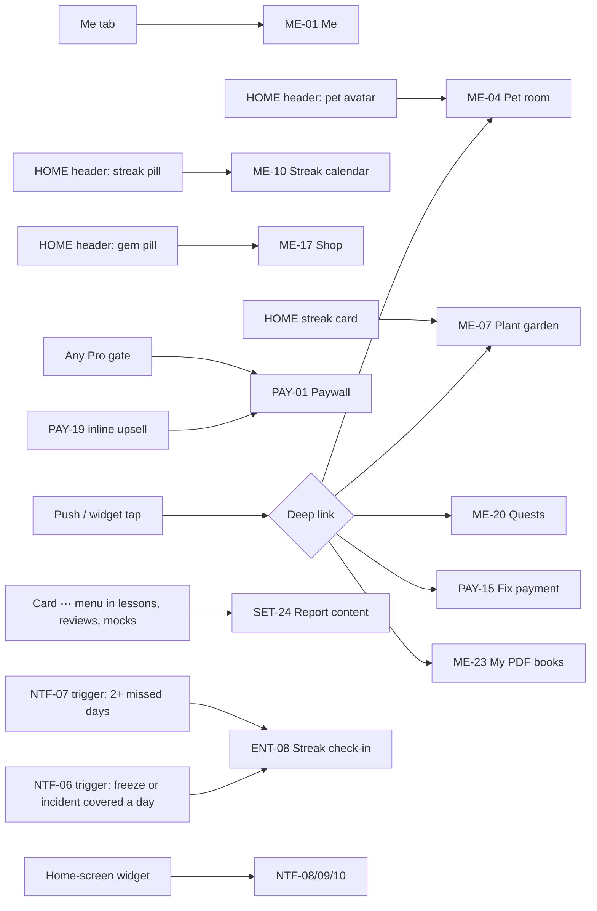

**Deep links this area adds** (APP_FLOW §4 needs these rows; per-exam apps prefix them, for example `/jee/`):

| Link | Opens | Used by |
|---|---|---|
| `smriti.app/me` | ME-01 | Email footer, help articles |
| `smriti.app/pet` | ME-04 | Pet pushes, medium widget |
| `smriti.app/garden` | ME-07 | Plant pushes, small widget |
| `smriti.app/streak` | ME-10 | Streak pushes |
| `smriti.app/quests` | ME-20 | Quest toasts |
| `smriti.app/shop` | ME-17 | Gem pill |
| `smriti.app/downloads` | ME-21 | Storage-low banner |
| `smriti.app/books/{exportId}` | ME-23 | Export-ready push and email |
| `smriti.app/pro` | PAY-01 (source `deeplink`) | Referral and web links |
| `smriti.app/pro/manage` | PAY-12 | Billing pushes, trial-ending push |
| `smriti.app/pro/fix` | PAY-15 | Billing-issue push |
| `smriti.app/pay/child/{token}` | PAY-17 (web) | "Ask a parent to pay" link |
| `smriti.app/settings/notifications` | SET-03 | Email footer "Change reminders" |
| `smriti.app/parent` | SET-13 → SET-14 | Parent weekly email, parent pushes |
| `smriti.app/privacy/export/{id}` | SET-12 | Data-export-ready push and email |

`smriti.app/review` (exists) and `smriti.app/plan` (needed by the large widget, owned by the learn agent) are also used.

---

## 3. ME flows

### 3.1 Me tab map

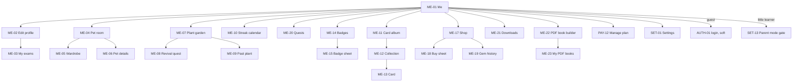

**ME-01 Me** shows, top to bottom: the pet portrait as the avatar, display name, exam chips, a stat row, the pet and plant cards, quests, collections, badges, tools (downloads, PDF books), the Pro card and the Settings entry.

| Branch | What changes |
|---|---|
| Guest | Name shows "Guest" with a "Save your progress" card (opens AUTH-01 soft, reason `save_progress`). Everything else works on local data. |
| Signed in | Name, handle (if the student made one in SOC), exams. |
| Free | Pro card: "Try Pro for ₹1" (or "Get Pro" when not eligible). Opens PAY-01 with source `me_card`. |
| Pro | Pro card shows "Pro · renews {date}" or "Pro · ends {date}" and opens PAY-12. |
| Billing issue | The Pro card turns to the billing-issue state and opens PAY-15. |
| Minor 13–17 | After guardian consent, other students see an auto nickname from a fixed word list with the pet avatar (R31 amended); friends added by link or QR see the pet name. Never the typed or real name. On their own Me screen they see the full display name. |
| Little learner | Simplified layout: big pet, plant, sticker album (the card album), badges. No shop prices in rupees anywhere (there never are). No Pro card: Pro is handled in Parent mode. "For grown-ups" row opens SET-13. |
| Per-exam app | Exam chips show the variant's exam only and are not editable here. |
| Offline | Everything renders from `profile_snapshot`. Stats show "Updated {time}". |

### 3.2 Profile and exams (ME-02, ME-03)

- **Avatar is the pet.** The avatar is a portrait of the student's pet wearing its equipped outfit, rendered from the pet art. There are **no photo uploads** for avatars. This avoids moderating photos of children and keeps one visual identity. (TRD §5 "Files" lists avatars as an upload, and `app.profiles.avatar_asset_id` says "private or preset". Both should change to "pet portrait only", §10.)
- **Display name.** Defaults to the Google account's given name when the student signs in (on iOS, the Apple name if shared). Editable, 2 to 24 characters, letters, spaces and Devanagari. It runs through the same name filter used for pet names. Guests have no display name.
- **My exams (ME-03).** All-exams app: add or remove exams, set the target month and year or "Not sure yet", pick the primary exam. Writes `app.user_exams`. Changing the primary exam changes the Home path and league group from the next league week (leagues are grouped by exam). Per-exam app: shows the variant's exam and target date only. The date is editable. A row says "Studying for more exams? Smriti (all exams) has them all." This is self-promotion, not an ad, and appears for minors too.
- **Target dates** are stored as a month and year when the student chose that in onboarding. Countdowns then say "in {Month Year}" rather than an invented day count (applies to the large widget too).

### 3.3 Pet: states, care and limits (ME-04, ME-05, ME-06)

**State model.** The server owns `mood` and `energy` (0–100, `game.pets`), applies decay per missed day in the nightly roll-up and raises them on care events (TRD §10). The derived label (`game.pets.state`) is what copy and widgets use. The Rive file only reads the numbers and `under10` (DESIGN §7.2).

Existing docs disagree on the label list (APP_FLOW §3.6: happy, content, sleepy, sad, unwell, resting; DESIGN §6.3: happy, excited, proud, curious, thinking, sleepy, tired, sad-but-hopeful, resting). This doc resolves it as two lists:

| Persistent state (derived, stored in `game.pets.state`) | Matches plant health | UI word EN / HI | Art (DESIGN §6.3 mood) |
|---|---|---|---|
| `happy` | thriving | Happy / खुश | happy |
| `content` | droopy | Okay / ठीक-ठाक | content (calm, sitting) |
| `sleepy` | dry | Sleepy / नींद में | sleepy |
| `tired` | wilted | Tired / थकान में | tired |
| `missing_you` | wilted, energy low | Missing you / आपकी याद में | sad-but-hopeful |
| `resting` | dormant | Resting / आराम में | resting (basket and blanket) |

Transient reactions (`excited`, `proud`, `curious`, `thinking`) are Rive triggers, never stored. Under-10 mode clamps the persistent state at `sleepy` and only uses `happy`, `content`, `sleepy` plus the reactions `excited` and `curious`.

**Care actions** (`POST /v1/pet/care`, idempotency key per action):

| Action | What it does | Limit (flags, starting values) | Free or Pro |
|---|---|---|---|
| **Study together** (main action) | Opens the next lesson or the review queue. Real recovery comes from studying, as in PRD §7. | none | both |
| **Pet** (tap or stroke the pet) | Plays the `pet` trigger, purr or bark if sound is on. Small mood rise. | mood gain capped at +5 a day from all non-study care | both |
| **Play** (toss a ball, drag) | Plays `hop`. Small energy rise. | 3 plays a day | both |
| **Treat** | Uses one treat from the inventory (bought with gems in ME-17). Energy rise. | 1 a day | both |
| **Nap** | Happens by itself during focus-timer breaks (PRD §5.4). Not a button. | | both |

So tapping can make the pet smile, but it can't bring a resting pet back without studying. That keeps the habit honest without punishing the student. APP_FLOW §3.6 says a "feed" is "bought with XP". XP is never spent in the DB (`game.xp_ledger` has no spend source) and spending it would lower league totals, so treats cost gems instead (§10 conflict list).

**Wardrobe (ME-05).** Equip outfits and a room backdrop. Equipped outfits live in `game.pets.outfit_ids`. A room backdrop needs a new column, `game.pets.room_theme` (§10). The shop item kind `theme` is defined here as a **pet-room backdrop**, not an app colour theme, so app contrast always comes from tokens (rule 9).

**Pet details (ME-06).** Rename the pet (same name filter as onboarding, 1 to 12 characters so push copy fits 60 characters). Switch between cat and dog: allowed, confirmed in a sheet, keeps mood, energy and outfits that fit both. Rate-limited to once every 30 days (flag) so the art cache stays warm.

### 3.4 Plant: stages, health, revival and the garden (ME-07, ME-08, ME-09)

**Growth stage** comes from `game.plants.growth_points` (one point per activity day, never decreases). **Health** comes from days since the last *health day*: a streak day (R1, R23), a 2-minute rescue (MEM-32), a freeze, a rest day or an incident day (memory-labs G23 asks for `learn.activity_days.rescue_done`). Thresholds are 1/7/30/100 study days to reach each stage (R37, flag).

APP_FLOW §3.6 lists six stages (with "Budding" at day 21). PRD §7, DESIGN §6.4, `plant-stage` preset, `game.plants.stage` and the Rive input `stage` (0–4) all have five. **This doc uses five stages** and asks APP_FLOW to drop "Budding" (§10). Thresholds are a flag (`game.plant.stage_days`) so they can be tuned:

| Stage | Rive `stage` | Study days to reach (starting value) | EN / HI |
|---|---|---|---|
| Seed | 0 | 0 | Seed / बीज |
| Sprout | 1 | 1 | Sprout / अंकुर |
| Sapling | 2 | 7 | Sapling / नन्हा पौधा |
| Flowering | 3 | 30 | Flowering / फूलों वाला |
| Tree | 4 | 100 | Tree / पेड़ |

Health thresholds and revival follow APP_FLOW §3.6 exactly:

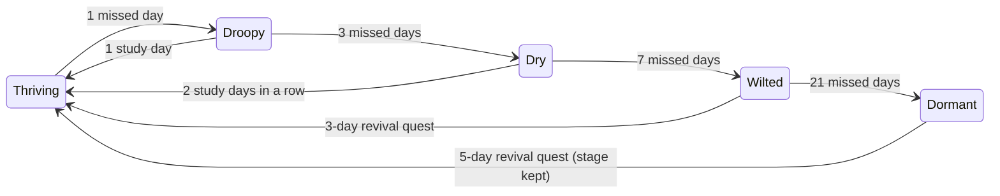

- The UI calls `dormant` **"Resting"**, never "dead" or "dormant".
- UX_FLOW §5 says the dormant revival is "3 short days". APP_FLOW §3.6 says 5. This doc follows APP_FLOW (5) because it is the state machine, and all copy uses `{days}` from the server so a later change needs no string change. UX_FLOW §5 should use `{days}` (§10).

**Revival quest (ME-08).** Starts automatically when the plant is wilted or resting and the student studies once. It shows 3 or 5 day dots (R12). A day counts when it is a streak day (R1, R23: one lesson, 10 reviews, one mock section or the daily challenge), not when the minutes goal is met. A rescue keeps health from dropping that night but never fills a dot. Missing a day during revival doesn't reset to zero: the dots already filled stay, and the plant's health simply stays where it is (gentle by design; `game.plants.revival_progress` keeps the count). On completion: `revive` trigger on the plant, the pet's `celebrate`, a badge the first time ("Green thumb"), and the pet's line "Look! It's growing again." The same quest also brings the pet back to `happy` (its "Nurse back to health" quest in UX_FLOW §5 is this same quest; one quest, not two).

**After the tree.** At stage Tree the plant keeps growing points but stays a tree. From day 100 a "Plant a new seed" button appears in the garden. It retires the tree into the garden (ME-09, kept forever with its days and dates) and plants a new seed of a species the student has unlocked (tulsi first; rare species unlock at milestones per PRD §7; Pro gets exclusive species per PRD §11.1). The streak does not reset: the streak and the plant are separate numbers. `game.plants` is one row per user, so past plants need a new table, `game.plant_history` (§10).

**Milestone moments and share cards (research A37).** Each stage-up and each streak day in `share.streak_milestones` gets a full-screen moment in ME-16 with an optional share card (13 and up). The card shows the pet, the plant and the streak number only. The research suggests share moments at days 7, 21, 50 and 100 (A37); R37 sets the plant thresholds at 1/7/30/100, so `share.streak_milestones` is 7, 30 and 100 and the moments match the plant stages.

**Seasonal variants** (`season` Rive input) follow a server flag per date range. They change leaves and pot details only, never the health reading.

### 3.5 Streak, freezes and rest days (ME-10)

- **Qualifying activity** (PRD §7, R1, R23): one lesson, or 10 reviews, or one mock section, or the daily challenge. The day boundary is the student's local midnight. The daily goal in minutes (onboarding, SET-10, default 10 per R6) drives the progress ring on Home and never decides the streak. `learn.activity_days.goal_met` is misnamed for this; TRD §10's "met the daily goal" is wrong (R1) and the column should read as "streak day".
- **Freezes** (R28, R36). Free: 1 granted on the 1st of each month. Pro: 2 a month (PRD §11.1). Extra freezes can be bought with gems. Up to `streak.freeze_slots` (2) can be equipped, for everyone; ME-10 and the shop show the two slots. A grant that finds both slots full is kept for the next free slot within the month, then lapses (stated in help). A freeze is used automatically by the nightly roll-up on a missed day when one is equipped (`game.streak_freezes.used_on`). It protects the streak, plant health and pet mood for that day. The next open shows ENT-08's freeze variant (NTF-06 trigger).
- **Incident freeze** (R28, research X15). `streak.incident_freeze` is a server switch for our outages: while on, no one's streak, plant or pet decays and no freezes are spent; after it, days are repaired from the event timestamps already queued in each outbox (APP_FLOW §3.10). ENT-08 shows its incident variant (NTF-06 trigger). ME-10 marks those days "Protected".
- **Rest day** (PRD §7 humane rules, research A43, R36). The student can mark a day as a rest day, one per calendar week (flag), from ME-10, up to `streak.rest_day_plan_ahead_days` ahead, so a festival or exam day can be protected in advance. The exam date in ME-03 is protected automatically when `streak.exam_day_protected` is on and doesn't use the week's rest day. It costs nothing. On a rest day the streak pauses (no +1, no break) and the pet and plant don't decay. If the student studies anyway, the rest day is cancelled and counts as a normal day. Rest days are separate from freezes: freezes catch unplanned misses, rest days are planned. Storage needs `learn.activity_days.rest_day boolean` or a `game.rest_days` table (§10).
- **Calendar (ME-10).** Month grid. Each day shows one of: studied (leaf icon), freeze used (snowflake icon), rest day (moon icon), protected by an incident (shield icon), missed (empty circle), today (outlined). The streak symbol everywhere is Phosphor `Plant`, never a flame (R28). Icons plus labels, never colour alone. Current and longest streak at the top, freezes held and the next monthly grant date.
- **Streak repair** (R36, research X3). There is no paid repair and no "buy back your streak" offer. A broken streak shows the longest streak kept forever, the plant's stage kept, and the revival quest. This is a deliberate humane choice (PRD §7: no shame messaging).

### 3.6 Gems, shop and the decision on buying gems (ME-17, ME-18, ME-19)

**Decision (accepted as R36): gems can't be bought with real money, by anyone.** PRD §7 only forbids gem packs for under-18s. We go further, because:
1. **Most of the audience is under 18,** and age is self-declared. Gating packs by age invites minors to lie, and a single purchase by a child creates a DPDP and consumer-protection problem we can't undo.
2. **One honest product.** Pro at ₹99 is the only thing we sell. A second currency with its own price makes "₹99" less clear and hides the real cost of things.
3. **Leagues stay fair.** Gems buy freezes, and freezes protect streaks. Paid freezes would let money buy league and streak standing.
4. **Store rules and review.** Virtual currency must go through store billing on iOS and Android, needs its own products per variant, and draws extra review on kids' categories. None of that is worth it at ₹99 ARPU.
5. **It can be revisited** for adult accounts later behind a flag, with this list as the bar to clear.

**Gem sources** (`game.gem_ledger.reason`; every amount is a `game.economy.*` flag, and the figures below are starting values for the owner to tune): daily quest 5–15 each, weekly quest 50, badge earned 20/50/100 by tier, league promotion 50, streak milestones (7, 30, 100, 365 days) 25/50/100/200, first revival quest completed 50, referral joined 50 (in addition to PRD §8's free week). No gems for opening the app or watching anything.

**Gem sinks** (`game.shop_items.kind`):

| Kind | Examples | Starting price | Notes |
|---|---|---|---|
| `freeze` | Streak freeze | 200 | Blocked when both freeze slots are full, with the reason shown |
| `treat` (new kind, §10) | Pet treat | 20 | Stackable, max 10 held |
| `pet_outfit` | Scarf, cap, raincoat | 300–800 | Some `pro_only` (PRD §11.1 "exclusive pets' outfits") |
| `plant_skin` | Pots | 400–1000 | Some `pro_only` (PRD §11.1 "exclusive ... plants") |
| `theme` | Pet-room backdrops | 300–600 | Not app colour themes (§3.3) |
| `palace_room` | Memory-palace room packs for MEM-14 (memory-labs request) | 300 | Shown to everyone with a Pro chip; buying and using them needs Pro, since building palaces is Pro (R19). Phase 2 |

- Purchases call `POST /v1/shop/purchase` with an idempotency key (gems are money-like, AGENTS.md API rule). The server checks the balance, writes `gem_ledger` (negative delta) and `inventory` in one transaction. Offline: the shop is read-only and the Buy button says "Connect to buy".
- **No random rewards anywhere.** No loot boxes, no mystery chests, no gacha cards. Quest rewards and collection cards are shown before they are earned.
- **Pro-only items after Pro ends:** items already bought stay owned and equipped. Only buying new Pro-only items needs Pro. Nothing is taken away.
- **Gem history (ME-19)** lists every ledger row with its reason, so the balance is always explainable (and support can answer "where did my gems go").

### 3.7 Quests, badges and the card album (ME-20, ME-14, ME-15, ME-11 to ME-13, ME-16)

- **Quests** come from `game.quests` (server data). Daily quests (3 at a time) reset at 00:00 local time. Weekly quests reset Monday 00:00 local. Event quests have their own dates. Progress comes from the same events as XP, so offline progress is predicted locally and confirmed on sync. Rewards are claimed with a tap (`POST /v1/quests/{id}/claim`), which plays ME-16. Unclaimed completed rewards are auto-claimed at reset so nothing is lost.
- **Quest wording** is UI copy from templates ("Finish {n} lessons", "Review {n} cards", "Study {n} minutes"). The quest catalogue is product config, not study content.
- **Badges** come from `game.badges` with a rule and tier. ME-14 shows earned badges first, then locked badges with progress ("{x} of {y}"). Badge art uses the `badge` preset. Badge names that mention a subject ("Periodic Table Master") are catalogue strings reviewed like UI copy.
- **Card album.** Besides subject sets, the album has "Elements" (cards from LAB-13 and LAB-14) and "Experiments" (LAB-15, LAB-16), as memory-labs asked; labs are free (R19), so these cards are open to everyone. Streak-themed cards and badges use the plant, never a flame (R28). Collections (`game.collections`) are earned **deterministically**: completing a specific lesson or concept gives its card. No random packs and nothing to buy. Each card is study content (an illustration and a short fact), so it is produced by `lesson-author` and `visual-director` and lives in the content bundle, referenced by `item_id`. Locked cards show a silhouette and "Finish {lesson} to collect". The DB has no item metadata table: either the bundle carries it or `game.collection_items` is added (§10; recommendation: the bundle carries it, because cards are content).
- **Reward celebration (ME-16)** is one shared overlay for a badge, a card, a quest reward, a plant stage-up and a streak milestone. Several rewards at once are queued and shown in one sequence with a "Skip all" button.

### 3.8 Downloads and storage (ME-21)

PRD §11.1 puts **offline downloads** in Pro. Every student still gets the seed pack and the automatic cache (TRD §3.2): lessons they open are cached and evicted least-recently-used first.

| | Free | Pro |
|---|---|---|
| Seed pack, automatic cache of opened lessons | yes | yes |
| "Download" a subject, chapter or topic (pinned, never evicted) | no: LRN-05 first (an honest sheet that offers "Save when online"), then PAY-01 with source `offline_download` (learn C15, accepted) | yes |
| Labs and 3D models opened before | cached like lessons and listed in ME-21 with sizes (labs are free, R19) | yes, and pinned with their chapter |
| A mock paper downloaded at mock start, so the runner works offline (APP_FLOW §3.5) | yes | yes |
| Storage limit setting (default 500 MB) | yes | yes |
| Wi-Fi only downloads, download language (English, Hindi, both) | yes (applies to the cache) | yes |
| Clear cache | yes | yes |

- UX_FLOW §5 offers "[Download for later]" on the no-internet state. For free students that button becomes "Save when online" (it queues a normal cache fetch, not a pin). §10 asks the learn agent to apply this.
- When Pro ends, pinned downloads become normal cache. They stay usable until evicted.
- Web: downloads use the PWA cache. ME-21 shows `navigator.storage.estimate()` and asks for persistent storage (`navigator.storage.persist()`) on the first pinned download.

### 3.9 PDF books (ME-22, ME-23)

PRD §5.6 and §11.1: Pro only. Implementation plan G-9: Phase 2.

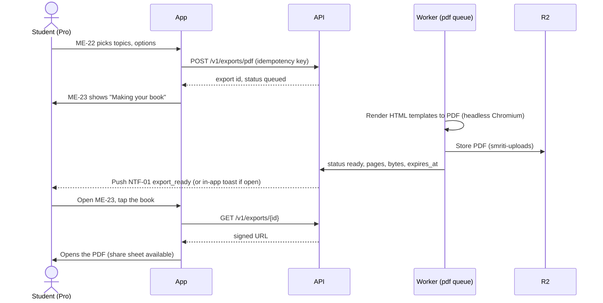

- **Builder options** (`app.exports.spec`): scope (topics picked from the student's exam tree, grouped by chapter), what to include (cheat sheets, formula and shortcut sheets, mnemonics, practice questions with answers at the end, the student's own flashcards and Cornell notes), language (English, Hindi, or both side by side), page size (A4). The book content is published content plus the student's own notes. Nothing new is written for the book.
- **Limits** (flags): up to 40 topics a book, 5 books a day. Over the limit the builder says so plainly.
- **Expiry:** the signed file expires (`expires_at`, flag 30 days). The book can be re-made from the same spec in one tap.
- **Free:** ME-22 opens with a sample cover and contents preview and a Pro lock. The CTA opens PAY-01 with source `pdf_export`. After paying, the student lands back in ME-22 with the selection kept.
- **Pro ends:** books already made stay downloadable until they expire. New books need Pro.
- **Offline:** the builder needs a connection (rendering is server-side). Ready books that were opened once are cached on the device.

---

## 4. SET flows

### 4.1 Settings map

```mermaid
flowchart TD
  SET01[SET-01 Settings] --> SET02[SET-02 Account]
  SET02 --> SO[AUTH-12 sign out]
  SET02 --> DEL[AUTH-13 delete]
  SET02 -->|guest| LOGIN[AUTH-01 login]
  SET01 --> PAY12[PAY-12 Manage plan]
  SET01 --> SET10[SET-10 Study preferences]
  SET01 --> SET03[SET-03 Notifications] --> SET04[SET-04 Reminder time]
  SET03 --> SET05[SET-05 Quiet hours]
  SET03 --> NTF03[NTF-03 Turn on notifications]
  SET03 --> NTF11[NTF-11 Add a widget]
  SET01 --> SET06[SET-06 Language]
  SET01 --> SET07[SET-07 Appearance]
  SET01 --> SET08[SET-08 Sound and haptics]
  SET01 --> SET09[SET-09 Accessibility]
  SET01 --> ME21[ME-21 Downloads and storage]
  SET01 --> SET11[SET-11 Privacy and data] --> SET12[SET-12 Data export]
  SET11 --> CONS[AUTH-18 guardian consent]
  SET01 --> SET13[SET-13 Parent mode] --> SET14[SET-14 Parent dashboard]
  SET14 --> SET15[SET-15 Weekly report] & SET16[SET-16 Time limits] & SET17[SET-17 Consents] & SET18[SET-18 Add a child]
  SET14 --> PAY17[PAY-17 Pay for a child]
  SET01 --> SET21[SET-21 Help] --> SET22[SET-22 Article] & SET23[SET-23 Contact support]
  SET01 --> SET25[SET-25 About and licences]
```

Settings are stored in three places:

| Setting | Stored in | Synced |
|---|---|---|
| Sound, haptics, reduced motion override, theme, captions, narration autoplay | `app.profiles.settings` (jsonb) plus MMKV / `localStorage` for instant reads | yes, per account |
| UI language | `app.profiles.locale` | yes |
| Content language default, tutor reply language | `app.profiles.settings.content_locale`, `.tutor_locale` (new keys, §10) | yes |
| Daily goal | `app.profiles.daily_goal_minutes` | yes |
| Notification types, reminder time, quiet hours | `notify.prefs` | yes |
| OS notification permission, widget presence | device only (`app.devices` gets a `push_enabled` flag on change) | no |
| Storage limit, Wi-Fi only, download language | device only (MMKV) | no, it depends on the device |
| Product analytics opt-out | `app.profiles.settings.analytics_opt_out` and device | yes |

Guests can change every setting. Their settings live under the anonymous user and stay after linking Google (same user id, common brief decision 3). In a merge, the target account's settings win, except the device-only ones.

### 4.2 Account (SET-02)

- **Signed in with Google:** shows the Google name and email, "Signed in with Google", and on iOS also any linked Apple ID. Rows: Add Google or Add Apple (AUTH-11), Switch account and Sign out (AUTH-12, with "Sign out of all devices"), Delete account (AUTH-13), "Your account works in every Smriti app and on the web" (informational), the Smriti handle (if any, owned by SOC).
- **Signed in with Apple only:** the name and "Signed in with Apple". The email is never shown, because Apple may give a private relay address (auth doc §5).
- **Guest:** "You're using Smriti as a guest. Sign in with Google to save your progress on every device." Opens AUTH-01 soft, reason `save_progress`. A destructive row "Erase this phone's progress" opens the AUTH-12 guest erase variant.
- **Managed child account (little learner):** "Managed by a parent's Google account." No sign-out or delete for the child. Those sit inside Parent mode behind the parent gate.
- **Teen with guardian consent:** a "Guardian" row shows "Confirmed by a guardian on {date}" and opens SET-11.
- **Pro and delete:** deleting the account does not cancel a store subscription (Apple and Google own it). AUTH-14 (Delete account: your subscription) covers this: it tells the student to cancel in Google Play or the App Store when the entitlement source is `play` or `app_store`, and links to PAY-13. For web, delete cancels the Razorpay subscription server-side.

### 4.3 Notifications settings (SET-03, SET-04, SET-05)

The rules engine is described in §6. Settings expose:

| Group | Toggle | Default adult | Default 13–17 | Default under 13 |
|---|---|---|---|---|
| Daily reminder | On, at {time} (SET-04) | on, time from onboarding | on, the picked time only | on, set by the parent (SET-16) |
| | Smart timing (near your usual study time) | on | not offered (R34) | not offered |
| Streak and plant | Streak saver (evening, only if today isn't a streak day yet) | on | not offered | not offered |
| | Plant and pet nudges | on | not offered | not offered |
| Learning | Reviews due, Weak-area alerts, Daily challenge | on, as their own pushes | folded into the daily reminder's copy | folded into the daily reminder's copy |
| | Bedtime review (Pro, PRD §5.4, opt-in) | off | the inferred-bedtime version is not offered; a bedtime review at a time they pick (MEM-06, `notify.prefs.bedtime_review_time`) is, off by default | not offered |
| Focus timer | Round and break ends (local, for a session they started) | on | on | on |
| Friends | Requests, accepts, cheers, Duo, duels, squads, leagues | on (once signed in and social is enabled) | on only after guardian consent | hidden (no social) |
| Exam alerts | Live mocks joined, scheduled mocks, "report ready" | on | on | hidden |
| News | Product news | off | hidden | hidden |
| Quiet hours | SET-05 | 22:00–07:00 | 21:00–07:00 | 20:00–08:00 |
| | School hours (weekdays 08:00–14:00) | off | on | on |
| Email (web only, when Web Push isn't available) | Daily reminder by email | off | hidden | hidden |

- **Billing and account notices** (payment failed, trial ending, export ready, data export ready, consent requests to a guardian) are transactional. They can't be turned off but they respect quiet hours.
- **Minors (R34, DPDP s.9(3)):** the only habit send is the reminder at the time they picked. Its copy may name what is waiting to learn (reviews due, today's challenge), which is the service itself, but never a predicted plant state, an inferred bedtime or an inferred study hour. Exam alerts they signed up for and focus alarms they started are their own choices, so they stay.
- **Under 13** (little learners and 10–12): the daily reminder (set by the parent from SET-16) and focus alarms only.
- **If OS permission is off**, SET-03 shows a top card "Notifications are off for Smriti" with [Turn on] (NTF-03). Toggles stay editable so the choices are ready.
- **Reminder time inside quiet hours:** SET-04 shows "This is inside your quiet hours, so we'll remind you at {quiet_end}" and offers to change either.
- `notify.prefs` lacks several columns for this (§10).

### 4.4 Language (SET-06)

Two separate choices, because PRD §13 lets students switch per lesson and many Hindi-medium students want an English app with Hindi lessons (or the reverse):

1. **App language** (menus, buttons, the pet's lines, notifications): English or हिन्दी. Writes `app.profiles.locale`. Applies instantly, no restart.
2. **Lesson language** (default for lessons, revision, questions, PDF books): Same as app, English, or हिन्दी. Writes `settings.content_locale`. Each lesson still has its own toggle (learn agent). Mocks choose their language on the instructions screen, as the real exams do (practice agent).
3. **Tutor replies:** Match how I write (default), English, हिन्दी, Hinglish (PRD §5.5). Writes `settings.tutor_locale`.

If the student switches lesson language and has pinned downloads, a sheet offers "Download Hindi versions too? {size}" with [Download] [Not now]. On a metered connection with Wi-Fi only on, it queues instead.

### 4.5 Appearance, sound, accessibility, study preferences (SET-07 to SET-10)

- **Appearance:** System (default), Light, Dark (DESIGN §9). A second toggle, "Dark mode in mock tests", is off by default because the runner is light like the real exam (R24, practice request). The MOCK runner reads only this setting.
- **Sound and haptics:** Sounds, Pet sounds (purr or bark), Haptics (hidden on web desktop and iOS web, which can't vibrate), Narration autoplay. Phone silent mode always wins (DESIGN §8).
- **Accessibility:** Reduce motion (Follow system, On) is the one app-wide setting (`a11y.reduceMotion` in `app-core`) that every viewer reads, including sims (through `sim-bridge`), 3D and 360° (memory-labs request), Captions always on, Read the pet's lines aloud (uses the screen reader when on, otherwise Deepgram TTS audio), Larger text follows the system (no in-app slider; explained with a link to system settings).
- **Study preferences (SET-10):** daily goal (5, 10, 20, 30 min, default 10 (R6), with the four watering-can images from onboarding, not plant sizes, onboarding D10), rest days (opens ME-10), default lesson mode for learned topics (Quick revision or Deep dive), the focus timer lengths (25/5 default, owned by MEM; linked). Changing the daily goal applies from tomorrow so today's progress doesn't jump.

### 4.6 Privacy and data (SET-11, SET-12)

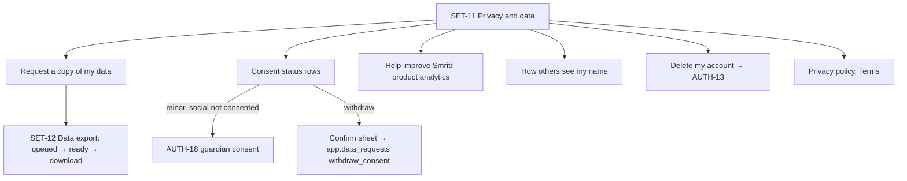

- **Data export** (DPDP access right): `POST /v1/me/data-export` creates `app.exports` with `kind = data_export` and `app.data_requests` with `kind = access`. The worker builds a ZIP (JSON plus a readable HTML summary: profile, exams, progress, reviews, mocks, notes, decks, palaces, tutor transcripts still within 180 days, purchases). Ready within 72 hours (flag), usually minutes. Push and email when ready. Download link expires in 7 days. One request per 24 hours.
- **Consent status** shows each consent with its date. For teens, the guardian scopes from the auth doc §6: `account`, `social`, `community` (sharing), `voice`, `uploads` (photo doubts; avatar uploads don't exist here because the avatar is the pet). For everyone: notifications (OS), product analytics (adults), product news. A teen or guardian withdraws one scope with `DELETE /v1/guardian/consents/{id}/scopes/{scope}`; `account` can't be withdrawn alone, since that is deleting the account. Withdrawing a consent explains the effect first ("Friends and leagues will be hidden. Your progress stays.") and then applies it.
- **Product analytics.** Learning events (answers, reviews, timings) are the service itself and can't be turned off without deleting the account; the screen says so plainly. Product events (screens and taps used for funnels) are optional:
  - Adults: "Help improve Smriti" toggle, on by default, can be turned off.
  - Minors (13–17 and under 13): product events are **off and the toggle isn't shown**. Only an essential allowlist is sent: crashes, sync health, purchase results, consent changes and notification opens (to enforce caps). The screen explains this. (Open question Q5 asks legal to confirm.)
- **Name display:** "How others see my name": full display name or first name and initial for adults. Minors are locked to the auto nickname and pet avatar (R31 amended, PRD §16.4).
- **Delete account** opens AUTH-13.

### 4.7 Parent mode (SET-13 to SET-19)

Phase 3 per PRD §17, except that the guardian-consent screens (auth agent) ship with social in Phase 2.

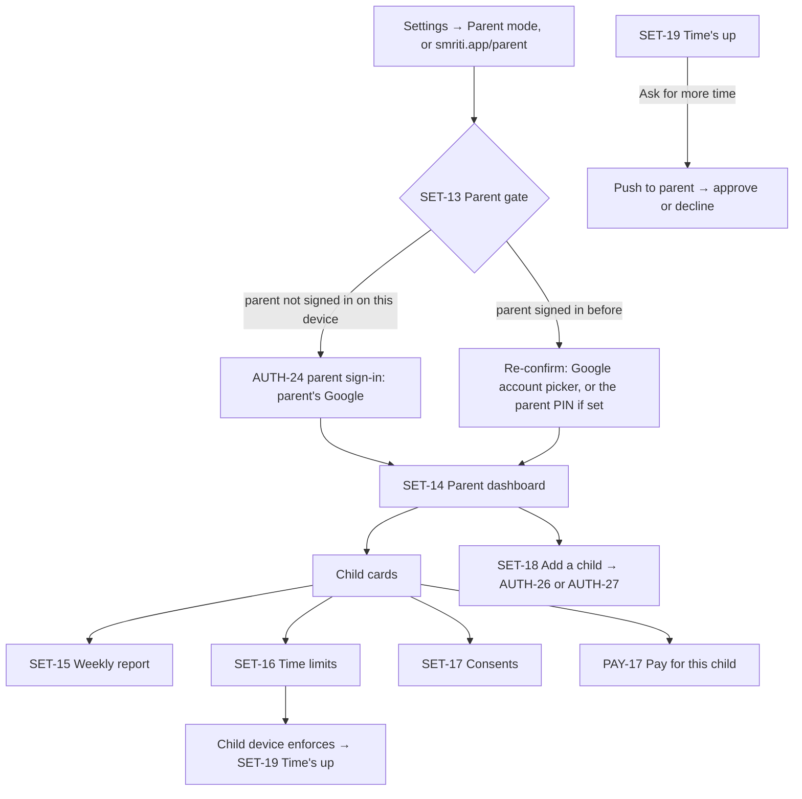

- **Where a parent sees the dashboard:** (a) on the child's device, through Parent mode, after the parent's Google sign-in, or (b) on the parent's own phone or browser, by signing in to Smriti with their own Google account. A parent account can also learn for itself; the dashboard is an extra section in its Me tab.
- **Parent gate (SET-13):** first time on a device, the parent signs in with Google (AUTH-24). Later visits re-confirm with the Google account picker. The parent can set an optional 4-digit parent PIN for faster entry on a shared phone. No maths-question "gates", which older children pass easily.
- **Child cards (SET-14):** pet, name, this week's minutes, streak, a "Needs you" chip when a consent or time request is waiting.
- **Weekly report (SET-15):** minutes per day (bar chart), lessons and reviews done, practice questions, streak, subjects studied (subject colours), mock scores if any (practice request), and "Coming up" from the plan. It never shows tutor chat text, notes or anything the child typed: only counts and topic names. Sent every Sunday evening to the parent by push (if they have the app) and by email (§6.7).
- **Time limits (SET-16):** daily limit (Off, 15, 30, 45, 60, 90, 120 min), allowed hours (for example 16:00–20:00), and break reminders. Enforced on the child's device with a local timer, so it works offline. A lesson card or a mock section in progress always finishes before the limit applies (cutting a timed mock would teach the wrong thing).
- **Time's up (SET-19):** the pet goes to sleep ("{pet} is sleepy. Let's stop for today."). Buttons: [Ask for 15 more minutes] (sends a push to the parent; approval extends the limit for today) and [OK]. Reviews already due stay due; nothing is lost.
- **Consents (SET-17):** per child, the same consent list as SET-11 with grant and withdraw. Granting a scope opens AUTH-20 (review and agree), since the parent is already signed in.
- **Add a child (SET-18):** two paths, both owned by the auth agent: create a managed child (class 1–5, no Google account) or link a teen who already has a Google sign-in (the teen confirms on their phone).
- **Who's learning? (AUTH-25, auth doc):** on a shared family phone with more than one profile, the app opens to a profile picker. Each child is a separate user and a separate local database (DB_SCHEMA §15). SET-20 is kept only as a pointer. This area adds the Parent-mode switch "Ask a grown-up before switching profiles" (SET-14); when it is on, AUTH-25 opens SET-13 before switching.
- **Picture rhymes (SET-14, Phase 3):** for little learners the mnemonic forge is off unless the parent turns on "Picture rhymes" for that child (memory-labs Q8).
- Parent mode as a whole is Phase 3 (PRD §17).
- DB gaps: `app.guardian_links` exists; limits and time requests still need tables (§10).

### 4.8 Help, report content, about (SET-21 to SET-25)

- **Help and FAQ:** articles are support copy in English and Hindi, served as a static bundle from the CDN (`/c/help/{locale}.json`) so they work offline once fetched. Categories: Getting started, Pet and plant, Streaks, Pro and payments, Notifications, Downloads, Account and Google sign-in, Privacy, Parents. Search is local over the bundle.
- **Contact support (SET-23):** category chips, an optional message (max 1000 characters), and an "Attach app info" toggle (on) that adds app version, variant, platform, content version and the last trace id. No email field: the server copies the reply address from the auth identity into the ticket only (the profile never stores the Google email, PRD §10.3), or replies in-app for Apple relay addresses and managed children (via the parent). The message is stored server-side for support only and never sent to analytics. Needs `POST /v1/support/tickets` (§10).
- **Report content (SET-24):** the one report sheet for all content, opened from LES-04's card menu, the ⋯ menu on review cards and mock solutions, album cards, and the Report item on tutor answers, generated images, story pages and role-play replies (AI-02, AI-05). PRD §18 asks for "report an error on every card". Item kinds: `lesson_card`, `question` (with `question_id`, practice), `review_card`, `solution`, `tutor_message`, `generated_image`, `story_page`, `roleplay_turn` (tutor-social), `community_mnemonic`, `lab` (memory-labs), `album_card`. Reasons are LES-04's six (R39), which match `learn.content_reports.reason`: Wrong information, Unclear, Typo, Translation mistake, Offensive, Other. Community mnemonics add Spam (memory-labs asked for Wrong, Confusing, Offensive or unkind, Spam, Other; the first three map to LES-04's, and `spam` needs adding to the DB check). A community report hides the item for the reporter at once. Optional note of 280 characters (hidden for under-13s, never sent to analytics). Auto-attached: `item_ref` (content id and card index, or the tutor message id), bundle hash, locale, platform. Works offline: queued in the outbox and written to `learn.content_reports`. Feeds the moderation queue (TRD §5.1 admin). Needs `POST /v1/content-reports` (§9). SOC-23 owns reporting a person or a deck.
- **About and licences (SET-25):** app name and variant (from config), version and build, content version, Terms, Privacy policy, Open-source licences (generated at build), Asset credits (every third-party sim, 3D model and image with its licence and attribution from asset metadata, AGENTS.md rule 10), "Rate Smriti" (store review prompt, never on first sessions and never for under-13s), and in per-exam apps the "Also try Smriti NEET" cross-promotion (APP_FLOW §3.9).

---

## 5. PAY flows

### 5.1 Entitlement model

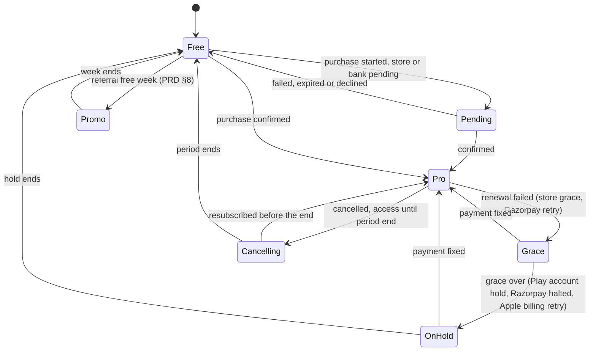

- **Server truth:** `billing.entitlements` (TRD §11), recomputed on every webhook. The client reads `entitlement`, `source`, `status`, `expires_at`, `grace_until`, `cancel_at_period_end` and `is_intro` from `GET /v1/me/summary` and caches them in `profile_snapshot`.
- **Client fast path:** on a store purchase the RevenueCat SDK returns `CustomerInfo` with the `pro` entitlement active. The app unlocks at once (RevenueCat has validated the receipt) and the server confirms through the webhook within seconds. If the server still disagrees after 10 minutes, the app shows PAY-10 "Still confirming" instead of silently locking.
- **Offline:** the cached entitlement is trusted until `expires_at` plus a 3-day offline grace (flag), so a Pro student on a train doesn't lose offline downloads. After that, Pro features show "Connect to check your Pro".
- **Grace means Pro:** during `grace` the student keeps Pro and sees the billing-issue banner. During `on_hold`/`halted` Pro features lock and PAY-15 explains why.
- **Status mapping** (DB `billing.subscriptions.status` needs `authenticated` and `pending`, §10):

| Source event | `status` | Entitlement | UI |
|---|---|---|---|
| Razorpay `subscription.authenticated` (mandate approved, first charge not yet captured) | `authenticated` (new) | not yet | PAY-08 / PAY-10 |
| Razorpay `subscription.activated` + `charged`; RevenueCat `INITIAL_PURCHASE` | `trialing` if intro, else `active` | pro | PAY-09 |
| RevenueCat `RENEWAL`; Razorpay `charged` | `active` | pro | none |
| RevenueCat `BILLING_ISSUE` (store grace); Razorpay `subscription.pending` | `grace` | pro until `grace_until` | banner, PAY-15 |
| Play account hold; Apple billing retry after grace; Razorpay `subscription.halted` | `on_hold` / `halted` | none | PAY-15 |
| RevenueCat `CANCELLATION` (auto-renew off); Razorpay cancel at cycle end | `active` + `cancel_at_period_end` | pro until period end | PAY-12 "Ends {date}" |
| RevenueCat `EXPIRATION`; Razorpay `subscription.cancelled`/`completed` after period | `expired` / `cancelled` | none | PAY-18 once |
| RevenueCat `UNCANCELLATION` / `PRODUCT_CHANGE` | `active` | pro | toast |
| Refund (store or Razorpay) | `cancelled` | none from refund time | PAY-18 |
| Referral week (PRD §8) | promo grant (new table, §10) | pro for 7 days | PAY-09 variant "A free week from {friend}" |

### 5.2 Paywall sources and variants

PAY-01 is one full-screen layout. The `source` changes the pet line, which benefit row comes first, and where "Maybe later" returns to. Every gate passes `source` and `return_to`. Some areas show their own short sheet first and then open PAY-01 with the source: LRN-05 (Pro preview), PRC-17 (free limit), AI-06 (daily limit) and AI-07 (Pro tool teaser). Those sheets never show prices other than "Try Pro for ₹1" or "Get Pro", chosen by the same eligibility answer.

| Source (`source`) | Shown when | First benefit row | Pet line (EN) |
|---|---|---|---|
| `deep_dive_lock` | Opening a locked Deep Dive (PRD §11.1: free has the first 2 chapters of each subject plus rotating free chapters) | All Deep Dives | "This deep dive is part of Pro." |
| `tutor_limit` | The 6th tutor message of the day (free has 5, text only), via AI-06 | Higher tutor limits, voice tutor, Feynman tutor, photo doubts | "We've used today's 5 free questions." |
| `tutor_voice` / `tutor_photo` / `tutor_feynman` | Tapping the mic, camera or Feynman mode as free, via AI-07 | Same row, the tapped feature named | "Talking it through is part of Pro." |
| `tutor_image` | Tapping "Draw it" (new Agnes image generation) as free, via AI-07 (R35) | Higher tutor limits, the PRD §11.1 row that covers it; no separate "Draw it" benefit row | "Here's what Pro adds." |
| `mock_lock` | A second sectional mock in a week, or a second full mock | All mocks, live all-India mocks, full analytics | "You've had this week's free mock." |
| `live_mock` | Joining a live all-India mock as free (when `feature.live_mocks` is on) | Live all-India mocks | "Live all-India mocks are part of Pro." |
| `custom_mock` | Building a custom mock as free | All mocks and full analytics | "Building your own mock is part of Pro." |
| `report_lock` | Opening full mock analytics as free | All mocks, live all-India mocks, full analytics | "The full report is in Pro." |
| `practice_cap` | The 31st practice question of the day, via PRC-17 | Unlimited practice, the full PYQ bank | "That's today's 30 free questions." |
| `pyq_paper` | Opening a PYQ paper outside the free sample | Unlimited practice, the full PYQ bank | "The full PYQ bank is in Pro." |
| `memory_lock` | AI mnemonic forge, memory palaces, audio mnemonics, sleep review (MEM-06, MEM-12, MEM-19, MEM-24) | That tool | "This memory tool is part of Pro." |
| `lab_lock` | Only a lab card inline in a locked Deep Dive (labs themselves are free, R19). PAY-01 adds "This lab is free in Labs. Open it there" → LAB-03 | All Deep Dives | "This deep dive is part of Pro." |
| `pdf_export` | ME-22 as free | PDF book export | "Turn your topics into a book with Pro." |
| `offline_download` | A Download button as free | Offline downloads | "Downloads for offline are in Pro." |
| `ai_tools_lock` | AI Cornell fill, AI mind maps | That tool | "The AI helper here is part of Pro." |
| `upsell_card` | PAY-19 inline card (every 5th lesson complete in LES-08, UX_FLOW §4.7) | All Deep Dives | "Want every deep dive?" |
| `deep_dive_preview` | LRN-05 Pro preview sheet [Try Pro for ₹1] | All Deep Dives | "This deep dive is part of Pro." |
| `me_card`, `settings`, `deeplink` | Me card, Settings row, `smriti.app/pro` | All Deep Dives | "Here's what Pro adds." |

Free limits are flags (PRD §11.1), so pet lines use `{limit}` variables, not fixed numbers. The table above shows today's values.

### 5.3 What the paywall may promise

The benefit list is built from PRD §11.1's Pro column only, filtered by `GET /v1/config` flags for features live on this platform and variant:

| Benefit row (exact PRD §11.1 wording, shortened only for space) | Flag that must be on | Phase |
|---|---|---|
| All Deep Dives | always | 1 |
| Unlimited practice, full PYQ bank | always | 1 |
| All mocks and full analytics | always | 1 |
| Live all-India mocks | `feature.live_mocks` | 3 |
| Higher AI tutor limits | always | 1 |
| Voice tutor | `feature.voice_tutor` | 2 |
| Feynman tutor | `feature.feynman` | 2 |
| Photo doubts | `feature.photo_doubt` | 1 or 2 |
| AI mnemonic forge, memory palaces, audio mnemonics, sleep review | one flag each | 1–2 |
| PDF book export | `feature.pdf_export` | 2 |
| Offline downloads | always | 1 |
| AI Cornell fill, AI mind maps | `feature.ai_notes` | 2 |
| 2 streak freezes a month (free has 1) | always | 1 |
| Exclusive pet outfits and plants | `feature.pro_cosmetics` | 1 |

Words and patterns we never use (research X5, R33): "unlimited tutor" (PRD says "higher limits"; the voice tutor has a fair-use limit), "ad-free" as a Pro benefit (free has no ads either), "guaranteed rank", "limited time", "only today", "Hurry", "% off", struck-through anchor prices, countdowns. Read-aloud of tutor answers is free with a daily cap (R35), so it is never a Pro benefit or a paywall source. Prices are tax-inclusive (R38).

### 5.4 Who can buy, and when the ₹1 offer shows

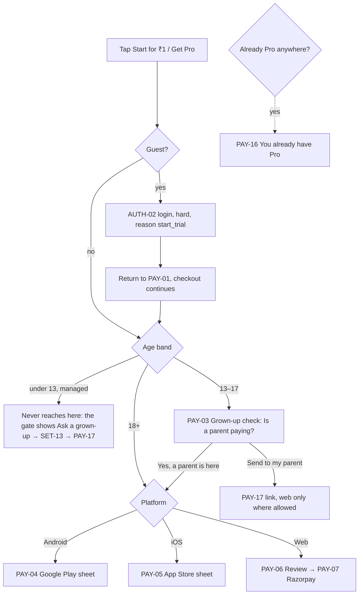

- **Already Pro:** gates never show to Pro students. If the entitlement exists from another platform or another Smriti app, every buy button is replaced by PAY-16. This prevents double billing across Smriti JEE, Smriti NEET, the all-exams app and the web.
- **₹1 eligibility** (PRD §11.2: once per person; the rule is the auth doc's §8 and TRD §11):
  - **Guests (R38, auth flow §8):** a guest has no identity keys yet, so the endpoint answers from the device signal alone (`eligible_hint`), and PAY-01 may show ₹1 on that hint. The full check runs after AUTH-02 and before any payment sheet opens. If it says no, PAY-01 switches to "Get Pro" at ₹99/month first, with the line "The ₹1 month was already used on this account." No store or Razorpay sheet ever opens with a ₹1 promise the full check refused.
  - PAY-01 asks `GET /v1/billing/intro-eligibility` as a signed-in user. It says no when any hashed sign-in identity on the account already claimed a ₹1 month, when the account ever had a subscription, or when the device signal says this phone claimed one (DeviceCheck on iOS; Play Integrity device recall on Android once we have access).
  - Each variant sells two products: `pro_monthly_intro_{variant}` (₹1 first month) and `pro_monthly_{variant}`. The paywall offers the intro one only when the answer is yes. The stores still apply their own intro rules on top, so the store sheet is the final word on mobile.
  - If the eligibility call fails or times out (offline, server error), the paywall shows the not-eligible copy with "Get Pro", never a ₹1 promise it can't keep, and retries when the student comes back online.
  - **When not eligible,** the paywall never mentions ₹1. Headline becomes "Get Pro for ₹99/month" and the CTA "Get Pro". Showing a ₹1 headline and then charging ₹99 at checkout is the dark pattern we refuse.
- **Prices shown** on mobile are the store's localised price strings from the SDK, never hard-coded. If the store string differs from config (₹99 / ₹1), the store's string is shown and an alert goes to the owner, because PRD §11 prices must match.
- **Minors and payments.** Under Indian contract law a minor's agreement isn't enforceable, and the payment instrument usually belongs to a parent. Under-13 accounts are managed by a parent and never reach checkout (the parent buys in PAY-17). For 13 to 17 year olds the checkout starts with PAY-03, which asks plainly whether a parent or guardian is paying. It doesn't verify identity (the store or bank does that), but it sets the right expectation and records `payer = guardian_declared` on the purchase attempt. On mobile, Apple's Ask to Buy and Google Family Link approvals arrive as a pending purchase (PAY-10). Legal review needed (Q4).

### 5.5 Checkout: Android (Google Play Billing via RevenueCat)

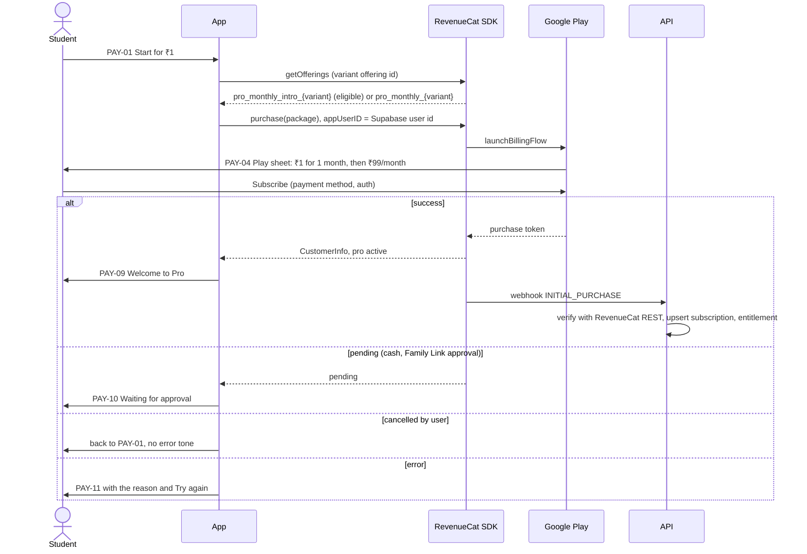

- The RevenueCat app user id is the Supabase user id, which is why a guest must sign in first (an anonymous id would strand the purchase if the device is lost).
- The intro offer and base plan are configured in Play Console per variant (`billing.products`: `pro_monthly_intro_{variant}` with `intro_price_paise` 100 and `pro_monthly_{variant}` without, both `price_paise` 9900). All map to the `pro` entitlement (TRD §3.1).
- User-choice billing (PRD §11.2) is out of scope until the owner decides.

### 5.6 Checkout: iOS (StoreKit via RevenueCat)

Same as Android, with these differences:
- PAY-05 is Apple's sheet. It shows the intro offer and renewal terms itself.
- The paywall must show, before the sheet, the price, the renewal period, what the intro offer is, a link to Terms of Use (EULA) and Privacy policy, and a "Restore purchases" button (App Store Review Guideline 3.1.2 and 3.1.1). PAY-01 includes all of these on iOS.
- Ask to Buy (Family Sharing) returns `deferred`: PAY-10 "Waiting for a parent to approve". When approved later, the RevenueCat listener unlocks Pro and a toast appears, even if the student is elsewhere in the app.
- No links or wording that steer to web pricing inside the iOS or Android apps (flag `pay.web_steering`, off on both; PRD §18 "where store policy allows").

### 5.7 Checkout: web (Razorpay Subscriptions with UPI Autopay)

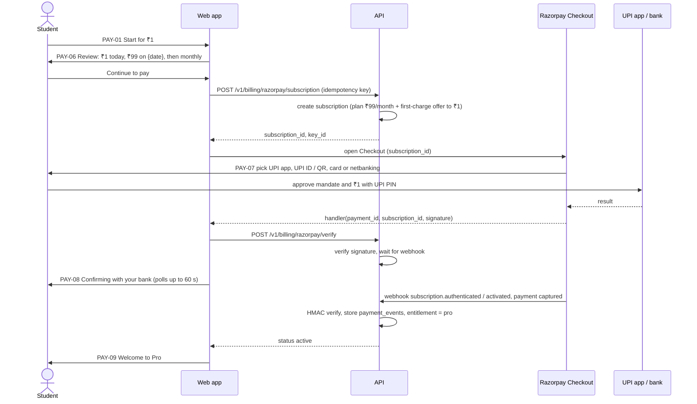

- **UPI app hand-off.** On a phone browser, Razorpay Checkout lists installed UPI apps (intent flow). The student switches to their UPI app, enters their UPI PIN and comes back. On desktop, Checkout offers the options it supports there (a QR code to scan with the phone, or a UPI ID). Verify the current option list with Razorpay before build; NPCI rules for UPI collect requests have been changing.
- **Card and netbanking mandates** are also offered (PRD §11.2). Some netbanking e-mandates confirm later than UPI; those land in PAY-10.
- **The first charge is ₹1** through the plan plus an offer or add-on (TRD §11). The mandate's maximum amount must cover ₹99. Before build, confirm with Razorpay how the authorisation transaction and the ₹1 first charge combine for UPI Autopay, and the exact mandate amount shown to the student in their UPI app. The UPI app will show the mandate details; PAY-06 must use the same numbers so nothing surprises the student.
- **Pre-debit notice.** The student's bank or UPI app notifies them before each recurring debit (RBI e-mandate rules; verify the current lead time with Razorpay). PAY-06 fine print says so without stating a number we haven't verified.
- **Left the UPI app without approving:** Checkout reports failure or the request times out. PAY-11 offers [Try again] and [Use another UPI app].
- **Approved but no webhook yet:** PAY-08 polls `GET /v1/billing/entitlement` for 60 s, then moves to PAY-10 "Your bank is confirming. We'll tell you when Pro is on." The server sends NTF `pro_activated` when the webhook arrives, or `payment_not_completed` if it fails.
- **Revoking the mandate in the UPI app** sends `subscription.cancelled`. Pro stays until the paid period ends; PAY-12 shows "Cancelled from your UPI app".

### 5.8 After payment: success, pending, failed (PAY-09, PAY-10, PAY-11)

- **PAY-09 success:** pet celebration, "Pro is on", the renewal line ("₹1 month ends {date}. Then ₹99/month."), three "Try now" rows tied to the trigger, and [Continue] back to the gated item (APP_FLOW §3.7). The gated item opens unlocked, so the purchase feels like it worked.
- **PAY-10 pending:** shows why (bank confirming, parent approving, store pending), what happens next, and that we'll notify. [Back to learning] returns to where they were. The gate stays locked until confirmation. The Me Pro card shows "Pro: waiting for confirmation".
- **PAY-11 failed:** plain reason from a mapped error code (declined, UPI timeout, network, store unavailable, already subscribed), [Try again] and [Use another way] (web) or [Back]. No charge was made, and the screen says so only when we know that from the error code.

### 5.9 Manage, cancel, restore (PAY-12, PAY-13, PAY-14)

**PAY-12 Manage plan** shows: plan name (Pro monthly), status, price, the next charge date and amount (or the end date), the source ("Billed by Google Play in Smriti JEE", "Billed by the App Store", "UPI Autopay from {bank or UPI handle masked}"), the benefits list, and these actions:

| Source | Cancel | Change payment method | Restore |
|---|---|---|---|
| Google Play | Opens the Play subscription page for this product (deep link `https://play.google.com/store/account/subscriptions?sku={id}&package={pkg}`) after PAY-13 explains | Same Play page | PAY-14 |
| App Store | Opens Apple's manage-subscriptions sheet (StoreKit `showManageSubscriptions`) after PAY-13 explains | Apple's sheet | PAY-14 (required) |
| Razorpay (web) | In-app: PAY-13 → `POST /v1/billing/razorpay/cancel` (cancel at cycle end) | "Update UPI or card" opens a new Razorpay mandate (old one cancelled after the new one activates) | not needed |
| Different platform from this device | PAY-16 explains where to manage it | | |
| Promo week | No cancel needed; "Ends {date}" | | |

- **PAY-13 Cancel** is short and honest: what they keep until {date}, what stops after, a reason picker (chips, optional, codes only), and the main button **Cancel Pro** (or **Go to Google Play / App Store**). No guilt copy, no "Are you sure?" chain, no hidden button. One "Keep Pro" secondary option. Offering a discount on cancel is out of scope (and store-limited).
- **PAY-14 Restore:** calls RevenueCat `restorePurchases`. Outcomes: restored (Pro on), nothing to restore, or "This purchase belongs to another Smriti account (signed in as {masked email}). Sign in with that Google account to use it." We recommend RevenueCat's "keep with original app user" transfer behaviour to stop one store purchase unlocking many accounts (Q6).

### 5.10 Grace period and billing issues (PAY-15)

- `grace`: Pro keeps working. A banner (NTF-04 `billing_issue`) on Home and Me, dismissible for 24 h, and PAY-15 explains: "Your payment for {date} didn't go through. Fix it by {grace_until} to keep Pro." Button: the store's payment-method page (Play / Apple) or a new Razorpay mandate (web). One push (NTF-01 `billing_issue`) on the first day of grace and one 2 days before `grace_until`.
- `on_hold`/`halted`: Pro features lock with PAY-15 as the gate instead of PAY-01 ("Pro is paused because a payment didn't go through"). No ₹1 offer, no "Maybe later" guilt. Progress, decks and downloads stay; pinned downloads behave as cache.
- **Trial ending reminder:** 3 days before the ₹1 month ends, one push (`trial_ending`) and a banner on PAY-12: "Your ₹1 month ends {date}. Then ₹99/month." This is not required by the stores, but it is honest and lowers refunds and chargebacks. It can't be turned off and respects quiet hours.

### 5.11 Pro on another platform (PAY-16)

| Student is on | Pro came from | What they see |
|---|---|---|
| Any app or web | Any source, same account | Pro works. No buy buttons. PAY-12 shows the source. |
| iOS | Play or web | "Your Pro is billed by Google Play / UPI Autopay. Manage it there." Restore is hidden (nothing to restore on Apple). |
| Android | App Store or web | Same, naming the App Store or UPI Autopay. |
| Web | Play or App Store | Same; web cannot cancel a store subscription. |
| Any | Pro on a **different Google account** | Paywall shows normally. A help link: "Bought Pro with another Google account? Sign in with that account." (PAY-14 detects this on mobile.) |

### 5.12 A parent paying for a child (PAY-03, PAY-17)

- **Same device:** the child hands the phone to the parent at PAY-03. The parent completes the store sheet (their store account is usually the one on a family phone) or Razorpay with their UPI.
- **Parent mode:** SET-14 shows "Get Pro for {child}" on each child card → PAY-17 → the platform checkout. The subscription belongs to the **child's** Smriti account (`billing.subscriptions.user_id` = child) with `payer = guardian` recorded. Manage and cancel for it sit in Parent mode, not in the child's settings (the child sees "Pro, from your parent").
- **Remote link (web only):** "Send to my parent" on PAY-03 creates a one-time payment link (`POST /v1/billing/child-payment-links`, valid 48 h, `pay.child_link_ttl_h`; one open link at a time, `DELETE .../{id}` withdraws it). The parent's page reads `GET /v1/billing/child-payment-links/{token}` and pays through `POST .../{token}/subscription` and `.../{token}/verify` (Idempotency-Key, no login). The subscription is the teen's with `payer = guardian_declared`, since nobody signed in as the guardian. The parent opens `smriti.app/pay/child/{token}` on their phone, sees the child's first name and pet, the same price and fine print, and pays with Razorpay. No login is needed for the parent to pay; the link is bound to the child's account. Inside the iOS and Android apps this link is behind `pay.child_link.enabled`, off by default, because it could count as steering to an outside payment (Q7).
- **Family plan for siblings** is Phase 3 (PRD §11.2). Until then each child needs their own Pro.

### 5.13 Pro ending (PAY-18)

Shown once, on the first open after Pro ends (expired, refunded, hold ended). It says what stays (all progress, streak, plant, pet, cards and reviews, decks, notes, items bought, books until they expire) and what pauses (Pro deep dives, unlimited practice, extra mocks, Pro tools, pinning downloads). [Get Pro again] (₹99/month: the ₹1 offer was used) and [Continue free]. No push for this, ever.

**Reviews of cards from Pro lessons stay free.** Locking memories the student already built would punish them for leaving and break the review habit. Their Deep Dives re-lock, but their cards keep coming up in the review queue (Q8).

### 5.14 Inline upsell (PAY-19)

A small card for other agents to place: after every 5th lesson complete for free students aged 13 and up (R15, UX_FLOW §4.7; at most one prompt per lesson complete, and a soft login sheet wins), never on Home, never in a review or mock (X8), on the tutor's "3 of 5 free questions left today" line, and on locked rows in lists. It never blocks the main action, appears at most once per screen, and at most 2 times a day across the app (flag). Never shown to minors under 13, Pro students, or during the first 3 days after install. The card uses `primaryTint`; gold is only on the tag art (R11, learn C11).

### 5.15 Trial timeline, our reminder and two-tap cancel (R33, research A39, X6)

- **Timeline with real dates** on PAY-01 (eligible), PAY-06 and PAY-12 during the ₹1 month: "Today: ₹1" → "{reminder_date}: we remind you by push and email" → "{renew_date}: ₹99/month starts", then "Cancel anytime in 2 taps from Your plan." Dates come from the product's real intro period (store or Razorpay), never computed by hand. `{reminder_date}` = renewal minus `billing.trial_reminder_days_before` (3).
- **Our own reminder**, on top of the bank's pre-debit notice and the stores' emails: the `trial_ending` push and the trial reminder email (NTF-12), both transactional, at the usual hour for adults and at the picked reminder time for minors. They can't be turned off, because they protect the student's money.
- **Two taps to cancel:** Your plan (PAY-12) [Cancel Pro] → PAY-13 [Cancel Pro] on web; on stores the second tap opens the store's own cancel page. Reaching Your plan is one tap from the ME-01 Pro card or the push.
- **"Your plan" line** on PAY-09 restates price, end date and reminder date right after purchase (X6).

### 5.16 Referral Pro week (tutor-social G-S10)

The PRD §8 free week for both friends is a promo grant, not a subscription: `billing.promo_grants` (`user_id`, `reason = referral_week`, `starts_at`, `ends_at`, `referral_id`) feeds the entitlement recompute with `source = promo`. It is credited when the invitee has signed in and finished one lesson (onboarding Q7, accepted). If the student already has Pro, the grant waits and starts only if their paid period ends without renewing, so it is never wasted. No payment details are asked for, and nothing renews.

---

## 6. NTF flows

### 6.1 Pipeline

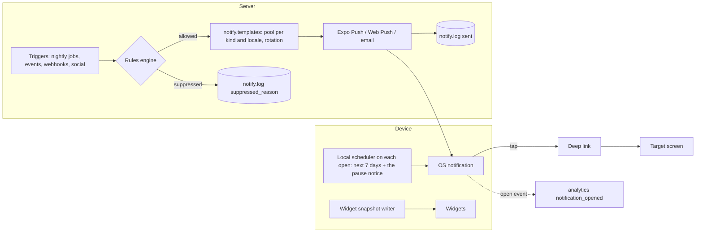

**Local first.** On every open the app schedules local notifications for the next 7 days (iOS allows 64 pending): one daily reminder per day and, for adults, today's streak saver (cancelled once today is a streak day). For adults the reminder's copy may follow the plant health predicted for that day; minors always get the plain rotating templates (§6.2). After the seventh reminder the scheduler places one `reminders_paused` notice, then nothing, so a student who doesn't open the app gets a kind stop (research A41). The server sends only `comeback_30` (adults) after that.

**Web** has no reliable local scheduling, so the server sends the daily reminder and streak saver by Web Push at the student's local time, through the same rules and the same pause. If Web Push isn't available (for example an iPhone browser without the installed PWA), the web app offers the opt-in email reminder to adults (SET-03).

### 6.2 Rules engine

Applied to every server send, and mirrored in the local scheduler (`app-core`) for local sends. **Volume is fixed** (research A40, R34): raising any cap needs the owner's sign-off. Every number is a flag; the values are the starting defaults.

| Rule (flag) | Adult | 13–17 | Under 13 |
|---|---|---|---|
| Habit pushes a day: reminder plus streak saver (`notify.cap.habit`) | 2 | 1 (the reminder) | 1 (the reminder) |
| Learning pushes a day: review due, weak area, daily challenge, bedtime (`notify.cap.learning`) | 1 | 0 (folded into the reminder) | 0 |
| Social pushes a day, after batching (`notify.cap.social`) | 3 | 2, after consent, held and sent together in the minor's reminder window (R45) | 0 |
| Total a day, not counting transactional, exam alerts or focus alarms (`notify.cap.total`) | 4 | 3 | 1 |
| Timing | chosen time, or smart timing: about `notify.smart.offset_hours` (23.5) after the last session, inside the allowed hours, never more than 2 hours before the chosen time | the picked time only | the parent's time only |
| Streak saver time | at least 1 hour before quiet hours start, only if today isn't a streak day | none | none |
| Quiet hours default | 22:00–07:00 | 21:00–07:00 | 20:00–08:00 |
| School hours (weekdays 08:00–14:00) | off | on | on |
| Copy chosen from predicted plant health, bedtime or study hour | yes | no | no |
| Product news | opt-in | never | never |

More rules:
- **Templates rotate** (research A40). Each kind has a pool in `notify.templates` (at least `notify.templates.min_per_kind`, 3, for habit kinds). Adults: the least recently sent template wins, with a novelty penalty so a line doesn't repeat within `notify.templates.repeat_gap_days`; an optional bandit (`notify.bandit`, adults only) learns which templates get opens across all adults. Minors: plain round robin, because learning from a child's responses would be behavioural monitoring.
- **Auto-pause after ignored reminders** (R34, research A41). `notify.autopause_after_ignored` (7) habit sends in a row without an app open pause all habit and learning pushes. The pause is announced once by `reminders_paused` in the pet's voice ("I'll stop reminding you for now. Tap me anytime."), with no sad image. Any app open resets the count and restarts reminders; ENT-08 then says "Reminders restart today."
- **Comeback after 30+ days** (R34, research A44): adults get one `comeback_30` push at `comeback.long_gap_days` (30), then silence. Minors get nothing after the pause. On return, ENT routes to ENT-08's long-break variant.
- **In-app wins.** If the app is in the foreground, a server push becomes an in-app toast (NTF-05) or nothing.
- **Never while a mock runner is open** (R24, practice request). While an attempt is open (`learn.mock_attempts` or the device's `mock_local`), nothing is shown, local or server, including focus alarms. Server sends are held until the runner closes, then dropped if stale. `report_ready` fires only after the student leaves the runner.
- **Daily reminder and nudges don't stack.** If a daily reminder fired today, a plant or pet nudge doesn't.
- **Minors' friend pushes** (R45): duels, Duo nudges, cheers and the other social kinds are held and delivered together in the minor's own reminder window; the in-app banner and SOC-06 inbox show them at once.
- **Transactional** (billing, exports, data export, guardian consent requests, time requests to a parent) skips caps but keeps quiet hours, except a parent's time request, which is only sent inside the child's allowed hours anyway.
- **Exam alerts** (`mock_reminder`, `report_ready`) have their own channel (research X20) and their own per-event limit; they never count against the caps, but quiet hours apply except for a live mock the student joined that starts inside them.
- **Every server send** writes `notify.log` with `status` and `suppressed_reason`. Opens come back as `notification_opened` (with `template_id`, never the text).

### 6.3 Push catalogue

Copy rules: the title is the pet's name (`{pet}`) for pet-voiced messages, and the brand name from config for billing, exam-alert and account messages. The body is at most 60 characters after variables are filled at their maximum length (listed in `docs/ux/me-money.md` NTF-01). The large icon is the pet in the matching mood (UX_FLOW §4.16). All strings go through the i18n gender-neutral lint (§1 rule 6) and use "आप" (R3). Full EN and HI copy for every row, with the starting template pools, is in NTF-01.

| Kind (`template_id`) | Class | Trigger | Timing | Deep link | Frequency | Minors |
|---|---|---|---|---|---|---|
| `daily_reminder` | habit, local | Daily | Chosen time (adults may use smart timing) | `/review` if cards are due, else `/home` | 1 a day | yes: picked time, plain templates, learning items named in the copy |
| `daily_reminder_thirsty` / `_dry` | habit, local | Same, when the plant is predicted droopy or dry | Chosen time | `/garden` | replaces `daily_reminder` that day | no (predicted state) |
| `streak_risk` (the streak saver) | habit, local | Today isn't a streak day yet (R1, R23), streak ≥ 1 | At least 1 h before quiet hours start | `/review?set=rescue` when a card is due or near due, else `/home` | 1 a day | no |
| `reminders_paused` | habit, local | `notify.autopause_after_ignored` habit sends ignored in a row | The next reminder slot | `/home` | once per pause | yes |
| `review_due` | learning, server | ≥ `notify.review_due.min_cards` cards due and not reviewed by the usual hour + 2 h | Usual hour + 2 h | `/review` | shares the learning cap | folded into the reminder |
| `weak_area` | learning, server | Nightly FSRS job (TRD §9.6) | Next day at the usual hour | `/review?topic={id}` | 2 a week | folded into the reminder (memory-labs request) |
| `challenge_ready` | learning, server | The daily challenge rolled (00:00 IST, R23) and isn't done | Usual hour | `/challenge` (PRC-11) | shares the learning cap | folded into the reminder (practice request) |
| `sleep_review` | learning, local, opt-in, Pro | Before the estimated bedtime | Bedtime minus `notify.sleep_review.lead_min`, never in quiet hours | `/review?set=bedtime` | 1 a day | no (adults only, memory-labs request, X17) |
| `pet_misses_you` | re-engagement, local | Day 3 of a lapse (replaces that day's reminder) | Chosen time | `/pet` | once per lapse | no |
| `comeback_30` | re-engagement, server | `comeback.long_gap_days` without an open | Chosen time | `/home` (ENT-08 opens) | once, then silence | no |
| `mock_reminder` | exam alert, server | A mock the student scheduled, or a live mock they joined | `notify.mock_reminder.lead_min` before | `/mock/{id}` | per mock | yes |
| `report_ready` | exam alert, local | A mock submitted offline or still scoring, and the report is now ready | After the runner closes | `/mock/{id}/report` (MOCK-19) | per attempt | yes |
| `focus_round_end` / `focus_break_end` | focus, local | A focus session the student started (MEM-29) | At the end of the round or break | `/focus` | per session | yes |
| `friend_request` / `friend_accepted` | social | Request received / accepted | Immediately (quiet hours delay to the end) | SOC-06 | batched after 3 a day | after consent |
| `friend_cheer` | social | A friend cheers | Batched hourly | SOC-06 | 1 a day | after consent |
| `duo_invite` | social | A friend invites to a Duo | Immediately | SOC-25 | per invite | after consent |
| `duo_nudge` / `duo_at_risk` | social | Partner's today is a streak day (R1) and yours isn't / the Duo streak needs you today, after 18:00 | Once | `/home` | 1 a day | after consent |
| `duel_challenge` / `duel_result` | social | A friend challenges / an async duel finished | Immediately | SOC-20 / SOC-19 | 3 a day | after consent; no random duels under 13 |
| `squad_quest_done` | social | The squad finished the weekly quest | Immediately | SOC-14 | 1 a week | after consent |
| `league_ending` | social | Sunday 18:00 IST, in a league, rank near a promotion line | Sunday 18:00 IST | SOC-08 | 1 a week | after consent |
| `league_promoted` | social | Monday rollover result = promoted, tier names from config (R30) | Monday 08:00 local | SOC-09 | 1 a week | after consent. Demotion is never pushed. |
| `league_result` | social | Monday rollover, not promoted (stayed or moved down); the copy never says which | Monday 08:00 local | SOC-09 | 1 a week | after consent |
| `referral_joined` | social | Invitee signed in and finished a lesson (§5.16) | Immediately | `/pro/manage` | per referral | after consent |
| `pro_activated` | transactional | Pending payment confirmed while away | Immediately | the saved `return_to` | once | all (parent for under 13) |
| `payment_not_completed` | transactional | Pending payment failed | Immediately | `/pro` | once | all |
| `trial_ending` | transactional | `billing.trial_reminder_days_before` (3) days before the ₹1 month ends (R33) | Usual hour (minors: picked time) | `/pro/manage` | once, plus the email | all |
| `billing_issue` | transactional | Grace day 1 and 2 days before `grace_until` | Usual hour | `/pro/fix` | 2 per issue | all |
| `export_ready` | transactional | PDF book ready | Immediately | `/books/{id}` | per export | all |
| `data_export_ready` | transactional | Data export ready | Immediately | `/privacy/export/{id}` | per export | all |
| `parent_weekly_report` | parent | Sunday 19:00 parent local | Sunday 19:00 | `/parent` | 1 a week | to the parent's device |
| `parent_time_request` | parent | Child taps "Ask for 15 more minutes" | Immediately | `/parent` | 3 a day per child | to the parent |
| `parent_consent_needed` | parent | A teen asks for a consent scope | Immediately | `/parent` | 1 a day | to the parent |
| `consent_decided` | transactional | A guardian agreed or declined while the teen's AUTH-21 wait screen was in the background (auth flow §6.10) | Immediately (quiet hours delay to the end) | AUTH-23 result for that request | per request | the teen (all ages that ask) |

The guest `streak_day_2` sign-in push the auth doc mentions (§3, behind `auth.streak_prompt_push`, off by default) would be a habit send for adults and unknown ages only, inside the same caps; it is not in the catalogue until that flag is turned on.

Not pushed, on purpose: freeze used (ENT-08 in-app), quest about to expire, badge earned, demotion, Pro ended, content updates, app updates (ENT handles those in-app), anything comparing the student with friends (X9).

### 6.4 Comeback timeline

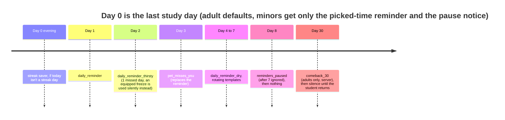

On the first open after 2 or more missed days, the NTF-07 trigger has ENT's launch routing (onboarding doc §6.13) open ENT-08, which shows the plant and pet state gently, opens the revival quest (ME-08) when the plant is wilted or resting, and after 30+ days adds the comeback plan (MEM-02, R22) and "Update your exam date" (ONB-06 `edit`). When reminders had auto-paused it says "Reminders restart today."

### 6.5 In-app banners and toasts (NTF-04, NTF-05)

Only one banner at a time, chosen by priority. Toasts follow DESIGN §5 (4 s, one action, errors stay).

| Priority | Banner (`kind`) | Where | Dismiss |
|---|---|---|---|
| 1 | `offline` "Offline. Downloaded lessons still work." | all main screens | auto when online |
| 2 | `billing_on_hold` | Home, Me | not dismissible, opens PAY-15 |
| 3 | `billing_issue` (grace) | Home, Me | 24 h |
| 4 | `payment_pending` | Home, Me | auto on confirm |
| 5 | `notifications_off` (after a streak of 3+ with OS permission off) | Home, once a week max | 7 days |
| 6 | `storage_low` (device under 500 MB free) | Home, Downloads | 7 days |
| 7 | `trial_ending` | PAY-12 and Me Pro card only | none |

Toasts: freeze bought, item equipped, quest reward claimed (when not celebrating), Pro activated (from a listener), PDF book ready (in-app), reminder time saved, report sent, "Saved. We'll sync when you're online." for offline writes, and errors with [Try again].

### 6.6 Widgets (NTF-08, NTF-09, NTF-10)

Phase 2 (implementation plan G-5, R8). All widgets are free, because they build the habit. Android first (research A42). Time-of-day changes come from the clock, not from the student's behaviour, so minors get them too.

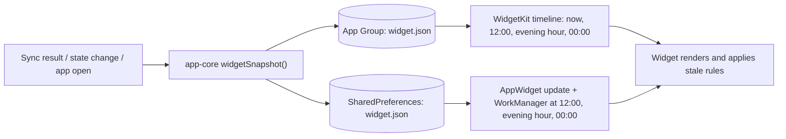

**Snapshot fields:** `schema_version`, `written_at`, `local_day`, `tz`, `locale`, `theme_pref`, `signed_in`, `is_under10`, `streak`, `goal_met_today`, `goal_progress` (0–1), `freeze_held`, `rest_day_today`, `last_activity_day`, `plant` {`species`, `skin`, `stage`, `health`}, `pet` {`species`, `name`, `state`, `outfit`}, `health_by_missed_days` (the thresholds as data, so the widget doesn't hard-code them), `due_cards`, `plan_items` (up to 3: title, subject family, minutes, deep link), `exam` {`name`, `target_date`, `date_precision`: day or month}. Art is pre-rendered PNGs in the widget bundle (25 plant images, pet moods), not Rive.

**Stale-data rules**, applied by the widget itself:

| Condition | Widget behaviour |
|---|---|
| Same `local_day` as the snapshot | Show the snapshot as is |
| A new day has started (after 00:00) | `goal_progress` resets to 0, `goal_met_today` false. Plant health and pet state are **predicted** from `last_activity_day` and `health_by_missed_days` (freeze and rest day count as watered for one day). Plan items hide behind "Plan today's study". `due_cards` shows "Reviews waiting" without a number. |
| Morning (quiet-hours end to 12:00) | Status line shows today's plan ("Today: {min} min") |
| Evening (`widget.evening_hour`, or 3 h before quiet hours if earlier) and today isn't a streak day | Line "2 min keeps your plant happy", thirsty plant art, tap opens `/review?set=rescue` (memory-labs request). Never red or alarm colours (research A42). |
| Snapshot older than 72 h | Keep the predicted plant and pet, hide numbers except the streak, line "Open Smriti to update" |
| Signed out, or no snapshot | Placeholder: the seed in its pot and "Open Smriti to start" |
| `is_under10` | The pet never shows below `sleepy`; the plant shows "Resting" art at most |
| Lock screen (iOS accessory, P2) | Streak number and a small plant only. No pet name, no exam. |

Taps deep link: small → `/garden` (evening: `/review?set=rescue`), medium pet → `/pet`, medium [Review] → `/review`, large items → their link, large header → `/plan`.

### 6.7 Email

Google sign-in means we know a verified email, but we keep email small:

| Email | To | When | Can turn off |
|---|---|---|---|
| Parent weekly report | Parent's Google email | Sunday 19:00 parent local | yes, in SET-14 |
| Guardian consent request and confirmation | Guardian | On request (auth agent owns the content) | no (needed for consent) |
| Data export ready | Account email; for a managed child, the parent | When ready | no |
| Trial reminder (R33) | Account email; the payer's for a parent-paid plan | `billing.trial_reminder_days_before` days before the ₹1 month ends | no (transactional) |
| PDF book ready | Account email (adults only) | When ready, if the app wasn't opened within 1 h | yes |
| Daily reminder (web only, opt-in) | Adult account email | Chosen time | yes, off by default, adults only |
| Account deleted confirmation | Account email | On delete (auth agent) | no |

No marketing email to minors, ever. Store receipts come from Apple and Google; Razorpay sends its own payment receipts, so we don't duplicate them. TRD has no email provider: one is needed (§10, Q9).

---

## 7. Branch matrix

| Branch | ME | SET | PAY | NTF |
|---|---|---|---|---|
| **Guest** | Full local Me, "Save your progress" card. Shop, quests, badges work (synced under the anonymous id). | All settings work. Account shows sign-in. Parent mode needs a parent sign-in anyway. | Paywall viewable. Any buy → AUTH-02 (hard login), then checkout continues. | Local reminders work. Server pushes need a device token, which guests have. Social: none. |
| **Signed in** | Name, handle, synced across devices. | Account shows Google. | Checkout available. | All classes per prefs. |
| **Free** | Pro locks on downloads, PDF books, palace rooms, Pro-only items. Labs are free. | | Paywall, upsell cards (13 and up). | `trial_ending` etc. never fire. |
| **Pro** | Unlocks. Pro card shows renewal. | Manage plan row. | No gates, no paywall, PAY-16 if a buy is attempted. | Billing transactional pushes. |
| **Online** | Live data. | Writes go straight to the API. | Checkout. | Server and local. |
| **Offline** | Snapshot data, shop read-only, care actions queued, quest claims queued. | Writes saved locally and queued. | Paywall shows, CTA disabled "Connect to the internet to start Pro". Manage plan shows cached status. | Local reminders still fire. |
| **Minor 13–17** | Auto nickname and pet avatar to other students, after consent (R31 amended). Share cards allowed (no personal data). | Stricter notification defaults, analytics toggle hidden, name display locked. | PAY-03 first. | Reminder at the picked time only (R34), learning folded in, exam alerts, focus alarms, social after consent and held for their reminder window (R45), quiet 21:00, school hours. |
| **Little learner / under 13** | Simplified Me, no Pro card, no prices, no sharing, "For grown-ups". | Parent mode is the only way to change most settings. | No paywall: "Ask a grown-up" → SET-13 → PAY-17. | Daily reminder (parent's time) and focus alarms only. |
| **Per-exam app** | Exam fixed. | Cross-promo row. | Variant's own store product, same `pro` entitlement. "Pro works in every Smriti app." | Same rules. Deep links carry the variant prefix. |
| **All-exams app** | Exam chips editable. | | `pro_monthly_intro_all` / `pro_monthly_all` products. | |
| **Mobile** | Widgets, haptics. | | Store sheets. | Local and Expo push. |
| **Web** | No widgets. Downloads = PWA cache. | Haptics hidden. Email reminder opt-in. | Razorpay. | Web Push via service worker, email fallback. |

---

## 8. Edge cases

1. **Timezone change while travelling.** Activity days use the profile timezone (`app.profiles.timezone`). When the device timezone differs for more than 24 h, a sheet asks "Use {new zone} for your streak?" Changing it never breaks a streak: the day being switched counts if studied in either zone.
2. **Clock tampering.** Streak, plant and pet are computed on the server from event timestamps checked for plausibility (TRD §10). The device's predicted state is overwritten by the server on sync.
3. **Purchase made, app killed before the success screen.** On the next open, the RevenueCat listener or `GET /v1/me/summary` shows Pro, and PAY-09 shows once ("Pro is on") before Home.
4. **Purchase on a guest device after sign-out.** Not possible: checkout needs a signed-in user. If the store account has an active Smriti subscription for another Smriti account, PAY-14 explains it.
5. **Two devices, one buys.** The other device sees Pro on its next `/me/summary` (or a silent push `entitlement_changed`, optional).
6. **Refund on web.** Support issues a Razorpay refund; webhook sets `cancelled`; PAY-18 shows on next open.
7. **Price change by the store or tax change.** Show the store's price string. Existing subscribers get the store's own price-change consent flow. Web: a new plan is created and existing mandates stay at their price until migrated with notice (legal).
8. **Intro used on Android, now on iOS.** Apple doesn't know about the Play claim, but our server does: the Google identity key is already in `billing.intro_claims`, so `intro-eligibility` says no and the iOS paywall sells `pro_monthly_{variant}` at ₹99 with the not-eligible copy. The fine print says "once per person".
9. **Account merge (common brief decision 3).** Gems: summed. Inventory: union. Freezes held: summed up to the cap. Pet: the target account's pet is kept; if the guest's pet differs and `merge.keep_guest_pet` is on, AUTH-08 says "{pet_b} is visiting your pet room" (research §11.6, auth flow §13) and the outfits move over. Plant: the higher growth points are kept, health from the more recent activity. Quests: the target's current quests, progress summed. Subscriptions: both kept; if both are active, the student is told one may need cancelling (PAY-16 variant).
10. **Account deletion with gems or Pro.** Gems and items are lost (stated in AUTH-13). Store subscriptions must be cancelled by the student (§4.2).
11. **Pet name or display name becomes offensive later** (filter list updated). The server flags it; on next open the student is asked to pick a new name (ME-06) with a neutral line, never accusatory.
12. **Widget with two children on a shared phone.** The widget shows the last active profile and says "{pet}'s plant"; switching profiles rewrites the snapshot.
13. **Quiet hours crossing midnight** (21:00–07:00) are handled as one window. A reminder time inside it moves to `quiet_end`.
14. **Notifications denied on iOS.** We can ask through the system only once. NTF-03 then sends the student to iOS Settings with steps. Android 13+ can be asked again only if not "don't ask again"; otherwise the same Settings hand-off.
15. **Time limit reached offline.** Enforced locally; the parent's approval of extra time needs a connection on the child's device, so offline the "Ask for more time" button says "Needs internet".
16. **PDF book with Hindi.** Rendered by Chromium with Noto Sans Devanagari embedded (TRD §5). The builder's preview uses the same fonts.
17. **Data export for a managed child** is requested and downloaded only in Parent mode.
18. **Rest day and a freeze on the same day.** The rest day wins; the freeze is kept.
19. **Student studies just after midnight.** It counts for the new day. A grace window is not added (keeps the rule simple and the streak honest).
20. **Gem balance would go negative** (refund of a purchase that granted gems, or a merge race): `gems >= 0` constraint; the server clamps at 0 and writes an `adjustment` row.

---

## 9. Data: local vs server

| Data | On device | On server | Endpoint |
|---|---|---|---|
| Profile, stats, pet, plant, entitlement | `profile_snapshot` | `app.profiles`, `game.user_stats`, `game.pets`, `game.plants`, `billing.entitlements` | `GET /v1/me/summary`, `PATCH /v1/me` |
| Exams | `profile_snapshot` | `app.user_exams` | **missing:** `PUT /v1/me/exams` |
| Pet care, rename, species, outfits, room | queued in `outbox` | `game.pets` | `POST /v1/pet/care`; **missing:** `PATCH /v1/pet` |
| Plant, garden history, new seed | snapshot | `game.plants`; **missing** `game.plant_history` | `GET /v1/plant`; **missing:** `GET /v1/garden`, `POST /v1/plant/new` |
| Streak calendar, freezes, rest days | snapshot of 2 months | `learn.activity_days`, `game.streak_freezes`; **missing** rest day storage | `POST /v1/streak/freeze`; **missing:** `GET /v1/streak/calendar?month=`, `POST /v1/streak/rest-day`, `DELETE /v1/streak/rest-day/{day}` |
| Quests | cached list, predicted progress | `game.quests`, `game.user_quests` | **missing:** `GET /v1/quests`, `POST /v1/quests/{id}/claim` |
| Badges | cached | `game.badges`, `game.user_badges` | **missing:** `GET /v1/badges` (with progress) |
| Collections | cached; card content in bundles | `game.collections`, `game.user_collection_items` | **missing:** `GET /v1/collections`, `GET /v1/collections/{id}` |
| Shop, inventory, gems | cached, read-only offline | `game.shop_items`, `game.inventory`, `game.gem_ledger`, `game.user_stats.gems` | **missing:** `GET /v1/shop`, `POST /v1/shop/purchase`, `POST /v1/inventory/equip`, `GET /v1/gems/ledger` |
| Downloads | `bundles`, `asset_cache`, MMKV settings | none (content manifest only) | `GET /v1/content/manifest` |
| PDF books | cached PDFs opened once | `app.exports` (`pdf_book`), R2 `smriti-uploads` | `POST /v1/exports/pdf`, `GET /v1/exports/{id}`; **missing:** `GET /v1/exports?kind=pdf_book` (list) |
| Settings | MMKV / `localStorage` | `app.profiles.settings`, `locale` | `PATCH /v1/me` |
| Notification prefs | MMKV copy for the local scheduler | `notify.prefs` | `PATCH /v1/notification-prefs`; **missing:** `GET /v1/notification-prefs` |
| Push token, web push subscription | | `app.devices` | `POST /v1/devices` (needs a web push subscription field) |
| Data export, consents | | `app.exports` (`data_export`), `app.data_requests`, `app.guardian_consents` | `DELETE /v1/guardian/consents/{id}/scopes/{scope}` (withdraw a teen scope); **missing:** `POST /v1/me/data-export`, `GET /v1/me/consents` (all consents with dates, including adult analytics and news) |
| Parent links, limits, time requests | limits cached on the child device | `app.guardian_links` (exists); **missing** `app.parental_controls`, `app.time_requests` | `GET /v1/guardian/learners`, `POST`/`DELETE /v1/guardian/children/{id}`, `POST /v1/guardian/children/{id}/session`, `POST /v1/guardian/link-requests`; **missing:** `GET /v1/guardian/learners/{id}/report?week=`, `PUT /v1/guardian/learners/{id}/controls`, `POST /v1/me/time-requests`, `POST /v1/guardian/time-requests/{id}/decision` |
| Content reports, support tickets | queued in outbox | `learn.content_reports` (exists); **missing** `ops.support_tickets` | **missing:** `POST /v1/content-reports`, `POST /v1/support/tickets` |
| Help articles | cached bundle | R2 `smriti-content` | CDN `/c/help/{locale}.json` |
| Subscription details | snapshot | `billing.subscriptions`, `billing.entitlements`, `billing.payments` | `GET /v1/billing/entitlement`, `GET /v1/billing/intro-eligibility`; **missing:** `GET /v1/billing/subscription` (Manage plan details), `POST /v1/billing/razorpay/verify`, `POST /v1/billing/razorpay/cancel`, `POST /v1/billing/razorpay/update-method`, `POST /v1/billing/child-payment-links` |
| Widget snapshot | App Group / SharedPreferences | none | |
| Notification log | | `notify.log` | worker only |

---

## 10. Conflicts and gaps in existing docs

| Where | Issue | Proposed fix |
|---|---|---|
| APP_FLOW §3.6 | Six plant stages (adds "Budding" at day 21); every other doc has five | Drop Budding; thresholds become a flag (§3.4) |
| UX_FLOW §5 vs APP_FLOW §3.6 | Dormant revival "3 short days" vs "5-day revival quest" | Keep 5 from APP_FLOW; copy uses `{days}` |
| APP_FLOW §3.6 vs DESIGN §6.3 | Different pet mood lists | Persistent states and transient reactions as in §3.3; update both docs |
| APP_FLOW §3.6 | Pet "feed" bought with XP | Treats bought with gems; add `treat` to `game.shop_items.kind` |
| APP_FLOW §2 "Me" row | Lists "Subscription"; the screens here are PAY-12. Missing: streak calendar, quests, wardrobe, garden history, data export, help article, contact support, about | Update the inventory to the IDs in this doc |
| APP_FLOW §2, §3.2, UX_FLOW §4.14, PRD §10.3, TRD §1, §4.2, §6, §17 | Phone OTP, email magic link, DLT SMS | Google only (iOS adds Apple), per the common brief. The auth agent owns the rewrite |
| TRD §11, DB `billing.intro_claims` | Was keyed by phone number | Resolved by the auth agent this round: identity keys plus device signals, two products per variant. This doc follows it (§5.4) |
| DB `app.guardian_consents` | Had a guardian phone hash | Resolved by the auth agent (`guardian_sub_hash`). DPDP Rules 2025 Rule 10 applies to consent records |
| PRD §10.3, APP_FLOW §2 | "Parent consent for under-13s" vs DPDP under-18 (PRD §16.4, TRD §6) | Under-18, as in the brief |
| DB `billing.subscriptions.status` | No state for a Razorpay mandate approved before the first charge, or for a pending retry | Add `authenticated` and `pending` (or map `pending` to `grace`) |
| DB `billing.subscriptions.source` | No referral or promo source for the PRD §8 free week | Add `billing.promo_grants` (user, reason, starts_at, ends_at) and include it in the entitlement recompute |
| DB `billing` | No payer record for a parent paying, no child payment links | `billing.subscriptions.payer` (`self`, `guardian_declared`, `guardian`), `billing.payment_links` |
| DB `notify.prefs` | Missing `reminder_enabled`, `smart_timing`, `pet_plant_nudges`, `review_due`, `mocks`, `school_hours`, `email_reminders`; minor defaults need a trigger on `age_band` | Add the columns; set defaults from `age_band` in `app.handle_new_user()` and on age change. Resolved in consistency pass: DB_SCHEMA §10 adds the columns and §3 sets the defaults by age. |
| DB `app.devices` | `push_token` only fits Expo tokens | Add `web_push_subscription jsonb` and `push_enabled` |
| DB `game.plants` | One row per user, no past plants | Add `game.plant_history` |
| DB `learn.activity_days` / `game` | No rest days | Add `rest_day boolean` to `learn.activity_days` |
| DB `game.pets` | No room backdrop | Add `room_theme text` |
| DB `game.collections` | No item metadata | Cards carry metadata in content bundles (recommended), or add `game.collection_items` |
| DB `app.*` | `app.guardian_links` now exists (auth agent). No limits or time requests | Add `app.parental_controls` (daily limit, allowed hours, break reminders, ask-before-switching) and `app.time_requests`, with the guardian-or-learner read RLS of `app.guardian_links` |
| DB | Content reports exist as `learn.content_reports` (use it, as the learn doc recommends). No support tickets | Add `ops.support_tickets` (service-only RLS; the reporter can read their own). It stores the reply email from the auth identity with the ticket only, since the profile never copies the Google email |
| DB `app.profiles` | No content language, tutor language, analytics opt-out | Keys in `settings` (`content_locale`, `tutor_locale`, `analytics_opt_out`), documented in DB_SCHEMA §3. Resolved in consistency pass: DB_SCHEMA §3 lists the documented `settings` keys. |
| TRD §5 "Files", DB `app.profiles.avatar_asset_id` | Avatar uploads | Avatar is the pet portrait; no uploads |
| TRD §5.1 | Many endpoints missing (§9 lists them) | Add them to the API surface. Resolved in consistency pass: TRD §5.1 now carries a "still to merge" note pointing here; the merge itself is open. |
| TRD §12 | Local reminders "rescheduled on each open" but no 7-day plan, no copy by predicted health, no web path | Use §6.1. Resolved in consistency pass: TRD §12 now describes the 7-day local plan. |
| TRD §9.6 | Smart timing needs a "usual study hour" estimate | Add it to the bedtime job. Resolved in consistency pass: TRD §9.6 adds the usual study hour (adults only). |
| TRD | No email provider | Pick one (Q9) |
| UX_FLOW §5 | "[Download for later]" for everyone, but downloads are Pro (PRD §11.1) | Free: "Save when online" (cache), Pro: Download |
| UX_FLOW §4.15 | Benefit list says "unlimited mocks" | Use PRD wording: "All mocks" and filter by live features |
| UX_FLOW §4.16 | Medium widget "pet mood, today's progress ring and a [Review] deep link": fine. Large widget "exam countdown" assumes a day-precise date | Show "in {Month Year}" when only a month is known |
| `docs/ux/learn.md` LES-04 vs SET-24 | LES-04 specs its own report sheet; `docs/flows/learn.md` §LES and `docs/flows/tutor-social.md` A5 route to SET-24 | One sheet: SET-24, with LES-04's title and six reasons (they match `learn.content_reports.reason`). LES-04 keeps the card menu |
| `docs/flows/practice.md` §10 vs `docs/ux/practice.md` (PRC hub, MOCK-14) | Practice uses `practice_cap` and `mock_lock` in the flow but `practice_limit` and `mock_limit` in the UX doc | Use the flow names, which this doc now lists (§5.2) |
| `docs/flows/tutor-social.md` A6 | Added `tutor_read_aloud` and `tutor_image` paywall sources | Resolved by R35: read-aloud is free with a daily cap flag, so `tutor_read_aloud` is removed; "Draw it" (new Agnes images) is Pro and listed under "Higher limits" as `tutor_image` (§5.2) |
| `docs/flows/memory-labs.md` (LAB-03 locked lab) | Earlier drafts put some labs behind Pro | Resolved by R19 (revised): every lab is free. `lab_lock` stays only for the inline card of a locked Deep Dive, and its paywall links to the same lab in LAB-03 |
| `docs/ux/onboarding.md` ENT-08 vs NTF-06, NTF-07 | Both docs retired the sheet in favour of the other during revision 1 | Resolved by R41: ENT-08 owns the sheet with this area's rows built in; NTF-06 and NTF-07 are its triggers |
| DECISIONS R37 vs `docs/research/COMPETITOR_FLOWS.md` A37 | A37 suggests share cards at 7/21/50/100 days | Share cards follow the R37 plant thresholds (7, 30, 100), so the milestones match the plant stages (§3.4). Resolved in consistency pass: `share.streak_milestones` is 7, 30, 100. |
| PRD §9.1 "Smart timing that learns the student's usual study hour" | R34 bans behaviour-predicted sends for minors (DPDP s.9(3)) | PRD §9.1 should say "for adults only"; minors get only the time they picked (§6.2). Resolved in consistency pass: PRD §9.1 now says smart timing is for adults only. |
| DB `learn.activity_days` | No `rescue_done` column, so a 2-minute rescue can't keep the plant healthy; `goal_met` is the daily ring only (comment already says so) | Add `rescue_done boolean not null default false` (memory-labs G23). Keep `goal_met` for the ring; the streak reads the R1 qualifying columns. Resolved in consistency pass: column added in DB_SCHEMA §5.1, with the plant health days rule. |
| DB `learn.content_reports.reason` | Check list has no `spam`, which SET-24 needs for community mnemonics (`community_mnemonic`) | Add `spam` to the check, allowed only when `kind = 'community_mnemonic'` (enforced in the service). Resolved in consistency pass: `spam` added to the check in DB_SCHEMA §5.4. |
| DB `learn.content_reports` | No `kind` column for the SET-24 kinds (`lesson_card`, `question`, `review_card`, `solution`, `tutor_message`, `generated_image`, `story_page`, `roleplay_turn`, `community_mnemonic`, `lab`, `album_card`) | Add `kind text not null` with that check list. Resolved in consistency pass: `kind` added in DB_SCHEMA §5.4 with the 11 kinds. |
| DB `billing` | No `billing.promo_grants` table and no `promo` value in `billing.subscriptions.source` (referral Pro week, §5.16) | Add the table (`user_id`, `reason` with `referral_week`, `starts_at`, `ends_at`) and `promo` as a source in the entitlement recompute. Resolved in consistency pass: table and `promo` source added in DB_SCHEMA §8. |
| DB_SCHEMA §11 (line "first name and initial on leaderboards") | Contradicts R31 (amended) and PRD §16.4, which now say auto nickname plus pet avatar after consent | DB_SCHEMA owner updates the sentence; leaderboards read a `public_nickname` generated server side. Resolved in consistency pass: DB_SCHEMA §7 now has the R31 amended paragraph; the nickname is stored as `app.profiles.nickname_word_ids` and `nickname_number` and rendered server side. |
| R31 (amended) word list | No owner named for the fixed EN/HI nickname word list | Tutor-social owns the feature; it ships as config with both languages and a review for unsafe combinations. Resolved in consistency pass: the owner question moves to `docs/flows/tutor-social.md` Q-B11, still open. |
| DB `notify.prefs` | New groups have no columns: `streak_saver`, `nudges`, `bedtime_review`, `focus_timer`, `friends`, `exam_alerts`, `news`, plus `paused_at` and `ignored_count` for auto-pause | Add the columns with defaults from `age_band` (minors: off except reminder, focus timer and exam alerts). Resolved in consistency pass: DB_SCHEMA §10 adds them as `streak_saver`, `pet_plant_nudges`, `sleep_review`, `focus_timer`, `friends`, `exam_alerts`, `news`, `paused_at` and `ignored_count`. |
| APP_FLOW HOME-07 | Older docs still name HOME-07 for parental limits | Retired; the screen is SET-19 (parent time limits) in this doc. Resolved in consistency pass: every flow and UX doc outside APP_FLOW now uses SET-19; APP_FLOW is being rewritten by the orchestrator. |
| DESIGN §5 | No component for a meter (pet mood and energy), a day-dot quest tracker, or a banner | Add `Meter`, `DayDots`, `Banner` (spec in the UX doc) |

---

## 11. Analytics events

Every event goes into the typed catalogue in `packages/analytics` first. No free text, no names, no email, no amounts typed by the student. For minors, only events marked **E** (essential) are sent (§4.6).

| Event | Props | E |
|---|---|---|
| `me_viewed` | `is_guest`, `is_pro` | |
| `profile_name_changed` | none | |
| `exam_added` / `exam_removed` / `exam_primary_changed` | `exam_profile_id` | |
| `pet_room_viewed` | `pet_state` | |
| `pet_care_action` | `action` (pet, play, treat), `pet_state_before` | |
| `pet_outfit_equipped` | `item_id` | |
| `pet_renamed` / `pet_species_switched` | `species` | |
| `garden_viewed` | `stage`, `health` | |
| `revival_quest_started` / `revival_quest_day_done` / `revival_quest_completed` | `kind` (wilted, dormant), `day` | |
| `plant_new_seed_planted` | `species` | |
| `streak_calendar_viewed` | `streak` | |
| `rest_day_set` / `rest_day_cancelled` | `days_ahead` | |
| `freeze_used` (server) | `source` | |
| `quests_viewed` | `daily_done`, `weekly_done` | |
| `quest_claimed` | `quest_id`, `period` | |
| `badge_viewed` / `badge_earned` (server) | `badge_id`, `tier` | |
| `collection_viewed` / `card_collected` (server) | `collection_id`, `item_id` | |
| `shop_viewed` | `gems` (bucketed) | |
| `shop_item_purchased` | `item_id`, `kind`, `price_gems` | |
| `shop_purchase_blocked` | `item_id`, `reason` (balance, cap, pro_only, offline) | |
| `downloads_viewed` | `used_mb_bucket` | |
| `download_started` / `download_completed` / `download_failed` | `scope` (subject, chapter, topic), `bytes_bucket`, `error_code` | |
| `cache_cleared` | `freed_mb_bucket` | |
| `pdf_builder_opened` | `is_pro` | |
| `pdf_export_requested` / `pdf_export_ready` / `pdf_export_failed` / `pdf_opened` | `topics_count`, `language`, `include_flags`, `error_code` | |
| `settings_changed` | `key` (enum), `value` (enum only, never free text) | |
| `notification_pref_changed` | `type`, `enabled` | E |
| `reminder_time_changed` | `hour` | |
| `language_changed` | `scope` (app, lesson, tutor), `locale` | |
| `theme_changed` | `mode` | |
| `data_export_requested` / `data_export_downloaded` | none | E |
| `consent_withdrawn` / `consent_granted` | `consent_type` | E |
| `analytics_opt_out_changed` | `enabled` | E |
| `parent_mode_opened` | `entry` (device, own_account) | |
| `parent_limit_changed` | `limit_type`, `value_bucket` | |
| `time_limit_reached` | `limit_type` | E |
| `time_request_sent` / `time_request_decided` | `decision` | E |
| `help_article_viewed` | `article_id` | |
| `support_ticket_sent` | `category`, `has_note` (bool) | |
| `content_report_submitted` | `surface`, `kind` (one of the eleven SET-24 kinds), `reason` (LES-04 reasons, plus `spam` for community items), `has_note` (bool, never the note) | E |
| `paywall_opened` | `source`, `platform`, `intro_eligible`, `variant`, `benefit_set_id` | E |
| `paywall_cta_tapped` | `source`, `intro_eligible` | E |
| `paywall_dismissed` | `source`, `method` (maybe_later, back, swipe) | E |
| `compare_plans_viewed` | `source` | |
| `grownup_check_answered` | `answer` (parent_here, send_link) | E |
| `checkout_started` | `platform`, `product_id`, `intro` | E |
| `checkout_result` | `platform`, `result` (success, pending, failed, user_cancelled), `error_code` | E |
| `subscription_status_changed` (server) | `from`, `to`, `source` | E |
| `manage_plan_viewed` | `status`, `source` | E |
| `cancel_started` / `cancel_reason_selected` / `cancel_completed` / `cancel_kept_pro` | `source`, `reason_code` | E |
| `restore_tapped` / `restore_result` | `result` | E |
| `billing_fix_opened` | `status` | E |
| `upsell_card_shown` / `upsell_card_tapped` | `placement` | |
| `notification_sent` (server, from `notify.log`) | `template_id`, `kind` (§6.4 catalogue, including `reminders_paused`, `challenge_ready`, `report_ready`, `focus_round_end`, `focus_break_end`, `friend_accepted`, `duo_invite`, `duo_at_risk`, `duel_result`, `squad_quest_done`, `league_result`), `channel` | E |
| `notification_suppressed` (server) | `template_id`, `reason` (cap, quiet_hours, mock_runner_open, minor_window_wait, paused, prefs_off) | E |
| `notification_opened` | `template_id`, `is_local` | E |
| `notification_permission_result` | `surface` (settings, banner, web), `result` | E |
| `banner_shown` / `banner_tapped` / `banner_dismissed` | `kind` | |
| `widget_added` / `widget_removed` | `size` | |
| `widget_tapped` | `size`, `target` | |
| `milestone_shown` | `milestone` (7, 30, 100), `kind` (streak, plant) | |
| `share_card_shared` | `milestone`, `target` (system_sheet, save_image); 13+ only, never for under-13 | |
| `reminders_auto_paused` (server) | `ignored_count` (bucketed) | E |
| `reminders_resumed` | `source` (settings, banner) | E |
| `comeback_started` / `comeback_completed` | `gap_bucket` (30_59, 60_plus); the in-app plan is for everyone, only the push is adults-only | |
| `trial_timeline_viewed` | `source` (paywall, manage_plan, checkout) | E |
| `trial_reminder_sent` (server) | `channel` (push, email) | E |
| `freeze_equipped` | `slots_filled` | |
| `incident_freeze_applied` (server) | `incident_id` | E |
| `streak_checkin_shown` / `streak_checkin_action` | owned by ENT-08 (onboarding); NTF-06 and NTF-07 are its triggers (R41) | |

---

## 12. Open questions for the owner

| # | Question | Recommended answer |
|---|---|---|
| Q1 | Can gems ever be bought with money? | Decided (R36): no, for anyone. |
| Q2 | Plant stage thresholds (study days to sprout, sapling, flowering, tree)? | Decided (R37): 1 / 7 / 30 / 100 as a flag; no "Budding". |
| Q3 | The ₹1 rule is "once per person" (identity keys plus device signals, auth doc §8). What does the paywall do when the eligibility call fails? | Show the ₹99 "Get Pro" copy and retry later. Never promise ₹1 without a yes from the server. Fine print says "once per person". |
| Q4 | Can a 13–17-year-old complete checkout themselves? | Yes, after PAY-03 ("Is a parent paying?"), relying on store family approvals and bank checks. Under 13 (all managed accounts, auth Q1): only a parent, through PAY-17. Legal to confirm. |
| Q5 | Product analytics for minors? | Off, no toggle, only the essential allowlist in §11. Legal to confirm against the DPDP Rules for children. This costs funnel visibility for minors; accept it. |
| Q6 | RevenueCat transfer behaviour when a store purchase is restored on a second Smriti account? | Keep with the original account and tell the student which account owns it. |
| Q7 | "Send to my parent" payment link inside the store apps? | Off on iOS and Android until store policy is checked for India; on for web. |
| Q8 | After Pro ends, do reviews of cards from Pro lessons keep coming? | Yes. Only the Deep Dives re-lock. |
| Q9 | Email provider for the parent report and transactional mail? | Any Indian-deliverability-tested provider behind a small interface in the worker; pick in Phase 2 with the parent report. |
| Q10 | Rest days: one free per week, separate from freezes? | Yes, as a flag (`game.rest_days_per_week` = 1). |
| Q11 | Do prices shown on web include GST? | Decided (R38): tax-inclusive everywhere. Finance to confirm invoicing. |
| Q12 | Hindi register for the pet? | Decided (R3): "आप" everywhere, pet lines included; "तुम" only in little-learner (class 1–5) strings. Gender-neutral constructions only. |
| Q13 | Trial-ending push 3 days before the ₹1 month ends? | Decided (R33): yes, always on (transactional), by push and email (§5.15, §6.7). |
| Q14 | Should demotion in leagues ever notify? | No. Promotion has its own push; everyone else gets the neutral `league_result` ("Your league week is done"), which never says stayed or moved down. |
| Q15 | Can the student switch pet species? | Yes, once every 30 days, keeping mood and outfits. |
| Q16 | For minors, should a friend push that waits for the reminder window (R45) be merged into the reminder, or sent just after it? | Merged into the reminder copy as one line ("{friend} sent a duel"), so the minor still gets one push a day. |
| Q17 | Template bandit for adults (`notify.bandit`): on at launch? | Off at launch; turn it on after the rotating pools have four weeks of open-rate data. Minors never use it. |
| Q18 | Who reviews the auto-nickname word list for unsafe combinations? | Tutor-social owns the list; trust and safety signs it off before Phase 2 social launch. |

---

## Changelog (revision 1)

- **Rulings:** aligned to R1 to R45. Gem rule, plant thresholds, paywall honesty, age-gated checkout and minors' analytics allowlist accepted as R36 to R39. §12 Q1, Q2, Q11, Q12 and Q13 are marked decided.
- **Hindi (R3):** आप everywhere, pet lines included; तुम only in little-learner strings. Gender-neutral throughout.
- **Streak and plant (R1, R23, R28, R37):**
  - Qualifying days are 1 lesson, 10 reviews, 1 mock section or the daily challenge.
  - The `Plant` icon replaces the flame everywhere.
  - 2 freeze slots, an incident freeze, rest days planned ahead and a protected exam day.
  - Health counts health days, including a 2-minute rescue.
  - Revival counts qualifying days.
  - Milestone moments and share cards with no personal data (13+).
- **ENT-08 (R41):** NTF-06 and NTF-07 are now trigger blocks for ENT-08's streak check-in sheet, not screens.
- **Minors (R31 amended, R34, R45):**
  - Public surfaces show the auto nickname and pet avatar; friends added by link or QR see the pet name.
  - Only the picked reminder time, with no smart timing, streak saver, nudges, bedtime review or comeback push (the in-app comeback plan in ENT-08 is for everyone).
  - Friend pushes wait for the reminder window.
- **Notifications (R34, A40, A41, A44):**
  - Fixed caps per group; rotating template pools with at least 3 per kind.
  - Auto-pause after 7 ignored reminders, with a `reminders_paused` notice.
  - Comeback flow after 30+ days (adults); no pushes while the mock runner is open.
  - New kinds from practice, memory-labs and tutor-social; Focus timer and Exam alerts channels.
  - NTF-02 is reached only from SET-03; NTF-03 reads ONB-15.
- **Paywall and billing (R14, R15, R33, R35, R38, A38, A39, X3, X5, X6):**
  - No paywall in onboarding; trial timeline with real dates; our reminder 3 days before; cancel in 2 taps (new §5.15).
  - Tax-inclusive prices, and ₹1 only when the server says eligible.
  - Labs are free, so `lab_lock` is only an inline Deep Dive card; read-aloud is free; "Draw it" is Pro under "Higher limits".
  - The practice limit pet line (`practice_cap`) no longer says "locked PYQ"; PAY-19 uses `primaryTint` and shows only to 13+.
  - Referral Pro week through `billing.promo_grants` (new §5.16).
- **Me and Settings:**
  - ME-01: AUTH-33 chip, My memory and Your chats rows, Continue with Google plus the R40 trust line.
  - ME-02: optional school and city fields.
  - ME-11: Elements and Experiments collections.
  - ME-17: palace room packs.
  - ME-21: downloads go to LRN-05 first and include labs.
  - SET-02: one-time Age row; deletion is never hidden (X16).
  - SET-03: groups regrouped; SET-07: mock dark mode; SET-09: global reduce motion; SET-10: watering cans, default 10 minutes.
  - SET-14: practice counts, Picture rhymes and Tutor button toggles, parent friends list.
  - SET-24: eleven kinds on `learn.content_reports`, LES-04 reasons plus Spam for community items.
- **Widget (A42):** the plant widget changes through the day.
- **Rest days (A43)** and **comeback (A44)** added.
- **Phases:** every screen carries a phase note (R8).
- **Docs:** §10 has new conflict rows (DB columns, PRD §9.1 smart timing, DB_SCHEMA nickname line, word-list owner, HOME-07); §11 has new events.
