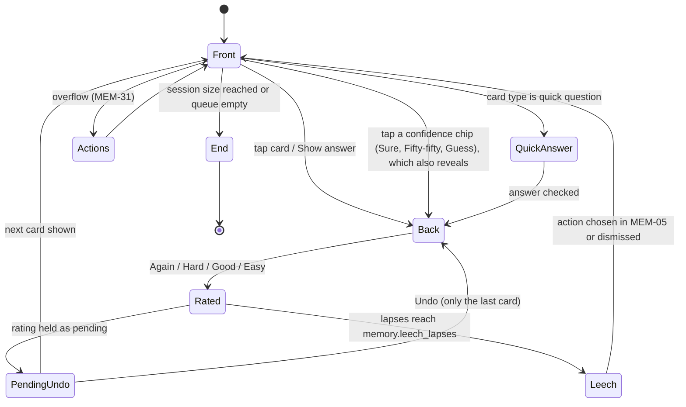
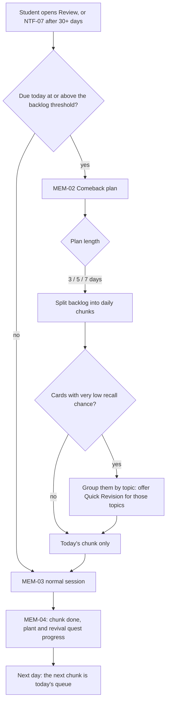
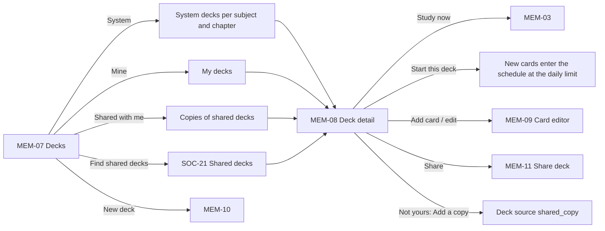
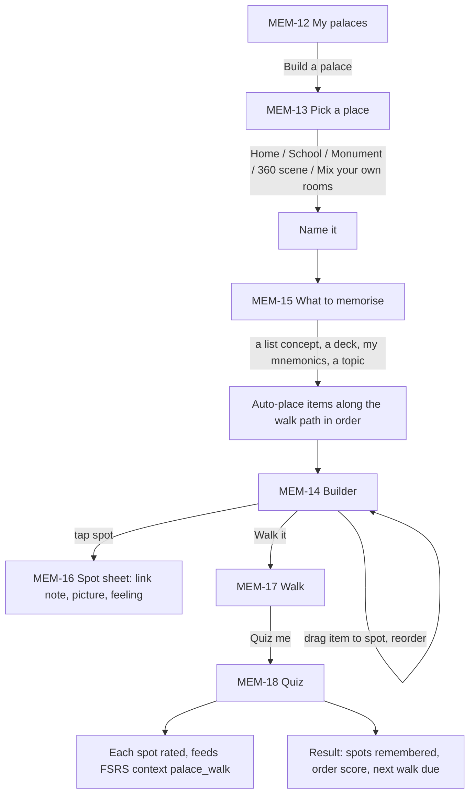
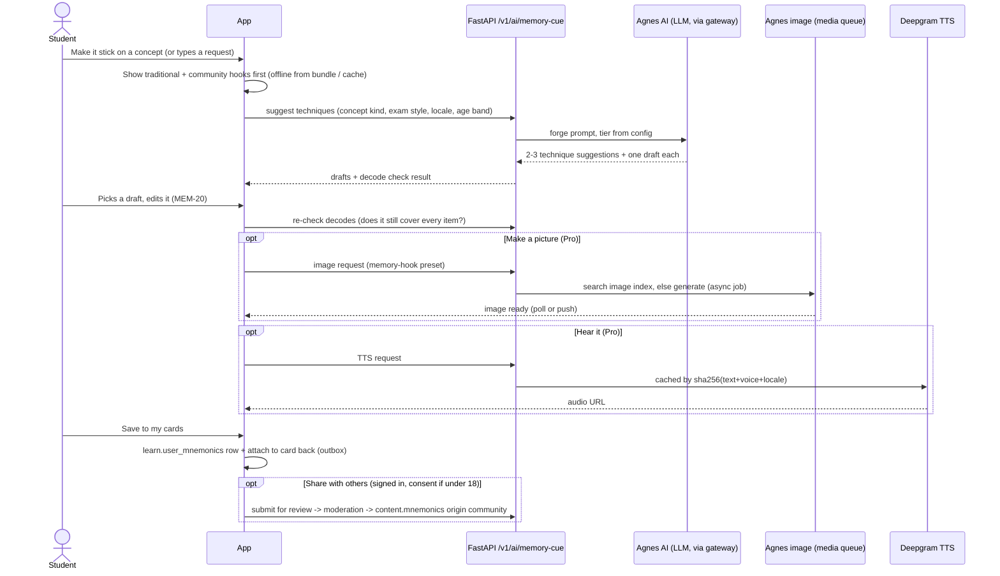
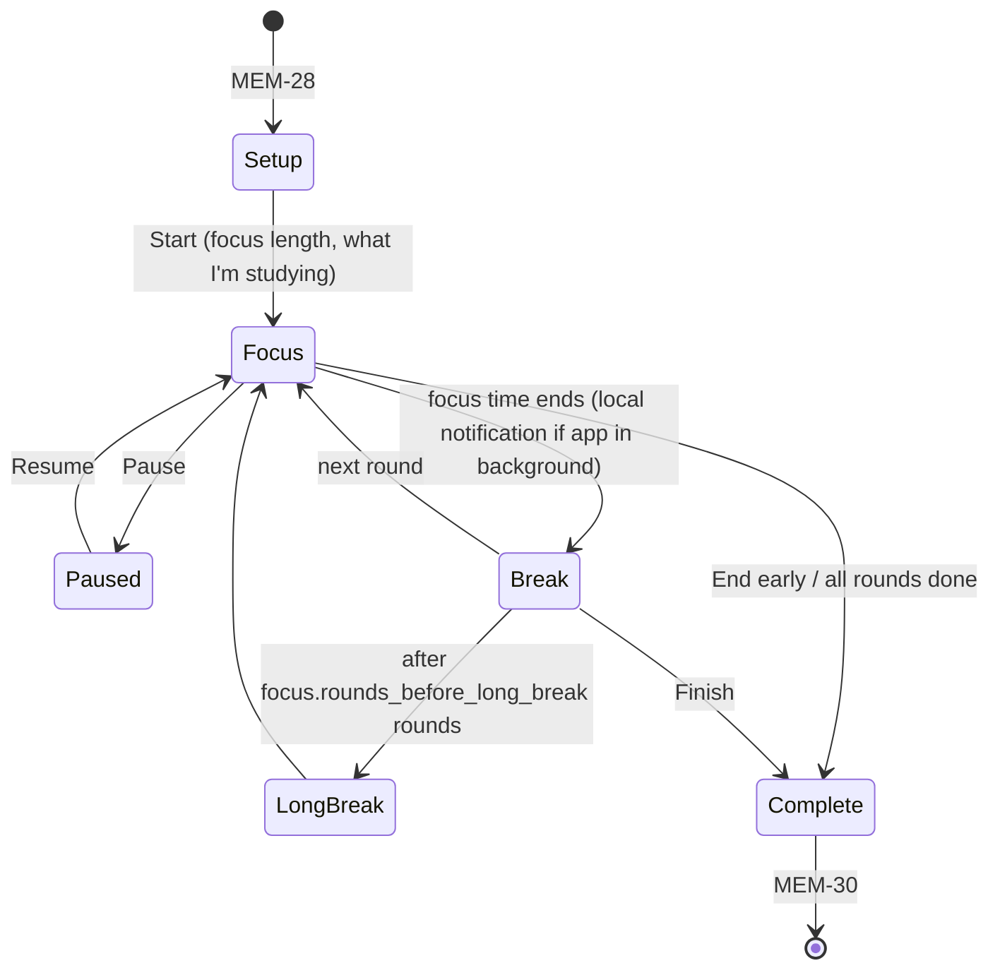
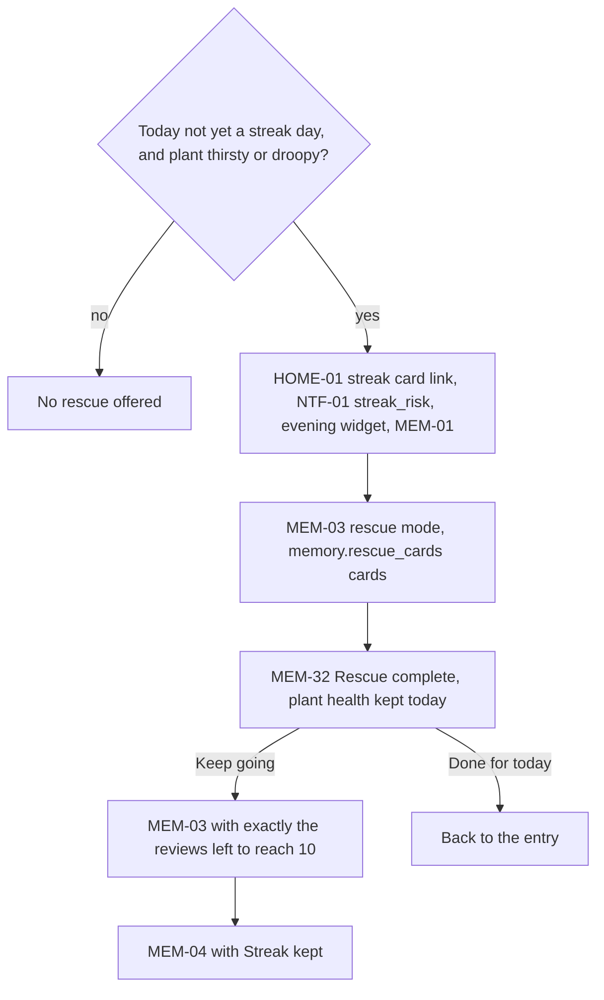
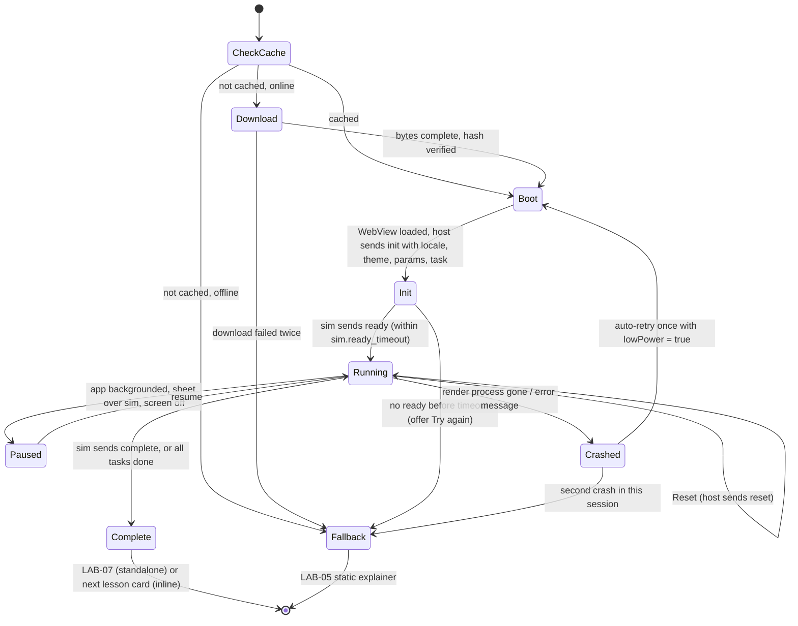

# Memory and Labs: flows

Status: Draft v0.2 (revision 1), 29 Oct 2026. Owner of this file: the memory and labs area (screen prefixes **MEM** and **LAB**).

Read with `docs/PRD.md` §5.3, §5.4, §5.6, §11.1, `docs/APP_FLOW.md` §2 and §3.3, `docs/TRD.md` §3, §7.3, §9.4, §9.6, §15, `docs/DB_SCHEMA.md` §4.5, §4.6, §5.2, §5.4, §15, and `DESIGN.md` §5, §6, §7.3. Screen-by-screen layout, copy and states are in `docs/ux/memory-labs.md`.

This file describes logic, not study content. Wherever a fact, mnemonic, card face, lesson text, element property or experiment step would appear, it is a placeholder such as `{card_front}` or `{experiment_step}`. That content is produced by the skills in `skills/` (AGENTS.md rule 1).

---

## 1. Purpose

Two areas share this file because they share the same engineering worries: offline-first local state, heavy media on cheap phones, and graceful fallback.

- **Memory (MEM)** makes learning stick: the daily FSRS review queue, flashcard decks, memory palaces, the "Make it stick" mnemonic forge, community mnemonics, the technique library, audio hooks, emotion tags, the metacognitive dashboard and the focus timer (PRD §5.4, §5.6).
- **Labs (LAB)** lets students learn by doing: simulations through `sim-bridge`, 3D models, 360° scenes, the periodic table, fun home experiments, and two small tools (unit converter, constants table) that PRD §5.6 lists but APP_FLOW §2 does not place (PRD §5.2, §5.3, TRD §7.3).

Design goals that drive every decision below:
1. **Never a wall.** A student who comes back after a break sees a plan, not "214 cards due".
2. **Offline first.** Reviews, decks, palaces and cached labs work with no network (PRD §16.2).
3. **Fast on a ₹10,000 phone.** One heavy surface at a time, low-detail assets first, a static fallback for anything that can fail (PRD §16.1, DESIGN §1.5).
4. **Real data only.** Every number shown to a student (intervals, accuracy, "sure and wrong 12 times") comes from their own events. Below a minimum sample we say "not enough answers yet" instead of showing a guess.

## 2. Screen index

| ID | Screen | Phase (IMPLEMENTATION_PLAN) | Tier |
|---|---|---|---|
| MEM-01 | Memory hub | 1 (M-3) | Free |
| MEM-02 | Comeback plan | 0 (F-8) | Free |
| MEM-03 | Review session (modes: normal, quick, rescue, topic, comeback, cram, palace, sleep) | 0 (F-8) | Free (sleep review mode is Pro, adults only, Phase 2) |
| MEM-04 | Review session complete | 0 (F-8) | Free |
| MEM-05 | Leech sheet ("This card keeps slipping") | 1 | Free |
| MEM-06 | Review settings | 1 | Free |
| MEM-07 | Decks | 1 | Free |
| MEM-08 | Deck detail | 1 | Free |
| MEM-09 | Card editor | 1 | Free |
| MEM-10 | New or edit deck sheet | 1 | Free |
| MEM-11 | Share deck sheet | 2 (G-4) | Free, signed in (under-18s need guardian consent) |
| MEM-12 | My palaces | 2 (G-6) | Pro |
| MEM-13 | Palace template picker | 2 (G-6) | Pro |
| MEM-14 | Palace builder | 2 (G-6) | Pro |
| MEM-15 | "What to memorise" picker sheet | 2 (G-6) | Pro |
| MEM-16 | Spot (locus) sheet | 2 (G-6) | Pro |
| MEM-17 | Palace walk | 2 (G-6) | Pro (system palace walks free) |
| MEM-18 | Palace quiz | 2 (G-6) | Pro |
| MEM-19 | Make it stick (mnemonic forge) | 1 (M-3) | Pro (community tab free) |
| MEM-20 | Mnemonic editor | 1 (M-3) | Pro |
| MEM-21 | Community mnemonics | 1 (M-3) | Free |
| MEM-22 | Technique library | 1 (M-3) | Free |
| MEM-23 | Technique detail | 1 (M-3) | Free |
| MEM-24 | Audio hooks player | 2 (G-7) | Pro |
| MEM-25 | Metacognitive dashboard | 2 (G-8) | Free (R19) |
| MEM-26 | "Sure but wrong" list | 2 (G-8) | Free |
| MEM-27 | Emotion tag sheet | 1 | Free |
| MEM-28 | Focus timer setup | 1 (M-8) | Free |
| MEM-29 | Focus session (focus and break) | 1 (M-8) | Free |
| MEM-30 | Focus session complete | 1 (M-8) | Free |
| MEM-31 | Card actions sheet | 0 (F-8) | Free |
| MEM-32 | 2-minute rescue complete | 1 (M-3) | Free |
| LAB-01 | Labs hub | 1 (M-4) | Free |
| LAB-02 | Lab list (see all, filtered) | 1 (M-4) | Free |
| LAB-03 | Lab detail (before launch) | 1 (M-4) | Free |
| LAB-04 | Sim player | 1 (M-4) | Free |
| LAB-05 | Lab fallback explainer | 1 (M-4) | Free |
| LAB-06 | Readings sheet | 1 (M-4) | Free |
| LAB-07 | Lab complete | 1 (M-4) | Free |
| LAB-08 | 3D viewer | 1 (M-4) | Free |
| LAB-09 | Part sheet (3D pin) | 1 (M-4) | Free |
| LAB-10 | 360° viewer | 1 (M-4) | Free |
| LAB-11 | Hotspot sheet | 1 (M-4) | Free |
| LAB-12 | View comfort sheet | 1 (M-4) | Free |
| LAB-13 | Periodic table | 1 (M-4) | Free |
| LAB-14 | Element sheet | 1 (M-4) | Free |
| LAB-15 | Fun experiments | 1 (M-4) | Free |
| LAB-16 | Experiment detail | 1 (M-4) | Free |
| LAB-17 | Safety check sheet | 1 (M-4) | Free |
| LAB-18 | Lab info and credits sheet | 1 (M-4) | Free |
| LAB-19 | Unit converter | 2 | Free |
| LAB-20 | Constants table | 2 | Free |

**Labs are free (R19, revised).** PRD §11.1 does not make labs Pro, so every lab in the Labs hub, the periodic table, experiments and tools are free, with no Pro chips. A lab card inside a locked Deep Dive lesson is still reachable from LAB-01. Only offline downloads (pinning) are Pro, because PRD §11.1 makes offline downloads a Pro tool; free students still get labs cached automatically when they use them.

**Phase notes (R8).** Screens marked 2 are Phase 2. Inside Phase 1 screens, these parts are later: sleep review mode (Phase 2), the little-learner (class 1–5) states and the parent controls they need (Phase 3), the Android Live Activity and iOS Screen Time options (later, §5.12). Each screen block in the UX doc repeats its phase in its Purpose line when it is not Phase 1.

## 3. Where these screens live

APP_FLOW §1 fixes five tabs as the target (Learn, Labs, Practice, Friends, Me); Phase 1 ships four, without Friends, which arrives in Phase 2 (R46). Labs is a tab. Memory is **not** a tab (R17): it is reached from the Review/Memory row on HOME-01, "My memory" on ME-01, lessons, notifications, widgets and HOME-05 search. Little learners get three tabs (Learn, Labs, Me, R14) and reach picture cards from HOME-06.

```mermaid
flowchart TD
  subgraph Learn[Learn tab]
    HOME[HOME-01 Home] -->|Review row| MEM03[MEM-03 Review session]
    HOME -->|Review row, big backlog| MEM02[MEM-02 Comeback plan]
    HOME -->|Memory row, see all| MEM01[MEM-01 Memory hub]
    HOME -->|Streak card, 2-minute rescue| RESC[MEM-03 rescue mode]
    RESC --> MEM32[MEM-32 Rescue complete]
    LES[LES-01 Lesson player] -->|LES-01.15 Make my own, concept preselected| MEM19[MEM-19 Make it stick]
    LES -->|LES-01.7 Expand, same WebView| LAB04[LAB-04 Sim player]
    LES -->|LES-01.8 labels| LAB08[LAB-08 3D viewer]
    LES -->|LES-01.9 hotspots| LAB10[LAB-10 360 viewer]
    LES10[LES-10 Rapid cards] -.->|same scheduler, context lesson| SCHED[(FSRS schedule)]
  end
  subgraph Me[Me tab]
    ME[ME-01 Me] -->|My memory| MEM01
  end
  subgraph Labs[Labs tab]
    LAB01[LAB-01 Labs hub] --> LAB03[LAB-03 Lab detail]
    LAB03 --> LAB04
    LAB03 --> LAB08
    LAB03 --> LAB10
    LAB01 --> LAB13[LAB-13 Periodic table] --> LAB14[LAB-14 Element sheet]
    LAB01 --> LAB15[LAB-15 Fun experiments] --> LAB16[LAB-16 Experiment detail]
    LAB01 --> LAB02[LAB-02 Lab list]
  end
  MEM01 --> MEM03
  MEM01 --> MEM07[MEM-07 Decks] --> MEM08[MEM-08 Deck detail]
  MEM01 --> MEM12[MEM-12 My palaces]
  MEM01 --> MEM22[MEM-22 Technique library]
  MEM01 --> MEM24[MEM-24 Audio hooks]
  MEM01 --> MEM25[MEM-25 Metacognitive dashboard]
  MEM01 --> MEM28[MEM-28 Focus timer]
  MEM03 -.-> SCHED
  NTF((NTF-01 push and NTF-08/09 widgets)) -.->|review_due, weak_area, sleep_review| MEM03
  NTF -.->|streak_risk, set=rescue| RESC
  NTF07[NTF-07 Welcome back] -.->|30+ days away| MEM02
  AI04[AI-04 Save as flashcard] -.->|Edit| MEM09[MEM-09 Card editor]
  AI04 -.->|View deck| MEM08
  SOC21[SOC-21 Shared decks] -.->|open a deck| MEM08
  MEM08 -->|Share| MEM11[MEM-11 Share deck]
  MOCK19[MOCK-19 Mock report] -.->|Fix next, cards_queued| SCHED
  MOCK21[MOCK-21 Confidence analysis] -.-> MEM25
```



**Change needed in other areas (summary, details in §13):** HOME-01 has the Review/Memory row and the streak card's rescue link (learn agent), ME-01 has a "My memory" row (me+money agent), and LES-01.7 to LES-01.9 hand off to the lab viewers through one contract (§6.9, learn agent).

## 4. Entry points

| Entry | Lands on | Notes |
|---|---|---|
| HOME-01 Review/Memory row, or hero kind `review` | MEM-03, or MEM-02 when the backlog rule (§5.2) fires | Shows today's capped count ("20 today · 5 min"), never the raw backlog (R22). |
| HOME-01 streak card, plant thirsty or droopy: "2-minute rescue" link | MEM-03 in rescue mode, ending on MEM-32 | §5.13. |
| HOME-01 Memory row "See all", ME-01 "My memory" row | MEM-01 | R17. |
| HOME-06 Little learner Home, picture cards | MEM-03 in little-learner mode | Phase 3. |
| Deep link `smriti.app/review` (APP_FLOW §4) | MEM-03 | Parameters match NTF-01: `?set=quick`, `?set=rescue`, `?set=bedtime` (adults only), `?topic={topic_id}`. |
| NTF-01 `review_due` | MEM-03 | Deep link `/review`. |
| NTF-01 `streak_risk` (the streak saver) | MEM-03 in rescue mode when at least one card is due or near due, else HOME-01 | Requested deep link `/review?set=rescue` (§13, NTF). |
| NTF-08 small widget, NTF-09 medium widget | MEM-03 quick mode; in the evening, rescue mode ("2 min keeps your plant happy", A42) | Me-money owns the widgets. |
| NTF-01 `sleep_review` (local) | MEM-03 in sleep mode | Pro, Phase 2, adults only (R34, X17). |
| NTF-01 `weak_area` | MEM-03 in topic mode | Deep link `/review?topic={topic_id}`. Minors get it only inside their chosen reminder time (R34). |
| NTF-07 Welcome back (30+ days away) | MEM-02 | §5.2 (A44, R22). |
| LES-01.15 memory hook card [Make my own] | MEM-19 with the card's concept preselected | Returns to the same card on close. |
| LES-01.15 [Add to deck] | Toast; the concept's system cards start | No screen. |
| LES-10 Rapid cards | Stays in LES-10 | Ratings go to the same FSRS scheduler with `context = 'lesson'` (§5.1). |
| LES-08 Lesson complete | A "{n} cards added to your reviews" line | Owned by learn; we supply the count. |
| AI-04 Save as flashcard | Quick-saves to the "From the tutor" deck; Toast [Edit] opens MEM-09 pre-filled, [View deck] opens MEM-08 | MEM-09 returns to AI-02 on save. |
| AI-02 `forge_mnemonic` result card [Open in Make it stick] | MEM-19 with the drafts already shown | Draft format in §5.7. |
| LRN-13 Cornell notepad "Turn into flashcards" | MEM-08 of the new deck | Deck `source = 'note'`. |
| LRN-12 Video lesson "Flashcards from this video" | MEM-08 | Deck `source = 'transcript'`. |
| SOC-21 Shared decks, a deck row | MEM-08 in "not yours yet" state | |
| Share link `smriti.app/deck/{code}` | MEM-08 in "not yours yet" state; ENT-06 when the app isn't installed | Gap G18. |
| PRC-05 and MOCK-22 "Add to my cards" | Toast; a quick question card joins the queue | §5.14. |
| MOCK-19 "Fix next" (and the practice summary "add cards to reviews") | Toast; cards queued for today | §5.14. |
| MOCK-21 and PRC-14 confidence links | MEM-25, MEM-26 | |
| Labs tab | LAB-01 | |
| LES-01.7 sim, LES-01.8 3D, LES-01.9 360° cards | Inline shell inside LES-01; [Expand] opens LAB-04, LAB-08 or LAB-10 | Contract in §6.9. |
| LRN-02 chapter, LRN-03 topic card, LAB-14 links | LAB-03 | |
| HOME-05 Global search | Any MEM or LAB item by title | |
| Technique detail [Try it] | MEM-19, MEM-14, MEM-07 or MEM-28 | Depends on the technique. |

---

## 5. Memory flows

### 5.1 The daily review queue

**What a "card" is.** `card_ref` is `c:{content_card_id}` for system cards (shipped in bundles) or `u:{uuid}` for the student's own cards (DB_SCHEMA §5.2). A card enters the student's schedule (`srs_cards`) when:
- the student completes the lesson that teaches its concept (system cards for that concept are created in state `learning`, first due by FSRS),
- the student taps [Add to deck] on a memory-hook card or [Start this deck] on a system deck (MEM-08),
- the student creates or copies a card (MEM-09, a shared-deck copy from MEM-08, AI-04 tutor save, LRN-13 note or LRN-12 transcript),
- the student taps "Add to my cards" on a practice or mock question (PRC-05, MOCK-22), which makes a quick question card `q:{question_id}` (§5.14),
- MOCK-19 "Fix next" queues the cards of its concepts (§5.14),
- the student rates a card in LES-10 Rapid cards (context `lesson`).

**Building today's queue** (runs in `app-core` on the device, offline, from `srs_cards` and `cards_index`):
1. Take every card with `due_at <= end of today` (profile timezone) that is not suspended and not buried.
2. Drop cards whose bundle is not on the device and cannot be fetched now (offline). Count them as "needs internet".
3. If the backlog rule fires (§5.2), switch to the comeback plan.
4. Add new cards from decks the student started, up to `memory.new_cards_per_day` (flag) minus new cards already introduced today. New cards are held back completely while a comeback plan is active.
5. **Order:** learning and relearning cards whose short step is due first (they decay fastest), then review cards by lowest retrievability first, then new cards. Then interleave: no two cards from the same topic back to back when the queue allows it, and siblings (a card and its reverse) never on the same day (the later one is buried until tomorrow).
6. **Cap:** a session is `memory.session_size` cards (student setting, default 20, choices 10 / 20 / 40 / All). The daily total is capped at `memory.daily_review_cap`. Remaining due cards stay due and roll over. The Home card shows today's capped count.

**One card, step by step (MEM-03):**



- **Confidence is optional and costs no extra tap.** The front shows [Show answer] plus three small chips (Sure, 50:50, Guess). Tapping a chip records the confidence and flips the card. Plain [Show answer] records no confidence. This feeds `srs_reviews.confidence` and the metacognitive dashboard (§5.10). Students can hide the chips in MEM-06.
- **Intervals on buttons.** `ts-fsrs` computes the next interval for all four ratings before the back is shown. Each rating button shows its interval ("10 min", "3 d", "2 mo"). Values come from the scheduler with fuzz applied, never hard-coded.
- **Labels.** The buttons say Again, Hard, Good, Easy (R18, DESIGN §5). They map to ratings 1–4 (`srs_reviews.rating`). PRD §5.4 now uses the same labels (consistency pass). Confidence chips say Sure, 50:50, Guess everywhere (R21).
- **Undo.** The last rating is held in memory as "pending" and written to the outbox when the next card is rated, when the session ends, or when the app goes to the background. Undo simply drops the pending rating, so no compensating event is needed. Only one step of undo exists.
- **Quick question cards** (a lesson check question re-used as a review card): wrong answer means rating Again automatically, with [I misread it] to change it; right answer shows only Hard, Good and Easy.
- **Committing a rating** (when the pending rating is flushed, see Undo) writes `review_rated` to the outbox in the same SQLite transaction as the local `srs_cards` update (DB_SCHEMA §15). The next card's intervals are computed from the pending state, so the student never waits. The server recomputes the schedule from events and its result wins on conflict (TRD §3.2).
- **Streak.** 10 reviews in a day is a qualifying activity (R1, PRD §7; flag `streak.reviews_to_qualify`). Every `review_rated` of the local day counts, whatever its context (review, lesson including LES-10, sleep_review, palace_walk), across sessions and devices. Free practice (cram) does not count. Until today qualifies by any activity (a lesson, a mock section, the daily challenge, R23, or these reviews), MEM-03 and MEM-04 show a streak chip: "{n} more reviews to keep your streak" with the Phosphor `Plant` icon (R28). The count comes from app-core `streakProgress()` (local events plus the last synced `activity_days`). When the 10th review is rated, the plant waters and the pet reacts inline (a small toast with the plant, not a full screen), and the chip turns into "Streak kept".
- **Calm screen.** No Pro upsell, paywall card or shop prompt inside MEM-03, MEM-04 or MEM-32 (R15, X8). No floating tutor button: the card back has one "Ask about this card" link that opens AI-02 with the card as context (agreed with tutor-social). Text the student typed on their own cards goes to the tutor only through that tap.
- **Exit.** [✕] closes immediately. Nothing is lost because every rating is already saved. A toast says "Saved. {n} cards left for later." There is no exit confirmation in reviews (unlike lessons), because there is nothing to lose.

**Card types in one mixed queue** (rendered by MEM-03; fields come from the flashcard schema requested in §12):

| Type | Front | Back | Rating |
|---|---|---|---|
| Basic | `{card_front}` text, optional image | `{card_back}`, optional image, mnemonic chip | 4 buttons |
| Reverse | The back of a basic card | Its front | 4 buttons, sibling-buried |
| Cloze | `{cloze_text}` with one gap shown as a blank chip | The gap filled, highlighted in subject tint | 4 buttons |
| Formula | Formula name or a symbol to explain | KaTeX SVG in a Formula box (DESIGN §5) | 4 buttons |
| Diagram label | An Agnes `sunny-diagram` with one label anchor shown as "?" | The label revealed at its anchor | 4 buttons |
| Quick question | `{question_stem}` with options (lesson check questions, or `q:` cards from practice and mocks) | Explanation link | Auto Again on wrong, else 3 buttons |
| List in chunks | `{list_name}` and how many items | Items revealed one chunk (3–5) at a time, per PRD §5.4 chunking | 4 buttons, rated as a whole |
| Audio | A play button, the audio hook plays | `{card_back}` and transcript | 4 buttons |
| Mnemonic | `{mnemonic_text}` | What it decodes to (`decodes_to`) | 4 buttons |
| Palace spot | The room image with one spot glowing | The item stored there | 4 buttons, `context = 'palace_walk'` |

**Little learner mode** (class 1–5, managed account, Phase 3): only Basic, Audio and picture cards; two big buttons "Got it" (rating Good) and "Not yet" (rating Again); session size 5; audio plays automatically; the pet reads the card aloud. No confidence chips, no intervals shown.

**Free practice (cram).** From a deck (MEM-08) the student can run "Practise without scheduling". It uses the MEM-03 layout with the intervals hidden and the rating buttons replaced by "Knew it" and "Didn't". It does not write `srs_reviews` and does not change the schedule. It sends only a product analytics event. This needs no schema change.

### 5.2 Coming back after a break: the comeback plan

The rule: show a plan, never a wall.



- **Backlog threshold.** The plan opens when today's due count is at least `max(memory.comeback.min_due, 3 × the student's median daily reviews over their last 14 active days)`. With no history yet, only `memory.comeback.min_due` applies.
- **Daily chunk.** The cards that fit the student's daily goal minutes at their own median seconds per card (from `srs_reviews.duration_ms`). With fewer than 50 timed reviews we use `memory.default_seconds_per_card`. The chunk is never below `memory.session_size`.
- **Plan length** defaults to the smallest of 3, 5 or 7 days that keeps the daily chunk inside the goal. The student can pick another length.
- **Order inside the plan:** concepts marked `priority: core` in the student's exam map first, then by retrievability, highest first ("save the ones you still nearly remember"). FSRS rewards a successful overdue review with a large stability gain, so this order rescues the most memory per minute.
- **Very low recall cards** (retrievability below `memory.comeback.relearn_below`) are not shown one by one. They are grouped by topic and offered as "Relearn with Quick Revision" (LRN-07 Quick revision sheet, always free, R9), which is faster than failing 30 cards in a row. After the revision sheet, those cards are reset to `relearning` and come back in the next chunks.
- **Hidden backlog (R22).** HOME-01 and MEM-03 show only today's capped chunk. MEM-02 shows the total once, in a calm way, with the plan.
- **After 30+ days away (A44).** NTF-07 Welcome back opens first (pet wakes, revival quest ME-08). Its review action opens MEM-02. The first session of the plan is short: `memory.comeback.first_session` cards (flag, 10), taken from `priority: core` concepts with the best chance of recall. Research A44 suggests "the 10 most-forgotten cards"; we do not do that, because ten Agains in a row after a long gap feels like failure, and FSRS gains most from successful overdue reviews. The most faded cards go to LRN-07 instead (§14 Q15).
- **Plant and pet.** Each finished daily chunk is a qualifying day (it is at least 10 reviews, R1), so it counts toward the plant's revival (R12, APP_FLOW §3.6). The short first session after 30+ days counts the same way when it reaches 10. MEM-02 shows the revival progress ("2 of 3 days to wake your plant").
- **New cards** stay paused until the backlog is below the threshold.
- **Opt out.** "Just review normally" runs the normal capped queue. The plan can be ended any time from MEM-06.
- **Storage.** The plan (start day, length, card order snapshot) lives on the device in `session_state` and is mirrored as a `comeback_plan_started` event so a second device shows the same plan. The plan is advice: the server does not enforce it.

### 5.3 Leeches

A **leech** is a card the student keeps forgetting.
- A card becomes a leech when `srs_cards.lapses` reaches `memory.leech_lapses` (flag), and again at every further multiple of half that number.
- On that rating MEM-05 slides up after the back is shown (not instead of it). Options:
  1. **Make it stick:** opens MEM-19 for that card's concept (Pro; free users see community mnemonics there).
  2. **See the lesson part:** opens LES-01 at the card that teaches the concept, then returns.
  3. **Edit this card:** only for the student's own cards (MEM-09). Tip: "Split it into two smaller cards".
  4. **Pause it for now:** sets `suspended = true`. It appears in MEM-08 under "Paused" and can be resumed.
  5. **Keep going:** dismisses.
- We never auto-suspend. A "Tricky card" chip (Phosphor `Lightning`, `warningTint`) marks leeches in deck lists. We avoid words like "leech" or "bad card" in the UI.
- Leech status is derived from `lapses`, so no new column is strictly needed. Showing "you dismissed this already" needs a per-card flag: see §12 gap G5.

### 5.4 Special sessions

| Session | Trigger | Queue | Differences |
|---|---|---|---|
| Quick review | NTF-08 and NTF-09 widgets (morning and day), `/review?set=quick` | Up to 5 due cards, lowest retrievability first | Ends with a one-line result, then back to where the student came from |
| 2-minute rescue | HOME-01 streak card link, NTF-01 `streak_risk`, evening widget, MEM-01 (§5.13) | `memory.rescue_cards` due cards | Ends on MEM-32. Keeps plant health, no streak credit by itself |
| Sleep review (Pro, Phase 2, adults only) | NTF-01 `sleep_review` local notification about 20 min before the estimated bedtime (TRD §9.6), opt-in in MEM-06 and `notify.prefs.sleep_review` | The 5 hardest due cards (highest difficulty among due), or 5 hardest recently reviewed if none are due | Night Colour theme unless the student turned that off, no sounds, gentle haptics only, `context = 'sleep_review'`, the pet says goodnight at the end. The bedtime is inferred from behaviour, so it is never offered to under-18s (R34, X17, DPDP s.9(3)). Minors can instead set a fixed "Bedtime review" time in MEM-06, which is an ordinary reminder at a time they chose |
| Topic review | NTF-01 `weak_area`, LRN-03 topic card "Review this topic" | Due cards of one topic plus cards predicted to fall below target in the next 3 days | Header shows the topic name and subject colour |
| Palace quiz | MEM-18 | Spots of one palace in walk order | `context = 'palace_walk'` |
| Free practice | MEM-08 | Any cards of one deck | No schedule change (§5.1) |

### 5.5 Decks and cards



- **System decks** are generated from published content: one per chapter, grouped by subject, filtered by the app variant's exam profile and the student's depth. A system deck lists all its cards, with each card's state: not started, learning, due, known, paused. The cards a student already studies through lessons show as started. "Start this deck" lets fact-heavy learners (UPSC, SSC) study cards before or without the lesson; new cards then enter at `memory.new_cards_per_day`.
- **My decks** are `learn.decks` rows with `owner_user_id = me` and `source` in `user`, `note`, `transcript`, `tutor`. "From the tutor" (AI-04's default deck name) is created on the first tutor save. A built-in "From practice" list in MEM-07 shows the student's `q:` cards (§5.14); it is a view over `srs_cards`, not a `learn.decks` row.
- **Shared decks** (Phase 2): a deck owner creates a `share_code` in MEM-11 after a moderation check of the cards. For minors the link opens only for their friends (R31). Anyone allowed opens MEM-08 in "not yours yet" state with a preview of up to 10 cards, a Helpful toggle and [Add a copy]. No author name is shown to other students, for anyone: "Shared by a friend" or "Shared by a student" (R20). A copy is a snapshot (`source = 'shared_copy'`): later edits by the owner do not flow to copies in Phase 2. Browsing friends' shared decks is SOC-21, which opens MEM-08. Deck reports go to SOC-23 (R39).
- **Card editor (MEM-09)** creates `learn.cards` rows with a client UUIDv7, offline. Card kinds for student cards: Basic, Basic and reverse, Cloze. Optional image: pick from approved images in the image index (search by words), or, for adult accounts, attach a photo (uploaded through a signed R2 URL, private, re-encoded and scanned, TRD §5). Optional concept link (search the syllabus graph) so the card counts toward mastery.
- **Delete** is soft (`deleted_at`), with Undo in a toast for 4 s.
- **Guests** can create decks and cards. They live under the anonymous user id and sync like any other data (TRD §6). Sharing needs sign-in (AUTH-02 hard login), and under-18s need guardian consent with the `community` scope first (AUTH-18 to AUTH-23).
- **Text the student types** (card faces, deck names) is never sent in analytics events (AGENTS.md rule 6).

### 5.6 Memory palace

PRD §5.4.5: build rooms, drag facts into them, review by walking through. Illustrated rooms first, 360° rooms later (IMPLEMENTATION_PLAN G-6).



- **Templates** are content, not code: each template is a set of rooms, each room an Agnes `sunny-scene` image with 5 to 10 predefined spots (`pos {x, y}` as fractions) in walk order. 360° templates use a `pano-360` scene with spots at `{yaw, pitch}`. A template content format is needed (§12 gap G3). Extra room packs can be bought with gems (`game.shop_items.kind = 'palace_room'`, sold in ME-17 Shop).
- **"Mix your own rooms"** (`template = 'custom'`) lets the student string together rooms from the template library in their own order and name them after their real rooms ("my bedroom"). Students do not upload photos of their homes in Phase 2 (privacy, especially for minors; §14 Q6).
- **What to memorise (MEM-15):** the best source is a concept of kind `list` or `date` from the syllabus graph, or a mnemonic with `technique = 'palace'` written by `mnemonic-maker`. The student can also pick cards from a deck, or their own mnemonics. Items keep their `item_ref` (card_ref, concept id or mnemonic id).
- **Auto-place** puts items in order along the walk path, one item per spot, and adds rooms when items outnumber spots. The student drags to change. Long lists warn above 30 items ("Long palaces are hard to walk. Split it?").
- **Spot sheet (MEM-16):** the item, the student's own link note ("what's happening here"), an optional picture (Agnes `memory-hook`, generated through the forge, Pro), and an emotion tag (MEM-27). The forge can suggest a vivid link for a spot.
- **Walk (MEM-17):** room by room, spot by spot, in order. Each spot glows, then reveals its item and link note. Audio can read each item (Deepgram cache). Swipe or [Next spot].
- **Quiz (MEM-18):** two modes. "What's here?": each spot glows with the item hidden; the student recalls, reveals and rates (Again to Easy). "Put them back": items shuffle into a tray and the student drags each to its spot; the order score is the share placed right.
- **Scheduling:** each palace spot is a review card of type "Palace spot" (§5.1) linked to its `item_ref`. Rating a spot in a quiz updates that item's schedule with `context = 'palace_walk'`. A palace as a whole shows "next walk due" = the earliest due spot.
- **Offline:** palaces are fully local (`palaces`, `palace_rooms`, `palace_loci` on the device, DB_SCHEMA §15). Room images are pinned in the asset cache while a palace uses them.
- **Free users:** can walk system palace mnemonics that appear in lessons (MEM-17 in read-only mode). Building, editing and quizzing own palaces is Pro (PRD §11.1).

### 5.7 Make it stick: the mnemonic forge, and community mnemonics



- **Inputs** are always anchored to a concept, card or highlighted fact, or to a typed request ("Create a memory hook for {fact}"). From LES-01.15 the forge opens with that card's concept preselected (`concept_id` and `source_card_id` passed in), and closing returns to the card. A typed request is matched to the syllabus graph first. If nothing matches and the student is under 13, the forge says it can only help with study topics (PRD §5.5 safety).
- **Technique suggestion** uses the concept's `kind` and the item count: lists and sets suggest acronym, story and palace; numbers and dates suggest major system and chunking; vocabulary and legal terms suggest keyword; three linked data points suggest PAO; rules suggest rhyme. The suggestions are chips the student can change.
- **Course-aware style:** the request carries the exam style from the student's primary exam (mnemonic-maker "Style by exam"). Class 1–5 gets rhymes and picture hooks only, and the forge is off for little learners unless a parent turns it on in SET-14 Parent dashboard (Phase 3, §14 Q8).
- **Decode check.** Every AI draft and every edit is checked against the concept's items (`decodes_to` of the source): "Covers 5 of 5 items, in order". A draft that fails is shown with the missing item named, and cannot be shared to the community until it passes. This protects AGENTS.md rule 3 (no invented facts) for AI output.
- **Saved where:** `learn.user_mnemonics` (origin `ai` or `user`) and attached to the card's back as a "Your hook" chip. If the concept has no card in the student's schedule yet, the student's cards for that concept are started.
- **Images and audio** are async. The image is a `memory-hook` preset request through the gateway's image interface: the image index is searched first, then Agnes runs in the worker's `media` queue (TRD §9.3, about 12 s or more). The forge shows a placeholder tile and keeps working; the image arrives later and is private to the student (`media_assets.visibility = 'private'`) unless the mnemonic is accepted into the community pool.
- **Limits.** Forge requests and images count against `ai.usage_daily` (tiers `cheap` or `tutor`, and `image`). Fair-use caps are flags.
- **Free users** see the community and traditional tabs and a locked "Make your own" panel with the PAY-01 entry (R9: a locked item opens to a useful sheet). Little learners never see a price: a parent passes PAY-03 Grown-up check first (R14). A one-time free taste is recommended (§14 Q2).
- **Draft format (shared with the tutor).** `POST /v1/ai/memory-cue` returns `drafts: ForgeDraft[]`, and the tutor's `forge_mnemonic` tool returns the same objects, so AI-02 can open MEM-19 with drafts already shown (no second call). One schema in `packages/content-schema` and the matching Pydantic model (gap G26):

```
ForgeDraft {
  draft_id        // client or server UUIDv7
  concept_id      // the anchor; card_ref instead when started from a student card
  source_card_id? // the LES-01.15 or review card it came from
  locale          // 'en' | 'hi'
  exam_style      // from the student's primary exam
  technique       // acronym | acrostic | story | rhyme | song | keyword | pao | major | peg | palace | chunks | picture
  text            // the hook, in the locale
  decode { covered, total, in_order, missing[] }  // missing = item indexes from decodes_to
  image_request?  // { preset: 'memory-hook', prompt_ref }, generated only when the student asks
  audio_ref?      // TTS cache key once made
  origin          // 'ai' | 'user'
}
```

  The tutor renders a draft as a result card with [Open in Make it stick]. Saving always happens in MEM-19 or MEM-20, so the decode check and the Pro rules apply in one place.
- **Offline:** traditional and community hooks for downloaded topics show from cache. Generating needs a connection; the forge says so and offers to save the request for later ("We'll make it when you're online").

**Community mnemonics (MEM-21):**
- Sources: published `content.mnemonics` with `origin` `traditional`, `system` or `community` for the concept and locale.
- Sort: Top (votes), New. A "Traditional" badge marks well-known ones, and "Checked" marks system ones reviewed by `content-qa`.
- **Votes:** one "Helpful" vote per signed-in user per mnemonic (toggle). No downvotes: unhelpful items fall in the ranking instead, and harmful ones are reported. Guests are asked to sign in (soft) to vote.
- **Report:** opens SET-24 Report content, the one shared report sheet (R39), with reasons Wrong, Confusing, Offensive or unkind, Spam, Other. A report hides the item for that student at once. Items with reports above `community.hide_after_reports` are hidden for everyone until a moderator looks.
- **Submit:** "Share with other students" on MEM-20. Needs sign-in (AUTH-02); under-18s need guardian consent (R20, fixed decision 5, AUTH-18 to AUTH-23), because publishing to the community is a social feature. Little learners cannot submit or see community items (they see traditional and system ones only). The submission runs the moderation pre-pass (`ai.moderation_flags`, `source_kind = 'user_mnemonic'`), the decode check, then a human review queue. Accepted items become `content.mnemonics` with `origin = 'community'`.
- **No author names** are shown on community mnemonics, for anyone ("Shared by a student", R20). Helpful votes only. This avoids exposing minors and keeps it about the hook. If a byline is ever added, it follows R31 (amended): the pet avatar and the auto-generated nickname, never a typed name or pet name.

### 5.8 Technique library

- Thirteen techniques from PRD §5.4 (acronym and acrostic, story linking, dual coding, keyword, chunking, PAO, major system, peg system, method of loci, elaborative interrogation, Feynman technique, Cornell notes, mind mapping) plus spaced repetition itself, which the library should explain first because the whole review system depends on it.
- Each technique detail (MEM-23) has: a short explainer (`{technique_explainer}`), a worked example for the student's exam (`{technique_example}`), "When to use it", and [Try it] which opens the matching tool:

| Technique | [Try it] opens |
|---|---|
| Spaced repetition | MEM-03 (or MEM-07 when nothing is due) |
| Acronym, acrostic, story, keyword, PAO, major system, peg, rhyme | MEM-19 with that technique pre-selected |
| Method of loci | MEM-13 (Pro) or a system palace walk (free) |
| Chunking | MEM-07 system deck with list cards |
| Dual coding | The current topic's explainer card in LES-01 |
| Elaborative interrogation | A "Why is this true?" review session (MEM-03 with "Why?" prompts on card backs) |
| Feynman technique | AI-10 Feynman: explain it |
| Cornell notes, mind mapping | LRN-13 Cornell notepad, LRN-14 Mind map viewer |

- The explainer and example texts are **content**, written through a skill (§12 gap G4 asks who owns them) and shipped in a `technique_library` bundle per locale, so the library works offline and is free (PRD §11.1).

### 5.9 Audio hooks

- Audio hooks are Deepgram TTS files for rhymes, lists and mnemonics, made by `audio-maker` for published mnemonics (shipped in bundles) and on demand for the student's own mnemonics (Pro, `POST /v1/ai/tts`, cached by `sha256(text + voice + locale + speed)`, TRD §9.4).
- MEM-24 plays a playlist: a topic's hooks, a deck's hooks, or "My hooks". Controls: play and pause, previous and next, speed (0.75×, 1×, 1.25×), repeat one, "Say it with me" (a pause after each line so the student repeats it aloud), and a transcript with the current line highlighted (captions are required, DESIGN §10).
- **Background play** on mobile (lock screen controls through `expo-audio`), because audio-first learners listen while commuting. Background play is Pro along with the player; system hooks inside lessons always play free in the lesson.
- **Offline:** hooks for downloaded topics are in the bundle media; others need the network. Pro students can download a playlist.
- **Accessibility:** this is also a screen-reader-first study mode (PRD §5.4.6): the whole player works with VoiceOver and TalkBack, and the transcript is selectable text.

### 5.10 Metacognitive dashboard

PRD §5.4.8: confidence heat map per topic, calibration score, the "illusion of knowing".

- **Data:** every answer and review with a confidence tag. Server side: `learn.concept_mastery` (`sure_total`, `sure_correct`, `fifty_*`, `guess_*`, `calibration`), and the `srs_reviews.confidence` and `question_attempts.confidence` history. Mock answers with confidence count too (`mock_answers.confidence`). For a review, "correct" means rating Hard, Good or Easy, and "wrong" means Again.
- **Minimum sample.** The dashboard shows nothing numeric until the student has `metacog.min_tagged` tagged answers in total, and a topic cell stays "Needs more answers" until it has `metacog.min_tagged_per_topic`. The empty state invites the student to tap Sure, 50:50 or Guess in their next practice.
- **What it shows:**
  1. **Headline facts**, each a real count from the student's own data: "You were sure and wrong {n} times this week", "{m} lucky guesses" (guess and right).
  2. **Calibration chart:** for each of Sure, 50:50 and Guess, a bar with the student's actual accuracy and the number of answers behind it. A reference mark on each bar shows where a well-calibrated learner would be (§14 Q5: the reference values are a learning-science decision for the owner; we recommend Sure about 90%, 50:50 about 50%, Guess about 25% as config, and we label them "target", not as a fact).
  3. **Confidence heat map:** one cell per topic, in four groups with an icon and a word each, never colour alone:
     - Know it and sure (sure and mostly right): `successTint`, icon `CheckCircle`.
     - Hidden strength (unsure but mostly right): `primaryTint`, icon `Sparkle`.
     - Illusion of knowing (sure but often wrong): `errorTint`, icon `WarningCircle`.
     - Known gap (unsure and often wrong): `warningTint`, icon `Question`.
  4. **Calibration score** per subject from `concept_mastery.calibration`, shown as a stat tile with a one-line meaning.
  5. **Next step:** "Practise your sure-but-wrong topics" opens MEM-26, then PRC-03 Drill setup prefilled with those concepts.
- **Range:** this week, last 30 days, all time. Filter by subject.
- **Links in:** MOCK-21 Concept and confidence analysis and the PRC-14 calibration card link here for the whole picture. The dashboard is free (R19).
- Computed on the server (`GET /v1/me/metacognition`, missing, §12) and cached in `profile_snapshot` for offline viewing of the last copy.

### 5.11 Emotion tagging

PRD §5.4.7 has it, so it ships (Phase 1, it is small).
- From a review card back, a lesson card overflow, or a palace spot: "Add a feeling" opens MEM-27.
- A preset grid of 12 emoji with a word each (for example "Funny", "Surprising", "Weird", "Proud"), an optional "This reminds me of…" private note, and [Save].
- Stored in `learn.emotion_tags` (one per item). The emoji shows as a small chip on the card back next time, which is the point: the feeling is a retrieval cue.
- The note is personal free text: it is stored owner-only (RLS), never in analytics, never in AI prompts unless the student opens the tutor on that card.
- Analytics carries only the emoji's preset id.

### 5.12 Focus timer

PRD §5.4.9: 25/5 by default, nudges to spread sessions, the pet naps during breaks.



- **Presets:** 15/3, 25/5 (default), 50/10, and Custom (focus 10–90 min, break 3–30 min). Rounds default 4 with a long break after them (flags, not facts).
- **What I'm studying** (optional): pick from today's plan or a subject. While a focus session runs, the student can open lessons and reviews from the timer screen; the timer keeps running as a slim bar at the top of the app.
- **Timing is timestamp-based** (`started_at`, planned `ends_at`), never a background loop, so it is exact after the app is killed or the phone sleeps. Ends are scheduled as local notifications ("Break time! {pet_name} is napping").
- **Leaving the app is fine.** Checking a formula elsewhere is normal studying. We do not punish leaving (no dead plant, no failed session). MEM-30 shows "You stepped away for {n} min" only if the student left for longer than `focus.away_note_after_min`.
- **Pet:** studies beside the timer during focus (Rive `think` state) and naps during breaks (`sleep` trigger), wakes at the end (`wake`). Reduced motion freezes it on static poses.
- **Counts:** finished focus rounds increment `learn.activity_days.focus_sessions`. A focus session alone is not a qualifying streak activity (PRD §7 lists lessons, 10 reviews or a mock section), so the timer cannot be left running to fake a streak. Minutes spent in lessons and reviews during focus count toward the daily goal as usual. No XP for the timer itself.
- **Spread nudge:** if the student runs more than `focus.cram_nudge_rounds` rounds in one sitting on the same subject, MEM-30 suggests a short session tomorrow instead ("Two short sessions beat one long one").

**What we can and cannot block, per platform:**

| Platform | Our own notifications | Other apps' notifications | How |
|---|---|---|---|
| Android | Held: local reminders are rescheduled to after the session; server pushes are held by the rules engine while `focus_until` is set | **Possible with permission.** Optional toggle "Silence notifications while I focus" asks for Do Not Disturb access (`ACCESS_NOTIFICATION_POLICY`, granted by the student in system settings). We switch the interruption filter to priority-only for the session and restore the previous filter at the end, on pause, and if the app is killed (restored on next launch). Needs a small native module through an Expo config plugin. | We never use accessibility services or usage-access permissions to block apps (Play policy risk, and too invasive for minors). |
| iOS | Held, same as Android | **Not possible for a normal app.** There is no public API to turn on Do Not Disturb or a Focus. We show a one-time tip: "Turn on Do Not Disturb in Control Centre", and a link to set up a Focus. Blocking apps needs Apple's Family Controls entitlement (Screen Time API); out of scope for Phase 1, noted as a later option. | A Live Activity with the countdown on the lock screen is a P2 nice-to-have (ActivityKit through `expo-apple-targets`). |
| Web | Held (web push suppressed while focus is active) | Not possible | The tab title shows the countdown. A notification at the end if permission was given. Timestamp-based, so background-tab timer throttling does not matter. |

- Keep screen awake: optional, off by default (battery on cheap phones).
- Focus timer defaults also show in SET-10 Study preferences, which links here.

### 5.13 The 2-minute rescue (A25, A26)

R1 makes 10 reviews a streak day. The rescue is a smaller step for a tired evening: a few cards that keep the plant from drooping, without pretending the streak day is done.



- **What it is:** MEM-03 in `rescue` mode with `memory.rescue_cards` cards (flag; research A26 suggests 5, owner decision, §14 Q14). Due cards first, lowest retrievability first. If fewer are due, the cards closest to being due fill the gap. With no cards at all, no rescue is offered and the streak card keeps its lesson action.
- **When it is offered:** today is not yet a streak day (R1, R23) and either the plant is thirsty (the HOME-01 streak card is in its at-risk state) or its health is droopy, dry or wilted (R2, R12). Not offered when the plant is dormant (the ME-08 revival quest takes over), during an active comeback plan (the plan's chunk is the action), or to little learners (their normal session is already 5 cards).
- **Entries:**
  1. HOME-01 streak card, at-risk or droopy state: a ghost link "2-minute rescue" under the line (learn owns the card).
  2. NTF-01 `streak_risk`, the streak saver: deep link `/review?set=rescue` when at least one card is due or near due, else `/home` (me-money owns the template).
  3. NTF-08 and NTF-09 widgets in the evening: "2 min keeps your plant happy", one tap to `/review?set=rescue` (A42).
  4. MEM-01 Today card: a secondary [2-minute rescue] in the same conditions.
- **Session:** MEM-03 with the header "2-minute rescue · {k} cards" and the streak chip. No upsell (R15). Ratings are normal `review_rated` events (context `review`), so they count toward the 10.
- **What it earns:**
  - **Plant health:** finishing it marks today as a *health day*, so the plant does not lose health tonight. A thirsty plant stays thriving. A droopy or drier plant stops getting worse, but a rescue is not a revival day: revival needs real study days (R12). This needs a rule change: TRD §10 counts health from "days since the last activity"; it must count days since the last health day (a streak day or a rescue day). The server marks a rescue day from a `rescue_completed` event (`activity_days.rescue_done`, gap G23).
  - **Streak:** none by itself. Today becomes a streak day only when the reviews reach `streak.reviews_to_qualify` (10) or another qualifying activity happens. Whether the streak survives a rescue-only day follows the normal rules (an equipped freeze, a rest day, R28).
  - No bonus XP or gems.
- **End screen (MEM-32):** "Plant watered!" and one honest line: "{n} more reviews keep your streak too." Primary [Keep going: {n} more] runs exactly the reviews left to reach 10, then MEM-04 shows "Streak kept". Secondary [Done for today]. If today already qualifies, MEM-32 says "Streak kept!" instead. If the streak would break tonight, the line says so plainly ("Your streak needs {n} more reviews before midnight"); if a freeze covers today it says "A streak freeze will cover today." No guilt words (DESIGN §11).
- **Guests** get the same. **Minors** get the same; the push and widget follow their chosen reminder time (R34).

### 5.14 Cards from practice and mocks

Practice and mocks feed the same queue in two ways. Both work offline through the outbox.

1. **"Add to my cards"** on PRC-05 and MOCK-22 makes one quick question card from that question: `card_ref = q:{question_id}` (new ref kind, gap G24). It renders as the Quick question type (§5.1) from the question bundle on the device and lists under "From practice" in MEM-07. Mock questions become cards only after the mock is submitted and its solutions are shown to the student (answer keys never ship before that). A `q:` card whose bundle is not on the device is skipped as "needs internet", like any card.
2. **"Fix next"** on MOCK-19 (and the practice summary's "add cards to reviews") calls app-core `queueCardsForConcepts(conceptIds, source)`:
   - system cards of those concepts that the student has not started are started now, outside `memory.new_cards_per_day`, up to `memory.queue_from_practice_max` (flag);
   - started cards of those concepts whose retrievability is below the student's target are moved into today's queue;
   - cards already due stay as they are; suspended cards stay suspended;
   - everything still respects `memory.daily_review_cap`; overflow rolls to tomorrow. During a comeback plan, the cards join the plan's next chunk instead (no wall, R22).
   - It writes one learning event `cards_queued {source, concept_ids[], card_refs[]}` (ids only, no text) in the same transaction as the local change, so the server applies the same change and other devices follow. Sources: `mock_report`, `practice_summary`, `solution`.
   - Online clients that are not offline-first (the web app's report page, the server's own jobs) can call `POST /v1/reviews/queue {concept_ids[], card_refs[], source}` with an `Idempotency-Key` header (AGENTS.md: mutations that touch progress take one). It returns the number of cards queued (gap G25).
   - A toast confirms: "{n} cards added to today's reviews" with [Review now], which opens MEM-03.

### 5.15 First-time pet demos (X19)

- The first time a student meets a new card type in MEM-03 (cloze, list in chunks, diagram label, audio, quick question, palace spot) or a new mode (rescue, sleep, cram, palace quiz, focus timer, forge), the pet shows a short demo of at most 10 seconds: two or three coach-mark steps over a sample card from the seed pack (`{demo_card_front}`, written by a skill like any content).
- A "?" icon in the top bar replays it at any time (`Question` icon, 48 × 48, label "How this works").
- Seen state is kept per device (MMKV `demo_seen.{feature}`). Reduced motion: the same steps as static text bubbles.
- Analytics: `pet_demo_shown {feature, replay}`.

---

## 6. Labs flows

### 6.1 Labs hub and the lab catalogue

- **Catalogue source:** labs are content items of kind `sim`, `model3d`, `pano360` and `experiment` (DB_SCHEMA §4.3), plus the periodic table and the two tools. The hub is built from a **labs index** shipped in the manifest per exam profile and locale (title, subject, chapter, kind, size, poster image, linked topic). This keeps the hub usable offline. The index does not exist yet (§12 gap G7).
- **Filtering by app variant:** the index is already filtered by the variant's exam profiles (TRD §3.1). Smriti JEE shows Physics, Chemistry and Maths labs; Smriti NEET shows Physics, Chemistry and Biology; UPSC shows 360° tours, monuments and maps; SSC may have few labs (§14 Q3).
- **Sections (LAB-01):** Continue (recently used, from local `lab_recent`), Featured (curated by config, UX_FLOW §4.9 names periodic table, virtual titration, circuit builder, optics bench, human body 3D as examples, but the actual list comes from `/config` and only lists published items), Tools (periodic table, fun experiments, unit converter, constants table), then By subject (subject colour sections), then By kind (sims, 3D, 360°). Filter chips: subject, kind, "Works offline".
- **No Pro marks:** every lab is free (R19, revised), so lab cards carry no Pro chip and LAB-03 has no locked state. A lab whose lesson sits in a locked Deep Dive still opens from the hub; its "Learn the topic" link then opens LRN-05 Pro preview, which is learn's gate, not ours. The only Pro action in Labs is [Download for offline] on LAB-03 (PRD §11.1 offline downloads), which opens PAY-01 for free students (PAY-03 first for little learners, R14).
- **Downloaded marks:** a "Works offline" chip when the item and its media are cached or pinned.

### 6.2 Sim lifecycle (LAB-04 and the inline card in lessons)

The same shell renders inline in a lesson card (LES-01.7 is learn's card, the shell is ours) and full screen in LAB-04. Inline and full screen share one WebView instance when expanding, so the sim keeps its state.



**Loading.**
1. The host knows the sim's size from `content.sims.size_bytes`. If it is not cached and the student is on mobile data, sims above `lab.confirm_download_mb` show the size and ask first ("This lab needs 1.8 MB. Download?"). Below that they load straight away.
2. Download to the asset cache (TRD §3.2), verify the content hash, then load the local copy into the WebView (mobile) or a sandboxed iframe (web). Progress shows real bytes.
3. The host sends `init`. The sim must answer `ready` within `sim.ready_timeout_ms` (flag; target start time 1.5 s on mid-range per TRD §7.3, a longer timeout on low-tier devices).
4. While loading: the lab's poster image (Agnes `sunny-object`), the lab title and the first task are shown, so the student can read while waiting.

**Running.**
- **Tasks checklist:** tasks come from the lesson card (`tasks[]`: prompt, expected measurement, tolerance, content-format §7) or the standalone lab's own task list. The current task is highlighted. A task is checked by either (a) the sim's `task_result` message, or (b) for sims that cannot send results (PhET HTML5 builds without PhET-iO), the host comparing the student's recorded reading with the expected value and tolerance. Correct: check mark and a short pet line. Wrong: "Not quite. Check {quantity} again." After two wrong tries the task's hint from content shows. Tasks never block forever: after the hint, [Skip task] appears.
- **Readings:** live values the sim reports in `state` messages show as Stat chips above the tasks (for example "{quantity}: {value} {unit}"). [Record reading] asks the sim for a measurement (a new `record` message, §12 gap G1) and adds a row to the readings table (LAB-06). For PhET-style sims, [Record reading] opens a small number entry with the unit fixed by the task.
- **Reset:** confirms only if readings exist ("Clear the lab? Your recorded readings stay."). Sends `reset`. Readings are kept unless the student clears them in LAB-06.
- **Expand to full screen and landscape:** [Expand] unlocks orientation (`expo-screen-orientation`). If the sim declares `preferredOrientation: landscape`, the shell suggests turning the phone with a small rotate hint, never forcing it. In landscape the tasks and readings move into a right-hand side panel that can collapse to a tab.
- **Low power:** on (and the student sees it is on) when the device is low tier (§6.3), the OS battery saver or iOS Low Power Mode is on (`expo-battery`), or the battery is below `lab.low_power_battery_pct`. Sent as `params.lowPower` in `init`; switching it while running sends `set_params` (new, §12 gap G1) or reloads the sim if the sim does not support live changes. The sim-builder budget for low power is 30 fps, fewer particles, no shadows.
- **Pause:** the host pauses the sim when the app goes to the background, when a sheet (tutor, readings) covers more than half of it, and when the screen turns off. Needs `pause` and `resume` messages (§12 gap G1). On web, the iframe is paused on `visibilitychange`.
- **Ask tutor:** AI-02 opens with the lab, the current task and the last `state` as context. In full screen (LAB-04, LAB-08, LAB-10) there is no floating tutor button; [Ask tutor] sits in the tasks card header and in the overflow (agreed with tutor-social). Inline in a lesson, the lesson's own tutor button applies.

**Failure and fallback (LAB-05).** Triggered by: offline and not cached; download failure; no `ready` in time; two crashes; WebGL or WebView unsupported; the student choosing "Show me without the lab". LAB-05 shows a static explainer from content: the sim card's `debrief`, a `sunny-diagram` image of the setup with app-overlaid labels, the expected observations, and, if the topic has a linked video timestamp, [Watch it instead]. A lesson continues after a fallback without penalty: the sim card counts as seen, its tasks as skipped (not wrong). The content format needs a `fallback` field for this (§12 gap G2).

**Security (web and mobile).** Sims run with no network access and no access to the app: on web a sandboxed iframe (`sandbox="allow-scripts"`, no `allow-same-origin`) on a separate sims origin, with `postMessage` origin checks and a strict CSP; on mobile a WebView with navigation blocked, `window.open` blocked, file access limited to the sim's folder, and an injected CSP with `connect-src 'none'`. Messages are schema-validated by `sim-bridge` and throttled (state at most `sim.max_state_hz` per second).

### 6.3 Cheap-phone performance: device tiers and budgets

`app-core` assigns a **device tier** once per install, refreshed on app update:

| Tier | Rule (mobile) | Rule (web) |
|---|---|---|
| Low | RAM at most 3 GB (`expo-device` total memory), or Android Go, or GPU without OpenGL ES 3.0, or a failed 1-second render probe | `navigator.deviceMemory` at most 2, or no WebGL2 |
| Mid | RAM 4 to 6 GB | Everything else |
| High | RAM above 6 GB and a recent device year class | Desktop with a discrete or recent GPU |

What each tier changes:

| Concern | Low | Mid | High |
|---|---|---|---|
| Sim `lowPower` | On by default (student can turn off) | Off | Off |
| Sim ready timeout | Longer (`sim.ready_timeout_ms_low`) | Standard | Standard |
| 3D model LOD | Low LOD only (under 800 KB, TRD §15) | Low LOD first, high LOD after idle | Same as mid |
| 3D render | `frameloop = demand` (render only on input), no shadows, pixel ratio capped at 1.5, no post-processing | Demand, pixel ratio 2 | Continuous while dragging, pixel ratio 2 |
| 360° texture | 2048 × 1024 variant | 4096 × 2048 (the delivered size, DESIGN §6.2) after a 1024 preview | Same as mid |
| 360° sensor rate | 30 Hz | 60 Hz | 60 Hz |
| Warm WebView | Never pre-warmed | Pre-warmed when LAB-03 opens | Same |
| Live heavy surfaces | Exactly one WebView or GL context at a time. Leaving a lab disposes it. | One at a time | One at a time |

- **Memory pressure:** on an OS memory warning (iOS) or trim-memory signal (Android, through React Native's memory warning event), the 3D viewer drops to low LOD and frees textures, the 360° viewer drops to the 2048 variant, and the lab hub releases poster images outside the viewport. If the WebView render process is killed (`onRenderProcessGone` on Android, `onContentProcessDidTerminate` on iOS), the sim shell restarts once in low power, then falls back (§6.2).
- **GL context lost** in the 3D or 360° viewer: show the poster image, the labels or hotspots as a list, and [Try again].
- **Downloads:** never download a high LOD or a 4096 pano on mobile data on a low-tier phone. Show sizes before large downloads.
- **Bundle budgets** are TRD's: sims under 2 MB, 3D under 3 MB high and 800 KB low, illustrations under 80 KB. Low-tier 360° variants need a new size in the publish job's variants (§12 gap G8). For mobile we recommend meshopt over Draco for 3D, because Draco decoding is slow on low-end CPUs (§14 Q9).
- **Thermal and battery:** the viewers stop rendering when idle for 3 s (demand frame loop), and stop sensors in the background.

### 6.4 3D viewer (LAB-08)

- Opens from a lesson `model3d` card ([Expand]) or from LAB-03. Content gives `model` (request id), `labels[]` (anchor node names such as `label:{part}`, text), `exploded_view` and a `prompt` (content-format §7).
- **Load order:** poster image immediately (Agnes `sunny-object` render of the model's subject), then the low LOD, then (mid and high tier, on Wi-Fi or after the student taps "Load full detail" on mobile data) the high LOD.
- **Controls:** one-finger drag rotates, pinch zooms (clamped), two-finger drag pans, double tap focuses on a part. [Recenter] restores the starting camera. [Labels] toggles pins. Exploded view slider (0 to 100%) when `exploded_view` is set. Gyro "look around" is **off by default** in 3D (drag is primary), with a toggle; it is never on in reduced-motion mode (DESIGN §7.3).
- **Pins:** each label anchor gets a numbered pin (a UI element, not an illustration) and a row in a labels list. Pins behind the model fade to 30% and are not tappable. Tapping a pin or a row opens LAB-09 with the part's name and `{part_description}` from content, and the camera turns to face that part (an instant cut in reduced-motion mode).
- **AR is out of scope** (PRD §2.2 non-goals cover headset VR; phone AR is also not planned). No AR button.
- **Fallback:** if GL is unavailable or the context is lost twice, LAB-05 shows the poster image with the labels as a numbered list.

### 6.5 360° viewer (LAB-10)

- Opens from a lesson `pano360` card or LAB-03. Content gives `pano` (request id), `hotspots[]` (yaw, pitch, title, body) and `prompt`.
- **Load order:** a 1024-wide preview (instantly sharp enough to orient), then the tier's full texture (§6.3).
- **Look around:** gyroscope on by default where the device has one and reduced motion is off, plus drag always. The first time, a short coach mark: "Move your phone to look around. Or drag." [Recenter] sets the current view as forward and levels the horizon.
- **Hotspots:** circular pins with an icon and a number, placed at yaw and pitch. A hotspot list button (top bar) lists all of them as rows; tapping a row turns the view to it (smooth turn, or instant cut in reduced motion) and opens LAB-11 with `{hotspot_title}` and `{hotspot_body}`. A progress line shows "3 of 7 found".
- **Comfort (motion sickness).** Phone 360° can make some students dizzy, mainly from auto-rotation, sensor jitter and lag. So:
  1. No auto-rotation, ever.
  2. Gyro input is smoothed (low-pass filter) and dead-zoned for small hand tremor.
  3. Field of view fixed at a comfortable default; pitch clamped short of straight up and down.
  4. LAB-12 comfort sheet: Look around with phone motion (on/off), Drag speed (slow, normal, fast), Turn in steps (snap-turn buttons left and right instead of smooth turning), and a link to the app's reduced-motion setting.
  5. If the student turns gyro off twice in a session, the viewer remembers drag mode for next time.
  6. A one-line tip the first time: "Feeling dizzy? Switch to drag."
- **Reduced motion:** gyro off, smooth turns replaced by cuts, the coach mark has no animation.
- **Web:** drag with the mouse, scroll to zoom the field of view a little. Device orientation only on phones and tablets. iOS Safari requires a motion permission prompt on a tap (`DeviceOrientationEvent.requestPermission()`), so the web viewer shows a "Use motion" button rather than asking on load.
- **Palace link (P2):** a 360° scene marked palace-ready offers "Use this place as a memory palace", which opens MEM-13 with the pano template.

### 6.6 Periodic table (LAB-13, LAB-14)

- **Data** comes from a published content item (element properties as data, with source and licence; PRD §15.2 lists Periodic-Table-JSON under CC BY-SA, which needs an owner and legal decision, §14 Q10). No value is typed into app code.
- **Grid:** the standard 18-group layout with the f-block rows below. On phones the grid scrolls horizontally with pinch zoom; at the default zoom each cell is at least 48 × 48 (DESIGN §4). Landscape shows more of it. A minimap strip helps orientation.
- **Colour by:** Block (s, p, d, f) by default, or Family. Block colours need four new tokens (§12 gap G9) and every cell also shows its block letter, so colour is never alone. "Family" mode is a highlight: pick a family chip and its elements stay full strength while others fade, so we do not need ten new colours.
- **Filters:** block chips, family chips, a state-at-room-temperature filter, and search by name, symbol or number (both languages).
- **Element sheet (LAB-14):** symbol, name in both languages, atomic number, then `{property}` rows from the data, an Agnes `sunny-object` illustration of where the element is found or used, uses (`{element_uses}`), the group's mnemonic if one exists (links to MEM-21 and MEM-19), [3D atom] (a data-built model, model-3d-sourcer "Build instead of sourcing"), [Collect card] for ME-11 Card album (`game.collections`), and [Ask tutor] (AI-02).
- **Offline:** the whole table is a small data bundle and works offline for everyone.

### 6.7 Fun experiments (LAB-15 to LAB-17)

- **Content:** `experiment@1` extras and lesson `experiment` cards (`title`, `materials[]`, `steps[]`, `safety[]`, `why_it_works`, `media`). The quality bar already rules out flames, strong acids and mains electricity (`skills/_shared/quality-bar.md` §5). The UI needs extra fields: `adult_required`, `min_age_band`, `duration_min`, `hazards[]` (enum: heat, sharp, chemical, water, choking, electricity_battery, mess), and `materials[].common_at_home` (§12 gap G10).
- **List (LAB-15):** cards with the illustration, time, number of materials, and a "With a grown-up" chip where needed. Filters: subject, time, "Only things at home", and for adults "No grown-up needed".
- **Safety first, every time.** Before the steps of any experiment with `adult_required` or any hazard, and before every experiment for under-13s, LAB-17 asks for an acknowledgement. Generic safety rules (UI copy) plus the experiment's own `safety[]` points. For little learners the sheet says "Show this to your grown-up" and the parent confirms with a tap. We cannot verify that an adult is present; the sheet is a clear prompt, not a lock.
- **Detail (LAB-16):** safety box at the top (never collapsed), materials checklist (tap to tick, saved locally), "What do you think will happen?" prediction chips (from content, optional), numbered steps with images, then [I did it!], then the "Why it works" reveal. A STOP rule is always visible in the steps area: "Stop and tell a grown-up if anything gets hot, breaks or smells strange."
- **No photo uploads** of experiments in Phase 1 (privacy for minors and moderation cost). The student can record what they saw by choosing an observation chip.
- **Completion:** `experiment_completed` event, XP (needs an XP source, §12 gap G11), and a card album item if the collection exists.

### 6.8 Tools: unit converter and constants table

- PRD §5.6 lists "unit converter, and constants table" next to the periodic table. APP_FLOW §2 does not place them, so we put them in the Labs hub Tools row (P2).
- **Unit converter (LAB-19):** pick a quantity (length, mass, time, energy, pressure, …), two units, and type a value. Conversion factors come from a data file with sources, never hard-coded.
- **Constants table (LAB-20):** searchable list of `{constant_name}`, `{symbol}`, `{value}`, `{unit}` from a sourced data file, filtered by the student's exam, with [Copy] and [Add to formula vault] (LRN-09 Library, formula vault).

### 6.9 Lesson card to viewer contract

LES-01.7 (sim), LES-01.8 (3D) and LES-01.9 (360°) hand off to LAB-04, LAB-08 and LAB-10 through one typed contract in `lesson-core`, with navigation in `app-core`, so web and mobile behave the same.

```
ViewerOpen {
  kind            // 'sim' | 'model3d' | 'pano360'
  source          // { bundle_id, card_id } of the lesson card
  asset_id        // sim id, model request id or pano request id
  labels?         // model3d: the card's labels[] ({ anchor, text_ref })
  exploded_view?  // model3d
  hotspots?       // pano360: the card's hotspots[] ({ yaw, pitch, title_ref, body_ref })
  tasks?          // sim: the card's tasks[]
  prompt_ref?
  return_to       // 'lesson_card'
}
ViewerResult {
  source          // the same { bundle_id, card_id }
  parts_viewed?   // model3d anchors opened
  hotspots_found? // pano360 hotspot indexes
  tasks?          // sim: [{ task_id, result: 'correct' | 'wrong' | 'skipped' }]
  readings_count?
  fallback_shown  // true if LAB-05 was shown
}
```

- **Labels and hotspots come from the lesson card**, never re-fetched. The `*_ref` keys point into the bundle already loaded, in both languages. Opened from LAB-03, the viewer uses the lab item's own lists.
- **Return:** [✕], the back gesture or [Continue] closes the viewer and returns to the same card in LES-01 with the `ViewerResult`. The card then shows "Explored" or "{found} of {n} found" (learn owns those states). Exploring is never required to continue.
- **Sim expand reuses the same WebView.** A React Native view that changes parent is remounted, and a remounted WebView reloads. So the sim WebView is mounted once in a host layer at the root of the lesson screen and laid over the inline card's frame (measured on layout and on scroll). [Expand] animates that host frame to full screen and shows the LAB-04 chrome around it; [Collapse] animates it back. On web, moving an iframe in the DOM also reloads it, so the same iframe is restyled in place to a fixed full-screen layer and the Fullscreen API is used on its container. If a device cannot keep the overlay in step with scrolling, the fallback is a `state` snapshot plus a `restore` message to a new WebView (gap G1).
- **One heavy surface at a time** still holds (§6.3): the viewer adopts the lesson's WebView rather than creating a second one.

---

## 7. Branch matrix

| Feature | Guest | Signed in | Free | Pro | Offline | Minor 13–17 | Under 13 / little learner | Per-exam app | Web |
|---|---|---|---|---|---|---|---|---|---|
| Review queue, comeback plan | Full (local, syncs as anonymous user) | Full | Full | Full | Full, except cards whose bundle isn't downloaded | Full | Little learner: 2 buttons, 5 cards, audio | Cards filtered by the variant's exam profiles | Full, keyboard shortcuts |
| Sleep review (Phase 2) | Not offered | Offered to adults | Locked (Pro chip in MEM-06) | Full | Works (local notification) | Not offered (inferred bedtime, R34, X17); a fixed-time bedtime review they pick instead | Not offered | Same | Not offered (no reliable local scheduling) |
| 2-minute rescue | Full | Full | Full | Full | Full | Full; push at their chosen time | Not offered | Same | Full (no widget) |
| My decks, card editor | Full | Full | Full | Full | Full | Full; photo attach off | No editor for little learners | Same | Full |
| Share deck (MEM-11) | AUTH-02 hard login | Yes | Yes | Yes | Needs network | Guardian consent with `community` scope; friends only | Not offered | Same | Full |
| Memory palace | Locked (Pro) and login before checkout | Pro | System palace walks only | Full | Full | Full | Little learner: system walks only | Templates per exam | Builder uses mouse drag |
| Forge | Community tab only | Community + AI if Pro | Community + traditional | Full | Show cached hooks; generation queued | Full; typed requests moderated | Under 13: only study topics; little learner: off unless a parent turns it on (SET-14) | Exam style from variant | Full |
| Community submit | Login | Yes | Yes | Yes | Needs network | Guardian consent | Not offered | Same | Full |
| Community vote | Soft login (AUTH-01) | Yes | Yes | Yes | Queued | Yes | Not shown | Same | Full |
| Audio hooks player | Locked | Pro | Lesson hooks only | Full + background | Downloaded only | Full | Little learner: autoplay in lessons | Same | Full (no lock screen controls) |
| Metacognitive dashboard | Shown with local data only | Full (server) | Full (recommended) | Full | Last cached copy | Full | Hidden for little learners | Same | Full |
| Focus timer | Full | Full | Full | Full | Full | DND toggle available | Little learner: parent sets length; no DND toggle | Same | Full (no blocking) |
| Labs hub, sims, 3D, 360° | Full | Full | All (no Pro labs, R19) | All, plus pinned downloads | Cached items; others fall back | Full | Simplified hub, big cards, gyro off by default for under 10 | Filtered by exam | iframe, mouse, no gyro on desktop |
| Experiments | Full | Full | Full | Full | Full (small data) | Full | Always the safety sheet; parent confirms | Physics/Chemistry/Biology apps | Full |

The all-exams app shows labs and decks across every exam the student selected, with an exam filter chip. A per-exam app hides other exams entirely.

## 8. Edge cases

1. **Clock changes or timezone travel:** `due_at` is UTC; "today" uses `app.profiles.timezone`. A big clock jump forward does not create a backlog wall: the comeback rule applies.
2. **Same card reviewed on two devices offline:** both events sync; the server orders by `reviewed_at`, recomputes, and both devices take the server state.
3. **A system card is retired or changed by a content patch:** retired cards are suspended server-side and removed from the queue; changed cards keep their schedule (same id). A changed card shows "Updated" on its back once.
4. **Due card whose bundle is not downloaded, offline:** skipped and counted; MEM-04 says "3 cards need internet. They'll be here next time."
5. **Guest signs in to an existing account:** the merge job unions events (fixed decision 3); decks, palaces and mnemonics from both survive. If both have a comeback plan, the device keeps the newer one.
6. **Undo after the app was killed:** not possible; the pending rating was flushed on background. This is expected.
7. **Leech on a quick question card:** the leech sheet offers "See the lesson part" and "Make it stick", never "Edit".
8. **Forge draft fails the decode check repeatedly:** after two failed regenerations, the forge offers the traditional or community hook, or "Write your own" (MEM-20 empty).
9. **Image generation times out (Agnes 429 or slow):** the mnemonic saves without the image; the image job keeps retrying in the worker and the picture appears later with a toast.
10. **Reported community mnemonic already saved by the student:** stays in their cards; only the community listing hides it.
11. **Palace item deleted** (card deleted or concept retired): the spot shows "This item was removed" with [Choose another].
12. **Palace with a missing room image offline:** the room shows its name on the subject tint and the spots as a numbered list; walk and quiz still work.
13. **Focus session across midnight:** counted on the day it started.
14. **Android DND access revoked mid-session:** we stop trying, the session continues, and the toggle shows as off.
15. **Sim sends malformed or flooding messages:** messages are dropped by schema validation and throttling; after `sim.max_errors` errors the shell falls back.
16. **Sim asks for a landscape layout on a phone with rotation lock on:** the rotate hint says "Turn off rotation lock to use landscape", and portrait still works.
17. **Two heavy surfaces requested** (for example tutor shows a 3D model while a sim is open): the second opens only after the first is disposed; the shell pauses and snapshots the sim state where the sim supports `state` restore.
18. **Low storage:** if the asset cache cannot fit a lab, we say so and offer to clear unpinned cached items (ME-21 Downloads and storage).
19. **Gyro present but noisy or missing** (many budget phones have no gyroscope, only an accelerometer): use accelerometer-plus-magnetometer orientation if available; if neither is usable, hide the motion toggle and use drag only.
20. **Experiment marked done by a child with no adult:** we cannot know. The safety sheet is the control; experiments needing an adult never appear in a search result without the chip.
21. **Rescue offered but the student already reached 10 reviews on another device:** the next sync updates `streakProgress()`; MEM-32 then shows "Streak kept!" and the HOME-01 link disappears.
22. **"Fix next" tapped twice, or on two devices:** `cards_queued` is idempotent per card (queuing a card that is already due today changes nothing), and the REST call carries an idempotency key.
23. **`q:` card whose question was retired by a content patch:** suspended server-side like a retired system card (case 3).
24. **Viewer closed by the OS** (memory pressure while LAB-08 or LAB-10 is open from a lesson): the lesson card shows its normal state, `ViewerResult` is not sent, and nothing is marked explored.

## 9. Data: on the device vs on the server

| Thing | On the device (DB_SCHEMA §15) | On the server | Sync path |
|---|---|---|---|
| Schedule | `srs_cards` | `learn.srs_cards` | `review_rated` events → server recompute → device overwrite |
| Review history | Outbox only | `learn.srs_reviews` (context `review`, `lesson`, `sleep_review`, `palace_walk`, `duel`) | Events |
| Queued cards from practice and mocks | `srs_cards` (including `q:` refs) | `learn.srs_cards` | `cards_queued` events; `POST /v1/reviews/queue` online |
| Streak progress and rescue | Derived from today's `review_rated` events | `learn.activity_days.cards_reviewed`, new `rescue_done` (G23) | `rescue_completed` event |
| Decks and student cards | `decks`, `cards` | `learn.decks`, `learn.cards` | `deck_created`, `deck_updated`, `deck_deleted`, `card_created`, `card_updated`, `card_deleted` events |
| Comeback plan | `session_state` | Not stored (advice) | `comeback_plan_started` event for other devices |
| Palaces | `palaces`, `palace_rooms`, `palace_loci` | `learn.palaces`, `palace_rooms`, `palace_loci` | `palace_*` events |
| Mnemonics (own) | Needs a local table `user_mnemonics` (gap G12) | `learn.user_mnemonics` | `user_mnemonic_saved` events |
| Community mnemonics | Cached per topic in `asset_cache` | `content.mnemonics` | `GET` (new endpoint) |
| Emotion tags | Needs a local table `emotion_tags` (gap G12) | `learn.emotion_tags` | `emotion_tag_set` events |
| Confidence data | Inside review and answer events | `learn.concept_mastery` | Computed on the server |
| Focus sessions | `session_state` | `learn.activity_days.focus_sessions` | `focus_round_completed` events |
| Lab recent list, readings, task results | Needs `lab_progress` (gap G6) | Needs `learn.lab_progress` (gap G6) | `lab_task_result`, `lab_completed` events |
| Sims, models, panos, element data | `asset_cache`, `bundles` | R2 + `content.sims`, `content.media_assets` | Manifest |

**Endpoints.** Existing (TRD §5.1): `GET /v1/reviews/due`, `POST /v1/reviews/{card}/rate`, `POST /v1/sync/events`, `GET /v1/sync/state`, `POST /v1/ai/memory-cue`, `GET /v1/content/manifest`, `GET /v1/config`. Missing ones are listed in §12 (G16).

## 10. Analytics events

All names are snake_case. Props carry ids, enums, counts and durations only: never card text, mnemonic text, deck names, notes or any free text (AGENTS.md rule 6). Learning events go through the outbox and `/v1/sync/events`; product events go through the `packages/analytics` batcher. New events are added to the typed catalogue first.

| Event | Kind | Key props |
|---|---|---|
| `review_session_started` | product | `mode` (normal, quick, rescue, sleep, topic, palace, cram, comeback), `queue_size`, `due_total_bucket` |
| `rescue_offered` | product | `entry` (home_streak_card, push, widget, hub), `plant_health` |
| `rescue_completed` | learning | `cards`, `reached_qualify` (bool) |
| `streak_reviews_progress` | product | `reviews_today_bucket`, `qualified` (sent once when the chip first shows and once at 10) |
| `cards_queued` | learning | `source` (mock_report, practice_summary, solution), `concept_count`, `card_count` (ids stay in the event payload, never in analytics) |
| `pet_demo_shown` | product | `feature`, `replay` |
| `review_card_shown` | product | `card_type`, `card_source` (system, user, shared) |
| `review_rated` | learning (exists) | `card_ref`, `rating`, `confidence`, `duration_ms`, `context`, `interval_days` |
| `review_undone` | product | `card_type` |
| `review_session_completed` | product | `mode`, `reviewed`, `again_count`, `duration_ms`, `left_early` |
| `comeback_plan_shown` | product | `due_total_bucket`, `days_away_bucket` |
| `comeback_plan_started` | learning | `plan_days`, `daily_chunk`, `relearn_topics` |
| `comeback_plan_day_completed` | product | `day_index`, `plan_days` |
| `leech_detected` | product | `card_type`, `lapses` |
| `leech_action` | product | `action` (forge, lesson, edit, pause, dismiss) |
| `review_settings_changed` | product | `setting`, `value` (enum or number) |
| `deck_created`, `deck_deleted` | learning | `deck_id`, `source` |
| `deck_started` | learning | `deck_id`, `card_count` |
| `card_created`, `card_updated`, `card_deleted` | learning | `card_id`, `deck_id`, `kind`, `has_image`, `has_concept` |
| `deck_shared` | product | `deck_id`, `card_count`, `audience` (friends, link) |
| `shared_deck_helpful` | product | `share_code_hash`, `on` |
| `shared_deck_copied` | product | `share_code_hash`, `card_count` |
| `deck_cram_completed` | product | `deck_id`, `cards`, `knew_count` |
| `palace_created` | learning | `palace_id`, `template` |
| `palace_items_placed` | learning | `palace_id`, `items`, `rooms`, `source` (list, deck, mnemonics) |
| `palace_walk_completed` | product | `palace_id`, `spots`, `duration_ms` |
| `palace_quiz_completed` | product | `palace_id`, `mode`, `spots`, `correct`, `order_score_pct` |
| `forge_opened` | product | `entry` (lesson, review, leech, tutor, tutor_drafts, typed, technique, element), `is_pro` |
| `forge_generated` | product | `techniques[]`, `drafts`, `decode_pass`, `latency_ms` |
| `forge_saved` | learning | `technique`, `origin` (ai, user), `has_image`, `has_audio` |
| `forge_image_requested` | product | `cache_hit` |
| `community_mnemonic_voted` | product | `mnemonic_id`, `on` |
| `community_mnemonic_reported` | product | `mnemonic_id`, `reason` |
| `community_mnemonic_submitted` | product | `technique` |
| `technique_viewed`, `technique_try_it` | product | `technique` |
| `audio_hook_played` | product | `mnemonic_id`, `speed`, `say_with_me`, `background` |
| `metacog_viewed` | product | `range`, `has_enough_data` |
| `metacog_drill_started` | product | `topics_count` |
| `emotion_tag_set` | learning | `item_kind`, `emoji_id`, `has_note` |
| `focus_started` | product | `preset`, `focus_min`, `break_min`, `dnd_requested` |
| `focus_round_completed` | learning | `focus_min`, `paused_ms`, `away_ms_bucket` |
| `focus_ended` | product | `rounds_done`, `ended_early` |
| `lab_hub_filtered` | product | `filter`, `value` |
| `lab_opened` | product | `lab_id`, `kind`, `entry` (hub, lesson, search, element) |
| `viewer_returned` | product | `kind`, `source_card_id`, `explored` (bool), `fallback_shown` |
| `sim_load_started` | product | `sim_id`, `cached`, `size_kb`, `tier` |
| `sim_ready` | product | `sim_id`, `load_ms`, `tier`, `low_power` |
| `sim_load_failed` | product | `sim_id`, `reason` (offline, download, timeout, crash, unsupported) |
| `lab_fallback_shown` | product | `lab_id`, `reason` |
| `lab_task_result` | learning | `lab_id`, `task_id`, `correct`, `tries`, `checked_by` (sim, host) |
| `lab_reading_recorded` | learning | `lab_id`, `name`, `unit` (no value needed for analytics; the value stays in the event payload for the student's own table) |
| `sim_reset`, `sim_expanded`, `sim_low_power_changed` | product | `sim_id`, `orientation`, `on` |
| `lab_completed` | learning | `lab_id`, `tasks_done`, `tasks_skipped`, `duration_ms` |
| `model3d_opened` | product | `model_id`, `lod`, `tier` |
| `model3d_part_opened`, `model3d_exploded` | product | `model_id`, `part_id` |
| `pano_opened` | product | `pano_id`, `gyro`, `texture_size` |
| `pano_hotspot_opened` | product | `pano_id`, `hotspot_index`, `via` (pin, list) |
| `pano_comfort_changed` | product | `setting`, `value` |
| `viewer_recentered` | product | `viewer` (model3d, pano) |
| `periodic_filter_changed`, `element_opened` | product | `mode`, `block`, `family`, `atomic_number` |
| `experiment_opened`, `experiment_safety_ack`, `experiment_completed` | product / learning | `experiment_id`, `adult_required`, `age_band` |

Minors carry no ad ids. None of these events track a child beyond what education needs (PRD §16.4).

## 11. Config flags used by these flows

All are `ops.flags` keys served by `GET /v1/config` (TRD §17), so they can be tuned without a release. Defaults are product starting points, tuned later from ClickHouse data, and are never shown to students as facts.

| Key | Default (recommended) | Used in |
|---|---|---|
| `streak.reviews_to_qualify` | 10 (R1, PRD §7) | §5.1, §5.13 |
| `memory.rescue_cards` | 5 (research A26; owner to confirm, §14 Q14) | §5.13 |
| `memory.comeback.first_session` | 10 (research A44) | §5.2 |
| `memory.queue_from_practice_max` | 20 | §5.14 |
| `memory.session_size` | 20 | §5.1 |
| `memory.daily_review_cap` | 200 | §5.1 |
| `memory.new_cards_per_day` | 15 | §5.1, MEM-08 |
| `memory.leech_lapses` | 8 | §5.3 |
| `memory.comeback.min_due` | 60 | §5.2 |
| `memory.comeback.relearn_below` | 0.3 (retrievability) | §5.2 |
| `memory.default_seconds_per_card` | 10 | §5.2 (until 50 timed reviews exist) |
| `memory.retention_presets` | relaxed 0.85, standard 0.90, exam 0.95 | MEM-06 |
| `metacog.min_tagged` | 30 | §5.10 |
| `metacog.min_tagged_per_topic` | 5 | §5.10 |
| `metacog.target_sure`, `target_fifty`, `target_guess` | 0.9, 0.5, 0.25 (owner to confirm, §14 Q5) | MEM-25 |
| `community.hide_after_reports` | 3 | §5.7 |
| `free.forge_trials_lifetime` | 1 (§14 Q2) | MEM-19 |
| `focus.presets` | 15/3, 25/5, 50/10 | MEM-28 |
| `focus.rounds_before_long_break`, `focus.long_break_min` | 4, 15 | §5.12 |
| `focus.away_note_after_min` | 3 | MEM-30 |
| `focus.cram_nudge_rounds` | 4 | MEM-30 |
| `lab.confirm_download_mb` | 5 (on mobile data) | LAB-03 |
| `lab.low_power_battery_pct` | 20 | §6.2 |
| `sim.ready_timeout_ms`, `sim.ready_timeout_ms_low` | 8000, 12000 | §6.2 |
| `sim.max_state_hz` | 10 | §6.2 |
| `sim.max_errors` | 20 per session | §8 |
| `labs.featured` | list of published item ids | LAB-01 |

## 12. Gaps in existing docs and what we need

| # | Gap | Where | Proposal |
|---|---|---|---|
| G1 | `sim-bridge` lacks pause, resume, live parameter changes, a record request, loading progress and a version handshake | TRD §7.3 | Add host → sim `pause`, `resume`, `set_params {lowPower, theme}`, `record {taskId?}`, and a `hello {protocolVersion}` reply in `ready`. Sim → host `progress {loaded, total}`. Document that PhET HTML5 sims (without PhET-iO, which is separately licensed) cannot send `state` or `task_result`, so the host checks typed readings against the task tolerance. |
| G2 | No fallback content for sims, 3D and 360° | content-format §7 (`sim`, `model3d`, `pano360`) | Add `fallback {media (sunny-diagram request), body, video_ref?}` to these card types and to standalone lab items. Content-qa checks it exists. |
| G3 | No content format for memory-palace templates | content-format, DESIGN §6.2 | Add `palace_template@1`: rooms with an image request (`sunny-scene` or `pano-360`), spots with `pos` and walk order, locale names. Owner: `visual-director` plus a small template skill section in `mnemonic-maker`. |
| G4 | Technique library text has no owner | skills/README | Add a `technique_library@1` extras format written by `mnemonic-maker` (explainer, per-exam example, when to use), with `content-qa` review. |
| G5 | No per-card flags for "leech acknowledged" or buried siblings | DB_SCHEMA §5.2 `srs_cards` | Add `flags smallint not null default 0` (bit: leech_seen) and `buried_until date`. Resolved in consistency pass: `srs_cards.flags` and `buried_until` added. |
| G6 | No lab progress or recently used labs across devices | DB_SCHEMA §5 | Add `learn.lab_progress (user_id, item_id, last_opened_at, tasks jsonb, readings jsonb, completed_at)` and the same local table. Resolved in consistency pass: `learn.lab_progress` and the local table added. |
| G7 | No labs index for the hub | TRD §7.2 manifest | Add a labs index bundle per exam profile × locale to the manifest (title, kind, subject, chapter, size, poster, topic link). Or `GET /v1/catalog/labs` with CDN caching; the bundle is better for offline. |
| G8 | No low-tier 360° texture variant | TRD §8, §15, `media_assets.variants` | Publish job makes 1024 preview, 2048 and 4096 variants of every pano, and records them in `variants`. |
| G9 | No tokens for periodic-table blocks | `packages/tokens/tokens.json` | Add `periodic.block.{s,p,d,f}` with tint and text for light and dark, contrast-checked in CI. Design owner to approve. |
| G10 | Experiment fields for the safety UI | content-format §13 `experiment@1`, lesson-author | Add `adult_required`, `min_age_band`, `duration_min`, `hazards[]` (enum), `materials[].common_at_home`, optional `prediction_options[]`, `observation_options[]`. |
| G11 | XP sources lack labs and experiments | DB_SCHEMA §6 `game.xp_ledger.source` | Add `lab` and `experiment`. No XP for the focus timer. Resolved in consistency pass: `lab` and `experiment` added to `game.xp_ledger.source`. |
| G12 | Device tables missing for own mnemonics, emotion tags, lab progress | DB_SCHEMA §15 | Add `user_mnemonics`, `emotion_tags`, `lab_progress` to the local schema. Resolved in consistency pass: local `user_mnemonics`, `emotion_tags` and `lab_progress` added. |
| G13 | No flashcard (spaced-repetition card) content format, though content-qa requires a spaced-repetition card per concept | content-format §7, content-qa §2 | Add `flashcards@1` (`content/flashcards/{subject}/{chapter}.json`) with card kinds from §5.1 (basic, reverse, cloze, formula, diagram_label, list_chunks, audio, mnemonic) and an owner skill (recommend `lesson-author`, or a new `card-author`). |
| G14 | Student card kind not stored | DB_SCHEMA §5.2 `learn.cards` | Add `kind text check (kind in ('basic','basic_reverse','cloze'))`. Resolved in consistency pass: `learn.cards.kind` added. |
| G15 | Community mnemonic votes, submitter and link to the student's copy | DB_SCHEMA §4.6 | Add `content.mnemonic_votes (mnemonic_id, user_id, created_at, primary key both)`; add `submitted_by uuid` (never exposed) and `source_user_mnemonic_id` to `content.mnemonics`; reports reuse `learn.content_reports` with `item_ref = 'mn:{id}'` and add `spam` to its reasons. Resolved in consistency pass: `content.mnemonic_votes`, `submitted_by` and `source_user_mnemonic_id` added; reports use `learn.content_reports` with `kind = community_mnemonic` and `spam`. |
| G16 | Missing endpoints | TRD §5.1 | `GET /v1/mnemonics?concept=&locale=&sort=`, `POST /v1/mnemonics` (submit), `PUT` and `DELETE /v1/mnemonics/{id}/vote`, `POST /v1/content-reports`, `POST /v1/ai/memory-cue/image` plus `GET /v1/ai/jobs/{id}`, `POST /v1/ai/tts`, `GET /v1/me/metacognition`, `POST /v1/decks/{id}/share`, `GET /v1/decks/shared/{code}`, `POST /v1/decks/shared/{code}/copy`, `PUT` and `DELETE /v1/decks/shared/{code}/helpful`, `POST /v1/reviews/queue` (G25). Deck, card and palace writes go through sync events, not REST. |
| G17 | Server pushes during a focus session | TRD §12, DB_SCHEMA §10 | Add `focus_until timestamptz` to `notify.prefs` (set by a `focus_started` event); the rules engine holds non-urgent pushes until then. Resolved in consistency pass: `notify.prefs.focus_until` added. |
| G18 | Deep links | APP_FLOW §4 | Add `smriti.app/deck/{code}` → MEM-08 (ENT-06 when the app isn't installed), `smriti.app/lab/{id}` → LAB-03, and the `/review` parameters `set=quick|rescue|bedtime` and `topic={id}`. |
| G19 | PRD rating names differ from DESIGN | PRD §5.4.1 ("Fail") vs DESIGN §5 ("Again") | Decided by R18: "Again". Update PRD wording. Resolved in consistency pass: PRD §5.4 now says Again, Hard, Good, Easy. |
| G20 | UX_FLOW error colour differs from tokens | UX_FLOW §2 (`#E5484D`) vs DESIGN §2.1 and tokens (`#D6363C`) | Tokens win; fix UX_FLOW §2. |
| G21 | Labs are missing from the free vs Pro table | PRD §11.1 | Decided by R19 (revised): all labs free. Add a Labs row to PRD §11.1. Resolved in consistency pass: PRD §11.1 has a Labs row: every lab is free. |
| G22 | APP_FLOW inventory lacks memory screens we need | APP_FLOW §2 (Memory row) | Add Review session complete, Comeback plan, Rescue complete, Decks list, Card editor, Community mnemonics, Emotion tag, and the Labs tools (unit converter, constants table). |
| G23 | Plant health ignores a rescue day | TRD §10, DB_SCHEMA §6 `learn.activity_days` | Add `rescue_done boolean not null default false`. Health counts days since the last health day (streak day or rescue day). The nightly roll-up and the sync handler apply it. Streak rules unchanged. Resolved in consistency pass: `learn.activity_days.rescue_done` added; DB_SCHEMA §5.1 and TRD §10 define health days. |
| G24 | No card ref for practice and mock questions | DB_SCHEMA §5.2 `card_ref` | Allow `q:{question_id}`. Retired questions suspend like retired cards. Mock questions only after the student's solutions are released. Resolved in consistency pass: `card_ref` allows `q:{question_id}` (DB_SCHEMA §5.2). |
| G25 | No way to queue cards from practice | TRD §5.1, DB_SCHEMA §15 events | Add the `cards_queued` learning event and `POST /v1/reviews/queue` (idempotency key). Server applies the §5.14 rules. |
| G26 | Forge draft shape is not defined in one place | TRD §9 AI gateway, `packages/content-schema` | Add `ForgeDraft` (§5.7) as the shared schema for `/v1/ai/memory-cue` and the tutor's `forge_mnemonic` tool. |
| G27 | No fixed bedtime review time for minors | DB_SCHEMA §10 `notify.prefs` | Add `bedtime_review_time time` (student-chosen). Sleep review with an inferred bedtime stays adult-only. Resolved in consistency pass: `notify.prefs.bedtime_review_time` added; me-money SET-03 offers it to teens. |
| G28 | Lesson card to viewer contract not in `lesson-core` | TRD §7.3, `packages/lesson-core` | Add `ViewerOpen` and `ViewerResult` (§6.9). |

## 13. Changes other areas need

| Area | Change |
|---|---|
| HOME (learn agent) | HOME-01 Review/Memory row shows the capped count and opens MEM-03 or MEM-02 by the §5.2 rule; "See all" opens MEM-01. The streak card's at-risk and droopy states get a "2-minute rescue" link to `/review?set=rescue` (§5.13). HOME-05 indexes decks, palaces, labs and elements. HOME-06 picture cards open MEM-03 in little-learner mode. |
| LES (learn agent) | LES-01.15 memory hook card: subject tint with a `Lightbulb` badge, not gold (R11). Its [Make my own] opens MEM-19 with the concept preselected for free users too (Known hooks and From students are free, R9), rather than LRN-05. LES-01.7 to LES-01.9 use the §6.9 contract. LES-10 rates through app-core with `context = 'lesson'`, and those ratings count toward the 10 reviews. LES-08 shows "{n} cards added to your reviews". |
| LRN (learn agent) | LRN-03 memory trick card: subject tint, not gold (R11). LRN-07 is the relearn target from MEM-02. LRN-13 and LRN-12 create decks and open MEM-08. LRN-09 formula vault accepts LAB-20 [Add to formula vault]. |
| PRC / MOCK (practice agent) | Same Sure / 50:50 / Guess chips (R21). PRC-05 and MOCK-22 "Add to my cards" make `q:` cards (§5.14); their toast [View] opens MEM-07 "From practice". MOCK-19 "Fix next" and the practice summary call `queueCardsForConcepts` (or `POST /v1/reviews/queue`). MOCK-21 and PRC-14 link to MEM-25 and MEM-26. MEM-26 [Practise these] opens PRC-03 prefilled. |
| AI (tutor agent) | AI-04 quick-saves to "From the tutor"; [Edit] opens MEM-09 pre-filled and returns to AI-02; [View deck] opens MEM-08. `forge_mnemonic` returns `ForgeDraft` (§5.7) and opens MEM-19 with the drafts. "Ask about this card" only on the MEM-03 card back. No floating tutor button on MEM-07 to MEM-18, MEM-22, MEM-23 or full-screen LAB-04, LAB-08, LAB-10. |
| SOC (tutor agent) | SOC-21 rows open MEM-08 "not yours yet". MEM-08 adds the requested Helpful toggle. MEM-11 creates the link after a moderation check, friends only for minors. Deck reports open SOC-23 (R39). No author names (R20). |
| ME (me+money agent) | ME-01 "My memory" row opens MEM-01. ME-21 lists cached labs with sizes. ME-11 includes element and experiment cards. ME-17 sells palace room packs. ME-08 revival: a rescue day is not a revival day. ME-04 "Study together" opens MEM-03. Use MEM-03 for review, MEM-28 for the focus timer and MEM-19 for the forge (done in `docs/ux/me-money.md`). |
| SET (me+money agent) | SET-24 is the one report sheet for community mnemonics, system cards and labs (R39); shared decks go to SOC-23. SET-09 reduced motion is the setting our viewers read. SET-03 lists sleep review (adults) and the bedtime review time (minors). SET-10 links to MEM-28 defaults. SET-14 gets the little-learner "Picture rhymes" forge switch (Phase 3). |
| PAY (me+money agent) | PAY-01 entries from MEM-12, MEM-19, MEM-24, MEM-06 (sleep review) and LAB-03 [Download for offline] only (no locked labs, R19), each with a `source`, returning to the gated item. PAY-03 Grown-up check first for little learners (R14). Never inside MEM-03, MEM-04 or MEM-32 (R15, X8). |
| NTF (me+money agent) | NTF-01 `streak_risk`: trigger "today is not a streak day" (R1, not "goal not met"), deep link `/review?set=rescue` when cards are due. `sleep_review`: adults only, not "not under 13" (R34, X17). `weak_area`: for minors only within their chosen reminder time. NTF-07 review action opens MEM-02. NTF-08 and NTF-09 evening state opens rescue mode. Local templates for focus round end and break end. |
| AUTH (auth agent) | AUTH-02 hard login for deck sharing and community submit; AUTH-01 soft login for votes; AUTH-18 to AUTH-23 guardian consent with the `community` scope before an under-18 shares or submits (R20). |
| TRD / DB (owner) | G23 to G28. |

## 14. Open questions (each with a recommended answer)

| # | Question | Recommendation |
|---|---|---|
| Q1 | Which labs are free? | **Decided (R19, revised):** all of them, with no Pro chips. Offline pinning stays Pro as part of PRD's offline downloads. |
| Q2 | Should free users get a taste of the AI forge? | Yes: `free.forge_trials_lifetime = 1` (flag), shown as "Try once free". Community and traditional hooks stay free. |
| Q3 | What does the Labs tab show in UPSC and SSC apps, which have few sims? | UPSC: 360° monument and geography tours, 3D artefacts, maps, experiments hidden. SSC: tools and any reasoning puzzles built as sims. If an app's index has fewer than 6 items, the tab shows them plus a "More labs are coming" empty state. Consider labelling the tab "Explore" in UPSC (config). |
| Q4 | Is the metacognitive dashboard free or Pro? | **Decided (R19):** free. |
| Q5 | Reference values for the calibration chart and the calibration score formula | Config values `metacog.target_sure`, `target_fifty`, `target_guess` (recommend 0.9, 0.5, 0.25), labelled "target" in the UI. The score is 100 minus the mean absolute gap between the target and the actual accuracy per level, weighted by answers. The owner (learning science) confirms. |
| Q6 | Can students photograph their real rooms for a memory palace? | Not in Phase 2. Privacy (homes, family members in photos, minors) and moderation cost outweigh the benefit. "Mix your own rooms" covers most of the value. Revisit for adults later. |
| Q7 | Should community mnemonics show author names? | **Decided (R20):** no names for anyone, helpful votes only, reportable. Applies to shared decks too. |
| Q8 | Forge for little learners | **Decided:** off unless a parent turns it on. Recommend the switch "Picture rhymes" in SET-14 Parent dashboard (Phase 3). |
| Q9 | Draco or meshopt for 3D on mobile? | meshopt for mobile and web (faster decode on cheap CPUs); keep Draco support for imported models only. Update TRD §8. |
| Q10 | Periodic-Table-JSON is CC BY-SA. Is share-alike acceptable for element data shipped in the app? | **Open, for the owner and legal.** Get a licence check. If unsure, build the element data from public-domain or CC BY sources (for example official IUPAC tables with attribution) through a content skill. |
| Q11 | Android Do Not Disturb toggle in the focus timer: ship in Phase 1? | Yes, as an opt-in, because it is the one real blocker that works. Hide it for little learners. |
| Q12 | Default session size and daily review cap | Session 20 cards, cap 200 a day, new cards 15 a day, leech at 8 lapses, comeback threshold 60 due. All flags, tuned from ClickHouse retention data. These are product defaults, never shown to students as facts. |
| Q13 | Should reviews offer an "Easy days" option (lighter load on chosen weekdays)? | Phase 2. FSRS load balancing can do it; keep the first version simple. |
| Q14 | 2-minute rescue: how many cards, and does a rescue count for anything beyond plant health? | 5 cards (A26), as a flag. Plant health only: no streak credit, not a revival day, and the streak follows its normal rules that night (freeze, rest day). Owner to confirm. |
| Q15 | Research A44 suggests the comeback starts with "the 10 most-forgotten cards". | Recommend not. Start with 10 core cards that have the best chance of recall, and send the most faded cards to LRN-07 Quick revision. Ten Agains after a long gap feel like failure. |

## Changelog (revision 1)

- **Rulings applied:** R1 and R23 (what counts as a streak day, §5.1), R2 and R12 (plant states and revival, §5.13), R3 (Hindi register, UX doc), R8 (phase notes, §2), R9 (locked always opens to something useful), R11 (Pro chip and memory hook cards off gold), R14 (no prices for little learners, PAY-03), R15 and X8 (no upsell in review), R17 (Memory not a tab), R18 (Again / Hard / Good / Easy), R19 revised (all labs free with no Pro chips; palace building, forge, audio hooks and sleep review Pro; dashboard free), R20 (no author names, helpful votes, consent), R21 (Sure / 50:50 / Guess), R22 (capped count), R28 (streak icon `Plant`), R31 (minors share to friends only), R34 and X17 (sleep review adults only; minors' weak-area push in their chosen time), R36 and R37 (freezes and "Resting" for dormant in any student-facing copy), R39 (SET-24 for content reports, SOC-23 for decks).
- **Research adopted:** A25 (10 reviews count, streak chip in MEM-03 and MEM-04), A26 (2-minute rescue, §5.13, new MEM-32), A42 (evening widget rescue), A44 (NTF-07 into MEM-02, first session capped; ordering adapted, Q15), X19 (pet demos, §5.15).
- **Cross-area requests handled:** viewer contract and same-WebView expand (§6.9); Make it stick with the concept preselected (§5.7); LES-10 ratings in the same scheduler (§5.1); "Fix next" and "Add to my cards" (§5.14, `cards_queued`, `POST /v1/reviews/queue`, `q:` refs); MOCK-19, MOCK-21 and PRC-14 links to MEM-25; AI-04 into MEM-09 and MEM-08; `ForgeDraft` for `forge_mnemonic` (§5.7); SOC-21 into MEM-08 with a Helpful toggle; tutor button placement.
- **IDs:** every placeholder reference to another area now names a real screen ID (§3, §4, §13).
- **New:** MEM-32, §5.13 to §5.15, §6.9, flags in §11, gaps G23 to G28, questions Q14 and Q15. Q1, Q4, Q7 and Q8 marked decided. Q10 stays open for the owner and legal.
