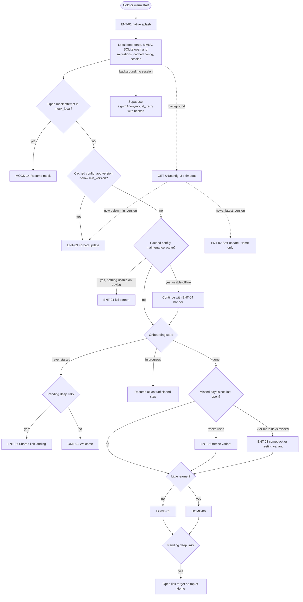
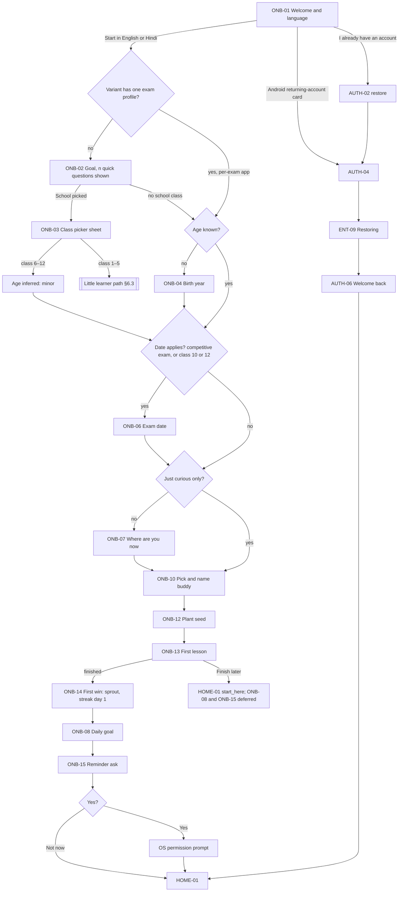
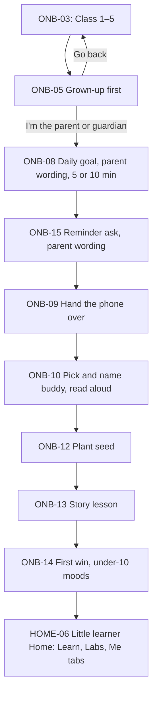
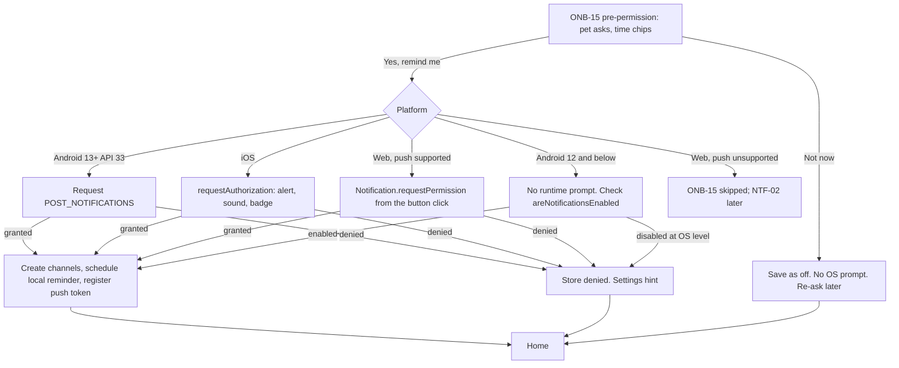
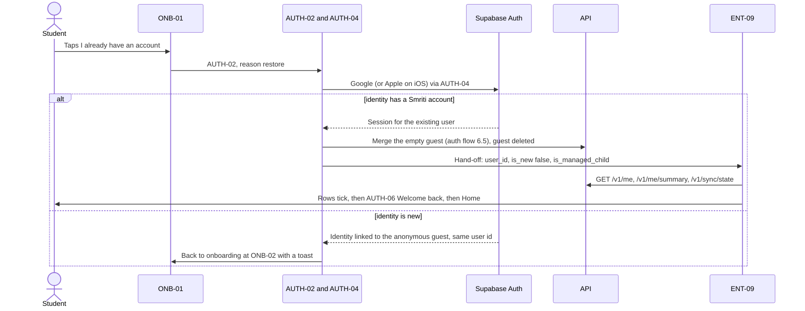
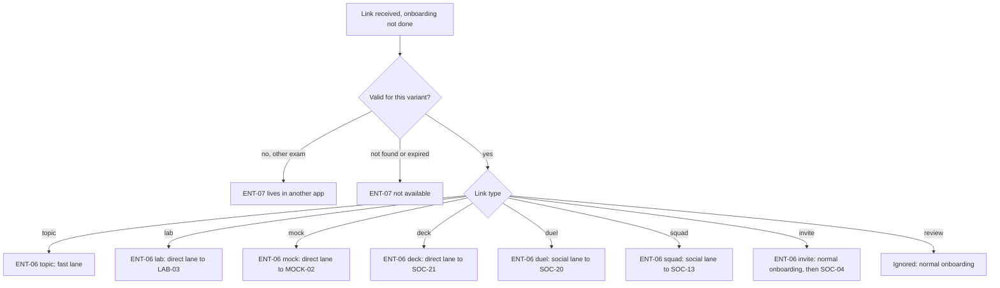
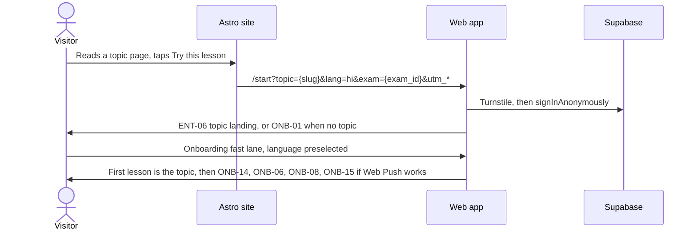
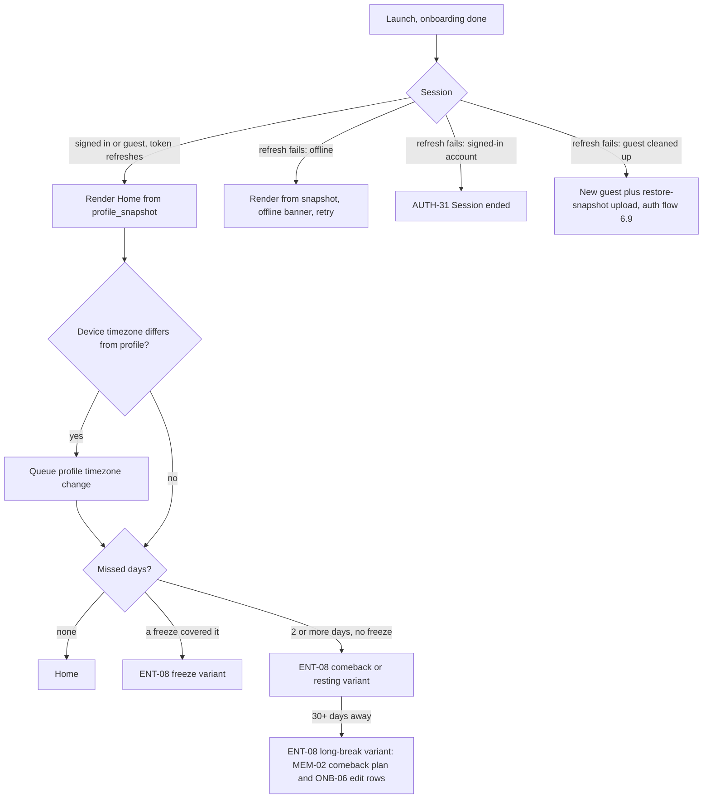

# Flow · Entry and onboarding (ENT, ONB)

Status: Draft v0.3 (revision 1), 29 Oct 2026. Owner area: entry (ENT) and onboarding (ONB).

This doc covers the logic: what happens from the moment the app (or the web app) opens until the student lands on Home, and what happens on every later launch. How each screen looks is in [`docs/ux/onboarding.md`](../ux/onboarding.md). It builds on PRD §3, §7, §10, §12 and §16.4, TRD §3, §3.1, §3.2, §4, §6 and §12, APP_FLOW §1–3.1, §3.6, §3.9 and §4, UX_FLOW §4.1–4.2 and §4.16, `DESIGN.md`, DB_SCHEMA §3, §6, §10, §11 and §15, the competitor research (`docs/research/COMPETITOR_FLOWS.md` §9–§12) and the orchestrator rulings R1–R34.

Fixed decisions that apply throughout: Google is the only sign-in (plus Sign in with Apple on iOS), guest-first with a Supabase anonymous session at first launch, **no login anywhere in onboarding** (research A1), and guardian consent for under-18s.

## Screens in this area

| ID | Screen | Kind | Phase |
|---|---|---|---|
| ENT-01 | Splash | Native splash, then a JS splash that holds for at most the local boot | 1 |
| ENT-02 | Soft update | Bottom sheet (40%) | 1 |
| ENT-03 | Forced update | Full screen, blocking | 1 |
| ENT-04 | Maintenance | Full screen, or a slim banner when the app can still work offline | 1 |
| ENT-05 | Offline first launch | Bottom sheet notice (mobile only) | 1 |
| ENT-06 | Shared link landing | Full screen before onboarding is done. Variants: topic, mock, lab (Phase 1); duel, squad, deck, invite (Phase 2) | 1 / 2 |
| ENT-07 | Link not available | Full screen (expired, wrong app, not found, needs internet) | 1 |
| ENT-08 | Streak check-in. Variants: freeze (me-money's NTF-06), incident freeze, comeback and resting (NTF-07), long break 30+ days. Me-money's NTF-06 and NTF-07 point here | Bottom sheet over Home (60%) | 1 |
| ENT-09 | Restoring progress | Full screen after signing in to an existing account on a new device or app | 1 |
| ONB-01 | Welcome and language, with the Android returning-account card | Step | 1 |
| ONB-02 | Goal (exam or class, multi-select). Also `add` mode from HOME-04 | Step | 1 |
| ONB-03 | Class picker | Sheet over ONB-02. Classes 9–12 in Phase 1, 6–8 and 1–5 in Phase 3 | 1 / 3 |
| ONB-04 | Birth year | Step, only when the age can't be inferred | 1 |
| ONB-05 | Grown-up first | Little learner path only | 3 |
| ONB-06 | Exam date. Also `edit` and `add` modes | Step | 1 |
| ONB-07 | Where are you now (self-rated level, no quiz) | Step | 1 |
| ONB-08 | Daily goal (after the first win) | Step | 1 |
| ONB-09 | Hand the phone over | Little learner path only | 3 |
| ONB-10 | Pick and name your buddy | Step (pick and name merged in revision 1) | 1 |
| ~~ONB-11~~ | *Retired in revision 1, merged into ONB-10.* The ID is not reused. | | |
| ONB-12 | Plant your seed (first lesson intro) | Step | 1 |
| ONB-13 | First lesson wrapper | The learn agent's LES-01 in `onboarding` mode | 1 |
| ONB-14 | First win (first lesson outro) | Celebration | 1 |
| ONB-15 | Reminder ask (pre-permission, then the OS prompt) | Step. Also the deferred ask after the first finished lesson | 1 |

---

## 1. Purpose

1. Get a new student from install to the first card of a real lesson in **about 30–45 seconds**, and to Home in about 3 minutes including a 2-minute lesson. No login and no network required.
2. Before the lesson, ask only what changes it: language, goal, an age signal for child-safety defaults, the exam cycle, a self-rated level, and a pet. Ask the daily goal after the student has felt what 2 minutes is (research §12.1).
3. Make the core loop obvious: the plant grows when you study, the pet cheers you on, one lesson a day keeps the streak (R1).
4. On every later launch, open the right screen instantly (Home, a resumed mock, a deep link, a forced update) without waiting on the network.

## 2. Key decisions

| # | Decision | Why |
|---|---|---|
| D1 | **Welcome and Language are one screen (ONB-01)** with two buttons, "Start in English" and "हिन्दी में शुरू करें" (R4). | Welcome asked nothing, and Language was a single binary choice. The device locale decides which button is primary. |
| D2 | **Age is a birth year, asked only when it can't be inferred (ONB-04)** (R5). Any school class implies a minor; class 1–5 implies a little learner. The month is asked only in the year the student turns 18. "Prefer not to say" gives under-18 defaults. | See §6.2. A neutral question without a default, and no more data than needed. |
| D3 | **Self-rated level only, no quiz in onboarding (ONB-07)** (R27, research A4). "Know the basics" and "Revising" start the first lesson later in the chapter. A "Find my level" check lives on Home (HOME-08 → LES-12 → LES-13, learn agent) and can be redone (research X13). | A quiz before the first lesson doubles the setup time. Self-rating is enough to start. |
| D4 | **Pick and name the buddy on one screen (ONB-10)** (R27, research §12.2). The name is prefilled (Miso or Bruno), so one tap keeps it. | Saves a step. The keyboard opens only if the student taps the field, and the pet cards shrink when it does. |
| D5 | **The seed is planted at ONB-12 and sprouts at ONB-14**, after the first lesson. | The sprout is the payoff for the first lesson (APP_FLOW §3.6, seed → sprout on day 1). |
| D6 | **ONB-12 is the first lesson's intro, ONB-14 its outro.** In `onboarding` mode the player skips LES-07 and LES-08. | Two celebrations in a row would be filler. |
| D7 | **Daily goal comes after the first win, just before the reminder ask** (R27, research §12.1). | Students choose better after feeling what a 2-minute lesson is; big goals set too early hurt streaks (research finding 2). The streak never depends on the goal (R1). |
| D8 | **Notifications are asked after the daily goal (ONB-15), with our own screen first.** The OS prompt fires only after [Yes, remind me] (research A6). | iOS gives one system prompt per install; Android 13+ stops showing it after the second denial. |
| D9 | **Little learners (class 1–5, Phase 3) are set up by a grown-up first** (ONB-05, ONB-08, ONB-15 in parent wording), then the phone is handed to the child (ONB-09). | The parent reads and decides; the child does the fun part. This is the one place the R27 order changes: the daily goal and reminder are asked while the parent holds the phone, because the child can't judge either and the phone won't come back. |
| D10 | **Daily goal art shows watering cans, not plant sizes.** | Plant growth comes from study days, not minutes (TRD §10, R1). Plant-size art would promise something the engine doesn't do. |
| D11 | **Launch never waits on the network** (research A8). The router uses local state and the cached `/v1/config`. Analytics, crash and RevenueCat SDKs start after the first screen renders. | Research finding 10: a blocking start check cost over a second in India. |
| D12 | **Deep links opened before onboarding take a fast lane** (§6.10). | It honours the reason the person installed. |
| D13 | **Per-exam apps skip Goal only when the variant has one exam profile.** | A JEE student still has to say Main or Main + Advanced. |
| D14 | **"{n} quick questions" is shown on the first question screen** (R27, research A2), and the progress bar has exactly those n segments. n counts the question steps the path can show; the bar shrinks if a branch skips one, and it never grows. | Naming the count makes setup feel short. |
| D15 | **The pet reacts to every answer** with one short line under the choices (research A3). No extra screens, no facts in the lines. | It makes the pet the voice from the first tap. |
| D16 | **Android returning-account check on first launch** (§6.9.1, research §11.3, flag `onb.returning_account_check`, an A/B test). | A returning student skips the whole onboarding; new students see nothing. |

## 3. Entry points

| Entry | Where it lands | Notes |
|---|---|---|
| First launch, mobile (all-exams or per-exam app) | ENT-01 → ONB-01 | Anonymous session in the background (§6.1). Returning-account check on Android (§6.9.1) |
| First launch with a pending deep link | ENT-01 → ENT-06 | §6.10 |
| First launch with no network | ENT-01 → ONB-01, ENT-05 sheet on top | §6.11 |
| Launch with onboarding in progress | ENT-01 → the last unfinished step | Answers are kept locally (§8) |
| Launch with a mock in progress (`mock_local` has an open attempt) | ENT-01 → MOCK-14 Resume mock, before Home | Practice agent's request. §4 rule 4 |
| Returning launch, onboarding done | ENT-01 → HOME-01 (or HOME-06), maybe ENT-08 on top | §6.13 |
| Launch below `min_version` | ENT-01 → ENT-03 (after MOCK-14 if a mock is open) | §6.14 |
| Launch during maintenance | ENT-01 → normal route with the ENT-04 banner, or ENT-04 full screen | §6.14 |
| "I already have an account" on ONB-01 | AUTH-02 (`restore`) → AUTH-04 → ENT-09 → AUTH-06 → HOME-01 | §6.9 |
| ONB-01 returning-account card (Android) | AUTH-04 (`restore`) → ENT-09 → AUTH-06 → HOME-01 | §6.9.1 |
| Web app first visit (`app.<domain>`) | ONB-01 (web layout) | §6.12 |
| Marketing site CTA ("Start learning free", "Try this lesson") | `app.<domain>/start?…` → ONB-01 with preselections, or ENT-06 | §6.12 |
| Marketing site "Sign in" | AUTH-29 → HOME-01, or ONB-02 for a brand-new account | §6.12 |
| HOME-04 [Add an exam] | ONB-02 `add` → ONB-06 `add` → HOME-04 | Learn agent's request. No progress bar, close instead of back, [Add] / [Save] |
| Home "Exam date passed" card (learn), ENT-08 long-break row | ONB-06 `edit` → back to the origin | Learn agent's request |
| First finished lesson after "Finish later" in onboarding | LES-08 → ONB-08 → ONB-15 | Learn agent's request (§6.7) |

---

## 4. Launch router (every launch)

**Rules**

1. **The splash holds only for the local boot**, never for a network call. Budget (research A8): first interactive frame of ONB-01 or Home under 2 s on a 2 GB RAM phone; TRD §15 allows 2.5 s to interactive Home on a 3 GB phone. Analytics, Sentry's non-critical parts and RevenueCat initialise after the first screen renders.
2. **The first-ever launch has no cached config.** The build ships a copy of the variant config (TRD §3.1) and default flags, so the router runs. The fetched config replaces it when it arrives.
3. **Server version check.** Besides `/v1/config`, an API error of type `client-too-old` (RFC 7807, suggested HTTP 426) raises ENT-03 at the next safe point.
4. **Safe points.** ENT-02 and ENT-03 never interrupt a mock (MOCK runner), a payment, or an answer being checked. While a mock attempt is open, soft and forced update prompts are held (practice agent's request); ENT-03 shows after the attempt is submitted and `mock_local` has synced. A cold start with an open attempt goes to MOCK-14 first.
5. **EAS Update (OTA JS)** downloads silently and applies on the next cold start. A `critical` OTA flag reloads at the next safe point with a toast, never mid-lesson or mid-mock.
6. **Deep links while the app is warm** skip the splash and follow §6.10.

---

## 5. First-run onboarding, main path

### 5.1 Diagram

### 5.2 Time budget (research §12)

Times are for a student who reads the headline and taps once. Transitions are 300 ms each and are included in the totals.

| Step | Shown to | Time | Why it exists |
|---|---|---|---|
| ONB-01 Welcome and language | Everyone | 3 s | Sets the language for every string and lesson after it, and offers restore |
| ONB-02 Goal | All-exams app, multi-profile variants | 5 s | Decides the exam profile, so the content, the first lesson and Home |
| ONB-03 Class picker (sheet) | Students who tap School | +3 s | The class profile and the age signal |
| ONB-04 Birth year | No class picked (most competitive-exam and "curious" students) | 4 s | Child-safety defaults from the first synced event |
| ONB-06 Exam date | Competitive exams, class 10 and 12 | 4 s | The exam cycle profile, the countdown, the plan's pacing |
| ONB-07 Where are you now | All but "curious only" and little learners | 4 s | Where in the chapter the first lesson starts |
| ONB-10 Pick and name buddy | Everyone | 6 s | The pet is the voice and the main reason to return (PRD §7) |
| ONB-12 Plant seed | Everyone | 4 s | Teaches the streak rule in one tap and frames the lesson |

| Path | Steps before the lesson | Typical total |
|---|---|---|
| All-exams app, JEE student, no class | 01, 02, 04, 06, 07, 10, 12 | about 32 s |
| All-exams app, class 12 + JEE | 01, 02 + 03, 06, 07, 10, 12 | about 31 s |
| Per-exam app with one profile (for example NEET) | 01, 04, 06, 07, 10, 12 | about 27 s |
| All-exams app, "Just curious" | 01, 02, 04, 10, 12 | about 24 s |
| Slow reader, Hindi, longest path | as the first row | up to about 45 s |

After the lesson (about 120 s): ONB-14 6 s, ONB-08 4 s, ONB-15 5 s. **Total to Home: about 2 min 50 s.**

**"{n} quick questions."** n is the number of question steps the variant's path can show before the lesson, counting ONB-03 as part of ONB-02 and ONB-10 as one question: 5 in the all-exams app (Goal, age, date, level, buddy), 4 in a single-profile per-exam app, 5 in a multi-profile per-exam app. The line shows on the first question screen (ONB-02, or ONB-04 in a single-profile per-exam app). If a branch skips a step (for example a class pick removes ONB-04), the bar loses a segment, which only makes it shorter than promised.

**Cut, with reasons:** "How did you hear about us?" (no value to the learner; attribution comes from store and UTM data), a tracking prompt (never: no ad IDs, rule 8), any paywall or plan choice (research X4), a sign-up step (fixed decision), a motivation step (the goal answers it), the placement quiz (moved to Home, D3), a separate naming screen (D4).

### 5.3 Step-by-step logic

Each step writes its answer to the local onboarding state immediately (MMKV `onboarding.v1`) and appends an outbox event (§8), so a killed app resumes at the same step and nothing is lost offline.

1. **ONB-01.** A language button sets `locale` and continues. The UI crossfades to that language (200 ms). The device locale `hi-*` shows ONB-01 in Hindi, anything else in English; both buttons always show their own script. "I already have an account" goes to §6.9. On Android, the returning-account card may appear (§6.9.1).
2. **ONB-02.** Shows the goals in the live catalogue from `/v1/config` (R7), filtered by the variant's `examProfileIds`, plus "School" and "Just curious" in the all-exams app. No "Coming soon" tiles. The first goal tapped is the main goal ("Main" chip); the card menu makes another one main. The pet reacts to each tap with a line chosen by the exam's `category` (D15). The "{n} quick questions" pet line shows before the first tap.
3. **ONB-03** opens when School is tapped. Classes with live content are enabled (Phase 1: 9–12); others are hidden in Phase 1 rather than shown as "Coming soon" (R7). Class 1–5 is exclusive: it clears other goals with a toast and switches to the little learner path (§6.3).
4. **ONB-04** when no school class was picked (§6.2).
5. **ONB-06** for the main goal only (§6.5).
6. **ONB-07** sets `self_level` (`starting`, `basics`, `revising`) for the main goal (§6.6).
7. **ONB-10.** Picking creates the pet locally (`species`); the name is prefilled with the default (Miso for the cat, Bruno for the dog, DESIGN.md §6.3) and can be changed in place.
8. **ONB-12.** One tap plants the seed; the pet waters it; [Start my first lesson].
9. **ONB-13** opens LES-01 with `mode=onboarding` (§6.7).
10. **ONB-14** shows the sprout, streak day 1 and the stats, and sets `onboarding_completed_at`.
11. **ONB-08** sets `daily_goal_minutes` (5, 10, 20, 30; default 10, R6).
12. **ONB-15** asks about reminders (§6.8). Then Home.

**Back behaviour.** Steps ONB-02 to ONB-12 have a back button that keeps answers; Android back does the same; back on ONB-01 exits the app. From ONB-13 on there is no back (the lesson has LES-05, and ONB-14, ONB-08 and ONB-15 move forward only).

**Progress bar.** n segments (D14) on ONB-02 to ONB-10; full on ONB-12. ONB-08 and ONB-15 show no bar (the lesson is done; they are one tap each).

---

## 6. Branches in detail

### 6.1 Guest session at first launch

- On first launch, in the background, the app calls Supabase `signInAnonymously()` (TRD §6). On web it needs a Cloudflare Turnstile token (managed, usually invisible).
- Onboarding never waits for it. If it fails (offline, rate limit, Turnstile), the app keeps a **local provisional profile** with a client UUID, writes events to the outbox, and retries on every foreground and network change. When the session arrives, the outbox flushes under the new `user_id`.
- With `minor.defer_sync_until_consent` on, the anonymous sign-in waits until the age is resolved (§6.2.1).
- **Gap:** DB_SCHEMA §15 names the local database `smriti-{user_id}.db`, which doesn't exist offline. Proposal: start in `smriti-local.db` keyed by an install id and rename on the first session.
- `first_variant`, `timezone` (from the device) and `locale` are set on the profile at the first sync.

### 6.2 Age and minors (DPDP)

| What the student picked | Age signal | Extra question |
|---|---|---|
| School, class 1–5 (Phase 3) | `u10` (little learner) | None |
| School, class 6–7 (Phase 3) | `10_12` | None |
| School, class 8–12 (with or without an exam) | `13_17` | None |
| Only exams and/or "Just curious" | Unknown | ONB-04 birth year |
| Per-exam app (Goal skipped) | Unknown | ONB-04 birth year |
| ONB-04 "Prefer not to say" | Treated as `13_17` (minor defaults) | None |

- The class-to-band mapping is a conservative default that errs young. A class 12 student who is 18 can correct it once from Settings (SET-02 Account, an "Age" row that re-runs the ONB-04 control, logged as `self_declared`; the row is in `docs/ux/me-money.md` SET-02).
- **Why a birth year, not yes/no or a full date of birth.** A neutral question (no default, no hint of the "right" answer) is the accepted way to screen age without inviting a false tap; a full date of birth is more data than needed. The year is ambiguous only in the year the student turns 18, so ONB-04 asks the month only then, and an unanswered month is treated as the younger option. AUTH-03 uses the same control when sign-in needs an age.
- **Under 10 from the birth year** in the all-exams app: ONB-04 offers the kids' version (opens ONB-03 at class 1–5, Phase 3). In Phase 1, or if declined, `u10` defaults apply without the little learner Home.
- **Why not folded into ONB-02.** The Goal grid is up to 6 big cards in Phase 1. A year field there makes it scroll on a 360 × 640 phone and puts two questions on one screen. A separate step costs 4 s for those who see it and nothing for those who don't.
- **Why not after the lesson.** The defaults below must apply from the first synced event.

| Band | Defaults from the first event |
|---|---|
| `u10` | Little learner mode if class 1–5 (§6.3). Pet moods limited to happy, excited, curious, sleepy (DESIGN.md §6.3). No prices (R14, R15). Learning-events-only analytics (learn doc §9). |
| `10_12`, `13_17`, unknown | No social until guardian consent (AUTH-18 to AUTH-23, or SET-17 for managed under-13s). On leaderboards, leagues, duels and community content they appear only after guardian consent, as the pet avatar and an auto-generated nickname, never a typed name (R31 amended). No real-money gem packs. Quiet hours and caps per the me-money table (13–17: 21:00–07:00; under 13: 20:00–08:00; school hours on). Only the reminder time they picked, no smart timing (R34). Reduced analytics allowlist (§9). |
| `18p` | Adult defaults. |

No ad IDs are collected for anyone, and the AD_ID permission / iOS tracking prompt is never requested.

#### 6.2.1 Variant: `minor.defer_sync_until_consent` on

The research reads DPDP s.9(1) as requiring verifiable parental consent before processing **any** personal data of a child (under 18), not only before social features (research finding 15, §13). The owner and legal review decide. This is the flagged variant, ready to switch on from `/v1/config` without an app release. Off is the current default (fixed decision 5).

**What changes for a minor guest (`10_12`, `13_17`, unknown, or `u10`) with the flag on:**

| Area | Flag off (default) | Flag on |
|---|---|---|
| Anonymous session | At first launch | Created only once the age resolves to `18p`. A minor stays a local provisional profile. |
| Progress (lessons, reviews, streak, plant, pet) | Synced as the anonymous user | **On this phone only.** The outbox keeps every event (no size cap below the storage limit) and nothing personal is sent. Streak, plant and pet are computed on the device by `app-core` with the same rules as the server. |
| Content | CDN bundles and the catalogue | Same. These requests carry the app variant but no user id. |
| Product analytics | Reduced allowlist (§9) | None sent. |
| Reminders | Local reminder plus a registered push token | Local reminder only; no push token is registered. |
| AI tutor, photo doubt, voice | Free limits (PRD §11.1) | Hidden until consent: they send the student's own text, voice or photos to our servers. The tutor button shows the consent card instead. |
| Daily challenge, live mocks, leaderboards, Pro | Need the server | Need consent (the card below), since they need an account. |
| Onboarding screens | As specified | Unchanged, except ONB-14 adds the "Only on this phone" save chip (research §11.7). |

**The student's path to saving it (gentle, never a wall):**

1. From the first Home after onboarding, the save chip "Only on this phone" sits in the Me header (ME-01) and Home shows a quiet card at the soft login moments (3rd lesson, streak day 2; AUTH-01 rules R29: once per trigger per 7 days, stop for 14 days after two "Later" taps).
2. The card reads "Ask a parent to save your progress" and explains why: "Your progress is only on this phone. If the app is removed, it's gone."
3. Tapping it, by age:
   - **13–17:** consent comes first (auth flow §6.10). AUTH-18 Guardian consent: ask creates the request from the device, with no account yet → AUTH-19 hand the phone, or AUTH-21 link or QR → AUTH-20 the guardian reviews and agrees (scope `account` at least) → AUTH-23 result, whose [Continue with Google] signs the teen in. The new account then claims the consent with the device-held secret. No teen account exists before the guardian agrees.
   - **Under 13, or little learner:** AUTH-24 Parent sign-in (the parent's own Google account, behind the parent gate SET-13), which adopts the guest as a managed child (auth flow §6.11).
4. On "agreed", the outbox flushes for the first time and the server takes over; AUTH-06 shows "Saved". On "declined" or "expired", nothing is lost on the phone and the card comes back at the next soft moment.

The auth doc's `auth.guardian_consent_gate` (`features` or `signin`) and this flag are decided by the same legal review (auth flow §6.10).

### 6.3 Little learner path (class 1–5, Phase 3)

- **No exam date, no level step.** The child starts at the beginning of the class; the parent can change the starting chapter in the parent dashboard (SET-14).
- **The parent sets the daily goal and the reminder before the hand-over** (D9). Research A6 suggests skipping the reminder ask for children and leaving it to Parent mode. We keep it here because the parent is holding the phone right now and Parent mode is behind a gate they may never open; "Not now" is one tap, and SET-04 changes it later.
- **Read aloud.** From ONB-09 onwards, every pet line and button is spoken in the chosen language (pre-recorded UI audio from `audio-maker` and Deepgram TTS; a seed-pack item).
- **No sign-in in onboarding.** The parent links their own Google account later through HOME-06's "For grown-ups" corner → SET-13 parent gate → AUTH-24. Several children on one phone use AUTH-25 Who's learning? and AUTH-26 Add a child (auth agent).
- **Lands on HOME-06 with three tabs: Learn, Labs, Me** (R14, learn agent's request). No Friends or Practice tab, no tutor button by default, no prices.
- **Social deep links** (duel, squad, invite) opened by a little learner are dropped after setup with no message to the child; topic and lab links are kept.

### 6.4 Per-exam apps vs the all-exams app

| | All-exams app | Per-exam app, one profile (for example NEET) | Per-exam app, several profiles (for example JEE, SSC) |
|---|---|---|---|
| Splash and accent | `primary` blue, white mark on blue | Variant accent (DESIGN.md §2.3), white mark | Same |
| ONB-01 | "Learn anything. Remember everything." | Exam lockup chip and an exam-flavoured scene; "Already use Smriti? Sign in" | Same |
| ONB-02 Goal | Full live catalogue, School, Just curious | **Skipped** | Only the variant's profiles, multi-select |
| ONB-03 Class picker | Yes | No | No |
| ONB-04 Birth year | Only if no class picked | Always (first question screen, carries "{n} quick questions") | Always |
| n quick questions | 5 | 4 | 5 |
| Little learner path | Yes (Phase 3) | No | No |
| After restore (§6.9) | Account's exams as saved | Adds this exam to the account if missing; asks only ONB-06 and ONB-07 for it | Same |

Accent swaps only `primary`, `onPrimary` and `primaryTint` (`examAccent`). NEET and SSC use ink text on the accent. Subject colours never change. Cross-promotion never appears in onboarding.

### 6.5 Exam date and cycles

- Exam profiles are per cycle (`jee-main-2027`, DB_SCHEMA §4.1), so ONB-06 chooses the **cycle**: one chip per active cycle of the main goal, plus "Not sure yet" (which picks the nearest cycle and leaves `target_date` empty).
- **Day counts only from an official date.** If the catalogue has the official date (with its source), ONB-06 shows "Your exam is in {days} days". If the student enters only a month with "Add exact month", it shows "{Month Year}" and never a day count (aligned with the me-money doc's countdown rule). We never guess a date (rule 3). **Gap:** `content.exam_profiles` has no schedule fields; proposal `schedule jsonb` (`session`, `starts_on`, `ends_on`, `source_url`, `verified_at`) filled by `exam-blueprint`.
- School class 10 and 12: "When are your board exams?" with board cycle chips. Other classes skip ONB-06.
- Multi-goal students set the main goal's date only; the rest get "Add date" on HOME-04 or ME-03.
- **Modes** (learn agent's request): `add` from HOME-04 (after ONB-02 `add`) and `edit` from Home's "Exam date passed" card or ENT-08's long-break row. Same screen, no progress bar, a close button, [Save], and it returns to the origin.

### 6.6 Level and the first lesson's starting point

| `self_level` | First lesson (always a real lesson, about 2 minutes) |
|---|---|
| `starting` | The seed pack's onboarding entry for the main goal: the first bite of the first topic of chapter 1. |
| `basics` | The `basics` entry: the first bite of a topic partway through chapter 1. |
| `revising` | The `revising` entry: the first bite of a late topic in chapter 1. |

- The entries are content data, not app logic: the seed pack manifest lists `onboarding_entries {starting, basics, revising}` per goal, chosen by `lesson-author` (a seed-pack requirement for TRD §3.2). If an entry is missing, `starting` is used.
- Card 1 of every onboarding entry must be an interactive or question card, not a text explainer, so the first interaction lands in the first 15 seconds (research A5).
- **"Find my level"** is a Home card on HOME-01 that opens HOME-08 (learn agent), runs the 5-question check in LES-12 and shows LES-13, then moves the start point. It can be redone and never locks anything (R27, research X13). ONB shows the student nothing about it; Home offers it to `basics` and `revising` students first.
- The self-level is also passed to the plan (`self_level` on `app.user_exams`) so the learn agent's plan can skip L1-only topics.

### 6.7 Pet, seed, first lesson and first win

- **Pet row.** Created locally at ONB-10 and synced as an outbox event. **Gap:** TRD §5.1 has no create endpoint; proposal: the sync handler accepts `pet_created` (species, name), or `PUT /v1/pet`.
- **Pet names** are free text: never in analytics (rule 6), checked against an English and Hindi blocklist on the device and the server, **1 to 12 characters** (graphemes), matching ME-06 so push copy fits 60 characters. Minors appear to others only by pet name and avatar (R31), so pet names are also run through the same moderation as usernames.
- **First lesson choice.** The main goal and `self_level` pick the entry (§6.6); a shared topic overrides it (§6.10) when its bundle is on the device or the network is up. On a load failure the player falls back to the `starting` entry, then to the general "curious" lesson.
- **LES-01 in `onboarding` mode** (learn agent owns the player; this is the contract):
  - no Pro gate, no preview limit, no Pro card, no soft login sheet (R15, R29)
  - the floating tutor button is hidden
  - the exit ✕ opens LES-05 with onboarding copy and [Keep going] / [Finish later]
  - at the last card, LES-07 and LES-08 are skipped and the player returns `{completed, xp, accuracy, duration_ms}` to ONB-14
  - it counts as a completed lesson for "soft login after the 3rd lesson" and as the day-1 qualifying activity (R1)
- **[Finish later]** ends onboarding without the first win: `onboarding_completed_at` is set, the seed stays a seed, Home opens in `start_here`, and **ONB-08 then ONB-15 are deferred to right after the first finished lesson's LES-08** (learn agent's request). The sprout then plays on LES-08 (learn agent's plant moment).
- **ONB-14** credits streak day 1 optimistically. The server confirms it from events; if it disagrees (clock, timezone), the next `/me/summary` wins quietly.

### 6.8 Daily goal, reminder ask and OS permission

**Daily goal (ONB-08), after the first win.** 10 min preselected. The helper says "You just did {minutes} minutes. Pick what feels easy." using the lesson's real duration. An outcome line ("At {minutes} a day you can finish {n_chapters} chapters before {exam_month}", research A9) appears only when `n_chapters` can be computed from real lesson durations in the manifest and an exam month exists; otherwise it is hidden (flag `onb.outcome_line`, a test).

- **Time chips:** 7:00 AM, 5:00 PM, 7:00 PM (default), 9:00 PM, Other time. Chips inside the band's quiet hours (me-money table) or school hours are disabled with a "Quiet hours" or "School hours" label. For minors only the picked time is used (R34).
- **Honest promise.** The daily reminder at the chosen time, plus one kind "plant is thirsty" streak saver at least an hour before quiet hours if nothing was done (research A41; NTF-01 catalogue). The copy names both.
- **Android:** create the notification channels at grant time (reminders, streak, reviews, mocks, friends, product news; research X20). Inexact daily scheduling; never request `SCHEDULE_EXACT_ALARM` or `USE_EXACT_ALARM`.
- **iOS:** one system prompt per install; "Not now" on our screen doesn't spend it. No provisional authorization at launch (Q5).
- **Re-ask policy** (our screen, never the OS prompt directly): at most 2 more times, at value moments (streak day 3, first review session finished), never twice within 7 days. Later re-asks use NTF-03 Turn on notifications (me-money), with SET-03 as the permanent home.
- **Web:** ONB-15 itself fires the browser prompt from the button click where Web Push works. Where it doesn't (iOS browsers without the installed web app, unsupported browsers), ONB-15 is skipped and NTF-02 Web push permission handles it later with the "Add to Home Screen" steps (me-money). **Overlap to settle:** NTF-02's entry "after the first completed lesson on web" duplicates ONB-15; proposal: NTF-02 is for SET-03 and the unsupported cases only.
- **Little learners:** the parent sees ONB-15 before ONB-09; under-13 reminders follow the me-money rule (daily reminder only, quiet 20:00–08:00).
- **Push token** with `POST /v1/devices` when online. **Gap:** `app.devices` has no permission state; proposal `notif_permission` (`not_asked`, `granted`, `denied`, `provisional`, `not_required`) and `notif_asked_count`.

### 6.9 "I already have an account"

- **The rest of onboarding is skipped** for a restored account. ENT-09 checks what this device still needs and runs only that:
  - **missing profile parts** (an account that never finished onboarding elsewhere): only the missing steps, for example ONB-10 if there's no pet
  - **per-exam app, the account lacks this exam:** add it to `app.user_exams` (not primary unless the account has none), then ONB-06 and ONB-07 for it only
  - **notifications on this device:** ONB-15 once if never asked here, with the account's saved time preselected
  - then AUTH-06 Welcome back, then HOME-01 (or HOME-06 for a managed child)
- **A parent restoring a child:** AUTH-02's "Restoring your child's account?" row → AUTH-24 → AUTH-28 → ENT-09 per child → AUTH-25 or HOME-06.
- **Language.** The account's saved locale wins (no language was picked on this path).
- **Signed in from the marketing site** (AUTH-29) with a brand-new account: the identity links to a fresh anonymous user and onboarding starts at ONB-02.

#### 6.9.1 Android returning-account check (flag `onb.returning_account_check`, Phase 1, A/B test)

Research §11.3. One check, on first launch only, only when there is no local session with progress, only online, only on Android.

1. When ONB-01 has rendered (so it never delays the first frame), the app asks Credential Manager **silently** whether a Google account on this phone has signed in to Smriti before:
   - **Android 14+ (API 34):** `prepareGetCredential` with `GetGoogleIdOption(filterByAuthorizedAccounts = true)`. It answers "has results" without showing any UI.
   - **Android 13 and below:** no silent check exists, so the app does nothing at launch; the "I already have an account" link covers them. (A direct `getCredential` call would show Google's sheet over ONB-01, which isn't "nothing for new users" in spirit, because it interrupts the returning student before they chose.)
2. **No authorised account** (new users, almost everyone): nothing is shown.
3. **An authorised account exists:** ONB-01 shows a non-blocking card above the language buttons: "Welcome back! Continue with Google to bring back your streak." with the standard Google button "Continue with Google" (approved label, R29) and the trust line "We never call you or share your email." The card has a close button; the language buttons still work.
   - **About the name:** the silent check doesn't reveal which account it found, so our card can't say "{name}". The name appears in Google's own "Continue as {name}" sheet the moment the student taps. (The coordinator's "continue as {name}" wording is therefore Google's sheet, not ours.)
4. Tapping the card's button goes straight to AUTH-04 with `reason = restore` (no AUTH-02, because the card already gives the reason and the trust line). Credential Manager is called with `filterByAuthorizedAccounts = true` and `autoSelectEnabled = true` (auth flow §5.1); Google shows "Continue as {name}" or signs in automatically.
5. Success → ENT-09 → AUTH-06 → Home, exactly as §6.9. Cancel → back to ONB-01 with the card still there. If the account turns out to be a guardian-only account or another conflict, AUTH-09 handles it.
6. Closing the card hides it for good on this install. Logged as `returning_card_shown` and `returning_card_action`.

iOS has no equivalent (the Google SDK's `restorePreviousSignIn` only restores this install's own session), and the web app shows nothing on first visit (One Tap is saved for value moments, research §11.5). Both keep the ONB-01 link.

### 6.10 Deep links before onboarding is done

Links: APP_FLOW §4 plus the new ones the other agents asked for. On first launch they arrive through universal links / App Links, or after install through the Play Install Referrer (Android). iOS has no supported deferred deep link without reading the clipboard, which we don't do.

**Three lanes:**
- **Fast lane (topic):** ONB-01 → ONB-02 preselected from the topic's exam tags → ONB-03 or ONB-04 if needed → ONB-10 → ONB-12 → ONB-13 with the shared topic's first bite → ONB-14 → ONB-06 → ONB-08 → ONB-15 → Home. ONB-07 is skipped (the topic sets the context). If the topic's Deep Dive is Pro, its free first bite is used (R16).
- **Direct lane (lab, mock, deck):** ONB-01 → ONB-02 preselected → ONB-03 or ONB-04 → ONB-10 → ONB-12 (button "Go to the lab" / "Go to the mock" / "See the deck") → the target. No first lesson now; Home's `start_here` offers it. ONB-08 and ONB-15 are deferred to after the first finished lesson or mock section (same hook as [Finish later], §6.7). A mock section is a qualifying activity (R1), so the seed sprouts then; a lab is not.
- **Social lane (duel, squad; Phase 2):** ONB-01 → ONB-02 preselected → ONB-03 or ONB-04 → ONB-10 → AUTH-02 (`social`) → the SOC gate (auth age check, guardian consent for minors, SOC-03 username) → the target. Then ONB-12 and the first lesson are offered from Home. If consent is pending, the duel or squad is kept for its validity and the student continues to Home.

| Link | Target | Lane | Phase | Notes |
|---|---|---|---|---|
| `/t/{topicSlug}` | LRN-03 / the first bite | Fast | 1 | |
| `/lab/{id}` | LAB-03 Lab detail | Direct | 1 | Memory-labs agent's request. A Pro lab opens LAB-03 with its preview, never a dead end (R9, R19) |
| `/mock/{mockId}` | MOCK-02 Mock detail | Direct | 1 | |
| `/deck/{code}` | SOC-21 shared deck preview, then MEM-08 when added | Direct | 2 | Requested by tutor-social and memory-labs. Guests can preview an adult's shared deck; adding follows MEM-08's rules. No author name is shown (R20) |
| `/duel/{code}` | SOC-20 incoming duel | Social | 2 | |
| `/squad/{code}` | SOC-13 join squad | Social | 2 | Tutor-social agent's request |
| `/invite/{code}` | SOC-04 "Add {name}?" after ONB-15 | Normal onboarding | 2 | Referral credit is PAY-09's "A free week from {friend}" (me-money) |
| `/review` | none before onboarding | Ignored | 1 | |

- **Who is named on a landing.** An adult sender shows their display name; a minor sender shows only their pet name and pet avatar (R31). Topic, lab, mock and deck links carry no sender.
- **Pending link storage:** MMKV `pending_link` (type, id, received time), surviving an app kill. Duel and squad links expire with the code (server answer); topic, lab and deck links are kept until used.
- **Mid-onboarding link:** the pending link applies its lane to the remaining steps.
- **Wrong variant:** ENT-07 with [Open in browser] and [Get {other_app_name}] (never for little learners). The all-exams app accepts every link.

### 6.11 Offline first launch (mobile)

- The seed pack (TRD §3.2) holds the onboarding entries for every goal option, the general lesson, the pet and plant art, Rive files and the read-aloud audio, so onboarding including the first lesson works with no network.
- ENT-05 appears once over ONB-01 and never blocks.
- Offline handling: no anonymous session yet (local provisional profile, §6.1); "I already have an account" disabled with "Needs internet"; no returning-account check; a shared topic not in the seed pack falls back to the main goal's entry and stays pending for Home; lab, deck, duel, squad and mock links show ENT-07 "Needs internet" with [Start learning].
- CI must check that every variant's seed pack covers every goal its ONB-02 can show.
- A first web visit can't happen offline, so ENT-05 is mobile only.

### 6.12 Web app first visit and the marketing site hand-off

- **Same screens and order** as mobile (parity). Each step is a route (`/start/goal`, `/start/date`…) so browser back works.
- **URL preselection:** `lang` preselects the language button; `exam` preselects ONB-02 (still shown); `topic`, `lab`, `mock`, `deck` pick the lane. Unknown or inactive values are ignored. UTM parameters go to `onboarding_started` as a campaign id only.
- **Marketing "Sign in"** → AUTH-29; an existing account lands on Home (ENT-09 first if this browser has no local data); a brand-new Google account starts at ONB-02.
- **Phone-size browsers** show a dismissible "Get the app" chip on ONB-01 only.
- **Storage on web.** Guest progress lives in IndexedDB, which Safari can clear for sites unused for 7 days. After ONB-14 the app asks for persistent storage where the browser grants it silently; the auth agent's Safari soft trigger covers the rest (Q8).
- **Updates on web:** a new service worker shows the ENT-02 web toast; a `client-too-old` error forces a reload (ENT-03 web).

### 6.13 Returning-user launch and streak state on open

- **Signed in and guest launch the same way.** A signed-in student whose refresh fails gets AUTH-31 (the local data and outbox are kept). A guest cleaned up server-side gets a new guest and the local state is re-uploaded (`POST /v1/sync/restore-snapshot`, auth flow §6.9), so nothing visible is lost.
- **ENT-08 owns the streak sheet** (me-money's NTF-06 and NTF-07 now point here): the freeze variant when the roll-up used a freeze, the incident variant when our outage was covered (R28), the comeback or resting variant after 2 or more missed days, with me-money's [See streak] → ME-10, "Next free freeze" line, revival quest (ME-08) and reminders-restarted line. ENT decides when: at most once a day, only on launch to Home (a deep link, a notification target or MOCK-14 wins, and the Home streak card carries the message instead), never on onboarding day. Little learners see only the gentle variants.
- **Long breaks (30+ days, research A44, R34):** ENT-08's long-break variant adds two rows: the comeback plan (MEM-02, R22: backlog spread over days, never a review wall) and "Update your exam date" (ONB-06 `edit`).
- **Streak math:** the server is the source of truth (R1, R23: one qualifying activity, local midnight); the app shows its prediction from `activity_days` until `/me/summary` returns, then the server wins and the sheet updates in place. Our own outages never break streaks (R28 incident freeze).
- **Timezone change:** the profile timezone follows the device at the next sync; counted days are not recomputed (TRD §10 owner to confirm).

### 6.14 Updates and maintenance

| Case | Trigger | What the student sees |
|---|---|---|
| Soft update | `latest_version` above the app version | ENT-02 on Home only, at most once per version and once every 3 days, never while a mock is open. Android: Play flexible update, then a "Restart" toast. iOS: the App Store page. |
| Forced update | app version below `min_version`, or `client-too-old` | ENT-03 at the next safe point; after a mock is submitted and synced. Android: Play immediate update when available. The outbox is kept and flushes after the update. |
| Forced, offline | cached config says forced | ENT-03 with "Connect to the internet to update" (Q9) |
| OTA JS update | EAS Update | Silent, next cold start |
| Maintenance, app still useful | `maintenance.active` in `/v1/config`, or 503 with `Retry-After` | ENT-04 banner; downloaded lessons and reviews work; sync paused; server-only actions show ENT-04 full screen when tapped. No streak loss (R28). |
| Maintenance, nothing usable | online-only action, or no seed pack | ENT-04 full screen with [Try again] |
| Web deploy | new service worker | "New version ready. Reload" toast |

**Gap:** `/v1/config` has no documented `maintenance` object. Proposal: `ops.maintenance` flag (`active`, `until`, `message_key`).

---

## 7. Edge cases

1. **App killed mid-onboarding:** resume at the last unfinished step. Killed during ONB-13: resume the lesson (LES-06).
2. **Language change mid-flow:** only by going back to ONB-01; later in SET-06.
3. **Dynamic type at 200%:** Goal grid becomes one column; Hindi wraps, never truncates; the pinned button stays visible.
4. **Low-end device:** static pet and plant poses (`perf.rive_enabled` per device class); no confetti on ONB-14.
5. **Reduced motion:** fades instead of slides; Rive frozen on static poses; seed planting as a three-frame cross-fade.
6. **Screen reader:** each step announces "Question {n} of {total}" and the headline; pet lines read as "{pet_name} says …".
7. **School and an exam** (class 12 + JEE): both are goals, age inferred from the class, main goal = first tapped.
8. **Only "Just curious":** no ONB-06 or ONB-07; the general lesson; Home shows the catalogue.
9. **Little learner chosen, then "Go back" on ONB-05:** back to ONB-03 with the class cleared.
10. **Under 10 by birth year in a per-exam app:** `u10` defaults; a note that little-learner mode is in the main app, with no install link for a child.
11. **Pet name blocked:** inline message; the default name stays.
12. **First lesson fails to load:** fall back to the `starting` entry, then the general lesson, then LES-11 with [Try again] and [Skip for now].
13. **"Finish later" in the first lesson:** Home `start_here`, seed unsprouted, ONB-08 and ONB-15 after the first finished lesson.
14. **OS permission dialog dismissed (Android back):** treated as "not now"; not re-fired.
15. **Time chip inside quiet or school hours:** disabled with a text label.
16. **Two Smriti apps on one device:** separate guests; the same Google account in both merges on the server (fixed decision 3).
17. **Wrong device clock:** the optimistic day 1 may be off; the server corrects it.
18. **Turnstile fails on web:** onboarding continues locally; a quiet "We couldn't save to the cloud yet" line on ONB-14.
19. **Restored minor without consent:** nothing changes in onboarding; social stays locked (SOC-02).
20. **Restored Pro:** comes with `/me/summary`; ENT-09 shows no prices.
21. **Returning-account card while offline:** not shown (the check needs Google Play services online).
22. **Returning-account card, then the student taps a language button instead:** the card stays until closed or onboarding moves on; it never reappears after ONB-01.
23. **Defer-sync flag turned on after a minor already synced:** existing server data stays (legal to advise); new events stay on the device until consent.

## 8. Data: local and server

| Data | On device | On the server | Written by | Gap |
|---|---|---|---|---|
| Onboarding progress | MMKV `onboarding.v1` | `app.profiles.onboarding_completed_at` | each step, ONB-14 | none |
| Language | MMKV, i18next | `app.profiles.locale` | ONB-01 | none |
| Goals, main goal, cycle, date | `profile_snapshot` | `app.user_exams` | ONB-02, ONB-03, ONB-06 | No endpoint (TRD §5.1 has only `PATCH /v1/me`). Proposal `PUT /v1/me/exams` plus a `user_exams_set` outbox event |
| Age | `profile_snapshot` | `app.profiles.age_band` | ONB-03 inference, ONB-04 | Need `birth_ym date` (ONB-04 answers only) and `age_source` (`class`, `birth_year`, `declined`, `guardian`, `self_declared`) |
| Level | `profile_snapshot` | none | ONB-07 | Need `self_level` on `app.user_exams` |
| First-lesson entry | seed pack manifest | none | content | Need `onboarding_entries` in the seed pack manifest (§6.6) |
| Daily goal | `profile_snapshot` | `app.profiles.daily_goal_minutes` | ONB-08 | DB default 15 must be 10 (R6) |
| Pet | SQLite | `game.pets` | ONB-10 | No create endpoint (§6.7) |
| Plant | `profile_snapshot` | `game.plants` (sign-up trigger) | trigger, events | none |
| First lesson | `lesson_progress`, outbox | `learn.lesson_progress`, `learn.activity_days` | ONB-13 | none |
| Reminder, permission | MMKV, local schedule | `notify.prefs.daily_reminder_at`, `app.devices.push_token` | ONB-15 | Permission columns on `app.devices` (§6.8) |
| Quiet hours | none | `notify.prefs` | from the age band | Defaults per me-money table |
| Pending deep link | MMKV `pending_link` | none | ENT-06 | none |
| Returning-card dismissed | MMKV | none | ONB-01 | none |
| Referral code | MMKV | `app.profiles.referred_by` | invite link | Claim endpoint (me-money / tutor-social to own) |
| Variant, timezone | MMKV | `app.profiles.first_variant`, `timezone`; `app.devices` | first sync | none |
| Cached config | MMKV | `ops.app_variants`, `ops.flags` | ENT-01 | `maintenance` object (§6.14) |
| Defer-sync state | outbox (unflushed), local engine state | none until consent | §6.2.1 | `app-core` must run streak, plant and pet rules fully on device |

**Offline-first profile writes.** Profile changes go through `PATCH /v1/me` today, which needs the network. For onboarding to work offline these must also be outbox events (`profile_updated`, `user_exams_set`, `pet_created`, `notif_prefs_updated`), applied idempotently by `/v1/sync/events`. Flag for TRD §3.2 and §5.1.

## 9. Analytics events

Added to the typed catalogue in `packages/analytics` first. snake_case, no free text, no pet name, no birth year, no ad id. For `audience = little` only the learn doc's learning allowlist is sent; for other minors and `unknown`, only the ✓ events; with `minor.defer_sync_until_consent` on, nothing is sent for minors.

| Event | Properties | Minor |
|---|---|---|
| `app_launched` | `cold`, `route` (`onboarding`, `resume`, `home`, `mock_resume`, `forced_update`, `maintenance`, `link`), `ms_to_first_screen` | ✓ |
| `config_fetch_failed` | `reason` | ✓ |
| `update_prompt_shown` / `update_prompt_action` | `kind` (`soft`, `forced`), `from_version`, `to_version`, `action` | ✓ |
| `maintenance_shown` | `mode` | ✓ |
| `offline_first_launch` | none | ✓ |
| `deep_link_opened` | `link_type` (`topic`, `lab`, `mock`, `deck`, `duel`, `squad`, `invite`, `review`), `pre_onboarding`, `source`, `lane` | ✓ |
| `deep_link_unavailable` | `link_type`, `reason` | ✓ |
| `returning_card_shown` / `returning_card_action` | `action` (`continue`, `dismiss`, `ignored`) | (adults and unknown only; the card appears before age is known, so it is sent as `unknown`) |
| `onboarding_started` | `entry`, `campaign_id` | ✓ |
| `onboarding_step_viewed` / `onboarding_step_completed` | `step`, `step_index`, `step_total`, `ms_on_step` | ✓ |
| `onboarding_step_back` | `from_step` | ✓ |
| `language_selected` | `locale`, `matched_device_locale` | ✓ |
| `goal_selected` | `exam_ids`, `count`, `main_exam_id`, `has_school` | ✓ |
| `class_selected` | `class_level` | ✓ |
| `age_resolved` | `audience` (`little`, `minor`, `adult`, `unknown`), `source` | ✓ |
| `kids_version_offered` | `action` | ✓ |
| `exam_cycle_selected` | `exam_profile_id`, `has_month`, `not_sure` | ✓ |
| `level_selected` | `level` | ✓ |
| `pet_selected` / `pet_named` | `species`; `used_default`, `used_suggestion`, `typed`, `blocked_attempts` | ✓ |
| `seed_planted` | none | ✓ |
| `first_session_started` / `first_session_exited` / `first_session_completed` | `kind` (`lesson`, `shared_topic`), `entry` (`starting`, `basics`, `revising`), `card_index`, `card_total`, `duration_ms`, `accuracy_bucket` | ✓ |
| `daily_goal_selected` | `minutes`, `outcome_line_shown` | ✓ |
| `reminder_preprompt_shown` / `reminder_preprompt_action` | `context` (`onboarding`, `deferred`, `little_parent`, `restore`, `reask`), `ask_number`, `action`, `time_slot` | ✓ |
| `os_notification_result` | `result` | ✓ |
| `onboarding_completed` | `total_ms`, `pre_lesson_ms`, `steps_shown`, `first_session_done`, `path` (`standard`, `little`, `per_exam`, `fast_lane`, `direct_lane`, `social_lane`) | ✓ |
| `existing_account_tapped` | none | ✓ |
| `restore_completed` | `outcome`, `duration_ms`, `steps_needed`, `entry` (`link`, `returning_card`, `web`) | ✓ |
| `parent_intro_shown` / `handoff_to_child_shown` | none | (little allowlist) |
| `streak_checkin_shown` / `streak_checkin_action` | `variant` (`freeze`, `incident`, `comeback`, `resting`, `long_break`), `days_away_bucket`, `action` | ✓ |

Me-money's NTF-06 and NTF-07 use these ENT-08 events.

## 10. Conflicts and gaps in existing docs

| Where | Issue | Proposed fix |
|---|---|---|
| UX_FLOW §4.2 title | "About 90 seconds in total" can't include a 2-minute lesson | "30–45 s before the first lesson, about 3 min to Home" |
| UX_FLOW §4.2 items 1–2, PRD §10.2, APP_FLOW §2 | Welcome and Language separate | Merged (R4) |
| UX_FLOW §4.2 item 5, APP_FLOW §3.1 | Placement quiz in onboarding | Self-rated only; "Find my level" on Home (R27) |
| UX_FLOW §4.2 item 6, PRD §10.2 step 6 | Daily goal before the lesson; plant-size art | After the first win (R27); watering cans (D10) |
| UX_FLOW §4.2 item 7 | Separate name step | Merged into ONB-10 |
| UX_FLOW §4.2 item 8 | Seed sprouts at planting | Sprouts after the first lesson (D5) |
| UX_FLOW §4.2 item 3 | Banking, Railways on the grid | Live catalogue only (R7) |
| UX_FLOW §4.1 | Pet waving on the splash | Mark only; pets wave on ONB-01 (D11) |
| PRD §10.2 "Per-exam apps skip step 3" | Wrong for multi-profile variants | D13 |
| PRD §10.3, UX_FLOW §4.14, APP_FLOW §2, TRD §4.2, §6, §17, DB `guardian_consents` | Phone OTP, email, under-13 consent | Superseded (auth agent) |
| APP_FLOW §3.1 | `POST /guest`; guest created after the seed | Client `signInAnonymously()` at launch (§6.1) |
| APP_FLOW §4 | Missing `/squad/{code}`, `/deck/{code}`, `/lab/{id}` | Add (§6.10) |
| TRD §10 | "Met the daily goal" decides the streak | R1 |
| TRD §3.2 seed pack | No onboarding entries per level, no read-aloud audio | Add (§6.6, §6.3) |
| TRD §5.1 | No user exams, pet create, guest-safe profile writes | §8 |
| DB_SCHEMA §3 | `daily_goal_minutes default 15`; only `age_band` | Default 10 (R6); `birth_ym`, `age_source`. Resolved in consistency pass: DB_SCHEMA §3 has all three |
| DB_SCHEMA §4.1 | No official exam dates | `schedule jsonb`. Resolved in consistency pass: `content.exam_profiles.schedule` added |
| DB_SCHEMA §15 | Local db named by `user_id` | Install-id keyed db. Resolved in consistency pass: DB_SCHEMA §15 starts in `smriti-local.db` and renames on the first session |
| me-money SET-10 and flow §6 | Daily goal shows "plant sizes from onboarding" | Watering cans (D10); SET-10 should reuse the same four images. Resolved in consistency pass: SET-10 uses the four watering cans |
| me-money NTF-02 | Entry "after the first completed lesson on web" duplicates ONB-15 | NTF-02 for SET-03 and unsupported browsers only. Resolved in consistency pass: NTF-02's entry list says so |
| me-money NTF-06, NTF-07 vs this doc | Both docs retired the streak sheet in favour of the other (this doc's first revision-1 draft retired ENT-08; me-money now says "see ENT-08") | Resolved: ENT-08 owns it, with me-money's requested rows and strings built in. Resolved in consistency pass: me-money's index now says NTF-06 and NTF-07 are ENT-08's triggers (R41) |
| auth AUTH-01 / AUTH-02 trust line | "We only get your name and email from Google. We never call you or post anything." differs from R29's "We never call you or share your email." | Use R29's line everywhere; ONB-01's card already does. Resolved in consistency pass: every sign-in surface uses the R40 line in EN and HI |
| me-money NTF-03 | Referenced a placeholder for the notification ask | ONB-15. Resolved in consistency pass: NTF-03 names ONB-15 |
| tutor-social vs memory-labs | `/deck/{code}` goes to SOC-21 (social) or MEM-08 (memory) | SOC-21 preview first, MEM-08 after "Add" (§6.10). Resolved by R41 |
| Hindi vocabulary | Other docs use पाठ, प्रगति, कक्षा, परीक्षा; this doc now uses लेसन, प्रोग्रेस, क्लास, एग्ज़ाम (R3, research A7) | `packages/i18n` glossary to pick one set for all docs |

## 11. Changes other areas need

| Area | Change |
|---|---|
| **Auth** | (1) Accept ONB-01's returning-account card as an entry to AUTH-04 with `reason = restore` (no AUTH-02). (2) Order on restore: ENT-09 then AUTH-06 (as auth flow §6.5). (3) The defer-sync path: "Ask a parent to save your progress" → AUTH-01 → AUTH-18…AUTH-23 for 13–17, AUTH-24 for under 13. (4) Social lane hand-off for duel and squad links. |
| **Learn** | (1) `mode=onboarding` contract (§6.7). (2) Deferred ONB-08 and ONB-15 after the first finished LES-08 (or first mock section). (3) "Find my level" is HOME-08 (done in the learn doc). (4) Plan uses `self_level`. (5) `add` and `edit` modes as specified. (6) HOME-06 three tabs. |
| **Me + money** | (1) Index wording for NTF-06 and NTF-07 as variants of ENT-08. (2) NTF-02 entry change. (3) NTF-03 reference to ONB-15. (4) SET-02 "Age" row. (5) SET-10 watering cans. (6) Pet name 1–12 characters is now aligned. |
| **Tutor + social** | SOC-13, SOC-20 and SOC-21 accept a pending link from ENT-06, and the sender label follows R31. |
| **Memory + labs** | LAB-03 and MEM-08 accept a pending link from ENT-06. |
| **Practice** | MOCK-14 is the first route when `mock_local` has an open attempt; prompts are held (done). MOCK-02 accepts the direct lane. |
| **Content skills** | Seed pack per variant: onboarding entries (`starting`, `basics`, `revising`) per goal with an interactive card 1, the general lesson, the little-learner story lesson, read-aloud UI audio. |
| **Design system** | Choice card and Picker components in DESIGN.md §5. |

## 12. Open questions for the owner

| # | Question | Recommended answer |
|---|---|---|
| Q1 | Turn on `minor.defer_sync_until_consent` (consent before any processing of a minor's data)? | Get the legal opinion before the Phase 1 beta. The variant is fully specified (§6.2.1) and switchable without a release. |
| Q2 | Hindi register | Decided by R3: आप everywhere, तुम only for little learners, plain spoken Hindi with loanwords. Remaining: one glossary for all docs (§10). |
| Q3 | Does one lesson keep the streak? | Decided by R1: yes. |
| Q4 | Guest cleanup at 90 days | Handled by the auth agent's restore-snapshot upload (auth flow §6.9). No change needed here. |
| Q5 | iOS provisional notifications for "Not now" students? | No for launch; revisit with data. |
| Q6 | Several learners on one phone | Handled by AUTH-25 and AUTH-26 (auth agent). The account part is Phase 1 (TRD §18 D9, auth Q2); only the Parent mode dashboard is Phase 3. |
| Q7 | When is the invite reward credited? | Me-money owns it (PAY-09). Recommend: after the invitee signs in and finishes one lesson. |
| Q8 | Earlier sign-in prompt for Safari web guests? | Yes, a soft sheet after the first lesson on Safari only (auth agent). |
| Q9 | Offline study when a forced update is pending and the phone is offline? | Yes for downloaded lessons and reviews with sync paused, if the API accepts the old event schema for one version. |
| Q10 | Ask "Class 11 / Class 12 / Passed 12" in the JEE and NEET apps? | Yes, as a chip row on ONB-07, if content ordering differs. It would also remove ONB-04 for most of them. Needs the content owner. |
| Q11 | Run the returning-account check as a test? | Yes, behind `onb.returning_account_check`, measured on restore rate and onboarding completion for new users (which should be unchanged). |
| Q12 | Run the post-lesson daily goal as a test against the old order? | Yes (research §14 Q1), measured on D7 streak retention. |

---

## Changelog (revision 1)

- **Order (R27):** daily goal moved after the first win, just before the reminder ask. Time budget redone: about 30–45 s before the first lesson (27–32 s typical), about 2 min 50 s to Home.
- **ONB-07:** self-rated level cards only. The placement quiz no longer replaces the first lesson. "Know the basics" and "Revising" start the first lesson later in chapter 1 (seed-pack `onboarding_entries`). "Find my level" lives on Home (HOME-08 → LES-12 → LES-13, learn agent).
- **ONB-10 and ONB-11 merged** into ONB-10 "Pick and name your buddy". ONB-11 retired.
- **ENT-08 kept as the owner of the streak check-in** (me-money's revision hands NTF-06 and NTF-07 to it). Added me-money's requests ([See streak] → ME-10, "Next free freeze", two-freeze title, revival quest ME-08 with DayDots, reminders-restarted line), an incident-freeze variant (R28), the long-break variant with MEM-02 and ONB-06 `edit` rows, and the `Plant` icon. An earlier draft of this revision retired it; that is reverted.
- **"{n} quick questions"** on the first question screen (ONB-02, or ONB-04 in single-profile per-exam apps), with an n-segment progress bar (D14).
- **The pet reacts to every choice** (D15).
- **Android returning-account check** on first launch with a non-blocking card on ONB-01 (§6.9.1), handing off to AUTH-04.
- **DPDP:** `minor.defer_sync_until_consent` specified as a full variant, with the student's experience and the path into AUTH-18 to AUTH-24 (§6.2.1).
- **Requests handled:** `add` and `edit` modes for ONB-02 and ONB-06; deferred ONB-08 and ONB-15 after "Finish later"; HOME-06 three tabs; ENT-06 variants for `/squad/{code}`, `/deck/{code}`, `/lab/{id}`; splash routes an open mock to MOCK-14 and holds update prompts while a mock is open.
- **Rulings applied:** R1 (streak), R3 (Hindi register and loanwords), R6 (daily goal default 10), R7 (live catalogue, no "Coming soon"; Phase 1 classes 9–12), R8 (phases noted), R14, R15, R16, R19, R20, R22, R23, R28 (plant icon on the streak pill, incident freeze), R29, R31 (minors shown by pet name), R34 (minors' reminders).
- **Alignment with other agents:** quiet hours and school hours from the me-money table; pet name 1–12 characters; month-only exam dates show "{Month Year}", not a day count; restore order ENT-09 → AUTH-06; real AUTH, HOME, LES, LAB, MEM, MOCK, SOC, SET and NTF IDs throughout.
- **Screen specs (`docs/ux/onboarding.md`):** rewritten to match: screen index with phases, n-segment bar and pet reaction line in the shared anatomy, the returning-account card on ONB-01, cards-only ONB-07, merged ONB-10, post-lesson ONB-08, Plant icon on ONB-14, quiet and school hours on ONB-15, loanword Hindi throughout, phase on every block.
- **Phases:** little learner screens (ONB-05, ONB-09, classes 1–8 on ONB-03) are Phase 3; social link lanes are Phase 2.
