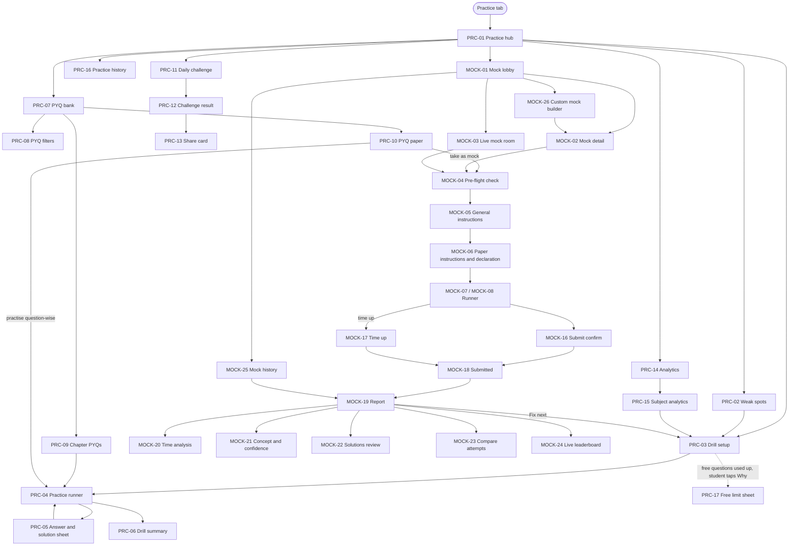
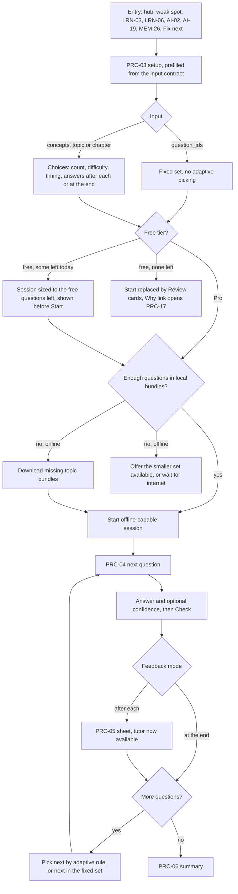
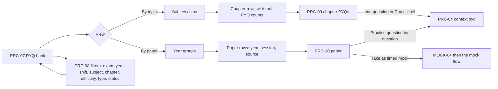
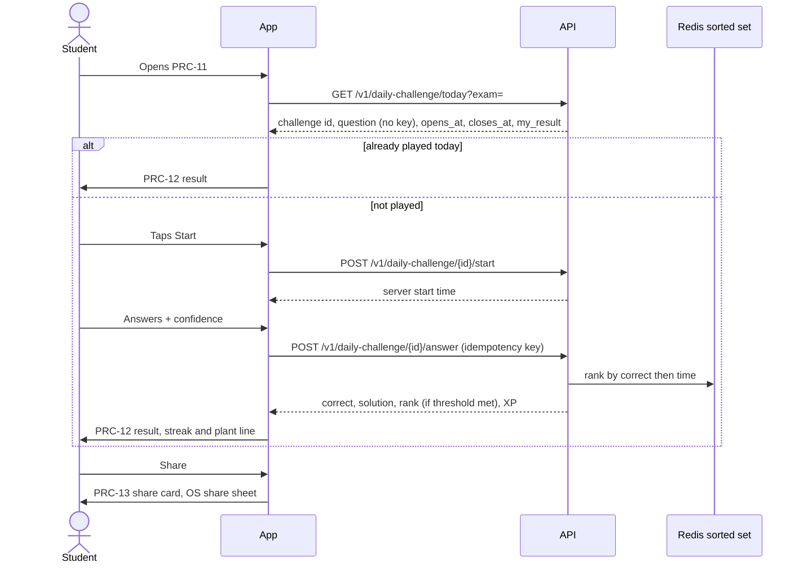
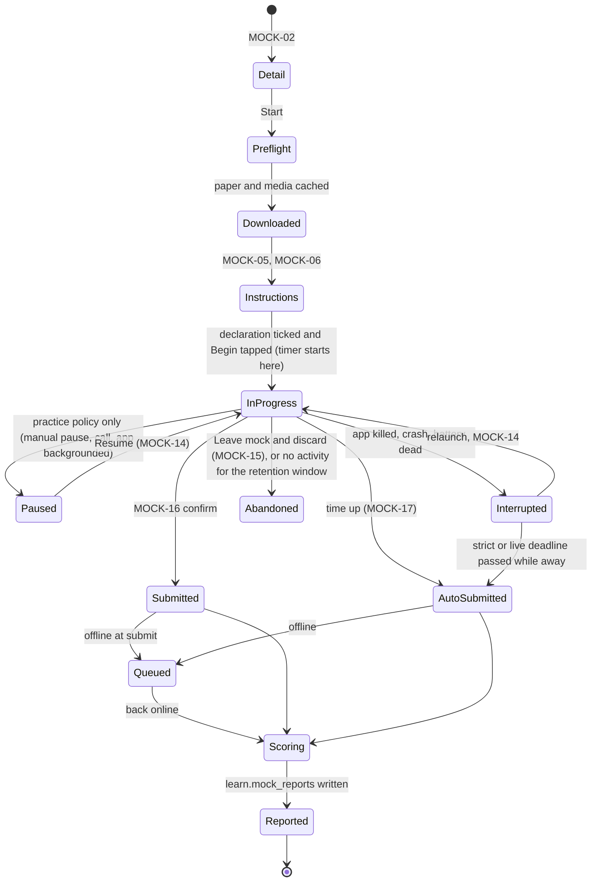
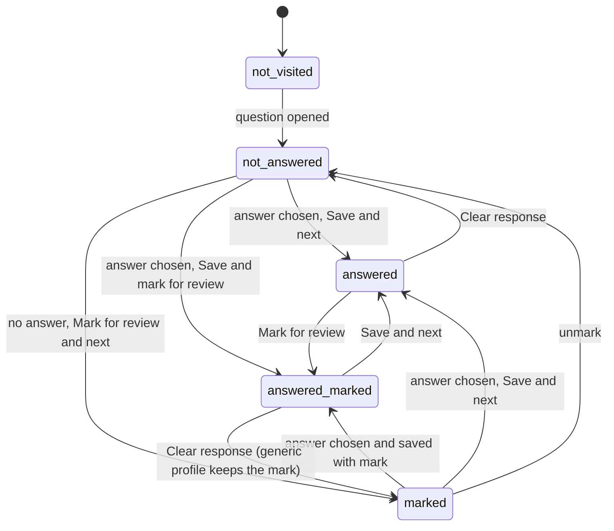
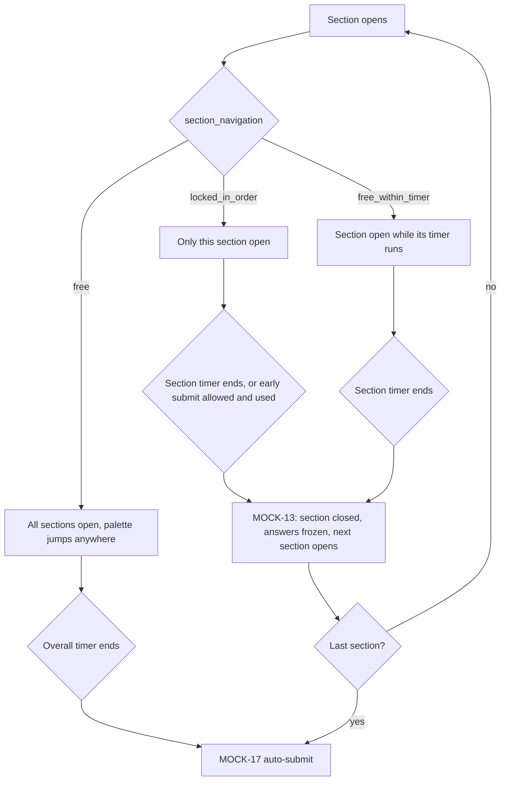
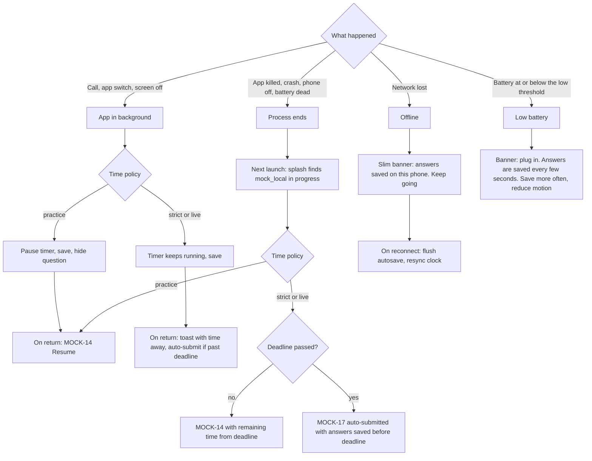
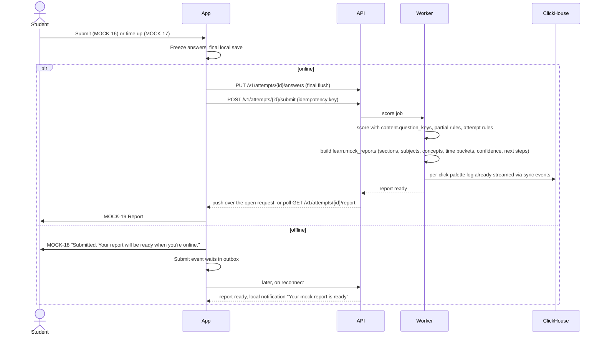
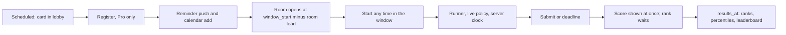

# Practice and mocks: flow

Status: Draft v0.2 (revision 1), 29 Oct 2026. Owner: practice agent. Covers the Practice tab (screen prefix **PRC**) and mock tests (prefix **MOCK**). Screen-by-screen detail is in `docs/ux/practice.md`.

Read with: PRD §4.3, §6, §7, §10.1, §11.1, §16.4 · APP_FLOW §3.5 · UX_FLOW §4.10, §4.17 · DESIGN.md §2.4, §9 · TRD §3.2, §5.1, §7.4, §10, §13 · DB_SCHEMA §4.4, §5.1, §5.3, §6 (`game.daily_challenges`), §14, §15 · `skills/exam-blueprint`, `skills/pyq-ingest`.

---

## 1. Purpose

Practice turns learning into marks. It has two halves:

1. **Practice (PRC):** short, low-stakes sessions that build accuracy and speed. Concept drills, weak-spot drills, the PYQ bank, the daily challenge, and the analytics dashboard that tells the student where to practise next.
2. **Mocks (MOCK):** full, sectional, chapter, PYQ-paper, custom and live mocks that behave like the real exam. The runner is a generic engine. Every duration, section, timer rule, question type, marking rule, language rule and calculator rule comes from the exam's blueprint (`content.exam_blueprints.spec`, written by `skills/exam-blueprint`). Nothing about a specific exam is hard-coded in the app.

Two rules shape every screen here:

- **Every number is real.** Scores, ranks, percentiles, weightage, PYQ counts, "repeated in N papers", readiness and accuracy all come from real data. When there is not enough data, the screen says so and shows an empty state. It never shows a placeholder chart or an estimate dressed up as a fact (AGENTS.md rule 3).
- **The runner is plain** (R24). No pet, no plant, no confetti, no gems, no tutor, no pushes and no subject tints from the pre-flight check to the submitted screen (MOCK-04 to MOCK-18). Its main button is the all-exams blue in every app, and MOCK-05 carries the "not affiliated with {conducting_body}" footer. The rest of Practice uses the normal Sunny Subjects look.
- **No blocking upsells** (research finding 11, Avoid X1 and X8). No Pro sheet or paywall opens on its own anywhere in Practice. Free limits are shown before a session starts, never discovered mid-session, and the limit sheet (PRC-17) is always dismissible. Children under 13 never see a price (R14, R15).

In this document, values in braces such as `{duration_min}`, `{section_timer_min}` and `{marking.correct}` are read from the blueprint at run time. Values such as `{free.practice_questions_per_day}` are flags from `GET /v1/config` (DB_SCHEMA `ops.flags`).

---

## 2. Entry points

| From | Goes to | Notes |
|---|---|---|
| Practice tab (bottom tab bar, or the web sidebar) | PRC-01 Practice hub | The tab root |
| Home "Today's plan" item of type drill or mock (HOME-02) | PRC-03 Drill setup (prefilled) or MOCK-02 Mock detail | Plan items come from `learn.daily_plans.items` |
| Home weak-area alert card (HOME-01) | PRC-02 Weak spots, or PRC-03 prefilled for that topic | TRD §9.6. The NTF-01 `weak_area` push goes to the review queue (`/review?topic`), not here |
| Topic card (LRN-03) or chapter (LRN-02) "Practise" | PRC-03 prefilled for that topic or chapter | |
| Chapter test entry sheet (LRN-06) | PRC-03 in chapter-test mode, then PRC-04 and PRC-06; or MOCK-02 for a timed chapter mock | lesson-core builds the set; it counts toward the daily free questions (§4.1) |
| Global search (HOME-05) result that is a PYQ | PRC-04 at that question, context `pyq` | The chapter's other PYQs are queued after it (§5.4) |
| Lesson complete (LES-08) "Practise this topic" | PRC-03 prefilled | |
| AI tutor tool `start_practice` (AI-02) | PRC-03 prefilled with the concepts the tutor chose | TRD §9.2 |
| Photo doubt "Similar questions" (AI-19) | PRC-03 with a fixed `question_ids[]` set | No adaptive picking (§5.3) |
| "Sure but wrong" list [Practise these] (MEM-26), metacognitive dashboard (MEM-25) | PRC-03 prefilled with `concepts[]` | |
| Mock report "Fix next" (MOCK-19) | PRC-03 prefilled with the weakest concepts | |
| Daily challenge card on Home (HOME-01), NTF-01 `challenge_ready` (folded into the daily reminder for minors), home-screen widget (Phase 2) | PRC-11 Daily challenge | No separate challenge push (R34 fixed volume) |
| Live mock reminder push (NTF-01 `mock_reminder`) | MOCK-03 Live mock room | Phase 3 |
| Shared link landing (ENT-06) for a mock or PYQ paper | MOCK-02 or PRC-10 | |
| Deep link `smriti.app/mock/{mockId}` (APP_FLOW §4) | MOCK-02 Mock detail | A per-exam app uses its own prefix, for example `/jee/mock/{mockId}` |
| Proposed deep links `smriti.app/pyq/{paperId}`, `smriti.app/challenge`, `smriti.app/practice` | PRC-10, PRC-11, PRC-01 | Not in APP_FLOW §4 yet (§12.1) |
| Astro site PYQ explanation page "Practise in the app" (TRD §4.1) | PRC-09 or PRC-10 through the deep link | Falls back to the web app if the mobile app isn't installed |
| App launch with an in-progress mock (ENT-01 splash) | MOCK-14 Resume mock | Checked before Home renders |
| Me tab stats (ME-01) | PRC-14 Analytics dashboard, MOCK-25 Mock history | |

---

## 3. Area map

Inside the runner (MOCK-07 phone, MOCK-08 tablet and web) the student can open MOCK-09 Palette, MOCK-10 Calculator, MOCK-11 Rough-work pad, MOCK-12 Question paper, MOCK-15 Leave mock, and sees MOCK-13 Section change when a sectional timer ends. MOCK-14 Resume appears after any interruption.

---

## 4. Who gets what: guest, free, Pro, minors, variants

### 4.1 Tier limits

The limits below are flags (PRD §11.1 says "the exact free limits are flags"). Values marked "PRD" are the PRD's starting values. Values marked "owner" have no number in any doc yet: the owner sets the flag and the app reads it. The app never ships a guessed default for these. If a flag is missing from `/config`, the app uses the PRD value where one exists, otherwise turns that limit off for the session and logs a config error.

| Capability | Guest | Free (signed in) | Pro | Flag key (proposed) |
|---|---|---|---|---|
| Practice questions (drills, weak-spot drills, PYQ question-wise) | 30 a day (PRD) | 30 a day (PRD) | Unlimited | `free.practice_questions_per_day` |
| Daily challenge | Yes, 1 a day | Yes | Yes | none (always free) |
| Appear on the daily-challenge leaderboard | No. Sees a private "you would be #n" line and a sign-in link | Yes (minors after guardian consent, §4.3) | Yes | none |
| PYQ bank browsing (topic view and paper view) | Yes | Yes | Yes | none |
| PYQ questions | Every PYQ viewable, counted within the daily question count (R25) | Same as guest | Full bank, no cap | `free.pyq_mode` = `counted` |
| PYQ papers as timed mocks | One free paper per exam (R25) | Same | All | `free.pyq_papers_free` (list of paper ids) |
| Chapter test from LRN-06 (untimed, in the practice runner) | Counts toward the daily question count | Same | Unlimited | `free.practice_questions_per_day` |
| Sectional mocks | 1 a week (PRD) | 1 a week (PRD) | All | `free.sectional_mocks_per_week` |
| Full mocks | 1 sample full mock (PRD): mocks with `content.mocks.is_free = true` | Same | All | `content.mocks.is_free` |
| Timed chapter mocks (MOCK) | Recommended: count as sectional (open question Q15) | Same | All | uses `free.sectional_mocks_per_week` |
| Custom weak-area mock (MOCK-26) | No | No | Yes | `pro.custom_mocks` |
| Live all-India mocks | No (Pro, PRD §11.1) | Locked card with the Pro offer | Yes | `live.enabled` per variant |
| Mock report: the three lead tiles (score, accuracy, time lost on wrong answers), section and subject bars, attempt summary, solutions review, the top "Fix next" item (R25, research A29) | Yes | Yes | Yes | `free.mock_report_sections` |
| Mock report: time analysis, concept heat map, confidence breakdown, compare attempts and top 10% compare, the Slow and Lucky filters in solutions, full "Fix next" list ("full analytics", PRD §11.1) | Inline locked rows | Inline locked rows | Yes | `free.mock_report_sections` |
| Percentile and rank on a mock | Yes, when the threshold is met, first attempts only (R26, §6.10) | Yes | Yes | `mock.min_attempts_for_percentile` (owner) |
| Analytics dashboard (PRC-14) and the metacognitive dashboard (MEM-25) | Yes | Yes | Yes | Free (R25, R19) |
| One-off paper download for an attempt the student may take | Yes | Yes | Yes | none |
| Pinned offline downloads (chapters, PYQ papers kept for later, ME-21) | No | No (PAY-01 trigger `offline_download`) | Yes | PAY owns the flag |

- **Counting.** A practice question counts when the student taps [Check] (or the answer is recorded in an "answers at the end" drill). Chapter-test questions from LRN-06 and PYQs opened from search count too. Lesson check questions, review cards and the daily challenge never count. Mock questions never count against the practice cap.
- **Day and week.** The practice cap resets at local midnight in `app.profiles.timezone`. The mock week runs Monday 00:00 to Sunday 23:59 IST, the same rollover as leagues (TRD §10).
- **When a mock counts.** Recommended: when the timer starts (the paper is revealed then). If the attempt is abandoned in the first `{mock.free_grace_min}` minutes (owner flag), it is refunded once a week. Open question Q3.
- **Offline counting.** The device keeps its own counter in `profile_snapshot` and enforces it offline. The server reconciles on sync. If the server count is higher (two devices), the next online check shows the cap. The app never deletes answers already given.
- **Limits are shown up front** (Avoid X1). A drill, chapter test or PYQ session started on the free tier is sized to the questions left today, and PRC-03 says so before [Start drill]. So no session ever stops in the middle, and no sheet appears mid-session. When nothing is left, PRC-03 replaces [Start drill] with [Review cards] and a "Why?" link to PRC-17.
- **PRC-17 and PAY-01 open only on a tap** (Avoid X8): the "Why?" link, a Pro chip, a locked report row or the "Unlimited with Pro" link. PRC-17 is always dismissible (swipe, back, tap outside, [Not now]) and leads with the free alternative (the review queue, a lesson). No timers, no fake scarcity (DESIGN.md §11, R33).
- **Paywall triggers** are PAY's names: `practice_limit` (daily question count), `mock_limit` (sectional, full, timed PYQ paper, live and custom mocks), `analytics_lock` (deeper mock report sections), `offline_download` (pinned downloads).
- **Under 13** (`10_12` age band): no prices anywhere. Every Pro link or chip reads "Ask a grown-up" and opens SET-13 parent gate, then PAY-01 for the parent (R14, R15).

### 4.2 Guests

- Guests are real Supabase users (`is_anonymous = true`, TRD §6), so attempts, mock answers and analytics are stored on the server under the same `user_id` from the start. Linking Google keeps the id. A merge (Google account already exists) replays the guest's events into the existing account (TRD §6, fixed decision 3). Mock attempts move with `user_id` re-pointed by the merge job; ranks are recomputed only for open live windows.
- Guests never see a login wall in Practice. Login is offered only at the moments in the brief: starting the ₹1 trial (hard), second device (hard), friends (hard). Practice adds no new forced moment. It adds two **inline links the student must tap themselves**: "Sign in to appear on the leaderboard" (PRC-12, MOCK-24) and "Sign in to keep your mock history on every device" (MOCK-25 footer). These open AUTH-01 (soft sheet) with reason `leaderboard` (PRC-12, MOCK-24) or `save_progress` (MOCK-25). They are tap triggers: they never pop up by themselves, so they open whenever the student taps them and don't use the R29 pop-up budget (auth flow §4).
- A guest who starts the ₹1 trial from PRC-17 or a Pro lock goes PAY-01 paywall → AUTH-02 (reason `start_trial`) → back to the exact screen and question (APP_FLOW §3.2).

### 4.3 Minors and little learners (DPDP, PRD §16.4)

| Age band (`app.profiles.age_band`) | Practice | Mocks | Leaderboards and sharing |
|---|---|---|---|
| `18p` | Everything | Everything | Display name as the student set it |
| `13_17` | Everything | Everything | Without guardian consent (`social` scope, AUTH-18 to AUTH-23): the student sees the leaderboard and their own row marked "You", and other users never see them; an [Ask a parent] link opens AUTH-18. With consent: shown to others only by the pet avatar and an auto-generated nickname (R31 amended). Share card shows no name. |
| `10_12` (managed account) | Everything, with no prices (Pro links read "Ask a grown-up" → SET-13) | Everything, no prices | As `13_17`, with consent given by the parent at account creation or in SET-17 (behind the SET-13 parent gate). Pet avatar and auto nickname only (R31 amended) |
| Little learners (class 1–5, `u10`) | No Practice tab (R14). Practice happens inside lessons and HOME-06; no PRC or MOCK screen is reachable | Hidden. Class 1–5 profiles have no blueprints | None. Parents see progress in SET-14 (Phase 3) |

- No behavioural tracking beyond what learning needs (PRD §16.4). Practice events carry only ids, counts, durations and enums. No free text, ever: rough-work notes, typed scratch text and the "report a problem" form never reach analytics.
- Under-18s on any public list (PRC-12, MOCK-24) are shown only by the pet avatar and an auto-generated nickname from the fixed word list (R31 amended), and only after guardian consent. The API resolves the name before it reaches the client, so the Leaderboard row component never receives a minor's real name or typed pet name. Friends added by invite link or QR see the pet name (Phase 2, Friends tab).

### 4.4 Per-exam apps and the all-exams app

- **Per-exam app** (for example Smriti JEE): Practice is locked to the variant's `examProfileIds` (TRD §3.1). No exam chip. Mock lobby, PYQ bank, daily challenge and analytics all use that profile. If the variant has two profiles (JEE Main and JEE Advanced), a segmented control at the top of PRC-01 and MOCK-01 switches between them.
- **All-exams app:** the exam switcher chip (HOME-04 owns its sheet) sits in the PRC-01 and MOCK-01 top bars. Practice always shows data for the current exam profile. A student preparing for several exams sees each exam's analytics separately. A school profile (`cbse-11-2027`) shows chapter tests and drills; mock types appear only when that profile has blueprints and published mocks.
- The daily challenge is per exam profile (`game.daily_challenges.exam_profile_id`). A student with several exams can play each exam's challenge, and each one awards its XP normally.

### 4.5 Mobile and web

| | Phone app (< 600 px) | Tablet app and web (≥ 600 px wide and ≥ 480 px tall) |
|---|---|---|
| Practice screens | Single column, bottom tab bar | Left sidebar, two panes (list and detail), UX_FLOW §4.17 |
| Mock runner | MOCK-07: question full width, palette as a sheet | MOCK-08: computer-based test layout. Question on the left, palette and candidate panel on the right, timer and section tabs on top |
| Input | Touch | Touch, mouse and keyboard. Shortcuts on web and with a hardware keyboard on tablets |
| Offline | Full offline for downloaded papers and bundles | Same on web through the service worker and IndexedDB (TRD §4.2). A closed tab resumes from IndexedDB on reopening. Reopening offline needs the app shell cached by the service worker |

A phone in landscape stays on MOCK-07 because its height is under 480 px. A tablet in portrait at 600 px or more uses MOCK-08 with the palette below the question.

---

## 5. Practice flows (PRC)

### 5.1 Practice hub (PRC-01)

On open, the hub renders immediately from `profile_snapshot` and the local practice cache, then refreshes from the network. It shows, top to bottom: a resume card if a mock is in progress (on this device or, from the server, on another one, with "Started on {device_label}"), the daily challenge card, weak spots, the four entry tiles (Concept drill, PYQ bank, Mock tests, Analytics), the next mock suggestion, a "Snap a doubt" row (AI-16 for Pro, AI-07 teaser for free 13+, hidden under 13), recent sessions, and the free-usage meter for guests and free users. There is no Pro upsell card on the hub; the only Pro touch is the meter's "Unlimited with Pro" link.

Data sources:
- Weak spots: `GET /v1/practice/weak-spots?exam=` (missing, §12.2). Offline: the last cached list.
- Daily challenge status: `GET /v1/daily-challenge/today?exam=` (missing). Offline: the card says the challenge needs internet.
- Recent: local `question_attempts` events and `mock_local`, plus `GET /v1/practice/sessions?limit=5` (missing) when online.
- Usage: `GET /v1/me/summary` extended with `limits` (§12.2), plus the local counter.

### 5.2 Weak spots (PRC-02)

A weak spot is a concept (shown grouped by topic) that meets at least one rule. Thresholds are flags; the owner sets them.

| Reason chip | Rule | Source |
|---|---|---|
| Low accuracy | `concept_mastery.attempts ≥ {practice.weak_min_attempts}` and accuracy below `{practice.weak_accuracy_below}` | `learn.concept_mastery` |
| Fading | FSRS predicted recall for the concept's cards drops below the target retention in the next 3 days | TRD §9.6 nightly job |
| Missed in a mock | Wrong or skipped in the last `{practice.weak_recent_mocks}` mock reports | `learn.mock_reports.report.next_steps` |
| Overconfident | Answered "Sure" and wrong at least `{practice.weak_sure_wrong_min}` times | `concept_mastery.sure_total - sure_correct` |

Ranking: by `exam_concepts.weightage` when `pyq-ingest` has computed it, otherwise by `priority` (`high_yield` first), then by how far below the threshold the concept is. Weightage is never estimated (content-format §6).

Not enough data: fewer than `{practice.weak_min_attempts}` answers on any concept → the empty state "Answer {remaining} more questions and I'll find your weak spots." with [Start a mixed drill].

### 5.3 Concept drill (PRC-03 → PRC-04 → PRC-06)

**Input contract** (agreed with Learn, Memory and Tutor). PRC-03 accepts one of:
- `concepts[]`: one or more concept IDs (MEM-26 [Practise these], MEM-25, MOCK-19 Fix next, MOCK-21, AI-02 `start_practice`).
- `topic_id` (LRN-03, PRC-02, PRC-15) or `chapter_id` (LRN-02).
- `chapter_id` with `mode = chapter_test` (LRN-06). lesson-core builds the question set; the session runs in PRC-04 with `context = chapter_test` and ends on the PRC-06 chapter-test variant, which marks topics learned under lesson-core's rule and returns to LRN-02.
- `question_ids[]`: a fixed set (AI-19 "Similar questions", HOME-05 search). No adaptive picking; the count and difficulty controls are hidden.

Plus `source` (for analytics) and an optional `count`. Every input path counts toward `free.practice_questions_per_day` and is sized up front (§4.1).

**Setup defaults.** Prefilled from the entry point. Plain entry from the hub: the student's top weak topic if any, else the next topic on their path. Count 10, Adaptive, Untimed, answers after each. The last choices are remembered per device (MMKV).

**Mixed (interleaved) drill.** "Mixed" picks concepts from two or more subjects or chapters the student has already learned (PRD §5.4 item 10). It is shown only when at least two subjects have learned concepts. It is the Phase 2 interleaved practice builder (IMPLEMENTATION_PLAN G-8); in Phase 1 the option is hidden by the flag `practice.mixed_enabled`.

**Adaptive difficulty.** Runs on the device in `app-core` (a practice engine beside `lesson-core`), so it works offline over downloaded bundles.
1. Start level: from `concept_mastery.mastery` for the scope (low → easy, middle → medium, high → hard). No mastery yet → medium.
2. After each answer: correct and within the question's `ideal_time_s` → one step harder; correct but slow, or answered "Guess" → same level; wrong → one step easier. After two wrong answers in a row, the next question is at most medium.
3. Difficulty uses `content.questions.difficulty` (IRT b) when calibrated (G-11), otherwise the author's `difficulty_estimate` (content-format §8). The label the student sees is always Easy, Medium or Hard, never a number.
4. No repeats inside a session. Prefer questions the student has not seen, then questions they got wrong more than 7 days ago.
5. If the pool runs out at a level, take the nearest level and say nothing.

**Timed mode.** A session clock counts down from the sum of the chosen questions' `ideal_time_s`. When it ends, the current question can be finished, and the session goes to the summary. In untimed mode a small count-up clock shows elapsed time. Per-question time is always recorded (`question_attempts.time_ms`).

**Answers at the end.** No feedback between questions. The summary then lists every question with its result, and each opens PRC-05.

**Language.** The per-question EN | हिं toggle is always allowed in practice (research A28). The choice is remembered per exam (§12.3: `app.user_exams.question_language`) and is also the default on MOCK-06.

**Tutor.** The floating tutor button (AI-01) is hidden on PRC-04 until the student has tapped [Check] on the current question, so the tutor can't hand over the answer. After Check, PRC-05 offers [Ask why], which opens AI-02 with `context_ref = question:{question_id}`. PRC-05 also offers "Learn this topic" → LRN-03.

**Question types.** The practice runner renders every type in content-format §8 with the same card renderers as the lesson player (`lesson-player-native`, `lesson-player-web`): MCQ single and multi, numerical and integer (keypad), match list, matrix match, assertion-reason, statement-based, paragraph (passage pinned above child questions), fill in the blank, order the steps.

**Feedback.** Same moment design as lesson questions (UX_FLOW §3): correct turns green with a check and a soft ding, wrong shakes and turns red with a cross. A first wrong answer in "after each" mode offers [Try again] once for MCQ types, as in the lesson player (APP_FLOW §3.4), but only the first attempt counts for accuracy and mastery. The pet may hop on a correct answer here; Practice is not the mock runner.

**Mistake tags.** After a wrong answer, PRC-05 offers optional chips: Concept, Calculation, Misread, Silly mistake, Ran out of time. They map to `question_attempts.mistake_type` (`conceptual`, `calculation`, `misread`, `silly`, `time`). One tap, no text.

**Exit.** Closing a drill mid-way keeps every answered question. The summary shows the partial session.

**Summary (PRC-06).** Accuracy, questions answered, time, XP earned, mastery change per concept (before and after, from the server once synced, else the local estimate marked "updating"), up to three "next" actions: practise the weakest concept again, review its cards, or open the lesson. A daily goal ring line ("{minutes} of {goal} min today" or "Daily goal done"). A drill does not qualify a streak day on its own (R1), so the summary shows no plant line.

### 5.4 PYQ bank (PRC-07 to PRC-10)

- **Source of truth.** `content.pyq_papers` and `content.pyq_questions`, written only by `skills/pyq-ingest` from official papers and keys. Chapter counts are `exam-maps.pyq_count` summed per chapter. Where `pyq_count` is `null` (not yet computed) the row shows the number of ingested questions with no "frequency" wording.
- **Every PYQ shows its cited paper.** A citation chip "{exam_short} {year} · {session_label}" sits above every PYQ stem in PRC-04, PRC-05, PRC-09, MOCK-22 and on the Astro pages. Tapping it opens the source sheet: paper title, date held (`held_on`), the official source link (`source_url`, the exam body's own site), retrieval date, and the official answer key status (final key, challenged, dropped). If a question was dropped or its key changed, a status chip says so ("Dropped in the final key", "Answer changed in the final key"). Our solution never silently disagrees with the official key; disagreements are resolved by a person before publish (`pyq-ingest` step 4).
- **Filters** (PRC-08): exam (all-exams app, or a variant with two profiles), year (multi-select), shift or session (from `session_label`), subject, chapter, difficulty (Easy, Medium, Hard from calibrated difficulty, or the author's estimate labelled "estimated" in the filter), question type, status (Not tried, Wrong, Correct). Filters are kept in the route's search params on web (TanStack Router) and in MMKV on mobile.
- **Topic view vs paper view.** Topic view is for learning ("all the friction PYQs"). Paper view is for exam rehearsal ("JEE Main 2025, 22 Jan, Shift 1"). A paper opened from paper view can be practised question by question (untimed, instant feedback, counts against the free cap) or taken as a timed mock with the blueprint version that was effective on `held_on` (§12.3 gap: `pyq_papers` has no blueprint link).
- **Free tier** (R25). Every PYQ is viewable and answerable within the daily question count. One paper per exam (`free.pyq_papers_free`) can also be taken as a timed mock; for other papers only "Take as a timed mock" carries a Pro chip (PAY-01 trigger `mock_limit`). No PYQ row, search result or question is ever locked.
- **From search.** A PYQ result in HOME-05 opens PRC-04 at that question (`question_ids = [id]`, `source = search`, context `pyq`), with the rest of its chapter's PYQs queued after it, as tapping a card in PRC-09 does. It counts as one question.
- **Offline.** PYQ lists come from the content manifest and downloaded chapter bundles. Paper view needs the paper's index (small JSON), downloaded when the student taps "Download paper". Keeping chapters and papers pinned for later is Pro (`offline_download`, managed in ME-21).

### 5.5 Daily challenge (PRC-11 to PRC-13)

- **One per exam per day.** `game.daily_challenges (exam_profile_id, day)`. The challenge rolls at 00:00 IST for everyone, because it is an all-India shared puzzle (R23). The streak day it counts for is the student's local date at submit (R23: streak days use local midnight).
- **Online only.** The answer is scored on the server so the leaderboard is fair. Offline, PRC-11 shows "Today's challenge needs internet" and offers an offline drill. Recommendation for DB_SCHEMA: daily-challenge questions use a `daily` use tag and keep their key in `content.question_keys` (§12.3).
- **Time.** Measured from the server start time to the server receive time, minus a network allowance, with the client's own measured `time_ms` stored too. If they differ by more than `{daily.max_clock_skew_ms}`, the client time is used for display and the server time for rank.
- **One attempt.** Leaving after Start counts as attempted. Coming back shows the question again with the clock still running from the server start.
- **Rank.** Correct answers first, then faster time, then earlier submit. A rank and "You beat {pct}% of players" appear only when today's players for that exam reach `{daily.min_players_for_rank}` (owner flag). Below that: "{count} players so far. Ranks appear at {min_players} players."
- **Streak tie-in.** Playing the challenge qualifies a streak day (R23, extending R1), whether the answer is right or wrong. It also awards XP toward the daily goal ring (`game.xp_ledger.source = 'challenge'`), which is separate from the streak. PRC-12 shows the streak with the Phosphor `Plant` (fill) icon in `streak` gold (R28) and "Your plant got its water today.", plus the goal ring line. `learn.activity_days` needs `challenge` as a qualifying source (§12.3).
- **Leaderboard identity.** Adults show their display name. Under-18s show only the pet avatar and an auto-generated nickname (R31 amended), and only with guardian consent; without it their row is private to them. Guests see a private "you would be #n" line.
- **Tutor.** Hidden from PRC-11 open until submit. After submit, PRC-12 → PRC-05 offers [Ask why].
- **Notifications.** There is no separate daily-challenge push (R34 fixed daily volume). NTF-01's `challenge_ready` covers it, folded into the daily reminder for minors (me-money flow §6.3).
- **Share card.** PRC-13 renders a card on the device from UI components (not an Agnes image with text): exam, date, a correct or wrong icon, time, rank band when available, streak count, and the pet. It contains **no free text**, no name for minors, no question text (so it can't leak the answer before the day ends) and no link that identifies the user. The OS share sheet sends it. We log only `daily_challenge_shared` with the target category when the OS reports it.

### 5.6 Analytics dashboard (PRC-14, PRC-15)

The dashboard is free for every tier (R25), and so is the MEM-25 metacognitive dashboard it links to (R19). Every card has a minimum data threshold (flags, owner sets values). Below it, the card shows its empty state with the exact count still needed ("Answer 14 more Physics questions to see this"). Charts never render with placeholder data.

| Card | What it shows | Computed from | Threshold flag |
|---|---|---|---|
| Readiness | One percentage: the exam's syllabus mastery, weighted by `exam_concepts.weightage` where computed, else equal weights, with "based on {practised} of {total} concepts" under it and an info sheet that explains the formula | `learn.concept_mastery` × `content.exam_concepts` | `analytics.min_concepts_for_readiness` |
| Subject mastery | One row per subject: mastery %, change over the period, concepts practised | Same, grouped by subject | `analytics.min_answers_per_subject` |
| Accuracy vs speed | Chapters plotted by accuracy and by average time relative to `ideal_time_s`, in four labelled quadrants. A list view for screen readers | `learn.question_attempts`, `mock_answers` | `analytics.min_answers_per_chapter` |
| Time per question | Average time vs target, "right but slow" count, "fast and wrong" count, time lost on skipped mock questions | Same | `analytics.min_answers_total` |
| Confidence calibration | Accuracy when Sure, 50:50 and Guess; "lucky guesses" count; a calibration line linking to the MEM-25 metacognitive dashboard | `concept_mastery.*_total`, `*_correct`, `calibration` | `analytics.min_tagged_answers` |
| Mistake types | Counts of the student's own tags | `question_attempts.mistake_type`, `mock_answers.mistake_type` | any tagged mistake |
| Trend | Mock scores as % of max over time; weekly accuracy | `learn.mock_attempts`, `question_attempts` | `analytics.min_mocks_for_trend` (mocks), 2 weeks of practice (accuracy) |
| Syllabus covered | Share of the exam's concepts with at least one answer or a learned lesson | `exam_concepts`, `concept_mastery`, `lesson_progress` | none |

- **Predicted rank** (PRD §6.3) is not shown in Phase 1. It needs the G-11 model trained on real outcomes. Until then the readiness card never mentions ranks or expected marks.
- **Period chips:** 7 days, 30 days, All time. Readiness ignores the period (it is a current state).
- **Data path:** `GET /v1/analytics/summary?exam=&period=` and `GET /v1/analytics/subjects/{id}?exam=&period=` (missing, §12.2), computed from Postgres (and later ClickHouse materialised views). Cached on the device (`analytics_cache`, proposed in §12.3) with "Updated {time}". Offline shows the cache and a slim offline banner. Unsynced local answers are not mixed into the numbers; a line says "{n} answers will count when you're online".

---

## 6. Mock flows (MOCK)

### 6.1 Mock types

| Kind (`content.mocks.kind`) | What it is | Built from |
|---|---|---|
| `full` | A complete paper | Blueprint + `mock_items` |
| `sectional` | One blueprint section, with that section's timer or a proportional time from the blueprint's section rule | Blueprint section + items |
| `chapter` | A chapter test in the exam's style | A chapter-scoped spec on the same blueprint's question types and marking |
| `pyq_paper` | A real past paper as a mock | `content.pyq_papers` + the blueprint effective on `held_on` |
| `live` | A scheduled all-India mock with a window, ranks and a leaderboard | Like `full`, with `window_start`, `window_end` |
| generated (no `mock_id`) | A custom weak-area mock (MOCK-26), Pro. Uses the blueprint's question types and marking, and the blueprint's pace for time: questions × (`duration_min` ÷ total questions), rounded up to the minute | `learn.mock_attempts.generated_spec` |

Exams with two papers (UPSC GS I and CSAT, JEE Advanced Paper 1 and 2) show one card per paper and a "pair" card that runs them in order with the break the blueprint states. Each paper is its own attempt and report; the pair report adds them up only where the blueprint says both count (CSAT is qualifying). This needs a `mock_group` link (§12.3).

### 6.2 Attempt lifecycle

`learn.mock_attempts.status` holds `in_progress`, `submitted`, `auto_submitted` and `abandoned`. Paused, interrupted, queued and scoring are client or job states and are not stored in that column (§12.3 proposes `paused_ms` and `time_policy`).

The attempt row is created when the student taps [Begin] on MOCK-06, with a client UUIDv7 (`POST /v1/mocks/{id}/attempts`). Offline, the row is created locally in `mock_local` and the create call goes into the outbox; the server accepts it later with the client's `started_at`, checked for plausibility.

### 6.3 Time policies

The runner has three time policies. The student never picks a policy by name; it follows from the mock type and one switch on MOCK-04.

| Policy | When | Timer while the app is in the background, a call is on, or the app is killed | Pause button |
|---|---|---|---|
| `practice` | Default for full, sectional, chapter, PYQ-paper and custom mocks | Stops. On return, MOCK-14 asks to resume. Time away is recorded as paused time | Yes, in the runner menu |
| `strict` | "Exam-day mode" switched on in MOCK-04 | Keeps running by wall clock, like the real exam | No |
| `live` | Live mocks | Keeps running. The server deadline (`server_deadline_at`) is the only truth | No |

- Under `practice`, the question area is hidden while paused, so pausing can't be used to read ahead. The report shows "Paused {count} times · {minutes} min" so the student is honest with themselves. Paused attempts still count for percentile, because the timer ran only while they were working.
- Under `strict` and `live`, coming back shows a toast "The timer kept running while you were away ({m} min)." If the deadline passed while away, the attempt is auto-submitted with the answers saved before the deadline (MOCK-17).
- **Exam-day mode** (PRD §6.2) also: hides the pause button, goes full screen (immersive mode on Android, Fullscreen API on web), suggests turning on Do Not Disturb (with a shortcut to system settings; Android may also request notification-policy access, iOS links to Focus settings), runs a reporting countdown of `{exam_day.reporting_lead_min}` before the paper opens (blueprint field, §12.3), and turns off keyboard shortcuts on web ("mouse only, like the real exam"). If the blueprint has no `exam_day` values, the reporting countdown is skipped and the switch still gives the strict timer and full screen.

### 6.4 Pre-flight, instructions and the timer start

1. **MOCK-02 Mock detail.** Shows what the blueprint says: duration `{duration_min}`, sections with question counts, question types, marking per type (`{marking.correct}`, `{marking.wrong}`, `{marking.unattempted}`, partial rules in plain words), languages, calculator, section rules, and the blueprint's source ("Pattern from {source.title}, {source.published}. Verified {verified_at}."). Free or Pro lock. Past attempts. A "Practise like the real exam" link opens the official instructions from the blueprint's cited source (research A27).
2. **MOCK-04 Pre-flight.** Downloads the paper (question stems, media, renderers' needs) and checks: storage free, battery level and charging, network (for live), a clean resume slot (no other mock in progress). Offers Exam-day mode. On success: "Ready offline".
3. **MOCK-05 General instructions.** The blueprint's `instructions` text in the chosen instruction language, laid out like the official first instructions page: a palette legend with the states, labels and colours of the exam's interface profile (research A27; DESIGN.md §2.4 `mockPalette` and shapes for the `generic` profile), how to navigate, how to answer each question type, how to change an answer. A language select at the top switches only the instruction text. The "Practise like the real exam" link and the "not affiliated with {conducting_body}" footer (R24) are here too.
4. **MOCK-06 Paper instructions and declaration.** Paper-specific rules: sections, timers, marking, attempt-any rules, calculator, and the **default question language** select (from `blueprint.languages`, preselected with the language this student last chose for this exam, research A28). The declaration checkbox ("I have read and understood the instructions...") must be ticked. [I am ready to begin] is disabled until then.
5. **The timer starts only when [I am ready to begin] is tapped** (or, for live mocks, at the later of that tap and `window_start`). Reading instructions never uses mock time. In Exam-day mode the reporting countdown runs while MOCK-05 and MOCK-06 are open, and the paper opens at zero if the declaration is ticked; if it isn't, the paper waits and the lost time is shown (as in a real exam hall, time doesn't wait for the candidate).

The mock is never counted against a free limit, and no attempt row is created, before step 5.

### 6.5 The runner engine

The engine lives in `app-core` (`mock-engine`) and is shared by MOCK-07 and MOCK-08. It reads:

| Blueprint field (skills/exam-blueprint) | Runner behaviour |
|---|---|
| `duration_min` | Overall countdown. Shown as `hh:mm:ss` with tabular figures |
| `section_navigation` = `free` | Section tabs are always tappable. The palette shows every section |
| `section_navigation` = `locked_in_order` | Only the current section is open. Earlier sections are locked once left, later ones are locked until reached. A section ends at its `timer_min`, or when the student submits the section if the blueprint allows early submit (§12.3 gap) |
| `section_navigation` = `free_within_timer` | Each section has its own timer and can be visited only while that timer runs |
| `sections[].timer_min` | Sectional countdown beside the overall timer. At zero: MOCK-13, then the next section opens. Answers in the closed section are frozen |
| `sections[].question_types`, `marking` | Which renderer and input each question uses. The marking line under the question header ("+{correct} / {wrong}") comes from here |
| `sections[].attempt_rule.attempt_any` | A counter "Answered {n} of {attempt_any} that count" in the section header. Behaviour on over-attempting follows the blueprint (§12.3 gap: `over_attempt` = `block` or `evaluate_first_n`). With `block`, saving one more answer shows "Only {attempt_any} answers count in this section. Clear one to answer this." |
| `languages`, `language_switch` | Default question language from MOCK-06. The per-question EN/HI toggle shows in full, sectional and PYQ-paper mocks only when the blueprint's `language_switch` is `per_question` (research A28; §12.3 gap: `language_switch` = `per_question` or `fixed`). Chapter and custom mocks are practice, so the toggle is always there, as in PRC-04 |
| `calculator` | `none`: no button. `basic` or `scientific`: MOCK-10 opens from the header |
| `interface` | The interface profile: which buttons exist, their labels and order, which palette states exist, their labels and colours, and the marking display. `nta`, `ssc_tcs` and `generic` are CBT layouts. `upsc_omr` (and NEET, which is pen and paper) uses the OMR answer-sheet mode (§6.7). Palette states and marking come only from the blueprint and its interface profile (research A27); the app hard-codes none of them |
| `mode` = `pen_paper` | OMR mode, no CBT palette states beyond the ones listed in §6.7 |
| `qualifying` | Shown on MOCK-02 and in the report ("Qualifying paper: you need {qualifying.rule}") |

**Interface profiles.** Button sets, labels and palette states differ by interface (for example, whether there is a separate "Save & mark for review" button, whether moving away without saving discards the selection, or which states the palette shows). These must be encoded from the official instructions by `exam-blueprint`, not guessed. Recommended: a new `interface_profile` object in the blueprint (§12.3) with `buttons[]`, `labels{en,hi}`, `palette_states[]` (each with `label{en,hi}`, `colour_token`, `shape`), `save_requires_explicit_action`, `clear_keeps_mark`, `marked_answer_evaluated`. Colours are named tokens, so contrast is checked once in `tokens.json`. Shapes are always kept, so a state never rests on colour alone. Until a profile is encoded for an exam, the runner uses the `generic` profile below with the `mockPalette` tokens.

**Generic profile (default until a profile is encoded).**
- Buttons on phone: [Mark for review & next] [Clear response] [Save & next], plus Previous and Next arrows in the header. On tablet and web: [Save & next], [Save & mark for review], [Clear response], [Mark for review & next], [Back], [Next], [Submit].
- Selecting an answer and moving away without saving: the selection is kept (no data loss).
- Clear response removes the answer and keeps a review mark if there was one.

**Palette states** (DB `mock_answers.palette_status`; the generic profile's five states, an exam's profile may list fewer):

Whether `answered_marked` answers are scored is a blueprint rule (`marked_answer_evaluated`). The submit summary (MOCK-16) and the instructions say which applies. The generic profile scores them, and says so.

**Numerical input.** Numerical and integer questions use an on-screen keypad (digits, decimal point, minus, backspace, clear) on every device, so practice matches CBT interfaces that use a virtual keypad. On web a physical keyboard also types into the field unless Exam-day mode is on and the interface profile says the keyboard is disabled. The answer box shows the tolerance rule only if the blueprint's instructions do.

**Per-question data.** For each question the engine records time on screen (`time_spent_ms`, only while the question is visible and the app is in the foreground), visits, first-seen order, first-answer order, answer changes, language switches and the final answer. An optional confidence row (Sure, 50:50, Guess) sits under the answer area, collapsed by default and off in Exam-day mode, because real exams don't have one; its use feeds the report's confidence breakdown.

**Rough work.** MOCK-11 is a drawing and typing pad, one page per question plus a free page. It is stored **only on the device** (`mock_local.rough_work`), never synced and never logged, and is shown beside the question in MOCK-22 on the same device. It is deleted with the attempt's local data after `{mock.rough_work_retention_days}`.

### 6.6 Autosave, sync and the server deadline

- **Local:** every answer, palette change and timer tick is written to `mock_local` at least every 5 seconds and immediately on every answer change (APP_FLOW §3.5). Writes are in one SQLite transaction with the outbox event.
- **Server:** when online, `PUT /v1/attempts/{id}/answers` sends changed rows, debounced to `{mock.autosave_interval_s}` (owner flag) and flushed on section change, on pause, on going to the background and on submit. `client_updated_at` decides the winner per question (DB_SCHEMA §5.3).
- **Deadline:** `server_deadline_at` = start + duration (+ paused time under `practice`, + any accommodation, §12.3). The server rejects answers with `client_updated_at` after the deadline plus `{mock.offline_grace_s}`, except under `practice` where the paused total extends it. The device uses a monotonic clock for its countdown, so changing the phone's time does nothing.
- **Live mocks:** the device syncs its clock offset at start and every few minutes (`GET /v1/time` or a response header, §12.2) and shows the server-derived remaining time.
- **One device at a time.** An attempt has an active device. Opening it on another device shows "Started on {device_label}. Continue here?" (`{device_label}` is "your phone", "your tablet" or "your laptop", from the platform, never a device name). Continuing moves the active device, loads the last synced answers, and the first device becomes read-only with a notice on its next sync. On web, a second tab gets the same message through `BroadcastChannel`.
- **Same history everywhere** (research A30). For signed-in students, attempts, answers and reports are on the server once synced, so MOCK-01, MOCK-25 and the PRC-01 resume card match on phone, tablet and web. The student copy says so plainly: "Your mocks are the same on every device you sign in to." (MOCK-01, MOCK-25) and "Saved to your account. You can continue on any device you sign in to." (MOCK-15). An attempt not yet synced from another device shows as "In progress on {device_label}" once that device syncs. Guests' attempts are also on the server, but only one device can hold a guest session, so guests see "Sign in to see your mocks on every device." instead.
- **Paper version.** The paper and its renderers are pinned at attempt start. A content patch that arrives mid-mock applies only to the next attempt.

### 6.7 OMR answer-sheet mode (pen-and-paper exams)

For blueprints with `mode = pen_paper` (NEET UG, UPSC Prelims per PRD §4.3), the runner keeps the question booklet feel and replaces the CBT palette with an OMR sheet:
- The question area scrolls like a booklet page. Each question has bubbles for its options below it (or in a bottom strip on phone).
- MOCK-09 becomes the full OMR sheet: rows of numbered bubbles. A filled bubble is the answer. There is no "not visited" or "marked" colour on a real OMR; a small private flag (flag icon, not a palette colour) can be set per question in normal mode and is hidden in Exam-day mode. Open question Q9.
- Changing a filled bubble asks once per mock "Real OMR sheets can't be changed. Change anyway?" in Exam-day mode only.
- The timer, autosave, submit and report work exactly as in CBT mode.

### 6.8 Section rules and transitions

- Warnings: the timer shows a warning state at each of `{mock.timer_warnings_min}` (owner flag, for example a list of minutes) before the section or paper ends. Each warning is an icon change, a one-line banner and a screen-reader announcement, never a sound in the runner.
- MOCK-13 is not dismissable for 3 seconds and then continues on its own, so a student isn't left on a modal while time runs.

### 6.9 Interruptions

More edge cases:
- **Storage full** when saving: keep answers in memory, show "Your phone is full. We're saving to the server instead." and push every change to the server if online. Offline and full: a blocking notice to free space, timer under `practice` pauses.
- **Notifications during a mock:** the app suppresses its own banners, toasts, pet nudges and soft update prompts while the runner is open. A forced update (ENT-03) waits until the attempt is submitted.
- **Screen sleep:** the screen is kept awake in the runner (`expo-keep-awake`, Screen Wake Lock API on web).
- **Split screen or picture-in-picture:** allowed under `practice`. Under `strict`, a notice "Exam-day mode works best full screen".
- **Session token expires offline:** the runner keeps working. The token refresh happens on reconnect before the autosave flush.
- **Guest links Google mid-mock** (not possible from the runner, but from another device): the user id is unchanged, so nothing happens. A merge moves the attempt with the rest of the guest's data.
- **The student changes the app language mid-mock:** not reachable from the runner. The default question language chosen on MOCK-06 stays for the attempt; the per-question toggle covers switching.
- **A question fails to render** (missing media): the question shows "This question didn't load" with [Retry] and stays answerable if its options loaded. The report marks it "not scored" and the server excludes it from the score and max score with a note. The error is logged with ids only.
- **A question is missing in the chosen language:** it shows in the other language with "Not available in हिन्दी" (content-qa should prevent this).

### 6.10 Submit, scoring and the report

- **Scoring** happens only on the server, because mock answer keys never ship to devices (DB_SCHEMA §4.4). Negative marking, partial marking and attempt-any rules come from the blueprint and `question_keys.partial_rule`. Dropped questions in PYQ papers score as the official key says.
- **Report content** (DB `learn.mock_reports.report`): score and max score; per section and per subject: marks, correct, wrong, skipped, accuracy, time; per concept accuracy (heat map); time buckets: right but slow, fast and wrong, lucky guesses (correct with "Guess"), time lost on skipped questions; attempt order; per-question time strip; confidence breakdown; "next steps" (up to `{report.fix_next_count}` concepts ranked by marks lost × weightage, with drill specs).
- **"Slow"** means time spent above the question's ideal time. Ideal time is the cohort's median time for correct answers from `mock_time_mv` once the question has `{report.min_cohort_for_ideal}` answers; before that, the author's `ideal_time_s`. The report labels which one it used ("Target time from {n} students" or "Target time set by our authors").
- **The report is time-focused** (research A29). MOCK-19 leads with three tiles: score, accuracy, and time lost on wrong answers (the sum of `time_spent_ms` on questions answered wrong). These three are free for everyone. Then section and subject bars, the per-question time strip, time buckets, the confidence split (Sure / 50:50 / Guess, R21) and Fix next.
- **Percentile and rank** appear only when the mock has at least `{mock.min_attempts_for_percentile}` scored attempts, counting only first attempts (R26; re-attempts are excluded so practice doesn't inflate rank). Below that: "Rank and percentile appear once {min} students have taken this mock. {count} so far." For live mocks they appear at `results_at`. No predicted rank in Phase 1 (R26).
- **Compare with the top 10%** (research A29). Instead of a named topper, MOCK-23 can compare the student with the average of the top 10% of first attempts on that mock: per-section marks, accuracy and time. It is an aggregate, never a person, shown only above the same threshold, and it is Pro (`analytics_lock`).
- **Streak.** Completing a mock section qualifies a streak day (R1): a section closed by its timer or by early submit, or the whole paper submitted. MOCK-19 shows the `Plant` streak line when the attempt gave today's streak day.
- **Fix next → drill:** each "Fix next" row opens PRC-03 prefilled (`concepts[]`, 10 questions, adaptive, untimed). The report also adds review cards for the missed concepts to the MEM-03 review queue (APP_FLOW §3.5, requested by memory-labs), with a toast "{n} cards added to your reviews" and [Undo]. The cards respect the comeback plan cap (R22): they join the queue, they don't flood today's count.
- **Re-attempts:** allowed for non-live mocks (settled, was Q11). A re-attempt gets its own report and is marked "Attempt {n}"; only the first attempt counts for percentile and rank (R26), and MOCK-02 and MOCK-19 say so. Compare (MOCK-23) uses attempts of the same mock or of the same blueprint paper.
- **Ask tutor from solutions.** MOCK-22 [Ask tutor] opens AI-02 with `context_ref = question:{question_id}` once the attempt is submitted. "Learn this topic" opens LRN-03.
- **Challenge a friend** (Phase 2). MOCK-19 can offer SOC-15 duel setup for signed-in students with social consent.

### 6.11 Live mocks (Phase 3, PRD §17)

- A live mock has a window (`window_start`, `window_end`). A student who starts by `window_end - duration` gets the full duration. Starting later gets a deadline capped at `window_end`, and MOCK-03 says so before they start ("You'll have {remaining} min. The window closes at {time}.").
- Only attempts started inside the window are ranked. After the window the mock becomes a normal full mock with its leaderboard frozen.
- Registration is a row in a new `learn.mock_registrations` table (§12.3). It enables the reminder (NTF-01 `mock_reminder`) and the room. Unregistered Pro users can still join while the window is open.
- The leaderboard (MOCK-24) follows R31: adults by display name, under-18s by the pet avatar and an auto-generated nickname only, with consent (R31 amended).
- Load: autosave and submit are the hot paths (k6 tests, TRD §16). The server fans out the start signal and clock over Supabase Realtime channel `mock:{id}` (DB_SCHEMA §12), and the client never depends on Realtime to run: if the channel drops, the runner continues on its local monotonic clock and the last offset.

---

## 7. What is stored where

### 7.1 On the device (DB_SCHEMA §15)

| Data | Table | Notes |
|---|---|---|
| Practice answers | `outbox` events `answer_submitted` with `context` | Become `learn.question_attempts` rows |
| Current drill session (settings, queue, position) | `session_state` | Resumes a drill if the app is killed |
| In-progress mock: answers, palette, timers, section state, language, pause log, active device | `mock_local` | Written every 5 s and on every change |
| Rough work (strokes and typed text) | `mock_local.rough_work` (proposed column) | Never synced, never logged |
| Downloaded mock papers and PYQ paper indexes | `bundles` (pinned while an attempt exists) | Paper stems only, no keys |
| Practice counter, mock-week counter, entitlement | `profile_snapshot` | Enforces free limits offline |
| Analytics dashboard cache | `analytics_cache` (proposed) | Last `/analytics/summary` per exam and period |
| Drill setup choices, PYQ filters, last practice tab | MMKV / `localStorage` | Conveniences only |
| Question language per exam | MMKV, mirrored to `app.user_exams.question_language` (proposed) | So the choice follows the student across devices |

### 7.2 On the server

| Data | Table |
|---|---|
| Practice and PYQ answers, chapter tests, daily challenge answers | `learn.question_attempts` (context `drill`, `practice`, `pyq`, `daily`, and the proposed `chapter_test`, §12.3) |
| Mastery and confidence totals | `learn.concept_mastery` |
| Daily challenge and results | `game.daily_challenges`, `game.daily_challenge_results` |
| XP from practice, mocks and the challenge | `game.xp_ledger` (`practice`, `mock`, `challenge`) |
| Activity day (streak) | `learn.activity_days` |
| Mock catalogue, items, blueprints, PYQ papers | `content.mocks`, `mock_items`, `exam_blueprints`, `pyq_papers`, `pyq_questions` |
| Mock keys | `content.question_keys` (service only) |
| Attempts, answers, reports | `learn.mock_attempts`, `learn.mock_answers`, `learn.mock_reports` |
| Every palette click, visit and language switch | ClickHouse `events` only (DB_SCHEMA §5.3 note) |

---

## 8. Endpoints

Existing in TRD §5.1: `GET /v1/practice/drill?concept=`, `GET /v1/pyq?exam=&year=&topic=`, `GET /v1/mocks`, `POST /v1/mocks/{id}/attempts`, `PUT /v1/attempts/{id}/answers`, `POST /v1/attempts/{id}/submit`, `GET /v1/attempts/{id}/report`, `POST /v1/sync/events`, `GET /v1/me/summary`, `GET /v1/config`.

Missing ones are listed in §12.2.

---

## 9. Rules for numbers on screen

### 9.1 Never invented
- Exam durations, section counts, marks, negative marks, timers, languages and calculator rules come from the blueprint. The app has no fallback values. A mock whose blueprint is missing a value it needs can't be published (`content-qa` check).
- "Asked in {n} papers" and chapter PYQ counts come from `pyq-ingest` (`pyq_count`), with the papers used listed in the info sheet.
- "{pct}% of players got this right" in the daily challenge, percentile and rank come from real attempts above the thresholds.

### 9.2 Thresholds are flags
All `{...}` thresholds in this document are `ops.flags` keys. The owner sets their values before launch. This document doesn't suggest numbers for them because any number would be a guess.

### 9.3 Rounding
Percentages are whole numbers. Scores keep the blueprint's precision (for example −⅓ marks show as two decimals, `−0.33`). Times show as `m:ss` for questions and `h:mm` for papers.

---

## 10. Analytics events

All names are snake_case, carry no free text and no personal data, and are added to `packages/analytics` first (AGENTS.md). Learning events go through the sync outbox; product events through the product stream. Both reach ClickHouse (DB_SCHEMA §14). Common props on every event: `exam_profile`, `platform`, `app_variant`, `locale`, `is_guest`, `tier` (`free` or `pro`).

| Event | Stream | Props |
|---|---|---|
| `practice_hub_viewed` | product | `has_weak_spots`, `has_mock_in_progress`, `challenge_state` |
| `weak_spots_viewed` | product | `count`, `reasons[]` |
| `drill_setup_opened` | product | `source` (`hub`, `weak_spot`, `topic`, `chapter`, `chapter_test`, `lesson_complete`, `tutor`, `similar_questions`, `metacog`, `search`, `fix_next`, `mock_report`, `plan`, `analytics`, `summary`) |
| `drill_started` | learning | `session_id`, `scope` (`concepts`, `topic`, `chapter`, `mixed`), `concept_count`, `question_count`, `difficulty_mode`, `timed`, `feedback_mode` |
| `answer_submitted` | learning | `question_id`, `context` (includes `chapter_test`), `session_id`, `is_correct`, `time_ms`, `confidence` (`sure`, `fifty`, `guess`, R21), `difficulty_shown`, `attempt_no` |
| `question_language_switched` | product | `question_id`, `context`, `from`, `to` (practice runner) |
| `mistake_tagged` | learning | `question_id`, `context`, `mistake_type` |
| `solution_viewed` | product | `question_id`, `context`, `sections_opened[]` (`feynman`, `steps`, `shortcut`, `traps`) |
| `drill_completed` | learning | `session_id`, `answered`, `correct`, `duration_ms`, `ended_by` (`finished`, `closed`, `time_up`). Sessions are sized to the free count before they start, so there is no `free_cap` value |
| `pyq_bank_viewed` | product | `view` (`topic`, `paper`) |
| `pyq_filter_applied` | product | `filter_keys[]`, `result_count` |
| `pyq_citation_opened` | product | `paper_id` |
| `pyq_paper_opened` | product | `paper_id`, `action` (`practise`, `mock`) |
| `daily_challenge_viewed` | product | `state` (`not_played`, `played`, `offline`) |
| `daily_challenge_started` | learning | `challenge_id` |
| `daily_challenge_submitted` | learning | `challenge_id`, `is_correct`, `time_ms`, `confidence` |
| `daily_challenge_shared` | product | `challenge_id`, `share_target` (OS category when reported, else `unknown`) |
| `analytics_viewed` | product | `period`, `cards_with_data` (count) |
| `analytics_card_opened` | product | `card` (`readiness`, `subject`, `speed`, `time`, `confidence`, `mistakes`, `trend`, `coverage`) |
| `free_limit_hit` | product | `limit_key`, `used`, `limit` |
| `free_limit_action` | product | `limit_key`, `action` (`trial`, `ask_grown_up`, `review`, `lesson`, `not_now`) |
| `mock_lobby_viewed` | product | `tab` |
| `mock_detail_viewed` | product | `mock_id`, `kind`, `locked` |
| `mock_official_instructions_opened` | product | `mock_id` (the A27 link on MOCK-02 and MOCK-05) |
| `custom_mock_created` | learning | `concept_count`, `question_count`, `duration_min` |
| `live_mock_registered` | product | `mock_id` |
| `mock_preflight_done` | product | `mock_id`, `downloaded_bytes`, `exam_day_mode`, `battery_low` |
| `mock_instructions_viewed` | product | `mock_id`, `page` (1 or 2), `instruction_language` |
| `mock_started` | learning | `attempt_id`, `mock_id`, `kind`, `blueprint_id`, `time_policy`, `language`, `layout` (`phone`, `cbt`), `interface` |
| `mock_answer` | learning | `attempt_id`, `question_id`, `palette_status`, `time_spent_ms`, `answer_changes` (TRD §3.2 names it) |
| `mock_palette_visit` | learning | `attempt_id`, `question_id`, `from` (`palette`, `next`, `prev`, `section_tab`, `paper_view`) |
| `mock_language_switched` | learning | `attempt_id`, `question_id`, `to` |
| `mock_tool_opened` | product | `attempt_id`, `tool` (`calculator`, `rough_work`, `question_paper`, `palette`) |
| `mock_section_changed` | learning | `attempt_id`, `section_code`, `reason` (`tap`, `timer`, `early_submit`) |
| `mock_paused` | learning | `attempt_id`, `reason` (`manual`, `background`, `killed`) |
| `mock_resumed` | learning | `attempt_id`, `paused_ms` |
| `mock_interrupted` | learning | `attempt_id`, `kind` (`background`, `killed`, `offline`, `battery_low`, `storage_full`, `device_takeover`) |
| `mock_submit_opened` | product | `attempt_id`, `answered`, `marked`, `not_visited` |
| `mock_submitted` | learning | `attempt_id`, `auto` (bool), `offline` (bool), `duration_ms` |
| `mock_abandoned` | learning | `attempt_id`, `answered` |
| `mock_report_viewed` | product | `attempt_id`, `has_percentile`, `locked_sections`, `attempt_no` |
| `mock_report_section_opened` | product | `attempt_id`, `section` (`time`, `concepts`, `confidence`, `solutions`, `compare`, `leaderboard`) |
| `mock_solutions_filtered` | product | `attempt_id`, `filter` (`all`, `wrong`, `skipped`, `marked`, `slow`, `lucky`) |
| `fix_next_started` | product | `attempt_id`, `concept_count` |
| `mock_compare_viewed` | product | `attempt_count`, `scope` (`this_mock`, `pattern`, `top_10`) |
| `screen_view` | product | `screen` (screen ID). Used for screens with no event of their own (PRC-16, MOCK-25) |
| `mock_leaderboard_viewed` | product | `mock_id`, `scope` (`all_india`, `friends`) |
| `paywall_viewed`, `paywall_cta_tapped`, `paywall_dismissed` | product | PAY owns these events. Practice only sets `trigger`: `practice_limit` (PRC-01, PRC-03, PRC-17), `mock_limit` (MOCK-01, MOCK-02, MOCK-03, MOCK-26, PRC-10), `analytics_lock` (MOCK-19 to MOCK-23), `offline_download` (PRC-07, PRC-09, ME-21) |

---

## 11. Accessibility and the runner (summary)

- Palette states use colour plus shape (DESIGN.md §2.4) plus the screen-reader label "Question 12, answered and marked for review".
- Timer: screen readers announce only at warnings and section changes, never every second. A "Read time left" action is available.
- Everything in the runner is operable by keyboard on web and tablets (UX_FLOW §4.17, §7).
- Charts in the report and dashboard have a list or table alternative.
- Extra time for students who need it: the real exams have notified rules for candidates with disabilities. If the blueprint encodes them (`accommodations`, §12.3), MOCK-04 offers "I need extra time" and the deadline extends by the notified amount. The report notes it. Open question Q10.

---

## 12. Gaps and changes needed in other docs

### 12.1 Conflicts

| Where | Conflict | Proposed fix |
|---|---|---|
| `skills/_shared/content-format.md` §8 vs PYQ practice offline | Keys move to `question_keys` for any `use` containing `mock`. PYQs and reused practice questions are often in both, so PYQ topic practice couldn't check answers offline. | Withhold keys only for questions in `live` mocks and `mock`-only originals. PYQ keys are public official keys; ship them in practice bundles. A PYQ-paper mock is still scored on the server. |
| UX_FLOW §4.10 | Phone buttons listed as three; the five palette states need a way to save an answer with a mark | Phone uses "Mark for review & next", which saves a selected answer as answered and marked (generic profile). Tablet and web show the full button set. |
| UX_FLOW §4.10 "Score ring, percentile and rank" | Implies they always show | Percentile and rank only above the threshold (§6.10) |
| DESIGN.md §2.4 / `tokens.json` `mockPalette` | No dark values, but DESIGN.md §9 allows dark mode in the runner if the student turns it on | Add `mockPalette.dark` (owner of DESIGN.md) |
| APP_FLOW §3.5 "A crash or call interruption resumes the mock with the timer intact" | Ambiguous: does the timer keep running? | Defined by time policy (§6.3) |
| PRD §7 streak qualifying list vs the daily challenge | The challenge isn't a qualifying activity | Settled by R23: it qualifies. Resolved in consistency pass: PRD §7 and `learn.activity_days.qualified` include it |
| PRD §6.1 "Daily challenge: one shared puzzle per exam per day" vs `game.daily_challenges.day` | Timezone of `day` not stated | Settled by R23: rolls at 00:00 IST; streak days stay on local midnight |
| `docs/ux/learn.md` PYQ search results "beyond the free sample show a Pro chip" | R25: all PYQs are viewable within the daily question count; nothing is locked | Learn removes the Pro chip on PYQ results. A PYQ opened from search counts as one question (§5.4). Resolved in consistency pass: `docs/ux/learn.md` HOME-05 shows no Pro chip |
| `docs/ux/me-money.md` PAY-01 trigger `practice_limit` "31st question or a locked PYQ" | R25: no PYQ is locked | `practice_limit` fires only for the daily question count. A timed PYQ paper beyond the free one uses `mock_limit`. Resolved in consistency pass: PAY-01 no longer mentions a locked PYQ |
| NTF-01 catalogue (`docs/ux/me-money.md`) | No local "Your mock report is ready" notification, and no daily-challenge mention | Resolved in consistency pass: NTF-01 has `report_ready` (local, exam alert, never during the runner) and `challenge_ready`, which is folded into the daily reminder for minors |
| AUTH-01 soft sheet reasons (`docs/ux/auth.md`) | No `leaderboard` reason for "Sign in to appear on the leaderboard" | Resolved in consistency pass: AUTH-01 has reason `leaderboard` (a tap trigger, auth flow §4) |
| R31 pet names on public leaderboards | Pet names are typed by students (onboarding buddy naming), so they are free text shown to others | Resolved by R31 (amended) and in consistency pass: public lists show the pet avatar and an auto-generated nickname, never the typed pet name. Pet names reach only friends added by link or QR |
| Old u10 simplified Practice hub (draft v0.1) | R14: little learners have no Practice tab | Removed here. Class 1–5 practice lives inside lessons and HOME-06 (learn agent) |
| `docs/ux/tutor-social.md`, `docs/ux/me-money.md` Hindi copy using तुम for all students | R3: आप everywhere except little-learner mode | Their owners fix it. Practice copy uses आप throughout and avoids gendered verb forms. Resolved in consistency pass: both docs use आप |
| R25 free report list vs the A29 "time lost on wrong answers" lead tile | R25 lists score, section bars, solutions and the top Fix next as free; A29 asks the report to lead with three tiles | Treated as part of the free score block: one number, not the deeper time analysis. Resolved by R43: the tile is free |
| APP_FLOW §4 `smriti.app/mock/{mockId}` opens "Mock lobby" | A link names one mock, so the lobby is one tap too far | Open MOCK-02 Mock detail, with MOCK-01 behind it in the back stack |
| APP_FLOW §4 deep links | No `smriti.app/pyq/{paperId}`, `smriti.app/challenge` or `smriti.app/practice` | Add them, opening PRC-10, PRC-11 and PRC-01 |
| APP_FLOW §2 Practice inventory | Lists 11 screens; this area needs 44 (weak spots, filters, paper view, source sheet, share card, pre-flight, runner tools, section change, resume, time up, compare, leaderboard, history, custom builder) | Replace the Practice row with the PRC and MOCK index in `docs/ux/practice.md` |
| `game.daily_challenges` has no `question` key rule; content-format §8 `use` has no `daily` value | The challenge key would ship in a practice bundle | Add `daily` to `use`; keys for `daily` stay in `content.question_keys` |

### 12.2 Missing endpoints (TRD §5.1)

| Endpoint | For |
|---|---|
| `GET /v1/practice/hub?exam=` (or extend `/me/summary`) | Hub in one call: weak spots preview, challenge state, recent, limits |
| `GET /v1/practice/weak-spots?exam=` | PRC-02 |
| `POST /v1/practice/sessions` and `GET /v1/practice/sessions?limit=` | Drill session records and history (PRC-16) |
| `GET /v1/pyq/papers?exam=&year=&session=` and `GET /v1/pyq/papers/{id}` | Paper view and paper detail |
| Extend `GET /v1/pyq` with `subject`, `chapter`, `difficulty`, `type`, `status`, `session` | PRC-08 filters |
| `GET /v1/daily-challenge/today?exam=`, `POST /v1/daily-challenge/{id}/start`, `POST /v1/daily-challenge/{id}/answer`, `GET /v1/daily-challenge/{id}/leaderboard?scope=` | PRC-11, PRC-12 |
| `GET /v1/analytics/summary?exam=&period=`, `GET /v1/analytics/subjects/{id}` | PRC-14, PRC-15 |
| `GET /v1/mocks/{id}` | Mock detail with blueprint summary |
| `GET /v1/mocks/{id}/paper` (signed URL, issued after attempt creation; for live mocks, an encrypted paper downloadable before the window with the key released at start) | Keeps mock questions off the public CDN |
| `POST /v1/mocks/{id}/registrations`, `DELETE` | Live registration |
| `POST /v1/mocks/generate` | Custom weak-area mock (MOCK-26) |
| `GET /v1/attempts/{id}` (state for resume or takeover), `POST /v1/attempts/{id}/pause`, `/resume`, `/takeover` | Interruption handling and one active device |
| `GET /v1/attempts/{id}/solutions` | Keys and solutions after submit |
| `GET /v1/attempts/compare?ids=` | MOCK-23 |
| `GET /v1/mocks/{id}/leaderboard?scope=` | MOCK-24 |
| `GET /v1/time` (or a `Server-Time` header on every response) | Clock offset for live mocks |
| `limits` block in `GET /v1/me/summary` | Free counters |

### 12.3 Schema and blueprint gaps

| Where | Gap | Proposal |
|---|---|---|
| `learn.mock_attempts` | No time policy, pause total, active device, accommodation | Add `time_policy text check (in ('practice','strict','live'))`, `paused_ms integer default 0`, `pause_count smallint default 0`, `active_device_id uuid`, `accommodation jsonb` |
| `learn.mock_answers.mistake_type` | No check constraint | Same check as `question_attempts.mistake_type` |
| Live registration | No table | `learn.mock_registrations (mock_id, user_id, registered_at, reminded_at, primary key (mock_id, user_id))` with owner RLS |
| `content.mocks` | No `results_at` for live rank publishing; no grouping of paired papers | Add `results_at timestamptz`, `group_id text`, `group_order smallint` |
| `content.pyq_papers` | No link to the blueprint effective on `held_on`; no `paper_code` | Add `blueprint_id uuid`, `paper_code text` |
| `content.questions` | Author's `difficulty_estimate` is not projected, so filters can't use it before calibration | Add `difficulty_label text check (in ('easy','medium','hard'))` |
| `learn.question_attempts` | No session grouping or difficulty shown; `context` check has no chapter test | Add `session_id uuid`, `difficulty_shown text`; add `chapter_test` to the `context` check (`'practice','drill','daily','lesson','duel','pyq','chapter_test'`) |
| `app.user_exams` | The per-exam question language (research A28) has nowhere to live | Add `question_language text check (question_language in ('en','hi'))` |
| `learn.activity_days` | Streak sources don't include the daily challenge (R23) | Add `challenge` to the qualifying sources |
| Practice sessions | No table | `learn.practice_sessions (id, user_id, kind, spec jsonb, started_at, ended_at, answered, correct)` |
| On-device §15 | No analytics cache, no rough-work storage | Add `analytics_cache`, and `rough_work` in `mock_local` |
| Blueprint schema (`skills/exam-blueprint`) | Missing: `interface_profile` (buttons, labels, `palette_states[]` with labels, colour tokens and shapes, save rule, clear rule, `marked_answer_evaluated`), `language_switch` (`per_question` or `fixed`), `attempt_rule.over_attempt`, `early_section_submit`, `exam_day` (`reporting_lead_min`), `accommodations`, `numeric_input` (`virtual_keypad` or `keyboard`) | Add these fields, encoded from the official instructions and notification. Do not fill them from memory |
| `tokens.json` | No `mockPalette.dark`; no data-viz scale for heat maps and charts; no runner surface tokens | Add `mockPalette.dark`, a `dataViz` group (sequential scale and categorical set checked for contrast), and `mockSurface`, `mockHeader` neutrals |
| `docs/PARITY.md` (to be created in Phase 0) | Not yet existing | Add rows for every PRC and MOCK screen; MOCK-08 is web and tablet only, MOCK-07 is phone only |

### 12.4 Changes other areas need

| Area | Change |
|---|---|
| ENT (onboarding agent) | Splash checks `mock_local` for an in-progress attempt and routes to MOCK-14 before Home. Soft and forced update prompts wait while a mock is in progress. |
| HOME (learn agent) | Today's plan items of type `drill`, `mock` and `daily_challenge` deep-link to PRC-03, MOCK-02 and PRC-11. The exam switcher sheet (HOME-04) is reused on PRC-01 and MOCK-01. HOME-05 PYQ results open PRC-04 at the question (§5.4). |
| LRN (learn agent) | LRN-03 and LRN-02 "Practise" open PRC-03. LRN-06 hands off with `chapter_id` + `mode = chapter_test` (§5.3) and counts toward the daily free questions; at zero free questions, LRN-06 shows the count and PRC-17 opens only on tap. A timed chapter mock goes to MOCK-02 (`kind = chapter`). Remove the Pro chip on PYQ search results (§12.1). |
| LES (learn agent) | Lesson complete offers "Practise this topic" (PRC-03). The lesson question card renderers are reused by PRC-04. |
| MEM (memory agent) | PRC-14's calibration card links to MEM-25, and the "Sure but wrong" callouts to MEM-26. MEM-26 [Practise these] opens PRC-03 with `concepts[]`. MOCK-19 Fix next adds cards to the MEM-03 review queue. Confidence chips are Sure / 50:50 / Guess everywhere (R21). |
| AI (tutor agent) | [Ask why] on PRC-05 and [Ask tutor] on MOCK-22 open AI-02 with `context_ref = question:{id}`. The tutor never opens inside the runner, on PRC-11 before submit, or on PRC-04 before Check. `start_practice` opens PRC-03 with `concepts[]`. AI-19 "Similar questions" opens PRC-03 with `question_ids[]`. "Snap a doubt" on PRC-01 opens AI-16 or AI-07. |
| SOC (social agent) | Friends scope on PRC-12 and MOCK-24 leaderboards (Phase 2, SOC-04, SOC-07). "Challenge a friend" from MOCK-19 opens SOC-15. Auto nicknames for minors on public lists (R31 amended). |
| ME / SET (me+money agent) | "Report a problem" on questions uses SET-24 report content with `question_id`. SET-14 parent dashboard shows practice and mock summaries for children (Phase 3). ME-21 manages pinned practice downloads. SET-07 "Dark mode in mock tests" switches the runner to dark. |
| PAY (me+money agent) | Paywall `trigger` values listed in §10: `practice_limit` covers the daily question count only (no locked PYQs, R25); timed PYQ papers use `mock_limit`. Return to the exact question or mock after purchase. Under-13 purchases only through SET-13. |
| NTF (me+money agent) | Done: `report_ready` local notification after an offline submit; `challenge_ready`, folded into the reminder for minors (R34). Live mocks use `mock_reminder`. No push, banner (NTF-04) or toast (NTF-05) while the runner is open (R24). |
| AUTH (auth agent) | Done: the `leaderboard` reason on AUTH-01 for the inline sign-in link on PRC-12 and MOCK-24. Guardian consent (`social` scope, AUTH-18 to AUTH-23) gates minors' leaderboard visibility. |

---

## 13. Owner questions: settled and open

### 13.1 Settled in revision 1

| # | Question | Settled answer | By |
|---|---|---|---|
| Q1 | Pausable "practice" mocks? | Yes. Pausable by default with an honest "Paused" line in the report; Exam-day mode is strict and live mocks use the server clock | R24, coordinator |
| Q2 | What is "a sample of PYQs" for free users? | Every PYQ viewable within the 30-a-day question count, plus one free PYQ paper per exam as a timed mock | R25 |
| Q4 | Is the analytics dashboard free? | Yes, and the MEM-25 metacognitive dashboard too. Deeper mock report sections are Pro | R25, R19 |
| Q5 | Which report sections are free? | Score, section and subject bars, solutions and the top "Fix next" item (plus the three A29 lead tiles, see Q16). Deeper analysis is Pro | R25 |
| Q6 | Inline "Sign in to..." links in Practice? | Yes, as links that open AUTH-01, never as pop-up sheets. Soft-wall frequency rules apply | R29, AUTH doc (`leaderboard` reason) |
| Q7 | Does the daily challenge qualify a streak day? | Yes | R23 |
| Q8 | Daily challenge day boundary? | 00:00 IST for the challenge; streak days stay on local midnight | R23 |
| Q11 | Re-attempts, and do they count for rank? | Allowed for non-live mocks; only first attempts count for rank and percentile | R26, coordinator |
| Q13 | "Not affiliated" line and logos? | Footer "not affiliated with {conducting_body}" on MOCK-05; no exam-body logos anywhere | R24 |

### 13.2 Still open

| # | Question | Recommended answer |
|---|---|---|
| Q3 | When does a free sectional mock count: at start or at submit? | At start (when the paper is revealed), with one refund a week if abandoned within `{mock.free_grace_min}` minutes. |
| Q9 | Should OMR mode allow a private review flag? | Yes in normal mode, hidden in Exam-day mode. |
| Q10 | Offer extra-time accommodation in mocks? | Yes, only where the official notification defines it, encoded in the blueprint. |
| Q12 | Do live mocks need a fixed start time, or a window? | A window, with a capped deadline for late starters (§6.11). Phase 3. |
| Q14 | Threshold values for every `{...}` flag in this document | Owner sets them before launch from beta data; the app ships none. |
| Q15 | Does a timed chapter mock (MOCK, `kind = chapter`) use the weekly free sectional mock? | Yes. The untimed LRN-06 chapter test already counts toward the daily questions, so the timed version should count as a mock, not as both. |
| Q16 | Is "time lost on wrong answers" free, as one of the three A29 lead tiles? | Closed by R43: yes. The per-question time strip and time buckets stay Pro. |

---

## Changelog (revision 1)

Rulings applied: R1, R3, R8, R14, R15, R19, R21 to R26, R28, R29, R31, R33, R34. Research items applied: A27, A28, A29, A30, finding 11 and Avoid X1, X8, X17.

**This flow doc**
- §1: added the R24 runner rules and the "no blocking upsells" rule (finding 11, X1, X8).
- §2: entry points now use real IDs (HOME-01, HOME-02, HOME-05, LRN-02, LRN-03, LRN-06, LES-08, AI-02, AI-19, MEM-25, MEM-26, MOCK-19, NTF-01, ENT-01, ENT-06, ME-01). The NTF-01 `weak_area` push goes to the review queue. No separate challenge push.
- §3: the free limit sheet hangs off drill setup, not the runner.
- §4.1: free tier settled per R25. Chapter tests count toward the daily questions. Sessions are sized up front (X1). PRC-17 and PAY-01 open only on a tap (X8). PAY trigger names used. Pinned downloads are Pro (`offline_download`). Under-13s see no prices.
- §4.2: inline sign-in links open AUTH-01 (`save_progress`, `leaderboard` requested).
- §4.3: R31 identity for minors on leaderboards (now the auto nickname and pet avatar, R31 amended). R14: little learners have no Practice tab, and the u10 hub was removed.
- §5.1: resume card shows the other device; "Snap a doubt" row; no upsell card.
- §5.3: input contract (`concepts[]`, `topic_id`, `chapter_id`, chapter-test mode, `question_ids[]`). The diagram has no mid-session cap. Language toggle always allowed in practice (A28). Tutor after Check. The summary uses the daily goal ring, not the plant (R1).
- §5.4: R25 free PYQs. Search opens a PYQ at its question. Pinned downloads are Pro.
- §5.5: R23 streak qualification, 00:00 IST, `Plant` icon (R28), R31 identity, tutor hidden before submit, no challenge push (R34).
- §5.6: the dashboard is free (R25, R19).
- §6.4 and §6.5: palette states, labels, colours and marking come only from the blueprint and its interface profile (A27). The official-instructions link. `language_switch` drives the mock toggle; the language is remembered per exam (A28).
- §6.6: same history on every device, with explicit student copy (A30).
- §6.10: three lead tiles (A29), first attempts only and no predicted rank (R26), top 10% compare, re-attempts allowed, streak from a mock section (R1), Fix next cards go to the MEM-03 queue, [Ask tutor] context, "Challenge a friend" (Phase 2).
- §6.11: NTF-01 `mock_reminder`, R31 on the live leaderboard.
- §7: `chapter_test` context; question language per exam.
- §10: new and changed events (`drill_setup_opened` sources, `question_language_switched`, `mock_official_instructions_opened`, `attempt_no`, compare `scope`); PAY's `paywall_*` events with `trigger` replace `paywall_opened`; `free_cap` removed from `drill_completed`.
- §12: new conflicts (Learn PYQ Pro chip, PAY "locked PYQ", NTF catalogue, AUTH reason, pet-name moderation, u10 hub, Hindi register in two other docs, the A29 tile). Schema gaps added: `chapter_test` context, `app.user_exams.question_language`, `activity_days` challenge source, profile palette states. Requests to other areas updated with real IDs.
- §13: Q1, Q2, Q4 to Q8, Q11 and Q13 settled. Q15 and Q16 added.

**`docs/ux/practice.md`**
- Shared rules: no upsell opens on its own, limits shown up front, PRC-17 always dismissible, no prices for under-13s; R31 leaderboard identity; tutor visibility; `Plant` streak icon and R1 streak sources; the phase in every priority line (R8); no pushes, banners or toasts in the runner (R24); the components table moved to a new "Proposed components" appendix with props and states for all ten components.
- PRC-01: real entry IDs, "Started on {device_label}" on the resume card, "Snap a doubt" row (AI-16, AI-07), [Ask a grown-up] for under-13s, u10 state removed.
- PRC-02: entries from MEM-25 and MEM-26; the `weak_area` push goes to the review queue.
- PRC-03: input contract, chapter-test mode (LRN-06), fixed set from AI-19, session sized to the free count before Start.
- PRC-04: language toggle, tutor only after Check, chapter-test context, HOME-05 entry, no mid-session cap.
- PRC-05: [Ask why] with `context_ref`, "Learn this topic" (LRN-03).
- PRC-06: daily goal ring line instead of the plant (R1), chapter-test variant.
- PRC-07, PRC-09, PRC-10: R25 free PYQs, `mock_limit` on timed papers, pinned downloads are Pro, ENT-06 entry.
- PRC-11: streak and 00:00 IST rules, tutor hidden, NTF-01 entry, u10 state removed.
- PRC-12: `Plant` streak line (R23, R28), R31 identity, [Ask a parent] / [Ask a grown-up], Friends tab is Phase 2, AUTH reason `leaderboard`.
- PRC-13: `Plant` icon.
- PRC-14: free, ME-01 entry, SET-14 for parents.
- PRC-17: opens only on a tap, free alternative first, [Not now], under-13 variant, PAY triggers.
- MOCK-01: sync copy (A30), R25 free mocks, phases for live and custom.
- MOCK-02: official-instructions link (A27), re-attempt note (R26).
- MOCK-03: NTF-01 `mock_reminder`, R31.
- MOCK-04: [Manage storage] → ME-21.
- MOCK-05: legend from the interface profile (A27), official link, SET-07 label.
- MOCK-06: language remembered per exam, fixed-language caption (A28).
- MOCK-07, MOCK-08: toggle per `language_switch` (A28), profile-driven legend, takeover state.
- MOCK-09, MOCK-16: states and columns from the interface profile.
- MOCK-14, MOCK-15, MOCK-25: device copy and sync copy (A30).
- MOCK-18: report-ready local notification (`report_ready`).
- MOCK-19: three lead tiles (A29), first-attempt rule, streak line, top 10%, "Challenge a friend", inline locks with `analytics_lock`.
- MOCK-20, MOCK-21, MOCK-23: inline Pro locks, MEM-26 link, top 10% scope.
- MOCK-22: [Ask tutor] with `context_ref`, "Learn this topic".
- MOCK-24: R31 identity, SOC-07, AUTH-18, SET-13.
- MOCK-26: PAY trigger, under-13 variant.
- Every block: Hindi copy uses आप without gendered verb forms (R3), and every new string has EN and HI rows.
