# Flows · AI tutor and social

Status: Draft v0.2 (revision 1), 29 Oct 2026. Owner of this file: tutor + social agent. The orchestrator's rulings R1–R44 (DECISIONS, with R31 as amended) override anything older here; the changelog is at the end.

This document covers the logic of every AI screen (`AI-*`) and every social screen (`SOC-*`). How each screen looks is in `docs/ux/tutor-social.md`. Screens owned by other areas are referred to by the IDs in their own specs: `docs/ux/auth.md` (AUTH), `docs/ux/onboarding.md` (ENT, ONB), `docs/ux/learn.md` (HOME, LRN, LES), `docs/ux/memory-labs.md` (MEM, LAB), `docs/ux/practice.md` (PRC, MOCK) and `docs/ux/me-money.md` (ME, SET, PAY, NTF). Where a needed screen does not exist yet, the reference is written `TODO(<AREA>)`.

**Phases (R8).** Phase 1: the text tutor, photo doubt, stories and role play (AI-01 to AI-09, AI-16 to AI-21, and the camera variant of AI-12). Phase 2: Feynman (AI-10, AI-11), the voice tutor (AI-12 mic variant, AI-13 to AI-15) and every social screen (SOC-01 to SOC-25). Phase 3: little-learner variants (classes 1–5 arrive with classes 1–8), parent opt-in for the little-learner tutor, squad group mocks.

Sources: PRD §5.5, §7, §8, §10.1, §11.1, §16.4; TRD §5.1, §6, §9, §10, §14; DB_SCHEMA §3, §5.2, §6, §7, §9, §12, §14, §15; APP_FLOW §3.2, §3.8, §4; UX_FLOW §4.11, §4.12.

---

## Part A · AI

### A1. Purpose

The AI layer gives every student a patient study companion that knows where they are in the syllabus. It has six surfaces:

| ID range | Surface | Tier (PRD §11.1) | Phase |
|---|---|---|---|
| AI-01 to AI-09 | Tutor chat sheet: button, chat, image viewer, save as flashcard, feedback, limits, Pro teaser, safety, history | Free `free_tutor_messages_per_day` (PRD §11.1 says 5); Pro higher fair-use cap | 1 |
| AI-10, AI-11 | Feynman mode: the student explains, the AI finds the gaps | Pro | 2 |
| AI-12 to AI-15 | Voice tutor (Gemini Live) | Pro, fair-use time cap | 2 (AI-12 camera variant: 1) |
| AI-16 to AI-19 | Photo doubt (camera, crop, read, solve) | Pro | 1 |
| AI-20 | Generated story ("Explain this as a story") | Free, counts as one tutor message | 1 |
| AI-21 | Role play with a character (inside a lesson) | Free inside any lesson the student can open. Its own small cap (`free.roleplay_chats_per_day` chats, each up to `roleplay_max_turns` turns); it never uses tutor messages | 1 |

All AI output is labelled "Made by AI. It can make mistakes." with a [Report] action. AI output is generated at runtime from published content (`search_content`, TRD §9.2). Nothing on these screens is hand-written study content: the UI strings in the UX doc are interface copy only.

### A2. Entry points

| From | How | Opens | Context sent |
|---|---|---|---|
| Any screen where the tutor button shows (§A4) | Tap the floating tutor button (AI-01) | AI-02 | The screen's context object (card, topic, question, lab, or none) |
| LES-04 card menu | "Ask {pet_name} about this card" | AI-02 | `context_ref = card:{id}`, `bundle_hash`, card type |
| LES-02 answer feedback sheet (after Check) | [Ask {pet_name}] | AI-02 with the follow-up "Why is my answer wrong?" pre-filled but not sent | `context_ref = question:{id}`, the student's choice, correct or not |
| LAB-04 sim player | [Ask tutor] | AI-02 at 40% height, no scrim, so the sim keeps running (LAB-04 pauses only under a sheet taller than half the screen) | `context_ref = lab:{id}`, current task index, sim state and recorded readings, as LAB-04 hands them over |
| MEM-03 review session (back side only) | "Ask about this card" | AI-02 | `context_ref = card:{id}` |
| MOCK-22 solutions review (after submit only) | [Ask tutor] on a question | AI-02 | `context_ref = question:{id}`, attempt answer |
| PRC-05 solution sheet, PRC-07 PYQ bank (after the student answers) | [Ask why] | AI-02 | `context_ref = question:{id}` |
| HOME-05 global search with no results | [Ask {pet_name}] under "Couldn't find that. Ask the tutor instead?" | AI-02 with the search text pre-filled in the input, not sent (so it costs nothing until the student taps Send) | none |
| PRC-04 drill runner, MOCK-07/MOCK-08 mock runner | Never. The tutor does not appear inside a runner (R24); it is reached afterwards from PRC-05 or MOCK-22 | | |
| AI-02 input row | Camera button | AI-16 (Pro) or AI-07 (free) | current context |
| AI-02 input row | Mic button | AI-12 then AI-13 (Pro) or AI-07 (free) | current context |
| AI-02 overflow menu, LRN-03 topic card, LES-08 lesson complete ("Explain it back"), MEM-22 technique library | Feynman mode (Phase 2) | AI-10 (Pro) or AI-07 (free) | `topic_id`, concept list |
| LRN-03 topic card, LES-04 card menu "Explain as a story", AI-02 follow-up chip | "Explain this as a story" | AI-20 | `concept_id`, and `card_id` from LES-04 |
| LES-01.16 role-play entry card | A suggested reply chip, the mic or [Start chat] | AI-21 in place in the player, with the chosen reply as the first student message | `card_id` (script from the bundle) |
| PRC-01 practice hub | "Snap a doubt" row (hidden for under-13s) | AI-16 (Pro) or AI-07 (free) | none |
| Push notifications | None. The tutor never sends push notifications | | |

### A3. Overview diagram

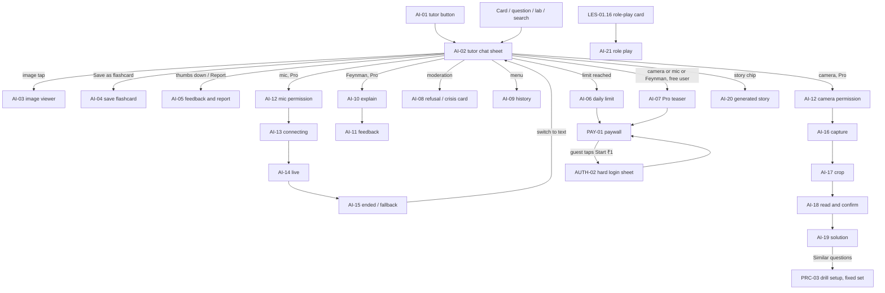

### A4. Tutor button visibility rules

The floating tutor button (AI-01) makes the tutor reachable from every study screen. It is hidden where it would help someone cheat, where it would cover controls, or where it would break focus.

| Shows | Hidden, and why |
|---|---|
| HOME-01 (Learn tab) | MOCK-07 and MOCK-08 mock runner, its palette and submit confirm (R24): the mock must feel like the real exam and must be fair |
| LRN subject map, chapter and LRN-03 topic card, revision sheet, cheat sheet, formula vault, LRN-11 storybook reader, notes, mind map | PRC-04 drill runner, while any question is open: practice asked for the tutor never to appear in a runner. It is reached from PRC-05 after answering |
| LES-01 lesson player (above the pinned CTA). On a question card it shows, but the tutor follows the hints-first policy and never gives the answer before the student has checked once | SOC-16 to SOC-19 duels: a live contest |
| LES-08 lesson complete | PRC-11 daily challenge before the student submits: it has a shared leaderboard (PRC-12) |
| MEM-03 review session, back side of a card only. Hidden on the front side so the tutor can't reveal the answer before the student tries to recall it | ENT and ONB screens: the student has not reached Home yet |
| MEM-07 decks, palace builder, MEM-22 technique library | AUTH sheets, PAY-01 paywall and checkout, payment status |
| LAB hub and LAB-04 (non-expanded) | Full-screen LAB sim, 3D or 360° view, and expanded video: it would cover controls. LAB-04's own [Ask tutor] button stays |
| PRC-01 practice hub, analytics, PRC-05 solution sheet, PRC-07 PYQ bank, MOCK-19 report, MOCK-22 solutions review | AI-02 itself, AI-10 to AI-21: the student is already in an AI surface |
| ME-01 tab root, pet room, plant garden | Friends tab and every SOC screen: they are not study screens |
| | SET settings, parent mode, privacy, delete account; ME shop and checkout flows |
| | Any screen while the software keyboard is open (the button would sit on the keyboard) |
| | Little learners (class 1–5, Phase 3): hidden by default (R14). A parent can turn on a "preset questions only" tutor in SET-14 ("Tutor button for {child}"); then it shows on HOME-06 and LES-01 only and opens the little-learner variant of AI-02 |
| | When the student turned the button off in SET-10 ("Show the tutor button"). The tutor then opens from the top bar and card menus only |

Rules:
- Position: bottom right, 16 px from the edge, 16 px above the pinned CTA or the tab bar. On screens with a pinned CTA it never overlaps the CTA.
- Context: each screen registers a context provider in `app-core` (`tutorContext()`), so the button sends what is on screen. With no provider the tutor opens with no context chip.
- While a tutor answer is streaming and the sheet is minimised, the button shows a small progress ring. When the answer finishes it shows a dot until opened.
- Web (≥ 600 px): the floating button is replaced by an [Ask {pet_name}] button in the top bar and the right-hand panel (UX_FLOW §4.17). The same hide rules apply.

### A5. Tutor chat: step-by-step logic

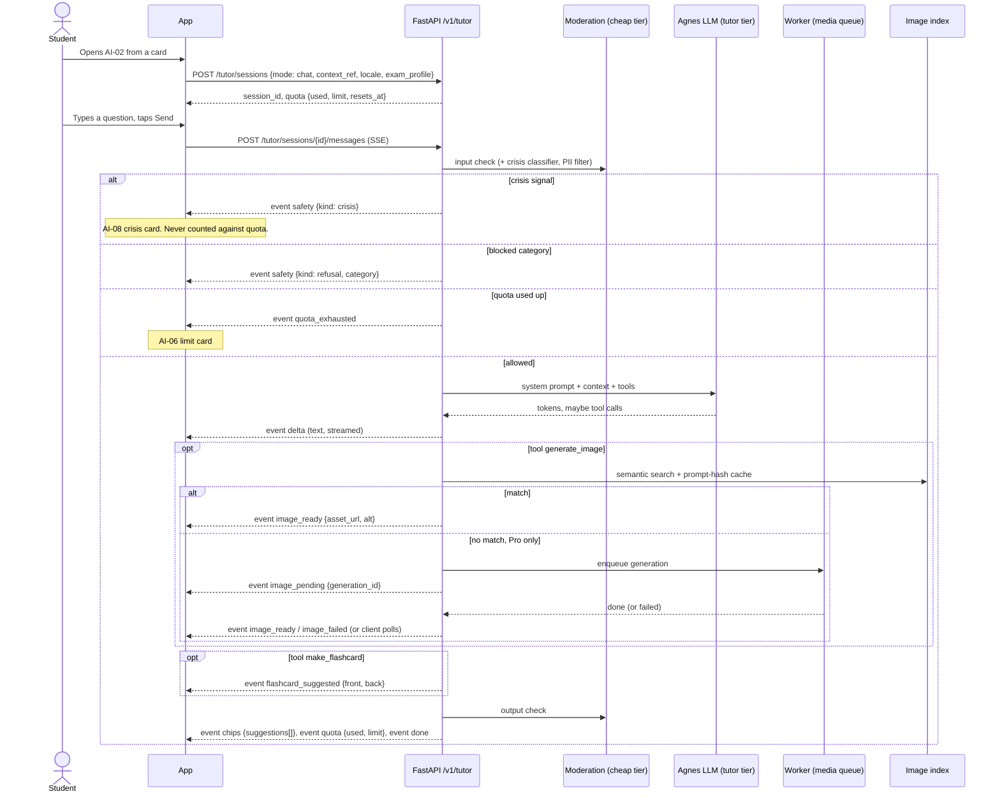

1. **Open.** The sheet opens at 60% height (UX_FLOW §4.6). If a session for the same context exists from the last 30 minutes, it reopens with its messages. Otherwise a new session starts (`ai.tutor_sessions`, mode `chat`). The context chip shows what the tutor can see ("{topic_title} · card 3 of 8"). The student can remove the chip to ask a general question.
2. **Empty state.** The pet greets, and 3 starter chips appear, built from the context: "Explain this simply", "Give me a hint", "Show an example". With no context: "Explain a topic", "Help with a question", "Quiz me".
3. **Send.** On Send, the app appends the message locally, shows the pet's "thinking" state and opens the SSE stream. A [Stop] button replaces Send while streaming. Stopping keeps the partial answer, marked "Stopped".
4. **Stream.** Text arrives as deltas. Inline and block maths (`$…$`, `$$…$$`) render with KaTeX when the closing delimiter arrives. Until then, the raw span shows as a shimmering placeholder, never as raw LaTeX. Markdown supports bold, lists and numbered steps only.
5. **Hints first.** For a question the student is working on (a question card, a drill or a PYQ before Check), the tutor gives a hint first and asks the student to try. The student can tap the chip "Show the full solution" after one hint.
6. **Images.** The model decides when a visual helps (TRD §9.3) and calls `generate_image`.
   - The API searches the image index first. A match arrives at once.
   - **Free users:** only index matches and cache hits are shown. If nothing matches, the answer stays text only and a "Draw it · Pro" chip appears (see open question Q-A2).
   - **Pro users:** a miss enqueues an Agnes job in the worker's `media` queue. The message shows the "Drawing…" placeholder (AI-02 state). Typical time is about 12 s for a 2K image (TRD §18 D6).
   - After 45 s the placeholder changes to "Still drawing. It will appear here when it's ready." The student can keep chatting. The image is attached to the message when it lands, even if the sheet was closed.
   - On failure or a policy block: "I couldn't draw this one." with [Try again] (one retry per message, it does not count as a new message).
   - Image prompts are written by the model from the content. They never copy the student's typed text, so no personal data reaches Agnes.
   - Hourly and daily image caps apply even for Pro (TRD §9.3, flags `tutor_images_per_hour`, `tutor_images_per_day`).
7. **After the answer.** Under each finished answer: thumbs up, thumbs down, "Save as flashcard", read aloud (free for everyone within the daily cap `free.tutor_read_aloud_per_day`, R35; Deepgram TTS, cached by text hash) and the overflow menu (Copy, Report). Then 2 or 3 follow-up chips. Chips are a fixed set the server picks from ("Explain simpler", "Show an example", "Give me a hint", "Quiz me on this", "Make it a story", "Draw it") plus at most one model-written chip.
8. **Save as flashcard** (AI-04). One tap quick-saves the `make_flashcard` suggestion (front and back) to the default deck "From the tutor" (`learn.decks.source = 'tutor'`) and shows a Toast (NTF-05) with [Edit] → MEM-09 card editor, pre-filled, and [View deck] → MEM-08. If there is no suggestion within 2 s, MEM-09 opens directly with the message text. MEM-09 owns editing and deck choice. Saving writes `learn.cards` with `source_ref` = the tutor message id, schedules it in local FSRS and appends an outbox event. It works offline once the answer is on screen. Free for everyone.
9. **Feedback** (AI-05). Thumbs up records `rating = up`. Thumbs down opens reason chips: Wrong, Confusing, Too long, Didn't answer my question, Wrong language, Not suitable. Only the reason codes are stored and sent to analytics. Picking "Wrong" or "Not suitable" also creates an `ai.moderation_flags` row (`source_kind = 'tutor_message'`, `action = 'queued'`), so the team reviews it.
   - **Report** (overflow menu on an answer, an image, a story page or a role-play reply) opens the shared **SET-24 Report content** sheet (me+money agent) with the item kind `tutor_message`, `generated_image`, `story_page` or `roleplay_turn`. One report sheet serves AI and community content in the app (R39). SOC-23 is for reporting a person or a shared deck (R39).
10. **Language.** The default is "Match how I write": the tutor mirrors Hindi, English or Hinglish as the student writes, falling back to the UI language. The overflow menu has "Answer in: Match how I write · English · हिन्दी · Hinglish". It writes `app.profiles.settings.tutor_locale`, the same key as SET-10 Study preferences (me+money agent).
11. **Close.** Swipe down or tap outside minimises the sheet. The session ends after 30 minutes idle (`ended_at`). The draft text is kept per context in `session_state` until sent or cleared.

### A6. Limits, Pro gates and the paywall hand-off

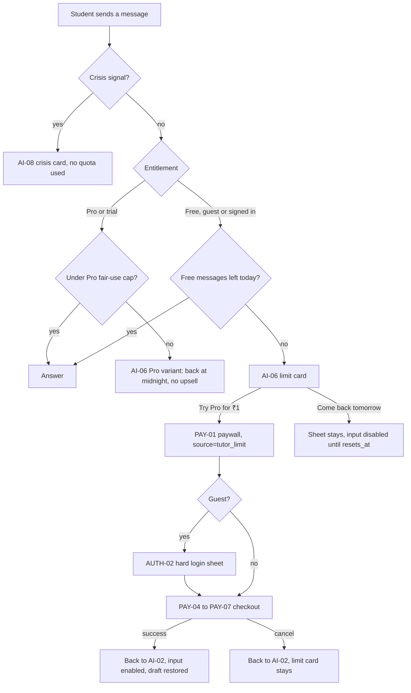

- **Free limit:** `free_tutor_messages_per_day` (PRD §11.1 says 5; it is a flag). It is the same for guests and signed-in free users, because the free tier works without login (PRD §1). Guests get a device-level cap as well, so a reinstall does not reset it (TRD §6 abuse control).
- **What counts:** each message the student sends, including follow-up chip taps, and one generated story (AI-20). Not counted: crisis responses, refusals from the input check, retries after a server error, image retries, a pre-filled draft from HOME-05 until it is sent, and role play (AI-21 has its own small cap, `free.roleplay_chats_per_day`, decided in revision 1).
- **Children (R15):** under-13 managed accounts never see a price or a Pro CTA. AI-06 offers [Review cards] and [Ask a grown-up] → PAY-03 grown-up check → PAY-17 pay for a child; AI-07 is replaced by a lock with "Ask a grown-up". Little learners never reach a limit screen.
- **Counter:** free users see "{n} of {limit} free questions left today" under the sheet title from the first message on. At 1 left it turns `warningText` with a clock icon.
- **Reset:** at local midnight in the profile's timezone (`ai.usage_daily.day`). The limit card shows the exact reset time.
- **Pro fair-use:** `pro_tutor_messages_per_day` (flag). At the cap, the Pro variant of AI-06 says the tutor is back at midnight and shows no upsell.
- **Pro tools for free users (R35):** camera (photo doubt), mic (voice), Feynman and "Draw it" (new Agnes images) show a small lock badge. Tapping one opens AI-07, a short teaser, then PAY-01 with the matching `source`: `tutor_voice`, `tutor_photo`, `tutor_feynman` (as in the me+money flow), plus `tutor_image` (new; me+money to add). Read aloud is not a Pro tool: it is free within `free.tutor_read_aloud_per_day`, and at the cap the button shows a Toast with the reset time, never a paywall. Indexed images are free (R35).
- **Return:** PAY-09 (welcome to Pro) returns to the same sheet. On success the entitlement refreshes from `/v1/me/summary`, the lock badges disappear, the input re-enables and the draft is restored. The limit card is replaced by the pet line "You're Pro now. Ask away!".
- **Offline:** the counter shows the last known value. Sending is disabled offline in any case.

### A7. Safety

PRD §5.5 and §16.4, TRD §9.2. Moderation runs on input and output with the `cheap` tier, plus a crisis classifier.

| Signal | Who | What the student sees | What is stored |
|---|---|---|---|
| Off-topic, under-13 (`age_band` `u10` or `10_12`) | Server, input check | The pet steers back: "I'm best at study questions. Want to get back to {topic_title}?" plus chips for the context | `ai.moderation_flags` category `off_topic`, action `allowed` with redirect |
| Off-topic, 13 and over | Server | Light redirect after one friendly answer if harmless; a polite refusal if not about study at all and not harmless | as above |
| Harmful request (violence, weapons, drugs, sexual content, hate, cheating in a live exam, personal data of others) | Server, input or output | AI-08 refusal: a short, calm message with no lecture, plus "Back to studying" chips | category, action `blocked`. The message text stays in `ai.tutor_messages` with `flagged = true` for review, under the 180-day retention |
| Self-harm, suicidal thoughts, abuse, or a crisis | Server crisis classifier, and an on-device keyword check (English, Hindi, Hinglish) that also works offline and at the limit | AI-08 crisis card (below). The normal answer is not shown | `ai.moderation_flags` category `crisis`, action `queued`. **No product analytics event carries the user id**: only an aggregate ops counter (§A12) |
| Personal data typed by the student (phone numbers, addresses) | Server PII filter | Removed from the prompt. The tutor reminds the student not to share personal details | Redacted before the LLM call |
| The output fails the output check | Server | The partial answer is replaced by "Let me try that again." and the model gets one retry. A second failure shows the refusal | category, action `blocked` |

**Crisis card (AI-08 crisis variant):**
- It interrupts the chat with a calm, plain card. The pet stays as a small static avatar: no animation, no jokes, no study chips.
- Copy acknowledges the feeling, says the student is not alone, and points to a trusted adult and helplines.
- Helplines come from config `safety.helplines[locale]`, never from code. Candidate values for India, **to be verified against the official sources by the owner and legal before launch** (AGENTS rule 3):
  - Tele-MANAS (Ministry of Health and Family Welfare), 24×7 mental health line: 14416 or 1-800-891-4416.
  - CHILDLINE (Ministry of Women and Child Development), for anyone under 18: 1098.
  - Emergency: 112.
- Buttons: [Call {helpline_name}] for each (opens the dialler with the number, never auto-dials), [Talk to someone I trust] (shows a short list: parent, teacher, school counsellor, with no data sent), and [Keep talking to {pet_name}].
- "Keep talking" continues in a supportive mode that follows safe-messaging guidance: no methods, no judgement, and it keeps offering the helplines. It never resumes the study topic by itself.
- The crisis card is shown even when the student is at the daily limit, offline (device keyword check), or a guest.
- **No automatic guardian notification.** Telling a guardian could put a child at risk if the danger is at home. A human safety review policy for queued crisis flags is an owner and legal decision (Q-A5).

### A8. Feynman mode (AI-10, AI-11) · Phase 2

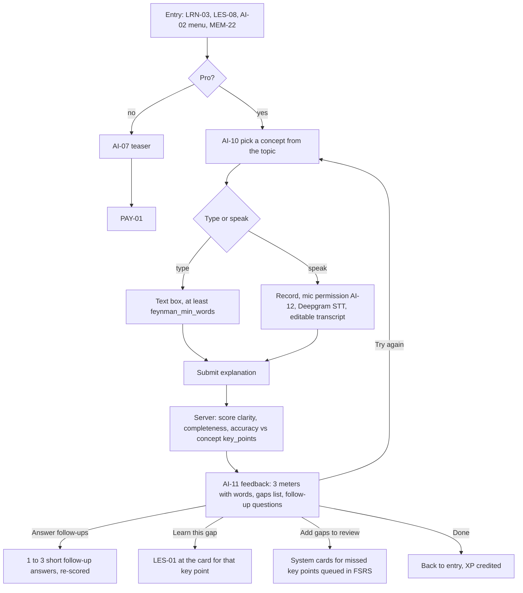

- Runs as a tutor session with `mode = 'feynman'` and `context_ref = concept_id`. The score is written to `ai.feynman_scores` (clarity, completeness, accuracy 0–100, `gaps`).
- Grading compares the explanation with the concept's published `key_points` (IMPLEMENTATION_PLAN G-3). The key points themselves are content from the bundle. The AI only marks which ones were covered, missed or wrong.
- First use shows a demo of about 10 seconds, and a "?" icon in the header replays it (research X19). The same applies to voice (AI-14), role play (AI-21) and duels (SOC-15).
- Scores are shown as three labelled meters with a word band, never as colour alone. Bands are config (`feynman_bands`: needs work, getting there, clear).
- "Since last time" comparisons appear only when an earlier score for the same concept exists (real data, AGENTS rule 3).
- Voice explanations: up to `feynman_max_record_seconds` (flag). Audio goes to Deepgram STT through the API and is not stored after transcription. The transcript is editable before submitting.
- Counts against the Pro tutor fair-use cap (one grading call plus one per follow-up).
- Offline: AI-10 lets the student type and save a draft. Submit waits for a connection, with "We'll grade it when you're online" and a [Send now] that becomes active when online.

### A9. Voice tutor (AI-12 to AI-15) · Phase 2

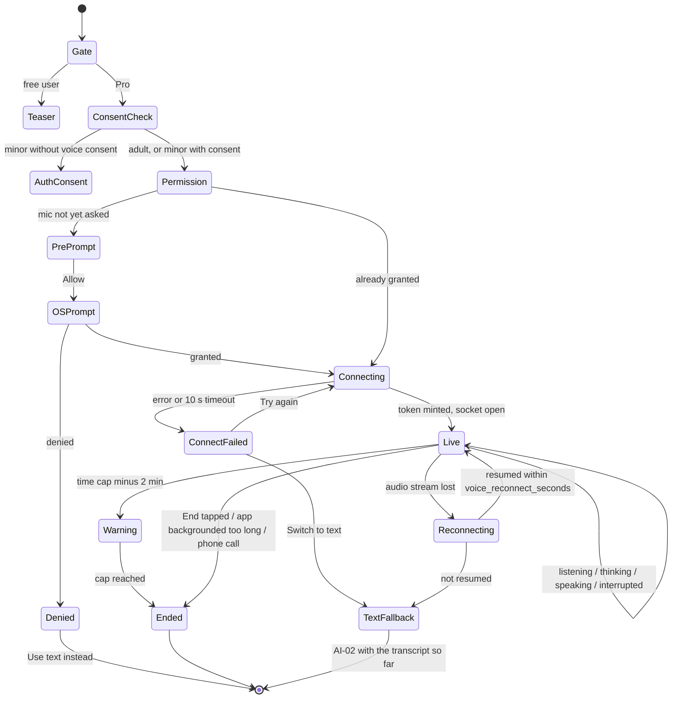

1. **Gate.** Voice is Pro only with a fair-use limit (PRD §5.5, §11.1). Free users get AI-07. For under-18s, voice sends audio to a third-party processor (Gemini Live), so it needs the guardian consent record to include the `voice` scope (auth flow §6.10). Without it, a teen sees AUTH-18 (AUTH-21 while pending); an under-13 managed account needs the parent to turn it on in SET-17. Little learners: voice is off.
2. **Mic permission.** If the OS permission was never asked, AI-12 (mic variant) explains why first, then the OS prompt. If denied: "Turn on the mic in Settings" with [Open settings] and [Use text instead].
3. **Connecting** (AI-13). `POST /v1/voice/session` checks entitlement, quota and consent, builds the context (system instructions, card, mastery, locale, age band) and mints a short-lived Gemini Live ephemeral token (TRD §9.4). The client opens the audio socket. Timeout 10 s, then AI-13 error state.
4. **Live** (AI-14). The pet shows four states: listening (ears up), thinking, speaking (mouth moves), and interrupted. Captions show both sides live, from Gemini Live's input and output transcription. Captions are on by default.
   - **Interruptions:** when the student speaks while the tutor is talking, the tutor's audio stops at once (barge-in), its caption ends with "…", and the pet switches to listening.
   - **Board:** images (`generate_image`) and formulas appear in a small board area under the pet. Formulas need a `show_on_board` tool (gap G-3). Tool calls are relayed to the API (TRD §9.4).
   - **Flashcards:** "Save that as a flashcard" by voice calls `make_flashcard`. A toast confirms with [Edit].
   - **Controls:** Mute, Captions on or off, [Switch to text], [End].
5. **Time caps.** `voice_session_max_seconds` and `voice_daily_seconds` (flags; fair-use per PRD). At 2 minutes left the banner says so. At the cap the tutor says a short goodbye and the session ends. The remaining daily time shows on AI-13.
6. **Network drop.** If audio stops arriving for 3 s: "Connection is weak. Trying to reconnect…". The app asks for a fresh token and resumes the session if possible. If not back within `voice_reconnect_seconds` (flag), the session ends and AI-15 offers [Continue in text]. That opens AI-02 with a summary of the voice transcript as context, so the student does not repeat themselves.
7. **Interruptions by the phone.** A phone call or audio focus loss pauses the session. Backgrounding the app for more than `voice_background_grace_seconds` (flag) ends it, to protect cost and privacy.
8. **End** (AI-15). Shows duration, flashcards made, and [View transcript], [Back to {where_from}]. The transcript is stored privately in R2 (`ai.voice_sessions.transcript_key`) and listed in AI-09 under the same 180-day retention.
9. **Web.** The browser asks for the mic. The same token flow works from the browser. Push-to-talk with the space bar is offered on desktop as an option.

### A10. Photo doubt (AI-16 to AI-19)

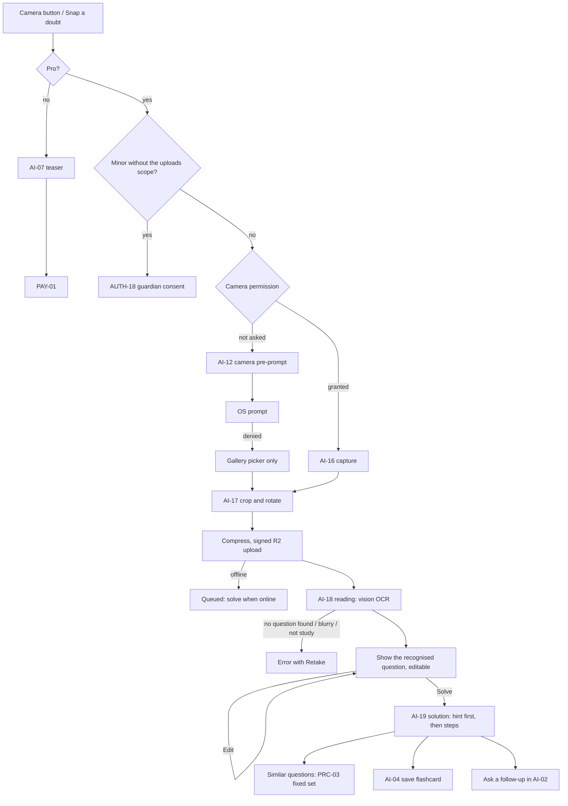

1. **Gate.** Pro only (PRD §11.1). For minors the guardian consent must include the `uploads` scope (auth flow §6.10). Under-13s don't get photo doubt in Phase 1 (the PRC-01 "Snap a doubt" row is hidden for them).
2. **Camera permission.** AI-12 (camera variant) first, then the OS prompt. If denied, the gallery picker still works (the Android photo picker and iOS PHPicker need no library permission).
3. **Capture** (AI-16). A guide frame: "Fit one question inside the box". Flash toggle, gallery button, shutter. Tips appear after 2 blurry attempts.
4. **Crop** (AI-17). Drag handles, rotate 90°, [Use photo] and [Retake]. "One question at a time" hint.
5. **Upload.** The app compresses to at most 2048 px on the long edge, requests a signed R2 upload URL (gap: `POST /v1/uploads/sign`), uploads to the private `uploads` bucket, then calls `POST /v1/ai/doubt-photo {upload_key, context}`. The worker scans the image (TRD §5 Files). Offline, the photo is kept on the device with "We'll solve it when you're back online". It is sent automatically when online, and the student gets an in-app banner (not a push).
6. **Read and confirm** (AI-18). The vision model returns the recognised question as text with LaTeX, the detected subject and the linked concepts. The student sees it rendered and taps [Solve this] or [Edit]. This step stops wrong solutions from a bad read.
   - Errors: blurry, no question found, more than one question ("Crop to one question"), handwriting unreadable, not a study photo. A photo with a face or a personal document is rejected with "We only need the question." and deleted.
7. **Solution** (AI-19). Streams as a tutor session with `mode = 'doubt_photo'`. Hints first: the student sees "Try with a hint" and "Show full solution". Steps reveal one at a time, with KaTeX. Linked concept chips open LRN-03. "Similar questions" opens PRC-03 with a fixed set (`question_ids[]` of published questions on the same concepts from `search_content`; scope row "Similar questions ({n})"). The free practice cap does not apply because photo doubt is Pro.
8. **Retention.** Doubt photos are deleted after `doubt_photo_retention_days` (flag, recommended 30) unless the student saves the solution, in which case only the recognised text is kept. Q-A4.

### A11. Generated story (AI-20) and role play (AI-21)

**Generated story.**
1. The student taps "Explain this as a story" (LRN-03, the LES-04 card menu, or the chip in AI-02).
2. `POST /v1/ai/story {concept_id, locale, age_band}` returns a story id. The LLM writes `story_pages` pages (flag, recommended 4 to 6) grounded in the concept summaries from `search_content`. Each page has text and one image request.
3. Text appears first. Each page's image fills in as it arrives, with a "Drawing…" placeholder. Images use the `storybook` preset (DESIGN §6.2) and go through the image index first. Free users get index matches only, with a tinted placeholder card showing the page's key idea when no image is found (no "fake" art).
4. The reader reuses the LRN-11 storybook reader layout (the shared `StorybookReader` component). Extra actions: read aloud (free within the daily cap, R35), "Save story" (kept in AI-09 history), "Make a flashcard", thumbs up or down, Report.
5. For free users one story counts as one tutor message. Age band sets the style: simpler words and shorter pages for under-13s.
6. Offline: only saved stories open. A new story needs a connection.

**Role play.**
1. The LES-01.16 role-play entry card (content format §7: `character`, `persona_prompt`, `goals[]`, `guardrails[]`, `opening_line`, `suggested_replies[]`) starts AI-21 in place inside the lesson player when the student taps a suggested reply, the mic or [Start chat]. The chosen reply becomes the first student message. (Learn's UX spec still says "full screen" in LES-01.16 while learn's flow says "in place"; this doc follows the flow, see the conflicts list.)
2. A session starts with `mode = 'roleplay'` (gap G-1: the mode check needs this value) and `context_ref = card_id`. The character's opening line comes from the script, so it shows instantly and offline.
3. The student replies by tapping a suggested reply chip or by typing. Mic input uses Deepgram STT into the text box (Pro). Under-13s and little learners get chips only, no free text.
4. The character stays in its era and follows the script's guardrails. If the student asks for something unsafe or far off-topic, the character "steps out of the story" with a plain line from the tutor and offers to go back.
5. The goals from the script show as a small checklist ("Find out: {goal}"). When all goals are met, or after `roleplay_max_turns` (flag), the character wraps up. A summary card lists what the student found out, linked to concepts, with [Continue lesson].
6. [Continue] is available after the first exchange, so the card never blocks the lesson. [Skip] is always there.
7. **Limits (decided in revision 1).** Role play never uses tutor messages, so a free lesson stays complete. It has its own small cap: free students get `free.roleplay_chats_per_day` chats a day, each up to `roleplay_max_turns` student turns; Pro has no daily cap beyond the shared fair-use cap. A chat in progress always finishes. At the daily cap the card shows the opening line and replies read-only with [Continue lesson] and is marked "to revisit". There is no paywall on this card.
8. Offline: the opening line and the suggested replies show, with "This chat needs internet" and [Skip for now]. The card is marked "to revisit" in `lesson_progress`.

### A12. Branches across the AI area

| Branch | Rule |
|---|---|
| Guest vs signed in | The tutor, stories and role play work for guests. History is kept under the anonymous user id and survives sign-in through `linkIdentity` (same user id). Pro tools need Pro, and buying Pro needs sign-in (AUTH-02, reason `pro`). |
| Free vs Pro | §A6. Free: `free_tutor_messages_per_day` text messages, index images only, read aloud within a daily cap, no voice, photo doubt, Feynman or new image generation (R35). Pro: fair-use caps, Agnes image generation, all tools. Trial users are Pro. |
| Online vs offline | The tutor needs a connection. Offline, AI-02 shows its offline state, keeps the draft, and offers "Search downloaded lessons". Saved answers, saved stories, flashcards and history already on the device open offline. The crisis card works offline. |
| Minor vs adult | Under-13s: on-topic only, simpler language, chips-first, no prices or Pro CTAs (R15). Under-18s: voice and photo uploads need the `voice` and `uploads` consent scopes. Tutor content filters are stricter for minors. Little learners (Phase 3): no tutor button by default (R14); with the parent's opt-in in SET-14, the AI-02 little-learner variant (chips only, read aloud, no camera, mic, Feynman or free text). |
| Per-exam vs all-exams app | The tutor's exam profile is the variant's exam (per-exam) or the primary exam (all-exams). `search_content` filters by that profile. Questions about another exam are still answered as study questions, with citations from that app's content only. |
| Mobile vs web | Web: right-hand panel instead of a sheet, top-bar button instead of the floating one, paste or drag an image for photo doubt, browser mic for voice, keyboard shortcuts (UX doc). |

### A13. Edge cases

- **Context card changes while the sheet is open** (the student swipes to the next card with the sheet minimised): the chip updates to the new card and the tutor is told "The student moved to card {n}".
- **Bundle updated mid-session:** the context uses the `bundle_hash` the student is looking at.
- **Two devices:** sessions are per device. History merges on the server.
- **Entitlement expires mid-session:** the current answer finishes. The next message follows free rules.
- **Image arrives after the session ended:** it is attached to the message in history. No notification.
- **Very long student message:** capped at `tutor_max_input_chars` (flag) with a counter.
- **Student pastes an answer key or asks the tutor to do a live mock:** the tutor is hidden in the mock runner. If asked about a live exam in progress, it refuses (cheating in a live exam).
- **Tutor eval regressions:** a model tier change runs the eval set first (TRD §9.1). The UI does not change.
- **Rate limit or 429 from Agnes:** the gateway retries with backoff (TRD §18 D6). After 10 s the student sees "Taking longer than usual…". After 30 s: error with [Try again], not counted.
- **Language switch mid-session:** new answers use the new language. Old ones stay.
- **Sign out:** local tutor drafts and cached history are deleted from the device.

### A14. Storage: local vs server

| Data | On device | Server | Notes |
|---|---|---|---|
| Sessions and messages | `session_state` (drafts, last session per context), cached history list (gap G-6) | `ai.tutor_sessions`, `ai.tutor_messages` (180 days) | Mode check needs `roleplay` (G-1) |
| Quota | Last known `{used, limit, resets_at}` in `profile_snapshot` | `ai.usage_daily` | Free limit from `/v1/config` flags |
| Feedback and reports | none | Gap G-2: `ai.message_feedback (message_id, user_id, rating, reasons text[], created_at)`; reports also in `ai.moderation_flags` | Reasons are codes only |
| Images | `asset_cache` | `content.media_assets` (`source = 'agnes'`), `ai.generations` | Visibility rule for tutor images: Q-A2 |
| Flashcards | `decks`, `cards`, `srs_cards`, `outbox` | `learn.decks` (`source = 'tutor'`), `learn.cards` | Free |
| Feynman | Draft in `session_state` | `ai.feynman_scores` | |
| Voice | none (audio is never stored on device) | `ai.voice_sessions`, transcript in private R2 | 180 days |
| Doubt photos | The queued photo until sent | Private R2 `uploads`, `ai.generations` (`kind = 'doubt_photo'`) | Retention flag (Q-A4) |
| Generated stories | Saved stories in `asset_cache` + `session_state` | Gap G-5: `ai.generated_stories (id, user_id, concept_id, locale, pages jsonb, created_at)` | 180 days unless saved |
| Moderation | none | `ai.moderation_flags` (service only) | |

**Endpoints** (TRD §5.1, with gaps):

| Endpoint | Status |
|---|---|
| `POST /v1/tutor/sessions`, `POST /v1/tutor/sessions/{id}/messages` (SSE) | In TRD. SSE event types to add (G-4): `delta`, `image_pending`, `image_ready`, `image_failed`, `flashcard_suggested`, `chips`, `quota`, `quota_exhausted`, `safety`, `done`, `error` |
| `GET /v1/tutor/sessions?cursor=` and `GET /v1/tutor/sessions/{id}` | Missing (history, AI-09) |
| `DELETE /v1/tutor/sessions/{id}` | Missing (the student deletes a chat) |
| `POST /v1/tutor/messages/{id}/feedback` | Missing (AI-05) |
| `GET /v1/ai/generations/{id}` | Missing (image polling fallback) |
| `POST /v1/ai/story`, `POST /v1/ai/doubt-photo`, `POST /v1/voice/session` | In TRD |
| `POST /v1/uploads/sign` | Missing (TRD §5 mentions signed URLs but no endpoint) |
| `POST /v1/ai/feynman/score` (or a `feynman` mode on the messages endpoint) | Missing |
| `POST /v1/ai/stt` (Feynman voice, role-play mic) | Missing |
| `POST /v1/ai/tts` (read aloud) | Missing (TRD §9.4 mentions on-demand TTS) |

### A15. Analytics events (AI)

All events go through the typed catalogue in `packages/analytics`. No free text, no message content, no transcript, no photo. Lengths are bucketed.

| Event | Props |
|---|---|
| `tutor_button_tapped` | `screen`, `context_kind` (`card`, `question`, `lab`, `review`, `none`) |
| `tutor_opened` | `entry` (`fab`, `card_menu`, `ask_why`, `lab`, `search_prefill`, `question`, `topbar`), `context_kind`, `is_resume` |
| `tutor_message_sent` | `session_id`, `input` (`typed`, `chip`, `prefill`), `chip_id` (fixed chips only), `length_bucket`, `lang` (`en`, `hi`, `hinglish`, detected) |
| `tutor_answer_completed` | `session_id`, `ttft_ms`, `duration_ms`, `had_image`, `had_math`, `tools` (names only), `stopped` |
| `tutor_image_state` | `state` (`index_hit`, `cache_hit`, `pending`, `ready`, `failed`, `blocked`, `locked_free`), `wait_ms` |
| `tutor_followup_chip_shown` / `_tapped` | `chip_id` (model chips logged as `model`) |
| `tutor_feedback_given` | `rating` (`up`, `down`), `reasons` (codes), `reported` |
| `tutor_flashcard_saved` | `source` (`button`, `tool`, `voice`), `edited` |
| `tutor_limit_reached` | `tier` (`free`, `pro_fair_use`), `is_guest` |
| `pro_teaser_shown` / `_cta_tapped` | `feature` (`voice`, `photo_doubt`, `feynman`, `tutor_image`) |
| `tutor_read_aloud_played` | `source` (`chat`, `story`, `roleplay`), `capped` (add to catalogue) |
| `tutor_safety_shown` | `kind` (`refusal`, `redirect`) only. **Crisis cards are never logged per user**: the API increments an ops counter `safety_crisis_total` with no user id |
| `feynman_started` / `_submitted` / `_completed` | `input` (`typed`, `voice`), `clarity_band`, `completeness_band`, `accuracy_band`, `gaps_count`, `followups_answered` |
| `voice_permission_result` | `result` (`granted`, `denied`, `blocked`) |
| `voice_session_started` / `_ended` | `connect_ms`, `seconds`, `interruptions`, `reconnects`, `end_reason` (`user`, `cap`, `network`, `background`, `call`, `error`) |
| `voice_fallback_to_text` | `reason` |
| `tutor_image_viewed` | `zoomed` |
| `photo_doubt_step` | `step` (`permission_granted`, `permission_denied`, `capture`, `gallery`, `crop`, `upload`, `read_ok`, `read_failed`, `edited`, `solved`), `fail_reason` (code) |
| `photo_doubt_similar_opened` | `count` |
| `story_requested` / `_completed` / `_saved` | `pages`, `images_ready`, `age_band_group` |
| `roleplay_started` / `_turn` / `_completed` / `_skipped` | `card_id`, `input` (`chip`, `typed`, `voice`), `goals_met`, `turns`, `capped` (daily cap reached) |
| `mode_demo_viewed` | `mode` (`feynman`, `voice`, `roleplay`, `duel`), `trigger` (`first_use`, `help_icon`), `skipped` (add to catalogue) |
| `ai_history_opened` / `ai_session_deleted` | none |

### A16. Open questions (AI)

| # | Question | Recommendation |
|---|---|---|
| Q-A1 | What is the Pro fair-use cap for text, and the voice caps per session and per day? | Set by flags. Start generous for text (for example 100 messages a day) and tight for voice (for example 15 min a session, 30 min a day), then tune from `ai.usage_daily` cost data. |
| Q-A2 | Do free users get any images from the tutor? | **Closed by R35:** yes, but only reused images from the approved index and exact cache hits, never new Agnes generations. Exact prompt-hash hits can be reused across users at once, because prompts never contain student text. Semantic reuse only of `approved` images. |
| Q-A3 | Do voice and photo uploads for under-18s need guardian consent? | **Closed:** yes, through the `voice` and `uploads` scopes (auth flow §6.10). Voice off for little learners. Legal review confirms. |
| Q-A4 | How long are doubt photos kept? | 30 days, then deleted. Saved solutions keep only the recognised text. |
| Q-A5 | What happens after a crisis flag? | A named safety lead reviews queued crisis flags within a set time. No automatic guardian contact. Legal review of the helpline list and copy before launch. |
| Q-A6 | Should the tutor be available to little learners at all? | **Closed by R14:** no tutor button by default. A parent can turn on a "preset questions only" tutor in SET-14; it is then chips only, read aloud, no free text. Phase 3. |
| Q-A10 | Does role play count against the free tutor limit? | **Closed in revision 1:** no. It has its own small cap (`free.roleplay_chats_per_day`, `roleplay_max_turns`), as the coordinator preferred. Learn's open question on this is answered the same way. |
| Q-A7 | Does Feynman mode feed mastery? | Yes, as a weak signal: a "clear" band on accuracy and completeness adds a mastery event. It never lowers mastery. |
| Q-A8 | Generated stories for free users: one tutor message each, or a separate daily cap? | One tutor message each, with images only from the index for free users. |
| Q-A9 | Is read aloud Pro? | **Closed by R35:** free for everyone with a daily cap flag (`free.tutor_read_aloud_per_day`). Little learners can't read long text yet, so the parent-enabled little-learner tutor reads every answer aloud; whether their cap is separate is an owner call. Cache TTS by text hash (TRD §9.4) to keep cost low. |

---

## Part B · Social

### B1. Purpose

Social features turn studying into a shared habit (PRD §2.1 goal 2, §8) while keeping children safe (PRD §16.4, DPDP). The Friends tab holds: friends and requests, the weekly league, leaderboards, Duos (friend streaks, R32), squads, challenge duels, shared decks, preset cheers and nudges, and report and block. All of Part B is Phase 2 (R8); squad group mocks are Phase 3.

**How students appear to each other (R31, amended).** Minors (under 18) appear nowhere social before guardian consent (AGENTS rule 8). After consent:
- **Public surfaces** (leagues, random duels, the All India, school, city and squad boards, the PRC-12 challenge leaderboard, community content): the pet avatar plus an auto-generated nickname from a fixed word list, for example "Sunny Sprout 27" / "धूप अंकुर 27" (rendered as `public_nickname` from `app.profiles.nickname_word_ids` and `nickname_number`, gap G-S12). Never the typed pet name and never a real name, because typed names can carry personal data.
- **Friends added by invite link or QR** (real-world contact): the pet avatar and the pet name. Friends added any other way (a teen found by exact username search) see the nickname.
- A minor's `@handle` is used only for exact search and is never shown on public surfaces. Usernames are generated from safe word lists, never from a real name.
- **Adults** appear by display name.
- A minor's real name, first name or initial is never shown to another student. PRD §16.4 now says the same (R31 amended).
- The UX doc writes this as `{name}`: the display name for adults; for minors the pet name or the nickname, by the rule above.
- The nickname word list lives in config (EN and HI pairs plus a number), is checked by a person before use, and is fixed per account (it changes only if a moderator resets it).

### B2. Decision: no free-text chat anywhere

There is **no free-text messaging** between users: no DMs, no squad chat, no duel chat, no comments, for adults or minors.

Why:
1. **The audience is mixed.** JEE and NEET aspirants are 16 to 19 (PRD §3), so adults and minors share leagues, squads and exam groups. Any chat open to adults would reach minors.
2. **DPDP and PRD §8** require no open DMs for under-18s. Age-split chat would add a second product to build and moderate for a small gain.
3. **Moderation cost.** Real-time text moderation in English, Hindi and Hinglish, with human review, is expensive and still leaks.
4. **Focus.** Students already have WhatsApp for chat. Smriti's job is the study loop. Preset messages keep the warmth (cheers, nudges, challenges) without the risk.

What exists instead: preset reactions (kudos) on friend activity, a short list of preset messages, Duo nudges, duel challenges, and shared decks. User-typed text that other people can see is limited to: the username (moderated at creation), and deck titles and card text in shared decks (moderated before they are listed, shown with no author name, R20). Squad names come from a name picker, not free text.

### B3. Entry points

| From | Opens |
|---|---|
| Bottom tab "Friends" | SOC-01, or SOC-02 when locked |
| Deep link `smriti.app/invite/{code}` (APP_FLOW §4) | New or signed-out users: ENT-06 invite variant, then onboarding and AUTH-02. Then SOC-04 "Add {name}?" confirm |
| Deep link `smriti.app/duel/{code}` | New or signed-out users: ENT-06 duel variant, then AUTH-02. Then SOC-20 incoming duel |
| Deep link `smriti.app/squad/{code}` (gap: not in APP_FLOW §4) | SOC-13 join squad |
| Deep link `smriti.app/deck/{share_code}` (gap: not in APP_FLOW §4) | SOC-21 preview, then MEM-08 after [Add a copy] (R41) |
| Any social deep link in little-learner mode, or one that has expired | ENT-07 link not available |
| NTF-01 push templates: `friend_request`, `friend_accepted` (new), `friend_cheer`, `duo_invite` (new), `duo_nudge`, `duel_challenge`, `duel_result` (new), `league_ending`, `league_promoted`, `league_result` (new), `squad_quest_done` (new); NTF-04 in-app banners for live duel invites | The matching SOC screen |
| LES-08 lesson complete, MOCK-19 mock report | "Challenge a friend" → SOC-15 with the same subject (hidden without the `social` scope) |
| MEM-07 decks footer | "Find shared decks" → SOC-21 |
| MEM-11 share deck sheet | Sharing is owned by memory-labs; shared decks then appear in SOC-21 for friends |
| SET-11 privacy | Social privacy options (discoverable by username, league opt-out). SET-11 owns the screen; options listed in §B11 |

### B4. The social gate

Every social action needs a signed-in account (PRD §10.1: hard trigger). Under-18s also need guardian consent first (PRD §16.4, TRD §6). The gate runs on opening the Friends tab, on every social deep link, and on every social action from elsewhere ("Challenge a friend").

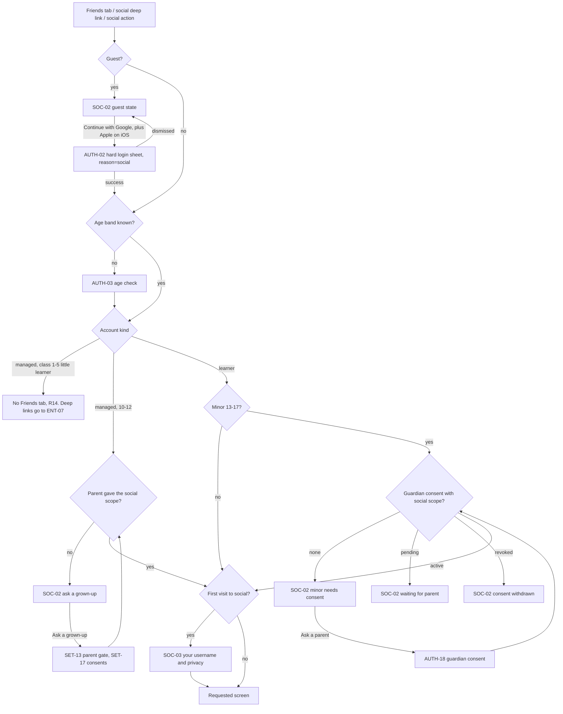

- The deep link that started the gate is kept and resumed after each step (APP_FLOW §3.2: return to where they were).
- A guest who opens an invite or duel link lands on ENT-06 first, then onboarding (ONB-01 onwards) and AUTH-02 when they tap [Add friend] or [Accept challenge].
- Little learners (class 1–5) have no Friends tab (R14) and no social features. Phase 3 may add a parent-set "family circle" (Q-B3).
- **Account kinds** follow the auth flow §3: guests, adult learners, teen learners (13 to 17, consent through AUTH-18 to AUTH-23 with the `social` scope, auth §6.10), and managed accounts for under-13s (class 1–5 little learners and ages 10–12), whose consent the parent gives at account creation or later in SET-17.
- **The username** is created automatically at sign-in from a safe generator (auth `POST /v1/auth/linked`). SOC-03 shows it once, on the first visit, so the student can keep or change it and set discoverability.
- **Consent pending** lasts until the guardian confirms (AUTH-19 on the same phone, or AUTH-21 by link or QR). The minor can still use the rest of the app.
- **Consent withdrawn** (guardian revokes in SET-17 or from their own account): social rows for the minor are hidden from others at once, Duos end, squad membership is suspended, league participation stops from the next week. Data is deleted per the consent withdrawal rules (`app.data_requests.kind = 'withdraw_consent'`).
- What each locked state shows is in the UX doc (SOC-02). It is never an empty screen. It shows the student's own real numbers (this week's XP, streak) and what unlocks.

### B5. Friends and adding friends

**Ways to add a friend.** Contacts are never read: there is no contacts permission and no phone-number matching.

| Method | Who can use it | Logic |
|---|---|---|
| Invite link `smriti.app/invite/{code}` | Everyone who passes the gate | Uses `app.profiles.referral_code`. Shared through the OS share sheet (WhatsApp is the main channel). Opening it sends a friend request from the invitee that the inviter has already agreed to, so it is accepted at once after the invitee confirms "Add {name} as a friend?". Doubles as the referral: both get a free week of Pro (PRD §8) when the invitee signs in and finishes their first lesson. |
| QR code | Everyone who passes the gate | SOC-05 shows "My QR" (the invite link as QR) and "Scan". In person only, so it is the safest way for minors. Scanning works the same as opening the link. |
| Username search | Adults search anyone discoverable. Teens (13 to 17) search adults and teens who are discoverable. Under-13s can't search | Exact handle match only (case-insensitive), no partial results, no suggestions, no browsing. Finds only profiles with "Others can find me by username" on. Default: on for adults, **off for minors**. Sends a request that the other person must accept. |
| From a league row, duel result or squad | Adults only, and only to other adults | "Add friend" on the mini profile. Minors don't see this button, and adults don't see it on minors' rows. |

**Adult and minor friendships.** An adult cannot find a minor by search (minors are not discoverable by default, and an adult never sees an add button on a minor). An adult and a minor become friends only through an invite link or QR, which needs real-world contact. The minor sees "Only add people you know in real life" on every confirm. Parent mode (SET-14) lists the minor's friends and can remove any of them (SET-14 "{child}'s friends" row).

**Requests.** Stored as `social.friendships` with `status = 'pending'` and `requested_by`. Requests appear in SOC-06 inbox. Accept, Decline (silent: the sender is not told) or Block. Pending requests expire after `friend_request_ttl_days` (flag). A cap on outgoing requests per day (`friend_requests_per_day`, flag) limits spam.

**Friend limit.** `max_friends` (flag). The friends list sorts by today's activity, then streak.

**Removing a friend.** From SOC-07 overflow: "Remove friend". Silent. Ends the Duo with that friend, if any.

### B6. League

```mermaid
stateDiagram-v2
  [*] --> NotJoined
  NotJoined --> InCohort: first XP of the week (adult auto opt-in after sign-in, or teen who tapped Join; gate passed; not opted out)
  InCohort --> InCohort: earn XP, rank updates (Redis sorted set)
  InCohort --> Rollover: Sunday at league_close_time IST
  Rollover --> Promoted: rank within promote zone (not Banyan)
  Rollover --> Stayed: middle
  Rollover --> Demoted: rank within demote zone (not Seed)
  Promoted --> ResultSheet
  Stayed --> ResultSheet
  Demoted --> ResultSheet
  ResultSheet --> NotJoined: new week, joins on first XP
  InCohort --> OptedOut: "Take a break from leagues"
  OptedOut --> NotJoined: turned back on (next week)
```

- **Week:** Monday 00:00 to Sunday `league_close_time` IST for everyone (TRD §10). Time left is shown to the minute in the last hour, in hours and days before that.
- **Tiers (R30):** 10 (DB_SCHEMA `league_cohorts.tier`, 1 to 10), named after plants and trees, lowest first: Seed बीज, Sprout अंकुर, Leaf पत्ती, Bud कली, Bloom फूल, Lotus कमल, Mango आम, Neem नीम, Peepal पीपल, Banyan बरगद. Names live in config (`league.tier_names`, EN and HI) so the owner can rename them. Each tier has a `league-tier` crest from Agnes built around its plant, so tiers differ in shape as well as colour.
- **Cohorts (R30):** groups of `league_cohort_size` (default 30) within one exam (`exam_group`, PRD §7). In a per-exam app it is that exam. In the all-exams app it is the primary exam. Changing the primary exam mid-week moves the student at the next week. Promotion and demotion counts are flags (`league_promote_count`, default 7; `league_demote_count`, default 5), per tier if needed. Banyan has no promotion zone; Seed has no demotion zone.
- **Joining (R30):** adults are opted in automatically after sign-in, with an opt-out. Teens (13 to 17, with the `social` scope) join by choice: a one-tap [Join] card on SOC-01 and SOC-08. Either way a student enters a cohort on their first XP of the week, so inactive users don't fill cohorts. New students start in Seed.
- **XP rules:** league XP is the week's XP from `game.xp_ledger` (sources: lesson, review, practice, mock, quest, duel, challenge, bonus). Amounts per activity come from gamification config (game area), including reduced XP for replaying a finished lesson (research A33). The anti-cheat caps on XP per hour (TRD §10) apply. XP from duels flagged for too-fast answers (§B10) is left out of league XP. The league info sheet (SOC-24) lists the sources; it does not invent amounts.
- **Best week (research X11):** SOC-08 shows "Your best week: {xp} XP in {tier_name}" from the student's own history, so rank is never the only measure. Hidden until one full week has ended.
- **Rewards:** gems or badges for top ranks come from gamification config (`league_rewards`), shown in the result sheet only when granted.
- **Who is in leagues:** adults and teens (13 to 17) who passed the gate. No leagues for under-13s or for class 1–5 (R30); ages 10 to 12 see the friends board instead.
- **How names show (R31, amended):** every row shows the pet avatar, the name and the XP. Minors appear by their nickname (pet name only to the viewer's invite or QR friends). Adults appear by display name. Tapping a row that is not a friend opens a mini profile (pet, tier, streak) with no add button for minors, and no add button on minors' rows. Report is always visible; block is in the overflow.
- **Opt out:** "Take a break from leagues" in SOC-08's overflow or SET-11 privacy. The student then sees the league card in a "You're taking a break from leagues" state with [Join again next week].
- **Promotion / demotion moments:** the first app open after rollover (outside a runner) shows SOC-09. Demotion copy is gentle and never shaming (PRD §7 humane design, research X9).
- **Notifications:** NTF-01 `league_ending` (once, on the last evening) and `league_promoted` / `league_result`. For minors these follow R34 (see §B11).
- **Live updates:** the league screen refreshes on open and on pull. It does not stream in real time (cost). "Updated {n} min ago" is shown.

### B7. Leaderboards

SOC-10 has scope tabs. All boards rank weekly XP for the current exam group, except the all-India board which also offers "This week" and "All time".

| Scope | Who appears | Needs | Default |
|---|---|---|---|
| Friends | The student and accepted friends | Gate | On |
| Squad | Members of each squad (a picker if the student is in several) | Squad membership | On if in a squad |
| School or coaching | Students who picked the same school or coaching centre | School picked from a list in profile (`app.profiles.institution_id` from the `app.institutions` directory, picked in ME-02; the directory source is Q-B12) | Off until picked |
| City | Students who picked the same city | City picked from a list in profile (`app.profiles.city`, picked in ME-02) | Off until picked |
| All India | Everyone in the exam group who has not opted out | Gate | On |

- Minors appear with the pet avatar and their nickname on every board; on the Friends board, friends added by invite or QR see the pet name (R31, amended). Adults appear by display name.
- XP from duels flagged for too-fast answers is left out of every board (A36).
- Under-13s (ages 10 to 12) see the Friends board only.
- School and city boards are opt-in per student (picking a school or city does not by itself put the student on the board; a separate toggle does).
- Daily challenge leaderboards belong to practice (PRC-12).

### B8. Duo (friend streaks, R32)

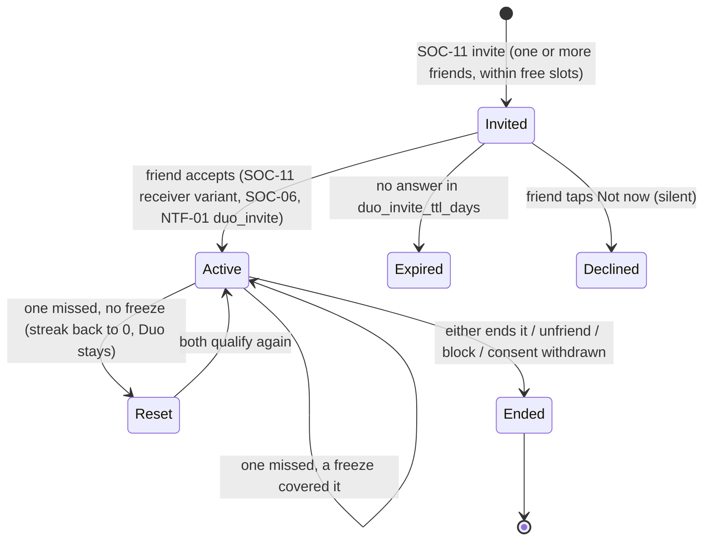

- **What it is:** a Duo is a shared streak with one friend. A student can hold Duos with up to `duo_max_partners` friends at once (default 5, R32, research A34). Each Duo is its own pair with its own streak; there is no group streak. "Duo" is the feature's name in both languages (Hindi copy keeps "Duo").
- **Who:** adults and teens with the `social` scope. Not under-13s, not little learners.
- **Limits:** the cap is per student, so both partners need a free slot. SOC-11 shows "{used} of {max} Duos" and disables friends who are at their own cap. DB_SCHEMA only enforces one Duo per pair; the per-user cap needs a check (gap G-S5).
- **Invites:** from SOC-07 [Start a Duo], SOC-12 [Add a Duo], or SOC-01's Duos row. Several friends can be invited at once, up to the free slots; each invite is a separate pair. `social.duos.status`: `invited` → `active`. Invites expire after `duo_invite_ttl_days` (flag). NTF-01 needs a new `duo_invite` template (me+money).
- **The streak day (R1, R23):** a Duo day counts when **both** partners have a qualifying streak day: one lesson, or 10 reviews, or one mock section, or the daily challenge. The daily goal (minutes) does not decide it. Each partner's day uses their own local midnight (R23), tracked in `last_both_active`. If either partner misses, the Duo streak resets to 0 unless that partner's equipped streak freeze or rest day covered the day (R28), which covers their Duos too. Our outages never break a Duo (the incident freeze applies, R28). The Duo streak shows next to each partner's own streak, never instead of it, with the same Phosphor `Plant` icon (R28).
- **Screens:** SOC-12 lists every Duo with today's status for both. SOC-25 is one Duo: the streak, best streak, today's tiles, this week's dots, and actions.
- **Nudges (A34):** when the partner hasn't qualified today, the student can send a preset nudge (SOC-22 nudge set, `social.nudges` with `kind = 'nudge'`), up to `duo_nudges_per_day` per pair. NTF-01 `duo_nudge` delivers it, subject to quiet hours (TRD §12) and, for minors, R34 (§B11). The current `duo_nudge` template text says "met today's goal"; it must say "studied today" to match R1 (recorded as a conflict for me-money).
- **Ending:** either partner can end a Duo from SOC-25. The other partner's card shows "This Duo has ended" with no blame. `status = 'ended'`. Removing or blocking the friend, or a withdrawn consent, ends it too. A student's own streak is never affected.
- **Data:** `social.duos` (one row per pair). The best streak per pair is kept for SOC-25 (gap G-S5 adds `best_streak`).

### B9. Squads

- Adults and teens only (not under-13s). Small groups of up to `squad_max_members` (flag, DB default 20). One student can be in up to `squads_per_user` (flag, recommended 3).
- **Create** (SOC-13): pick a name from the name picker (two-part names like "{adjective} {animal}" in English and Hindi, from a curated list; no free text), pick a crest (from a set of `badge`-preset crests), optionally lock it to an exam. Creating gives an invite code and link (`social.squads.invite_code`).
- **Join:** by link, QR or code. Minors can join only by link or QR (real-world contact), and only after consent.
- **Squad home** (SOC-14): members with today's status (minors as the pet avatar and auto nickname, R31 amended), the weekly squad leaderboard, the squad quest, and "Group mock" (Phase 3; TODO(PRACTICE): practice has no squad mock lobby yet).
- **Squad quest:** a weekly cooperative target from gamification config (for example a squad XP total or lesson count). Progress is the sum of members' qualifying events. Everyone who contributed gets the reward, announced by NTF-01 `squad_quest_done` (new template). Gap G-S6: no table for squad quests.
- **Roles:** owner and admins can remove members and regenerate the invite code. If the owner leaves, the longest-standing admin, or else member, becomes owner.
- **No chat.** Members can send preset cheers to the squad ("Let's go, squad!").

### B10. Challenge duel

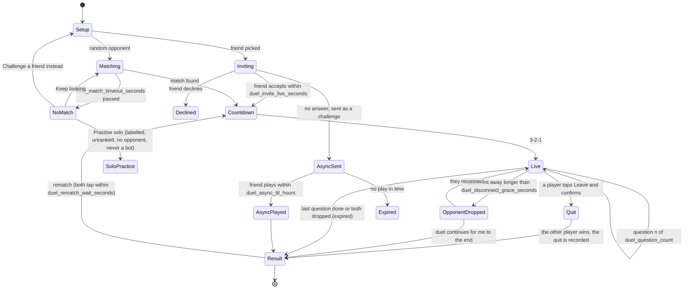

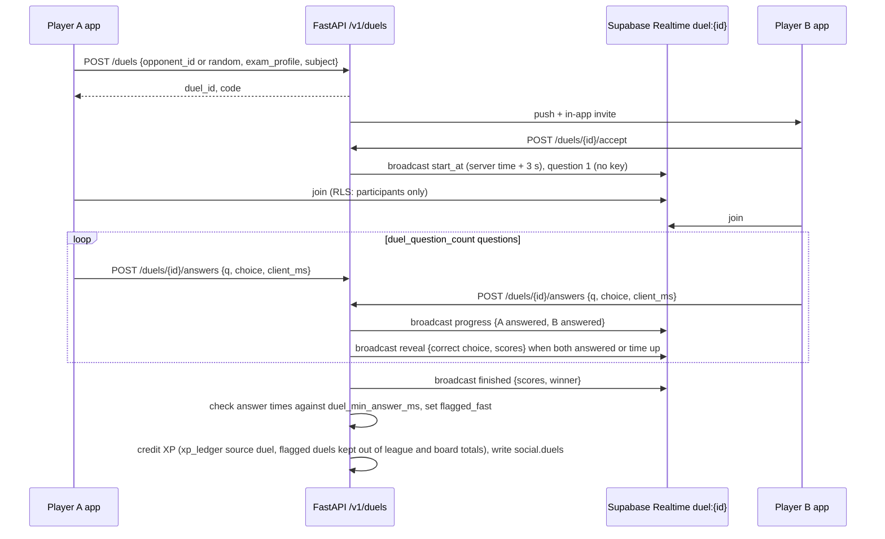

1. **Setup** (SOC-15): pick a friend (online friends first, shown by a "Studying now" dot only if they allow it) or "Random opponent". Pick a subject. Questions come from the published question bank for that exam profile and subject: single-answer MCQs, `duel_question_count` of them (flag; PRD §8 describes 10), chosen at a level close to both players' mastery. Questions with a known image or long passage are excluded so the duel stays fast.
   - **Exam mismatch:** a friend in another exam can be challenged only on a subject both exams share (for example Physics and Chemistry for JEE and NEET). In a per-exam app, only that exam's subjects are offered.
2. **Random matching:** matched by exam group, similar tier, and **age group**: adults with adults, 13–17 with 13–17. Under-13s and little learners have no random duels. A random opponent is shown by pet avatar, name and league tier: adults by display name, minors by nickname (R31, amended), never a real name. No add-friend from a random duel for minors.
3. **Waiting** (SOC-16): friend invite waits `duel_invite_live_seconds` (flag, recommended 60). Then: "{name} isn't free right now. Send it as a challenge?" The async challenge lets the friend play the same questions within `duel_async_ttl_hours` (flag, recommended 24); the results are compared when both finish. Random matching offers options after `duel_match_timeout_seconds` (flag, default 10, R31): [Keep looking] (matching continues), [Practise solo] and [Challenge a friend instead]. There are never bots pretending to be people. "Practise solo" (research A31) is labelled as a solo round: the same kind of question set, no opponent, not ranked, no win XP, and it never counts as a duel result.
4. **Countdown** (SOC-17): 3-2-1 synced to the server `start_at`, so both start together.
5. **Live** (SOC-18): one question at a time, a per-question timer (`duel_question_seconds`, flag). Each player sees their own options and both players' progress dots. The opponent's choice is never shown before both answer. The server holds the keys (`content.question_keys`, service only) and scores. Points: correct answers plus a speed bonus from config.
6. **Disconnects:** the server keeps the clock.
   - If a player's channel drops, their timer keeps running. They can rejoin within the same question.
   - After `duel_disconnect_grace_seconds` (flag, recommended 15), the other player sees "{name}'s connection dropped. Keep going, your score still counts." Unanswered questions score 0 for the absent player.
   - If both drop, the duel is `expired` with no result and no XP.
   - **Quitting (revision 1, research A36):** [Leave] asks to confirm: "If you leave, {name} wins this duel. You won't lose XP." A quit carries no XP penalty (the student keeps XP for answers already given), but the opponent is shown as the winner and gets the normal win XP. The quit is recorded (`social.duels.abandoned_by`). Quitting `duel_quit_limit` random duels within `duel_quit_window_hours` pauses random matching for `duel_quit_cooldown_minutes` (SOC-15 shows the pause); friend duels stay open. A connection drop is not a quit.
   - **Too-fast answers (A36):** the server flags any answer faster than `duel_min_answer_ms` from the question reveal (`social.duels.flagged_fast`, per player). A flagged duel's result stands, but its XP is left out of league and leaderboard totals, and repeated flags feed the anti-cheat review (TRD §10, IMPLEMENTATION_PLAN G-10). Nothing is shown during the duel; only the flagged player sees a neutral "not counted" line on SOC-19.
   - Gap G-S7: `social.duels.status` needs `abandoned`, plus `abandoned_by`, `flagged_fast` and `mode` (`live`, `async`, `solo`), and per-question answers need a table or a documented `scores` JSON shape.
7. **Result** (SOC-19): both pets (each player's own species, name and outfits) react: the winner's pet celebrates, the other's pet cheers ("Good game!"), never sad. Scores, a per-question list with "Ask tutor why" on wrong answers (opens AI-02 with `context_ref = question:{id}`, after the duel), XP earned, [Rematch], [New opponent], [Done]. Every opponent card has a visible [Report] (A36). Rematch needs both players within `duel_rematch_wait_seconds` (flag), otherwise the rematch button returns to [New opponent].
8. **Offline:** duels need a connection. SOC-15 shows the offline state. An accepted async challenge can't be played offline either (server scoring).
9. **Ages 10 to 12 (managed accounts):** friend duels only, after the parent gives the `social` scope, with gentler timers (`duel_question_seconds_u13`, flag). Little learners (class 1–5) have no duels.

### B11. Reactions, cheers, nudges, report and block

- **Reactions (kudos):** on friend activity cards in SOC-01 (streak milestones, league promotion, badges earned, Duo milestones). Four presets: Clap, Star, Strong, Smile (Phosphor `HandsClapping`, `Star`, `Barbell`, `Smiley`, each with its word). "Fire" was dropped because the streak is a plant, not a flame (R28), and "Sprout" because it is now a league tier name (R30). One reaction per item per person. The friend sees "{name} and 2 others cheered".
- **Preset messages** (SOC-22): a fixed list in both languages, for example "Let's study together!", "Great streak!", "You've got this!", "Duel me?", "Congrats on the promotion!", "Your plant looks thirsty!". Sent as `social.nudges` (`kind` `cheer` or `nudge`), rate-limited (`cheers_per_friend_per_day`, `nudges_per_friend_per_day`, flags). Delivered as an SOC-06 inbox item and, if the recipient allows, an NTF-01 push (`friend_cheer`, `duo_nudge`).
- **Notifications for minors (R34):** a minor gets pushes only at the reminder time the minor picked, never at a predicted or "smart" time. Social pushes for minors (cheers, nudges, duel challenges, league messages) are therefore not sent on their own: they wait in the SOC-06 inbox and are mentioned in that day's reminder. The live duel invite banner (NTF-04) inside the open app is not a push and still shows. This is a strict reading of R34; the coordinator may relax it for in-app events (open question Q-B9).
- **Activity items** come from events the server already has (streak, league, badges). No new user-written text. Gap G-S2: an `social.activity_items` table or a materialised view, and a `social.reactions` table.
- **Report** (SOC-23): from any profile, league row, duel result (a visible button on the opponent card, A36), squad member, Duo, or a shared deck (SOC-21 preview, R39). Person reasons: Inappropriate username, Cheating, Bullying or unkind, Pretending to be someone, Other. Deck reasons: Wrong facts, Copied from somewhere, Inappropriate words, Spam, Other (a deck report never names the author and has no block option). AI answers, images and community mnemonics are reported through SET-24 (R39). An optional note (to the moderation team only, never shown to anyone else, never in analytics) for 18+ only. Minors pick reasons only and see "A grown-up you trust can help too." Stored in `social.user_reports` (reason should become a check-constrained code, gap G-S8).
- **Block:** stored as `social.friendships.status = 'blocked'` with `requested_by` = the blocker. Blocking removes the friendship, ends their Duo, hides each from the other's leagues (rows show "Hidden"), stops duel invites, nudges and deck shares between them, and removes them from shared squads' views (they stay members, but each sees the other as "Hidden member"). Unblock in SET-11 privacy. The blocked person is not told.
- **Moderation outcome:** reported usernames are reset to a generated handle pending review. Repeat offenders lose social access (server flag).

### B12. Shared decks

Ownership after revision 1: memory-labs owns sharing (MEM-11 share deck sheet) and the deck page (MEM-08). Social owns SOC-21, the place to find decks friends shared and the preview of any shared deck. Per R41, `smriti.app/deck/{code}` opens the SOC-21 preview first, then MEM-08 on the student's own copy after [Add a copy].

- **Anonymous (R20):** a shared deck never shows its author's name to other students, adult or minor. MEM-08 and SOC-21 say "Shared by a friend" or "Shared by a student". Only helpful votes are shown ("{n} found this helpful"), never a list of who voted. Every shared deck can be reported through SOC-23 (R39).
- **Sharing:** from MEM-11. Submitting needs sign-in (AUTH-02, reason `share_deck`), and under-18s need the `community` consent scope (R20, auth §6.10). Under-13s can't share. The deck's title and card text go through moderation (`cheap` tier) before `learn.decks.share_code` is set and the link `smriti.app/deck/{code}` works (gap G-S9: `share_status`). MEM-11 has no moderation step or "shared without your name" line yet (requested from memory-labs).
- **Finding** (SOC-21): scope "From friends" (decks friends shared with friends, default) and, behind the flag `social.deck_listing`, "For {exam}" (decks listed for the exam after moderation). Rows show the title, card count, subject chip, "Shared by a friend" or "Shared by a student", and the helpful count. Opening a row, or the deck link, opens the SOC-21 preview (title, card count, three sample cards, helpful count, [Report deck]) with [Add a copy], which makes a copy (`source = 'shared_copy'`) the receiver owns and then opens MEM-08 on that copy (R41). MEM-08's "not yours yet" state is no longer needed for links (a request to memory-labs).
- **Who can open it:** adults' decks open for anyone with the link (`is_public` stays false: unlisted) and appear in "For {exam}" only when the flag is on. Teens' decks open only for the teen's friends and are never listed. Guests can open the SOC-21 preview of an adult's deck link (after ENT-06 for new installs); adding needs sign-in (AUTH-02, reason `share_deck`).
- **Helpful votes:** one per student per deck, signed-in only. Votes sort the "For {exam}" list. No comments.
- The owner can stop sharing at any time (MEM-08). Copies already made stay with the receivers.
- Offline: SOC-21 shows the cached list; opening a deck not yet copied needs a connection. Copies work offline once added.

### B13. Branches across the social area

| Branch | Rule |
|---|---|
| Guest vs signed in | Guests see SOC-02 guest state only. Every social deep link goes through ENT-06 and the gate. Guests can open the SOC-21 preview of an adult's shared deck link. |
| Free vs Pro | Social is free for everyone (PRD §11.1 gamification "Everything"). Pro adds nothing social except Pro-only pet outfits that show on avatars. The invite reward gives both a free Pro week. |
| Online vs offline | SOC-01, SOC-08, SOC-10, SOC-12 and SOC-14 show the last cached data with the offline banner and "Updated {time}". Sending requests, cheers, duels and shares need a connection; those buttons show "Needs internet" instead of failing. |
| Minor vs adult | §B4 gate, §B5 discovery rules, minors shown with the pet avatar and a generated nickname, or the pet name to invite or QR friends (R31, amended), teens opt in to leagues while adults are opted in (R30), no random duels for under-13s, age-matched random duels, no add button between adults and minors except by link or QR, pushes only at the minor's own reminder time (R34), parent mode oversight. |
| Under-13 (managed) | Class 1–5 little learners: no Friends tab and no social features (R14, R30); a social deep link goes to ENT-07. Ages 10 to 12: with the parent's `social` scope, friends by link or QR only, the friends board, friend duels and preset cheers. No leagues, no squads, no Duos, no random duels, no deck sharing, no username search, never discoverable. The parent sees and can remove friends in SET-14. |
| Per-exam vs all-exams app | Friends, Duos and squads are account-wide and show in every app. Leagues and boards use the app's exam (per-exam) or the primary exam (all-exams). Duels are limited to shared subjects (§B10). |
| Mobile vs web | Web supports everything, including QR scanning with the camera on phones and tablets. On desktop the "Scan" tab says "Scan with your phone" and shows the student's own QR large. Web uses Supabase Realtime JS for duels. Side-by-side layouts (UX doc). |

### B14. Edge cases

- **The invite link is opened by the inviter themselves:** "This is your own invite link." with [Share it].
- **Invite link opened by someone already a friend:** "You're already friends." → SOC-07.
- **Invite link of a blocked person:** treated as invalid, with no sign of the block.
- **Minor opens an adult's invite link before consent:** the request is held and resumes after consent. If the guardian declines, it is dropped.
- **Guardian removes a friend in parent mode:** treated like "Remove friend", silent.
- **Account deleted:** friendships, Duos and squad memberships cascade. Leaderboard rows disappear at the next refresh. Past duel results show "Deleted user".
- **Username change:** allowed once every `handle_change_days` (flag). Old handles are reserved for 30 days.
- **Timezone differences in a Duo:** each partner's streak day ends at their own local midnight (R23). The Duo day counts when both partners have a qualifying day for the same calendar date, each by their own clock. (Q-B4 closed.)
- **A friend at their Duo cap:** shown disabled in SOC-11 with "{name} has {max} Duos already." An invite to a friend who fills their last slot in the meantime fails softly: "{name} has no free Duo slot now."
- **Quit and reconnect race:** a player who taps [Leave] and confirms is out, even if the connection then drops; a drop before the confirm is a disconnect, not a quit.
- **League rollover while the app is open:** the league screen shows "This week has ended. Results are coming." until the rollover job finishes, then SOC-09.
- **XP earned offline:** counts for the league when it syncs, by `occurred_at`, if it syncs before the rollover job closes the week. Late events after rollover go to the new week's total only for XP, not to the closed league (stated in the league info sheet).
- **Duel question reported as wrong:** the report goes to `learn.content_reports`. If accepted, the duel result is not changed (stated in help).
- **A squad member is blocked by another member:** both stay, each sees "Hidden member".

### B15. Storage: local vs server

| Data | On device | Server | Gap |
|---|---|---|---|
| Friends, requests, inbox | Cached list for offline display (gap G-6: a `social_cache` local table) | `social.friendships`, `social.nudges` | |
| Handle and privacy settings | `profile_snapshot` | `app.profiles.handle`, `settings` | G-S3: `discoverable` and `league_opt_out` need explicit columns or documented `settings` keys |
| League | Cached standings | Redis `league:{week}:{tier}:{cohort}`, `game.league_cohorts`, `game.league_members` | |
| Leaderboards | Cached top rows | Redis sorted sets | G-S4: school, coaching and city need columns and a directory |
| Duo | Cached Duo list (SOC-12) | `social.duos` | G-S5: per-user cap `duo_max_partners` (default 5) not enforced; `best_streak` per pair missing |
| Squads | Cached squad home | `social.squads`, `social.squad_members` | G-S6: squad quests table; squad name picker list in config |
| Duels | Nothing persistent (live state only) | `social.duels`, Realtime `duel:{id}` | G-S7: `abandoned` status, `abandoned_by`, `flagged_fast`, `mode` (`live`, `async`, `solo`), per-question answers, quit counter for the cooldown |
| Reactions and activity | Cached | none yet | G-S2: `social.reactions`, `social.activity_items` |
| Reports and blocks | none | `social.user_reports`, `social.friendships` (`blocked`) | G-S8: reason codes |
| Shared decks | `decks`, `cards`, cached SOC-21 list | `learn.decks.share_code`, `source = 'shared_copy'` | G-S9: `share_status` (moderation), a listed-for-exam flag, and a helpful-votes table |
| Referral reward | none | Billing entitlement | G-S10: `billing.subscriptions.source` has no `referral`; a grant table or source is needed (me+money agent) |

**Endpoints to add under `/v1/social` (TRD §5.1 lists the area only):**

| Endpoint | Purpose |
|---|---|
| `GET /v1/social/overview` | SOC-01 in one call: league card, friends' today, Duos, squads, inbox count |
| `PUT /v1/me/handle`, `GET /v1/social/handle-available?h=` | SOC-03 |
| `GET /v1/social/users/by-handle/{handle}` | Exact match search (discoverable only) |
| `GET /v1/social/invite/{code}`, `POST /v1/social/invite/{code}/accept` | Invite link and QR |
| `GET /v1/social/friends`, `POST /v1/social/friend-requests`, `POST /v1/social/friend-requests/{id}/accept`, `…/decline`, `DELETE /v1/social/friends/{user_id}` | Friends |
| `GET /v1/social/inbox` | SOC-06 |
| `GET /v1/social/profiles/{user_id}` | SOC-07 (through the security-definer view, DB_SCHEMA §12) |
| `GET /v1/leagues/current`, `GET /v1/leagues/last-result` | SOC-08, SOC-09 |
| `GET /v1/leaderboards?scope=&period=` | SOC-10 |
| `GET /v1/duos`, `POST /v1/duos` (one or more `friend_ids`, each a pair), `POST /v1/duos/{id}/accept`, `DELETE /v1/duos/{id}` | Duos (SOC-11, SOC-12, SOC-25) |
| `POST /v1/leagues/join`, `PUT /v1/leagues/opt-out` | Teen opt-in and anyone's break from leagues |
| `POST /v1/squads`, `GET /v1/squads/{id}`, `POST /v1/squads/join/{code}`, `DELETE /v1/squads/{id}/members/{user_id}` | Squads |
| `POST /v1/duels`, `POST /v1/duels/{id}/accept`, `…/decline`, `POST /v1/duels/{id}/answers`, `POST /v1/duels/{id}/rematch`, `POST /v1/duels/match` (queue), `DELETE /v1/duels/match` | Duels (answers with idempotency keys, because they touch XP) |
| `POST /v1/social/reactions`, `POST /v1/social/nudges` | Preset reactions and messages |
| `POST /v1/social/reports`, `POST /v1/social/blocks`, `DELETE /v1/social/blocks/{user_id}` | Report and block |
| `POST /v1/decks/{id}/share`, `DELETE /v1/decks/{id}/share`, `GET /v1/decks/shared/{code}`, `POST /v1/decks/shared/{code}/copy` | Shared decks (memory-labs owns these with MEM-11 and MEM-08) |
| `GET /v1/decks/shared?scope=&cursor=` (scope `friends` or `exam`), `PUT /v1/decks/shared/{code}/helpful` | SOC-21 list and helpful votes |

**Push templates needed in NTF-01** (me+money owns the catalogue): `friend_accepted`, `duo_invite`, `duel_result`, `league_result` (stayed or demoted), `squad_quest_done`. The existing `duo_nudge` text had to change from "met today's goal" to a qualifying day (R1). All done in the me-money catalogue.

### B16. Analytics events (social)

No names, handles, typed text or other users' ids in props. The counterpart is recorded only as `relation` (`friend`, `random`, `squad`).

| Event | Props |
|---|---|
| `social_gate_shown` | `state` (`guest`, `minor_no_consent`, `consent_pending`, `consent_revoked`, `age_unknown`, `u13_no_scope`, `first_visit`), `entry` |
| `social_gate_cta_tapped` | `state`, `cta` (`sign_in`, `ask_parent`, `resend`, `learn_more`) |
| `handle_set` | `attempts`, `suggestion_used` |
| `friend_add_method` | `method` (`invite_share`, `invite_open`, `qr_show`, `qr_scan`, `username_search`, `league_row`) |
| `friend_search_result` | `found` (bool) |
| `friend_request_sent` / `_accepted` / `_declined` / `_expired` | `method` |
| `friend_removed` | none |
| `league_viewed` | `tier`, `zone` (`promote`, `safe`, `demote`), `hours_left_bucket` |
| `league_result_shown` | `tier_before`, `result` (`promoted`, `stayed`, `demoted`) |
| `league_opt_out_changed` | `on` |
| `league_joined` | `source` (`auto_adult`, `teen_card`) |
| `leaderboard_viewed` | `scope`, `period` |
| `duo_invited` / `_started` / `_ended` / `_streak_day` | `partners_count` (for `_invited` and `_started`), `streak` (for `_streak_day`), `end_reason` |
| `squad_created` / `_joined` / `_left` / `_quest_completed` | `size_bucket`, `join_method` |
| `duel_setup` | `relation`, `subject_family` |
| `duel_match_wait` | `result` (`found`, `timeout`, `cancelled`, `solo`), `wait_ms` |
| `duel_started` / `_finished` | `relation`, `mode` (`live`, `async`), `correct`, `result` (`win`, `loss`, `draw`, `opponent_dropped`, `opponent_quit`, `quit`, `expired`), `abandoned` |
| `duel_solo_finished` | `correct` |
| `duel_disconnect` | `seconds_away`, `recovered` |
| `duel_rematch` | `accepted` |
| `duel_invite_response` | `response` (`play`, `later`, `decline`), `mode` |
| `league_rules_viewed` | none |
| `screen_view` | `screen` (shared product event, used for SOC-01 and SOC-07) |
| `reaction_sent` | `reaction_id` |
| `preset_message_sent` | `message_id`, `kind` (`cheer`, `nudge`) |
| `report_submitted` | `target_kind` (`profile`, `deck`, `duel`, `league_row`, `squad_member`, `duo`), `reason` (code), `has_note` |
| `block_changed` | `blocked` (bool), `source` |
| `shared_decks_viewed` / `shared_deck_opened` / `shared_deck_helpful` / `shared_deck_copied` | `scope` (`friends`, `exam`), `entry` (`list`, `link`), `on` (for `_helpful`). Share events belong to memory-labs (MEM-11) |
| `invite_reward_granted` | `role` (`inviter`, `invitee`) |

### B17. Open questions (social)

| # | Question | Recommendation |
|---|---|---|
| Q-B1 | League tier names (10 tiers in DB_SCHEMA). | **Closed by R30:** Seed, Sprout, Leaf, Bud, Bloom, Lotus, Mango, Neem, Peepal, Banyan (बीज, अंकुर, पत्ती, कली, फूल, कमल, आम, नीम, पीपल, बरगद), in config so the owner can rename. |
| Q-B2 | Cohort size and promotion and demotion counts. | **Closed by R30:** flags `league_cohort_size` 30, `league_promote_count` 7, `league_demote_count` 5; tune from ClickHouse. |
| Q-B3 | Do little learners get any social feature? | No Friends tab (R14). In Phase 3, possibly a "family circle" set up by the parent in parent mode (siblings and cousins only), preset cheers only. Owner to decide. |
| Q-B4 | Which calendar day counts for a Duo with partners in different timezones? | **Closed by R23:** each partner's own local midnight. |
| Q-B5 | Should "Studying now" presence show to friends? | Yes for adults, opt-in. Off and hidden for minors. |
| Q-B6 | Referral reward condition. | Grant when the invitee signs in and completes their first lesson, capped per inviter per month (flag), one reward per invitee account. |
| Q-B7 | Is there any free-text chat? | No, for anyone (§B2). Revisit only with a separate adult-only product decision and a moderation budget. |
| Q-B8 | Group mocks for squads (PRD §8). | Phase 3. A squad picks a mock and a window; results compare inside the squad only. Needs a practice screen (TODO(PRACTICE)). |
| Q-B9 | Does R34 ("for minors, only the reminder time they picked") cover friend-triggered pushes (cheers, nudges, duel challenges) for teens? | **Closed by R45:** yes. For minors, friend-triggered pushes (duels, Duo nudges, cheers) wait for the minor's own reminder window; in-app banners still show. |
| Q-B10 | What are the duel anti-abuse values? | Flags: `duel_min_answer_ms`, `duel_quit_limit`, `duel_quit_window_hours`, `duel_quit_cooldown_minutes`. Set from real answer-time data in the first weeks; no defaults are proposed here. |
| Q-B11 | Who owns the fixed EN and HI word list for minors' auto nicknames (R31 amended), and who reviews it for unsafe combinations? | Open, needs the owner. Tutor-social owns the feature and ships the list as config (`app.profiles.nickname_word_ids`), but a named content owner and a safety review of every word pair in both languages must sign it off before Phase 2. This doc does not write the list. Carried from me-money's TODO(SOC). |
| Q-B12 | Which public directory feeds the optional school and coaching picker (`app.institutions`)? | Open, needs the owner: the source, its licence and how often it is refreshed. |

---

## Gaps found (both parts)

| ID | Gap | Where | Who |
|---|---|---|---|
| G-1 | `ai.tutor_sessions.mode` lacks `roleplay` (and `story` if stories are sessions) | DB_SCHEMA §9 | DB owner. Resolved in consistency pass: `roleplay` added to `ai.tutor_sessions.mode`. |
| G-2 | No table for thumbs up/down and reason codes | DB_SCHEMA §9 | DB owner. Resolved in consistency pass: `ai.message_feedback` added. |
| G-3 | Voice board needs a `show_on_board` tool; Rive pet files need a `talking` or `speaking` input and a `listen` trigger | TRD §9.2/§9.4, DESIGN §7.2 | TRD owner, anim-maker |
| G-4 | SSE event types for the tutor stream are not defined | TRD §5, §9.2 | TRD owner |
| G-5 | No storage for generated stories | DB_SCHEMA §9 | DB owner. Resolved in consistency pass: `ai.generated_stories` added. |
| G-6 | No on-device cache tables for tutor history and the social overview | DB_SCHEMA §15 | DB owner. Resolved in consistency pass: local `tutor_history` and `social_cache` tables added (DB_SCHEMA §15). |
| G-7 | Mobile runtime maths rendering is not chosen (bundles have pre-rendered KaTeX SVG, but tutor answers need live rendering on React Native) | TRD §3, §4.2 | TRD owner |
| G-8 | `POST /v1/uploads/sign`, STT, TTS, feedback, history and generation status endpoints missing | TRD §5.1 | TRD owner |
| G-S1 | Guardian consent stores a phone hash and `phone_otp` method; this round's decision is Google-based guardian consent. Scope must include `social`, `voice`, `uploads` | DB_SCHEMA §3 `app.guardian_consents`, TRD §6 | Auth agent. Resolved in consistency pass: `app.guardian_consents` is Google-based with `account`, `social`, `community`, `voice` and `uploads` scopes. |
| G-S2 | No reactions or activity tables | DB_SCHEMA §7 | DB owner. Resolved in consistency pass: `social.activity_items` and `social.reactions` added. |
| G-S3 | Discoverable and league opt-out settings not modelled | DB_SCHEMA §3 | DB owner. Resolved in consistency pass: `app.profiles.discoverable` and `league_opt_out` added. |
| G-S4 | School, coaching and city are in PRD §10.3 profiles but not in `app.profiles`; no directory | DB_SCHEMA §3 | DB owner. Resolved in consistency pass: `app.institutions` plus `app.profiles.institution_id` and `city` added; the directory source is an owner question. |
| G-S5 | The per-user Duo cap (`duo_max_partners`, default 5) is not enforced; no `best_streak` per pair | DB_SCHEMA §7 | DB owner. Resolved in consistency pass: `social.duos.best_streak` and a cap trigger on `social.duo_max_partners` added. |
| G-S6 | No squad quest tables; no name-picker list | DB_SCHEMA §6/§7 | DB owner, game config. Resolved in consistency pass: `game.squad_quests` and `game.squad_quest_progress` added; names stay in config. |
| G-S7 | Duels: no `abandoned` status, `abandoned_by`, `flagged_fast` or `mode`, no per-question answers | DB_SCHEMA §7 | DB owner. Resolved in consistency pass: `social.duels.mode`, `abandoned` status, `abandoned_by`, `flagged_fast` and `social.duel_answers` added; the cooldown counts quits. |
| G-S8 | `social.user_reports.reason` is free text | DB_SCHEMA §7 | DB owner. Resolved in consistency pass: `social.user_reports.reason` is a code list, with deck reports. |
| G-S9 | Shared decks have no moderation status, listing flag or helpful votes | DB_SCHEMA §5.2 | DB owner, memory-labs. Resolved in consistency pass: `learn.decks.share_status`, `listed_for_exam` and `learn.deck_helpful_votes` added. |
| G-S10 | Referral Pro week has no billing source | DB_SCHEMA §8 | Me+money agent. Resolved in consistency pass: `billing.promo_grants` and source `promo` added. |
| G-S11 | Deep links for squads and shared decks are missing | APP_FLOW §4 | Onboarding agent (ENT deep-link landing) |
| G-S12 | No `public_nickname` column or nickname word list for minors (R31, amended) | DB_SCHEMA §3, config | DB owner, content owner for the word list. Resolved in consistency pass: `app.profiles.nickname_word_ids` and `nickname_number`; the word list owner is open (Q-B11). |

Resolved in consistency pass:
- The tutor button is hidden for little learners by default (R14); a parent turns on the preset-questions tutor in SET-14 ("Tutor button for {child}"), which now exists (A4).
- Shared deck reports from SOC-21 and MEM-08 open SOC-23 (R39); AI answers, images, story pages, role-play replies and community mnemonics open SET-24 (`learn.content_reports.kind`).
- SOC-03 has a minor variant with [Shuffle] for the username and the auto nickname (R31 amended, auth flow §13).
- NTF-01 has `friend_accepted`, `duo_invite`, `duel_result`, `league_result` and `squad_quest_done`, and `duo_nudge` reads "{friend} counted today" (R1).
- ME-01 has the "Your chats" row (AI-09) and ME-02 has the optional school and city fields.
- Still open: the XP rules page linked from the league info sheet (SOC-24 entry, `TODO(ME)` in the UX doc), the squad group mock lobby (`TODO(PRACTICE)`, Phase 3) and the nickname word list owner (Q-B11).
---

## Changelog (revision 1)

- **Rulings applied:** R1 and R23 (Duo days use the qualifying streak day and each partner's local midnight), R3 (all Hindi copy rewritten to आप with gender-neutral verbs; तुम only in little-learner strings), R8 (a phase on every screen and in the index), R14 (no Friends tab or tutor button for little learners), R15 (no prices or Pro CTAs for under-13s: AI-06, AI-07, SOC-04), R20 (anonymous shared decks with helpful votes), R24 (no tutor or banners in PRC-04, MOCK-07, MOCK-08), R28 (`Plant` streak icon, "Fire" reaction dropped), R29 and R40 (approved Google label and the trust line on SOC-02), R30 (plant tier names, cohorts of 30, 7 up and 5 down as flags, adults opted in automatically, teens opt in, no leagues for class 1–5), R31 as amended (minors shown publicly by pet avatar and a generated nickname, pet name only to invite or QR friends; "Practise solo" offered after 10 s, never a bot), R32 (Duo with up to 5 friends), R34 (no social pushes to minors outside their reminder time), R35 (read aloud free with a daily cap; only "Draw it" images, voice, Feynman and photo doubt are Pro), R39 (decks and people reported in SOC-23, everything else in SET-24), R41 (`/deck/{code}` opens the SOC-21 preview, then MEM-08 after [Add a copy]).
- **Research items applied:** A31 (practise solo, unranked), A33 (less XP for replays, stated in SOC-24), A34 (Duo up to 5 with preset nudges), A35 and A36 (quit gives the opponent the win with no XP penalty, quit cooldown, too-fast answers flagged and kept out of leagues and boards, a visible Report on every opponent card), X9 (no guilt copy), X11 ("your best week" on SOC-08), X19 (a first-time demo and "?" icon for Feynman, voice, role play and duels).
- **Part A:** phase table; role play has its own small cap (`free.roleplay_chats_per_day`, `roleplay_max_turns`) and never uses tutor messages; real entry IDs (HOME-05 pre-fill without sending, LES-02, LES-04, LES-01.16, LAB-04 at 40% height, MEM-03, PRC-05, PRC-07 and MOCK-22 with `context_ref = question:{id}`, LRN-03, LES-08, MEM-22, PRC-01); tutor button `primary` fill to match LES-01 and hidden in every runner and on social screens; AI-04 is a quick save with MEM-09 for editing; AI-19 "Similar questions" goes to PRC-03 with a fixed set; Q-A2, Q-A3, Q-A6 and Q-A9 closed, Q-A10 added.
- **Part B:** names rule rewritten (R31, amended); B6 league rewritten; B8 Duo rewritten for several pairs, with a state diagram; B10 quit, cooldown, too-fast and solo rules; B11 reactions (Clap, Star, Strong, Smile) and R34; B12 shared decks rewritten around MEM-11, the SOC-21 preview and MEM-08; real IDs for ENT-06, ENT-07, AUTH, NTF-01 templates, NTF-04, NTF-05, MOCK-19, LES-08, PRC-12; new NTF templates listed; Q-B1, Q-B2 and Q-B4 closed, Q-B9 and Q-B10 added; gaps G-S5, G-S7 and G-S9 widened, G-S12 added.
- **UX doc:** new SOC-25 (Duo detail); SOC-11, SOC-12 and SOC-21 redone; SOC-01, SOC-02, SOC-07, SOC-08, SOC-15 to SOC-20, SOC-22 to SOC-24 and AI-01, AI-02, AI-04, AI-06, AI-07, AI-10, AI-14, AI-20 and AI-21 updated; 46 blocks, each with the 12 headings and a phase.
