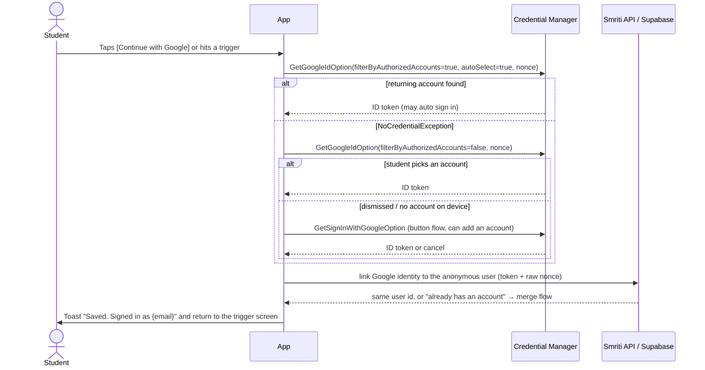
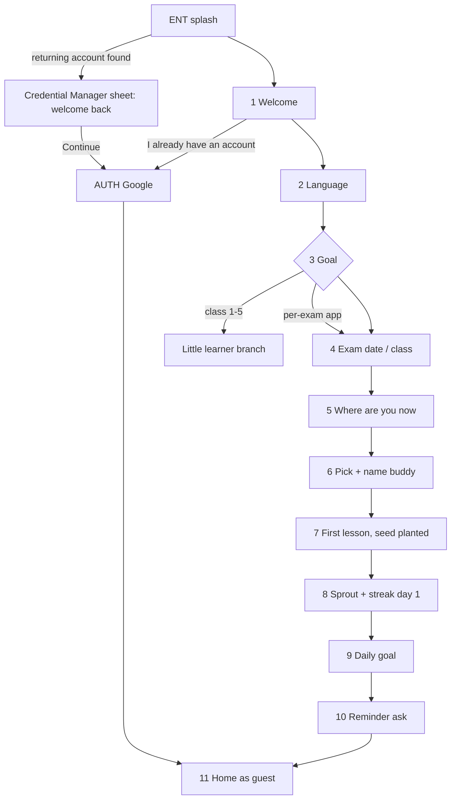

# Competitor flows: what the best learning apps do, and what Smriti should borrow

Status: Research v1, 29 Oct 2026. Owner of this file: research worker (app flow + UI/UX round).

This report studies how leading learning apps structure first run, sign-in, home, lessons, gamification, review, social, paywall and re-engagement. It ends with an Adopt list, an Avoid list, Google sign-in guidance for a guest-first app, and a recommended Smriti onboarding sequence.

## How to read this report

- Every factual claim carries a numbered source, for example [1]. The full list is in §15.
- Source strength is marked where it matters:
  - **Official**: the company's own blog, help centre, store listing, developer docs or a peer-reviewed paper.
  - **Teardown**: a third-party recording or analysis of the app (useful for screen order, but may be one A/B variant).
  - **Reviews**: Google Play user reviews read on 29 Oct 2026 (India store). They show real pain points, not company facts.
  - **Unverified**: I could not confirm it from a reachable source. Treat as a hypothesis.
- Store listings were read from the India Play Store (`hl=en_IN&gl=IN`) on 29 Oct 2026.
- Nothing here is study content. UI copy examples are given in English and Hindi. Numbers are quoted only from sources.

## Contents

1. Top 15 findings
2. Duolingo
3. Brilliant
4. Matiks
5. Duolingo Math and Duolingo ABC
6. Khan Academy Kids
7. Indian exam-prep apps: Testbook, Adda247, Physics Wallah, Unacademy
8. Side-by-side comparison
9. Synthesis: Adopt list (by Smriti screen area)
10. Synthesis: Avoid list
11. Google sign-in UX for a guest-first, Google-only app
12. Recommended Smriti onboarding sequence
13. Conflicts and gaps found in existing Smriti docs
14. Open questions for the owner
15. Sources

---

## 1. Top 15 findings

1. **Asking for sign-up later is worth a lot.** Duolingo moved the sign-up screen back a few steps and saw about a 20% rise in daily active users. Later tuning of soft and hard walls added 8.2% more. Soft walls with a "Later" button beat hard walls by a wide margin [2]. Smriti's guest-first plan is right.
2. **The streak should be easy to keep and decoupled from a big daily goal.** When Duolingo let one lesson extend the streak (instead of the full daily goal), day-14 retention rose 3.3% and new learners on a streak rose 19% [4]. Learners with higher goals were less likely to be on a streak [4].
3. **Slack beats rigidity.** Letting learners hold up to two streak freezes raised daily active learners by 0.38% [1]. The Weekend Amulet (protect weekends) raised D7 retention 2.1% and D14 4% [2]. Brilliant copies this with "Streak Charges", max two, plus a free automatic save for long streaks [40].
4. **Punishing mistakes hurts beginners.** Duolingo replaced hearts (lose one per mistake) with Energy because beginners were 2x more likely to run out of hearts mid-lesson, and its data shows Energy helps more learners finish lessons [5]. Smriti should never gate learning on mistakes.
5. **Leagues work, but only if simple and fair.** Duolingo's leagues raised total learning time 17% and tripled highly engaged learners. Users were matched with people of similar recent engagement and opted in automatically [3]. Both Duolingo and Brilliant use groups of 30 and 10 tiers [9][42].
6. **Protect the notification channel.** Duolingo forbids raising notification volume without strong justification and CEO approval [3]. It optimises which message, when and in what words, using a bandit that also demotes recently seen messages [11][12]. "Hi, it's Duo" copy gave +5% DAU and a reminder 23.5 hours after the last session won [2].
7. **Shared streaks are the strongest social loop.** Learners with at least one Friend Streak are 22% more likely to finish their daily lesson. The hardest step is the first invite [15].
8. **Labelling a hard question as hard makes students try harder and come back.** Duolingo's "hard exercise" label made learners study longer, return the next day more and feel less bad about mistakes [19]. This fits exam students who fear failure.
9. **India needs a different approach to paywalls and language.** In India, Duolingo removing the initial Plus promotion gave +1% DAU, and removing Plus entirely gave +6% DAU. Formal Hindi words confused people; using everyday English words ("language", "level") in Hindi onboarding raised completion 1% [22].
10. **Speed on cheap Android phones is a growth lever.** In early 2024, 39% of Duolingo users on entry-level Android phones waited over 5 seconds at app start. Deferring work cut that to 8% and raised app-open conversion from 91% to 94.7%. A blocking check took over a second in India [23].
11. **Indian exam-prep apps lose trust through phone-number logins, sales calls, pop-ups and silent auto-debits.** Play reviews for Unacademy and Adda247 repeatedly describe daily sales calls after sign-up. Testbook reviews describe ₹1 trials that turned into unexpected auto-debits of ₹649 to ₹799 [76][70][65]. Smriti's Google-only login with no phone number, and an honest ₹1 trial, is a real differentiator.
12. **The mock runner must feel like the real exam.** Testbook sells "interface, timer, question navigation and marking scheme similar to the real" CBT, and reports score, accuracy, time per question, strong and weak topics, percentile and All India Rank [66]. Students complain when mocks do not sync across devices or lack per-question timing [70].
13. **Hinglish is the real medium of instruction.** Physics Wallah lists 21 Hinglish, 12 English and 3 Hindi-medium batches for JEE Class 11 [74]. Smriti's "English and Hindi" plan should treat Hinglish as a first-class tone for the tutor and pet, even if content stays EN and HI.
14. **Google sign-in should be a bottom sheet plus a persistent button, never a form.** Android's Credential Manager guidance is to try authorised accounts first, then all accounts, then fall back to a button [87]. Google's own case studies report large lifts from One Tap, for example Pinterest users are 2x more likely to use One Tap than multi-step sign-in, and Indian publisher Vikatan saw new account creation rise 270% [91].
15. **Children's data rules are stricter than the current plan assumes.** India's DPDP Act defines a child as under 18 and requires verifiable parental consent before processing *any* personal data of a child, and bans tracking or behavioural monitoring of children [103]. This affects guest analytics, "smart timing" and "learns your bedtime" features for minors, not just social features. Needs legal review (see §13).

---

## 2. Duolingo

Duolingo is the reference for onboarding, habit loops and gamification. It now teaches languages, Math, Music and Chess in one app [33][30].

### 2a. First-run onboarding

A teardown recorded in Oct 2026 (iOS, Spanish course) shows 25 key screens. They are condensed here into 15 steps, in order [24] (Teardown):

| # | Screen | What it asks or shows |
|---|---|---|
| 1 | Fork | "Already have an account?" or "New to Duolingo?" |
| 2 | Quiz intro | Duo says there are 7 quick questions before the first lesson. Naming the count makes the quiz feel short. |
| 3 | Course pick | Language to learn (not described in this recording; shown in another recording [52]). |
| 4 | Social proof | Loading screen: 20 million people learn this language. |
| 5 | Attribution | "How did you hear about Duolingo?" (TV, YouTube, TikTok, in-game ads). |
| 6 | Tracking prompt | iOS App Tracking Transparency prompt right after attribution (in Dec 2024 it came last). |
| 7 | Self-rated level | Five bands instead of a test. Duo confirms the choice back. |
| 8 | Motivation | Why are you learning? Checkboxes. Duo reacts to each choice. |
| 9 | Routine intro | Sets up the idea of a daily habit. |
| 10 | Daily goal | 5, 10, 15 or 20 minutes, each with an identity label, and a "committed" button. |
| 11 | Outcome projection | What the chosen minutes achieve in the first week, then in three months. In Dec 2024 the notification primer sat here. |
| 12 | Plan choice | Super (marked recommended) vs learn for free. First paywall entry. |
| 13 | Trial details | Free vs Super comparison, trial reminder choice (2 or 3 days before the end, with real dates), annual plans with a 7-day trial. "View all plans" includes monthly with no trial. |
| 14 | Placement choice | Start from scratch or "Find my level" (marked recommended). |
| 15 | First lesson | Framed as a 2-minute lesson. First exercise is a matching-pairs task. |

- **Length:** sources count between 24 and 52 screens depending on version and how they count [24]. The pre-lesson part is long but each screen is one tap.
- **Account wall:** none before the first lesson. Account creation is optional and is prompted at logical moments after lessons; some features such as leaderboards stay locked until the learner registers [25]. Duolingo's own guide says "Don't forget to create a profile to save your progress!" and that a profile lets you use the account on other devices [7].
- **Guest mode:** yes, effectively. You can learn without an account [25].
- **History:** moving the sign-up screen back a few steps gave about +20% DAU. The team then tested whether to ask mid-lesson or at the end, and later soft/hard wall tuning gave +8.2% DAU [2].

### 2b. Sign-in methods and timing

- Duolingo's help centre has an article on creating an account and logging in [39], but I could not read the current list of methods. An older guide says Google, Facebook, or email with username and password (Unverified for 2026).
- Sign-up is asked after the learner has had value, with a "Later" option (soft wall). Hard walls performed significantly worse in Duolingo's tests [2].
- Under-13 learners (US) are age-gated at registration and get an ad-free, restricted version [29].

### 2c. Home and learning path

- Since 1 Nov 2022 the home screen is a single linear path instead of a grid of skills. The stated reason: learners were unsure whether they were using Duolingo the "best" way [6].
- Lesson order on the path is "grounded in spaced repetition", so new and old concepts are interleaved, and practice sessions are built into the path [6].
- Lessons group into units with a header that names the new concepts. Tips moved into a per-unit "guidebook" [6].
- Learners can start from the beginning or take a placement test; from the start they can still skip ahead one unit at a time. Placement cannot be undone [7].
- Subjects share one app. The course icon at top left switches subject, and streak, XP and boosts carry across subjects [33].

### 2d. Lesson interaction, feedback and hints

- Each character has an animation that plays on a correct answer, plus interstitials that reward several correct answers in a row [20].
- Labelling hard exercises at the top of the screen made learners study longer and return the next day more, and one learner said a warned-hard mistake felt less bad [19].
- "Explain My Answer" gives personalised feedback on the specific error and is now free for all learners [21].
- Reviewing mistakes at the end of a lesson is free and does not use Energy [5].
- Settings let learners turn off sound effects, haptics and listening exercises, and skip listening in a loud place [7].

### 2e. Gamification loops

| Element | How Duolingo does it | Source |
|---|---|---|
| Streak | One lesson a day extends it. Daily goal progress is tracked separately. | [4] |
| Streak freeze | Up to two equipped at once. Prompt copy "Protect your 3 day streak!" A refill costs 400 gems in the screenshot. | [1] |
| Streak repair | Buyable with gems in the Shop [28]. The India Play listing lists "Monthly Streak Repair" as a Super perk [30]. | [28][30] |
| Streak revival | June 2026 event: learners who lost a 30+ day streak could earn it back by finishing three lessons in a row. | [27] |
| Streak wager | Learners bet gems on keeping a 7, 14 or 30 day streak with no freezes. | [36] |
| Milestones | Week, month, 100 days and a year get a special Duo animation and a shareable card. | [18] |
| Streak protection from outages | A "Big Red Button" tool and streak repair after incidents, using access logs. | [32] |
| XP | Path XP was raised so rewards match effort and learning outcomes. | [10] |
| Leagues | Weekly, 10 tiers with Diamond at top, matched by similar habits and time zone. Top 10 Diamond learners can enter a 3-round tournament. Illegitimate XP gets a learner removed. Opt-out in web settings. | [9] |
| Quests | Monthly challenges moved from XP-based to quest-based because learners farmed XP at month end. Daily quests favour finishing units. | [10] |
| Hearts to Energy | Energy drains with each exercise and is regained with runs of correct answers. Bonus for perfect lessons and adding a friend. Rewarded ads and gems refill it. Super and Max get unlimited. Still in testing with a small number of users when the post was written. | [5] |
| Gems | Soft currency for freezes, hearts/energy, timer boosts. | [7] |
| Badges | Badge v1 gave +2.4% DAU and +116% friends added. A single "You signed up" badge had no effect: users value collections. | [2] |
| Coach messages | Growth-mindset messages from Duo gave +7.2% D14 retention, beating "Whoa, you're amazing" copy. | [2] |

The 7-day mark matters: learners who reach a 7-day streak are 3.6x more likely to finish their course [1]. Over four years the share of DAU on a 7+ day streak rose almost 3x to more than half of DAU [3].

**How Duolingo stops gamification from replacing learning.** It built a metric, "Time Spent Learning Well", that weights path lessons fully and other lessons at half, because "not all learning time is equal" and "the number of completed lessons was the strongest predictor of learning gains". Shorter lessons lowered this metric in tests [10].

### 2f. Review and spaced repetition

- Duolingo's half-life regression model had nearly half the prediction error of its earlier Leitner method, and in A/B tests gave a 12% lift in overall activity [13][14].
- Each unit includes personalised practice built from content due for review and the learner's mistakes [7].
- The Practice tab (Mistakes, Words, Speak, Listen) became free for all learners on 18 Feb 2026 [8].

### 2g. Social

- **Friend Streak:** up to 5 friends, each pair keeps a streak only if both do a lesson. +22% daily lesson completion for learners with one or more. 57% of users have at least one friend on Duolingo. The invite step is the bottleneck [15].
- **Friends Quests:** weekly cooperative challenges with a friend, 5 days to finish [16].
- **Leagues:** see 2e. Under-13 (US) learners see a randomised fake name on leaderboards, their profile cannot be opened from the board, and leaderboards can be switched off [29]. (The help centre and privacy policy differ on whether under-13s get leaderboards at all [29].)

### 2h. Paywall, trial and pricing

- The paywall appears inside onboarding, before the first lesson, with Super marked "recommended" [24].
- A trial-reminder choice shows real dates before purchase [24]. The India Play listing offers "Super Duolingo for 14 days free" [30].
- India learning: learners tapped the prominent promo by mistake, thought they hit a paywall, and churned. Some said they would prefer a one-time fee. Duolingo chose to "grow in these markets first and monetize later" [22].

### 2i. Re-engagement

- **Notifications:** a bandit picks one reminder template per learner per day, scored only against learners of the same type, with repeat templates demoted because novelty fades [11][12]. The paper reports +0.5% DAU and +2% new-user retention over a strong baseline [12].
- **Timing and copy:** 23.5 hours after last use and "Hi, it's Duo" won tests. A red dot on the app icon gave +6% DAU [2].
- **Streak saver:** a late-night notification for users about to lose a streak was the first big streak win [3].
- **Stopping:** after a long period of ignored reminders the app sends "These reminders don't seem to be working. We'll stop sending them for now." [31] (Reported by press, not an official statement.)
- **Widgets:** started as a hackathon after iOS 14. Half of learners with the widget installed have a streak of at least 6 months (correlation) [17].
- **Lapsed users:** "resurrected" means returning after 30+ days. They were about 5% of DAU and about 20% less likely than new users to still be active 7 and 14 days later. Duolingo planned a dedicated re-onboarding [26].

### 2j. Accessibility and localisation

- Turtle button replays audio slowly; listening exercises can be reduced or skipped [7].
- India: a separate Play listing for "learn English" because over 95% of Indian English learners had phones set to English. Putting English-for-Hindi-speakers at the top of the course list gave +2% DAU [22].
- Engineering for entry-level phones: defer ad SDK init (saved about 1.5 s), make blocking checks non-blocking (15% faster in India), delay non-critical leaderboard and quest calls by 5 s, show "Session complete" immediately and sync in the background (perceived latency down over 60%), and split course files so only needed chunks download [23].

---

## 3. Brilliant

Brilliant teaches maths, science and coding through interactive problems. It positions itself as a tutor: "you learn by doing – there are no videos, everything is interactive" [51]. Its tutor character Koji is built in Rive and voiced through ElevenLabs [48][49].

### 3a. First-run onboarding

From a teardown (Teardown) [47]:

1. Promise screen about learning maths and computer science.
2. Competency-based onboarding: the app uses real maths problems to gauge level.
3. A detailed personalisation quiz (about 12 steps in total).
4. Account creation (after the quiz).
5. Paywall: one annual plan with a 7-day free trial, a visual trial timeline (reminder before the end, date billing starts), testimonials and a feature table. Native store checkout.
6. Course recommendation based on answers.
7. Learning path, then the first lesson (for example a visual balance-scale puzzle that builds algebra intuition).

- **Account wall:** before the first lesson [47]. The help centre describes sign-up as the starting step [45]. Guest mode: none found (Unverified).
- **Trials:** Brilliant says it "sometimes" offers trials to eligible users, and a card is required when it does [46].

### 3b. Sign-in methods

Email, Google or Apple [45]. Google and Apple users may not have a Brilliant password and can set one later [45]. The web sign-up page also shows Facebook (from a search summary, Unverified).

### 3c. Home and path

- Courses show as a path that marks your position and next steps [47].
- Free users must work through each topic in order; Premium can jump to any concept [43].
- Streaks section on Home shows available Streak Charges as battery icons [41].

### 3d. Lesson interaction

- Lessons are sequences of interactive puzzles and simulations, not videos [51].
- A wrong answer opens an explanation that itself has interactive elements to explore [47].
- Lesson and practice completion trigger celebration animations and an XP counter [47].
- Koji, the tutor, is a fully animated character. Text-heavy versions "felt bland and clunky, like customer support". With the character, testers were more comfortable asking "dumb" questions and explained more of their thinking aloud [48]. The Play listing says the tutor "can sketch right on your screen" and "doesn't give you answers" [50].

### 3e. Gamification

| Element | Brilliant | Source |
|---|---|---|
| Streak | Extends when you finish 3 problems or one full concept in a day. | [40] |
| Streak Charge | Earned from some lessons/practice, max 2, never expire, applied automatically on a missed day. Long streaks may get a free automatic save. | [40][41] |
| Leagues | 30 learners, 10 levels named after elements (Hydrogen to Einsteinium), weekly from Monday 3 AM UTC, you join when you first earn XP that week. | [42] |
| XP | Earned from lessons and practice. | [47] |
| Free limit | 2 "keys" a day, each unlocks one concept or one practice set. Premium: no keys. | [43] |

### 3f. Review

Practice sessions exist and earn XP [47]. I found no public detail on Brilliant's scheduling algorithm (Unverified).

### 3g. Social

Leagues only. I found no friend streak or duel feature (Unverified).

### 3h. Paywall

- Paywall right after account creation, inside onboarding, with a trial timeline [47].
- Free tier has occasional ads between concepts and a "limited Koji preview" [43].

### 3i. Re-engagement

- iOS-only widget that shows streak status and, if you have not practised, "increasingly urgent practice prompts throughout the day" [44].
- A Brilliant welcome email reportedly says learners with a 3-day streak are 17x more likely to finish a lesson (company claim seen only in a search summary, Unverified).

### 3j. Accessibility and localisation

No public accessibility statement found (Unverified). One tutor rig runs on iOS, Android and web through Rive [48].

---

## 4. Matiks

Matiks is an Indian mental-maths and puzzle game (MATIKS MENTAL ARITHMETIC PVT LTD) with live 1v1 duels [55]. The Play listing shows 50 lakh+ downloads, 4.4 stars from 36.5K reviews, no ads, and "#3 top free sports" [56]. It was first released on 19 Aug 2024 [59]. TechCrunch (26 Oct 2026) reports daily users grew from 22,000 to over 300,000 by September and 2.2 million monthly users, mostly in India, after a $10M pre-Series A led by General Catalyst [57]. A co-founder is a mental calculation world champion [58].

### 4a. First-run onboarding

- Release notes mention "smoother onboarding" and "a smoother sign-in" [55]. I could not find a recording of the screen order (Unverified).
- Players can practise against bots before competing with real people [57].
- Reviews say some modes are hard to understand at first and tutorials could be clearer ("I didn't know how to do some of the modes") [56] (Reviews).

### 4b. Sign-in

An account exists and can be logged out of; a developer reply refers to an email linked to the account [55][56]. The Play web page offers "Sign in with Google" for the store, not the app, so the in-app method is Unverified.

### 4c. Home structure

Arena of modes: Live Math Duels, Cross Math and number puzzles, timed challenges, daily brain workouts, personalised progress (focus, accuracy, speed), global leaderboards [56]. Four categories: Math, Puzzle, Memory, Logic [57].

### 4d. Interaction patterns

- Fast timed rounds; a reviewer liked that "the need to keep up with the time limit" stops them stalling [56] (Reviews).
- The app "adapts to your skill level as you play" [56].
- Post-duel review and game insights are Pro features [55].

### 4e. Gamification

| Element | Matiks | Source |
|---|---|---|
| Rating | Ranked play with levels such as "Amateur" and "Expert" for maths; a reviewer asks for the same in other games. Ratings are "clustered by type". | [56][55] (Reviews) |
| Leagues | "Polished League screens and smoother matchmaking" in release notes. | [55] |
| Streaks | Kept through challenges and quests; "Streak Shields"; "Pi" currency restores streaks. Pro adds an extra shield slot. | [55][57] |
| Physical rewards | Reviews describe a t-shirt for a 50-day streak, with complaints about slow delivery. | [56] (Reviews) |
| Currency | Pi bundles (1k, 4k, 10k). | [55] |

### 4f. Review

Not a spaced-repetition app. "Daily Brain Workouts" give short repeat practice [56].

### 4g. Social

Duel friends or random players worldwide [55]. Reviews flag three problems: opponents who quit just before losing, leaderboards full of implausibly fast times (suspected second accounts or calculators), and long waits to find an opponent [56] (Reviews).

### 4h. Paywall and pricing

Matiks Pro weekly, monthly, quarterly and yearly (App Store, shown in US dollars), unlocking game insights, unlimited post-duel reviews and an extra streak shield slot [55]. TechCrunch says a subscription "began testing this month" and the app did not push purchases or show intrusive ads during a week of play [57].

### 4i. Re-engagement

Reviews praise "the reminders to play" [56]. Latest notes: "We gave your widgets some extra love" [55].

### 4j. Accessibility and localisation

Korean and Japanese localisation is planned [57]. One reviewer with learning disabilities found tutorials hard [56] (Reviews).

---

## 5. Duolingo Math and Duolingo ABC

### Duolingo Math

- Launched in beta at Duocon 2022 as a separate free iOS app with an elementary track (ages 7 to 12: multiplication, division, fractions, decimals, area, geometry, measurement) and an adult "Brain Training" track for quick mental maths [34].
- It reused much of the language app's UI code and the same format: bite-sized lessons, streaks and animation [34].
- Since Oct 2023 Maths sits inside the main Duolingo app, so it shares quests, leaderboards, streak and XP [33].
- **Lesson for Smriti:** one app, many subjects, one streak. Subject is a switcher, not a separate app, which matches Smriti's all-exams app. The per-exam apps should still share the account and streak (brief decision 4).

### Duolingo ABC (ages 3 to 8)

- 700+ reading lessons with tracing, drag-and-drop and read-along highlighting [35].
- "No ads or in-app purchases", works offline, follows the Play Families policy [35].
- The team describes animation and "a generous dose of sparkles" on a correct answer as a source of intrinsic motivation for young children (Duolingo ABC engineering post, read via a search summary) [38].
- Duolingo ABC has no social features and collects no personal information about the child [29].
- Parent gate details: not found (Unverified).

---

## 6. Khan Academy Kids

- Non-profit, ages 2 to 8, "no ads, no subscriptions", COPPA-compliant, Play Families policy [60].
- A cast of animal characters, each tied to a skill area: Kodi the Bear leads, Ollo (phonics), Reya (stories and writing), Peck (numbers), Sandy (puzzles and memory) [60].
- "Read To Me" read-aloud books in English or Spanish, plus offline downloads of books and games [60].
- **Account:** on first use the app asks a *parent* to create an account with email, or sign in with Google or Apple. The parent account saves progress for each child profile and restores progress after reinstall or a new device [61].
- **Parent gate:** tap "For Parents" and follow swipe instructions to reach the Parent Section [61].
- On the main Khan Academy site, under-13 accounts are managed by a parent, who sets the username and password; real names in usernames are discouraged [62].
- Teacher tools let teachers assign work and track progress [60].
- **Lesson for Smriti:** for class 1 to 5, the parent is the account holder, the child gets a profile, characters narrate, and adult-only areas sit behind a gesture gate. This matches brief decision 5 (managed child account linked to a parent's Google account).

---

## 7. Indian exam-prep apps

### 7.1 Snapshot (India Play Store, 29 Oct 2026)

| App | Downloads, rating | Positioning on the listing | Source |
|---|---|---|---|
| Testbook | 5 crore+, 4.4 stars, 8.89 lakh reviews | Govt exams (SSC, Railways, Banking, Teaching, Defence, UPSC, State PSC). "2 Lakhs+ Mock Tests", "12+ Languages", "Real Exam Interface", Testbook Pass, SuperCoaching. | [65] |
| Adda247 | 1 crore+, 4.4 stars, 9.39 lakh reviews | Govt exams. Mahapack subscription, live classes, "2 lakh+ free mock tests", "8+ languages including Hindi, English, Tamil, Telugu, Bengali, Odia, Punjabi, and Assamese". | [70] |
| Physics Wallah | 5 crore+, 4.7 stars, 14.2 lakh reviews | JEE, NEET, school, UPSC, SSC, Banking. "Accessible Learning", live classes, test series, offline downloads, AI doubt help. | [72] |
| Unacademy | 10 crore+, 4.1 stars, 12.6 lakh reviews | Live and recorded classes, batches, test series, subscriptions (from reviews; listing text not read in full). | [76] |

### 7.2 First run and login

- **Physics Wallah:** login with registered mobile number and OTP [75]. A reviewer says the app "every time asks for the mobile number" [72] (Reviews). Another App Store review (seen in a search summary) reports that a user whose old number stopped working could not get an OTP (Unverified).
- **Unacademy:** OTP goes to the verified phone number even when you log in with email; fallbacks are Resend OTP and "Get a call" [77]. Free learners cannot change their phone number; only active subscribers can, with an invoice [78].
- **Testbook:** free tests need sign-up ("Sign Up To Test Your Exam Knowledge Now!") and free users can attempt a free test only once [66]. The exact login methods are Unverified.
- **Adda247:** login method Unverified. A review about a "batch transfer to another phone number" suggests purchases are tied to a phone number [70] (Reviews).
- **Guest mode:** none of the four showed a guest mode in the sources I could read (Unverified).

**What happens after a phone-number login (Reviews).** Unacademy reviews: "they call 3–4 times a day", "continuous calls from different numbers", "I downloaded and explored the app just once... Ever since then... continuous calls", and "unable to delete my account" until the subscription expires [76]. Adda247: a user who tapped a subscription query once got "every single day a different person calling" [70]. This is the trust gap Smriti can own: Google-only, no phone number, and a promise never to call.

### 7.3 Mock test runner conventions

- **Real-exam parity:** Testbook's RRB series says the "interface, timer, question navigation and marking scheme are similar to the real Railway CBT exam" [66]. PW offers offline computer-based "NTA like Real Tests" in centres [73].
- **Palette states (NTA style):** not visited, not answered, answered, marked for review, answered and marked for review. A question that is answered and marked for review is evaluated; marked for review without an answer is not [81]. Unanswered questions score zero and wrong answers lose marks per the NTA scheme for that exam [82]. Colour names differ between exams and sources, so Smriti must take them from each exam's official bulletin via `exam-blueprint` (AGENTS.md rule 3).
- **Language:** on BYJU'S Exam Prep, a dropdown before and during most tests switches between English and Hindi [80]. Unacademy lists "Test Languages: English and Hindi" on bilingual series [79]. Testbook lists English, Hindi and six more languages for the RRB series [66]. PW test series and solutions are in Hindi and English [73].
- **Report:** Testbook: score, accuracy, time per question, strong and weak topics, percentile, All India Rank [66]; topper comparison [68]; live tests add a rank predictor [69]. Adda247: overall and sectional analysis, ranks, "comparison with topper" [71]. PW: state and All India Rank and a performance dashboard [73].
- **Student complaints (Reviews):** Adda247 mocks taken on a laptop show as "not attempted" on the phone, and there is "no individual timing for each question like the app in the testbook" [70]. Adda247 offline downloads sometimes do not play offline after spending mobile data [70].

### 7.4 Pricing display

- **Testbook Pass:** one plan, "Yearly Testbook Pass", original ₹1199 shown before ₹399, "67% OFF", "Bestseller", "Hurry up!", coupon link, non-refundable [67][66].
- **PW REAL Test Pass:** ₹4,999 to ₹7,999 for 12 months, shown with about 33 to 35% off [73].
- **Trust issues (Reviews):** Testbook reviews describe "₹799 was auto-debited from my account without proper notice after the trial" and a "₹1 payment" flow followed by "₹649 autopay" [65]. Others report double debits and "Payment Pending" after paying [65].
- **Regulation:** NPCI's RuPay AutoPay circular requires the issuer to send a pre-debit notification at least 24 hours before each recurring charge, and recurring debits up to ₹15,000 run without extra authentication after registration [102]. Press reports on RBI's 2026 e-mandate framework describe the same 24-hour alert and ₹15,000 limit across cards, UPI and wallets [84].

### 7.5 Pop-ups and notifications (Reviews)

- Adda247: "half a dozen of different advertisements/pop-ups that block most of the screen", sometimes with no close button; "too many notifications" so "important exam-related updates may get missed" [70].
- Testbook: after buying a yearly plan, "they keep selling you and showing you ads" and a desktop pop-up on every page change [65].

### 7.6 Language and medium

- PW JEE Class 11: 21 Hinglish, 12 English, 3 Hindi-medium batches out of 58 [74].
- Unacademy offered courses in "English, Hindi and Bilingual" (UPSC page about four years old) [83].
- Testbook and Adda247 advertise 12+ and 8+ languages [65][70].

---

## 8. Side-by-side comparison

| | Duolingo | Brilliant | Matiks | KA Kids | Testbook / Adda / PW / Unacademy |
|---|---|---|---|---|---|
| Account before first lesson | No [25] | Yes [47] | Unverified | Parent account at first use [61] | Yes, phone OTP common [75][77] |
| Sign-in methods | Multiple (current list Unverified) | Email, Google, Apple [45] | Account with email (Unverified) | Email, Google, Apple (parent) [61] | Phone OTP (PW, Unacademy) [75][77] |
| Paywall in onboarding | Yes, before first lesson [24] | Yes, after sign-up [47] | No push seen [57] | Never (free) [60] | Purchase prompts throughout (Reviews) |
| Streak protection | 2 freezes, repair, revival event [1][28][27] | 2 charges, auto-save for long streaks [40] | Streak shields, Pi to restore [55] | n/a | n/a |
| Mistake penalty | Energy (replacing hearts) [5] | 2 keys/day limit (not per mistake) [43] | Lose the round | None | Negative marking only in mocks [82] |
| Leagues | 30 people, 10 tiers [9] | 30 people, 10 tiers [42] | Ranks and leagues [55] | None | All India Rank on mocks [66] |
| Social | Friend streak, quests [15][16] | Leagues | Live duels [55] | None | Live classes, comments (Unverified) |
| Ads | Free tier, rewarded ads [5] | Free tier [43] | None [56] | None [60] | Own-product upsell pop-ups (Reviews) [70] |
| Hindi | Hindi UI with plain words [22] | Unverified | Unverified | No (EN/ES) [60] | Yes, HI/EN tests [66][79] |

---

## 9. Synthesis: Adopt list

Each pattern names the Smriti screen area (prefixes from the common brief), the evidence, and exactly how to adapt it for Indian students on cheap Android phones, in Hindi, under exam pressure, with parents in the picture. Items marked **(test)** should ship behind a flag and be A/B tested, because the evidence comes from another market or product.

### ONB · Onboarding

| # | Pattern | Evidence | Smriti adaptation |
|---|---|---|---|
| A1 | **Zero account in onboarding.** Value first, account later. | +20% DAU from moving sign-up back [2]. Apple HIG: "Delay sign-in for as long as possible" [94]. | Keep the brief's rule: Supabase anonymous session at ENT, no AUTH screen anywhere in ONB. The only auth entry is the "I already have an account" link on ONB-01. |
| A2 | **Name the number of questions before the quiz.** | Duolingo: "7 quick questions before we start your first lesson" [24]. | Pet line on ONB-01: "{n} quick questions, then your first lesson." / "बस {n} छोटे सवाल, फिर आपका पहला लेसन।" (n = 4 in the all-exams app, 3 in per-exam apps). Show an n-step progress bar, not 10. |
| A3 | **The mascot reacts to every answer.** | Duo reacts to each motivation choice [24]. | `Pet line` component under each choice card. Example on picking NEET: "A future doctor! Let's go." / "डॉक्टर बनना है? चलो!" No extra screens. Pet copy only, no facts. |
| A4 | **Self-rated level now, placement later.** | Duolingo uses five self-rated bands, then offers "Find my level" [24]. Brilliant uses real problems [47]. Duolingo placement cannot be undone [7]. | ONB keeps the three cards ("Just starting", "Know the basics", "Revising"). The 5-question placement moves to a Home card "Skip what you know: 3-min check". Allow redoing placement from the subject map. |
| A5 | **First lesson under 2 minutes, first interaction in the first 15 seconds.** | Duolingo frames the first lesson as 2 minutes, and the first exercise is a tap-to-match task [24]. Brilliant opens with a visual puzzle [47]. | ONB first lesson: card 1 must be an interactive or question card (tap or drag), not a text explainer. Served from the seed pack so it works offline on first launch. |
| A6 | **Ask for notifications after the first win, in context.** | Android: request after a user action, not at first launch [100]. Duolingo moved its primer around and asks during onboarding [24][7]. | After lesson complete, the pet asks "Can I remind you at {time}?" with a time picker. The OS prompt only follows a "Yes". "Not now" never blocks Home. For little learners, skip the ask (parent sets it in Parent mode). |
| A7 | **Language first, in plain everyday Hindi.** | Formal Hindi confused Duolingo's Indian users; English loanwords raised completion 1% [22]. | ONB-02 shows both languages on one screen. Hindi UI strings use common loanwords (लेसन, लेवल, प्रोग्रेस, सेव, टेस्ट, मॉक). `packages/i18n` style guide should say "spoken Hindi, not textbook Hindi". |
| A8 | **Fast first frame on cheap phones.** | 39% of entry-level Android users waited 5+ s; deferring work cut it to 8% and lifted app-open conversion to 94.7% [23]. | ENT splash must not wait on network. `GET /config` is non-blocking with cached defaults. Analytics, crash and RevenueCat SDKs initialise after Home renders. Budget: first interactive ONB frame under 2 s on a 2 GB RAM phone. |
| A9 | **Project an outcome from the student's own choices.** | Duolingo shows what the chosen minutes achieve in a week and in three months [24]. | After the daily goal, show "At {minutes} a day you can finish {n_chapters} chapters before {exam_month}." Compute `n_chapters` from real lesson durations in the content manifest. If data is missing, hide the line. Never invent a number (rule 3). |

### AUTH · Sign-in and accounts

| # | Pattern | Evidence | Smriti adaptation |
|---|---|---|---|
| A10 | **Soft walls with "Later", hard walls only for social and money.** | Soft walls with a "Later" button beat hard walls; hard walls "perform significantly worse" [2]. Duolingo locks leaderboards until sign-up [25]. | Soft sheet at end of lesson 3 and before streak day 3. Hard gate only for friends, leagues, duels, the ₹1 trial and restore on a second device (brief decision 2). "Later" is a full-size secondary button, not a tiny link. |
| A11 | **Bottom sheet first, persistent button always.** | Credential Manager: try authorised accounts, then all accounts, then a button. The button survives dismissal and handles "no account on device" [86][87]. | AUTH login sheet triggers the Credential Manager sheet on Android. If dismissed, the in-app [Continue with Google] button stays on the sheet and in ME/SET. Details in §11. |
| A12 | **Say what signing in gives, not what it costs.** | HIG: "Ask people to sign in only in exchange for value" and show a brief description of benefits [95]. | Sheet headline names the pet and plant: "Keep {pet_name} and your plant safe on any phone." / "{pet_name} और आपका पौधा हर फ़ोन पर सुरक्षित रखें।" |
| A13 | **Welcome straight back to where they were; show who is signed in.** | HIG: welcome people as soon as sign-in completes, do not ask for unneeded info, and indicate the sign-in method in settings [95]. | After linking, a toast "Saved. You're signed in as {email}." and return to the trigger screen. SET shows "Signed in with Google · {email}". No name, school or city form after sign-in. |

### HOME · Home and path

| # | Pattern | Evidence | Smriti adaptation |
|---|---|---|---|
| A14 | **One guided path per subject, with review nodes woven in.** | Duolingo's path removed "which lesson next?" anxiety and interleaves practice by spaced repetition [6]. | Home shows one "next up" node per subject, with review nodes placed by FSRS due dates. Exam students also need freedom, so the chapter list is always one tap away (see A15). |
| A15 | **Let strong students jump ahead.** | Duolingo lets learners skip ahead a unit [7]. Brilliant Premium can jump to any concept [43]. | "Test out of this chapter" on LRN chapter screens for everyone, free. Exam students revising for boards should not be forced through basics. Not a Pro gate. |
| A16 | **Per-unit guidebook.** | Duolingo moved tips into a guidebook for each unit [6]. | The chapter header on the path opens the chapter cheat sheet (LRN) and formula vault. Same content the student already has, surfaced at the right moment. |
| A17 | **Streak card with visible protection.** | Brilliant shows charges as battery icons in the streak area of Home [41]. Duolingo's prompt "You have 0 of 2 equipped" [1]. | `Streak card` shows plant state plus freeze slots as two small icons with text "2 freezes ready" / "2 फ़्रीज़ तैयार". Never colour alone. |
| A18 | **One switcher for subjects and exams; streak and XP carry across.** | Duolingo: course icon at top left switches subject; streak, XP and boosts carry [33]. | All-exams app: exam switcher at top left of HOME. Streak, plant, pet and XP are account-wide across exams and across per-exam apps (brief decision 4). |

### LES · Lesson player

| # | Pattern | Evidence | Smriti adaptation |
|---|---|---|---|
| A19 | **Pet reacts to answers and to combos.** | Duolingo character animations on correct answers and combo interstitials [20]. | Rive `pet-*.riv` `celebrate` on correct, `think` on wrong. A combo interstitial after 5 correct in a row, at most once per lesson, skippable, under 1.2 s (`celebrate` token). Reduced motion: static pose plus text. |
| A20 | **Label hard questions as hard.** | The label made learners study longer, return more and feel less bad about mistakes [19]. | A "Tough one" chip (Phosphor icon plus text) on questions tagged hard or PYQ (field names to match `packages/content-schema`), for example "Asked in JEE Main" only when the PYQ has a citation (rule 3). |
| A21 | **Wrong answer leads to an explanation you can poke at.** | Brilliant's explanations after a wrong answer are interactive [47]. Duolingo made "Explain My Answer" free [21]. | First wrong: hint. Second wrong: worked solution, and if the card has a sim, "Try it in the sim". "Ask {pet_name} why" opens the tutor with the card context. Free for all. |
| A22 | **Mistakes review at the end is always free.** | Reviewing mistakes at the end does not use Energy [5]. Practice tab made free [8]. | LES complete offers "Fix 3 mistakes" as an optional step after the celebration. It never costs gems or the free question quota. |
| A23 | **Finish instantly, sync later.** | Showing "Session complete" immediately cut perceived latency over 60% [23]. | Lesson complete renders from local state; sync goes to the outbox. Never show a spinner between the last card and the celebration. |
| A24 | **An animated, voiced tutor character lowers the fear of asking.** | Koji testers asked more "dumb" questions and explained their thinking [48]. | AI tutor sheet uses the student's pet with Rive states (`think`, `wave`), voiced by Deepgram TTS. The pet never gives the final answer first (Socratic, PRD §5.5). |

### MEM · Memory and review

| # | Pattern | Evidence | Smriti adaptation |
|---|---|---|---|
| A25 | **Review counts toward the streak and lives on the path.** | Duolingo built practice into the path [6] and each unit has personalised review [7]. Model-driven scheduling raised activity 12% [13]. | 10 reviews count as a streak day (already in PRD §7). The review queue card sits on Home above "next lesson" when cards are due. Keep FSRS fully free and offline. |
| A26 | **A short, low-effort day still counts.** | Duolingo keeps low-effort options so learners do not churn ("they can't learn if they churn") [10]. | "2-minute rescue": 5 due cards from the widget or notification count toward keeping the plant healthy (not full streak credit unless the 10-review rule is met). Product decision for the owner, see §14. |

### PRC and MOCK · Practice and mocks

| # | Pattern | Evidence | Smriti adaptation |
|---|---|---|---|
| A27 | **Real-exam interface parity.** | Testbook sells interface, timer, navigation and marking similar to the real CBT [66]. NTA palette and marked-for-review rules [81][82]. | MOCK runner palette states, colours and marking come from the exam's blueprint (`exam-blueprint`, cited notification), never hard-coded. A "Practise like the real exam" banner links to the official instructions. |
| A28 | **Switch question language mid-test.** | BYJU'S Exam Prep dropdown before and during tests [80]; bilingual test series are standard [79][66]. | Per-question EN/HI toggle in the MOCK runner top bar, where the real exam allows bilingual papers. The choice is remembered per exam. |
| A29 | **A report that answers "where did my time go?"** | Testbook: score, accuracy, time per question, weak topics, percentile, AIR, topper comparison [66][68]. Adda247 users ask for per-question timing [70]. | MOCK report leads with three tiles (score, accuracy, time lost on wrong answers), then per-question time, confidence split and an auto revision plan. Percentile and rank only once real data exists (rule 3). "Compare with top 10%" instead of a named topper, to avoid exposing a person. |
| A30 | **Mock attempts sync across devices.** | Adda247 reviews: laptop attempts show as "not attempted" on phone [70]. | Mock state is local-first with 5 s autosave (APP_FLOW §3.5) and a server copy after sync. History on web and phone must match. |
| A31 | **Practise against a bot before ranked duels.** | Matiks lets players practise against bots before real players [57]. Long matchmaking waits annoy users [56]. | PRC duel: if no opponent in 10 s, offer "Play {pet_name}'s practice bot" (unranked). Bot difficulty from the student's own accuracy. |

### SOC · Social

| # | Pattern | Evidence | Smriti adaptation |
|---|---|---|---|
| A32 | **Weekly league of 30, similar engagement, by exam.** | Duolingo: +17% learning time [3]; 30-person groups and 10 tiers in Duolingo and Brilliant [9][42]. | Leagues of 30 within one exam, matched by last week's XP. Adults are opted in after sign-in. Minors only after guardian consent (brief decision 5). Opt-out in SET. XP from Deep Dive lessons weighted higher than quick replays (A33). |
| A33 | **Reward learning, not grinding.** | Duolingo moved monthly challenges from XP to quests and weights path lessons higher [10]. | Quests like "Finish 1 new topic" and "Review 20 due cards" instead of "Earn 500 XP". Replaying a mastered lesson gives reduced XP. |
| A34 | **Shared streak with up to 5 friends, with gentle nudges.** | +22% daily lesson completion; first invite is the bottleneck [15]. | SOC duo: cap at 5. Invite via share sheet link (WhatsApp is the main channel in India). For minors, preset nudges only (PRD §8). The invite step gets the design effort. |
| A35 | **Protect children on leaderboards.** | Duolingo under-13: fake randomised names, profile not openable, leaderboards can be turned off [29]. | Minors appear by pet name plus avatar only, never real name or photo. Little learners (class 1 to 5) have no leagues at all. |
| A36 | **Fair play in duels.** | Matiks reviews: rage-quits and implausible times on leaderboards [56]. Duolingo removes illegitimate XP [9]. | A quit counts as a loss. Answers faster than a per-question floor (from blueprint data) are flagged and excluded from leaderboards. Report button on every opponent card. |

### ME · Profile and rewards

| # | Pattern | Evidence | Smriti adaptation |
|---|---|---|---|
| A37 | **Big milestone moments with a share card.** | Duolingo milestone animations at week, month, 100 days, year, plus a share card [18]. Badges work as collections, single badges do not [2]. | Plant stage changes (day 7, 21, 50, 100, APP_FLOW §3.6) get a full-screen moment and a share card showing pet, plant and streak only, no name or school. Badges live in albums (PRD collections). |

### PAY · Paywall

| # | Pattern | Evidence | Smriti adaptation |
|---|---|---|---|
| A38 | **No paywall in onboarding for Indian users.** | Removing the initial Plus promo in India gave +1% DAU and removing Plus gave +6% DAU [22]. | First paywall only at a real Pro gate (APP_FLOW §3.7) or the every-5th-lesson card. Never in ONB. |
| A39 | **Show the trial timeline with real dates and let them pick a reminder.** | Duolingo trial reminder choice with dates [24]; Brilliant trial timeline [47]; Play requires clear terms and conversion details [101]. Testbook reviews show what happens without it [65]. | PAY shows: "Today: ₹1. {date_minus_3}: we remind you. {renew_date}: ₹99/month starts. Cancel anytime in 2 taps." / "आज: ₹1। {date_minus_3}: हम याद दिलाएँगे। {renew_date}: ₹99/महीना शुरू। 2 टैप में कभी भी कैंसिल करें।" Smriti sends its own reminder (push and email) 3 days before, on top of the bank's 24-hour pre-debit notice [102]. |

### NTF · Notifications and widgets

| # | Pattern | Evidence | Smriti adaptation |
|---|---|---|---|
| A40 | **Protect the channel: fixed volume, smarter content.** | Duolingo needs CEO approval to raise volume [3]; a bandit picks templates and demotes repeats [11][12]; 23.5-hour timing and "Hi, it's Duo" won [2]. | NTF catalogue has a hard cap (PRD §9.1: one nudge a day). Templates rotate with a novelty penalty. For adults, send near 23.5 h after the last session within quiet hours. For minors, use the reminder time they picked, not inferred behaviour (see §13 on DPDP). |
| A41 | **A late, kind streak saver, and stop when ignored.** | Late-night streak saver was Duolingo's first streak win [3]; reminders pause after being ignored [31]. | One "plant is thirsty" push, at least 1 hour before quiet hours start. After 7 ignored reminders in a row, pause and say so kindly: "I'll stop reminding you for now. Tap me anytime." / "अभी के लिए याद दिलाना बंद कर रहा हूँ। जब चाहें टैप करें।" No guilt, no sad pet image. |
| A42 | **Widget that gets more helpful through the day.** | Brilliant's widget shows "increasingly urgent practice prompts" [44]; Duolingo widget users skew to long streaks [17]. | Plant widget: morning shows plan, evening shows "2 min keeps your plant happy" with one-tap review. Urgency through copy and plant state, never red alarm styling. Android widget first (most Indian users). |
| A43 | **Weekend and rest-day protection.** | Weekend Amulet: +2.1% D7, +4% D14 [2]. | PRD §7 has a "rest day" option. Proposal: one chosen weekday per week where the plant does not droop. Exam-day and festival days can be marked rest days in advance. |
| A44 | **Comeback flow for 30+ day gaps.** | Resurrected users are about 5% of DAU and less likely to stick [26]; streak revival via 3 lessons [27]. | ENT detects a 30+ day gap and opens a "Welcome back" sheet: pet wakes up, plant revival quest (APP_FLOW §3.6), a catch-up review of the 10 most-forgotten cards, and an option to update exam date. |

That is 44 items. If the team needs a shorter list, the P0 subset is A1, A4, A5, A6, A7, A8, A10, A11, A12, A13, A17, A21, A23, A27, A28, A29, A38, A39, A40, A41.

---

## 10. Synthesis: Avoid list

| # | Avoid | Why (evidence) | What Smriti does instead |
|---|---|---|---|
| X1 | **Hearts or energy that stop learning after mistakes.** | Beginners were 2x more likely to run out of hearts mid-lesson [5]. Exam students already fear mistakes. | No per-mistake limits anywhere. Free limits (PRD §11.1) count practice questions per day, are shown up front, and never trigger mid-lesson or mid-mock. |
| X2 | **Daily keys that ration lessons.** | Brilliant free users get 2 keys a day [43]. | Free Deep Dive scope is by chapter (PRD §11.1), not by a daily ration that interrupts a study session. |
| X3 | **Paid streak repair as the main recovery path.** | Gem or paid repair is listed in the Deceptive Patterns hall of shame [37]; Duolingo sells repair with gems [28]. | Recovery is earned by studying (plant revival quest). Freezes from gems or Pro are fine. No real-money gems for under-18s (PRD §7). |
| X4 | **Paywall during onboarding.** | India data above [22]; Duolingo's onboarding has several paywall screens [24]. | See A38. |
| X5 | **Fake urgency and inflated anchors.** | "67% OFF", ₹1199 struck to ₹399, "Hurry up!" [67]; Play lists emphasising the trial over the charge as a violation [101]. | One honest price. Discounts only if a real previous price existed. No countdown timers (UX_FLOW §4.15 already says so). |
| X6 | **A ₹1 trial that surprises people.** | Testbook reviews: auto-debits of ₹649 to ₹799, one "without any clear prior reminder or consent" [65]. | A39 timeline, own reminder 3 days before, cancel path in 2 taps from ME, and a "Your plan" line on the PAY status screen. |
| X7 | **Phone-number logins used for sales calls.** | Unacademy and Adda247 reviews describe daily calls after one visit [76][70]. | Google only, never collect a phone number, never call. Say so on the login sheet: "We never call you or share your email." / "हम आपको कभी कॉल नहीं करेंगे और आपका ईमेल किसी से शेयर नहीं करेंगे।" |
| X8 | **Upsell pop-ups that block the screen.** | Adda247 and Testbook reviews [70][65]. | At most one Pro card every 5th lesson, below the buttons, never modal (UX_FLOW §4.7). No upsell inside MOCK runner or review. |
| X9 | **Guilt and passive-aggressive notifications.** | The "these reminders don't seem to be working" line became a meme for a reason [31]. PRD forbids shame messaging. | Pet copy is warm and short. No "you let me down", no crying pet, no "your friends are ahead of you". |
| X10 | **XP that rewards grinding easy content.** | Duolingo learners farmed XP at month end [10]. | A33. |
| X11 | **Leaderboards forced on everyone.** | A classroom study found a leaderboard-and-badges course ended with lower intrinsic motivation and lower exam scores [105]. | Leagues are optional, off for little learners, and the league screen shows "your best week" alongside rank. |
| X12 | **Streak tied to a large daily goal.** | Decoupling raised D14 retention 3.3% [4]. | Streak = one qualifying activity (PRD §7). Daily goal is a separate ring. |
| X13 | **Irreversible placement.** | Duolingo placement cannot be undone [7]. | Placement and "test out" can be redone; learned flags can be reset per chapter. |
| X14 | **Rewards you cannot deliver.** | Matiks reviews: 50-day t-shirt not shipped, support silent [56]. | Only digital rewards (plants, pet outfits, badges). Physical prizes, if ever, need a fulfilment owner and an SLA. |
| X15 | **Losing a streak to our own outage.** | Duolingo built a "Big Red Button" to protect streaks during incidents [32]. | A server flag that freezes streak and plant decay for all users during an incident, plus automatic repair from the event timestamps already queued in the outbox (APP_FLOW §3.10). |
| X16 | **Hard-to-find account deletion.** | Unacademy review: cannot delete until the subscription expires [76]; Apple requires in-app deletion and a consistent flow [93][94]. | SET "Delete account" in two screens, explains subscription billing per store, and states when deletion completes. |
| X17 | **Behavioural tracking of minors.** | DPDP s.9(3) bans tracking or behavioural monitoring of children [103]. | Minors get no ad IDs (already rule 8) and no inferred-schedule features unless legal review clears them (see §13). |
| X18 | **Ads, including rewarded ads.** | Duolingo and Brilliant use ads in free tiers [5][43]. | No ads ever (PRD §11.1). Keep it a visible promise in the store listing. |
| X19 | **Unclear game modes.** | Matiks reviewers could not work out some modes [56]. | Every new card type and game mode has a 10-second first-time demo with the pet, replayable from a "?" icon. |
| X20 | **Overflowing notification firehoses for paid users.** | Adda247: "too many notifications", important updates missed [70]. | Notification categories in SET (reminders, reviews due, mocks, friends), each toggleable, with exam-critical alerts in their own channel. |

---
## 11. Google sign-in UX for a guest-first, Google-only app

Fixed decisions this section works within (common brief): Google is the only login on Android, web, the marketing site and every app variant. iOS also shows Sign in with Apple under Google (App Store guideline 4.8 [93]). Guest-first with a Supabase anonymous session. Linking keeps the same user id. One account across all apps.

### 11.1 Principles from the research

1. **Never a form.** Google sign-in on Android is a system bottom sheet and on the web a One Tap prompt. Both are one or two taps. Google's case studies report large lifts when these replace multi-step sign-in: Reddit "almost 2X" conversion with button plus One Tap, Pinterest users "2x more likely to use Google One Tap", and Indian publishers Vikatan (+270% new accounts) and Lokmat (+150% subscribers) [91].
2. **Ask at moments of value, with the reason in the headline.** Apple's HIG says ask "only in exchange for value" and "Delay sign-in as long as possible" [95]. Duolingo's soft walls with "Later" beat hard walls [2].
3. **Always keep a visible button.** The Android bottom sheet can be dismissed, hidden by the user's Google settings, or skip accounts that need re-auth; the button covers all of those and can add a new account [86].
4. **Every dismissal has a cost on the web.** One Tap cools down after manual closes: 2 hours, then 1 day, 1 week, then 4 weeks; a successful sign-in resets it [88]. So Smriti should not fire One Tap at every page load. Spend it at value moments.
5. **Tell people plainly what got saved.** HIG: "Indicate when people are currently signed in", for example "Using Sign in with Apple" in settings [95].

### 11.2 When to ask (maps to brief decision 2)

| Trigger | Wall | Surface | Headline EN | Headline HI | Buttons |
|---|---|---|---|---|---|
| End of 3rd lesson | Soft | Sheet over LES complete, after the celebration finishes | Keep {pet_name} and your plant safe on any phone. | {pet_name} और अपना पौधा हर फ़ोन पर सुरक्षित रखें। | [Continue with Google] · [Later] |
| Evening of streak day 2 (before day 3) | Soft | Home banner and one push | Don't lose your 2-day plant. Save it in one tap. | अपना 2 दिन का पौधा मत खोइए। एक टैप में सेव करें। | [Continue with Google] · [Not now] (button text must stay one of Google's approved labels [85]) |
| Add friend, join league, start duel | Hard | Sheet | Friends and leagues need an account so others can find you. | दोस्त और लीग के लिए अकाउंट चाहिए, ताकि दूसरे आपको ढूँढ सकें। | [Continue with Google] · [Back] |
| Start ₹1 trial | Hard | Sheet before checkout | Your Pro plan is linked to your Google account, so it works on every Smriti app. | आपका Pro प्लान आपके Google अकाउंट से जुड़ेगा, हर Smriti ऐप पर चलेगा। | [Continue with Google] · [Back] |
| New phone / reinstall, "I already have an account" | Hard | ONB-01 link or ENT restore check | Welcome back! Sign in to bring back your streak, pet and notes. | फिर से स्वागत है! अपना स्ट्रीक, पेट और नोट्स वापस लाने के लिए साइन इन करें। | [Continue with Google] |
| Manual, from ME / SET | n/a | Account row | Not saved yet. Sign in so you don't lose it if you change phones. | अभी सेव नहीं है। फ़ोन बदलें तो भी न खोए, इसके लिए साइन इन करें। | [Continue with Google] |

Rules for all sheets:
- A trust line under the button: "We never call you or share your email." / "हम आपको कभी कॉल नहीं करेंगे और आपका ईमेल किसी से शेयर नहीं करेंगे।" (Directly answers the Indian-app pain in §7.2.)
- Soft sheets appear at most once per trigger per 7 days. After two "Later" taps on soft sheets, stop soft sheets for 14 days and keep only the quiet ME row.
- Never show a soft sheet mid-lesson, mid-review or mid-mock.
- For minors, the hard social triggers lead to the guardian consent flow after sign-in (AUTH screens owned by the auth agent).
- Little learners (class 1 to 5) never see these sheets. Their "save" path is Parent mode, behind a parent gate like Khan Academy Kids' "For Parents" swipe [61] and Apple's Kids Category parental gate rule [93].

### 11.3 Android: Credential Manager bottom sheet

Recommended call order, straight from Google's implementation guide [87]:

Notes:
- Automatic sign-in only happens when there is a single authorised account on the device that previously signed in to the app, the user did not sign out, and the user did not disable it in Google settings [87].
- Validate the ID token on the server, use a nonce, and call `clearCredentialState()` on sign-out so the next sign-in shows full options [87].
- Supabase: native Google sign-in on Android uses Credential Manager and `signInWithIdToken`, with nonce validation on by default [98]. To keep the guest's user id, use manual identity linking; `linkIdentity()` accepts the native ID token (`token`) in JavaScript, and manual linking must be enabled in the project [97]. Anonymous users carry an `is_anonymous` JWT claim for RLS, Supabase recommends CAPTCHA or Turnstile on anonymous sign-ins, and there is an IP limit of 30 anonymous sign-ins per hour by default [96].
- Conflict: Supabase's docs say converting an anonymous user "requires manual handling of potential conflicts" [96]. Smriti's merge flow (brief decision 3) is that handling.
- React Native: the `@react-native-google-signin/google-signin` "Universal sign in" module wraps Credential Manager on Android and the Google Sign-In SDK on iOS, has an Expo config plugin, and is a paid (licensed) tier [99]. Free alternatives exist (third-party) [99]. TRD owner to choose.
- **(test) Returning-account check on first launch.** When ONB-01 appears, make one `GetGoogleIdOption(filterByAuthorizedAccounts=true)` request. If a Google account on the device has signed in to Smriti before, Credential Manager shows its sheet (or signs in automatically when the criteria above are met), and Smriti then shows "Welcome back, {first_name}!" and skips onboarding. If none exists it returns `NoCredentialException` and new users see nothing [87]. Cost: one call. Gain: returning students skip the whole onboarding.

### 11.4 iOS

- Google Sign-In for iOS presents the web sign-in through `ASWebAuthenticationSession` from a presenting view controller [92]. iOS shows a system alert asking the user to allow the app to use google.com to sign in before the Google page appears (exact wording set by iOS, Unverified). Smriti cannot remove it, so the sheet copy should prepare for it: "Google will open for a moment." / "थोड़ी देर के लिए Google खुलेगा।"
- Do not start interactive sign-in at app launch; restore a previous session with `restorePreviousSignIn` instead [92].
- Sign in with Apple sits directly under the Google button, same height and width. Guideline 4.8 requires an equivalent option when a third-party login sets up the primary account [93]. Google's own guidelines ask that the Google button be at least as prominent as other third-party options [85]. So both buttons are equal.
- If a student uses Apple's private relay email, do not ask for a personal email later [95].
- Account deletion must be available in the app and Apple tokens revoked on deletion [93][94].

### 11.5 Web app and marketing site

- **Marketing site "Sign in":** render the Google button (personalised when possible) and allow One Tap with `context: "signin"` on the sign-in page only. Do not fire One Tap on every SEO topic page, because of the cooldown [88].
- **Web app (`apps/web`), guest-first:** no One Tap on first visit. Fire One Tap with `context: "use"` (title "Use") only at the same value moments as mobile (§11.2) [89]. Keep `cancel_on_tap_outside` at its default so a stray click does not trap the student [89].
- **Returning users:** the personalised button shows the name and email of a Google session that has approved the site before [90]. Use it on the sign-in page and the "Welcome back" landing. It is hidden at widths under 200 px or for icon or small buttons [90].
- **Browsers:** Safari, Firefox and Chrome on iOS get an "ITP" upgraded flow (welcome page then pop-up) and no auto sign-in [88]. FedCM may apply its own cooldowns [88]. Enable `use_fedcm_for_button` where supported [89].
- **Button parameters:** `type: "standard"`, `theme: "outline"` (light) or `"filled_black"` (Night Colour), `size: "large"`, `text: "continue_with"`, `shape: "pill"` to match Smriti's rounded buttons, `width` up to 400, and `locale` set from the app language (`hi` or `en`) so the label is localised [89].

### 11.6 Linking, merge and "what happened" copy

| Case | What the student sees EN | HI |
|---|---|---|
| Linked, new Google account | Saved! {pet_name}, your plant and {n} days of progress are now in your Google account. | सेव हो गया! {pet_name}, आपका पौधा और {n} दिन की प्रोग्रेस अब आपके Google अकाउंट में है। |
| Google account already had Smriti progress (merge) | Welcome back! We joined this phone's progress with your account. You kept the longer streak ({streak} days) and all your lessons. | फिर से स्वागत है! इस फ़ोन की प्रोग्रेस आपके अकाउंट से जोड़ दी गई। लंबा स्ट्रीक ({streak} दिन) और सारे लेसन आपके पास हैं। |
| Merge with two different pets | You had two buddies. {pet_a} is your main buddy; {pet_b} is visiting your pet room. | आपके दो दोस्त थे। {pet_a} आपका मुख्य दोस्त है, {pet_b} आपके पेट रूम में है। (Owner decision: see §14 Q9.) |
| Offline when tapping | No internet. Your progress stays on this phone, and we'll save it when you're back online. | इंटरनेट नहीं है। प्रोग्रेस इसी फ़ोन पर है, ऑनलाइन होते ही सेव कर देंगे। |
| Cancelled | No problem. You can save anytime from Me. | कोई बात नहीं। आप कभी भी 'मैं' टैब से सेव कर सकते हैं। |
| Error | Couldn't reach Google. Try again in a moment. | Google से कनेक्ट नहीं हो पाया। थोड़ी देर में फिर कोशिश करें। |

### 11.7 Showing "your progress is saved"

A small, always-truthful save state, shown in ME header, SET account row, and as a one-time line on LES complete after first sign-in:

| State | Icon (Phosphor) + text EN | HI | Condition |
|---|---|---|---|
| Guest, not saved | `CloudSlash` "Only on this phone" | "सिर्फ़ इसी फ़ोन पर" | Anonymous session |
| Saving | `CloudArrowUp` "Saving…" | "सेव हो रहा है…" | Outbox has events, online |
| Saved | `CloudCheck` "Saved to {email}" | "{email} में सेव है" | Linked, outbox empty |
| Saved, offline | `CloudCheck` "Saved. New progress syncs when online" | "सेव है। नई प्रोग्रेस ऑनलाइन होने पर सिंक होगी" | Linked, offline with queued events |

Never colour alone: icon plus text, and the `Chip` status style from DESIGN.md §5.

### 11.8 Google's button branding rules (official [85])

- **Text:** "Sign in with Google", "Sign up with Google" or "Continue with Google". Localisation is "permitted and encouraged". Never just "Google" [85].
- **Themes and colours:**

| Theme | Fill | Stroke | Text |
|---|---|---|---|
| Light | #FFFFFF | #747775, 1 px inside | #1F1F1F |
| Dark | #131314 | #8E918F, 1 px inside | #E3E3E3 |
| Neutral | #F2F2F2 | none | #1F1F1F |

- **Font:** Google Sans Medium 14/20 [85].
- **Padding:** Android and web: 12 px left of the logo, 10 px after the logo, 12 px after the text. iOS: 16, 12, 16 [85].
- **Logo:** always the standard-colour "G" on white, never resized or recoloured, never monochrome, never on another background [85].
- **Shapes:** rectangular or pill; scale freely but keep the aspect ratio [85].
- **Prominence:** at least as prominent as other third-party sign-in buttons [85].
- **Scopes:** ask for extra scopes only when a feature needs them (incremental authorisation) [85]. Smriti needs only `openid email profile`.
- **For DESIGN.md:** these raw hex values are a documented brand exception to "tokens only". Add `google.button.*` tokens to `packages/tokens/tokens.json` so components still read tokens, and render with Google's SDK where possible.
- **Apple:** use the system `ASAuthorizationAppleIDButton` with titles "Sign in / Sign up / Continue with Apple" (styles black, white, white outline). I could not read Apple's current size rules (Unverified); match the Google button's height.

### 11.9 Sign out, switching and edge cases

- **Sign out:** confirm first if the outbox has unsynced events ("2 lessons haven't saved yet. Stay signed in until they do?"). Then `clearCredentialState()` on Android [87], clear local user data, and return to ONB-01 with a fresh anonymous session.
- **No Google account on the device:** the button flow lets the student add one [86].
- **Shared family phone:** after sign-out the next student starts as a new guest. A "Switch account" row in SET makes this explicit.
- **Google Play services missing (rare devices):** fall back to the web OAuth flow in a Custom Tab (TRD owner to confirm).
- **Under-13 sign-in attempt in a class 1 to 5 profile:** block and route to Parent mode (brief decision 5).

---

## 12. Recommended Smriti onboarding sequence

### 12.1 What the research says about order

- Value before account: Duolingo puts the account after the first lesson [25] and gained about 20% DAU doing so [2].
- Short, counted questions with mascot reactions keep the pre-lesson part fast [24].
- Self-rated level is enough to start; a test can come later [24][7].
- Notification permission should follow a user action [100].
- No paywall in onboarding in India [22].
- Goal setting before experience can overshoot: learners with "intense" goals were less likely to be on a streak [4]. Choosing the daily goal right after the first lesson lets the student pick with a real sense of what 5 or 10 minutes feels like. **(test)**

### 12.2 Sequence

Target: under 45 seconds before the first lesson (budget below is about 30 s), about 3 minutes in total including a 2-minute lesson. The current UX_FLOW §4.2 says "about 90 seconds in total", which cannot include a 2-minute lesson (see §13).

| Step | Screen (ID owned by onboarding agent) | What it asks or shows | Target time | Why |
|---|---|---|---|---|
| 0 | ENT splash | Pet idle. Anonymous session in the background. Then the returning-account check (§11.3) as Welcome appears. | under 2 s to first frame on a 2 GB phone | [23] |
| 1 | Welcome | Both pets wave. "Learn anything. Remember everything." [Get started], "I already have an account" link. Pet line: "{n} quick questions, then your first lesson." | 3 s | [24] |
| 2 | Language | Two big cards: English, हिन्दी. Sets UI and content language. | 3 s | [22] |
| 3 | Goal | Exam or class grid. Skipped in per-exam apps. Class 1 to 5 branches to 12.3. | 5 s | APP_FLOW §3.1 |
| 4 | Exam date / class year | Month-year wheel or "Not sure yet". Shows "Your exam is in {days} days". School: class picker instead. | 5 s | Exam pressure is the core motivation (PRD §3) |
| 5 | Where are you now | Three cards. No quiz here. | 4 s | [24][7] |
| 6 | Pick and name your buddy | Cat or dog, name field prefilled with a suggestion; one tap keeps it. | 8 s | Personalisation before the lesson, so the pet can cheer during it [20] |
| 7 | First lesson | 2-minute seed-pack lesson in the goal's subject. Card 1 is interactive. The seed is planted on card 1 by the pet (replaces the separate "Plant your seed" screen). | 120 s | [24][47] |
| 8 | Lesson complete | Plant sprouts, streak day 1, XP. Plant explainer line: "Study daily and it grows. Miss days and it gets thirsty." | 8 s | [1][18] |
| 9 | Daily goal | 5 / 10 / 20 / 30 min, 10 preselected, each with a plant size. Then the outcome line (A9) only if real data exists. | 5 s | [4][24] |
| 10 | Reminder | Pet: "Can I remind you at {time}?" Time picker, then the OS prompt only after "Yes". | 6 s | [100] |
| 11 | Home | Guest. Cards: "Skip what you know: 3-min check" and the quiet "Only on this phone" save chip in ME. No login sheet. | n/a | A4, §11.7 |

Total before the first lesson: about 30 s including the splash. Total to Home: about 2 min 50 s.

### 12.3 Variants

- **Per-exam app:** skip step 3. Step 4 shows that exam's date picker directly.
- **Class 1 to 5 (little learner):** after step 3, a "Grown-up nearby?" screen asks the child to hand the phone to a parent. The parent picks the class, the buddy can be named together, and the first lesson is narrated by the pet (audio on by default). Skip step 10 for the child; the reminder ask happens in Parent mode. No social, no leagues (A35). Parent link to Google happens later in Parent mode behind a gesture gate [61][93].
- **Returning student on a new phone:** "I already have an account" or the returning-account check goes straight to AUTH, then Home with "Welcome back! Your {n}-day streak is safe." (UX_FLOW §4.14). Onboarding is skipped.
- **Web app:** same steps in a centred column. The OS notification prompt becomes a web push prompt only after "Yes" on step 10.
- **Offline first launch:** steps 1 to 10 all work from the seed pack. The anonymous session is created on first connectivity; events queue in the outbox.

### 12.4 Copy for the new or changed steps

| Key | EN | HI |
|---|---|---|
| `onb.welcome.pet_hint` | {n} quick questions, then your first lesson. | बस {n} छोटे सवाल, फिर आपका पहला लेसन। |
| `onb.first_lesson.seed` | Let's plant your seed. It grows every day you study. | चलो, आपका बीज लगाते हैं। हर दिन पढ़ने से यह बढ़ेगा। |
| `onb.goal.title` | How much time can you give each day? | आप रोज़ कितना समय दे सकते हैं? |
| `onb.goal.hint` | You just did 2 minutes. Pick what feels easy. | अभी आपने 2 मिनट पढ़ा। जो आसान लगे, वो चुनें। |
| `onb.reminder.ask` | Can I remind you at {time}? | क्या मैं आपको {time} बजे याद दिलाऊँ? |
| `onb.reminder.no` | Not now | अभी नहीं |
| `onb.little.handoff` | Ask a grown-up to help you start. | शुरू करने के लिए किसी बड़े से मदद लो। |
| `home.placement_card` | Skip what you know: 3-min check | जो आता है उसे छोड़ें: 3 मिनट का चेक |
| `auth.restore_card` | Welcome back, {first_name}? | फिर से स्वागत है, {first_name}? |

---

## 13. Conflicts and gaps found in existing Smriti docs

| Doc and section | Issue | Suggested fix |
|---|---|---|
| `docs/PRD.md` §10.3 | Lists phone OTP (main method), Google, Apple and email magic link. Conflicts with the owner's Google-only decision (common brief, decision 1). | Change to "Google on every surface; Sign in with Apple on iOS only (guideline 4.8)". |
| `docs/UX_FLOW.md` §4.14 | Login sheet shows [Continue with phone], Google, Apple, "Email instead" and an OTP screen. | Replace with §11 of this report: Google button, Apple on iOS, trust line, no OTP screen. |
| `docs/APP_FLOW.md` §2 (Auth row) | "Login sheet (phone OTP, Google, Apple, email), OTP entry". | Update the inventory to AUTH screen IDs from the auth agent. |
| `docs/UX_FLOW.md` §4.2 | Title says "about 90 seconds in total", but the steps include a 2-minute first lesson. | Say "under 45 s before the first lesson, about 3 min in total". |
| `docs/UX_FLOW.md` §4.2 steps 6 and 8 | Daily goal comes before the lesson and "Plant your seed" is its own screen. | Proposed order in §12.2 (goal after lesson, seed planted inside the lesson). Flag as A/B test. |
| `docs/PRD.md` §10.1 | Login prompt list lacks "second device / restore" (present in the brief and APP_FLOW §3.2). | Add it. |
| Common brief decision 5, `docs/PRD.md` §10.3 | Guardian consent is planned only before social features. DPDP s.9(1) requires verifiable parental consent before processing **any** personal data of a child, and "child" means under 18 [103]. | Legal review before beta. Interim: for self-declared minors, keep guest data on device plus minimal server data needed to run the service, and ask consent at the first sync of personal data. Auth agent to own. |
| Common brief decision 5 | Guardian confirms "by signing in with their own Google account". The DPDP Rules require due diligence that the consenting person is an identifiable adult, via identity details the fiduciary holds or authorised tokens such as DigiLocker [104][103]. A Google sign-in may not prove adulthood. | Legal review. Consider a guardian age declaration plus a DigiLocker or similar token option, and keep an audit log. |
| `docs/PRD.md` §9.1 "Smart timing that learns the student's usual study hour", §5.4 item 11 "learns the student's usual bedtime", item 12 predictive alerts | For minors this may count as "tracking or behavioural monitoring of children", banned by DPDP s.9(3) [103]. | Gate these features to adults until legal review. For minors, use the reminder time they picked. |
| `docs/PRD.md` §11.2 | Pricing benchmark gap: Testbook Pass is shown at ₹399 a year [67]; Smriti Pro is ₹99 a month (₹1,188 a year). For SSC and banking variants this may look expensive. | Owner decision (§14 Q6). The PRD's later ₹799/year plan could come earlier for government-exam variants. |
| `docs/PRD.md` §15.1 | Matiks is referenced for duels; the research adds practise-against-bot and anti-rage-quit rules (A31, A36). | Add to PRC/SOC specs. |
| `DESIGN.md` §5 "tokens only" | Google and Apple sign-in buttons must use their brand colours [85]. | Add a documented brand exception and `google.button.*` tokens (§11.8). |

---

## 14. Open questions for the owner (with a recommended answer)

1. **Should daily goal move after the first lesson?** Recommended: yes, as an A/B test against the current order, measured on D7 streak retention.
2. **Should a "2-minute rescue" (5 due cards) keep the plant healthy on a busy day?** Recommended: yes for plant health, no for full streak credit (streak stays "one lesson or 10 reviews or one mock section", PRD §7).
3. **Returning-account check at first launch on Android?** Recommended: yes. It shows nothing to new users and saves returning users the whole onboarding.
4. **Leagues default for adults after sign-in?** Recommended: auto opt-in, with a clear opt-out in SET, as Duolingo does [3][9]. Minors only after guardian consent.
5. **Commission a DPDP legal review now?** Recommended: yes, before the Phase 1 beta, covering guest data of minors, guardian verification and behavioural features (§13).
6. **Bring the yearly plan forward for government-exam apps?** Recommended: test ₹799/year (already in PRD §11.2) at launch for SSC/banking variants, shown as a total and a per-month figure, with no fake anchors.
7. **Put "We never call you or share your email" on the login sheet?** Recommended: yes. It turns a known pain with Indian apps (§7.2) into trust.
8. **Mid-test language switch when the real exam does not allow it?** Recommended: follow each exam's blueprint in full mocks; always allow it in practice and sectional mocks.
9. **Merge with two pets on two devices: which pet wins?** Recommended: the pet on the account (older one) stays main; the other becomes a visitor in the pet room, so nothing is lost and no question is asked (fits brief decision 3).
10. **Physical rewards for streak milestones (Matiks style)?** Recommended: no for now (X14).

---

## 15. Sources

All read on 29 Oct 2026 unless noted. "Search summary" means the page was found and summarised by a search tool but not opened in full.

**Duolingo**

1. Duolingo blog, "The Duolingo Streak uses habit research to keep you motivated". https://blog.duolingo.com/how-duolingo-streak-builds-habit
2. First Round Review, "The tenets of A/B testing from Duolingo's master growth hacker" (Gina Gotthilf). https://review.firstround.com/the-tenets-of-a-b-testing-from-duolingos-master-growth-hacker
3. Jorge Mazal, "How Duolingo reignited user growth", Lenny's Newsletter, Feb 2023. https://lennysnewsletter.com/p/how-duolingo-reignited-user-growth
4. Duolingo blog, "Improving the streak: forming habits one lesson at a time". https://blog.duolingo.com/improving-the-streak/
5. Duolingo blog, "Why Duolingo switched to Energy and how it helps you learn". https://blog.duolingo.com/duolingo-energy/
6. Duolingo blog, "The science behind Duolingo's home screen redesign". https://blog.duolingo.com/new-duolingo-home-screen-design
7. Duolingo blog, "Duolingo 101: How to learn a language on Duolingo". https://blog.duolingo.com/duolingo-101-how-to-learn-a-language-on-duolingo/
8. Duolingo blog, "Practice any skill, any time in the Practice tab", 18 Feb 2026. https://blog.duolingo.com/guide-to-duolingo-practice-hub/
9. Duolingo blog, "How Duolingo leaderboards and leagues work". https://blog.duolingo.com/duolingo-leagues-leaderboards/
10. Duolingo blog, "Behind the metric: how we developed Time Spent Learning Well". https://blog.duolingo.com/time-spent-learning-well/
11. Duolingo blog, "Hi, it's Duo: the AI behind the meme". https://blog.duolingo.com/hi-its-duo-the-ai-behind-the-meme/
12. K. Yancey and B. Settles, "A Sleeping, Recovering Bandit Algorithm for Optimizing Recurring Notifications", KDD 2020. https://research.duolingo.com/papers/yancey.kdd20.pdf (abstract via search summary)
13. Duolingo blog, "How we learn how you learn". https://blog.duolingo.com/how-we-learn-how-you-learn (search summary)
14. B. Settles and B. Meeder, "A Trainable Spaced Repetition Model for Language Learning", ACL 2016. https://preview.aclanthology.org/fix_video/P16-1174.pdf (search summary)
15. Duolingo blog, "5 product lessons we learned from building Friend Streak". https://blog.duolingo.com/product-lessons-friend-streak/
16. Duolingo blog, "Friends Quests". https://blog.duolingo.com/friends-quests/ (search summary)
17. Duolingo blog, widget feature. https://blog.duolingo.com/duolingo-widget-feature/ (search summary)
18. Duolingo blog, "Animating the Duolingo streak". https://blog.duolingo.com/streak-milestone-design-animation/
19. Duolingo blog, "How difficult lessons motivate learners". https://blog.duolingo.com/duolingo-difficult-exercises/
20. Duolingo blog, "Building character". https://blog.duolingo.com/building-character/ (search summary)
21. Duolingo blog, "Duolingo now offers grammar explanations for free" (Explain My Answer). https://blog.duolingo.com/explain-my-answer-now-free/ (search summary)
22. Duolingo blog, "Language learning for the next billion: Duolingo in India". https://blog.duolingo.com/language-learning-for-the-next-billion-duolingo-in-india/
23. Duolingo blog, Android performance case study, June 2025. https://blog.duolingo.com/android-app-performance/
24. Botsi, "Duolingo onboarding flow: full teardown" (recorded Oct 2026, compares Dec 2024). https://www.botsi.com/resources/flows/apps/duolingo (Teardown)
25. Appcues GoodUX, "Duolingo's delightful user onboarding experience". https://goodux.appcues.com/blog/duolingo-user-onboarding (Teardown)
26. Duolingo blog, "Back from the brink: what Duolingo learned about its resurrected users" (2017). https://blog.duolingo.com/back-from-the-brink-what-duolingo-learned-about-its-resurrected-users
27. Android Authority, Duolingo streak revival event. https://www.androidauthority.com/p-3673004/ (search summary)
28. Duolingo Help Center, "What is a streak?". https://www.duolingo.com/help/what-is-a-streak (search summary)
29. Duolingo privacy policy (children's section). https://www.duolingo.com/privacy (search summary)
30. Duolingo on Google Play (India). https://play.google.com/store/apps/details?id=com.duolingo&hl=en_IN&gl=IN
31. "Duolingo needs to chill", Debugger (Medium). https://debugger.medium.com/duolingo-needs-to-chill-8f1832745ca0 (search summary)
32. Duolingo blog, "How we protect learner streaks from site issues". https://blog.duolingo.com/protecting-streaks-from-site-issues (search summary)
33. Duolingo blog, "The Duolingo app now has Math, Music, and Language", 11 Oct 2023. https://blog.duolingo.com/new-subjects/
34. Engadget, "Duolingo's free Math app arrives on iOS" (2022). https://www.engadget.com/duolingo-math-app-free-ios-181355062.html (search summary)
35. Duolingo ABC on Google Play. https://play.google.com/store/apps/details?id=com.duolingo.literacy&hl=en_IN&gl=IN
36. Duolingo blog, "No excuses: 23 tips to keep your streak alive". https://blog.duolingo.com/tips-for-maintaining-streak/ (search summary)
37. Deceptive Patterns, Duolingo paid streak repair, 16 Aug 2022. https://www.deceptive.design/articles/when-a-user-uses-duolingo-on-a-series-of-consecutive-days-this-is-called-a-streak-if-users-miss-a-day-they-can-pay-to-repair-it
38. Duolingo blog, "A good read: building Duolingo ABC for Android". https://blog.duolingo.com/a-good-read-building-duolingo-abc-for-android/ (search summary)
39. Duolingo Help Center, "How do I create an account and/or login?". https://support.duolingo.com/hc/en-us/articles/204829870-How-do-I-create-an-account-and-or-login (search summary)

**Brilliant**

40. Brilliant Help, "What is a streak?". https://brilliant.org/help/using-brilliant/what-is-a-streak/
41. Brilliant Help, "What is a Streak Charge?". https://brilliant.org/help/using-brilliant/what-is-a-streak-charge/ (search summary)
42. Brilliant Help, "What are Leagues and leaderboards?". https://brilliant.org/help/features/what-are-leagues-and-leaderboards/
43. Brilliant Help, "What's the difference between free and Premium?". https://brilliant.org/help/pricing-and-plans/what-s-the-difference-between-free-and-premium/
44. Brilliant Help, "Does Brilliant have a widget?". https://brilliant.org/help/features/does-brilliant-have-a-widget/
45. Brilliant Help, "How do I get started on Brilliant?". https://brilliant.org/help/using-brilliant/how-do-i-get-started-on-brilliant/ (search summary)
46. Brilliant Help, "Does Brilliant offer any free trials?". https://brilliant.org/help/pricing-and-plans/does-brilliant-offer-any-free-trials/ (search summary)
47. ScreensDesign, "Brilliant: Learn by doing" teardown. https://screensdesign.com/showcase/brilliant-learn-by-doing (Teardown)
48. Rive blog, "Brilliant builds its math and coding tutor character with Rive", 4 Jun 2026. https://rive.app/blog/brilliant-builds-its-math-and-coding-tutor-character-with-rive
49. ElevenLabs blog, "Brilliant launches personal tutor powered by ElevenLabs". https://elevenlabs.io/blog/brilliant-launches-personal-tutor-powered-by-elevenlabs (search summary)
50. Brilliant on Google Play. https://play.google.com/store/apps/details?id=org.brilliant.android&hl=en_IN&gl=IN
51. Brilliant job posting, Product Designer, Learning Interactives. https://jobs.lever.co/brilliant/9f63e8ed-2f9d-4e28-8a68-6262a0f8f68d (search summary)

**Other teardowns**

52. ScreensDesign, "Duolingo onboarding design: 10 recorded screens explained" (undated). https://screensdesign.com/articles/duolingo-onboarding-design/ (Teardown)

**Matiks**

55. Matiks on the App Store. https://apps.apple.com/app/id6738620563
56. Matiks on Google Play (India), description and user reviews. https://play.google.com/store/apps/details?id=com.matiks.app&hl=en_IN&gl=IN (Reviews)
57. TechCrunch, "Matiks raises $10M to expand its math and puzzle gaming platform", 26 Oct 2026. https://techcrunch.com/2026/10/26/matiks-raises-10m-to-expand-its-math-and-puzzle-gaming-platform/
58. CIOL, "Matiks secures $3.14M funding". https://www.ciol.com/funding-acquistion-merger/matiks-secures-314m-funding-to-gamify-mental-math-and-memory-skills-10461984 (search summary)
59. AppGoblin, Matiks listing data. https://appgoblin.info/apps/com.matiks.app

**Khan Academy Kids**

60. Khan Academy Kids on Google Play. https://play.google.com/store/apps/details?id=org.khankids.android&hl=en_IN&gl=IN
61. Khan Academy Kids Help, "How do I set up an account?". https://khankids.zendesk.com/hc/en-us/articles/360006537272-How-do-I-set-up-an-account (search summary; page blocked direct fetch)
62. Khan Academy Help, "If my child is younger than age 13, what login options are there?". https://support.khanacademy.org/hc/en-us/articles/202487460-If-my-child-is-younger-than-age-13-what-login-options-are-there (search summary)

**Indian exam-prep apps**

65. Testbook on Google Play (India), description and user reviews. https://play.google.com/store/apps/details?id=com.testbook.tbapp&hl=en_IN&gl=IN (Reviews)
66. Testbook, RRB Group D test series page. https://testbook.com/rrb-group-d/test-series
67. Testbook Pass page. https://testbook.com/pass
68. Testbook, CTET test series page. https://testbook.com/ctet/test-series (search summary)
69. Testbook, free live tests and quizzes. https://testbook.com/free-live-tests-and-quizzes (search summary)
70. Adda247 on Google Play (India), description and user reviews. https://play.google.com/store/apps/details?id=com.adda247.app&hl=en_IN&gl=IN (Reviews)
71. Adda247 test series product page. https://www.adda247.com/product-testseries/74675/sectional-mocks-eng-qa-lr-ga-mock-test-series-by-adda247 (search summary)
72. Physics Wallah on Google Play (India), description and user reviews. https://play.google.com/store/apps/details?id=xyz.penpencil.physicswala&hl=en_IN&gl=IN (Reviews)
73. Physics Wallah, REAL Test page. https://www.pw.live/real-test
74. Physics Wallah, JEE Class 11 online batches. https://www.pw.live/iit-jee/class-11/batches (search summary)
75. Physics Wallah, "How to activate PW Pi account and plan" (mobile number + OTP login). https://pw.live/news/how-to-activate-pw-pi-account-and-plan (search summary)
76. Unacademy on Google Play (India), user reviews. https://play.google.com/store/apps/details?id=com.unacademyapp&hl=en_IN&gl=IN (Reviews)
77. Unacademy Help Centre, "Unable to Login". https://unacademy.com/helpcenter/category/81000193354/article/81000382684 (search summary)
78. Unacademy Help Centre, "How do I change/update my mobile number or email?". https://unacademy.com/helpcenter/category/81000193487/article/81000382696 (search summary)
79. Unacademy test series listing (Hindi and English). https://unacademy.com/test-series/first-unit-test-preparation-hindi-english/0MLIFSPD (search summary)
80. BYJU'S Exam Prep Help, "Can I change the language of test?". https://help.byjusexamprep.com/29/can-i-change-the-language-of-test (search summary)
81. Careers360, JEE Main question palette button meanings. https://engineering.careers360.com/articles/jee-main-question-answer-coloured-button-meaning (search summary)
82. NTA marking scheme notice (2022), government-hosted PDF. https://cdnbbsr.s3waas.gov.in/s3f8e59f4b2fe7c5705bf878bbd494ccdf/uploads/2022/07/2022072411.pdf (search summary)
83. Unacademy, "UPSC: Academics and Learner Experience". https://unacademy.com/content/upsc/why-unacademy/ (search summary)
84. Business Today, "RBI caps recurring payments at ₹15,000 without OTP under new e-mandate framework", 21 Apr 2026. https://www.businesstoday.in/personal-finance/news/story/rbi-caps-recurring-payments-at-rs15000-without-otp-under-new-e-mandate-framework-526759-2026-04-21 (search summary)

**Google, Apple, Supabase, platform and policy**

85. Google, "Sign in with Google branding guidelines". https://developers.google.com/identity/branding-guidelines
86. Android Developers, "Authenticate users with Sign in with Google" (Credential Manager overview). https://developer.android.com/identity/sign-in/credential-manager-siwg
87. Android Developers, Credential Manager Sign in with Google implementation. https://developer.android.com/identity/sign-in/credential-manager-siwg-implementation
88. Google Identity Services (web), "Understand the One Tap user experience" / features. https://developers.google.com/identity/gsi/web/guides/features
89. Google Identity Services (web), JavaScript API reference. https://developers.google.com/identity/gsi/web/reference/js-reference
90. Google Identity Services (web), personalised button. https://developers.google.com/identity/gsi/web/guides/personalized-button
91. Google, Sign in with Google case studies. https://developers.google.com/identity/sign-in/case-studies
92. Google Sign-In for iOS, GIDSignIn reference. https://developers.google.com/identity/sign-in/ios/reference/Classes/GIDSignIn (search summary)
93. Apple, App Store Review Guidelines (1.3, 3.1.2, 4.8, 5.1.1). https://developer.apple.com/app-store/review/guidelines/
94. Apple HIG, "Managing accounts". https://developer.apple.com/design/human-interface-guidelines/managing-accounts
95. Apple HIG, "Sign in with Apple". https://developer.apple.com/design/human-interface-guidelines/sign-in-with-apple
96. Supabase, "Anonymous sign-ins". https://supabase.com/docs/guides/auth/auth-anonymous
97. Supabase, "Identity linking". https://supabase.com/docs/guides/auth/auth-identity-linking
98. Supabase, "Login with Google". https://supabase.com/docs/guides/auth/social-login/auth-google
99. React Native Google Sign In, "Universal Google sign in". https://react-native-google-signin.github.io/docs/one-tap (search summary)
100. Android Developers, "Notification runtime permission". https://developer.android.com/develop/ui/views/notifications/notification-permission
101. Google Play Console Help, "Subscriptions" policy. https://support.google.com/googleplay/android-developer/answer/9900533?hl=en (search summary)
102. NPCI, RuPay AutoPay AFA limit circular (2022): 24-hour pre-debit notification, ₹15,000 limit. https://www.npci.org.in/PDF/npci/rupay/2022/Circular-RuPay-AutoPay-AFA-Limit-enhancement-and-compliance.pdf (search summary)
103. Digital Personal Data Protection Act 2023, section 9 (children). https://dpdpa.com/dpdpa2023/chapter-2/section9.html (search summary; check the Gazette text)
104. The Tribune, "Govt notifies Digital Personal Data Protection Rules", Nov 2025. https://www.tribuneindia.com/news/business/govt-notifies-digital-personal-data-protection-rules-rollout-in-phases-specified-obligations-for-data-fiduciaries/amp (search summary)
105. M. Hanus and J. Fox, "Assessing the effects of gamification in the classroom", Computers & Education 80 (2015) 152–161. https://doi.org/10.1016/j.compedu.2014.08.019 (abstract via search summary)
