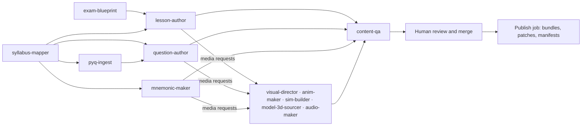

# Smriti content skills

Skills that any coding agent (Claude Code, Codex, OpenCode and others that read Agent Skills) can run to produce Smriti's content and media. **This repo doesn't contain the content itself.** Agents produce it by running these skills, and `content-qa` plus a reviewer check every result.

Each skill is a folder with a `SKILL.md` (front matter with `name` and `description`, then the instructions). To use one, open its `SKILL.md` and follow it. Claude Code loads them automatically through `.claude/skills`, which links to this folder. Other agents can be pointed at `skills/` the same way.

## Read first

| File | What it sets |
|---|---|
| [`_shared/content-format.md`](_shared/content-format.md) | The JSON format every skill writes into `content/` |
| [`_shared/quality-bar.md`](_shared/quality-bar.md) | Completeness, accuracy, teaching, language, safety and licence rules |
| [`../DESIGN.md`](../DESIGN.md) §6–7 | The illustration style, Agnes presets, mascots, plant and motion |
| [`../AGENTS.md`](../AGENTS.md) | Repo-wide rules (no hand-drawn illustrations, no invented facts, no model IDs) |

## The skills

| Skill | Produces | Writes to |
|---|---|---|
| [`syllabus-mapper`](syllabus-mapper/SKILL.md) | Concept graph, exam map, coverage inventory | `content/graph/`, `exam-maps/`, `coverage/` |
| [`exam-blueprint`](exam-blueprint/SKILL.md) | Versioned exam patterns for the mock engine | `content/blueprints/` |
| [`lesson-author`](lesson-author/SKILL.md) | Deep Dive and Quick Revision lessons, cheat sheets, storybooks, role plays, experiments | `content/lessons/`, `extras/` |
| [`question-author`](question-author/SKILL.md) | Practice and mock questions with Feynman-style solutions | `content/questions/` |
| [`pyq-ingest`](pyq-ingest/SKILL.md) | Structured previous-year papers, real weightage | `content/pyq/`, `questions/`, `exam-maps/` |
| [`mnemonic-maker`](mnemonic-maker/SKILL.md) | Acronyms, rhymes, stories, keyword, PAO, major-system, peg and palace hooks | `content/mnemonics/` |
| [`visual-director`](visual-director/SKILL.md) | Every illustration, through Agnes AI | R2 staging + `content/media/requests/` |
| [`anim-maker`](anim-maker/SKILL.md) | Lesson animations, pet and plant Rive files, UI flourishes | R2 staging + requests |
| [`sim-builder`](sim-builder/SKILL.md) | Simulations and virtual labs | `sims/` |
| [`model-3d-sourcer`](model-3d-sourcer/SKILL.md) | Optimised, licence-checked 3D models | R2 staging + requests |
| [`audio-maker`](audio-maker/SKILL.md) | Narration and audio mnemonics through Deepgram | R2 staging + requests |
| [`content-qa`](content-qa/SKILL.md) | Findings report and coverage numbers | `content/coverage/`, the pull request |

## Order of work for a new exam

1. `exam-blueprint` and `syllabus-mapper` first. They need only official documents.
2. `pyq-ingest` next, so question styles and weightage come from real papers.
3. Then chapter by chapter: `lesson-author`, `question-author` and `mnemonic-maker`. They file **media requests** instead of making media.
4. The media skills fulfil the requests.
5. `content-qa` runs on every pull request. A person reviews and merges.
6. A subject is released only when its coverage report is at 100%.

One chapter per pull request keeps reviews manageable.

## Owner-listed external skills

The owner asked for these to be used alongside ours:

| Skill | What it does | How it fits |
|---|---|---|
| [`anatomy`](https://github.com/wheresryan22/anatomy) (MIT) | Explains an idea by building it as a working, interactive isometric figure with many small parts, in SVG, WebGL or 3D | Use it for interactive "how it works" figures (an engine, the heart, a circuit). Package the output like a sim (`sim-builder`: bridge protocol, budgets, both languages). Static illustrations still come from Agnes. |
| [`colorfigures`](https://april-zhu.com/colorfigures) | Figure-making skill named in the brief | This environment couldn't reach the site, so check its scope and licence before first use. Apply the same rule: interactive figures go through `sim-builder` conventions, static illustrations come from Agnes. |

## Environment

| Variable | Needed by |
|---|---|
| `AGNES_AI_API_KEY`, `AGNES_BASE_URL` | `visual-director`, `anim-maker` (art layers), and the LLM steps of any skill that runs through the gateway |
| `DEEPGRAM_API_KEY` | `audio-maker` |
| R2 staging credentials (`R2_*`) | Every media skill |

If a key a skill needs is missing, the skill stops and says which one. It never falls back to drawing or inventing.
